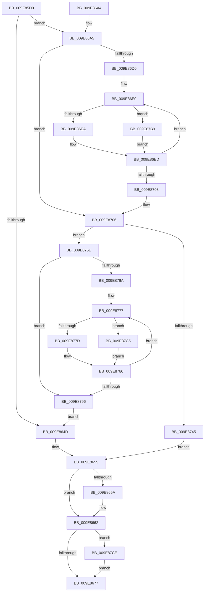

# CmpStartSiloRegistryNamespace

- RVA: `0x009E85D0`–`0x009E87DB` (길이 `523` bytes)
- VA: `0x00000001409E85D0`
- 실행 섹션: `PAGE`
- PDB 이름 있음: `예`; PDB Function 태그: `아니요`
- unwind 정보 RVA: `0x000A4D30`
- 디코드: `131`개 명령, `523/523` bytes 표시
- 미해석 바이트: `0` (있으면 어셈블리에 `.byte`로 보존)

> 이 문서는 커널 이미지의 기계어와 PDB 기호를 분석해 생성했습니다. 4번과 5번은 함수 원형과 자료형을 바이너리 사용 방식에서 추정한 C 해석이며 원본 소스 복구 결과는 아닙니다.

## 1. Dependencies

- 직접 호출 지점: **14**; 고유 호출 대상: **13**
- 직접 호출자로 확인된 함수: **2**
- RIP 상대 이미지 참조: **2**

### Outgoing calls
- `0x009E8612` → [memset](../../text/6C/memset_function_006C6C40.md) (function, `0x006C6C40`)
- `0x009E8639` → [CmpInitializeParseContext](../87/CmpInitializeParseContext_function_008767F0.md) (function, `0x008767F0`)
- `0x009E865D` → [CmSiFreeMemory](../../text/47/CmSiFreeMemory_function_00475D80.md) (function, `0x00475D80`)
- `0x009E8669` → [CmpCleanupParseContext](../87/CmpCleanupParseContext_function_00876910.md) (function, `0x00876910`)
- `0x009E8683` → [_security_check_cookie](../../text/6A/_security_check_cookie_function_006AC640.md) (function, `0x006AC640`)
- `0x009E86A5` → [CmpLockRegistry](../../pagecmrc/BC/CmpLockRegistry_function_00BC9B34.md) (function, `0x00BC9B34`)
- `0x009E86BA` → [CmpStartKcbStackForTopLayerKcb](../84/CmpStartKcbStackForTopLayerKcb_function_00848390.md) (function, `0x00848390`)
- `0x009E86F0` → [CmpLockKcbExclusive](../86/CmpLockKcbExclusive_function_00861EB0.md) (function, `0x00861EB0`)
- `0x009E873A` → [CmpCreateKeyBody](../8C/CmpCreateKeyBody_function_008C3C10.md) (function, `0x008C3C10`)
- `0x009E874A` → [CmpUnlockKcbStack](../84/CmpUnlockKcbStack_function_00848460.md) (function, `0x00848460`)
- `0x009E874F` → [CmpUnlockRegistry](../../pagecmrc/BC/CmpUnlockRegistry_function_00BC9A84.md) (function, `0x00BC9A84`)
- `0x009E8783` → [CmpUnlockKcb](../../pagecmrc/BC/CmpUnlockKcb_function_00BC92C0.md) (function, `0x00BC92C0`)
- `0x009E8796` → [CmpUnlockRegistry](../../pagecmrc/BC/CmpUnlockRegistry_function_00BC9A84.md) (function, `0x00BC9A84`)
- `0x009E87D1` → [ObfDereferenceObject](../../text/2F/ObfDereferenceObject_function_002F9350.md) (function, `0x002F9350`)

### Direct callers
- [CmInitServerSiloState](../7E/CmInitServerSiloState_function_007E5B14.md) at `0x007E5B57`
- [CmInitSiloNamespace](CmInitSiloNamespace_function_009E7DD8.md) at `0x009E7E2E`

### Static image references
- `0x009E85F1` → RVA `0x00E0A740` (`.data`; read)
- `0x009E86AA` → RVA `0x00FD9B68` (`PAGEDATA`; read)

## 2. Other-region calls and transfers

- 다른 실행 섹션으로 향하는 call: **8**
  - `0x009E8612` → [memset](../../text/6C/memset_function_006C6C40.md) (`PAGE` → `.text`)
  - `0x009E865D` → [CmSiFreeMemory](../../text/47/CmSiFreeMemory_function_00475D80.md) (`PAGE` → `.text`)
  - `0x009E8683` → [_security_check_cookie](../../text/6A/_security_check_cookie_function_006AC640.md) (`PAGE` → `.text`)
  - `0x009E86A5` → [CmpLockRegistry](../../pagecmrc/BC/CmpLockRegistry_function_00BC9B34.md) (`PAGE` → `PAGECMRC`)
  - `0x009E874F` → [CmpUnlockRegistry](../../pagecmrc/BC/CmpUnlockRegistry_function_00BC9A84.md) (`PAGE` → `PAGECMRC`)
  - `0x009E8783` → [CmpUnlockKcb](../../pagecmrc/BC/CmpUnlockKcb_function_00BC92C0.md) (`PAGE` → `PAGECMRC`)
  - `0x009E8796` → [CmpUnlockRegistry](../../pagecmrc/BC/CmpUnlockRegistry_function_00BC9A84.md) (`PAGE` → `PAGECMRC`)
  - `0x009E87D1` → [ObfDereferenceObject](../../text/2F/ObfDereferenceObject_function_002F9350.md) (`PAGE` → `.text`)
- 별도 외부 분기/꼬리 이동을 확인하지 못했습니다.

## 3. Assembly (complete function range)

```asm
009E85D0  48 89 5C 24 10                  mov qword ptr [rsp + 0x10], rbx
009E85D5  48 89 74 24 18                  mov qword ptr [rsp + 0x18], rsi
009E85DA  55                              push rbp
009E85DB  57                              push rdi
009E85DC  41 54                           push r12
009E85DE  41 55                           push r13
009E85E0  41 56                           push r14
009E85E2  48 8D AC 24 B0 FE FF FF         lea rbp, [rsp - 0x150]
009E85EA  48 81 EC 50 02 00 00            sub rsp, 0x250
009E85F1  48 8B 05 48 21 42 00            mov rax, qword ptr [rip + 0x422148]
009E85F8  48 33 C4                        xor rax, rsp
009E85FB  48 89 85 40 01 00 00            mov qword ptr [rbp + 0x140], rax
009E8602  4C 8B E1                        mov r12, rcx
009E8605  33 D2                           xor edx, edx
009E8607  48 8D 4C 24 70                  lea rcx, [rsp + 0x70]
009E860C  41 B8 D0 01 00 00               mov r8d, 0x1d0
009E8612  E8 29 E6 CD FF                  call 0x1406c6c40
009E8617  0F 57 C0                        xorps xmm0, xmm0
009E861A  48 8D 4C 24 70                  lea rcx, [rsp + 0x70]
009E861F  83 C8 FF                        or eax, 0xffffffff
009E8622  45 33 F6                        xor r14d, r14d
009E8625  0F 11 44 24 50                  movups xmmword ptr [rsp + 0x50], xmm0
009E862A  66 89 44 24 52                  mov word ptr [rsp + 0x52], ax
009E862F  44 88 74 24 40                  mov byte ptr [rsp + 0x40], r14b
009E8634  0F 11 44 24 60                  movups xmmword ptr [rsp + 0x60], xmm0
009E8639  E8 B2 E1 E8 FF                  call 0x1408767f0
009E863E  41 8B DE                        mov ebx, r14d
009E8641  48 89 5C 24 48                  mov qword ptr [rsp + 0x48], rbx
009E8646  4D 39 74 24 20                  cmp qword ptr [r12 + 0x20], r14
009E864B  74 58                           je 0x1409e86a5
009E864D  48 8B 7C 24 68                  mov rdi, qword ptr [rsp + 0x68]
009E8652  41 8B F6                        mov esi, r14d
009E8655  48 85 FF                        test rdi, rdi
009E8658  74 08                           je 0x1409e8662
009E865A  48 8B CF                        mov rcx, rdi
009E865D  E8 1E D7 A8 FF                  call 0x140475d80
009E8662  33 D2                           xor edx, edx
009E8664  48 8D 4C 24 70                  lea rcx, [rsp + 0x70]
009E8669  E8 A2 E2 E8 FF                  call 0x140876910
009E866E  48 85 DB                        test rbx, rbx
009E8671  0F 85 57 01 00 00               jne 0x1409e87ce
009E8677  8B C6                           mov eax, esi
009E8679  48 8B 8D 40 01 00 00            mov rcx, qword ptr [rbp + 0x140]
009E8680  48 33 CC                        xor rcx, rsp
009E8683  E8 B8 3F CC FF                  call 0x1406ac640
009E8688  4C 8D 9C 24 50 02 00 00         lea r11, [rsp + 0x250]
009E8690  49 8B 5B 38                     mov rbx, qword ptr [r11 + 0x38]
009E8694  49 8B 73 40                     mov rsi, qword ptr [r11 + 0x40]
009E8698  49 8B E3                        mov rsp, r11
009E869B  41 5E                           pop r14
009E869D  41 5D                           pop r13
009E869F  41 5C                           pop r12
009E86A1  5F                              pop rdi
009E86A2  5D                              pop rbp
009E86A3  C3                              ret
009E86A4  CC                              int3
009E86A5  E8 8A 14 1E 00                  call 0x140bc9b34
009E86AA  4C 8B 2D B7 14 5F 00            mov r13, qword ptr [rip + 0x5f14b7]
009E86B1  48 8D 4C 24 50                  lea rcx, [rsp + 0x50]
009E86B6  49 8B 55 08                     mov rdx, qword ptr [r13 + 8]
009E86BA  E8 D1 FC E5 FF                  call 0x140848390
009E86BF  41 0F B7 F6                     movzx esi, r14w
009E86C3  48 8B 7C 24 68                  mov rdi, qword ptr [rsp + 0x68]
009E86C8  66 44 3B 74 24 52               cmp r14w, word ptr [rsp + 0x52]
009E86CE  7F 36                           jg 0x1409e8706
009E86D0  48 8D 44 24 58                  lea rax, [rsp + 0x58]
009E86D5  4C 8B F7                        mov r14, rdi
009E86D8  4C 2B F0                        sub r14, rax
009E86DB  48 8D 5C 24 58                  lea rbx, [rsp + 0x58]
009E86E0  66 83 FE 02                     cmp si, 2
009E86E4  0F 8D CF 00 00 00               jge 0x1409e87b9
009E86EA  48 8B CB                        mov rcx, rbx
009E86ED  48 8B 09                        mov rcx, qword ptr [rcx]
009E86F0  E8 BB 97 E7 FF                  call 0x140861eb0
009E86F5  66 FF C6                        inc si
009E86F8  48 83 C3 08                     add rbx, 8
009E86FC  66 3B 74 24 52                  cmp si, word ptr [rsp + 0x52]
009E8701  7E DD                           jle 0x1409e86e0
009E8703  45 33 F6                        xor r14d, r14d
009E8706  49 8B 4D 08                     mov rcx, qword ptr [r13 + 8]
009E870A  48 8D 44 24 40                  lea rax, [rsp + 0x40]
009E870F  48 89 44 24 38                  mov qword ptr [rsp + 0x38], rax
009E8714  4C 8D 44 24 70                  lea r8, [rsp + 0x70]
009E8719  48 8D 44 24 48                  lea rax, [rsp + 0x48]
009E871E  45 33 C9                        xor r9d, r9d
009E8721  48 89 44 24 30                  mov qword ptr [rsp + 0x30], rax
009E8726  33 D2                           xor edx, edx
009E8728  48 8D 44 24 50                  lea rax, [rsp + 0x50]
009E872D  48 89 44 24 28                  mov qword ptr [rsp + 0x28], rax
009E8732  C7 44 24 20 03 00 00 00         mov dword ptr [rsp + 0x20], 3
009E873A  E8 D1 B4 ED FF                  call 0x1408c3c10
009E873F  8B F0                           mov esi, eax
009E8741  85 C0                           test eax, eax
009E8743  79 19                           jns 0x1409e875e
009E8745  48 8D 4C 24 50                  lea rcx, [rsp + 0x50]
009E874A  E8 11 FD E5 FF                  call 0x140848460
009E874F  E8 30 13 1E 00                  call 0x140bc9a84
009E8754  48 8B 5C 24 48                  mov rbx, qword ptr [rsp + 0x48]
009E8759  E9 F7 FE FF FF                  jmp 0x1409e8655
009E875E  41 0F B7 F6                     movzx esi, r14w
009E8762  66 44 3B 74 24 52               cmp r14w, word ptr [rsp + 0x52]
009E8768  7F 2C                           jg 0x1409e8796
009E876A  48 8D 44 24 58                  lea rax, [rsp + 0x58]
009E876F  48 2B F8                        sub rdi, rax
009E8772  48 8D 5C 24 58                  lea rbx, [rsp + 0x58]
009E8777  66 83 FE 02                     cmp si, 2
009E877B  7D 48                           jge 0x1409e87c5
009E877D  48 8B CB                        mov rcx, rbx
009E8780  48 8B 09                        mov rcx, qword ptr [rcx]
009E8783  E8 38 0B 1E 00                  call 0x140bc92c0
009E8788  66 FF C6                        inc si
009E878B  48 83 C3 08                     add rbx, 8
009E878F  66 3B 74 24 52                  cmp si, word ptr [rsp + 0x52]
009E8794  7E E1                           jle 0x1409e8777
009E8796  E8 E9 12 1E 00                  call 0x140bc9a84
009E879B  48 8B 4C 24 48                  mov rcx, qword ptr [rsp + 0x48]
009E87A0  33 C0                           xor eax, eax
009E87A2  F0 49 0F B1 4C 24 20            lock cmpxchg qword ptr [r12 + 0x20], rcx
009E87A9  48 F7 D8                        neg rax
009E87AC  48 1B DB                        sbb rbx, rbx
009E87AF  48 23 5C 24 48                  and rbx, qword ptr [rsp + 0x48]
009E87B4  E9 94 FE FF FF                  jmp 0x1409e864d
009E87B9  49 8D 4E F0                     lea rcx, [r14 - 0x10]
009E87BD  48 03 CB                        add rcx, rbx
009E87C0  E9 28 FF FF FF                  jmp 0x1409e86ed
009E87C5  48 8D 4F F0                     lea rcx, [rdi - 0x10]
009E87C9  48 03 CB                        add rcx, rbx
009E87CC  EB B2                           jmp 0x1409e8780
009E87CE  48 8B CB                        mov rcx, rbx
009E87D1  E8 7A 0B 91 FF                  call 0x1402f9350
009E87D6  E9 9C FE FF FF                  jmp 0x1409e8677
```

## 4. C-style interpretation (structured pseudocode)

```c
__int64 __fastcall CmpStartSiloRegistryNamespace(__int64 a1, int a2, __int64 a3, int a4)
{
    __int64 result;
    __int64 v_r14;
    __int64 v_rbx;
    __int64 v_rdi;
    __int64 v_rsi;
    __int64 v_rsp;
    unsigned __int64 v_stack_m178;
    unsigned __int64 v_stack_m1E0;
    unsigned __int64 v_stack_m1E8;
    unsigned __int64 v_stack_m1F8;
    unsigned __int16 v_stack_m1FE;
    unsigned __int64 v_stack_m200;
    unsigned __int64 v_stack_m208;
    unsigned __int64 v_stack_m210;
    unsigned __int64 v_stack_m218;
    unsigned __int64 v_stack_m220;
    unsigned __int16 v_stack_m226;
    unsigned __int64 v_stack_m228;
    unsigned __int64 v_stack_m230;
    unsigned __int8 v_stack_m238;
    unsigned __int64 v_stack_m28;
    unsigned __int64 v_stack_m38;
    unsigned __int64 v_stack_p10;
    unsigned __int64 v_stack_p18;

    v_stack_p10 = v_rbx;
    v_stack_p18 = v_rsi;
    v_rsp = (v_rsp) - (592);
    result = (*(unsigned __int64 *)(v_rip + 4333896)) ^ (v_rsp);
    v_stack_m38 = result;
    a2 = 0;
    result = memset(v_stack_m208, a2, 464, a4);
    result = (unsigned int)((result) | (0xFFFFFFFFULL));
    v_r14 = 0;
    v_stack_m228 = v_xmm0;
    v_stack_m226 = (unsigned __int16)(result);
    v_stack_m238 = 0;
    v_stack_m218 = v_xmm0;
    result = CmpInitializeParseContext(v_stack_m208, a2, 464, a4);
    v_stack_m230 = 0;
    if ((*(unsigned __int64 *)(a1 + 32)) == 0) goto loc_009E86A5;
loc_009E864D:
loc_009E8655:
    if (v_stack_m210 != 0) {
        a1 = v_stack_m210;
        result = CmSiFreeMemory(a1, a2, 464, a4);
    }
    a2 = 0;
    result = CmpCleanupParseContext(v_stack_m208, a2, 464, a4);
    if (0 != 0) goto loc_009E87CE;
loc_009E8677:
    a1 = (v_stack_m38) ^ (v_rsp);
    result = _security_check_cookie(a1, a2, 464, a4);
    return result;
loc_009E86A5:
    result = CmpLockRegistry(a1, a2, 464, a4);
    result = CmpStartKcbStackForTopLayerKcb(v_stack_m200, *(unsigned __int64 *)(*(unsigned __int64 *)(v_rip + 6231223) + 8), 464, a4);
    if (0 > v_stack_m1FE) goto loc_009E8706;
    v_r14 = (v_stack_m1E8) - (v_stack_m1F8);
loc_009E86E0:
    if (0 >= 2) goto loc_009E87B9;
loc_009E86ED:
    result = CmpLockKcbExclusive(*(unsigned __int64 *)(v_stack_m1F8), *(unsigned __int64 *)(*(unsigned __int64 *)(v_rip + 6231223) + 8), 464, a4);
    v_rsi = (unsigned __int16)((0) + 1);
    v_rbx = (v_stack_m1F8) + (8);
    if (((unsigned __int16)(v_rsi)) <= v_stack_m1FE) goto loc_009E86E0;
    v_r14 = 0;
loc_009E8706:
    v_stack_m218 = v_stack_m210;
    a4 = 0;
    v_stack_m220 = v_stack_m208;
    a2 = 0;
    v_stack_m228 = v_stack_m200;
    v_stack_m230 = 3;
    result = CmpCreateKeyBody(*(unsigned __int64 *)(*(unsigned __int64 *)(v_rip + 6231223) + 8), a2, v_stack_m1E0, a4);
    if (!sign_flag) goto loc_009E875E;
    result = CmpUnlockKcbStack(v_stack_m200, a2, v_stack_m1E0, a4);
    result = CmpUnlockRegistry(v_stack_m200, a2, v_stack_m1E0, a4);
    goto loc_009E8655;
loc_009E875E:
    if (0 > v_stack_m1FE) goto loc_009E8796;
    v_rdi = (v_stack_m1E8) - (v_stack_m1F8);
loc_009E8777:
    if (0 >= 2) goto loc_009E87C5;
loc_009E8780:
    result = CmpUnlockKcb(*(unsigned __int64 *)(v_stack_m1F8), a2, v_stack_m1E0, a4);
    v_rsi = (unsigned __int16)((0) + 1);
    v_rbx = (v_stack_m1F8) + (8);
    if (((unsigned __int16)(v_rsi)) <= v_stack_m1FE) goto loc_009E8777;
loc_009E8796:
    result = CmpUnlockRegistry(*(unsigned __int64 *)(v_stack_m1F8), a2, v_stack_m1E0, a4);
    result = 0;
    result = -(result);
    v_rbx = (v_rbx) & (v_stack_m208);
    goto loc_009E864D;
loc_009E87B9:
    a1 = (v_r14 - 16) + (v_rbx);
    goto loc_009E86ED;
loc_009E87C5:
    a1 = (v_rdi - 16) + (v_rbx);
    goto loc_009E8780;
loc_009E87CE:
    result = ObfDereferenceObject(v_rbx, a2, v_stack_m1E0, a4);
    goto loc_009E8677;
}
```

## 5. (Beta) C Style

```c
int64_t CmpStartSiloRegistryNamespace(void *Arg1, int32_t Arg2, int64_t Arg3, int32_t Arg4)
{
    uint8_t *arg1 = (uint8_t *)Arg1;

    int64_t result;
    int64_t local_r14;
    int64_t local_rbx;
    int64_t local_rdi;
    int64_t local_rsi;
    int64_t local_rsp;
    uint64_t v_stack_m178;
    uint64_t v_stack_m1E0;
    uint64_t v_stack_m1E8;
    uint64_t v_stack_m1F8;
    uint16_t v_stack_m1FE;
    uint64_t v_stack_m200;
    uint64_t v_stack_m208;
    uint64_t v_stack_m210;
    uint64_t v_stack_m218;
    uint64_t v_stack_m220;
    uint16_t v_stack_m226;
    uint64_t v_stack_m228;
    uint64_t v_stack_m230;
    uint8_t v_stack_m238;
    uint64_t v_stack_m28;
    uint64_t v_stack_m38;
    uint64_t v_stack_p10;
    uint64_t v_stack_p18;

    v_stack_p10 = local_rbx;
    v_stack_p18 = local_rsi;
    local_rsp = (local_rsp) - (592);
    result = (*(uint64_t *)(v_rip + 0x422148)) ^ (local_rsp);
    v_stack_m38 = result;
    Arg2 = 0;
    result = memset(v_stack_m208, Arg2, 464, Arg4);
    result = (uint32_t)((result) | (0xFFFFFFFFULL));
    local_r14 = 0;
    v_stack_m228 = v_xmm0;
    v_stack_m226 = (uint16_t)(result);
    v_stack_m238 = 0;
    v_stack_m218 = v_xmm0;
    result = CmpInitializeParseContext(v_stack_m208, Arg2, 464, Arg4);
    v_stack_m230 = 0;
    if ((*(uint64_t *)(arg1 + 0x20)) == 0) goto loc_009E86A5;
loc_009E864D:
loc_009E8655:
    if (v_stack_m210 != 0) {
        Arg1 = v_stack_m210;
        result = CmSiFreeMemory(Arg1, Arg2, 464, Arg4);
    }
    Arg2 = 0;
    result = CmpCleanupParseContext(v_stack_m208, Arg2, 464, Arg4);
    if (0 != 0) goto loc_009E87CE;
loc_009E8677:
    Arg1 = (v_stack_m38) ^ (local_rsp);
    result = _security_check_cookie(Arg1, Arg2, 464, Arg4);
    return result;
loc_009E86A5:
    result = CmpLockRegistry(Arg1, Arg2, 464, Arg4);
    result = CmpStartKcbStackForTopLayerKcb(v_stack_m200, *(uint64_t *)(*(uint64_t *)(v_rip + 0x5F14B7) + 0x8), 464, Arg4);
    if (0 > v_stack_m1FE) goto loc_009E8706;
    local_r14 = (v_stack_m1E8) - (v_stack_m1F8);
loc_009E86E0:
    if (0 >= 2) goto loc_009E87B9;
loc_009E86ED:
    result = CmpLockKcbExclusive(*(uint64_t *)(v_stack_m1F8), *(uint64_t *)(*(uint64_t *)(v_rip + 0x5F14B7) + 0x8), 464, Arg4);
    local_rsi = (uint16_t)((0) + 1);
    local_rbx = (v_stack_m1F8) + (8);
    if (((uint16_t)(local_rsi)) <= v_stack_m1FE) goto loc_009E86E0;
    local_r14 = 0;
loc_009E8706:
    v_stack_m218 = v_stack_m210;
    Arg4 = 0;
    v_stack_m220 = v_stack_m208;
    Arg2 = 0;
    v_stack_m228 = v_stack_m200;
    v_stack_m230 = 3;
    result = CmpCreateKeyBody(*(uint64_t *)(*(uint64_t *)(v_rip + 0x5F14B7) + 0x8), Arg2, v_stack_m1E0, Arg4);
    if (!sign_flag) goto loc_009E875E;
    result = CmpUnlockKcbStack(v_stack_m200, Arg2, v_stack_m1E0, Arg4);
    result = CmpUnlockRegistry(v_stack_m200, Arg2, v_stack_m1E0, Arg4);
    goto loc_009E8655;
loc_009E875E:
    if (0 > v_stack_m1FE) goto loc_009E8796;
    local_rdi = (v_stack_m1E8) - (v_stack_m1F8);
loc_009E8777:
    if (0 >= 2) goto loc_009E87C5;
loc_009E8780:
    result = CmpUnlockKcb(*(uint64_t *)(v_stack_m1F8), Arg2, v_stack_m1E0, Arg4);
    local_rsi = (uint16_t)((0) + 1);
    local_rbx = (v_stack_m1F8) + (8);
    if (((uint16_t)(local_rsi)) <= v_stack_m1FE) goto loc_009E8777;
loc_009E8796:
    result = CmpUnlockRegistry(*(uint64_t *)(v_stack_m1F8), Arg2, v_stack_m1E0, Arg4);
    result = 0;
    result = -(result);
    local_rbx = (local_rbx) & (v_stack_m208);
    goto loc_009E864D;
loc_009E87B9:
    Arg1 = (local_r14 - 16) + (local_rbx);
    goto loc_009E86ED;
loc_009E87C5:
    Arg1 = (local_rdi - 16) + (local_rbx);
    goto loc_009E8780;
loc_009E87CE:
    result = ObfDereferenceObject(local_rbx, Arg2, v_stack_m1E0, Arg4);
    goto loc_009E8677;
}
```

### 관측된 메모리 오프셋

구조체 형식이 확인되지 않은 접근은 인자 기준의 오프셋으로만 기록했습니다.

| 기준 인자 | 오프셋 표현 | 폭 (bit) | 접근 |
|---|---:|---:|---|
| `Arg1` | `+ 0x20` | `64` | `R` |

## 6. Execution-region graph

[열기: 2D/3D 그래프와 함수 탐색 컨트롤 패널](../../../control-panel.html?section=page&rva=0x009E85D0&view=graph)

- 2D 그래프는 위에서 아래로 흐르고, 3D 그래프는 빈 공간을 드래그해 회전합니다. Shift+드래그는 이동, 휠은 확대·축소, 함수 노드 선택은 대상 보고서 이동입니다.

### Static fallback


