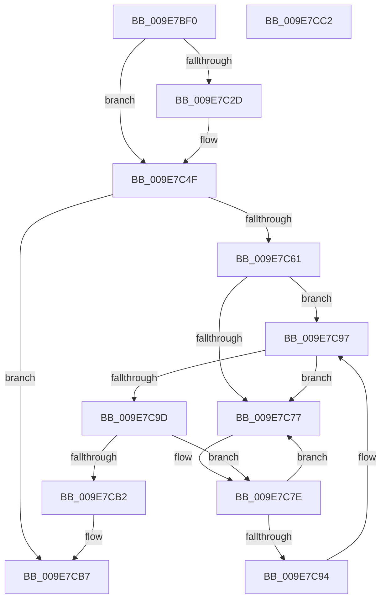

# CmpStopSiloKeyLockTracker

- RVA: `0x009E7BF0`–`0x009E7CC3` (길이 `211` bytes)
- VA: `0x00000001409E7BF0`
- 실행 섹션: `PAGE`
- PDB 이름 있음: `예`; PDB Function 태그: `아니요`
- unwind 정보 RVA: `0x000A4C70`
- 디코드: `61`개 명령, `211/211` bytes 표시
- 미해석 바이트: `0` (있으면 어셈블리에 `.byte`로 보존)

> 이 문서는 커널 이미지의 기계어와 PDB 기호를 분석해 생성했습니다. 4번과 5번은 함수 원형과 자료형을 바이너리 사용 방식에서 추정한 C 해석이며 원본 소스 복구 결과는 아닙니다.

## 1. Dependencies

- 직접 호출 지점: **5**; 고유 호출 대상: **5**
- 직접 호출자로 확인된 함수: **2**
- RIP 상대 이미지 참조: **0**

### Outgoing calls
- `0x009E7C00` → [CmpLockSiloKeyLockTrackerExclusive](../8F/CmpLockSiloKeyLockTrackerExclusive_function_008F9EF8.md) (function, `0x008F9EF8`)
- `0x009E7C52` → [CmpUnlockSiloKeyLockTracker](CmpUnlockSiloKeyLockTracker_function_009E8050.md) (function, `0x009E8050`)
- `0x009E7C61` → [CmpLockRegistry](../../pagecmrc/BC/CmpLockRegistry_function_00BC9B34.md) (function, `0x00BC9B34`)
- `0x009E7C81` → [CmpFreeSiloKeyLockEntry](../7E/CmpFreeSiloKeyLockEntry_function_007EDD38.md) (function, `0x007EDD38`)
- `0x009E7CB2` → [CmpUnlockRegistry](../../pagecmrc/BC/CmpUnlockRegistry_function_00BC9A84.md) (function, `0x00BC9A84`)

### Direct callers
- [PspDeleteExternalServerSiloState](../77/PspDeleteExternalServerSiloState_function_0077FB88.md) at `0x0077FBFB`
- [CmpFreeSiloContextCallback](CmpFreeSiloContextCallback_function_009E7BA0.md) at `0x009E7BC5`

### Static image references
- 디코드된 RIP-relative 메모리 참조가 없습니다.

## 2. Other-region calls and transfers

- 다른 실행 섹션으로 향하는 call: **2**
  - `0x009E7C61` → [CmpLockRegistry](../../pagecmrc/BC/CmpLockRegistry_function_00BC9B34.md) (`PAGE` → `PAGECMRC`)
  - `0x009E7CB2` → [CmpUnlockRegistry](../../pagecmrc/BC/CmpUnlockRegistry_function_00BC9A84.md) (`PAGE` → `PAGECMRC`)
- 별도 외부 분기/꼬리 이동을 확인하지 못했습니다.

## 3. Assembly (complete function range)

```asm
009E7BF0  48 89 5C 24 08                  mov qword ptr [rsp + 8], rbx
009E7BF5  55                              push rbp
009E7BF6  48 8B EC                        mov rbp, rsp
009E7BF9  48 83 EC 30                     sub rsp, 0x30
009E7BFD  48 8B D9                        mov rbx, rcx
009E7C00  E8 F3 22 F1 FF                  call 0x1408f9ef8
009E7C05  8B 43 08                        mov eax, dword ptr [rbx + 8]
009E7C08  48 8D 4B 10                     lea rcx, [rbx + 0x10]
009E7C0C  83 E0 FE                        and eax, 0xfffffffe
009E7C0F  83 C8 02                        or eax, 2
009E7C12  89 43 08                        mov dword ptr [rbx + 8], eax
009E7C15  48 8D 45 F0                     lea rax, [rbp - 0x10]
009E7C19  48 8B 11                        mov rdx, qword ptr [rcx]
009E7C1C  48 89 45 F8                     mov qword ptr [rbp - 8], rax
009E7C20  48 8D 45 F0                     lea rax, [rbp - 0x10]
009E7C24  48 89 45 F0                     mov qword ptr [rbp - 0x10], rax
009E7C28  48 3B D1                        cmp rdx, rcx
009E7C2B  74 22                           je 0x1409e7c4f
009E7C2D  48 8B 41 08                     mov rax, qword ptr [rcx + 8]
009E7C31  4C 8D 45 F0                     lea r8, [rbp - 0x10]
009E7C35  48 89 55 F0                     mov qword ptr [rbp - 0x10], rdx
009E7C39  48 89 45 F8                     mov qword ptr [rbp - 8], rax
009E7C3D  4C 89 42 08                     mov qword ptr [rdx + 8], r8
009E7C41  48 8D 55 F0                     lea rdx, [rbp - 0x10]
009E7C45  48 89 10                        mov qword ptr [rax], rdx
009E7C48  48 89 49 08                     mov qword ptr [rcx + 8], rcx
009E7C4C  48 89 09                        mov qword ptr [rcx], rcx
009E7C4F  48 8B CB                        mov rcx, rbx
009E7C52  E8 F9 03 00 00                  call 0x1409e8050
009E7C57  48 8D 45 F0                     lea rax, [rbp - 0x10]
009E7C5B  48 39 45 F0                     cmp qword ptr [rbp - 0x10], rax
009E7C5F  74 56                           je 0x1409e7cb7
009E7C61  E8 CE 1E 1E 00                  call 0x140bc9b34
009E7C66  48 8B 45 F0                     mov rax, qword ptr [rbp - 0x10]
009E7C6A  48 8D 55 F0                     lea rdx, [rbp - 0x10]
009E7C6E  48 8B 08                        mov rcx, qword ptr [rax]
009E7C71  48 39 50 08                     cmp qword ptr [rax + 8], rdx
009E7C75  74 20                           je 0x1409e7c97
009E7C77  B9 03 00 00 00                  mov ecx, 3
009E7C7C  CD 29                           int 0x29
009E7C7E  48 8B C8                        mov rcx, rax
009E7C81  E8 B2 60 E0 FF                  call 0x1407edd38
009E7C86  48 8B 45 F0                     mov rax, qword ptr [rbp - 0x10]
009E7C8A  48 8D 4D F0                     lea rcx, [rbp - 0x10]
009E7C8E  48 39 48 08                     cmp qword ptr [rax + 8], rcx
009E7C92  75 E3                           jne 0x1409e7c77
009E7C94  48 8B 08                        mov rcx, qword ptr [rax]
009E7C97  48 39 41 08                     cmp qword ptr [rcx + 8], rax
009E7C9B  75 DA                           jne 0x1409e7c77
009E7C9D  48 89 4D F0                     mov qword ptr [rbp - 0x10], rcx
009E7CA1  48 8D 55 F0                     lea rdx, [rbp - 0x10]
009E7CA5  48 89 51 08                     mov qword ptr [rcx + 8], rdx
009E7CA9  48 8D 4D F0                     lea rcx, [rbp - 0x10]
009E7CAD  48 3B C1                        cmp rax, rcx
009E7CB0  75 CC                           jne 0x1409e7c7e
009E7CB2  E8 CD 1D 1E 00                  call 0x140bc9a84
009E7CB7  48 8B 5C 24 40                  mov rbx, qword ptr [rsp + 0x40]
009E7CBC  48 83 C4 30                     add rsp, 0x30
009E7CC0  5D                              pop rbp
009E7CC1  C3                              ret
009E7CC2  CC                              int3
```

## 4. C-style interpretation (structured pseudocode)

```c
__int64 __fastcall CmpStopSiloKeyLockTracker(__int64 a1)
{
    __int64 result;
    __int64 v_rsp;
    unsigned __int64 v_stack_m10;
    unsigned __int64 v_stack_m18;
    unsigned __int64 v_stack_p8;

    v_stack_p8 = v_rbx;
    v_rsp = (v_rsp) - (48);
    result = CmpLockSiloKeyLockTrackerExclusive(a1, a2, a3, a4);
    result = (unsigned int)(((unsigned int)(*(unsigned int *)(a1 + 8))) & (0xFFFFFFFEULL));
    result = (unsigned int)((result) | (2));
    *(unsigned int *)(a1 + 8) = (unsigned int)(result);
    v_stack_m10 = v_stack_m18;
    v_stack_m18 = v_stack_m18;
    result = v_stack_m18;
    if ((*(unsigned __int64 *)(a1 + 16)) != (a1 + 16)) {
        result = *(unsigned __int64 *)(a1 + 16 + 8);
        a3 = v_stack_m18;
        v_stack_m18 = *(unsigned __int64 *)(a1 + 16);
        v_stack_m10 = result;
        *(unsigned __int64 *)(*(unsigned __int64 *)(a1 + 16) + 8) = a3;
        a2 = v_stack_m18;
        *(unsigned __int64 *)(result) = a2;
        *(unsigned __int64 *)(a1 + 16 + 8) = a1 + 16;
        *(unsigned __int64 *)(a1 + 16) = a1 + 16;
    }
    result = CmpUnlockSiloKeyLockTracker(a1, a2, a3, a4);
    if (v_stack_m18 == v_stack_m18) goto loc_009E7CB7;
    result = CmpLockRegistry(a1, a2, a3, a4);
    if ((*(unsigned __int64 *)(v_stack_m18 + 8)) == v_stack_m18) goto loc_009E7C97;
loc_009E7C77:
loc_009E7C7E:
    result = CmpFreeSiloKeyLockEntry(v_stack_m18, v_stack_m18, a3, a4);
    if ((*(unsigned __int64 *)(v_stack_m18 + 8)) != v_stack_m18) goto loc_009E7C77;
loc_009E7C97:
    if ((*(unsigned __int64 *)(*(unsigned __int64 *)(v_stack_m18) + 8)) != v_stack_m18) goto loc_009E7C77;
    v_stack_m18 = *(unsigned __int64 *)(v_stack_m18);
    *(unsigned __int64 *)(*(unsigned __int64 *)(v_stack_m18) + 8) = v_stack_m18;
    if (v_stack_m18 != v_stack_m18) goto loc_009E7C7E;
    result = CmpUnlockRegistry(v_stack_m18, v_stack_m18, a3, a4);
loc_009E7CB7:
    v_rsp = (v_rsp) + (48);
    return result;
}
```

## 5. (Beta) C Style

```c
int64_t CmpStopSiloKeyLockTracker(void *Arg1)
{
    uint8_t *arg1 = (uint8_t *)Arg1;

    int64_t result;
    int64_t local_rsp;
    uint64_t v_stack_m10;
    uint64_t v_stack_m18;
    uint64_t v_stack_p8;

    v_stack_p8 = local_rbx;
    local_rsp = (local_rsp) - (48);
    result = CmpLockSiloKeyLockTrackerExclusive(Arg1, a2, a3, a4);
    result = (uint32_t)(((uint32_t)(*(uint32_t *)(arg1 + 0x8))) & (0xFFFFFFFEULL));
    result = (uint32_t)((result) | (2));
    *(uint32_t *)(arg1 + 0x8) = (uint32_t)(result);
    v_stack_m10 = v_stack_m18;
    v_stack_m18 = v_stack_m18;
    result = v_stack_m18;
    if ((*(uint64_t *)(arg1 + 0x10)) != (Arg1 + 16)) {
        result = *(uint64_t *)(arg1 + 0x10 + 0x8);
        a3 = v_stack_m18;
        v_stack_m18 = *(uint64_t *)(arg1 + 0x10);
        v_stack_m10 = result;
        *(uint64_t *)(*(uint64_t *)(arg1 + 0x10) + 0x8) = a3;
        a2 = v_stack_m18;
        *(uint64_t *)(result) = a2;
        *(void **)(arg1 + 0x10 + 0x8) = Arg1 + 16;
        *(void **)(arg1 + 0x10) = Arg1 + 16;
    }
    result = CmpUnlockSiloKeyLockTracker(Arg1, a2, a3, a4);
    if (v_stack_m18 == v_stack_m18) goto loc_009E7CB7;
    result = CmpLockRegistry(Arg1, a2, a3, a4);
    if ((*(uint64_t *)(v_stack_m18 + 0x8)) == v_stack_m18) goto loc_009E7C97;
loc_009E7C77:
loc_009E7C7E:
    result = CmpFreeSiloKeyLockEntry(v_stack_m18, v_stack_m18, a3, a4);
    if ((*(uint64_t *)(v_stack_m18 + 0x8)) != v_stack_m18) goto loc_009E7C77;
loc_009E7C97:
    if ((*(uint64_t *)(*(uint64_t *)(v_stack_m18) + 0x8)) != v_stack_m18) goto loc_009E7C77;
    v_stack_m18 = *(uint64_t *)(v_stack_m18);
    *(uint64_t *)(*(uint64_t *)(v_stack_m18) + 0x8) = v_stack_m18;
    if (v_stack_m18 != v_stack_m18) goto loc_009E7C7E;
    result = CmpUnlockRegistry(v_stack_m18, v_stack_m18, a3, a4);
loc_009E7CB7:
    local_rsp = (local_rsp) + (48);
    return result;
}
```

### 관측된 메모리 오프셋

구조체 형식이 확인되지 않은 접근은 인자 기준의 오프셋으로만 기록했습니다.

| 기준 인자 | 오프셋 표현 | 폭 (bit) | 접근 |
|---|---:|---:|---|
| `Arg1` | `+ 0x0` | `64` | `R` |
| `Arg1` | `+ 0x0` | `64` | `W` |
| `Arg1` | `+ 0x8` | `32` | `R` |
| `Arg1` | `+ 0x8` | `32` | `W` |
| `Arg1` | `+ 0x8` | `64` | `R` |
| `Arg1` | `+ 0x8` | `64` | `W` |
| `Arg1` | `+ 0x10` | `64` | `R` |

## 6. Execution-region graph

[열기: 2D/3D 그래프와 함수 탐색 컨트롤 패널](../../../control-panel.html?section=page&rva=0x009E7BF0&view=graph)

- 2D 그래프는 위에서 아래로 흐르고, 3D 그래프는 빈 공간을 드래그해 회전합니다. Shift+드래그는 이동, 휠은 확대·축소, 함수 노드 선택은 대상 보고서 이동입니다.

### Static fallback


