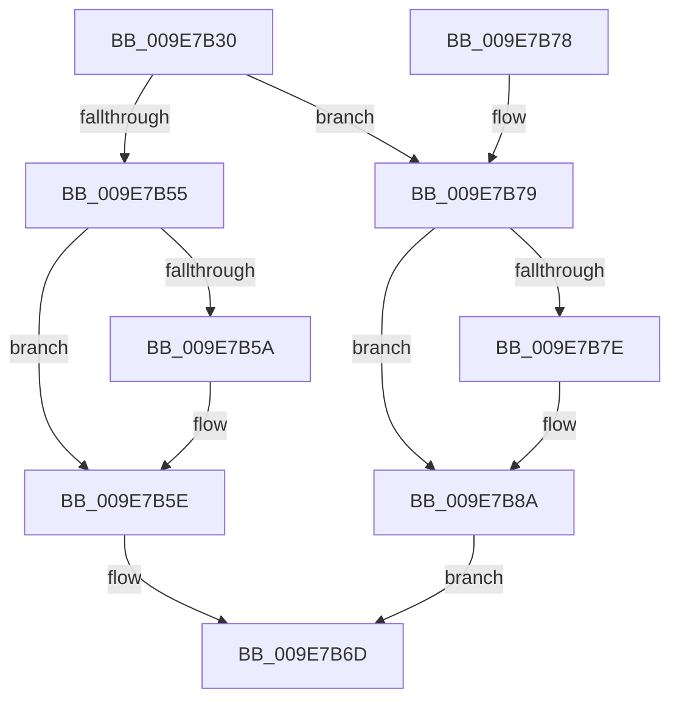

# CmpTryToLockKcbExclusive

- RVA: `0x009E7B30`–`0x009E7B8E` (길이 `94` bytes)
- VA: `0x00000001409E7B30`
- 실행 섹션: `PAGE`
- PDB 이름 있음: `예`; PDB Function 태그: `아니요`
- unwind 정보 RVA: `0x0009F34C`
- 디코드: `28`개 명령, `94/94` bytes 표시
- 미해석 바이트: `0` (있으면 어셈블리에 `.byte`로 보존)

> 이 문서는 커널 이미지의 기계어와 PDB 기호를 분석해 생성했습니다. 4번과 5번은 함수 원형과 자료형을 바이너리 사용 방식에서 추정한 C 해석이며 원본 소스 복구 결과는 아닙니다.

## 1. Dependencies

- 직접 호출 지점: **2**; 고유 호출 대상: **2**
- 직접 호출자로 확인된 함수: **2**
- RIP 상대 이미지 참조: **0**

### Outgoing calls
- `0x009E7B47` → [KeAbPreAcquire](../../text/21/KeAbPreAcquire_function_00210230.md) (function, `0x00210230`)
- `0x009E7B85` → [KeAbPostReleaseEx](../../text/26/KeAbPostReleaseEx_function_00262210.md) (function, `0x00262210`)

### Direct callers
- [CmpCreateKeyControlBlock](../85/CmpCreateKeyControlBlock_function_00851DB0.md) at `0x008524C5`
- [CmpCreateRegistryRoot](../../init/C5/CmpCreateRegistryRoot_function_00C57880.md) at `0x00C579D4`

### Static image references
- 디코드된 RIP-relative 메모리 참조가 없습니다.

## 2. Other-region calls and transfers

- 다른 실행 섹션으로 향하는 call: **2**
  - `0x009E7B47` → [KeAbPreAcquire](../../text/21/KeAbPreAcquire_function_00210230.md) (`PAGE` → `.text`)
  - `0x009E7B85` → [KeAbPostReleaseEx](../../text/26/KeAbPostReleaseEx_function_00262210.md) (`PAGE` → `.text`)
- 별도 외부 분기/꼬리 이동을 확인하지 못했습니다.

## 3. Assembly (complete function range)

```asm
009E7B30  48 89 5C 24 08                  mov qword ptr [rsp + 8], rbx
009E7B35  57                              push rdi
009E7B36  48 83 EC 20                     sub rsp, 0x20
009E7B3A  33 D2                           xor edx, edx
009E7B3C  48 8B D9                        mov rbx, rcx
009E7B3F  48 83 C1 30                     add rcx, 0x30
009E7B43  44 8D 42 01                     lea r8d, [rdx + 1]
009E7B47  E8 E4 86 82 FF                  call 0x140210230
009E7B4C  F0 48 0F BA 6B 30 00            lock bts qword ptr [rbx + 0x30], 0
009E7B53  72 24                           jb 0x1409e7b79
009E7B55  48 85 C0                        test rax, rax
009E7B58  74 04                           je 0x1409e7b5e
009E7B5A  C6 40 0A 01                     mov byte ptr [rax + 0xa], 1
009E7B5E  65 48 8B 0C 25 88 01 00 00      mov rcx, qword ptr gs:[0x188]
009E7B67  B0 01                           mov al, 1
009E7B69  48 89 4B 38                     mov qword ptr [rbx + 0x38], rcx
009E7B6D  48 8B 5C 24 30                  mov rbx, qword ptr [rsp + 0x30]
009E7B72  48 83 C4 20                     add rsp, 0x20
009E7B76  5F                              pop rdi
009E7B77  C3                              ret
009E7B78  CC                              int3
009E7B79  48 85 C0                        test rax, rax
009E7B7C  74 0C                           je 0x1409e7b8a
009E7B7E  48 8B D0                        mov rdx, rax
009E7B81  48 8D 4B 30                     lea rcx, [rbx + 0x30]
009E7B85  E8 86 A6 87 FF                  call 0x140262210
009E7B8A  32 C0                           xor al, al
009E7B8C  EB DF                           jmp 0x1409e7b6d
```

## 4. C-style interpretation (structured pseudocode)

```c
__int64 __fastcall CmpTryToLockKcbExclusive(__int64 a1, int a2)
{
    __int64 result;
    __int64 v_rsp;
    unsigned __int64 v_stack_p8;

    v_stack_p8 = v_rbx;
    v_rsp = (v_rsp) - (32);
    a2 = 0;
    a1 = (a1) + (48);
    result = KeAbPreAcquire(a1, a2, a2 + 1, a4);
    if (condition_is_below) goto loc_009E7B79;
    if (result != 0) {
        *(unsigned __int8 *)(result + 10) = 1;
    }
    *(unsigned __int64 *)(a1 + 56) = *(unsigned __int64 *)(gs_base + (0 + 392));
loc_009E7B6D:
    v_rsp = (v_rsp) + (32);
    return 1;
loc_009E7B79:
    result = 1;
    if (1 != 0) {
        a2 = 1;
        a1 = v_stack_p8 + 48;
        result = KeAbPostReleaseEx(a1, a2, a2 + 1, a4);
    }
    result = 0;
    goto loc_009E7B6D;
}
```

## 5. (Beta) C Style

```c
int64_t CmpTryToLockKcbExclusive(void *Arg1, int32_t Arg2)
{
    uint8_t *arg1 = (uint8_t *)Arg1;

    int64_t result;
    int64_t local_rsp;
    uint64_t v_stack_p8;

    v_stack_p8 = local_rbx;
    local_rsp = (local_rsp) - (32);
    Arg2 = 0;
    Arg1 = (Arg1) + (48);
    result = KeAbPreAcquire(Arg1, Arg2, Arg2 + 1, a4);
    if (condition_is_below) goto loc_009E7B79;
    if (result != 0) {
        *(uint8_t *)(result + 0xA) = 1;
    }
    *(uint64_t *)(arg1 + 0x38) = *(uint64_t *)(gs_base + (0 + 0x188));
loc_009E7B6D:
    local_rsp = (local_rsp) + (32);
    return 1;
loc_009E7B79:
    result = 1;
    if (1 != 0) {
        Arg2 = 1;
        Arg1 = v_stack_p8 + 48;
        result = KeAbPostReleaseEx(Arg1, Arg2, Arg2 + 1, a4);
    }
    result = 0;
    goto loc_009E7B6D;
}
```

### 관측된 메모리 오프셋

구조체 형식이 확인되지 않은 접근은 인자 기준의 오프셋으로만 기록했습니다.

| 기준 인자 | 오프셋 표현 | 폭 (bit) | 접근 |
|---|---:|---:|---|
| `Arg1` | `+ 0x30` | `64` | `R` |
| `Arg1` | `+ 0x30` | `64` | `R/W` |
| `Arg1` | `+ 0x38` | `64` | `W` |

## 6. Execution-region graph

[열기: 2D/3D 그래프와 함수 탐색 컨트롤 패널](../../../control-panel.html?section=page&rva=0x009E7B30&view=graph)

- 2D 그래프는 위에서 아래로 흐르고, 3D 그래프는 빈 공간을 드래그해 회전합니다. Shift+드래그는 이동, 휠은 확대·축소, 함수 노드 선택은 대상 보고서 이동입니다.

### Static fallback


