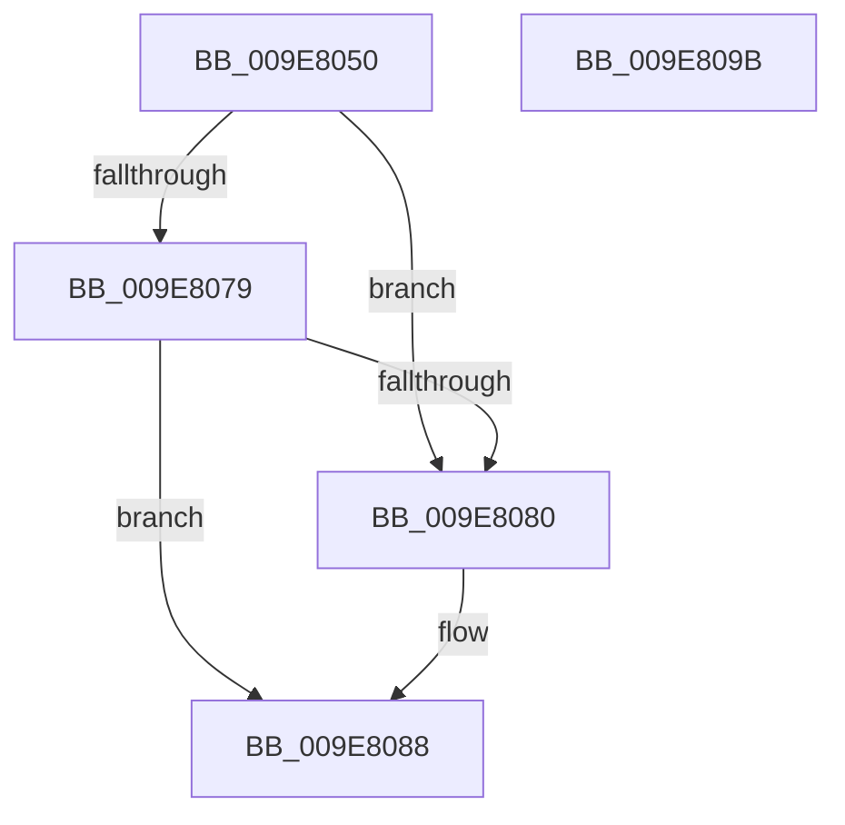

# CmpUnlockSiloKeyLockTracker

- RVA: `0x009E8050`–`0x009E809C` (길이 `76` bytes)
- VA: `0x00000001409E8050`
- 실행 섹션: `PAGE`
- PDB 이름 있음: `예`; PDB Function 태그: `아니요`
- unwind 정보 RVA: `0x0005CF00`
- 디코드: `24`개 명령, `76/76` bytes 표시
- 미해석 바이트: `0` (있으면 어셈블리에 `.byte`로 보존)

> 이 문서는 커널 이미지의 기계어와 PDB 기호를 분석해 생성했습니다. 4번과 5번은 함수 원형과 자료형을 바이너리 사용 방식에서 추정한 C 해석이며 원본 소스 복구 결과는 아닙니다.

## 1. Dependencies

- 직접 호출 지점: **3**; 고유 호출 대상: **3**
- 직접 호출자로 확인된 함수: **4**
- RIP 상대 이미지 참조: **0**

### Outgoing calls
- `0x009E8083` → [ExfReleasePushLock](../../text/26/ExfReleasePushLock_function_002638D0.md) (function, `0x002638D0`)
- `0x009E808B` → [KeAbPostRelease](../../text/2E/KeAbPostRelease_function_002E1600.md) (function, `0x002E1600`)
- `0x009E8090` → [KeLeaveCriticalRegion](../../text/25/KeLeaveCriticalRegion_function_0025D8B0.md) (function, `0x0025D8B0`)

### Direct callers
- [CmInitServerSiloState](../7E/CmInitServerSiloState_function_007E5B14.md) at `0x007E5B72`
- [CmpStopSiloKeyLockTracker](CmpStopSiloKeyLockTracker_function_009E7BF0.md) at `0x009E7C52`
- [CmLockKeyForWrite](CmLockKeyForWrite_function_009E7EE8.md) at `0x009E7FC3`
- [CmLockKeyForWrite](CmLockKeyForWrite_function_009E7EE8.md) at `0x009E7FDB`
- [sub_00B3073E](../B3/Unknown_function_00B3073E.md) at `0x00B30796`

### Static image references
- 디코드된 RIP-relative 메모리 참조가 없습니다.

## 2. Other-region calls and transfers

- 다른 실행 섹션으로 향하는 call: **3**
  - `0x009E8083` → [ExfReleasePushLock](../../text/26/ExfReleasePushLock_function_002638D0.md) (`PAGE` → `.text`)
  - `0x009E808B` → [KeAbPostRelease](../../text/2E/KeAbPostRelease_function_002E1600.md) (`PAGE` → `.text`)
  - `0x009E8090` → [KeLeaveCriticalRegion](../../text/25/KeLeaveCriticalRegion_function_0025D8B0.md) (`PAGE` → `.text`)
- 별도 외부 분기/꼬리 이동을 확인하지 못했습니다.

## 3. Assembly (complete function range)

```asm
009E8050  40 53                           push rbx
009E8052  48 83 EC 20                     sub rsp, 0x20
009E8056  48 8B D9                        mov rbx, rcx
009E8059  0F 0D 09                        prefetchw byte ptr [rcx]
009E805C  48 8B 01                        mov rax, qword ptr [rcx]
009E805F  45 33 C0                        xor r8d, r8d
009E8062  48 8B D0                        mov rdx, rax
009E8065  48 83 E2 F0                     and rdx, 0xfffffffffffffff0
009E8069  48 83 FA 10                     cmp rdx, 0x10
009E806D  48 8D 48 F0                     lea rcx, [rax - 0x10]
009E8071  49 0F 46 C8                     cmovbe rcx, r8
009E8075  A8 02                           test al, 2
009E8077  75 07                           jne 0x1409e8080
009E8079  F0 48 0F B1 0B                  lock cmpxchg qword ptr [rbx], rcx
009E807E  74 08                           je 0x1409e8088
009E8080  48 8B CB                        mov rcx, rbx
009E8083  E8 48 B8 87 FF                  call 0x1402638d0
009E8088  48 8B CB                        mov rcx, rbx
009E808B  E8 70 95 8F FF                  call 0x1402e1600
009E8090  E8 1B 58 87 FF                  call 0x14025d8b0
009E8095  48 83 C4 20                     add rsp, 0x20
009E8099  5B                              pop rbx
009E809A  C3                              ret
009E809B  CC                              int3
```

## 4. C-style interpretation (structured pseudocode)

```c
__int64 __fastcall CmpUnlockSiloKeyLockTracker(__int64 a1, __int64 a2, int a3)
{
    __int64 result;
    __int64 v_rsp;

    v_rsp = (v_rsp) - (32);
    a3 = 0;
    a2 = (*(unsigned __int64 *)(a1)) & (-16);
    a1 = *(unsigned __int64 *)(a1) - 16;
    if (a2 <= 16) { a1 = 0; }
    if ((((unsigned __int8)(*(unsigned __int64 *)(a1))) & (2)) != 0) goto loc_009E8080;
    result = *(unsigned __int64 *)(a1);
    if ((((unsigned __int8)(*(unsigned __int64 *)(a1))) & (2)) != 0) {
        a1 = a1;
        result = ExfReleasePushLock(a1, a2, a3, a4);
    }
    result = KeAbPostRelease(a1, a2, a3, a4);
    result = KeLeaveCriticalRegion(a1, a2, a3, a4);
    v_rsp = (v_rsp) + (32);
    return result;
}
```

## 5. (Beta) C Style

```c
int64_t CmpUnlockSiloKeyLockTracker(void *Arg1, int64_t Arg2, int32_t Arg3)
{
    uint8_t *arg1 = (uint8_t *)Arg1;

    int64_t result;
    int64_t local_rsp;

    local_rsp = (local_rsp) - (32);
    Arg3 = 0;
    Arg2 = (*(uint64_t *)(arg1)) & (-16);
    Arg1 = *(uint64_t *)(arg1) - 16;
    if (Arg2 <= 16) { Arg1 = 0; }
    if ((((uint8_t)(*(uint64_t *)(arg1))) & (2)) != 0) goto loc_009E8080;
    result = *(uint64_t *)(arg1);
    if ((((uint8_t)(*(uint64_t *)(arg1))) & (2)) != 0) {
        Arg1 = Arg1;
        result = ExfReleasePushLock(Arg1, Arg2, Arg3, a4);
    }
    result = KeAbPostRelease(Arg1, Arg2, Arg3, a4);
    result = KeLeaveCriticalRegion(Arg1, Arg2, Arg3, a4);
    local_rsp = (local_rsp) + (32);
    return result;
}
```

### 관측된 메모리 오프셋

구조체 형식이 확인되지 않은 접근은 인자 기준의 오프셋으로만 기록했습니다.

| 기준 인자 | 오프셋 표현 | 폭 (bit) | 접근 |
|---|---:|---:|---|
| `Arg1` | `+ 0x0` | `8` | `R` |
| `Arg1` | `+ 0x0` | `64` | `R` |

## 6. Execution-region graph

[열기: 2D/3D 그래프와 함수 탐색 컨트롤 패널](../../../control-panel.html?section=page&rva=0x009E8050&view=graph)

- 2D 그래프는 위에서 아래로 흐르고, 3D 그래프는 빈 공간을 드래그해 회전합니다. Shift+드래그는 이동, 휠은 확대·축소, 함수 노드 선택은 대상 보고서 이동입니다.

### Static fallback


