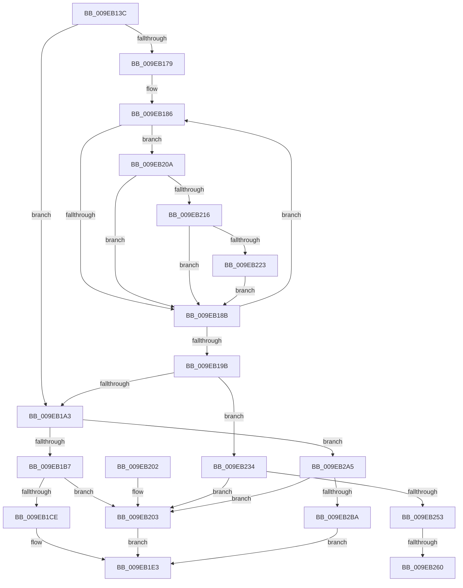

# EtwpBuildNotificationPacket

- RVA: `0x009EB13C`–`0x009EB2C9` (길이 `397` bytes)
- VA: `0x00000001409EB13C`
- 실행 섹션: `PAGE`
- PDB 이름 있음: `예`; PDB Function 태그: `예`
- unwind 정보 RVA: `0x000A54D0`
- 디코드: `110`개 명령, `397/397` bytes 표시
- 미해석 바이트: `0` (있으면 어셈블리에 `.byte`로 보존)

> 이 문서는 커널 이미지의 기계어와 PDB 기호를 분석해 생성했습니다. 4번과 5번은 함수 원형과 자료형을 바이너리 사용 방식에서 추정한 C 해석이며 원본 소스 복구 결과는 아닙니다.

## 1. Dependencies

- 직접 호출 지점: **4**; 고유 호출 대상: **2**
- 직접 호출자로 확인된 함수: **3**
- RIP 상대 이미지 참조: **0**

### Outgoing calls
- `0x009EB1C1` → [ExAllocatePool2](../../poolcode/B8/ExAllocatePool2_function_00B820F0.md) (function, `0x00B820F0`)
- `0x009EB1D7` → [memcpy](../../text/6C/memcpy_function_006C6840.md) (function, `0x006C6840`)
- `0x009EB249` → [ExAllocatePool2](../../poolcode/B8/ExAllocatePool2_function_00B820F0.md) (function, `0x00B820F0`)
- `0x009EB2AC` → [ExAllocatePool2](../../poolcode/B8/ExAllocatePool2_function_00B820F0.md) (function, `0x00B820F0`)

### Direct callers
- [SendCaptureStateNotificationsWorker](../7B/SendCaptureStateNotificationsWorker_function_007BCF30.md) at `0x007BD163`
- [EtwpNotifyDisallowedGuidChange](EtwpNotifyDisallowedGuidChange_function_009EAD14.md) at `0x009EADCA`
- [EtwpEnableGuid](../A5/EtwpEnableGuid_function_00A5CD28.md) at `0x00A5D2B8`

### Static image references
- 디코드된 RIP-relative 메모리 참조가 없습니다.

## 2. Other-region calls and transfers

- 다른 실행 섹션으로 향하는 call: **4**
  - `0x009EB1C1` → [ExAllocatePool2](../../poolcode/B8/ExAllocatePool2_function_00B820F0.md) (`PAGE` → `POOLCODE`)
  - `0x009EB1D7` → [memcpy](../../text/6C/memcpy_function_006C6840.md) (`PAGE` → `.text`)
  - `0x009EB249` → [ExAllocatePool2](../../poolcode/B8/ExAllocatePool2_function_00B820F0.md) (`PAGE` → `POOLCODE`)
  - `0x009EB2AC` → [ExAllocatePool2](../../poolcode/B8/ExAllocatePool2_function_00B820F0.md) (`PAGE` → `POOLCODE`)
- call이 아닌 외부 분기/꼬리 이동: **2**
  - `0x009EB25A` → [sub_00B309B4](../B3/Unknown_function_00B309B4.md) (`tail-transfer`)
  - `0x009EB2A0` → [sub_00B309B4](../B3/Unknown_function_00B309B4.md) (`tail-transfer`)

## 3. Assembly (complete function range)

```asm
009EB13C  48 89 5C 24 08                  mov qword ptr [rsp + 8], rbx
009EB141  48 89 6C 24 10                  mov qword ptr [rsp + 0x10], rbp
009EB146  48 89 74 24 18                  mov qword ptr [rsp + 0x18], rsi
009EB14B  57                              push rdi
009EB14C  41 54                           push r12
009EB14E  41 55                           push r13
009EB150  41 56                           push r14
009EB152  41 57                           push r15
009EB154  48 83 EC 20                     sub rsp, 0x20
009EB158  4C 8B 91 80 02 00 00            mov r10, qword ptr [rcx + 0x280]
009EB15F  33 DB                           xor ebx, ebx
009EB161  45 0F B7 E0                     movzx r12d, r8w
009EB165  4D 8B F1                        mov r14, r9
009EB168  48 8B FA                        mov rdi, rdx
009EB16B  48 8B E9                        mov rbp, rcx
009EB16E  8B F3                           mov esi, ebx
009EB170  44 8D 6B 01                     lea r13d, [rbx + 1]
009EB174  4D 85 D2                        test r10, r10
009EB177  74 2A                           je 0x1409eb1a3
009EB179  8B D3                           mov edx, ebx
009EB17B  4C 8D 89 80 00 00 00            lea r9, [rcx + 0x80]
009EB182  49 83 C2 58                     add r10, 0x58
009EB186  41 39 19                        cmp dword ptr [r9], ebx
009EB189  75 7F                           jne 0x1409eb20a
009EB18B  41 03 D5                        add edx, r13d
009EB18E  49 83 C1 20                     add r9, 0x20
009EB192  49 83 C2 68                     add r10, 0x68
009EB196  83 FA 10                        cmp edx, 0x10
009EB199  72 EB                           jb 0x1409eb186
009EB19B  85 F6                           test esi, esi
009EB19D  0F 85 91 00 00 00               jne 0x1409eb234
009EB1A3  41 B8 45 74 77 44               mov r8d, 0x44777445
009EB1A9  B9 00 01 00 00                  mov ecx, 0x100
009EB1AE  48 85 FF                        test rdi, rdi
009EB1B1  0F 84 EE 00 00 00               je 0x1409eb2a5
009EB1B7  8B 47 04                        mov eax, dword ptr [rdi + 4]
009EB1BA  8B D0                           mov edx, eax
009EB1BC  49 89 1E                        mov qword ptr [r14], rbx
009EB1BF  8B E8                           mov ebp, eax
009EB1C1  E8 2A 6F 19 00                  call 0x140b820f0
009EB1C6  48 8B F0                        mov rsi, rax
009EB1C9  48 85 C0                        test rax, rax
009EB1CC  74 35                           je 0x1409eb203
009EB1CE  44 8B C5                        mov r8d, ebp
009EB1D1  48 8B D7                        mov rdx, rdi
009EB1D4  48 8B C8                        mov rcx, rax
009EB1D7  E8 64 B6 CD FF                  call 0x1406c6840
009EB1DC  44 89 6E 08                     mov dword ptr [rsi + 8], r13d
009EB1E0  49 89 36                        mov qword ptr [r14], rsi
009EB1E3  48 8B 6C 24 58                  mov rbp, qword ptr [rsp + 0x58]
009EB1E8  8B C3                           mov eax, ebx
009EB1EA  48 8B 5C 24 50                  mov rbx, qword ptr [rsp + 0x50]
009EB1EF  48 8B 74 24 60                  mov rsi, qword ptr [rsp + 0x60]
009EB1F4  48 83 C4 20                     add rsp, 0x20
009EB1F8  41 5F                           pop r15
009EB1FA  41 5E                           pop r14
009EB1FC  41 5D                           pop r13
009EB1FE  41 5C                           pop r12
009EB200  5F                              pop rdi
009EB201  C3                              ret
009EB202  CC                              int3
009EB203  BB 17 00 00 C0                  mov ebx, 0xc0000017
009EB208  EB D9                           jmp 0x1409eb1e3
009EB20A  4D 8B 02                        mov r8, qword ptr [r10]
009EB20D  4D 85 C0                        test r8, r8
009EB210  0F 84 75 FF FF FF               je 0x1409eb18b
009EB216  0F B6 CA                        movzx ecx, dl
009EB219  41 0F A3 CC                     bt r12d, ecx
009EB21D  0F 83 68 FF FF FF               jae 0x1409eb18b
009EB223  41 8B 40 10                     mov eax, dword ptr [r8 + 0x10]
009EB227  83 C0 07                        add eax, 7
009EB22A  83 E0 F8                        and eax, 0xfffffff8
009EB22D  03 F0                           add esi, eax
009EB22F  E9 57 FF FF FF                  jmp 0x1409eb18b
009EB234  44 8D BE 88 00 00 00            lea r15d, [rsi + 0x88]
009EB23B  B9 00 01 00 00                  mov ecx, 0x100
009EB240  41 8B D7                        mov edx, r15d
009EB243  41 B8 45 74 77 44               mov r8d, 0x44777445
009EB249  E8 A2 6E 19 00                  call 0x140b820f0
009EB24E  48 85 C0                        test rax, rax
009EB251  74 B0                           je 0x1409eb203
009EB253  44 89 68 08                     mov dword ptr [rax + 8], r13d
009EB257  48 85 FF                        test rdi, rdi
009EB25A  0F 84 54 57 14 00               je 0x140b309b4
009EB260  0F 10 07                        movups xmm0, xmmword ptr [rdi]
009EB263  0F 11 00                        movups xmmword ptr [rax], xmm0
009EB266  0F 10 4F 10                     movups xmm1, xmmword ptr [rdi + 0x10]
009EB26A  0F 11 48 10                     movups xmmword ptr [rax + 0x10], xmm1
009EB26E  0F 10 47 20                     movups xmm0, xmmword ptr [rdi + 0x20]
009EB272  0F 11 40 20                     movups xmmword ptr [rax + 0x20], xmm0
009EB276  0F 10 4F 30                     movups xmm1, xmmword ptr [rdi + 0x30]
009EB27A  0F 11 48 30                     movups xmmword ptr [rax + 0x30], xmm1
009EB27E  0F 10 47 40                     movups xmm0, xmmword ptr [rdi + 0x40]
009EB282  0F 11 40 40                     movups xmmword ptr [rax + 0x40], xmm0
009EB286  0F 10 4F 50                     movups xmm1, xmmword ptr [rdi + 0x50]
009EB28A  0F 11 48 50                     movups xmmword ptr [rax + 0x50], xmm1
009EB28E  0F 10 47 60                     movups xmm0, xmmword ptr [rdi + 0x60]
009EB292  0F 11 40 60                     movups xmmword ptr [rax + 0x60], xmm0
009EB296  F2 0F 10 4F 70                  movsd xmm1, qword ptr [rdi + 0x70]
009EB29B  F2 0F 11 48 70                  movsd qword ptr [rax + 0x70], xmm1
009EB2A0  E9 0F 57 14 00                  jmp 0x140b309b4
009EB2A5  BF 78 00 00 00                  mov edi, 0x78
009EB2AA  8B D7                           mov edx, edi
009EB2AC  E8 3F 6E 19 00                  call 0x140b820f0
009EB2B1  48 85 C0                        test rax, rax
009EB2B4  0F 84 49 FF FF FF               je 0x1409eb203
009EB2BA  44 89 68 08                     mov dword ptr [rax + 8], r13d
009EB2BE  89 78 04                        mov dword ptr [rax + 4], edi
009EB2C1  49 89 06                        mov qword ptr [r14], rax
009EB2C4  E9 1A FF FF FF                  jmp 0x1409eb1e3
```

## 4. C-style interpretation (structured pseudocode)

```c
__int64 __fastcall EtwpBuildNotificationPacket(__int64 a1, __int64 a2, unsigned __int16 a3, __int64 a4)
{
    __int64 result;
    __int64 v_r10;
    __int64 v_rbx;
    __int64 v_rsi;
    __int64 v_rsp;
    unsigned __int64 v_stack_p10;
    unsigned __int64 v_stack_p18;
    unsigned __int64 v_stack_p8;

    v_stack_p8 = v_rbx;
    v_stack_p10 = v_rbp;
    v_stack_p18 = v_rsi;
    v_rsp = (v_rsp) - (32);
    v_rbx = 0;
    if (*(unsigned __int64 *)(a1 + 640) == 0) goto loc_009EB1A3;
    v_r10 = (*(unsigned __int64 *)(a1 + 640)) + (88);
loc_009EB186:
    if ((*(unsigned int *)(a1 + 128)) != 0) goto loc_009EB20A;
loc_009EB18B:
    a2 = (unsigned int)((0) + ((unsigned int)(v_rbx + 1)));
    a4 = (a1 + 128) + (32);
    v_r10 = (v_r10) + (104);
    if (((unsigned int)(a2)) < 16) goto loc_009EB186;
    if (0 != 0) goto loc_009EB234;
loc_009EB1A3:
    if (a2 == 0) goto loc_009EB2A5;
    *(unsigned __int64 *)(a4) = 0;
    result = ExAllocatePool2(256, (unsigned int)((unsigned int)((unsigned int)(*(unsigned int *)(a2 + 4)))), (unsigned int)(0x44777445ULL), a4);
    if (result == 0) goto loc_009EB203;
    result = memcpy(result, a2, (unsigned int)((unsigned int)((unsigned int)((unsigned int)((unsigned int)(*(unsigned int *)(a2 + 4)))))), a4);
    *(unsigned int *)(result + 8) = (unsigned int)(v_rbx + 1);
    *(unsigned __int64 *)(a4) = result;
loc_009EB1E3:
    v_rsp = (v_rsp) + (32);
    return 0;
loc_009EB203:
    goto loc_009EB1E3;
loc_009EB20A:
    if (*(unsigned __int64 *)(v_r10) == 0) goto loc_009EB18B;
    if (condition_is_above_or_equal) goto loc_009EB18B;
    result = (unsigned int)(((unsigned int)(*(unsigned int *)(*(unsigned __int64 *)(v_r10) + 16))) + (7));
    result = (unsigned int)((result) & (0xFFFFFFF8ULL));
    v_rsi = (unsigned int)((v_stack_p18) + ((unsigned int)(result)));
    goto loc_009EB18B;
loc_009EB234:
    result = ExAllocatePool2(256, (unsigned int)((unsigned int)(v_rsi + 136)), (unsigned int)(0x44777445ULL), a4);
    if (result == 0) goto loc_009EB203;
    *(unsigned int *)(result + 8) = (unsigned int)(v_rbx + 1);
    *(unsigned __int64 *)(result) = v_xmm0;
    *(unsigned __int64 *)(result + 16) = v_xmm1;
    *(unsigned __int64 *)(result + 32) = v_xmm0;
    *(unsigned __int64 *)(result + 48) = v_xmm1;
    *(unsigned __int64 *)(result + 64) = v_xmm0;
    *(unsigned __int64 *)(result + 80) = v_xmm1;
    *(unsigned __int64 *)(result + 96) = v_xmm0;
    *(unsigned __int64 *)(result + 112) = v_xmm1;
loc_009EB2A5:
    result = ExAllocatePool2(256, 120, (unsigned int)(0x44777445ULL), a4);
    if (result == 0) goto loc_009EB203;
    *(unsigned int *)(result + 8) = (unsigned int)(v_rbx + 1);
    *(unsigned int *)(result + 4) = 120;
    *(unsigned __int64 *)(a4) = result;
    goto loc_009EB1E3;
}
```

## 5. (Beta) C Style

```c
int64_t EtwpBuildNotificationPacket(void *Arg1, int64_t Arg2, uint16_t Arg3, void *Arg4)
{
    uint8_t *arg1 = (uint8_t *)Arg1;
    uint8_t *arg4 = (uint8_t *)Arg4;

    int64_t result;
    int64_t local_r10;
    int64_t local_rbx;
    int64_t local_rsi;
    int64_t local_rsp;
    uint64_t v_stack_p10;
    uint64_t v_stack_p18;
    uint64_t v_stack_p8;

    v_stack_p8 = local_rbx;
    v_stack_p10 = local_rbp;
    v_stack_p18 = local_rsi;
    local_rsp = (local_rsp) - (32);
    local_rbx = 0;
    if (*(uint64_t *)(arg1 + 0x280) == 0) goto loc_009EB1A3;
    local_r10 = (*(uint64_t *)(arg1 + 0x280)) + (88);
loc_009EB186:
    if ((*(uint32_t *)(arg1 + 0x80)) != 0) goto loc_009EB20A;
loc_009EB18B:
    Arg2 = (uint32_t)((0) + ((uint32_t)(local_rbx + 1)));
    Arg4 = (Arg1 + 128) + (32);
    local_r10 = (local_r10) + (104);
    if (((uint32_t)(Arg2)) < 16) goto loc_009EB186;
    if (0 != 0) goto loc_009EB234;
loc_009EB1A3:
    if (Arg2 == 0) goto loc_009EB2A5;
    *(uint64_t *)(arg4) = 0;
    result = ExAllocatePool2(256, (uint32_t)((uint32_t)((uint32_t)(*(uint32_t *)(Arg2 + 0x4)))), (uint32_t)(0x44777445ULL), Arg4);
    if (result == 0) goto loc_009EB203;
    result = memcpy(result, Arg2, (uint32_t)((uint32_t)((uint32_t)((uint32_t)((uint32_t)(*(uint32_t *)(Arg2 + 0x4)))))), Arg4);
    *(uint32_t *)(result + 0x8) = (uint32_t)(local_rbx + 1);
    *(uint64_t *)(arg4) = result;
loc_009EB1E3:
    local_rsp = (local_rsp) + (32);
    return 0;
loc_009EB203:
    goto loc_009EB1E3;
loc_009EB20A:
    if (*(uint64_t *)(local_r10) == 0) goto loc_009EB18B;
    if (condition_is_above_or_equal) goto loc_009EB18B;
    result = (uint32_t)(((uint32_t)(*(uint32_t *)(*(uint64_t *)(local_r10) + 0x10))) + (7));
    result = (uint32_t)((result) & (0xFFFFFFF8ULL));
    local_rsi = (uint32_t)((v_stack_p18) + ((uint32_t)(result)));
    goto loc_009EB18B;
loc_009EB234:
    result = ExAllocatePool2(256, (uint32_t)((uint32_t)(local_rsi + 136)), (uint32_t)(0x44777445ULL), Arg4);
    if (result == 0) goto loc_009EB203;
    *(uint32_t *)(result + 0x8) = (uint32_t)(local_rbx + 1);
    *(uint64_t *)(result) = v_xmm0;
    *(uint64_t *)(result + 0x10) = v_xmm1;
    *(uint64_t *)(result + 0x20) = v_xmm0;
    *(uint64_t *)(result + 0x30) = v_xmm1;
    *(uint64_t *)(result + 0x40) = v_xmm0;
    *(uint64_t *)(result + 0x50) = v_xmm1;
    *(uint64_t *)(result + 0x60) = v_xmm0;
    *(uint64_t *)(result + 0x70) = v_xmm1;
loc_009EB2A5:
    result = ExAllocatePool2(256, 120, (uint32_t)(0x44777445ULL), Arg4);
    if (result == 0) goto loc_009EB203;
    *(uint32_t *)(result + 0x8) = (uint32_t)(local_rbx + 1);
    *(uint32_t *)(result + 0x4) = 120;
    *(uint64_t *)(arg4) = result;
    goto loc_009EB1E3;
}
```

### 관측된 메모리 오프셋

구조체 형식이 확인되지 않은 접근은 인자 기준의 오프셋으로만 기록했습니다.

| 기준 인자 | 오프셋 표현 | 폭 (bit) | 접근 |
|---|---:|---:|---|
| `Arg1` | `+ 0x0` | `32` | `R` |
| `Arg1` | `+ 0x80` | `64` | `R` |
| `Arg1` | `+ 0x280` | `64` | `R` |
| `Arg4` | `+ 0x0` | `64` | `W` |

## 6. Execution-region graph

[열기: 2D/3D 그래프와 함수 탐색 컨트롤 패널](../../../control-panel.html?section=page&rva=0x009EB13C&view=graph)

- 2D 그래프는 위에서 아래로 흐르고, 3D 그래프는 빈 공간을 드래그해 회전합니다. Shift+드래그는 이동, 휠은 확대·축소, 함수 노드 선택은 대상 보고서 이동입니다.

### Static fallback


