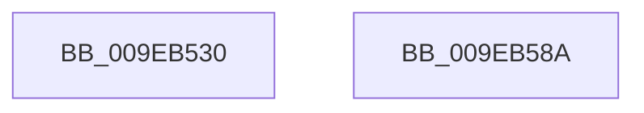

# EtwpCheckCurrentUserProcessAccess

- RVA: `0x009EB530`–`0x009EB58B` (길이 `91` bytes)
- VA: `0x00000001409EB530`
- 실행 섹션: `PAGE`
- PDB 이름 있음: `예`; PDB Function 태그: `아니요`
- unwind 정보 RVA: `0x000A5538`
- 디코드: `26`개 명령, `91/91` bytes 표시
- 미해석 바이트: `0` (있으면 어셈블리에 `.byte`로 보존)

> 이 문서는 커널 이미지의 기계어와 PDB 기호를 분석해 생성했습니다. 4번과 5번은 함수 원형과 자료형을 바이너리 사용 방식에서 추정한 C 해석이며 원본 소스 복구 결과는 아닙니다.

## 1. Dependencies

- 직접 호출 지점: **3**; 고유 호출 대상: **3**
- 직접 호출자로 확인된 함수: **3**
- RIP 상대 이미지 참조: **0**

### Outgoing calls
- `0x009EB553` → [ObpGetObjectSecurity](../87/ObpGetObjectSecurity_function_008717E0.md) (function, `0x008717E0`)
- `0x009EB565` → [EtwpAccessCheck](../8C/EtwpAccessCheck_function_008C6C2C.md) (function, `0x008C6C2C`)
- `0x009EB578` → [ObReleaseObjectSecurityEx](../8C/ObReleaseObjectSecurityEx_function_008C6E30.md) (function, `0x008C6E30`)

### Direct callers
- [EtwpGetPrivateSessionTraceHandle](../7B/EtwpGetPrivateSessionTraceHandle_function_007BC5A8.md) at `0x007BC650`
- [EtwpNotifyGuid](../8C/EtwpNotifyGuid_function_008C8110.md) at `0x008C8479`
- [EtwpIsRegEntryAllowed](EtwpIsRegEntryAllowed_function_009EB2D0.md) at `0x009EB3D4`

### Static image references
- 디코드된 RIP-relative 메모리 참조가 없습니다.

## 2. Other-region calls and transfers

- 다른 실행 섹션으로 향하는 call: **0**
- 별도 외부 분기/꼬리 이동을 확인하지 못했습니다.

## 3. Assembly (complete function range)

```asm
009EB530  48 8B C4                        mov rax, rsp
009EB533  48 89 58 08                     mov qword ptr [rax + 8], rbx
009EB537  57                              push rdi
009EB538  48 83 EC 20                     sub rsp, 0x20
009EB53C  48 83 60 18 00                  and qword ptr [rax + 0x18], 0
009EB541  4C 8D 40 10                     lea r8, [rax + 0x10]
009EB545  45 33 C9                        xor r9d, r9d
009EB548  C6 40 10 00                     mov byte ptr [rax + 0x10], 0
009EB54C  48 8D 50 18                     lea rdx, [rax + 0x18]
009EB550  48 8B F9                        mov rdi, rcx
009EB553  E8 88 62 E8 FF                  call 0x1408717e0
009EB558  48 8B 4C 24 40                  mov rcx, qword ptr [rsp + 0x40]
009EB55D  45 33 C0                        xor r8d, r8d
009EB560  BA FF FF 1F 00                  mov edx, 0x1fffff
009EB565  E8 C2 B6 ED FF                  call 0x1408c6c2c
009EB56A  8A 54 24 38                     mov dl, byte ptr [rsp + 0x38]
009EB56E  4C 8B C7                        mov r8, rdi
009EB571  48 8B 4C 24 40                  mov rcx, qword ptr [rsp + 0x40]
009EB576  8B D8                           mov ebx, eax
009EB578  E8 B3 B8 ED FF                  call 0x1408c6e30
009EB57D  8B C3                           mov eax, ebx
009EB57F  48 8B 5C 24 30                  mov rbx, qword ptr [rsp + 0x30]
009EB584  48 83 C4 20                     add rsp, 0x20
009EB588  5F                              pop rdi
009EB589  C3                              ret
009EB58A  CC                              int3
```

## 4. C-style interpretation (structured pseudocode)

```c
__int64 __fastcall EtwpCheckCurrentUserProcessAccess(__int64 a1, __int64 a2, __int64 a3, int a4)
{
    __int64 result;
    __int64 v_rsp;
    unsigned __int8 v_stack_p10;
    unsigned __int64 v_stack_p18;
    unsigned __int64 v_stack_p8;

    *(unsigned __int64 *)(v_rsp + 8) = v_rbx;
    v_rsp = (v_rsp) - (32);
    a4 = 0;
    *(unsigned __int8 *)(v_rsp + 16) = 0;
    result = ObpGetObjectSecurity(a1, v_rsp + 24, v_rsp + 16, a4);
    a3 = 0;
    result = EtwpAccessCheck(v_stack_p18, (unsigned int)(0x1FFFFFULL), a3, a4);
    result = ObReleaseObjectSecurityEx(v_stack_p18, v_stack_p10, a1, a4);
    v_rsp = (v_rsp) + (32);
    return (unsigned int)((unsigned int)((unsigned int)((unsigned int)(result))));
}
```

## 5. (Beta) C Style

```c
int64_t EtwpCheckCurrentUserProcessAccess(int64_t Arg1, int64_t Arg2, int64_t Arg3, int32_t Arg4)
{
    int64_t result;
    int64_t local_rsp;
    uint8_t v_stack_p10;
    uint64_t v_stack_p18;
    uint64_t v_stack_p8;

    *(uint64_t *)(local_rsp + 0x8) = local_rbx;
    local_rsp = (local_rsp) - (32);
    Arg4 = 0;
    *(uint8_t *)(local_rsp + 0x10) = 0;
    result = ObpGetObjectSecurity(Arg1, local_rsp + 24, local_rsp + 16, Arg4);
    Arg3 = 0;
    result = EtwpAccessCheck(v_stack_p18, (uint32_t)(0x1FFFFFULL), Arg3, Arg4);
    result = ObReleaseObjectSecurityEx(v_stack_p18, v_stack_p10, Arg1, Arg4);
    local_rsp = (local_rsp) + (32);
    return (uint32_t)((uint32_t)((uint32_t)((uint32_t)(result))));
}
```

## 6. Execution-region graph

[열기: 2D/3D 그래프와 함수 탐색 컨트롤 패널](../../../control-panel.html?section=page&rva=0x009EB530&view=graph)

- 2D 그래프는 위에서 아래로 흐르고, 3D 그래프는 빈 공간을 드래그해 회전합니다. Shift+드래그는 이동, 휠은 확대·축소, 함수 노드 선택은 대상 보고서 이동입니다.

### Static fallback


