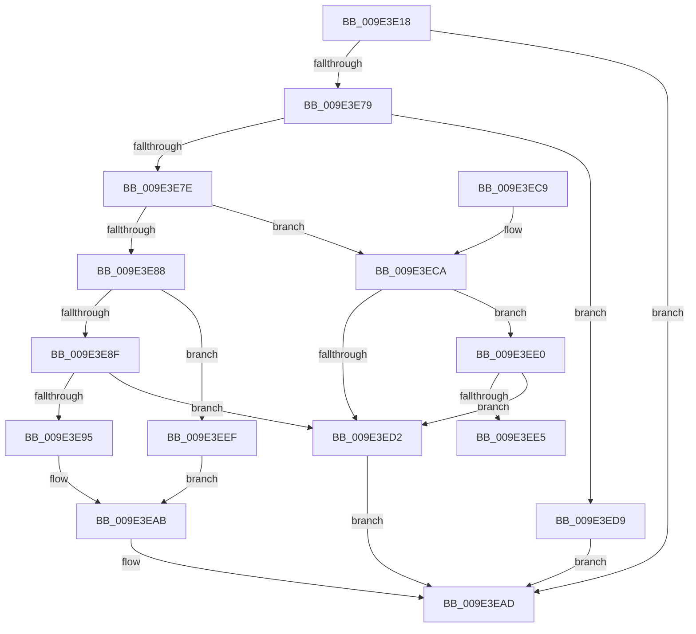

# EtwpCheckGuidAccessAndDoRundown

- RVA: `0x009E3E18`–`0x009E3EF6` (길이 `222` bytes)
- VA: `0x00000001409E3E18`
- 실행 섹션: `PAGE`
- PDB 이름 있음: `예`; PDB Function 태그: `예`
- unwind 정보 RVA: `0x000A4034`
- 디코드: `70`개 명령, `222/222` bytes 표시
- 미해석 바이트: `0` (있으면 어셈블리에 `.byte`로 보존)

> 이 문서는 커널 이미지의 기계어와 PDB 기호를 분석해 생성했습니다. 4번과 5번은 함수 원형과 자료형을 바이너리 사용 방식에서 추정한 C 해석이며 원본 소스 복구 결과는 아닙니다.

## 1. Dependencies

- 직접 호출 지점: **3**; 고유 호출 대상: **3**
- 직접 호출자로 확인된 함수: **1**
- RIP 상대 이미지 참조: **2**

### Outgoing calls
- `0x009E3E6B` → [EtwpCheckGuidAccess](../8C/EtwpCheckGuidAccess_function_008C697C.md) (function, `0x008C697C`)
- `0x009E3EA4` → [EtwpCheckLoggerAccessAndDoRundown](EtwpCheckLoggerAccessAndDoRundown_function_009E3EFC.md) (function, `0x009E3EFC`)
- `0x009E3EB5` → [_security_check_cookie](../../text/6A/_security_check_cookie_function_006AC640.md) (function, `0x006AC640`)

### Direct callers
- [EtwpEnableDisableSpecialGuids](EtwpEnableDisableSpecialGuids_function_009E3A88.md) at `0x009E3C02`

### Static image references
- `0x009E3E27` → RVA `0x00E0A740` (`.data`; read)
- `0x009E3E52` → RVA `0x00011F40` (`.rdata`; read)

## 2. Other-region calls and transfers

- 다른 실행 섹션으로 향하는 call: **1**
  - `0x009E3EB5` → [_security_check_cookie](../../text/6A/_security_check_cookie_function_006AC640.md) (`PAGE` → `.text`)
- call이 아닌 외부 분기/꼬리 이동: **1**
  - `0x009E3EEA` → [sub_00B30604](../B3/Unknown_function_00B30604.md) (`tail-transfer`)

## 3. Assembly (complete function range)

```asm
009E3E18  40 53                           push rbx
009E3E1A  55                              push rbp
009E3E1B  56                              push rsi
009E3E1C  57                              push rdi
009E3E1D  41 55                           push r13
009E3E1F  41 56                           push r14
009E3E21  41 57                           push r15
009E3E23  48 83 EC 60                     sub rsp, 0x60
009E3E27  48 8B 05 12 69 42 00            mov rax, qword ptr [rip + 0x426912]
009E3E2E  48 33 C4                        xor rax, rsp
009E3E31  48 89 44 24 50                  mov qword ptr [rsp + 0x50], rax
009E3E36  44 8B B4 24 C8 00 00 00         mov r14d, dword ptr [rsp + 0xc8]
009E3E3E  0F 57 C0                        xorps xmm0, xmm0
009E3E41  48 8B BC 24 C0 00 00 00         mov rdi, qword ptr [rsp + 0xc0]
009E3E49  41 8B E8                        mov ebp, r8d
009E3E4C  48 8B F1                        mov rsi, rcx
009E3E4F  45 33 C0                        xor r8d, r8d
009E3E52  48 8D 0D E7 E0 62 FF            lea rcx, [rip - 0x9d1f19]
009E3E59  BA 80 00 00 00                  mov edx, 0x80
009E3E5E  0F 11 44 24 30                  movups xmmword ptr [rsp + 0x30], xmm0
009E3E63  45 8A F9                        mov r15b, r9b
009E3E66  0F 11 44 24 40                  movups xmmword ptr [rsp + 0x40], xmm0
009E3E6B  E8 0C 2B EE FF                  call 0x1408c697c
009E3E70  45 33 ED                        xor r13d, r13d
009E3E73  8B D8                           mov ebx, eax
009E3E75  85 C0                           test eax, eax
009E3E77  78 34                           js 0x1409e3ead
009E3E79  3B 6E 10                        cmp ebp, dword ptr [rsi + 0x10]
009E3E7C  73 5B                           jae 0x1409e3ed9
009E3E7E  8B 47 0C                        mov eax, dword ptr [rdi + 0xc]
009E3E81  3D 01 00 00 80                  cmp eax, 0x80000001
009E3E86  74 42                           je 0x1409e3eca
009E3E88  3D 02 00 00 80                  cmp eax, 0x80000002
009E3E8D  75 60                           jne 0x1409e3eef
009E3E8F  83 7F 08 08                     cmp dword ptr [rdi + 8], 8
009E3E93  75 3D                           jne 0x1409e3ed2
009E3E95  48 8B 07                        mov rax, qword ptr [rdi]
009E3E98  45 8A CF                        mov r9b, r15b
009E3E9B  44 8B C5                        mov r8d, ebp
009E3E9E  48 8B CE                        mov rcx, rsi
009E3EA1  0F B7 10                        movzx edx, word ptr [rax]
009E3EA4  E8 53 00 00 00                  call 0x1409e3efc
009E3EA9  8B D8                           mov ebx, eax
009E3EAB  8B C3                           mov eax, ebx
009E3EAD  48 8B 4C 24 50                  mov rcx, qword ptr [rsp + 0x50]
009E3EB2  48 33 CC                        xor rcx, rsp
009E3EB5  E8 86 87 CC FF                  call 0x1406ac640
009E3EBA  48 83 C4 60                     add rsp, 0x60
009E3EBE  41 5F                           pop r15
009E3EC0  41 5E                           pop r14
009E3EC2  41 5D                           pop r13
009E3EC4  5F                              pop rdi
009E3EC5  5E                              pop rsi
009E3EC6  5D                              pop rbp
009E3EC7  5B                              pop rbx
009E3EC8  C3                              ret
009E3EC9  CC                              int3
009E3ECA  8B 57 08                        mov edx, dword ptr [rdi + 8]
009E3ECD  83 FA 20                        cmp edx, 0x20
009E3ED0  76 0E                           jbe 0x1409e3ee0
009E3ED2  B8 0D 00 00 C0                  mov eax, 0xc000000d
009E3ED7  EB D4                           jmp 0x1409e3ead
009E3ED9  B8 08 00 00 C0                  mov eax, 0xc0000008
009E3EDE  EB CD                           jmp 0x1409e3ead
009E3EE0  F6 C2 03                        test dl, 3
009E3EE3  75 ED                           jne 0x1409e3ed2
009E3EE5  B9 01 00 00 00                  mov ecx, 1
009E3EEA  E9 15 C7 14 00                  jmp 0x140b30604
009E3EEF  BB 0D 00 00 C0                  mov ebx, 0xc000000d
009E3EF4  EB B5                           jmp 0x1409e3eab
```

## 4. C-style interpretation (structured pseudocode)

```c
__int64 __fastcall EtwpCheckGuidAccessAndDoRundown(__int64 a1, __int64 a2, int a3, unsigned __int8 a4, __int64 a5, unsigned int a6)
{
    __int64 result;
    __int64 v_r13;
    __int64 v_rsp;
    unsigned __int64 v_stack_m48;
    unsigned __int64 v_stack_m58;
    unsigned __int64 v_stack_m68;

    v_rsp = (v_rsp) - (96);
    result = (*(unsigned __int64 *)(v_rip + 4352274)) ^ (v_rsp);
    v_stack_m48 = result;
    a3 = 0;
    v_stack_m68 = v_xmm0;
    v_stack_m58 = v_xmm0;
    result = EtwpCheckGuidAccess(v_rip - 10297113, 128, a3, a4);
    v_r13 = 0;
    if (sign_flag) goto loc_009E3EAD;
    if (((unsigned int)((unsigned int)(a3))) >= (*(unsigned int *)(a1 + 16))) goto loc_009E3ED9;
    if (((unsigned int)((unsigned int)(*(unsigned int *)(a5 + 12)))) == 0x80000001ULL) goto loc_009E3ECA;
    if (((unsigned int)((unsigned int)(*(unsigned int *)(a5 + 12)))) != 0x80000002ULL) goto loc_009E3EEF;
    if ((*(unsigned int *)(a5 + 8)) != 8) goto loc_009E3ED2;
    result = EtwpCheckLoggerAccessAndDoRundown(a1, *(unsigned __int16 *)(*(unsigned __int64 *)(a5)), (unsigned int)((unsigned int)((unsigned int)(a3))), a4);
loc_009E3EAB:
loc_009E3EAD:
    a1 = (v_stack_m48) ^ (v_rsp);
    result = _security_check_cookie(a1, *(unsigned __int16 *)(*(unsigned __int64 *)(a5)), (unsigned int)((unsigned int)((unsigned int)(a3))), a4);
    v_rsp = (v_rsp) + (96);
    return result;
loc_009E3ECA:
    if (((unsigned int)((unsigned int)(*(unsigned int *)(a5 + 8)))) <= 32) goto loc_009E3EE0;
loc_009E3ED2:
    goto loc_009E3EAD;
loc_009E3ED9:
    goto loc_009E3EAD;
loc_009E3EE0:
    if ((((unsigned __int8)((unsigned int)(*(unsigned int *)(a5 + 8)))) & (3)) != 0) goto loc_009E3ED2;
loc_009E3EEF:
    goto loc_009E3EAB;
}
```

## 5. (Beta) C Style

```c
int64_t EtwpCheckGuidAccessAndDoRundown(void *Arg1, int64_t Arg2, int32_t Arg3, uint8_t Arg4, void *Arg5, uint32_t Arg6)
{
    uint8_t *arg1 = (uint8_t *)Arg1;
    uint8_t *arg5 = (uint8_t *)Arg5;

    int64_t result;
    int64_t local_r13;
    int64_t local_rsp;
    uint64_t v_stack_m48;
    uint64_t v_stack_m58;
    uint64_t v_stack_m68;

    local_rsp = (local_rsp) - (96);
    result = (*(uint64_t *)(v_rip + 0x426912)) ^ (local_rsp);
    v_stack_m48 = result;
    Arg3 = 0;
    v_stack_m68 = v_xmm0;
    v_stack_m58 = v_xmm0;
    result = EtwpCheckGuidAccess(v_rip - 10297113, 128, Arg3, Arg4);
    local_r13 = 0;
    if (sign_flag) goto loc_009E3EAD;
    if (((uint32_t)((uint32_t)(Arg3))) >= (*(uint32_t *)(arg1 + 0x10))) goto loc_009E3ED9;
    if (((uint32_t)((uint32_t)(*(uint32_t *)(arg5 + 0xC)))) == 0x80000001ULL) goto loc_009E3ECA;
    if (((uint32_t)((uint32_t)(*(uint32_t *)(arg5 + 0xC)))) != 0x80000002ULL) goto loc_009E3EEF;
    if ((*(uint32_t *)(arg5 + 0x8)) != 8) goto loc_009E3ED2;
    result = EtwpCheckLoggerAccessAndDoRundown(Arg1, *(uint16_t *)(*(uint64_t *)(arg5)), (uint32_t)((uint32_t)((uint32_t)(Arg3))), Arg4);
loc_009E3EAB:
loc_009E3EAD:
    Arg1 = (v_stack_m48) ^ (local_rsp);
    result = _security_check_cookie(Arg1, *(uint16_t *)(*(uint64_t *)(arg5)), (uint32_t)((uint32_t)((uint32_t)(Arg3))), Arg4);
    local_rsp = (local_rsp) + (96);
    return result;
loc_009E3ECA:
    if (((uint32_t)((uint32_t)(*(uint32_t *)(arg5 + 0x8)))) <= 32) goto loc_009E3EE0;
loc_009E3ED2:
    goto loc_009E3EAD;
loc_009E3ED9:
    goto loc_009E3EAD;
loc_009E3EE0:
    if ((((uint8_t)((uint32_t)(*(uint32_t *)(arg5 + 0x8)))) & (3)) != 0) goto loc_009E3ED2;
loc_009E3EEF:
    goto loc_009E3EAB;
}
```

### 관측된 메모리 오프셋

구조체 형식이 확인되지 않은 접근은 인자 기준의 오프셋으로만 기록했습니다.

| 기준 인자 | 오프셋 표현 | 폭 (bit) | 접근 |
|---|---:|---:|---|
| `Arg1` | `+ 0x10` | `32` | `R` |
| `Arg5` | `+ 0x0` | `64` | `R` |
| `Arg5` | `+ 0x8` | `32` | `R` |
| `Arg5` | `+ 0xC` | `32` | `R` |

## 6. Execution-region graph

[열기: 2D/3D 그래프와 함수 탐색 컨트롤 패널](../../../control-panel.html?section=page&rva=0x009E3E18&view=graph)

- 2D 그래프는 위에서 아래로 흐르고, 3D 그래프는 빈 공간을 드래그해 회전합니다. Shift+드래그는 이동, 휠은 확대·축소, 함수 노드 선택은 대상 보고서 이동입니다.

### Static fallback


