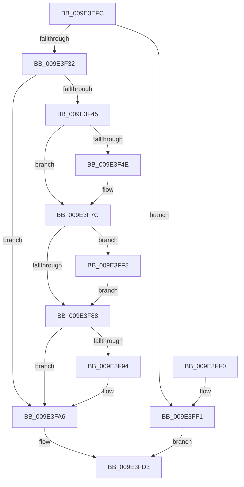

# EtwpCheckLoggerAccessAndDoRundown

- RVA: `0x009E3EFC`–`0x009E4004` (길이 `264` bytes)
- VA: `0x00000001409E3EFC`
- 실행 섹션: `PAGE`
- PDB 이름 있음: `예`; PDB Function 태그: `아니요`
- unwind 정보 RVA: `0x000A4064`
- 디코드: `65`개 명령, `264/264` bytes 표시
- 미해석 바이트: `0` (있으면 어셈블리에 `.byte`로 보존)

> 이 문서는 커널 이미지의 기계어와 PDB 기호를 분석해 생성했습니다. 4번과 5번은 함수 원형과 자료형을 바이너리 사용 방식에서 추정한 C 해석이며 원본 소스 복구 결과는 아닙니다.

## 1. Dependencies

- 직접 호출 지점: **7**; 고유 호출 대상: **7**
- 직접 호출자로 확인된 함수: **2**
- RIP 상대 이미지 참조: **0**

### Outgoing calls
- `0x009E3F21` → [EtwpAcquireLoggerContextByLoggerId](../93/EtwpAcquireLoggerContextByLoggerId_function_00932920.md) (function, `0x00932920`)
- `0x009E3F3A` → [EtwpCheckLoggerControlAccess](../8C/EtwpCheckLoggerControlAccess_function_008C0AE0.md) (function, `0x008C0AE0`)
- `0x009E3F77` → [EtwpLogKernelTraceRundown](EtwpLogKernelTraceRundown_function_009E400C.md) (function, `0x009E400C`)
- `0x009E3FA1` → [EtwpStackRundown](../../text/3F/EtwpStackRundown_function_003FC8B4.md) (function, `0x003FC8B4`)
- `0x009E3FAF` → [KeReleaseMutex](../../text/39/KeReleaseMutex_function_00396810.md) (function, `0x00396810`)
- `0x009E3FCE` → [ExReleaseRundownProtectionCacheAwareEx](../../text/25/ExReleaseRundownProtectionCacheAwareEx_function_0025F050.md) (function, `0x0025F050`)
- `0x009E3FFD` → [EtwpLogPmcCounterRundown](../A9/EtwpLogPmcCounterRundown_function_00A95790.md) (function, `0x00A95790`)

### Direct callers
- [EtwpCheckGuidAccessAndDoRundown](EtwpCheckGuidAccessAndDoRundown_function_009E3E18.md) at `0x009E3EA4`
- [sub_00B305C2](../B3/Unknown_function_00B305C2.md) at `0x00B305E6`

### Static image references
- 디코드된 RIP-relative 메모리 참조가 없습니다.

## 2. Other-region calls and transfers

- 다른 실행 섹션으로 향하는 call: **3**
  - `0x009E3FA1` → [EtwpStackRundown](../../text/3F/EtwpStackRundown_function_003FC8B4.md) (`PAGE` → `.text`)
  - `0x009E3FAF` → [KeReleaseMutex](../../text/39/KeReleaseMutex_function_00396810.md) (`PAGE` → `.text`)
  - `0x009E3FCE` → [ExReleaseRundownProtectionCacheAwareEx](../../text/25/ExReleaseRundownProtectionCacheAwareEx_function_0025F050.md) (`PAGE` → `.text`)
- 별도 외부 분기/꼬리 이동을 확인하지 못했습니다.

## 3. Assembly (complete function range)

```asm
009E3EFC  48 8B C4                        mov rax, rsp
009E3EFF  48 89 58 08                     mov qword ptr [rax + 8], rbx
009E3F03  48 89 68 10                     mov qword ptr [rax + 0x10], rbp
009E3F07  48 89 70 18                     mov qword ptr [rax + 0x18], rsi
009E3F0B  48 89 78 20                     mov qword ptr [rax + 0x20], rdi
009E3F0F  41 56                           push r14
009E3F11  48 83 EC 30                     sub rsp, 0x30
009E3F15  41 8B F0                        mov esi, r8d
009E3F18  45 8A F1                        mov r14b, r9b
009E3F1B  41 B0 01                        mov r8b, 1
009E3F1E  48 8B E9                        mov rbp, rcx
009E3F21  E8 FA E9 F4 FF                  call 0x140932920
009E3F26  48 8B D8                        mov rbx, rax
009E3F29  48 85 C0                        test rax, rax
009E3F2C  0F 84 BF 00 00 00               je 0x1409e3ff1
009E3F32  48 8B D0                        mov rdx, rax
009E3F35  B9 80 00 00 00                  mov ecx, 0x80
009E3F3A  E8 A1 CB ED FF                  call 0x1408c0ae0
009E3F3F  8B F8                           mov edi, eax
009E3F41  85 C0                           test eax, eax
009E3F43  78 61                           js 0x1409e3fa6
009E3F45  F7 43 0C 00 00 00 02            test dword ptr [rbx + 0xc], 0x2000000
009E3F4C  74 2E                           je 0x1409e3f7c
009E3F4E  44 0F B6 83 32 03 00 00         movzx r8d, byte ptr [rbx + 0x332]
009E3F56  45 8A CE                        mov r9b, r14b
009E3F59  83 64 24 28 00                  and dword ptr [rsp + 0x28], 0
009E3F5E  8B D6                           mov edx, esi
009E3F60  48 83 64 24 20 00               and qword ptr [rsp + 0x20], 0
009E3F66  48 8B CD                        mov rcx, rbp
009E3F69  49 C1 E0 05                     shl r8, 5
009E3F6D  49 81 C0 CC 11 00 00            add r8, 0x11cc
009E3F74  4C 03 C5                        add r8, rbp
009E3F77  E8 90 00 00 00                  call 0x1409e400c
009E3F7C  F7 83 30 03 00 00 00 08 00 00   test dword ptr [rbx + 0x330], 0x800
009E3F86  75 70                           jne 0x1409e3ff8
009E3F88  F7 83 30 03 00 00 00 00 00 01   test dword ptr [rbx + 0x330], 0x1000000
009E3F92  74 12                           je 0x1409e3fa6
009E3F94  48 8B 8B 20 04 00 00            mov rcx, qword ptr [rbx + 0x420]
009E3F9B  44 8B C6                        mov r8d, esi
009E3F9E  48 8B D5                        mov rdx, rbp
009E3FA1  E8 0E 89 A1 FF                  call 0x1403fc8b4
009E3FA6  48 8D 8B 78 02 00 00            lea rcx, [rbx + 0x278]
009E3FAD  33 D2                           xor edx, edx
009E3FAF  E8 5C 28 9B FF                  call 0x140396810
009E3FB4  48 8B 83 50 05 00 00            mov rax, qword ptr [rbx + 0x550]
009E3FBB  BA 01 00 00 00                  mov edx, 1
009E3FC0  44 8B 03                        mov r8d, dword ptr [rbx]
009E3FC3  48 8B 88 C0 02 00 00            mov rcx, qword ptr [rax + 0x2c0]
009E3FCA  4A 8B 0C C1                     mov rcx, qword ptr [rcx + r8*8]
009E3FCE  E8 7D B0 87 FF                  call 0x14025f050
009E3FD3  48 8B 5C 24 40                  mov rbx, qword ptr [rsp + 0x40]
009E3FD8  8B C7                           mov eax, edi
009E3FDA  48 8B 7C 24 58                  mov rdi, qword ptr [rsp + 0x58]
009E3FDF  48 8B 6C 24 48                  mov rbp, qword ptr [rsp + 0x48]
009E3FE4  48 8B 74 24 50                  mov rsi, qword ptr [rsp + 0x50]
009E3FE9  48 83 C4 30                     add rsp, 0x30
009E3FED  41 5E                           pop r14
009E3FEF  C3                              ret
009E3FF0  CC                              int3
009E3FF1  BF 96 02 00 C0                  mov edi, 0xc0000296
009E3FF6  EB DB                           jmp 0x1409e3fd3
009E3FF8  8B D6                           mov edx, esi
009E3FFA  48 8B CB                        mov rcx, rbx
009E3FFD  E8 8E 17 0B 00                  call 0x140a95790
009E4002  EB 84                           jmp 0x1409e3f88
```

## 4. C-style interpretation (structured pseudocode)

```c
__int64 __fastcall EtwpCheckLoggerAccessAndDoRundown(__int64 a1, __int64 a2, int a3, unsigned __int8 a4)
{
    __int64 result;
    __int64 v_rsp;
    unsigned int v_stack_m10;
    unsigned __int64 v_stack_m18;
    unsigned __int64 v_stack_p10;
    unsigned __int64 v_stack_p18;
    unsigned __int64 v_stack_p20;
    unsigned __int64 v_stack_p8;

    *(unsigned __int64 *)(v_rsp + 8) = v_rbx;
    *(unsigned __int64 *)(v_rsp + 16) = v_rbp;
    *(unsigned __int64 *)(v_rsp + 24) = v_rsi;
    *(unsigned __int64 *)(v_rsp + 32) = v_rdi;
    v_rsp = (v_rsp) - (48);
    result = EtwpAcquireLoggerContextByLoggerId(a1, a2, 1, a4);
    if (result == 0) goto loc_009E3FF1;
    result = EtwpCheckLoggerControlAccess(128, result, 1, a4);
    if (sign_flag) goto loc_009E3FA6;
    if (((*(unsigned int *)(result + 12)) & (0x2000000ULL)) != 0) {
        a3 = *(unsigned __int8 *)(result + 818);
        a4 = a4;
        a2 = (unsigned int)((unsigned int)(a3));
        a1 = a1;
        a3 = (a3) << (5);
        a3 = (a3) + (0x11CCULL);
        a3 = (a3) + (a1);
        result = EtwpLogKernelTraceRundown(a1, a2, a3, a4);
    }
    if (((*(unsigned int *)(result + 816)) & (0x800ULL)) != 0) goto loc_009E3FF8;
loc_009E3F88:
    if (((*(unsigned int *)(result + 816)) & (0x1000000ULL)) != 0) {
        a1 = *(unsigned __int64 *)(result + 1056);
        a3 = (unsigned int)((unsigned int)(a3));
        a2 = a1;
        result = EtwpStackRundown(a1, a2, a3, a4);
    }
    a2 = 0;
    result = KeReleaseMutex(result + 632, a2, a3, a4);
    result = ExReleaseRundownProtectionCacheAwareEx(*(unsigned __int64 *)(*(unsigned __int64 *)(*(unsigned __int64 *)(result + 1360) + 704) + (unsigned int)(*(unsigned int *)(result)) * 8), 1, (unsigned int)(*(unsigned int *)(result)), a4);
loc_009E3FD3:
    v_rsp = (v_rsp) + (48);
    return (unsigned int)((unsigned int)((unsigned int)((unsigned int)(result))));
loc_009E3FF1:
    goto loc_009E3FD3;
loc_009E3FF8:
    result = EtwpLogPmcCounterRundown(v_stack_p8, (unsigned int)((unsigned int)(v_stack_p18)), (unsigned int)(*(unsigned int *)(result)), a4);
    goto loc_009E3F88;
}
```

## 5. (Beta) C Style

```c
int64_t EtwpCheckLoggerAccessAndDoRundown(int64_t Arg1, int64_t Arg2, int32_t Arg3, uint8_t Arg4)
{
    int64_t result;
    int64_t local_rsp;
    uint32_t v_stack_m10;
    uint64_t v_stack_m18;
    uint64_t v_stack_p10;
    uint64_t v_stack_p18;
    uint64_t v_stack_p20;
    uint64_t v_stack_p8;

    *(uint64_t *)(local_rsp + 0x8) = local_rbx;
    *(uint64_t *)(local_rsp + 0x10) = local_rbp;
    *(uint64_t *)(local_rsp + 0x18) = local_rsi;
    *(uint64_t *)(local_rsp + 0x20) = local_rdi;
    local_rsp = (local_rsp) - (48);
    result = EtwpAcquireLoggerContextByLoggerId(Arg1, Arg2, 1, Arg4);
    if (result == 0) goto loc_009E3FF1;
    result = EtwpCheckLoggerControlAccess(128, result, 1, Arg4);
    if (sign_flag) goto loc_009E3FA6;
    if (((*(uint32_t *)(result + 0xC)) & (0x2000000ULL)) != 0) {
        Arg3 = *(uint8_t *)(result + 0x332);
        Arg4 = Arg4;
        Arg2 = (uint32_t)((uint32_t)(Arg3));
        Arg1 = Arg1;
        Arg3 = (Arg3) << (5);
        Arg3 = (Arg3) + (0x11CCULL);
        Arg3 = (Arg3) + (Arg1);
        result = EtwpLogKernelTraceRundown(Arg1, Arg2, Arg3, Arg4);
    }
    if (((*(uint32_t *)(result + 0x330)) & (0x800ULL)) != 0) goto loc_009E3FF8;
loc_009E3F88:
    if (((*(uint32_t *)(result + 0x330)) & (0x1000000ULL)) != 0) {
        Arg1 = *(uint64_t *)(result + 0x420);
        Arg3 = (uint32_t)((uint32_t)(Arg3));
        Arg2 = Arg1;
        result = EtwpStackRundown(Arg1, Arg2, Arg3, Arg4);
    }
    Arg2 = 0;
    result = KeReleaseMutex(result + 632, Arg2, Arg3, Arg4);
    result = ExReleaseRundownProtectionCacheAwareEx(*(uint64_t *)(*(uint64_t *)(*(uint64_t *)(result + 0x550) + 0x2C0) + (uint32_t)(*(uint32_t *)(result)) * 8), 1, (uint32_t)(*(uint32_t *)(result)), Arg4);
loc_009E3FD3:
    local_rsp = (local_rsp) + (48);
    return (uint32_t)((uint32_t)((uint32_t)((uint32_t)(result))));
loc_009E3FF1:
    goto loc_009E3FD3;
loc_009E3FF8:
    result = EtwpLogPmcCounterRundown(v_stack_p8, (uint32_t)((uint32_t)(v_stack_p18)), (uint32_t)(*(uint32_t *)(result)), Arg4);
    goto loc_009E3F88;
}
```

## 6. Execution-region graph

[열기: 2D/3D 그래프와 함수 탐색 컨트롤 패널](../../../control-panel.html?section=page&rva=0x009E3EFC&view=graph)

- 2D 그래프는 위에서 아래로 흐르고, 3D 그래프는 빈 공간을 드래그해 회전합니다. Shift+드래그는 이동, 휠은 확대·축소, 함수 노드 선택은 대상 보고서 이동입니다.

### Static fallback


