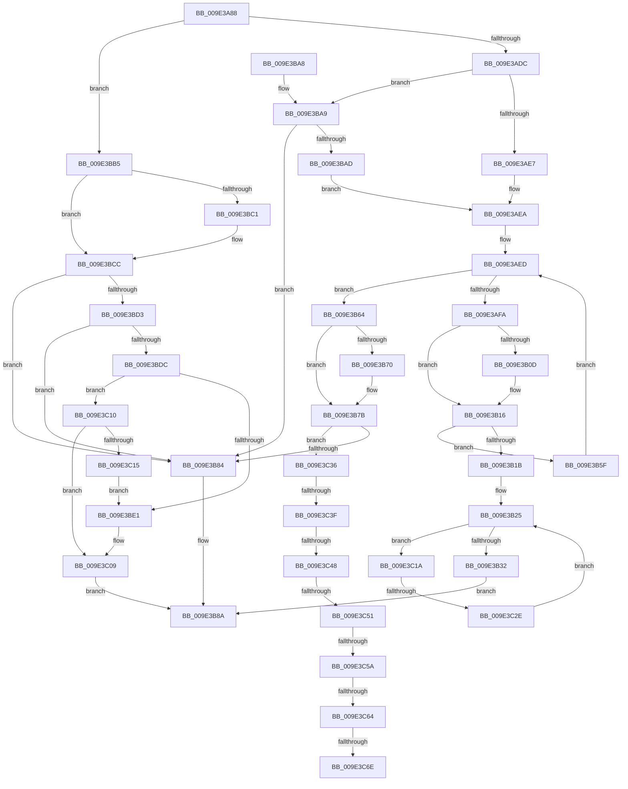

# EtwpEnableDisableSpecialGuids

- RVA: `0x009E3A88`–`0x009E3C7F` (길이 `503` bytes)
- VA: `0x00000001409E3A88`
- 실행 섹션: `PAGE`
- PDB 이름 있음: `예`; PDB Function 태그: `예`
- unwind 정보 RVA: `0x000A3FE8`
- 디코드: `131`개 명령, `503/503` bytes 표시
- 미해석 바이트: `0` (있으면 어셈블리에 `.byte`로 보존)

> 이 문서는 커널 이미지의 기계어와 PDB 기호를 분석해 생성했습니다. 4번과 5번은 함수 원형과 자료형을 바이너리 사용 방식에서 추정한 C 해석이며 원본 소스 복구 결과는 아닙니다.

## 1. Dependencies

- 직접 호출 지점: **3**; 고유 호출 대상: **3**
- 직접 호출자로 확인된 함수: **1**
- RIP 상대 이미지 참조: **6**

### Outgoing calls
- `0x009E3B58` → [EtwpEnableDisableUMGL](EtwpEnableDisableUMGL_function_009E3C88.md) (function, `0x009E3C88`)
- `0x009E3C02` → [EtwpCheckGuidAccessAndDoRundown](EtwpCheckGuidAccessAndDoRundown_function_009E3E18.md) (function, `0x009E3E18`)
- `0x009E3C74` → [EtwpLogFileNameRundown](../7C/EtwpLogFileNameRundown_function_007C00F0.md) (function, `0x007C00F0`)

### Direct callers
- [EtwpEnableGuid](../A5/EtwpEnableGuid_function_00A5CD28.md) at `0x00A5CEEF`

### Static image references
- `0x009E3AED` → RVA `0x00B4C360` (`EtwpUmglProviders`; read)
- `0x009E3B64` → RVA `0x00014618` (`.rdata`; read)
- `0x009E3B70` → RVA `0x00014620` (`.rdata`; read)
- `0x009E3BB5` → RVA `0x00011F40` (`.rdata`; read)
- `0x009E3BC1` → RVA `0x00011F48` (`.rdata`; read)
- `0x009E3BD3` → RVA `0x00FC6AA8` (`ALMOSTRO`; read)

## 2. Other-region calls and transfers

- 다른 실행 섹션으로 향하는 call: **0**
- call이 아닌 외부 분기/꼬리 이동: **8**
  - `0x009E3C28` → [sub_00B305C2](../B3/Unknown_function_00B305C2.md) (`tail-transfer`)
  - `0x009E3C39` → [sub_00B305C2 + 0x3A](../B3/Unknown_function_00B305C2.md) (`tail-transfer`)
  - `0x009E3C42` → [sub_00B305C2 + 0x11](../B3/Unknown_function_00B305C2.md) (`tail-transfer`)
  - `0x009E3C4B` → [sub_00B305C2 + 0x31](../B3/Unknown_function_00B305C2.md) (`tail-transfer`)
  - `0x009E3C54` → [sub_00B305C2 + 0x18](../B3/Unknown_function_00B305C2.md) (`tail-transfer`)
  - `0x009E3C5E` → [sub_00B305C2 + 0x1B](../B3/Unknown_function_00B305C2.md) (`tail-transfer`)
  - `0x009E3C68` → [sub_00B305C2 + 0x1B](../B3/Unknown_function_00B305C2.md) (`tail-transfer`)
  - `0x009E3C7A` → [sub_00B305C2 + 0x29](../B3/Unknown_function_00B305C2.md) (`tail-transfer`)

## 3. Assembly (complete function range)

```asm
009E3A88  48 89 5C 24 08                  mov qword ptr [rsp + 8], rbx
009E3A8D  48 89 6C 24 10                  mov qword ptr [rsp + 0x10], rbp
009E3A92  48 89 74 24 18                  mov qword ptr [rsp + 0x18], rsi
009E3A97  57                              push rdi
009E3A98  41 54                           push r12
009E3A9A  41 55                           push r13
009E3A9C  41 56                           push r14
009E3A9E  41 57                           push r15
009E3AA0  48 83 EC 40                     sub rsp, 0x40
009E3AA4  4C 8B B4 24 A8 00 00 00         mov r14, qword ptr [rsp + 0xa8]
009E3AAC  41 BA 01 00 00 00               mov r10d, 1
009E3AB2  41 8B C1                        mov eax, r9d
009E3AB5  45 0F B7 F8                     movzx r15d, r8w
009E3AB9  44 8B 8C 24 90 00 00 00         mov r9d, dword ptr [rsp + 0x90]
009E3AC1  48 8B FA                        mov rdi, rdx
009E3AC4  48 8B D9                        mov rbx, rcx
009E3AC7  41 BB 25 02 00 C0               mov r11d, 0xc0000225
009E3ACD  41 8D 52 01                     lea edx, [r10 + 1]
009E3AD1  45 88 16                        mov byte ptr [r14], r10b
009E3AD4  3B C2                           cmp eax, edx
009E3AD6  0F 84 D9 00 00 00               je 0x1409e3bb5
009E3ADC  33 C9                           xor ecx, ecx
009E3ADE  41 3B C2                        cmp eax, r10d
009E3AE1  0F 85 C2 00 00 00               jne 0x1409e3ba9
009E3AE7  41 8A EA                        mov bpl, r10b
009E3AEA  44 8B C1                        mov r8d, ecx
009E3AED  48 8D 05 6C 88 16 00            lea rax, [rip + 0x16886c]
009E3AF4  41 83 F8 0A                     cmp r8d, 0xa
009E3AF8  73 6A                           jae 0x1409e3b64
009E3AFA  45 8B E8                        mov r13d, r8d
009E3AFD  4D 03 ED                        add r13, r13
009E3B00  4E 8B 24 E8                     mov r12, qword ptr [rax + r13*8]
009E3B04  49 8B 34 24                     mov rsi, qword ptr [r12]
009E3B08  48 2B 37                        sub rsi, qword ptr [rdi]
009E3B0B  75 09                           jne 0x1409e3b16
009E3B0D  49 8B 74 24 08                  mov rsi, qword ptr [r12 + 8]
009E3B12  48 2B 77 08                     sub rsi, qword ptr [rdi + 8]
009E3B16  48 85 F6                        test rsi, rsi
009E3B19  75 44                           jne 0x1409e3b5f
009E3B1B  4C 8B 84 24 98 00 00 00         mov r8, qword ptr [rsp + 0x98]
009E3B23  8B D1                           mov edx, ecx
009E3B25  3B 94 24 A0 00 00 00            cmp edx, dword ptr [rsp + 0xa0]
009E3B2C  0F 82 E8 00 00 00               jb 0x1409e3c1a
009E3B32  8B D1                           mov edx, ecx
009E3B34  89 54 24 30                     mov dword ptr [rsp + 0x30], edx
009E3B38  48 8D 05 21 88 16 00            lea rax, [rip + 0x168821]
009E3B3F  42 0F B6 44 E8 08               movzx eax, byte ptr [rax + r13*8 + 8]
009E3B45  45 0F B7 C7                     movzx r8d, r15w
009E3B49  48 89 4C 24 28                  mov qword ptr [rsp + 0x28], rcx
009E3B4E  40 8A D5                        mov dl, bpl
009E3B51  48 8B CB                        mov rcx, rbx
009E3B54  89 44 24 20                     mov dword ptr [rsp + 0x20], eax
009E3B58  E8 2B 01 00 00                  call 0x1409e3c88
009E3B5D  EB 2B                           jmp 0x1409e3b8a
009E3B5F  45 03 C2                        add r8d, r10d
009E3B62  EB 89                           jmp 0x1409e3aed
009E3B64  4C 8B 05 AD 0A 63 FF            mov r8, qword ptr [rip - 0x9cf553]
009E3B6B  4C 2B 07                        sub r8, qword ptr [rdi]
009E3B6E  75 0B                           jne 0x1409e3b7b
009E3B70  4C 8B 05 A9 0A 63 FF            mov r8, qword ptr [rip - 0x9cf557]
009E3B77  4C 2B 47 08                     sub r8, qword ptr [rdi + 8]
009E3B7B  4D 85 C0                        test r8, r8
009E3B7E  0F 84 B2 00 00 00               je 0x1409e3c36
009E3B84  41 88 0E                        mov byte ptr [r14], cl
009E3B87  41 8B C3                        mov eax, r11d
009E3B8A  4C 8D 5C 24 40                  lea r11, [rsp + 0x40]
009E3B8F  49 8B 5B 30                     mov rbx, qword ptr [r11 + 0x30]
009E3B93  49 8B 6B 38                     mov rbp, qword ptr [r11 + 0x38]
009E3B97  49 8B 73 40                     mov rsi, qword ptr [r11 + 0x40]
009E3B9B  49 8B E3                        mov rsp, r11
009E3B9E  41 5F                           pop r15
009E3BA0  41 5E                           pop r14
009E3BA2  41 5D                           pop r13
009E3BA4  41 5C                           pop r12
009E3BA6  5F                              pop rdi
009E3BA7  C3                              ret
009E3BA8  CC                              int3
009E3BA9  85 C0                           test eax, eax
009E3BAB  75 D7                           jne 0x1409e3b84
009E3BAD  40 8A E9                        mov bpl, cl
009E3BB0  E9 35 FF FF FF                  jmp 0x1409e3aea
009E3BB5  4C 8B 05 84 E3 62 FF            mov r8, qword ptr [rip - 0x9d1c7c]
009E3BBC  4C 2B 07                        sub r8, qword ptr [rdi]
009E3BBF  75 0B                           jne 0x1409e3bcc
009E3BC1  4C 8B 05 80 E3 62 FF            mov r8, qword ptr [rip - 0x9d1c80]
009E3BC8  4C 2B 47 08                     sub r8, qword ptr [rdi + 8]
009E3BCC  33 C9                           xor ecx, ecx
009E3BCE  4D 85 C0                        test r8, r8
009E3BD1  75 B1                           jne 0x1409e3b84
009E3BD3  48 3B 1D CE 2E 5E 00            cmp rbx, qword ptr [rip + 0x5e2ece]
009E3BDA  75 A8                           jne 0x1409e3b84
009E3BDC  45 3B CA                        cmp r9d, r10d
009E3BDF  75 2F                           jne 0x1409e3c10
009E3BE1  8B 84 24 A0 00 00 00            mov eax, dword ptr [rsp + 0xa0]
009E3BE8  45 8B C7                        mov r8d, r15d
009E3BEB  89 44 24 28                     mov dword ptr [rsp + 0x28], eax
009E3BEF  45 8A CA                        mov r9b, r10b
009E3BF2  48 8B 84 24 98 00 00 00         mov rax, qword ptr [rsp + 0x98]
009E3BFA  48 8B CB                        mov rcx, rbx
009E3BFD  48 89 44 24 20                  mov qword ptr [rsp + 0x20], rax
009E3C02  E8 11 02 00 00                  call 0x1409e3e18
009E3C07  8B C8                           mov ecx, eax
009E3C09  8B C1                           mov eax, ecx
009E3C0B  E9 7A FF FF FF                  jmp 0x1409e3b8a
009E3C10  44 3B CA                        cmp r9d, edx
009E3C13  75 F4                           jne 0x1409e3c09
009E3C15  44 8A D1                        mov r10b, cl
009E3C18  EB C7                           jmp 0x1409e3be1
009E3C1A  8B C2                           mov eax, edx
009E3C1C  48 03 C0                        add rax, rax
009E3C1F  41 81 7C C0 0C 04 00 00 80      cmp dword ptr [r8 + rax*8 + 0xc], 0x80000004
009E3C28  0F 84 94 C9 14 00               je 0x140b305c2
009E3C2E  41 03 D2                        add edx, r10d
009E3C31  E9 EF FE FF FF                  jmp 0x1409e3b25
009E3C36  40 84 ED                        test bpl, bpl
009E3C39  0F 84 BD C9 14 00               je 0x140b305fc
009E3C3F  45 2B CA                        sub r9d, r10d
009E3C42  0F 84 8B C9 14 00               je 0x140b305d3
009E3C48  45 2B CA                        sub r9d, r10d
009E3C4B  0F 84 A2 C9 14 00               je 0x140b305f3
009E3C51  44 2B CA                        sub r9d, edx
009E3C54  0F 84 80 C9 14 00               je 0x140b305da
009E3C5A  41 83 E9 04                     sub r9d, 4
009E3C5E  0F 84 79 C9 14 00               je 0x140b305dd
009E3C64  41 83 F9 08                     cmp r9d, 8
009E3C68  0F 85 6F C9 14 00               jne 0x140b305dd
009E3C6E  41 8B D7                        mov edx, r15d
009E3C71  48 8B CB                        mov rcx, rbx
009E3C74  E8 77 C4 DD FF                  call 0x1407c00f0
009E3C79  90                              nop
009E3C7A  E9 6C C9 14 00                  jmp 0x140b305eb
```

## 4. C-style interpretation (structured pseudocode)

```c
__int64 __fastcall EtwpEnableDisableSpecialGuids(__int64 a1, __int64 a2, unsigned __int16 a3, int a4, unsigned int a5, __int64 a6, unsigned int a7, __int64 a8)
{
    __int64 result;
    __int64 v_r13;
    __int64 v_rsi;
    __int64 v_rsp;
    unsigned int v_stack_m18;
    unsigned __int64 v_stack_m20;
    unsigned __int64 v_stack_m28;
    unsigned int v_stack_m38;
    unsigned __int64 v_stack_m40;
    unsigned int v_stack_m48;
    unsigned __int64 v_stack_p10;
    unsigned __int64 v_stack_p18;
    unsigned __int64 v_stack_p8;

    v_stack_p8 = v_rbx;
    v_stack_p10 = v_rbp;
    v_stack_p18 = v_rsi;
    v_rsp = (v_rsp) - (64);
    *(unsigned __int8 *)(a8) = 1;
    if (((unsigned int)((unsigned int)(a4))) == ((unsigned int)(1 + 1))) goto loc_009E3BB5;
    a1 = 0;
    if (((unsigned int)((unsigned int)(a4))) != 1) goto loc_009E3BA9;
loc_009E3AEA:
loc_009E3AED:
    if (0 >= 10) goto loc_009E3B64;
    v_r13 = (0) + (0);
    v_rsi = (*(unsigned __int64 *)(*(unsigned __int64 *)(v_rip + 1476716 + v_r13 * 8))) - (*(unsigned __int64 *)(a2));
    if (!(condition_is_not_equal)) {
        v_rsi = *(unsigned __int64 *)(*(unsigned __int64 *)(v_rip + 1476716 + v_r13 * 8) + 8);
        v_rsi = (v_rsi) - (*(unsigned __int64 *)(a2 + 8));
    }
    if (v_rsi != 0) goto loc_009E3B5F;
loc_009E3B25:
    if (0 < a7) goto loc_009E3C1A;
    v_stack_m38 = 0;
    v_stack_m40 = 0;
    v_stack_m48 = (unsigned int)(*(unsigned __int8 *)(v_rip + 1476641 + v_r13 * 8 + 8));
    result = EtwpEnableDisableUMGL(0, 1, a3, (unsigned int)(a5));
    goto loc_009E3B8A;
loc_009E3B5F:
    a3 = (unsigned int)((a3) + (1));
    goto loc_009E3AED;
loc_009E3B64:
    a3 = (*(unsigned __int64 *)(v_rip - 10286419)) - (*(unsigned __int64 *)(a2));
    if (!(condition_is_not_equal)) {
        a3 = *(unsigned __int64 *)(v_rip - 10286423);
        a3 = (a3) - (*(unsigned __int64 *)(a2 + 8));
    }
    if (a3 == 0) goto loc_009E3C36;
loc_009E3B84:
    *(unsigned __int8 *)(a8) = 0;
loc_009E3B8A:
    return (unsigned int)((unsigned int)((unsigned int)(0xC0000225ULL)));
loc_009E3BA9:
    if ((unsigned int)((unsigned int)((unsigned int)((unsigned int)(0xC0000225ULL)))) != 0) goto loc_009E3B84;
    goto loc_009E3AEA;
loc_009E3BB5:
    a3 = (*(unsigned __int64 *)(v_rip - 10296444)) - (*(unsigned __int64 *)(a2));
    if (!(condition_is_not_equal)) {
        a3 = *(unsigned __int64 *)(v_rip - 10296448);
        a3 = (a3) - (*(unsigned __int64 *)(a2 + 8));
    }
    a1 = 0;
    if (a3 != 0) goto loc_009E3B84;
    if ((*(unsigned __int64 *)(v_stack_m28 + 48)) != (*(unsigned __int64 *)(v_rip + 6172366))) goto loc_009E3B84;
    if (((unsigned int)((unsigned int)(a5))) != 1) goto loc_009E3C10;
loc_009E3BE1:
    v_stack_m18 = (unsigned int)((unsigned int)(a7));
    v_stack_m20 = a6;
    result = EtwpCheckGuidAccessAndDoRundown(*(unsigned __int64 *)(v_stack_m28 + 48), 1, (unsigned int)(a3), 1);
loc_009E3C09:
    goto loc_009E3B8A;
loc_009E3C10:
    if (1 != 1) goto loc_009E3C09;
    goto loc_009E3BE1;
loc_009E3C1A:
    result = (1) + (1);
    a2 = (unsigned int)((1) + ((unsigned int)((unsigned __int8)((unsigned int)((unsigned int)(result))))));
    goto loc_009E3B25;
loc_009E3C36:
    a4 = (unsigned int)((1) - ((unsigned int)((unsigned __int8)((unsigned int)((unsigned int)(result))))));
    a4 = (unsigned int)((a4) - ((unsigned int)((unsigned __int8)((unsigned int)((unsigned int)(result))))));
    a4 = (unsigned int)((a4) - ((unsigned int)(a2)));
    a4 = (unsigned int)((a4) - (4));
    result = EtwpLogFileNameRundown(*(unsigned __int64 *)(v_stack_m28 + 48), (unsigned int)(a3), (unsigned int)(a3), a4);
}
```

## 5. (Beta) C Style

```c
int64_t EtwpEnableDisableSpecialGuids(int64_t Arg1, void *Arg2, uint16_t Arg3, int32_t Arg4, uint32_t Arg5, void *Arg6, uint32_t Arg7, void *Arg8)
{
    uint8_t *arg2 = (uint8_t *)Arg2;
    uint8_t *arg6 = (uint8_t *)Arg6;
    uint8_t *arg8 = (uint8_t *)Arg8;

    int64_t result;
    int64_t local_r13;
    int64_t local_rsi;
    int64_t local_rsp;
    uint32_t v_stack_m18;
    uint64_t v_stack_m20;
    uint64_t v_stack_m28;
    uint32_t v_stack_m38;
    uint64_t v_stack_m40;
    uint32_t v_stack_m48;
    uint64_t v_stack_p10;
    uint64_t v_stack_p18;
    uint64_t v_stack_p8;

    v_stack_p8 = local_rbx;
    v_stack_p10 = local_rbp;
    v_stack_p18 = local_rsi;
    local_rsp = (local_rsp) - (64);
    *(uint8_t *)(arg8) = 1;
    if (((uint32_t)((uint32_t)(Arg4))) == ((uint32_t)(1 + 1))) goto loc_009E3BB5;
    Arg1 = 0;
    if (((uint32_t)((uint32_t)(Arg4))) != 1) goto loc_009E3BA9;
loc_009E3AEA:
loc_009E3AED:
    if (0 >= 10) goto loc_009E3B64;
    local_r13 = (0) + (0);
    local_rsi = (*(uint64_t *)(*(uint64_t *)(v_rip + 0x16886C + local_r13 * 8))) - (*(uint64_t *)(arg2));
    if (!(condition_is_not_equal)) {
        local_rsi = *(uint64_t *)(*(uint64_t *)(v_rip + 0x16886C + local_r13 * 8) + 0x8);
        local_rsi = (local_rsi) - (*(uint64_t *)(arg2 + 0x8));
    }
    if (local_rsi != 0) goto loc_009E3B5F;
loc_009E3B25:
    if (0 < Arg7) goto loc_009E3C1A;
    v_stack_m38 = 0;
    v_stack_m40 = 0;
    v_stack_m48 = (uint32_t)(*(uint8_t *)(v_rip + 0x168821 + local_r13 * 8 + 0x8));
    result = EtwpEnableDisableUMGL(0, 1, Arg3, (uint32_t)(Arg5));
    goto loc_009E3B8A;
loc_009E3B5F:
    Arg3 = (uint32_t)((Arg3) + (1));
    goto loc_009E3AED;
loc_009E3B64:
    Arg3 = (*(uint64_t *)(v_rip - 0x9CF553)) - (*(uint64_t *)(arg2));
    if (!(condition_is_not_equal)) {
        Arg3 = *(uint64_t *)(v_rip - 0x9CF557);
        Arg3 = (Arg3) - (*(uint64_t *)(arg2 + 0x8));
    }
    if (Arg3 == 0) goto loc_009E3C36;
loc_009E3B84:
    *(uint8_t *)(arg8) = 0;
loc_009E3B8A:
    return (uint32_t)((uint32_t)((uint32_t)(0xC0000225ULL)));
loc_009E3BA9:
    if ((uint32_t)((uint32_t)((uint32_t)((uint32_t)(0xC0000225ULL)))) != 0) goto loc_009E3B84;
    goto loc_009E3AEA;
loc_009E3BB5:
    Arg3 = (*(uint64_t *)(v_rip - 0x9D1C7C)) - (*(uint64_t *)(arg2));
    if (!(condition_is_not_equal)) {
        Arg3 = *(uint64_t *)(v_rip - 0x9D1C80);
        Arg3 = (Arg3) - (*(uint64_t *)(arg2 + 0x8));
    }
    Arg1 = 0;
    if (Arg3 != 0) goto loc_009E3B84;
    if ((*(uint64_t *)(v_stack_m28 + 0x30)) != (*(uint64_t *)(v_rip + 0x5E2ECE))) goto loc_009E3B84;
    if (((uint32_t)((uint32_t)(Arg5))) != 1) goto loc_009E3C10;
loc_009E3BE1:
    v_stack_m18 = (uint32_t)((uint32_t)(Arg7));
    v_stack_m20 = Arg6;
    result = EtwpCheckGuidAccessAndDoRundown(*(uint64_t *)(v_stack_m28 + 0x30), 1, (uint32_t)(Arg3), 1);
loc_009E3C09:
    goto loc_009E3B8A;
loc_009E3C10:
    if (1 != 1) goto loc_009E3C09;
    goto loc_009E3BE1;
loc_009E3C1A:
    result = (1) + (1);
    Arg2 = (uint32_t)((1) + ((uint32_t)((uint8_t)((uint32_t)((uint32_t)(result))))));
    goto loc_009E3B25;
loc_009E3C36:
    Arg4 = (uint32_t)((1) - ((uint32_t)((uint8_t)((uint32_t)((uint32_t)(result))))));
    Arg4 = (uint32_t)((Arg4) - ((uint32_t)((uint8_t)((uint32_t)((uint32_t)(result))))));
    Arg4 = (uint32_t)((Arg4) - ((uint32_t)(Arg2)));
    Arg4 = (uint32_t)((Arg4) - (4));
    result = EtwpLogFileNameRundown(*(uint64_t *)(v_stack_m28 + 0x30), (uint32_t)(Arg3), (uint32_t)(Arg3), Arg4);
}
```

### 관측된 메모리 오프셋

구조체 형식이 확인되지 않은 접근은 인자 기준의 오프셋으로만 기록했습니다.

| 기준 인자 | 오프셋 표현 | 폭 (bit) | 접근 |
|---|---:|---:|---|
| `Arg2` | `+ 0x0` | `64` | `R` |
| `Arg2` | `+ 0x8` | `64` | `R` |
| `Arg6` | `+ 0xC + rax*8` | `32` | `R` |
| `Arg8` | `+ 0x0` | `8` | `W` |

## 6. Execution-region graph

[열기: 2D/3D 그래프와 함수 탐색 컨트롤 패널](../../../control-panel.html?section=page&rva=0x009E3A88&view=graph)

- 2D 그래프는 위에서 아래로 흐르고, 3D 그래프는 빈 공간을 드래그해 회전합니다. Shift+드래그는 이동, 휠은 확대·축소, 함수 노드 선택은 대상 보고서 이동입니다.

### Static fallback


