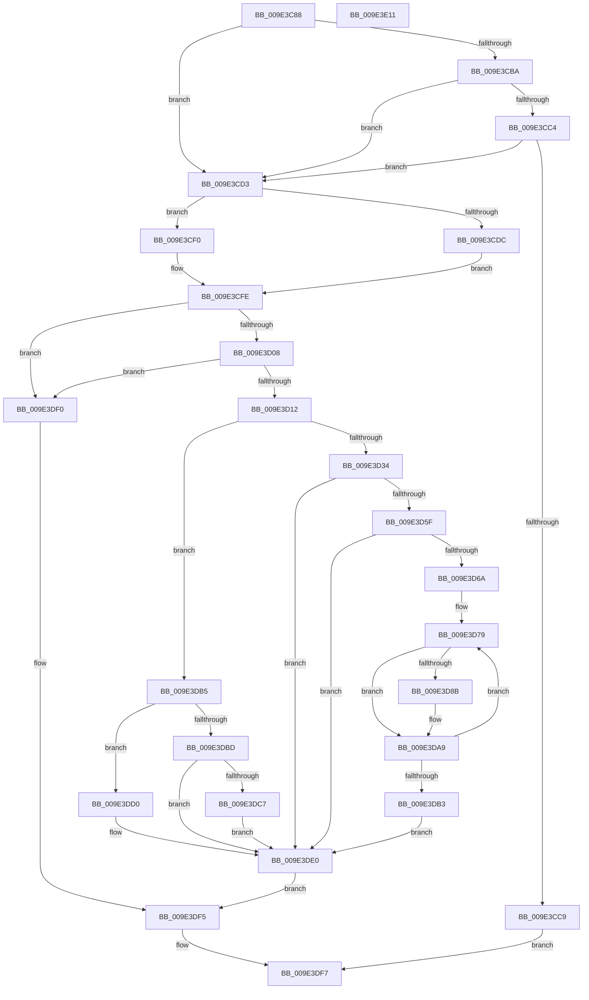

# EtwpEnableDisableUMGL

- RVA: `0x009E3C88`–`0x009E3E12` (길이 `394` bytes)
- VA: `0x00000001409E3C88`
- 실행 섹션: `PAGE`
- PDB 이름 있음: `예`; PDB Function 태그: `아니요`
- unwind 정보 RVA: `0x000A4018`
- 디코드: `101`개 명령, `394/394` bytes 표시
- 미해석 바이트: `0` (있으면 어셈블리에 `.byte`로 보존)

> 이 문서는 커널 이미지의 기계어와 PDB 기호를 분석해 생성했습니다. 4번과 5번은 함수 원형과 자료형을 바이너리 사용 방식에서 추정한 C 해석이며 원본 소스 복구 결과는 아닙니다.

## 1. Dependencies

- 직접 호출 지점: **6**; 고유 호출 대상: **6**
- 직접 호출자로 확인된 함수: **1**
- RIP 상대 이미지 참조: **3**

### Outgoing calls
- `0x009E3D26` → [KeWaitForSingleObject](../../text/20/KeWaitForSingleObject_function_0020E6B0.md) (function, `0x0020E6B0`)
- `0x009E3D80` → [PsLookupProcessByProcessId](../8A/PsLookupProcessByProcessId_function_008A2AA0.md) (function, `0x008A2AA0`)
- `0x009E3D95` → [EtwpUpdateProcessTracingCallback](../7B/EtwpUpdateProcessTracingCallback_function_007B8F40.md) (function, `0x007B8F40`)
- `0x009E3DA4` → [ObfDereferenceObjectWithTag](../../text/2F/ObfDereferenceObjectWithTag_function_002F78E0.md) (function, `0x002F78E0`)
- `0x009E3DC9` → [EtwpDisablePerProcessTracing](../7B/EtwpDisablePerProcessTracing_function_007B8D60.md) (function, `0x007B8D60`)
- `0x009E3DE9` → [KeReleaseMutex](../../text/39/KeReleaseMutex_function_00396810.md) (function, `0x00396810`)

### Direct callers
- [EtwpEnableDisableSpecialGuids](EtwpEnableDisableSpecialGuids_function_009E3A88.md) at `0x009E3B58`

### Static image references
- `0x009E3CD3` → RVA `0x00FC6AA8` (`ALMOSTRO`; read)
- `0x009E3CF0` → RVA `0x00FC5008` (`ALMOSTRO`; read)
- `0x009E3D1D` → RVA `0x00EFF220` (`.data`; read)

## 2. Other-region calls and transfers

- 다른 실행 섹션으로 향하는 call: **3**
  - `0x009E3D26` → [KeWaitForSingleObject](../../text/20/KeWaitForSingleObject_function_0020E6B0.md) (`PAGE` → `.text`)
  - `0x009E3DA4` → [ObfDereferenceObjectWithTag](../../text/2F/ObfDereferenceObjectWithTag_function_002F78E0.md) (`PAGE` → `.text`)
  - `0x009E3DE9` → [KeReleaseMutex](../../text/39/KeReleaseMutex_function_00396810.md) (`PAGE` → `.text`)
- 별도 외부 분기/꼬리 이동을 확인하지 못했습니다.

## 3. Assembly (complete function range)

```asm
009E3C88  48 89 5C 24 08                  mov qword ptr [rsp + 8], rbx
009E3C8D  48 89 74 24 18                  mov qword ptr [rsp + 0x18], rsi
009E3C92  57                              push rdi
009E3C93  41 54                           push r12
009E3C95  41 55                           push r13
009E3C97  41 56                           push r14
009E3C99  41 57                           push r15
009E3C9B  48 83 EC 40                     sub rsp, 0x40
009E3C9F  8B B4 24 90 00 00 00            mov esi, dword ptr [rsp + 0x90]
009E3CA6  45 33 ED                        xor r13d, r13d
009E3CA9  45 0F B7 F0                     movzx r14d, r8w
009E3CAD  45 8A E1                        mov r12b, r9b
009E3CB0  44 8A FA                        mov r15b, dl
009E3CB3  41 8B DD                        mov ebx, r13d
009E3CB6  84 D2                           test dl, dl
009E3CB8  75 19                           jne 0x1409e3cd3
009E3CBA  44 39 AC 24 A0 00 00 00         cmp dword ptr [rsp + 0xa0], r13d
009E3CC2  74 0F                           je 0x1409e3cd3
009E3CC4  83 FE 02                        cmp esi, 2
009E3CC7  72 0A                           jb 0x1409e3cd3
009E3CC9  B8 BB 00 00 C0                  mov eax, 0xc00000bb
009E3CCE  E9 24 01 00 00                  jmp 0x1409e3df7
009E3CD3  48 3B 0D CE 2D 5E 00            cmp rcx, qword ptr [rip + 0x5e2dce]
009E3CDA  74 14                           je 0x1409e3cf0
009E3CDC  48 8B 41 08                     mov rax, qword ptr [rcx + 8]
009E3CE0  48 8B B8 08 05 00 00            mov rdi, qword ptr [rax + 0x508]
009E3CE7  48 81 C7 26 02 00 00            add rdi, 0x226
009E3CEE  EB 0E                           jmp 0x1409e3cfe
009E3CF0  48 8B 3D 11 13 5E 00            mov rdi, qword ptr [rip + 0x5e1311]
009E3CF7  48 81 C7 80 03 00 00            add rdi, 0x380
009E3CFE  44 3B 71 10                     cmp r14d, dword ptr [rcx + 0x10]
009E3D02  0F 83 E8 00 00 00               jae 0x1409e3df0
009E3D08  66 45 85 F6                     test r14w, r14w
009E3D0C  0F 84 DE 00 00 00               je 0x1409e3df0
009E3D12  45 33 C9                        xor r9d, r9d
009E3D15  4C 89 6C 24 20                  mov qword ptr [rsp + 0x20], r13
009E3D1A  45 33 C0                        xor r8d, r8d
009E3D1D  48 8D 0D FC B4 51 00            lea rcx, [rip + 0x51b4fc]
009E3D24  33 D2                           xor edx, edx
009E3D26  E8 85 A9 82 FF                  call 0x14020e6b0
009E3D2B  45 84 FF                        test r15b, r15b
009E3D2E  0F 84 81 00 00 00               je 0x1409e3db5
009E3D34  44 88 74 24 78                  mov byte ptr [rsp + 0x78], r14b
009E3D39  44 88 64 24 79                  mov byte ptr [rsp + 0x79], r12b
009E3D3E  0F B7 44 24 78                  movzx eax, word ptr [rsp + 0x78]
009E3D43  66 89 04 77                     mov word ptr [rdi + rsi*2], ax
009E3D47  4C 89 6C 24 30                  mov qword ptr [rsp + 0x30], r13
009E3D4C  4C 89 6C 24 38                  mov qword ptr [rsp + 0x38], r13
009E3D51  44 39 AC 24 A0 00 00 00         cmp dword ptr [rsp + 0xa0], r13d
009E3D59  0F 84 81 00 00 00               je 0x1409e3de0
009E3D5F  89 74 24 30                     mov dword ptr [rsp + 0x30], esi
009E3D63  C6 44 24 34 01                  mov byte ptr [rsp + 0x34], 1
009E3D68  76 76                           jbe 0x1409e3de0
009E3D6A  48 8B BC 24 98 00 00 00         mov rdi, qword ptr [rsp + 0x98]
009E3D72  8B B4 24 A0 00 00 00            mov esi, dword ptr [rsp + 0xa0]
009E3D79  8B 0F                           mov ecx, dword ptr [rdi]
009E3D7B  48 8D 54 24 38                  lea rdx, [rsp + 0x38]
009E3D80  E8 1B ED EB FF                  call 0x1408a2aa0
009E3D85  8B D8                           mov ebx, eax
009E3D87  85 C0                           test eax, eax
009E3D89  78 1E                           js 0x1409e3da9
009E3D8B  48 8B 4C 24 38                  mov rcx, qword ptr [rsp + 0x38]
009E3D90  48 8D 54 24 30                  lea rdx, [rsp + 0x30]
009E3D95  E8 A6 51 DD FF                  call 0x1407b8f40
009E3D9A  48 8B 4C 24 38                  mov rcx, qword ptr [rsp + 0x38]
009E3D9F  BA 44 66 6C 74                  mov edx, 0x746c6644
009E3DA4  E8 37 3B 91 FF                  call 0x1402f78e0
009E3DA9  48 83 C7 04                     add rdi, 4
009E3DAD  48 83 EE 01                     sub rsi, 1
009E3DB1  75 C6                           jne 0x1409e3d79
009E3DB3  EB 2B                           jmp 0x1409e3de0
009E3DB5  8A 04 77                        mov al, byte ptr [rdi + rsi*2]
009E3DB8  41 3A C6                        cmp al, r14b
009E3DBB  75 13                           jne 0x1409e3dd0
009E3DBD  66 44 89 2C 77                  mov word ptr [rdi + rsi*2], r13w
009E3DC2  83 FE 01                        cmp esi, 1
009E3DC5  77 19                           ja 0x1409e3de0
009E3DC7  8B CE                           mov ecx, esi
009E3DC9  E8 92 4F DD FF                  call 0x1407b8d60
009E3DCE  EB 10                           jmp 0x1409e3de0
009E3DD0  F6 D8                           neg al
009E3DD2  1B DB                           sbb ebx, ebx
009E3DD4  81 E3 58 FD FF FF               and ebx, 0xfffffd58
009E3DDA  81 C3 02 03 00 C0               add ebx, 0xc0000302
009E3DE0  33 D2                           xor edx, edx
009E3DE2  48 8D 0D 37 B4 51 00            lea rcx, [rip + 0x51b437]
009E3DE9  E8 22 2A 9B FF                  call 0x140396810
009E3DEE  EB 05                           jmp 0x1409e3df5
009E3DF0  BB 08 00 00 C0                  mov ebx, 0xc0000008
009E3DF5  8B C3                           mov eax, ebx
009E3DF7  4C 8D 5C 24 40                  lea r11, [rsp + 0x40]
009E3DFC  49 8B 5B 30                     mov rbx, qword ptr [r11 + 0x30]
009E3E00  49 8B 73 40                     mov rsi, qword ptr [r11 + 0x40]
009E3E04  49 8B E3                        mov rsp, r11
009E3E07  41 5F                           pop r15
009E3E09  41 5E                           pop r14
009E3E0B  41 5D                           pop r13
009E3E0D  41 5C                           pop r12
009E3E0F  5F                              pop rdi
009E3E10  C3                              ret
009E3E11  CC                              int3
```

## 4. C-style interpretation (structured pseudocode)

```c
__int64 __fastcall EtwpEnableDisableUMGL(__int64 a1, int a2, int a3, int a4, unsigned int a5, __int64 a6, unsigned int a7)
{
    __int64 result;
    __int64 v_r13;
    __int64 v_rbx;
    __int64 v_rdi;
    __int64 v_rsi;
    __int64 v_rsp;
    unsigned __int64 v_stack_m28;
    unsigned __int64 v_stack_m30;
    unsigned __int8 v_stack_m34;
    unsigned __int64 v_stack_m38;
    unsigned __int64 v_stack_m48;
    unsigned __int8 v_stack_p10;
    unsigned __int8 v_stack_p11;
    unsigned __int64 v_stack_p18;
    unsigned __int64 v_stack_p8;

    v_stack_p8 = v_rbx;
    v_stack_p18 = v_rsi;
    v_rsp = (v_rsp) - (64);
    v_r13 = 0;
    if ((unsigned __int8)(a2) != 0) goto loc_009E3CD3;
    if (a7 == 0) goto loc_009E3CD3;
    if (((unsigned int)((unsigned int)(a5))) < 2) goto loc_009E3CD3;
    goto loc_009E3DF7;
loc_009E3CD3:
    if (a1 == (*(unsigned __int64 *)(v_rip + 6172110))) goto loc_009E3CF0;
    v_rdi = (*(unsigned __int64 *)(*(unsigned __int64 *)(a1 + 8) + 1288)) + (550);
    goto loc_009E3CFE;
loc_009E3CF0:
    v_rdi = (*(unsigned __int64 *)(v_rip + 6165265)) + (896);
loc_009E3CFE:
    if (((unsigned int)((unsigned __int16)(a3))) >= (*(unsigned int *)(a1 + 16))) goto loc_009E3DF0;
    if ((unsigned __int16)((unsigned __int16)(a3)) == 0) goto loc_009E3DF0;
    a4 = 0;
    v_stack_m48 = 0;
    a3 = 0;
    a2 = 0;
    result = KeWaitForSingleObject(v_rip + 5354748, a2, a3, a4);
    if ((unsigned __int8)((unsigned __int8)(a2)) == 0) goto loc_009E3DB5;
    v_stack_p10 = (unsigned __int8)((unsigned __int16)(a3));
    v_stack_p11 = (unsigned __int8)((unsigned __int8)(a4));
    *(unsigned __int16 *)(v_rdi + (unsigned int)(a5) * 2) = (unsigned __int16)(v_stack_p10);
    v_stack_m38 = 0;
    v_stack_m30 = 0;
    if (a7 == 0) goto loc_009E3DE0;
    v_stack_m38 = (unsigned int)((unsigned int)(a5));
    v_stack_m34 = 1;
    if (a7 <= 0) goto loc_009E3DE0;
loc_009E3D79:
    result = PsLookupProcessByProcessId((unsigned int)(*(unsigned int *)(a6)), v_stack_m30, a3, a4);
    if (!(sign_flag)) {
        a1 = v_stack_m30;
        a2 = v_stack_m38;
        result = EtwpUpdateProcessTracingCallback(a1, a2, a3, a4);
        a1 = v_stack_m30;
        a2 = 0x746C6644ULL;
        result = ObfDereferenceObjectWithTag(a1, a2, a3, a4);
    }
    v_rdi = (a6) + (4);
    v_rsi = ((unsigned int)(a7)) - (1);
    if (condition_is_not_equal) goto loc_009E3D79;
    goto loc_009E3DE0;
loc_009E3DB5:
    if (((unsigned __int8)(*(unsigned __int8 *)(v_rdi + v_rsi * 2))) != ((unsigned __int8)((unsigned __int16)(a3)))) goto loc_009E3DD0;
    *(unsigned __int16 *)(v_rdi + v_rsi * 2) = 0;
    if (((unsigned int)(v_rsi)) > 1) goto loc_009E3DE0;
    result = EtwpDisablePerProcessTracing((unsigned int)((unsigned int)(v_rsi)), a2, a3, a4);
    goto loc_009E3DE0;
loc_009E3DD0:
    result = (unsigned __int8)(-(result));
    v_rbx = (unsigned int)(((unsigned int)((unsigned int)(result))) & (0xFFFFFD58ULL));
    v_rbx = (unsigned int)((v_rbx) + (0xC0000302ULL));
loc_009E3DE0:
    a2 = 0;
    result = KeReleaseMutex(v_rip + 5354551, a2, a3, a4);
    goto loc_009E3DF5;
loc_009E3DF0:
loc_009E3DF5:
loc_009E3DF7:
    return (unsigned int)((unsigned int)((unsigned int)(0xC0000008ULL)));
}
```

## 5. (Beta) C Style

```c
int64_t EtwpEnableDisableUMGL(int64_t Arg1, int32_t Arg2, int32_t Arg3, int32_t Arg4, uint32_t Arg5, void *Arg6, uint32_t Arg7)
{
    uint8_t *arg6 = (uint8_t *)Arg6;

    int64_t result;
    int64_t local_r13;
    int64_t local_rbx;
    int64_t local_rdi;
    int64_t local_rsi;
    int64_t local_rsp;
    uint64_t v_stack_m28;
    uint64_t v_stack_m30;
    uint8_t v_stack_m34;
    uint64_t v_stack_m38;
    uint64_t v_stack_m48;
    uint8_t v_stack_p10;
    uint8_t v_stack_p11;
    uint64_t v_stack_p18;
    uint64_t v_stack_p8;

    v_stack_p8 = local_rbx;
    v_stack_p18 = local_rsi;
    local_rsp = (local_rsp) - (64);
    local_r13 = 0;
    if ((uint8_t)(Arg2) != 0) goto loc_009E3CD3;
    if (Arg7 == 0) goto loc_009E3CD3;
    if (((uint32_t)((uint32_t)(Arg5))) < 2) goto loc_009E3CD3;
    goto loc_009E3DF7;
loc_009E3CD3:
    if (Arg1 == (*(uint64_t *)(v_rip + 0x5E2DCE))) goto loc_009E3CF0;
    local_rdi = (*(uint64_t *)(*(uint64_t *)(Arg1 + 0x8) + 0x508)) + (550);
    goto loc_009E3CFE;
loc_009E3CF0:
    local_rdi = (*(uint64_t *)(v_rip + 0x5E1311)) + (896);
loc_009E3CFE:
    if (((uint32_t)((uint16_t)(Arg3))) >= (*(uint32_t *)(Arg1 + 0x10))) goto loc_009E3DF0;
    if ((uint16_t)((uint16_t)(Arg3)) == 0) goto loc_009E3DF0;
    Arg4 = 0;
    v_stack_m48 = 0;
    Arg3 = 0;
    Arg2 = 0;
    result = KeWaitForSingleObject(v_rip + 5354748, Arg2, Arg3, Arg4);
    if ((uint8_t)((uint8_t)(Arg2)) == 0) goto loc_009E3DB5;
    v_stack_p10 = (uint8_t)((uint16_t)(Arg3));
    v_stack_p11 = (uint8_t)((uint8_t)(Arg4));
    *(uint16_t *)(local_rdi + (uint32_t)(Arg5) * 2) = (uint16_t)(v_stack_p10);
    v_stack_m38 = 0;
    v_stack_m30 = 0;
    if (Arg7 == 0) goto loc_009E3DE0;
    v_stack_m38 = (uint32_t)((uint32_t)(Arg5));
    v_stack_m34 = 1;
    if (Arg7 <= 0) goto loc_009E3DE0;
loc_009E3D79:
    result = PsLookupProcessByProcessId((uint32_t)(*(uint32_t *)(arg6)), v_stack_m30, Arg3, Arg4);
    if (!(sign_flag)) {
        Arg1 = v_stack_m30;
        Arg2 = v_stack_m38;
        result = EtwpUpdateProcessTracingCallback(Arg1, Arg2, Arg3, Arg4);
        Arg1 = v_stack_m30;
        Arg2 = 0x746C6644ULL;
        result = ObfDereferenceObjectWithTag(Arg1, Arg2, Arg3, Arg4);
    }
    local_rdi = (Arg6) + (4);
    local_rsi = ((uint32_t)(Arg7)) - (1);
    if (condition_is_not_equal) goto loc_009E3D79;
    goto loc_009E3DE0;
loc_009E3DB5:
    if (((uint8_t)(*(uint8_t *)(local_rdi + local_rsi * 2))) != ((uint8_t)((uint16_t)(Arg3)))) goto loc_009E3DD0;
    *(uint16_t *)(local_rdi + local_rsi * 2) = 0;
    if (((uint32_t)(local_rsi)) > 1) goto loc_009E3DE0;
    result = EtwpDisablePerProcessTracing((uint32_t)((uint32_t)(local_rsi)), Arg2, Arg3, Arg4);
    goto loc_009E3DE0;
loc_009E3DD0:
    result = (uint8_t)(-(result));
    local_rbx = (uint32_t)(((uint32_t)((uint32_t)(result))) & (0xFFFFFD58ULL));
    local_rbx = (uint32_t)((local_rbx) + (0xC0000302ULL));
loc_009E3DE0:
    Arg2 = 0;
    result = KeReleaseMutex(v_rip + 5354551, Arg2, Arg3, Arg4);
    goto loc_009E3DF5;
loc_009E3DF0:
loc_009E3DF5:
loc_009E3DF7:
    return (uint32_t)((uint32_t)((uint32_t)(0xC0000008ULL)));
}
```

### 관측된 메모리 오프셋

구조체 형식이 확인되지 않은 접근은 인자 기준의 오프셋으로만 기록했습니다.

| 기준 인자 | 오프셋 표현 | 폭 (bit) | 접근 |
|---|---:|---:|---|
| `Arg6` | `+ 0x0` | `32` | `R` |

## 6. Execution-region graph

[열기: 2D/3D 그래프와 함수 탐색 컨트롤 패널](../../../control-panel.html?section=page&rva=0x009E3C88&view=graph)

- 2D 그래프는 위에서 아래로 흐르고, 3D 그래프는 빈 공간을 드래그해 회전합니다. Shift+드래그는 이동, 휠은 확대·축소, 함수 노드 선택은 대상 보고서 이동입니다.

### Static fallback


