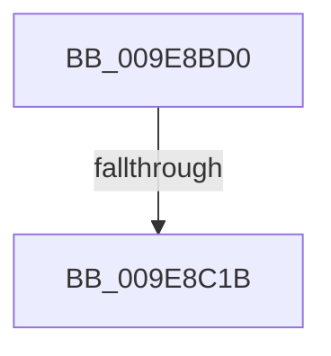

# EtwpGetTraceGuidInfo

- RVA: `0x009E8BD0`–`0x009E8C24` (길이 `84` bytes)
- VA: `0x00000001409E8BD0`
- 실행 섹션: `PAGE`
- PDB 이름 있음: `예`; PDB Function 태그: `아니요`
- unwind 정보 RVA: `0x000A4EFC`
- 디코드: `24`개 명령, `84/84` bytes 표시
- 미해석 바이트: `0` (있으면 어셈블리에 `.byte`로 보존)

> 이 문서는 커널 이미지의 기계어와 PDB 기호를 분석해 생성했습니다. 4번과 5번은 함수 원형과 자료형을 바이너리 사용 방식에서 추정한 C 해석이며 원본 소스 복구 결과는 아닙니다.

## 1. Dependencies

- 직접 호출 지점: **0**; 고유 호출 대상: **0**
- 직접 호출자로 확인된 함수: **1**
- RIP 상대 이미지 참조: **1**

### Outgoing calls
- 직접 디코드된 call 명령이 없습니다.

### Direct callers
- [NtTraceControl](../A9/NtTraceControl_function_00A9ED40.md) at `0x00A9F361`

### Static image references
- `0x009E8BF7` → RVA `0x00FC6AA8` (`ALMOSTRO`; read)

## 2. Other-region calls and transfers

- 다른 실행 섹션으로 향하는 call: **0**
- call이 아닌 외부 분기/꼬리 이동: **1**
  - `0x009E8C15` → [sub_009E9269](Unknown_function_009E9269.md) (`tail-transfer`)

## 3. Assembly (complete function range)

```asm
009E8BD0  4C 89 4C 24 20                  mov qword ptr [rsp + 0x20], r9
009E8BD5  4C 89 44 24 18                  mov qword ptr [rsp + 0x18], r8
009E8BDA  53                              push rbx
009E8BDB  55                              push rbp
009E8BDC  56                              push rsi
009E8BDD  41 54                           push r12
009E8BDF  41 55                           push r13
009E8BE1  41 56                           push r14
009E8BE3  41 57                           push r15
009E8BE5  48 83 EC 30                     sub rsp, 0x30
009E8BE9  45 8B 21                        mov r12d, dword ptr [r9]
009E8BEC  4D 8B F8                        mov r15, r8
009E8BEF  45 33 C9                        xor r9d, r9d
009E8BF2  44 89 64 24 70                  mov dword ptr [rsp + 0x70], r12d
009E8BF7  48 3B 0D AA DE 5D 00            cmp rcx, qword ptr [rip + 0x5ddeaa]
009E8BFE  48 8B F2                        mov rsi, rdx
009E8C01  48 8B E9                        mov rbp, rcx
009E8C04  44 89 4C 24 20                  mov dword ptr [rsp + 0x20], r9d
009E8C09  45 8B E9                        mov r13d, r9d
009E8C0C  44 89 4C 24 24                  mov dword ptr [rsp + 0x24], r9d
009E8C11  41 8D 59 08                     lea ebx, [r9 + 8]
009E8C15  0F 85 4E 06 00 00               jne 0x1409e9269
009E8C1B  41 BE 80 03 FE 7F               mov r14d, 0x7ffe0380
009E8C21  41 8B D1                        mov edx, r9d
```

## 4. C-style interpretation (structured pseudocode)

```c
void __fastcall EtwpGetTraceGuidInfo(__int64 a1, __int64 a2, __int64 a3, __int64 a4)
{
    __int64 v_rsp;
    unsigned int v_stack_m44;
    unsigned int v_stack_m48;
    unsigned __int64 v_stack_p18;
    unsigned __int64 v_stack_p20;
    unsigned int v_stack_p8;

    v_stack_p20 = a4;
    v_stack_p18 = a3;
    v_rsp = (v_rsp) - (48);
    a4 = 0;
    v_stack_p8 = (unsigned int)((unsigned int)(*(unsigned int *)(a4)));
    v_stack_m48 = 0;
    v_stack_m44 = 0;
    return;
}
```

## 5. (Beta) C Style

```c
void EtwpGetTraceGuidInfo(int64_t Arg1, int64_t Arg2, int64_t Arg3, void *Arg4)
{
    uint8_t *arg4 = (uint8_t *)Arg4;

    int64_t local_rsp;
    uint32_t v_stack_m44;
    uint32_t v_stack_m48;
    uint64_t v_stack_p18;
    uint64_t v_stack_p20;
    uint32_t v_stack_p8;

    v_stack_p20 = Arg4;
    v_stack_p18 = Arg3;
    local_rsp = (local_rsp) - (48);
    Arg4 = 0;
    v_stack_p8 = (uint32_t)((uint32_t)(*(uint32_t *)(arg4)));
    v_stack_m48 = 0;
    v_stack_m44 = 0;
    return;
}
```

### 관측된 메모리 오프셋

구조체 형식이 확인되지 않은 접근은 인자 기준의 오프셋으로만 기록했습니다.

| 기준 인자 | 오프셋 표현 | 폭 (bit) | 접근 |
|---|---:|---:|---|
| `Arg4` | `+ 0x0` | `32` | `R` |

## 6. Execution-region graph

[열기: 2D/3D 그래프와 함수 탐색 컨트롤 패널](../../../control-panel.html?section=page&rva=0x009E8BD0&view=graph)

- 2D 그래프는 위에서 아래로 흐르고, 3D 그래프는 빈 공간을 드래그해 회전합니다. Shift+드래그는 이동, 휠은 확대·축소, 함수 노드 선택은 대상 보고서 이동입니다.

### Static fallback


