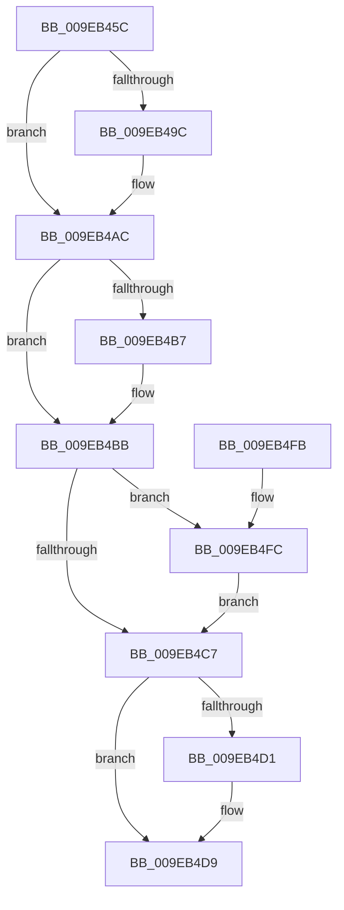

# EtwpIsGuidAllowed

- RVA: `0x009EB45C`–`0x009EB529` (길이 `205` bytes)
- VA: `0x00000001409EB45C`
- 실행 섹션: `PAGE`
- PDB 이름 있음: `예`; PDB Function 태그: `아니요`
- unwind 정보 RVA: `0x000A551C`
- 디코드: `61`개 명령, `205/205` bytes 표시
- 미해석 바이트: `0` (있으면 어셈블리에 `.byte`로 보존)

> 이 문서는 커널 이미지의 기계어와 PDB 기호를 분석해 생성했습니다. 4번과 5번은 함수 원형과 자료형을 바이너리 사용 방식에서 추정한 C 해석이며 원본 소스 복구 결과는 아닙니다.

## 1. Dependencies

- 직접 호출 지점: **5**; 고유 호출 대상: **5**
- 직접 호출자로 확인된 함수: **3**
- RIP 상대 이미지 참조: **1**

### Outgoing calls
- `0x009EB487` → [KeAbPreAcquire](../../text/21/KeAbPreAcquire_function_00210230.md) (function, `0x00210230`)
- `0x009EB4A7` → [ExfAcquirePushLockSharedEx](../../text/21/ExfAcquirePushLockSharedEx_function_0021044C.md) (function, `0x0021044C`)
- `0x009EB4D4` → [ExfReleasePushLockShared](../../text/26/ExfReleasePushLockShared_function_00263440.md) (function, `0x00263440`)
- `0x009EB4DC` → [KeAbPostRelease](../../text/2E/KeAbPostRelease_function_002E1600.md) (function, `0x002E1600`)
- `0x009EB51B` → [bsearch](../../text/50/bsearch_function_00500430.md) (function, `0x00500430`)

### Direct callers
- [EtwpNotifyDisallowedGuidChange](EtwpNotifyDisallowedGuidChange_function_009EAD14.md) at `0x009EADFB`
- [EtwpIsRegEntryAllowed](EtwpIsRegEntryAllowed_function_009EB2D0.md) at `0x009EB3AD`
- [EtwpAddRegEntryToGroup](../9F/EtwpAddRegEntryToGroup_function_009F39D4.md) at `0x009F3BF4`
- [EtwpAddRegEntryToGroup](../9F/EtwpAddRegEntryToGroup_function_009F39D4.md) at `0x009F3D39`

### Static image references
- `0x009EB503` → RVA `0x009E4860` (`EtwpCompareGuid`; read)

## 2. Other-region calls and transfers

- 다른 실행 섹션으로 향하는 call: **5**
  - `0x009EB487` → [KeAbPreAcquire](../../text/21/KeAbPreAcquire_function_00210230.md) (`PAGE` → `.text`)
  - `0x009EB4A7` → [ExfAcquirePushLockSharedEx](../../text/21/ExfAcquirePushLockSharedEx_function_0021044C.md) (`PAGE` → `.text`)
  - `0x009EB4D4` → [ExfReleasePushLockShared](../../text/26/ExfReleasePushLockShared_function_00263440.md) (`PAGE` → `.text`)
  - `0x009EB4DC` → [KeAbPostRelease](../../text/2E/KeAbPostRelease_function_002E1600.md) (`PAGE` → `.text`)
  - `0x009EB51B` → [bsearch](../../text/50/bsearch_function_00500430.md) (`PAGE` → `.text`)
- 별도 외부 분기/꼬리 이동을 확인하지 못했습니다.

## 3. Assembly (complete function range)

```asm
009EB45C  48 89 5C 24 10                  mov qword ptr [rsp + 0x10], rbx
009EB461  48 89 6C 24 18                  mov qword ptr [rsp + 0x18], rbp
009EB466  56                              push rsi
009EB467  57                              push rdi
009EB468  41 54                           push r12
009EB46A  41 56                           push r14
009EB46C  41 57                           push r15
009EB46E  48 83 EC 30                     sub rsp, 0x30
009EB472  48 8D 99 B0 02 00 00            lea rbx, [rcx + 0x2b0]
009EB479  4C 8B F2                        mov r14, rdx
009EB47C  48 8B E9                        mov rbp, rcx
009EB47F  45 33 C0                        xor r8d, r8d
009EB482  48 8B CB                        mov rcx, rbx
009EB485  33 D2                           xor edx, edx
009EB487  E8 A4 4D 82 FF                  call 0x140210230
009EB48C  48 8B F0                        mov rsi, rax
009EB48F  33 C0                           xor eax, eax
009EB491  44 8D 60 11                     lea r12d, [rax + 0x11]
009EB495  F0 4C 0F B1 23                  lock cmpxchg qword ptr [rbx], r12
009EB49A  74 10                           je 0x1409eb4ac
009EB49C  4C 8B CB                        mov r9, rbx
009EB49F  4C 8B C6                        mov r8, rsi
009EB4A2  33 D2                           xor edx, edx
009EB4A4  48 8B CB                        mov rcx, rbx
009EB4A7  E8 A0 4F 82 FF                  call 0x14021044c
009EB4AC  45 33 FF                        xor r15d, r15d
009EB4AF  40 B7 01                        mov dil, 1
009EB4B2  48 85 F6                        test rsi, rsi
009EB4B5  74 04                           je 0x1409eb4bb
009EB4B7  40 88 7E 0A                     mov byte ptr [rsi + 0xa], dil
009EB4BB  0F B7 85 30 05 00 00            movzx eax, word ptr [rbp + 0x530]
009EB4C2  66 85 C0                        test ax, ax
009EB4C5  75 35                           jne 0x1409eb4fc
009EB4C7  49 8B C4                        mov rax, r12
009EB4CA  F0 4C 0F B1 3B                  lock cmpxchg qword ptr [rbx], r15
009EB4CF  74 08                           je 0x1409eb4d9
009EB4D1  48 8B CB                        mov rcx, rbx
009EB4D4  E8 67 7F 87 FF                  call 0x140263440
009EB4D9  48 8B CB                        mov rcx, rbx
009EB4DC  E8 1F 61 8F FF                  call 0x1402e1600
009EB4E1  48 8B 5C 24 68                  mov rbx, qword ptr [rsp + 0x68]
009EB4E6  40 8A C7                        mov al, dil
009EB4E9  48 8B 6C 24 70                  mov rbp, qword ptr [rsp + 0x70]
009EB4EE  48 83 C4 30                     add rsp, 0x30
009EB4F2  41 5F                           pop r15
009EB4F4  41 5E                           pop r14
009EB4F6  41 5C                           pop r12
009EB4F8  5F                              pop rdi
009EB4F9  5E                              pop rsi
009EB4FA  C3                              ret
009EB4FB  CC                              int3
009EB4FC  48 8B 95 38 05 00 00            mov rdx, qword ptr [rbp + 0x538]
009EB503  48 8D 0D 56 93 FF FF            lea rcx, [rip - 0x6caa]
009EB50A  48 89 4C 24 20                  mov qword ptr [rsp + 0x20], rcx
009EB50F  4C 8B C0                        mov r8, rax
009EB512  49 8B CE                        mov rcx, r14
009EB515  41 B9 10 00 00 00               mov r9d, 0x10
009EB51B  E8 10 4F B1 FF                  call 0x140500430
009EB520  48 85 C0                        test rax, rax
009EB523  40 0F 94 C7                     sete dil
009EB527  EB 9E                           jmp 0x1409eb4c7
```

## 4. C-style interpretation (structured pseudocode)

```c
__int64 __fastcall EtwpIsGuidAllowed(__int64 a1, __int64 a2, int a3)
{
    __int64 result;
    __int64 v_r15;
    __int64 v_rdi;
    __int64 v_rsp;
    unsigned __int64 v_stack_p10;
    unsigned __int64 v_stack_p18;
    unsigned __int64 v_stack_p20;

    v_stack_p10 = v_rbx;
    v_stack_p18 = v_rbp;
    v_rsp = (v_rsp) - (48);
    a3 = 0;
    a2 = 0;
    result = KeAbPreAcquire(a1 + 688, a2, a3, a4);
    result = 0;
    if (!(condition_is_equal)) {
        a4 = a1 + 688;
        a3 = 0;
        a2 = 0;
        a1 = a1 + 688;
        result = ExfAcquirePushLockSharedEx(a1, a2, a3, a4);
    }
    v_r15 = 0;
    if (result != 0) {
        *(unsigned __int8 *)(result + 10) = 1;
    }
    if ((unsigned __int16)(*(unsigned __int16 *)(a1 + 1328)) != 0) goto loc_009EB4FC;
loc_009EB4C7:
    result = result + 17;
    if ((unsigned __int16)(*(unsigned __int16 *)(a1 + 1328)) != 0) {
        a1 = a1 + 688;
        result = ExfReleasePushLockShared(a1, a2, a3, a4);
    }
    result = KeAbPostRelease(a1 + 688, a2, a3, a4);
    v_rsp = (v_rsp) + (48);
    return 1;
loc_009EB4FC:
    v_stack_p20 = v_rip - 27818;
    result = bsearch(0, *(unsigned __int64 *)(v_stack_p18 + 1336), 1, 16);
    v_rdi = (result == 0) ? 1 : 0;
    goto loc_009EB4C7;
}
```

## 5. (Beta) C Style

```c
int64_t EtwpIsGuidAllowed(void *Arg1, int64_t Arg2, int32_t Arg3)
{
    uint8_t *arg1 = (uint8_t *)Arg1;

    int64_t result;
    int64_t local_r15;
    int64_t local_rdi;
    int64_t local_rsp;
    uint64_t v_stack_p10;
    uint64_t v_stack_p18;
    uint64_t v_stack_p20;

    v_stack_p10 = local_rbx;
    v_stack_p18 = local_rbp;
    local_rsp = (local_rsp) - (48);
    Arg3 = 0;
    Arg2 = 0;
    result = KeAbPreAcquire(Arg1 + 688, Arg2, Arg3, a4);
    result = 0;
    if (!(condition_is_equal)) {
        a4 = Arg1 + 688;
        Arg3 = 0;
        Arg2 = 0;
        Arg1 = Arg1 + 688;
        result = ExfAcquirePushLockSharedEx(Arg1, Arg2, Arg3, a4);
    }
    local_r15 = 0;
    if (result != 0) {
        *(uint8_t *)(result + 0xA) = 1;
    }
    if ((uint16_t)(*(uint16_t *)(arg1 + 0x530)) != 0) goto loc_009EB4FC;
loc_009EB4C7:
    result = result + 17;
    if ((uint16_t)(*(uint16_t *)(arg1 + 0x530)) != 0) {
        Arg1 = Arg1 + 688;
        result = ExfReleasePushLockShared(Arg1, Arg2, Arg3, a4);
    }
    result = KeAbPostRelease(Arg1 + 688, Arg2, Arg3, a4);
    local_rsp = (local_rsp) + (48);
    return 1;
loc_009EB4FC:
    v_stack_p20 = v_rip - 27818;
    result = bsearch(0, *(uint64_t *)(v_stack_p18 + 0x538), 1, 16);
    local_rdi = (result == 0) ? 1 : 0;
    goto loc_009EB4C7;
}
```

### 관측된 메모리 오프셋

구조체 형식이 확인되지 않은 접근은 인자 기준의 오프셋으로만 기록했습니다.

| 기준 인자 | 오프셋 표현 | 폭 (bit) | 접근 |
|---|---:|---:|---|
| `Arg1` | `+ 0x0` | `64` | `R` |
| `Arg1` | `+ 0x2B0` | `64` | `R` |
| `Arg1` | `+ 0x530` | `16` | `R` |
| `Arg1` | `+ 0x538` | `64` | `R` |

## 6. Execution-region graph

[열기: 2D/3D 그래프와 함수 탐색 컨트롤 패널](../../../control-panel.html?section=page&rva=0x009EB45C&view=graph)

- 2D 그래프는 위에서 아래로 흐르고, 3D 그래프는 빈 공간을 드래그해 회전합니다. Shift+드래그는 이동, 휠은 확대·축소, 함수 노드 선택은 대상 보고서 이동입니다.

### Static fallback


