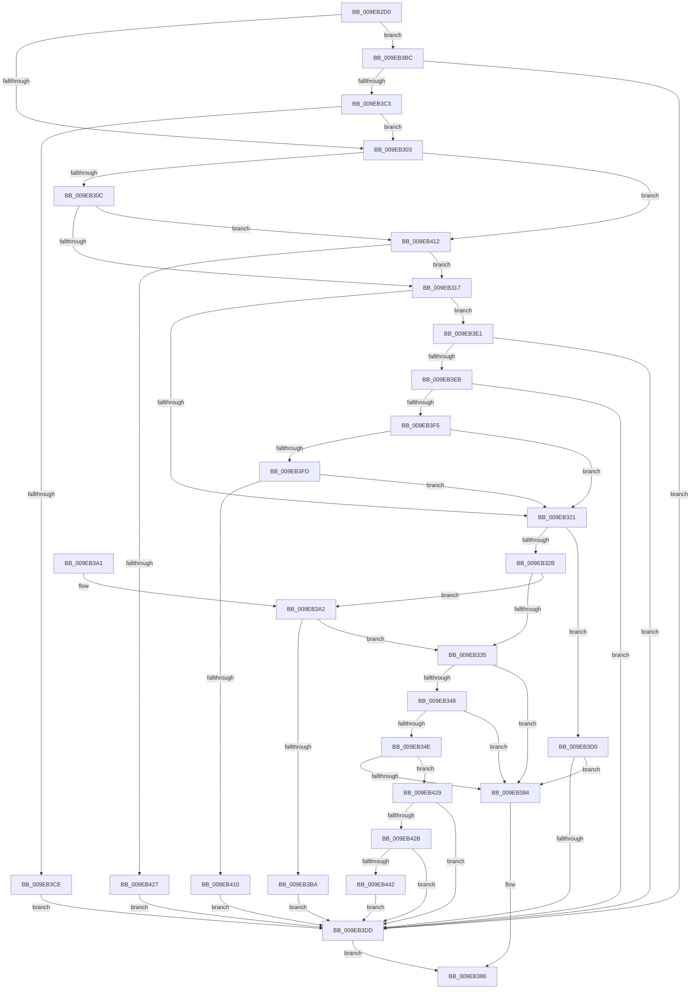

# EtwpIsRegEntryAllowed

- RVA: `0x009EB2D0`–`0x009EB455` (길이 `389` bytes)
- VA: `0x00000001409EB2D0`
- 실행 섹션: `PAGE`
- PDB 이름 있음: `예`; PDB Function 태그: `아니요`
- unwind 정보 RVA: `0x000A5500`
- 디코드: `98`개 명령, `389/389` bytes 표시
- 미해석 바이트: `0` (있으면 어셈블리에 `.byte`로 보존)

> 이 문서는 커널 이미지의 기계어와 PDB 기호를 분석해 생성했습니다. 4번과 5번은 함수 원형과 자료형을 바이너리 사용 방식에서 추정한 C 해석이며 원본 소스 복구 결과는 아닙니다.

## 1. Dependencies

- 직접 호출 지점: **8**; 고유 호출 대상: **8**
- 직접 호출자로 확인된 함수: **1**
- RIP 상대 이미지 참조: **2**

### Outgoing calls
- `0x009EB359` → [SeCaptureSubjectContextEx](../8C/SeCaptureSubjectContextEx_function_008C4C90.md) (function, `0x008C4C90`)
- `0x009EB36B` → [EtwpCheckGuidAccess](../8C/EtwpCheckGuidAccess_function_008C697C.md) (function, `0x008C697C`)
- `0x009EB377` → [SeReleaseSubjectContext](../86/SeReleaseSubjectContext_function_0086B710.md) (function, `0x0086B710`)
- `0x009EB3AD` → [EtwpIsGuidAllowed](EtwpIsGuidAllowed_function_009EB45C.md) (function, `0x009EB45C`)
- `0x009EB3D4` → [EtwpCheckCurrentUserProcessAccess](EtwpCheckCurrentUserProcessAccess_function_009EB530.md) (function, `0x009EB530`)
- `0x009EB41A` → [EtwpApplyTransientFilters](../8C/EtwpApplyTransientFilters_function_008C8994.md) (function, `0x008C8994`)
- `0x009EB439` → [EtwEventEnabled](../../text/39/EtwEventEnabled_function_00392450.md) (function, `0x00392450`)
- `0x009EB44E` → [EtwpEventWriteProviderAccessCheckStatus](../7B/EtwpEventWriteProviderAccessCheckStatus_function_007B5D04.md) (function, `0x007B5D04`)

### Direct callers
- [EtwpEnableGuid](../A5/EtwpEnableGuid_function_00A5CD28.md) at `0x00A5D42A`

### Static image references
- `0x009EB42B` → RVA `0x00EFF840` (`.data`; read)
- `0x009EB432` → RVA `0x00014790` (`.rdata`; read)

## 2. Other-region calls and transfers

- 다른 실행 섹션으로 향하는 call: **1**
  - `0x009EB439` → [EtwEventEnabled](../../text/39/EtwEventEnabled_function_00392450.md) (`PAGE` → `.text`)
- 별도 외부 분기/꼬리 이동을 확인하지 못했습니다.

## 3. Assembly (complete function range)

```asm
009EB2D0  48 8B C4                        mov rax, rsp
009EB2D3  48 89 58 08                     mov qword ptr [rax + 8], rbx
009EB2D7  48 89 68 10                     mov qword ptr [rax + 0x10], rbp
009EB2DB  48 89 70 18                     mov qword ptr [rax + 0x18], rsi
009EB2DF  48 89 78 20                     mov qword ptr [rax + 0x20], rdi
009EB2E3  41 56                           push r14
009EB2E5  48 83 EC 50                     sub rsp, 0x50
009EB2E9  F6 41 62 01                     test byte ptr [rcx + 0x62], 1
009EB2ED  4D 8B F1                        mov r14, r9
009EB2F0  41 8B 71 48                     mov esi, dword ptr [r9 + 0x48]
009EB2F4  49 8B F8                        mov rdi, r8
009EB2F7  48 8B EA                        mov rbp, rdx
009EB2FA  48 8B D9                        mov rbx, rcx
009EB2FD  0F 85 B9 00 00 00               jne 0x1409eb3bc
009EB303  83 FE 02                        cmp esi, 2
009EB306  0F 84 06 01 00 00               je 0x1409eb412
009EB30C  41 80 78 12 00                  cmp byte ptr [r8 + 0x12], 0
009EB311  0F 85 FB 00 00 00               jne 0x1409eb412
009EB317  F6 43 62 08                     test byte ptr [rbx + 0x62], 8
009EB31B  0F 85 C0 00 00 00               jne 0x1409eb3e1
009EB321  80 7F 12 00                     cmp byte ptr [rdi + 0x12], 0
009EB325  0F 85 A5 00 00 00               jne 0x1409eb3d0
009EB32B  80 BC 24 90 00 00 00 02         cmp byte ptr [rsp + 0x90], 2
009EB333  74 6D                           je 0x1409eb3a2
009EB335  80 7F 10 00                     cmp byte ptr [rdi + 0x10], 0
009EB339  0F 57 C0                        xorps xmm0, xmm0
009EB33C  0F 11 44 24 30                  movups xmmword ptr [rsp + 0x30], xmm0
009EB341  0F 11 44 24 40                  movups xmmword ptr [rsp + 0x40], xmm0
009EB346  74 3C                           je 0x1409eb384
009EB348  F6 43 62 01                     test byte ptr [rbx + 0x62], 1
009EB34C  75 36                           jne 0x1409eb384
009EB34E  48 8B 53 50                     mov rdx, qword ptr [rbx + 0x50]
009EB352  4C 8D 44 24 30                  lea r8, [rsp + 0x30]
009EB357  33 C9                           xor ecx, ecx
009EB359  E8 32 99 ED FF                  call 0x1408c4c90
009EB35E  4C 8D 44 24 30                  lea r8, [rsp + 0x30]
009EB363  BA 00 02 00 00                  mov edx, 0x200
009EB368  48 8B CF                        mov rcx, rdi
009EB36B  E8 0C B6 ED FF                  call 0x1408c697c
009EB370  48 8D 4C 24 30                  lea rcx, [rsp + 0x30]
009EB375  8B F8                           mov edi, eax
009EB377  E8 94 03 E8 FF                  call 0x14086b710
009EB37C  85 FF                           test edi, edi
009EB37E  0F 85 A5 00 00 00               jne 0x1409eb429
009EB384  B0 01                           mov al, 1
009EB386  48 8B 5C 24 60                  mov rbx, qword ptr [rsp + 0x60]
009EB38B  48 8B 6C 24 68                  mov rbp, qword ptr [rsp + 0x68]
009EB390  48 8B 74 24 70                  mov rsi, qword ptr [rsp + 0x70]
009EB395  48 8B 7C 24 78                  mov rdi, qword ptr [rsp + 0x78]
009EB39A  48 83 C4 50                     add rsp, 0x50
009EB39E  41 5E                           pop r14
009EB3A0  C3                              ret
009EB3A1  CC                              int3
009EB3A2  48 8B 53 20                     mov rdx, qword ptr [rbx + 0x20]
009EB3A6  48 8B CD                        mov rcx, rbp
009EB3A9  48 83 C2 28                     add rdx, 0x28
009EB3AD  E8 AA 00 00 00                  call 0x1409eb45c
009EB3B2  84 C0                           test al, al
009EB3B4  0F 85 7B FF FF FF               jne 0x1409eb335
009EB3BA  EB 21                           jmp 0x1409eb3dd
009EB3BC  41 80 78 11 00                  cmp byte ptr [r8 + 0x11], 0
009EB3C1  75 1A                           jne 0x1409eb3dd
009EB3C3  41 80 78 12 00                  cmp byte ptr [r8 + 0x12], 0
009EB3C8  0F 84 35 FF FF FF               je 0x1409eb303
009EB3CE  EB 0D                           jmp 0x1409eb3dd
009EB3D0  48 8B 4B 50                     mov rcx, qword ptr [rbx + 0x50]
009EB3D4  E8 57 01 00 00                  call 0x1409eb530
009EB3D9  85 C0                           test eax, eax
009EB3DB  74 A7                           je 0x1409eb384
009EB3DD  32 C0                           xor al, al
009EB3DF  EB A5                           jmp 0x1409eb386
009EB3E1  80 BC 24 90 00 00 00 02         cmp byte ptr [rsp + 0x90], 2
009EB3E9  74 F2                           je 0x1409eb3dd
009EB3EB  80 BC 24 88 00 00 00 00         cmp byte ptr [rsp + 0x88], 0
009EB3F3  75 E8                           jne 0x1409eb3dd
009EB3F5  85 F6                           test esi, esi
009EB3F7  0F 85 24 FF FF FF               jne 0x1409eb321
009EB3FD  48 8B 43 20                     mov rax, qword ptr [rbx + 0x20]
009EB401  0F B7 48 58                     movzx ecx, word ptr [rax + 0x58]
009EB405  66 41 39 4E 68                  cmp word ptr [r14 + 0x68], cx
009EB40A  0F 84 11 FF FF FF               je 0x1409eb321
009EB410  EB CB                           jmp 0x1409eb3dd
009EB412  48 8B 94 24 80 00 00 00         mov rdx, qword ptr [rsp + 0x80]
009EB41A  E8 75 D5 ED FF                  call 0x1408c8994
009EB41F  84 C0                           test al, al
009EB421  0F 85 F0 FE FF FF               jne 0x1409eb317
009EB427  EB B4                           jmp 0x1409eb3dd
009EB429  79 B2                           jns 0x1409eb3dd
009EB42B  48 8B 0D 0E 44 51 00            mov rcx, qword ptr [rip + 0x51440e]
009EB432  48 8D 15 57 93 62 FF            lea rdx, [rip - 0x9d6ca9]
009EB439  E8 12 70 9A FF                  call 0x140392450
009EB43E  84 C0                           test al, al
009EB440  74 9B                           je 0x1409eb3dd
009EB442  89 7C 24 28                     mov dword ptr [rsp + 0x28], edi
009EB446  4C 8B CB                        mov r9, rbx
009EB449  48 89 6C 24 20                  mov qword ptr [rsp + 0x20], rbp
009EB44E  E8 B1 A8 DC FF                  call 0x1407b5d04
009EB453  EB 88                           jmp 0x1409eb3dd
```

## 4. C-style interpretation (structured pseudocode)

```c
__int64 __fastcall EtwpIsRegEntryAllowed(__int64 a1, __int64 a2, __int64 a3, __int64 a4, __int64 a5, unsigned __int8 a6, unsigned __int8 a7)
{
    __int64 result;
    __int64 v_rsp;
    unsigned __int64 v_stack_m18;
    unsigned __int64 v_stack_m28;
    unsigned __int64 v_stack_p10;
    unsigned __int64 v_stack_p18;
    unsigned __int64 v_stack_p20;
    unsigned int v_stack_p28;
    unsigned __int64 v_stack_p8;

    *(unsigned __int64 *)(v_rsp + 8) = v_rbx;
    *(unsigned __int64 *)(v_rsp + 16) = v_rbp;
    *(unsigned __int64 *)(v_rsp + 24) = v_rsi;
    *(unsigned __int64 *)(v_rsp + 32) = v_rdi;
    v_rsp = (v_rsp) - (80);
    if (((*(unsigned __int8 *)(a1 + 98)) & (1)) != 0) goto loc_009EB3BC;
loc_009EB303:
    if (((unsigned int)((unsigned int)(*(unsigned int *)(a4 + 72)))) == 2) goto loc_009EB412;
    if ((*(unsigned __int8 *)(a3 + 18)) != 0) goto loc_009EB412;
loc_009EB317:
    if (((*(unsigned __int8 *)(a1 + 98)) & (8)) != 0) goto loc_009EB3E1;
loc_009EB321:
    if ((*(unsigned __int8 *)(a3 + 18)) != 0) goto loc_009EB3D0;
    if (a7 == 2) goto loc_009EB3A2;
loc_009EB335:
    v_stack_m28 = v_xmm0;
    v_stack_m18 = v_xmm0;
    if ((*(unsigned __int8 *)(a3 + 16)) == 0) goto loc_009EB384;
    if (((*(unsigned __int8 *)(a1 + 98)) & (1)) != 0) goto loc_009EB384;
    a1 = 0;
    result = SeCaptureSubjectContextEx(a1, *(unsigned __int64 *)(a1 + 80), v_stack_m28, a4);
    result = EtwpCheckGuidAccess(a3, 512, v_stack_m28, a4);
    result = SeReleaseSubjectContext(v_stack_m28, 512, v_stack_m28, a4);
    if ((unsigned int)((unsigned int)((unsigned int)(result))) != 0) goto loc_009EB429;
loc_009EB384:
loc_009EB386:
    v_rsp = (v_rsp) + (80);
    return 1;
loc_009EB3A2:
    a2 = (*(unsigned __int64 *)(v_stack_p8 + 32)) + (40);
    result = EtwpIsGuidAllowed(v_stack_p10, a2, v_stack_m28, a4);
    if ((unsigned __int8)(result) != 0) goto loc_009EB335;
    goto loc_009EB3DD;
loc_009EB3BC:
    if ((*(unsigned __int8 *)(v_stack_m28 + 17)) != 0) goto loc_009EB3DD;
    if ((*(unsigned __int8 *)(v_stack_m28 + 18)) == 0) goto loc_009EB303;
    goto loc_009EB3DD;
loc_009EB3D0:
    result = EtwpCheckCurrentUserProcessAccess(*(unsigned __int64 *)(v_stack_p8 + 80), a2, v_stack_m28, a4);
    if ((unsigned int)(result) == 0) goto loc_009EB384;
loc_009EB3DD:
    result = 0;
    goto loc_009EB386;
loc_009EB3E1:
    if (a7 == 2) goto loc_009EB3DD;
    if (a6 != 0) goto loc_009EB3DD;
    if ((unsigned int)(v_stack_p18) != 0) goto loc_009EB321;
    if ((*(unsigned __int16 *)(a4 + 104)) == ((unsigned __int16)(*(unsigned __int16 *)(*(unsigned __int64 *)(v_stack_p8 + 32) + 88)))) goto loc_009EB321;
    goto loc_009EB3DD;
loc_009EB412:
    result = EtwpApplyTransientFilters(*(unsigned __int16 *)(*(unsigned __int64 *)(v_stack_p8 + 32) + 88), a5, v_stack_m28, a4);
    if ((unsigned __int8)(result) != 0) goto loc_009EB317;
    goto loc_009EB3DD;
loc_009EB429:
    if (!sign_flag) goto loc_009EB3DD;
    result = EtwEventEnabled(*(unsigned __int64 *)(v_rip + 5325838), v_rip - 10316969, v_stack_m28, a4);
    if ((unsigned __int8)(result) == 0) goto loc_009EB3DD;
    v_stack_p28 = (unsigned int)(v_stack_p20);
    v_stack_p20 = v_stack_p10;
    result = EtwpEventWriteProviderAccessCheckStatus(*(unsigned __int64 *)(v_rip + 5325838), v_rip - 10316969, v_stack_m28, v_stack_p8);
    goto loc_009EB3DD;
}
```

## 5. (Beta) C Style

```c
int64_t EtwpIsRegEntryAllowed(void *Arg1, int64_t Arg2, void *Arg3, void *Arg4, int64_t Arg5, uint8_t Arg6, uint8_t Arg7)
{
    uint8_t *arg1 = (uint8_t *)Arg1;
    uint8_t *arg3 = (uint8_t *)Arg3;
    uint8_t *arg4 = (uint8_t *)Arg4;

    int64_t result;
    int64_t local_rsp;
    uint64_t v_stack_m18;
    uint64_t v_stack_m28;
    uint64_t v_stack_p10;
    uint64_t v_stack_p18;
    uint64_t v_stack_p20;
    uint32_t v_stack_p28;
    uint64_t v_stack_p8;

    *(uint64_t *)(local_rsp + 0x8) = local_rbx;
    *(uint64_t *)(local_rsp + 0x10) = local_rbp;
    *(uint64_t *)(local_rsp + 0x18) = local_rsi;
    *(uint64_t *)(local_rsp + 0x20) = local_rdi;
    local_rsp = (local_rsp) - (80);
    if (((*(uint8_t *)(arg1 + 0x62)) & (1)) != 0) goto loc_009EB3BC;
loc_009EB303:
    if (((uint32_t)((uint32_t)(*(uint32_t *)(arg4 + 0x48)))) == 2) goto loc_009EB412;
    if ((*(uint8_t *)(arg3 + 0x12)) != 0) goto loc_009EB412;
loc_009EB317:
    if (((*(uint8_t *)(arg1 + 0x62)) & (8)) != 0) goto loc_009EB3E1;
loc_009EB321:
    if ((*(uint8_t *)(arg3 + 0x12)) != 0) goto loc_009EB3D0;
    if (Arg7 == 2) goto loc_009EB3A2;
loc_009EB335:
    v_stack_m28 = v_xmm0;
    v_stack_m18 = v_xmm0;
    if ((*(uint8_t *)(arg3 + 0x10)) == 0) goto loc_009EB384;
    if (((*(uint8_t *)(arg1 + 0x62)) & (1)) != 0) goto loc_009EB384;
    Arg1 = 0;
    result = SeCaptureSubjectContextEx(Arg1, *(uint64_t *)(arg1 + 0x50), v_stack_m28, Arg4);
    result = EtwpCheckGuidAccess(Arg3, 512, v_stack_m28, Arg4);
    result = SeReleaseSubjectContext(v_stack_m28, 512, v_stack_m28, Arg4);
    if ((uint32_t)((uint32_t)((uint32_t)(result))) != 0) goto loc_009EB429;
loc_009EB384:
loc_009EB386:
    local_rsp = (local_rsp) + (80);
    return 1;
loc_009EB3A2:
    Arg2 = (*(uint64_t *)(v_stack_p8 + 0x20)) + (40);
    result = EtwpIsGuidAllowed(v_stack_p10, Arg2, v_stack_m28, Arg4);
    if ((uint8_t)(result) != 0) goto loc_009EB335;
    goto loc_009EB3DD;
loc_009EB3BC:
    if ((*(uint8_t *)(v_stack_m28 + 0x11)) != 0) goto loc_009EB3DD;
    if ((*(uint8_t *)(v_stack_m28 + 0x12)) == 0) goto loc_009EB303;
    goto loc_009EB3DD;
loc_009EB3D0:
    result = EtwpCheckCurrentUserProcessAccess(*(uint64_t *)(v_stack_p8 + 0x50), Arg2, v_stack_m28, Arg4);
    if ((uint32_t)(result) == 0) goto loc_009EB384;
loc_009EB3DD:
    result = 0;
    goto loc_009EB386;
loc_009EB3E1:
    if (Arg7 == 2) goto loc_009EB3DD;
    if (Arg6 != 0) goto loc_009EB3DD;
    if ((uint32_t)(v_stack_p18) != 0) goto loc_009EB321;
    if ((*(uint16_t *)(arg4 + 0x68)) == ((uint16_t)(*(uint16_t *)(*(uint64_t *)(v_stack_p8 + 0x20) + 0x58)))) goto loc_009EB321;
    goto loc_009EB3DD;
loc_009EB412:
    result = EtwpApplyTransientFilters(*(uint16_t *)(*(uint64_t *)(v_stack_p8 + 0x20) + 0x58), Arg5, v_stack_m28, Arg4);
    if ((uint8_t)(result) != 0) goto loc_009EB317;
    goto loc_009EB3DD;
loc_009EB429:
    if (!sign_flag) goto loc_009EB3DD;
    result = EtwEventEnabled(*(uint64_t *)(v_rip + 0x51440E), v_rip - 10316969, v_stack_m28, Arg4);
    if ((uint8_t)(result) == 0) goto loc_009EB3DD;
    v_stack_p28 = (uint32_t)(v_stack_p20);
    v_stack_p20 = v_stack_p10;
    result = EtwpEventWriteProviderAccessCheckStatus(*(uint64_t *)(v_rip + 0x51440E), v_rip - 10316969, v_stack_m28, v_stack_p8);
    goto loc_009EB3DD;
}
```

### 관측된 메모리 오프셋

구조체 형식이 확인되지 않은 접근은 인자 기준의 오프셋으로만 기록했습니다.

| 기준 인자 | 오프셋 표현 | 폭 (bit) | 접근 |
|---|---:|---:|---|
| `Arg1` | `+ 0x20` | `64` | `R` |
| `Arg1` | `+ 0x50` | `64` | `R` |
| `Arg1` | `+ 0x62` | `8` | `R` |
| `Arg3` | `+ 0x10` | `8` | `R` |
| `Arg3` | `+ 0x11` | `8` | `R` |
| `Arg3` | `+ 0x12` | `8` | `R` |
| `Arg4` | `+ 0x48` | `32` | `R` |
| `Arg4` | `+ 0x68` | `16` | `R` |

## 6. Execution-region graph

[열기: 2D/3D 그래프와 함수 탐색 컨트롤 패널](../../../control-panel.html?section=page&rva=0x009EB2D0&view=graph)

- 2D 그래프는 위에서 아래로 흐르고, 3D 그래프는 빈 공간을 드래그해 회전합니다. Shift+드래그는 이동, 휠은 확대·축소, 함수 노드 선택은 대상 보고서 이동입니다.

### Static fallback


