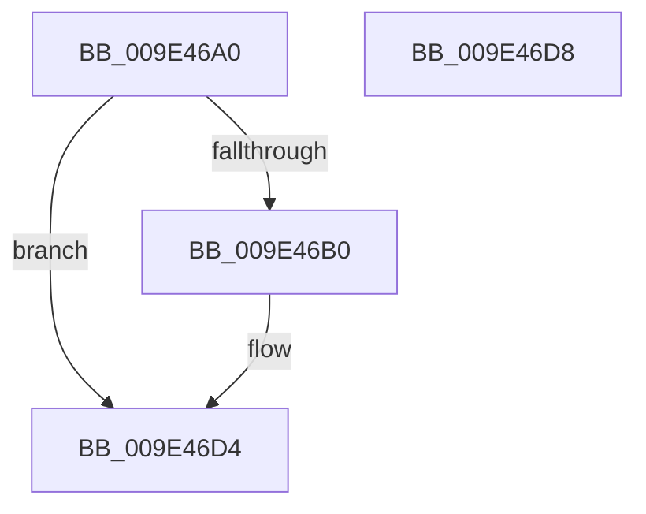

# EtwpIsStackWalkingEnabled

- RVA: `0x009E46A0`–`0x009E46D9` (길이 `57` bytes)
- VA: `0x00000001409E46A0`
- 실행 섹션: `PAGE`
- PDB 이름 있음: `예`; PDB Function 태그: `아니요`
- unwind 정보 RVA: `0x000DB714`
- 디코드: `17`개 명령, `57/57` bytes 표시
- 미해석 바이트: `0` (있으면 어셈블리에 `.byte`로 보존)

> 이 문서는 커널 이미지의 기계어와 PDB 기호를 분석해 생성했습니다. 4번과 5번은 함수 원형과 자료형을 바이너리 사용 방식에서 추정한 C 해석이며 원본 소스 복구 결과는 아닙니다.

## 1. Dependencies

- 직접 호출 지점: **0**; 고유 호출 대상: **0**
- 직접 호출자로 확인된 함수: **1**
- RIP 상대 이미지 참조: **0**

### Outgoing calls
- 직접 디코드된 call 명령이 없습니다.

### Direct callers
- [EtwpProcessThreadImageRundown](EtwpProcessThreadImageRundown_function_009E4568.md) at `0x009E45C2`

### Static image references
- 디코드된 RIP-relative 메모리 참조가 없습니다.

## 2. Other-region calls and transfers

- 다른 실행 섹션으로 향하는 call: **0**
- 별도 외부 분기/꼬리 이동을 확인하지 못했습니다.

## 3. Assembly (complete function range)

```asm
009E46A0  8B 81 30 03 00 00               mov eax, dword ptr [rcx + 0x330]
009E46A6  45 32 C0                        xor r8b, r8b
009E46A9  4C 8B C9                        mov r9, rcx
009E46AC  84 C0                           test al, al
009E46AE  79 24                           jns 0x1409e46d4
009E46B0  49 8B 81 18 04 00 00            mov rax, qword ptr [r9 + 0x418]
009E46B7  0F B7 CA                        movzx ecx, dx
009E46BA  81 E1 FF 1F 00 00               and ecx, 0x1fff
009E46C0  8B D1                           mov edx, ecx
009E46C2  80 E1 07                        and cl, 7
009E46C5  48 C1 EA 03                     shr rdx, 3
009E46C9  44 8A 04 02                     mov r8b, byte ptr [rdx + rax]
009E46CD  41 D2 F8                        sar r8b, cl
009E46D0  41 80 E0 01                     and r8b, 1
009E46D4  41 8A C0                        mov al, r8b
009E46D7  C3                              ret
009E46D8  CC                              int3
```

## 4. C-style interpretation (structured pseudocode)

```c
__int64 __fastcall EtwpIsStackWalkingEnabled(__int64 a1, unsigned __int16 a2, unsigned __int8 a3)
{
    __int64 result;

    a3 = 0;
    result = (unsigned int)(*(unsigned int *)(a1 + 816));
    if (sign_flag) {
        result = *(unsigned __int64 *)(a1 + 1048);
        a1 = a2;
        a1 = (unsigned int)((a1) & (0x1FFFULL));
        a2 = (unsigned int)(a1);
        a1 = (unsigned __int8)((a1) & (7));
        a2 = (a2) >> (3);
        a3 = *(unsigned __int8 *)(a2 + result * 1);
        a3 = (unsigned __int8)((a3) >> ((unsigned __int8)(a1)));
        a3 = (unsigned __int8)((a3) & (1));
    }
    return a3;
}
```

## 5. (Beta) C Style

```c
int64_t EtwpIsStackWalkingEnabled(void *Arg1, uint16_t Arg2, uint8_t Arg3)
{
    uint8_t *arg1 = (uint8_t *)Arg1;

    int64_t result;

    Arg3 = 0;
    result = (uint32_t)(*(uint32_t *)(arg1 + 0x330));
    if (sign_flag) {
        result = *(uint64_t *)(arg1 + 0x418);
        Arg1 = Arg2;
        Arg1 = (uint32_t)((Arg1) & (0x1FFFULL));
        Arg2 = (uint32_t)(Arg1);
        Arg1 = (uint8_t)((Arg1) & (7));
        Arg2 = (Arg2) >> (3);
        Arg3 = *(uint8_t *)(Arg2 + result * 1);
        Arg3 = (uint8_t)((Arg3) >> ((uint8_t)(Arg1)));
        Arg3 = (uint8_t)((Arg3) & (1));
    }
    return Arg3;
}
```

### 관측된 메모리 오프셋

구조체 형식이 확인되지 않은 접근은 인자 기준의 오프셋으로만 기록했습니다.

| 기준 인자 | 오프셋 표현 | 폭 (bit) | 접근 |
|---|---:|---:|---|
| `Arg1` | `+ 0x330` | `32` | `R` |
| `Arg1` | `+ 0x418` | `64` | `R` |

## 6. Execution-region graph

[열기: 2D/3D 그래프와 함수 탐색 컨트롤 패널](../../../control-panel.html?section=page&rva=0x009E46A0&view=graph)

- 2D 그래프는 위에서 아래로 흐르고, 3D 그래프는 빈 공간을 드래그해 회전합니다. Shift+드래그는 이동, 휠은 확대·축소, 함수 노드 선택은 대상 보고서 이동입니다.

### Static fallback


