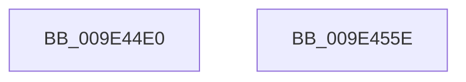

# EtwpLogGroupMask

- RVA: `0x009E44E0`–`0x009E455F` (길이 `127` bytes)
- VA: `0x00000001409E44E0`
- 실행 섹션: `PAGE`
- PDB 이름 있음: `예`; PDB Function 태그: `아니요`
- unwind 정보 RVA: `0x000A40A0`
- 디코드: `28`개 명령, `127/127` bytes 표시
- 미해석 바이트: `0` (있으면 어셈블리에 `.byte`로 보존)

> 이 문서는 커널 이미지의 기계어와 PDB 기호를 분석해 생성했습니다. 4번과 5번은 함수 원형과 자료형을 바이너리 사용 방식에서 추정한 C 해석이며 원본 소스 복구 결과는 아닙니다.

## 1. Dependencies

- 직접 호출 지점: **2**; 고유 호출 대상: **2**
- 직접 호출자로 확인된 함수: **2**
- RIP 상대 이미지 참조: **1**

### Outgoing calls
- `0x009E4547` → [EtwpLogKernelEvent](../../text/25/EtwpLogKernelEvent_function_0025CC00.md) (function, `0x0025CC00`)
- `0x009E4554` → [_security_check_cookie](../../text/6A/_security_check_cookie_function_006AC640.md) (function, `0x006AC640`)

### Direct callers
- [EtwpUpdateSelectedGroupMasks](../../text/49/EtwpUpdateSelectedGroupMasks_function_0049B114.md) at `0x0049B2FB`
- [EtwpUpdateSelectedGroupMasks](../../text/49/EtwpUpdateSelectedGroupMasks_function_0049B114.md) at `0x0049B360`
- [EtwpLogKernelTraceRundown](EtwpLogKernelTraceRundown_function_009E400C.md) at `0x009E4031`

### Static image references
- `0x009E44E7` → RVA `0x00E0A740` (`.data`; read)

## 2. Other-region calls and transfers

- 다른 실행 섹션으로 향하는 call: **2**
  - `0x009E4547` → [EtwpLogKernelEvent](../../text/25/EtwpLogKernelEvent_function_0025CC00.md) (`PAGE` → `.text`)
  - `0x009E4554` → [_security_check_cookie](../../text/6A/_security_check_cookie_function_006AC640.md) (`PAGE` → `.text`)
- 별도 외부 분기/꼬리 이동을 확인하지 못했습니다.

## 3. Assembly (complete function range)

```asm
009E44E0  4C 8B DC                        mov r11, rsp
009E44E3  48 83 EC 78                     sub rsp, 0x78
009E44E7  48 8B 05 52 62 42 00            mov rax, qword ptr [rip + 0x426252]
009E44EE  48 33 C4                        xor rax, rsp
009E44F1  48 89 44 24 68                  mov qword ptr [rsp + 0x68], rax
009E44F6  41 0F 10 48 10                  movups xmm1, xmmword ptr [r8 + 0x10]
009E44FB  C7 44 24 28 02 18 50 00         mov dword ptr [rsp + 0x28], 0x501802
009E4503  49 8D 43 C8                     lea rax, [r11 - 0x38]
009E4507  0F 57 C0                        xorps xmm0, xmm0
009E450A  66 45 89 4B A8                  mov word ptr [r11 - 0x58], r9w
009E450F  F3 0F 7F 44 24 48               movdqu xmmword ptr [rsp + 0x48], xmm0
009E4515  41 B9 01 00 00 00               mov r9d, 1
009E451B  C7 44 24 60 55 00 00 00         mov dword ptr [rsp + 0x60], 0x55
009E4523  41 0F 10 00                     movups xmm0, xmmword ptr [r8]
009E4527  44 8B C2                        mov r8d, edx
009E452A  49 89 43 B8                     mov qword ptr [r11 - 0x48], rax
009E452E  48 8B D1                        mov rdx, rcx
009E4531  49 C7 43 C0 24 00 00 00         mov qword ptr [r11 - 0x40], 0x24
009E4539  49 8D 4B B8                     lea rcx, [r11 - 0x48]
009E453D  0F 11 44 24 40                  movups xmmword ptr [rsp + 0x40], xmm0
009E4542  0F 11 4C 24 50                  movups xmmword ptr [rsp + 0x50], xmm1
009E4547  E8 B4 86 87 FF                  call 0x14025cc00
009E454C  48 8B 4C 24 68                  mov rcx, qword ptr [rsp + 0x68]
009E4551  48 33 CC                        xor rcx, rsp
009E4554  E8 E7 80 CC FF                  call 0x1406ac640
009E4559  48 83 C4 78                     add rsp, 0x78
009E455D  C3                              ret
009E455E  CC                              int3
```

## 4. C-style interpretation (structured pseudocode)

```c
__int64 __fastcall EtwpLogGroupMask(__int64 a1, int a2, __int64 a3, unsigned __int16 a4)
{
    __int64 result;
    __int64 v_rsp;
    unsigned __int64 v_stack_m10;
    unsigned int v_stack_m18;
    unsigned __int64 v_stack_m28;
    unsigned __int64 v_stack_m30;
    unsigned __int64 v_stack_m38;
    unsigned int v_stack_m50;

    v_rsp = (v_rsp) - (120);
    result = (*(unsigned __int64 *)(v_rip + 4350546)) ^ (v_rsp);
    v_stack_m10 = result;
    v_stack_m50 = 0x501802ULL;
    *(unsigned __int16 *)(v_rsp - 88) = a4;
    v_stack_m30 = v_xmm0;
    v_stack_m18 = 85;
    *(unsigned __int64 *)(v_rsp - 72) = v_rsp - 56;
    *(unsigned __int64 *)(v_rsp - 64) = 36;
    v_stack_m38 = v_xmm0;
    v_stack_m28 = v_xmm1;
    result = EtwpLogKernelEvent(v_rsp - 72, a1, (unsigned int)(a2), 1);
    a1 = (v_stack_m10) ^ (v_rsp);
    result = _security_check_cookie(a1, a1, (unsigned int)(a2), 1);
    v_rsp = (v_rsp) + (120);
    return result;
}
```

## 5. (Beta) C Style

```c
int64_t EtwpLogGroupMask(int64_t Arg1, int32_t Arg2, void *Arg3, uint16_t Arg4)
{
    uint8_t *arg3 = (uint8_t *)Arg3;

    int64_t result;
    int64_t local_rsp;
    uint64_t v_stack_m10;
    uint32_t v_stack_m18;
    uint64_t v_stack_m28;
    uint64_t v_stack_m30;
    uint64_t v_stack_m38;
    uint32_t v_stack_m50;

    local_rsp = (local_rsp) - (120);
    result = (*(uint64_t *)(v_rip + 0x426252)) ^ (local_rsp);
    v_stack_m10 = result;
    v_stack_m50 = 0x501802ULL;
    *(uint16_t *)(local_rsp - 0x58) = Arg4;
    v_stack_m30 = v_xmm0;
    v_stack_m18 = 85;
    *(uint64_t *)(local_rsp - 0x48) = local_rsp - 56;
    *(uint64_t *)(local_rsp - 0x40) = 36;
    v_stack_m38 = v_xmm0;
    v_stack_m28 = v_xmm1;
    result = EtwpLogKernelEvent(local_rsp - 72, Arg1, (uint32_t)(Arg2), 1);
    Arg1 = (v_stack_m10) ^ (local_rsp);
    result = _security_check_cookie(Arg1, Arg1, (uint32_t)(Arg2), 1);
    local_rsp = (local_rsp) + (120);
    return result;
}
```

### 관측된 메모리 오프셋

구조체 형식이 확인되지 않은 접근은 인자 기준의 오프셋으로만 기록했습니다.

| 기준 인자 | 오프셋 표현 | 폭 (bit) | 접근 |
|---|---:|---:|---|
| `Arg3` | `+ 0x0` | `128` | `R` |
| `Arg3` | `+ 0x10` | `128` | `R` |

## 6. Execution-region graph

[열기: 2D/3D 그래프와 함수 탐색 컨트롤 패널](../../../control-panel.html?section=page&rva=0x009E44E0&view=graph)

- 2D 그래프는 위에서 아래로 흐르고, 3D 그래프는 빈 공간을 드래그해 회전합니다. Shift+드래그는 이동, 휠은 확대·축소, 함수 노드 선택은 대상 보고서 이동입니다.

### Static fallback


