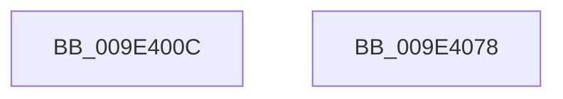

# EtwpLogKernelTraceRundown

- RVA: `0x009E400C`–`0x009E4079` (길이 `109` bytes)
- VA: `0x00000001409E400C`
- 실행 섹션: `PAGE`
- PDB 이름 있음: `예`; PDB Function 태그: `아니요`
- unwind 정보 RVA: `0x00066400`
- 디코드: `30`개 명령, `109/109` bytes 표시
- 미해석 바이트: `0` (있으면 어셈블리에 `.byte`로 보존)

> 이 문서는 커널 이미지의 기계어와 PDB 기호를 분석해 생성했습니다. 4번과 5번은 함수 원형과 자료형을 바이너리 사용 방식에서 추정한 C 해석이며 원본 소스 복구 결과는 아닙니다.

## 1. Dependencies

- 직접 호출 지점: **3**; 고유 호출 대상: **3**
- 직접 호출자로 확인된 함수: **2**
- RIP 상대 이미지 참조: **0**

### Outgoing calls
- `0x009E4031` → [EtwpLogGroupMask](EtwpLogGroupMask_function_009E44E0.md) (function, `0x009E44E0`)
- `0x009E4054` → [EtwpKernelTraceRundown](EtwpKernelTraceRundown_function_009E4080.md) (function, `0x009E4080`)
- `0x009E405E` → [EtwpLogAlwaysPresentRundown](EtwpLogAlwaysPresentRundown_function_009E4474.md) (function, `0x009E4474`)

### Direct callers
- [EtwpCheckLoggerAccessAndDoRundown](EtwpCheckLoggerAccessAndDoRundown_function_009E3EFC.md) at `0x009E3F77`
- [sub_00B30604](../B3/Unknown_function_00B30604.md) at `0x00B30662`

### Static image references
- 디코드된 RIP-relative 메모리 참조가 없습니다.

## 2. Other-region calls and transfers

- 다른 실행 섹션으로 향하는 call: **0**
- 별도 외부 분기/꼬리 이동을 확인하지 못했습니다.

## 3. Assembly (complete function range)

```asm
009E400C  48 89 5C 24 08                  mov qword ptr [rsp + 8], rbx
009E4011  48 89 6C 24 10                  mov qword ptr [rsp + 0x10], rbp
009E4016  48 89 74 24 18                  mov qword ptr [rsp + 0x18], rsi
009E401B  57                              push rdi
009E401C  48 83 EC 30                     sub rsp, 0x30
009E4020  41 8A D9                        mov bl, r9b
009E4023  49 8B F8                        mov rdi, r8
009E4026  41 B9 20 00 00 00               mov r9d, 0x20
009E402C  8B F2                           mov esi, edx
009E402E  48 8B E9                        mov rbp, rcx
009E4031  E8 AA 04 00 00                  call 0x1409e44e0
009E4036  8B 44 24 68                     mov eax, dword ptr [rsp + 0x68]
009E403A  44 8A CB                        mov r9b, bl
009E403D  89 44 24 28                     mov dword ptr [rsp + 0x28], eax
009E4041  44 8B C6                        mov r8d, esi
009E4044  48 8B 44 24 60                  mov rax, qword ptr [rsp + 0x60]
009E4049  48 8B D5                        mov rdx, rbp
009E404C  48 8B CF                        mov rcx, rdi
009E404F  48 89 44 24 20                  mov qword ptr [rsp + 0x20], rax
009E4054  E8 27 00 00 00                  call 0x1409e4080
009E4059  8B D6                           mov edx, esi
009E405B  48 8B CD                        mov rcx, rbp
009E405E  E8 11 04 00 00                  call 0x1409e4474
009E4063  48 8B 5C 24 40                  mov rbx, qword ptr [rsp + 0x40]
009E4068  48 8B 6C 24 48                  mov rbp, qword ptr [rsp + 0x48]
009E406D  48 8B 74 24 50                  mov rsi, qword ptr [rsp + 0x50]
009E4072  48 83 C4 30                     add rsp, 0x30
009E4076  5F                              pop rdi
009E4077  C3                              ret
009E4078  CC                              int3
```

## 4. C-style interpretation (structured pseudocode)

```c
__int64 __fastcall EtwpLogKernelTraceRundown(__int64 a1, int a2, __int64 a3, unsigned __int8 a4, __int64 a5, unsigned int a6)
{
    __int64 result;
    __int64 v_rsp;
    unsigned int v_stack_m10;
    unsigned __int64 v_stack_m18;
    unsigned __int64 v_stack_p10;
    unsigned __int64 v_stack_p18;
    unsigned __int64 v_stack_p8;

    v_stack_p8 = v_rbx;
    v_stack_p10 = v_rbp;
    v_stack_p18 = v_rsi;
    v_rsp = (v_rsp) - (48);
    result = EtwpLogGroupMask(a1, a2, a3, 32);
    v_stack_m10 = (unsigned int)((unsigned int)(a6));
    v_stack_m18 = a5;
    result = EtwpKernelTraceRundown(a3, a1, (unsigned int)((unsigned int)((unsigned int)(a2))), a4);
    result = EtwpLogAlwaysPresentRundown(a1, (unsigned int)((unsigned int)((unsigned int)(a2))), (unsigned int)((unsigned int)((unsigned int)(a2))), a4);
    v_rsp = (v_rsp) + (48);
    return result;
}
```

## 5. (Beta) C Style

```c
int64_t EtwpLogKernelTraceRundown(int64_t Arg1, int32_t Arg2, int64_t Arg3, uint8_t Arg4, int64_t Arg5, uint32_t Arg6)
{
    int64_t result;
    int64_t local_rsp;
    uint32_t v_stack_m10;
    uint64_t v_stack_m18;
    uint64_t v_stack_p10;
    uint64_t v_stack_p18;
    uint64_t v_stack_p8;

    v_stack_p8 = local_rbx;
    v_stack_p10 = local_rbp;
    v_stack_p18 = local_rsi;
    local_rsp = (local_rsp) - (48);
    result = EtwpLogGroupMask(Arg1, Arg2, Arg3, 32);
    v_stack_m10 = (uint32_t)((uint32_t)(Arg6));
    v_stack_m18 = Arg5;
    result = EtwpKernelTraceRundown(Arg3, Arg1, (uint32_t)((uint32_t)((uint32_t)(Arg2))), Arg4);
    result = EtwpLogAlwaysPresentRundown(Arg1, (uint32_t)((uint32_t)((uint32_t)(Arg2))), (uint32_t)((uint32_t)((uint32_t)(Arg2))), Arg4);
    local_rsp = (local_rsp) + (48);
    return result;
}
```

## 6. Execution-region graph

[열기: 2D/3D 그래프와 함수 탐색 컨트롤 패널](../../../control-panel.html?section=page&rva=0x009E400C&view=graph)

- 2D 그래프는 위에서 아래로 흐르고, 3D 그래프는 빈 공간을 드래그해 회전합니다. Shift+드래그는 이동, 휠은 확대·축소, 함수 노드 선택은 대상 보고서 이동입니다.

### Static fallback


