# EtwpNotifyDisallowedGuidChange

- RVA: `0x009EAD14`–`0x009EB134` (길이 `1,056` bytes)
- VA: `0x00000001409EAD14`
- 실행 섹션: `PAGE`
- PDB 이름 있음: `예`; PDB Function 태그: `예`
- unwind 정보 RVA: `0x000A54A4`
- 디코드: `264`개 명령, `1,056/1,056` bytes 표시
- 미해석 바이트: `0` (있으면 어셈블리에 `.byte`로 보존)

> 이 문서는 커널 이미지의 기계어와 PDB 기호를 분석해 생성했습니다. 4번과 5번은 함수 원형과 자료형을 바이너리 사용 방식에서 추정한 C 해석이며 원본 소스 복구 결과는 아닙니다.

## 1. Dependencies

- 직접 호출 지점: **17**; 고유 호출 대상: **14**
- 직접 호출자로 확인된 함수: **1**
- RIP 상대 이미지 참조: **0**

### Outgoing calls
- `0x009EAD4F` → [EtwpFindGuidEntryByGuid](../8C/EtwpFindGuidEntryByGuid_function_008C1DB0.md) (function, `0x008C1DB0`)
- `0x009EAD86` → [KeAbPreAcquire](../../text/21/KeAbPreAcquire_function_00210230.md) (function, `0x00210230`)
- `0x009EAD9F` → [ExfAcquirePushLockExclusiveEx](../../text/20/ExfAcquirePushLockExclusiveEx_function_0020FC90.md) (function, `0x0020FC90`)
- `0x009EADCA` → [EtwpBuildNotificationPacket](EtwpBuildNotificationPacket_function_009EB13C.md) (function, `0x009EB13C`)
- `0x009EADED` → [PsGetCurrentProcessId](../../text/43/PsGetCurrentProcessId_function_00433560.md) (function, `0x00433560`)
- `0x009EADFB` → [EtwpIsGuidAllowed](EtwpIsGuidAllowed_function_009EB45C.md) (function, `0x009EB45C`)
- `0x009EAF25` → [EtwpUpdateRegEntryEnableMask](../8C/EtwpUpdateRegEntryEnableMask_function_008C1990.md) (function, `0x008C1990`)
- `0x009EAF5A` → [EtwpCalculateUpdateNotification](../8C/EtwpCalculateUpdateNotification_function_008C0BE0.md) (function, `0x008C0BE0`)
- `0x009EAF81` → [EtwpUnreferenceDataBlock](../8B/EtwpUnreferenceDataBlock_function_008BFC5C.md) (function, `0x008BFC5C`)
- `0x009EAF90` → [EtwpSendDataBlock](../8C/EtwpSendDataBlock_function_008C8530.md) (function, `0x008C8530`)
- `0x009EAFCC` → [EtwpUnreferenceDataBlock](../8B/EtwpUnreferenceDataBlock_function_008BFC5C.md) (function, `0x008BFC5C`)
- `0x009EB00E` → [KeAbPostRelease](../../text/2E/KeAbPostRelease_function_002E1600.md) (function, `0x002E1600`)
- `0x009EB013` → [KeLeaveCriticalRegion](../../text/25/KeLeaveCriticalRegion_function_0025D8B0.md) (function, `0x0025D8B0`)
- `0x009EB01B` → [EtwpUnreferenceGuidEntry](../8C/EtwpUnreferenceGuidEntry_function_008C3320.md) (function, `0x008C3320`)
- `0x009EB081` → [KeAbPreAcquire](../../text/21/KeAbPreAcquire_function_00210230.md) (function, `0x00210230`)
- `0x009EB09A` → [ExfAcquirePushLockExclusiveEx](../../text/20/ExfAcquirePushLockExclusiveEx_function_0020FC90.md) (function, `0x0020FC90`)
- `0x009EB0DE` → [ExfReleasePushLock](../../text/26/ExfReleasePushLock_function_002638D0.md) (function, `0x002638D0`)

### Direct callers
- [EtwpUpdateDisallowedGuids](EtwpUpdateDisallowedGuids_function_009EA8FC.md) at `0x009EAB6A`
- [EtwpUpdateDisallowedGuids](EtwpUpdateDisallowedGuids_function_009EA8FC.md) at `0x009EACC3`

### Static image references
- 디코드된 RIP-relative 메모리 참조가 없습니다.

## 2. Other-region calls and transfers

- 다른 실행 섹션으로 향하는 call: **8**
  - `0x009EAD86` → [KeAbPreAcquire](../../text/21/KeAbPreAcquire_function_00210230.md) (`PAGE` → `.text`)
  - `0x009EAD9F` → [ExfAcquirePushLockExclusiveEx](../../text/20/ExfAcquirePushLockExclusiveEx_function_0020FC90.md) (`PAGE` → `.text`)
  - `0x009EADED` → [PsGetCurrentProcessId](../../text/43/PsGetCurrentProcessId_function_00433560.md) (`PAGE` → `.text`)
  - `0x009EB00E` → [KeAbPostRelease](../../text/2E/KeAbPostRelease_function_002E1600.md) (`PAGE` → `.text`)
  - `0x009EB013` → [KeLeaveCriticalRegion](../../text/25/KeLeaveCriticalRegion_function_0025D8B0.md) (`PAGE` → `.text`)
  - `0x009EB081` → [KeAbPreAcquire](../../text/21/KeAbPreAcquire_function_00210230.md) (`PAGE` → `.text`)
  - `0x009EB09A` → [ExfAcquirePushLockExclusiveEx](../../text/20/ExfAcquirePushLockExclusiveEx_function_0020FC90.md) (`PAGE` → `.text`)
  - `0x009EB0DE` → [ExfReleasePushLock](../../text/26/ExfReleasePushLock_function_002638D0.md) (`PAGE` → `.text`)
- call이 아닌 외부 분기/꼬리 이동: **3**
  - `0x009EB11E` → [sub_00B30994](../B3/Unknown_function_00B30994.md) (`tail-transfer`)
  - `0x009EB129` → [sub_00B30994](../B3/Unknown_function_00B30994.md) (`tail-transfer`)
  - `0x009EB12F` → [sub_00B30994 + 0x8](../B3/Unknown_function_00B30994.md) (`tail-transfer`)

## 3. Assembly (complete function range)

```asm
009EAD14  48 8B C4                        mov rax, rsp
009EAD17  48 89 58 08                     mov qword ptr [rax + 8], rbx
009EAD1B  44 89 40 18                     mov dword ptr [rax + 0x18], r8d
009EAD1F  48 89 50 10                     mov qword ptr [rax + 0x10], rdx
009EAD23  55                              push rbp
009EAD24  56                              push rsi
009EAD25  57                              push rdi
009EAD26  41 54                           push r12
009EAD28  41 55                           push r13
009EAD2A  41 56                           push r14
009EAD2C  41 57                           push r15
009EAD2E  48 83 EC 70                     sub rsp, 0x70
009EAD32  4C 8B E2                        mov r12, rdx
009EAD35  45 8B F8                        mov r15d, r8d
009EAD38  4C 8B F1                        mov r14, rcx
009EAD3B  48 8B D1                        mov rdx, rcx
009EAD3E  33 F6                           xor esi, esi
009EAD40  45 33 C0                        xor r8d, r8d
009EAD43  48 89 70 98                     mov qword ptr [rax - 0x68], rsi
009EAD47  49 8B 8C 24 50 05 00 00         mov rcx, qword ptr [r12 + 0x550]
009EAD4F  E8 5C 70 ED FF                  call 0x1408c1db0
009EAD54  48 89 44 24 60                  mov qword ptr [rsp + 0x60], rax
009EAD59  48 8B E8                        mov rbp, rax
009EAD5C  48 85 C0                        test rax, rax
009EAD5F  0F 84 BB 02 00 00               je 0x1409eb020
009EAD65  65 4C 8B 0C 25 88 01 00 00      mov r9, qword ptr gs:[0x188]
009EAD6E  48 8D 98 98 02 00 00            lea rbx, [rax + 0x298]
009EAD75  45 33 C0                        xor r8d, r8d
009EAD78  33 D2                           xor edx, edx
009EAD7A  48 8B CB                        mov rcx, rbx
009EAD7D  66 41 FF 89 E4 01 00 00         dec word ptr [r9 + 0x1e4]
009EAD85  90                              nop
009EAD86  E8 A5 54 82 FF                  call 0x140210230
009EAD8B  F0 48 0F BA 2B 00               lock bts qword ptr [rbx], 0
009EAD91  48 8B F8                        mov rdi, rax
009EAD94  73 0E                           jae 0x1409eada4
009EAD96  4C 8B C3                        mov r8, rbx
009EAD99  48 8B D0                        mov rdx, rax
009EAD9C  48 8B CB                        mov rcx, rbx
009EAD9F  E8 EC 4E 82 FF                  call 0x14020fc90
009EADA4  48 85 FF                        test rdi, rdi
009EADA7  74 04                           je 0x1409eadad
009EADA9  C6 47 0A 01                     mov byte ptr [rdi + 0xa], 1
009EADAD  65 48 8B 04 25 88 01 00 00      mov rax, qword ptr gs:[0x188]
009EADB6  4C 8D 4C 24 40                  lea r9, [rsp + 0x40]
009EADBB  45 33 C0                        xor r8d, r8d
009EADBE  48 89 85 A0 02 00 00            mov qword ptr [rbp + 0x2a0], rax
009EADC5  33 D2                           xor edx, edx
009EADC7  48 8B CD                        mov rcx, rbp
009EADCA  E8 6D 03 00 00                  call 0x1409eb13c
009EADCF  48 8B 74 24 40                  mov rsi, qword ptr [rsp + 0x40]
009EADD4  33 FF                           xor edi, edi
009EADD6  85 C0                           test eax, eax
009EADD8  0F 85 E6 01 00 00               jne 0x1409eafc4
009EADDE  C7 06 03 00 00 00               mov dword ptr [rsi], 3
009EADE4  41 0F 10 06                     movups xmm0, xmmword ptr [r14]
009EADE8  F3 0F 7F 46 28                  movdqu xmmword ptr [rsi + 0x28], xmm0
009EADED  E8 6E 87 A4 FF                  call 0x140433560
009EADF2  49 8B D6                        mov rdx, r14
009EADF5  89 46 24                        mov dword ptr [rsi + 0x24], eax
009EADF8  49 8B CC                        mov rcx, r12
009EADFB  E8 5C 06 00 00                  call 0x1409eb45c
009EAE00  84 C0                           test al, al
009EAE02  8B CF                           mov ecx, edi
009EAE04  8B C7                           mov eax, edi
009EAE06  0F 95 C1                        setne cl
009EAE09  45 85 FF                        test r15d, r15d
009EAE0C  0F 94 C0                        sete al
009EAE0F  3B C8                           cmp ecx, eax
009EAE11  0F 84 AD 01 00 00               je 0x1409eafc4
009EAE17  44 8B F7                        mov r14d, edi
009EAE1A  48 89 7C 24 50                  mov qword ptr [rsp + 0x50], rdi
009EAE1F  48 39 BD 90 02 00 00            cmp qword ptr [rbp + 0x290], rdi
009EAE26  75 15                           jne 0x1409eae3d
009EAE28  48 8D 45 10                     lea rax, [rbp + 0x10]
009EAE2C  48 8B 08                        mov rcx, qword ptr [rax]
009EAE2F  48 3B C8                        cmp rcx, rax
009EAE32  74 09                           je 0x1409eae3d
009EAE34  4C 8D 71 F0                     lea r14, [rcx - 0x10]
009EAE38  4C 89 74 24 50                  mov qword ptr [rsp + 0x50], r14
009EAE3D  4C 8B ED                        mov r13, rbp
009EAE40  48 89 6C 24 58                  mov qword ptr [rsp + 0x58], rbp
009EAE45  40 88 BC 24 C8 00 00 00         mov byte ptr [rsp + 0xc8], dil
009EAE4D  49 8D 4D 38                     lea rcx, [r13 + 0x38]
009EAE51  4C 8B 39                        mov r15, qword ptr [rcx]
009EAE54  48 89 4C 24 48                  mov qword ptr [rsp + 0x48], rcx
009EAE59  4C 3B F9                        cmp r15, rcx
009EAE5C  0F 84 50 01 00 00               je 0x1409eafb2
009EAE62  40 8A AC 24 C8 00 00 00         mov bpl, byte ptr [rsp + 0xc8]
009EAE6A  48 8B C1                        mov rax, rcx
009EAE6D  44 8B B4 24 C0 00 00 00         mov r14d, dword ptr [rsp + 0xc0]
009EAE75  4D 8B EF                        mov r13, r15
009EAE78  4D 8B 3F                        mov r15, qword ptr [r15]
009EAE7B  49 8B 4D 28                     mov rcx, qword ptr [r13 + 0x28]
009EAE7F  48 85 C9                        test rcx, rcx
009EAE82  0F 84 12 01 00 00               je 0x1409eaf9a
009EAE88  40 84 ED                        test bpl, bpl
009EAE8B  0F 85 B0 01 00 00               jne 0x1409eb041
009EAE91  4D 8D 65 66                     lea r12, [r13 + 0x66]
009EAE95  45 85 F6                        test r14d, r14d
009EAE98  0F 85 9B 01 00 00               jne 0x1409eb039
009EAE9E  66 41 39 3C 24                  cmp word ptr [r12], di
009EAEA3  0F 84 F1 00 00 00               je 0x1409eaf9a
009EAEA9  4C 8B 94 24 B8 00 00 00         mov r10, qword ptr [rsp + 0xb8]
009EAEB1  8B D7                           mov edx, edi
009EAEB3  45 8B 0A                        mov r9d, dword ptr [r10]
009EAEB6  83 FA 10                        cmp edx, 0x10
009EAEB9  0F 83 D6 00 00 00               jae 0x1409eaf95
009EAEBF  8B C2                           mov eax, edx
009EAEC1  48 C1 E0 05                     shl rax, 5
009EAEC5  44 8B C2                        mov r8d, edx
009EAEC8  0F B7 84 08 86 00 00 00         movzx eax, word ptr [rax + rcx + 0x86]
009EAED0  41 3B C1                        cmp eax, r9d
009EAED3  74 04                           je 0x1409eaed9
009EAED5  FF C2                           inc edx
009EAED7  EB DD                           jmp 0x1409eaeb6
009EAED9  49 8D 40 04                     lea rax, [r8 + 4]
009EAEDD  48 C1 E0 05                     shl rax, 5
009EAEE1  39 3C 08                        cmp dword ptr [rax + rcx], edi
009EAEE4  74 EF                           je 0x1409eaed5
009EAEE6  8B CA                           mov ecx, edx
009EAEE8  B8 01 00 00 00                  mov eax, 1
009EAEED  D2 E0                           shl al, cl
009EAEEF  84 C0                           test al, al
009EAEF1  0F 84 9E 00 00 00               je 0x1409eaf95
009EAEF7  45 85 F6                        test r14d, r14d
009EAEFA  75 0A                           jne 0x1409eaf06
009EAEFC  41 84 04 24                     test byte ptr [r12], al
009EAF00  0F 84 8F 00 00 00               je 0x1409eaf95
009EAF06  41 0F B7 1C 24                  movzx ebx, word ptr [r12]
009EAF0B  41 B1 02                        mov r9b, 2
009EAF0E  0F B6 F8                        movzx edi, al
009EAF11  49 8B D2                        mov rdx, r10
009EAF14  44 0F B7 C7                     movzx r8d, di
009EAF18  44 89 74 24 28                  mov dword ptr [rsp + 0x28], r14d
009EAF1D  49 8B CD                        mov rcx, r13
009EAF20  40 88 6C 24 20                  mov byte ptr [rsp + 0x20], bpl
009EAF25  E8 66 6A ED FF                  call 0x1408c1990
009EAF2A  45 0F B7 0C 24                  movzx r9d, word ptr [r12]
009EAF2F  48 8D 44 24 40                  lea rax, [rsp + 0x40]
009EAF34  48 89 44 24 38                  mov qword ptr [rsp + 0x38], rax
009EAF39  44 0F B7 C3                     movzx r8d, bx
009EAF3D  44 89 74 24 30                  mov dword ptr [rsp + 0x30], r14d
009EAF42  0F B7 D7                        movzx edx, di
009EAF45  40 88 6C 24 28                  mov byte ptr [rsp + 0x28], bpl
009EAF4A  49 8B CD                        mov rcx, r13
009EAF4D  C6 44 24 20 02                  mov byte ptr [rsp + 0x20], 2
009EAF52  48 89 B4 24 C8 00 00 00         mov qword ptr [rsp + 0xc8], rsi
009EAF5A  E8 81 5C ED FF                  call 0x1408c0be0
009EAF5F  48 8B 74 24 40                  mov rsi, qword ptr [rsp + 0x40]
009EAF64  8A D8                           mov bl, al
009EAF66  48 8B 84 24 C8 00 00 00         mov rax, qword ptr [rsp + 0xc8]
009EAF6E  33 FF                           xor edi, edi
009EAF70  48 3B C6                        cmp rax, rsi
009EAF73  74 11                           je 0x1409eaf86
009EAF75  48 85 F6                        test rsi, rsi
009EAF78  0F 84 6A 01 00 00               je 0x1409eb0e8
009EAF7E  48 8B C8                        mov rcx, rax
009EAF81  E8 D6 4C ED FF                  call 0x1408bfc5c
009EAF86  84 DB                           test bl, bl
009EAF88  74 0B                           je 0x1409eaf95
009EAF8A  48 8B D6                        mov rdx, rsi
009EAF8D  49 8B CD                        mov rcx, r13
009EAF90  E8 9B D5 ED FF                  call 0x1408c8530
009EAF95  48 8B 44 24 48                  mov rax, qword ptr [rsp + 0x48]
009EAF9A  4C 3B F8                        cmp r15, rax
009EAF9D  0F 85 D2 FE FF FF               jne 0x1409eae75
009EAFA3  48 8B 6C 24 60                  mov rbp, qword ptr [rsp + 0x60]
009EAFA8  4C 8B 74 24 50                  mov r14, qword ptr [rsp + 0x50]
009EAFAD  4C 8B 6C 24 58                  mov r13, qword ptr [rsp + 0x58]
009EAFB2  4C 3B ED                        cmp r13, rbp
009EAFB5  0F 85 3A 01 00 00               jne 0x1409eb0f5
009EAFBB  4D 85 F6                        test r14, r14
009EAFBE  0F 85 8D 00 00 00               jne 0x1409eb051
009EAFC4  48 85 F6                        test rsi, rsi
009EAFC7  74 08                           je 0x1409eafd1
009EAFC9  48 8B CE                        mov rcx, rsi
009EAFCC  E8 8B 4C ED FF                  call 0x1408bfc5c
009EAFD1  48 89 BD A0 02 00 00            mov qword ptr [rbp + 0x2a0], rdi
009EAFD8  48 8D 9D 98 02 00 00            lea rbx, [rbp + 0x298]
009EAFDF  0F 0D 0B                        prefetchw byte ptr [rbx]
009EAFE2  48 8B 03                        mov rax, qword ptr [rbx]
009EAFE5  48 8B C8                        mov rcx, rax
009EAFE8  48 83 E1 F0                     and rcx, 0xfffffffffffffff0
009EAFEC  48 83 F9 10                     cmp rcx, 0x10
009EAFF0  48 8D 50 F0                     lea rdx, [rax - 0x10]
009EAFF4  48 0F 46 D7                     cmovbe rdx, rdi
009EAFF8  A8 02                           test al, 2
009EAFFA  0F 85 DB 00 00 00               jne 0x1409eb0db
009EB000  F0 48 0F B1 13                  lock cmpxchg qword ptr [rbx], rdx
009EB005  0F 85 D0 00 00 00               jne 0x1409eb0db
009EB00B  48 8B CB                        mov rcx, rbx
009EB00E  E8 ED 65 8F FF                  call 0x1402e1600
009EB013  E8 98 28 87 FF                  call 0x14025d8b0
009EB018  48 8B CD                        mov rcx, rbp
009EB01B  E8 00 83 ED FF                  call 0x1408c3320
009EB020  48 8B 9C 24 B0 00 00 00         mov rbx, qword ptr [rsp + 0xb0]
009EB028  48 83 C4 70                     add rsp, 0x70
009EB02C  41 5F                           pop r15
009EB02E  41 5E                           pop r14
009EB030  41 5D                           pop r13
009EB032  41 5C                           pop r12
009EB034  5F                              pop rdi
009EB035  5E                              pop rsi
009EB036  5D                              pop rbp
009EB037  C3                              ret
009EB038  CC                              int3
009EB039  39 79 60                        cmp dword ptr [rcx + 0x60], edi
009EB03C  E9 62 FE FF FF                  jmp 0x1409eaea3
009EB041  48 8B 89 90 02 00 00            mov rcx, qword ptr [rcx + 0x290]
009EB048  4D 8D 65 6A                     lea r12, [r13 + 0x6a]
009EB04C  E9 44 FE FF FF                  jmp 0x1409eae95
009EB051  65 48 8B 04 25 88 01 00 00      mov rax, qword ptr gs:[0x188]
009EB05A  49 8D 9E 98 02 00 00            lea rbx, [r14 + 0x298]
009EB061  45 33 C0                        xor r8d, r8d
009EB064  C6 84 24 C8 00 00 00 01         mov byte ptr [rsp + 0xc8], 1
009EB06C  33 D2                           xor edx, edx
009EB06E  4C 89 74 24 58                  mov qword ptr [rsp + 0x58], r14
009EB073  48 8B CB                        mov rcx, rbx
009EB076  4D 8B EE                        mov r13, r14
009EB079  66 FF 88 E4 01 00 00            dec word ptr [rax + 0x1e4]
009EB080  90                              nop
009EB081  E8 AA 51 82 FF                  call 0x140210230
009EB086  F0 48 0F BA 2B 00               lock bts qword ptr [rbx], 0
009EB08C  48 8B F8                        mov rdi, rax
009EB08F  73 0E                           jae 0x1409eb09f
009EB091  4C 8B C3                        mov r8, rbx
009EB094  48 8B D0                        mov rdx, rax
009EB097  48 8B CB                        mov rcx, rbx
009EB09A  E8 F1 4B 82 FF                  call 0x14020fc90
009EB09F  48 85 FF                        test rdi, rdi
009EB0A2  74 04                           je 0x1409eb0a8
009EB0A4  C6 47 0A 01                     mov byte ptr [rdi + 0xa], 1
009EB0A8  65 48 8B 04 25 88 01 00 00      mov rax, qword ptr gs:[0x188]
009EB0B1  33 FF                           xor edi, edi
009EB0B3  48 8B 74 24 40                  mov rsi, qword ptr [rsp + 0x40]
009EB0B8  49 89 86 A0 02 00 00            mov qword ptr [r14 + 0x2a0], rax
009EB0BF  49 8B 46 10                     mov rax, qword ptr [r14 + 0x10]
009EB0C3  44 8B F7                        mov r14d, edi
009EB0C6  48 83 C0 F0                     add rax, -0x10
009EB0CA  48 3B C5                        cmp rax, rbp
009EB0CD  4C 0F 45 F0                     cmovne r14, rax
009EB0D1  4C 89 74 24 50                  mov qword ptr [rsp + 0x50], r14
009EB0D6  E9 72 FD FF FF                  jmp 0x1409eae4d
009EB0DB  48 8B CB                        mov rcx, rbx
009EB0DE  E8 ED 87 87 FF                  call 0x1402638d0
009EB0E3  E9 23 FF FF FF                  jmp 0x1409eb00b
009EB0E8  48 8B F0                        mov rsi, rax
009EB0EB  48 89 44 24 40                  mov qword ptr [rsp + 0x40], rax
009EB0F0  E9 91 FE FF FF                  jmp 0x1409eaf86
009EB0F5  49 89 BD A0 02 00 00            mov qword ptr [r13 + 0x2a0], rdi
009EB0FC  49 8D 9D 98 02 00 00            lea rbx, [r13 + 0x298]
009EB103  0F 0D 0B                        prefetchw byte ptr [rbx]
009EB106  48 8B 03                        mov rax, qword ptr [rbx]
009EB109  48 8B C8                        mov rcx, rax
009EB10C  48 83 E1 F0                     and rcx, 0xfffffffffffffff0
009EB110  48 83 F9 10                     cmp rcx, 0x10
009EB114  48 8D 50 F0                     lea rdx, [rax - 0x10]
009EB118  48 0F 46 D7                     cmovbe rdx, rdi
009EB11C  A8 02                           test al, 2
009EB11E  0F 85 70 58 14 00               jne 0x140b30994
009EB124  F0 48 0F B1 13                  lock cmpxchg qword ptr [rbx], rdx
009EB129  0F 85 65 58 14 00               jne 0x140b30994
009EB12F  E9 68 58 14 00                  jmp 0x140b3099c
```

## 4. C-style interpretation (structured pseudocode)

```c
__int64 __fastcall EtwpNotifyDisallowedGuidChange(__int64 a1, __int64 a2, int a3)
{
    __int64 result;
    __int64 v_r14;
    __int64 v_rdi;
    __int64 v_rsi;
    __int64 v_rsp;
    unsigned __int64 v_stack_m48;
    unsigned __int64 v_stack_m50;
    unsigned __int64 v_stack_m58;
    unsigned __int64 v_stack_m60;
    unsigned __int64 v_stack_m68;
    unsigned __int64 v_stack_m70;
    unsigned int v_stack_m78;
    unsigned int v_stack_m80;
    unsigned __int8 v_stack_m88;
    unsigned __int64 v_stack_p10;
    unsigned int v_stack_p18;
    unsigned __int8 v_stack_p20;
    unsigned __int64 v_stack_p40;
    unsigned __int64 v_stack_p50;
    unsigned __int64 v_stack_p58;
    unsigned __int64 v_stack_p8;
    unsigned __int8 v_stack_pC8;

    *(unsigned __int64 *)(v_rsp + 8) = v_rbx;
    *(unsigned int *)(v_rsp + 24) = a3;
    *(unsigned __int64 *)(v_rsp + 16) = a2;
    v_rsp = (v_rsp) - (112);
    v_rsi = 0;
    a3 = 0;
    *(unsigned __int64 *)(v_rsp - 104) = 0;
    result = EtwpFindGuidEntryByGuid(*(unsigned __int64 *)(a2 + 1360), a1, a3, a4);
    v_stack_m48 = result;
    if (result == 0) goto loc_009EB020;
    a3 = 0;
    a2 = 0;
    result = KeAbPreAcquire(result + 664, a2, a3, *(unsigned __int64 *)(gs_base + (0 + 392)));
    if (!(condition_is_above_or_equal)) {
        a3 = result + 664;
        a2 = result;
        a1 = result + 664;
        result = ExfAcquirePushLockExclusiveEx(a1, a2, a3, *(unsigned __int64 *)(gs_base + (0 + 392)));
    }
    if (result != 0) {
        *(unsigned __int8 *)(result + 10) = 1;
    }
    a3 = 0;
    *(unsigned __int64 *)(result + 672) = *(unsigned __int64 *)(gs_base + (0 + 392));
    a2 = 0;
    result = EtwpBuildNotificationPacket(result, a2, a3, v_stack_m68);
    v_rdi = 0;
    if ((unsigned int)(result) != 0) goto loc_009EAFC4;
    *(unsigned int *)(v_stack_m68) = 3;
    *(unsigned __int64 *)(v_stack_m68 + 40) = v_xmm0;
    result = PsGetCurrentProcessId(result, a2, a3, v_stack_m68);
    *(unsigned int *)(v_stack_m68 + 36) = (unsigned int)(result);
    result = EtwpIsGuidAllowed(0, a1, a3, v_stack_m68);
    a1 = ((unsigned __int8)(result) != 0) ? 1 : 0;
    result = ((unsigned int)((unsigned int)(a3)) == 0) ? 1 : 0;
    if (((unsigned int)(a1)) == ((unsigned int)(result))) goto loc_009EAFC4;
    v_stack_m58 = 0;
    if ((*(unsigned __int64 *)(result + 656)) != 0) goto loc_009EAE3D;
    v_r14 = 0;
    if ((*(unsigned __int64 *)(result + 16)) != (result + 16)) {
        v_r14 = *(unsigned __int64 *)(result + 16) - 16;
        v_stack_m58 = v_r14;
    }
    v_stack_m50 = result;
    v_stack_p20 = 0;
loc_009EAE4D:
    v_stack_m60 = result + 56;
    if ((*(unsigned __int64 *)(result + 56)) == (result + 56)) goto loc_009EAFB2;
loc_009EAE75:
    if (*(unsigned __int64 *)(*(unsigned __int64 *)(result + 56) + 40) == 0) goto loc_009EAF9A;
    if ((unsigned __int8)(v_stack_p20) != 0) goto loc_009EB041;
loc_009EAE95:
    if ((unsigned int)((unsigned int)(v_stack_p18)) != 0) goto loc_009EB039;
loc_009EAEA3:
    if ((*(unsigned __int16 *)(*(unsigned __int64 *)(result + 56) + 102)) == 0) goto loc_009EAF9A;
loc_009EAEB6:
    if (0 >= 16) goto loc_009EAF95;
    result = (0) << (5);
    if (((unsigned int)(*(unsigned __int16 *)(result + *(unsigned __int64 *)(*(unsigned __int64 *)(result + 56) + 40) * 1 + 134))) == ((unsigned int)((unsigned int)(*(unsigned int *)(v_stack_p10))))) goto loc_009EAED9;
loc_009EAED5:
    a2 = (unsigned int)((0) + 1);
    goto loc_009EAEB6;
loc_009EAED9:
    result = (0 + 4) << (5);
    if ((*(unsigned int *)(result + *(unsigned __int64 *)(*(unsigned __int64 *)(result + 56) + 40) * 1)) == 0) goto loc_009EAED5;
    result = (unsigned __int8)((1) << ((unsigned __int8)((unsigned int)((unsigned int)(a2)))));
    if ((unsigned __int8)(result) == 0) goto loc_009EAF95;
    if ((unsigned int)((unsigned int)(v_stack_p18)) != 0) goto loc_009EAF06;
    if (((*(unsigned __int8 *)(*(unsigned __int64 *)(result + 56) + 102)) & ((unsigned __int8)(result))) == 0) goto loc_009EAF95;
loc_009EAF06:
    v_stack_m80 = (unsigned int)((unsigned int)(v_stack_p18));
    v_stack_m88 = (unsigned __int8)(v_stack_p20);
    result = EtwpUpdateRegEntryEnableMask(*(unsigned __int64 *)(result + 56), v_stack_p10, (unsigned __int16)((unsigned __int8)(result)), 2);
    v_stack_m70 = v_stack_m68;
    v_stack_m78 = (unsigned int)((unsigned int)(v_stack_p18));
    v_stack_m80 = (unsigned __int8)(v_stack_p20);
    v_stack_m88 = 2;
    v_stack_p20 = v_stack_m68;
    result = EtwpCalculateUpdateNotification(*(unsigned __int64 *)(result + 56), (unsigned __int16)((unsigned __int8)(result)), (unsigned __int16)(*(unsigned __int16 *)(*(unsigned __int64 *)(result + 56) + 102)), *(unsigned __int16 *)(*(unsigned __int64 *)(result + 56) + 102));
    v_rdi = 0;
    if (v_stack_p20 == v_stack_m68) goto loc_009EAF86;
    if (v_stack_m68 == 0) goto loc_009EB0E8;
    result = EtwpUnreferenceDataBlock(v_stack_p20, (unsigned __int16)((unsigned __int8)(result)), (unsigned __int16)(*(unsigned __int16 *)(*(unsigned __int64 *)(result + 56) + 102)), *(unsigned __int16 *)(*(unsigned __int64 *)(result + 56) + 102));
loc_009EAF86:
    if ((unsigned __int8)((unsigned __int8)(result)) != 0) {
        a2 = v_stack_m68;
        a1 = *(unsigned __int64 *)(result + 56);
        result = EtwpSendDataBlock(a1, a2, (unsigned __int16)(*(unsigned __int16 *)(*(unsigned __int64 *)(result + 56) + 102)), *(unsigned __int16 *)(*(unsigned __int64 *)(result + 56) + 102));
    }
loc_009EAF9A:
    if ((*(unsigned __int64 *)(*(unsigned __int64 *)(result + 56))) != v_stack_m60) goto loc_009EAE75;
loc_009EAFB2:
    if (v_stack_m50 != v_stack_m48) goto loc_009EB0F5;
    if (v_stack_m58 != 0) goto loc_009EB051;
loc_009EAFC4:
    result = v_stack_m60;
    if (v_stack_m68 != 0) {
        a1 = v_stack_m68;
        result = EtwpUnreferenceDataBlock(a1, a2, (unsigned __int16)(*(unsigned __int16 *)(*(unsigned __int64 *)(result + 56) + 102)), *(unsigned __int16 *)(*(unsigned __int64 *)(result + 56) + 102));
    }
    *(unsigned __int64 *)(v_stack_m48 + 672) = 0;
    a1 = (*(unsigned __int64 *)(v_stack_m48 + 664)) & (-16);
    a2 = *(unsigned __int64 *)(v_stack_m48 + 664) - 16;
    if (a1 <= 16) { a2 = 0; }
    if ((((unsigned __int8)(*(unsigned __int64 *)(v_stack_m48 + 664))) & (2)) != 0) goto loc_009EB0DB;
    if ((((unsigned __int8)(*(unsigned __int64 *)(v_stack_m48 + 664))) & (2)) != 0) goto loc_009EB0DB;
loc_009EB00B:
    result = KeAbPostRelease(v_stack_m48 + 664, a2, (unsigned __int16)(*(unsigned __int16 *)(*(unsigned __int64 *)(result + 56) + 102)), *(unsigned __int16 *)(*(unsigned __int64 *)(result + 56) + 102));
    result = KeLeaveCriticalRegion(v_stack_m48 + 664, a2, (unsigned __int16)(*(unsigned __int16 *)(*(unsigned __int64 *)(result + 56) + 102)), *(unsigned __int16 *)(*(unsigned __int64 *)(result + 56) + 102));
    result = EtwpUnreferenceGuidEntry(v_stack_m48, a2, (unsigned __int16)(*(unsigned __int16 *)(*(unsigned __int64 *)(result + 56) + 102)), *(unsigned __int16 *)(*(unsigned __int64 *)(result + 56) + 102));
loc_009EB020:
    v_rsp = (v_rsp) + (112);
    return result;
loc_009EB039:
    goto loc_009EAEA3;
loc_009EB041:
    goto loc_009EAE95;
loc_009EB051:
    a3 = 0;
    v_stack_pC8 = 1;
    a2 = 0;
    v_stack_p58 = v_stack_m58;
    result = KeAbPreAcquire(v_stack_m58 + 664, a2, a3, *(unsigned __int16 *)(*(unsigned __int64 *)(result + 56) + 102));
    if (!(condition_is_above_or_equal)) {
        a3 = v_stack_m58 + 664;
        a2 = result;
        a1 = v_stack_m58 + 664;
        result = ExfAcquirePushLockExclusiveEx(a1, a2, a3, *(unsigned __int16 *)(*(unsigned __int64 *)(result + 56) + 102));
    }
    if (result != 0) {
        *(unsigned __int8 *)(result + 10) = 1;
    }
    v_rdi = 0;
    *(unsigned __int64 *)(v_stack_m58 + 672) = *(unsigned __int64 *)(gs_base + (0 + 392));
    result = (*(unsigned __int64 *)(v_stack_m58 + 16)) + (-16);
    v_r14 = 0;
    if (result != v_stack_m48) { v_r14 = result; }
    v_stack_p50 = v_r14;
    goto loc_009EAE4D;
loc_009EB0DB:
    result = ExfReleasePushLock(v_stack_m58 + 664, a2, a3, *(unsigned __int16 *)(*(unsigned __int64 *)(result + 56) + 102));
    goto loc_009EB00B;
loc_009EB0E8:
    v_stack_p40 = result;
    goto loc_009EAF86;
loc_009EB0F5:
    *(unsigned __int64 *)(v_stack_m58 + 672) = 0;
    a1 = (*(unsigned __int64 *)(v_stack_m58 + 664)) & (-16);
    a2 = *(unsigned __int64 *)(v_stack_m58 + 664) - 16;
    if (a1 <= 16) { a2 = 0; }
}
```

## 5. (Beta) C Style

```c
int64_t EtwpNotifyDisallowedGuidChange(void *Arg1, void *Arg2, int32_t Arg3)
{
    uint8_t *arg1 = (uint8_t *)Arg1;
    uint8_t *arg2 = (uint8_t *)Arg2;

    int64_t result;
    int64_t local_r14;
    int64_t local_rdi;
    int64_t local_rsi;
    int64_t local_rsp;
    uint64_t v_stack_m48;
    uint64_t v_stack_m50;
    uint64_t v_stack_m58;
    uint64_t v_stack_m60;
    uint64_t v_stack_m68;
    uint64_t v_stack_m70;
    uint32_t v_stack_m78;
    uint32_t v_stack_m80;
    uint8_t v_stack_m88;
    uint64_t v_stack_p10;
    uint32_t v_stack_p18;
    uint8_t v_stack_p20;
    uint64_t v_stack_p40;
    uint64_t v_stack_p50;
    uint64_t v_stack_p58;
    uint64_t v_stack_p8;
    uint8_t v_stack_pC8;

    *(uint64_t *)(local_rsp + 0x8) = local_rbx;
    *(uint32_t *)(local_rsp + 0x18) = Arg3;
    *(void **)(local_rsp + 0x10) = Arg2;
    local_rsp = (local_rsp) - (112);
    local_rsi = 0;
    Arg3 = 0;
    *(uint64_t *)(local_rsp - 0x68) = 0;
    result = EtwpFindGuidEntryByGuid(*(uint64_t *)(arg2 + 0x550), Arg1, Arg3, a4);
    v_stack_m48 = result;
    if (result == 0) goto loc_009EB020;
    Arg3 = 0;
    Arg2 = 0;
    result = KeAbPreAcquire(result + 664, Arg2, Arg3, *(uint64_t *)(gs_base + (0 + 0x188)));
    if (!(condition_is_above_or_equal)) {
        Arg3 = result + 664;
        Arg2 = result;
        Arg1 = result + 664;
        result = ExfAcquirePushLockExclusiveEx(Arg1, Arg2, Arg3, *(uint64_t *)(gs_base + (0 + 0x188)));
    }
    if (result != 0) {
        *(uint8_t *)(result + 0xA) = 1;
    }
    Arg3 = 0;
    *(uint64_t *)(result + 0x2A0) = *(uint64_t *)(gs_base + (0 + 0x188));
    Arg2 = 0;
    result = EtwpBuildNotificationPacket(result, Arg2, Arg3, v_stack_m68);
    local_rdi = 0;
    if ((uint32_t)(result) != 0) goto loc_009EAFC4;
    *(uint32_t *)(v_stack_m68) = 3;
    *(uint64_t *)(v_stack_m68 + 0x28) = v_xmm0;
    result = PsGetCurrentProcessId(result, Arg2, Arg3, v_stack_m68);
    *(uint32_t *)(v_stack_m68 + 0x24) = (uint32_t)(result);
    result = EtwpIsGuidAllowed(0, Arg1, Arg3, v_stack_m68);
    Arg1 = ((uint8_t)(result) != 0) ? 1 : 0;
    result = ((uint32_t)((uint32_t)(Arg3)) == 0) ? 1 : 0;
    if (((uint32_t)(Arg1)) == ((uint32_t)(result))) goto loc_009EAFC4;
    v_stack_m58 = 0;
    if ((*(uint64_t *)(result + 0x290)) != 0) goto loc_009EAE3D;
    local_r14 = 0;
    if ((*(uint64_t *)(result + 0x10)) != (result + 16)) {
        local_r14 = *(uint64_t *)(result + 0x10) - 16;
        v_stack_m58 = local_r14;
    }
    v_stack_m50 = result;
    v_stack_p20 = 0;
loc_009EAE4D:
    v_stack_m60 = result + 56;
    if ((*(uint64_t *)(result + 0x38)) == (result + 56)) goto loc_009EAFB2;
loc_009EAE75:
    if (*(uint64_t *)(*(uint64_t *)(result + 0x38) + 0x28) == 0) goto loc_009EAF9A;
    if ((uint8_t)(v_stack_p20) != 0) goto loc_009EB041;
loc_009EAE95:
    if ((uint32_t)((uint32_t)(v_stack_p18)) != 0) goto loc_009EB039;
loc_009EAEA3:
    if ((*(uint16_t *)(*(uint64_t *)(result + 0x38) + 0x66)) == 0) goto loc_009EAF9A;
loc_009EAEB6:
    if (0 >= 16) goto loc_009EAF95;
    result = (0) << (5);
    if (((uint32_t)(*(uint16_t *)(result + *(uint64_t *)(*(uint64_t *)(result + 0x38) + 0x28) * 1 + 0x86))) == ((uint32_t)((uint32_t)(*(uint32_t *)(v_stack_p10))))) goto loc_009EAED9;
loc_009EAED5:
    Arg2 = (uint32_t)((0) + 1);
    goto loc_009EAEB6;
loc_009EAED9:
    result = (0 + 4) << (5);
    if ((*(uint32_t *)(result + *(uint64_t *)(*(uint64_t *)(result + 0x38) + 0x28) * 1)) == 0) goto loc_009EAED5;
    result = (uint8_t)((1) << ((uint8_t)((uint32_t)((uint32_t)(Arg2)))));
    if ((uint8_t)(result) == 0) goto loc_009EAF95;
    if ((uint32_t)((uint32_t)(v_stack_p18)) != 0) goto loc_009EAF06;
    if (((*(uint8_t *)(*(uint64_t *)(result + 0x38) + 0x66)) & ((uint8_t)(result))) == 0) goto loc_009EAF95;
loc_009EAF06:
    v_stack_m80 = (uint32_t)((uint32_t)(v_stack_p18));
    v_stack_m88 = (uint8_t)(v_stack_p20);
    result = EtwpUpdateRegEntryEnableMask(*(uint64_t *)(result + 0x38), v_stack_p10, (uint16_t)((uint8_t)(result)), 2);
    v_stack_m70 = v_stack_m68;
    v_stack_m78 = (uint32_t)((uint32_t)(v_stack_p18));
    v_stack_m80 = (uint8_t)(v_stack_p20);
    v_stack_m88 = 2;
    v_stack_p20 = v_stack_m68;
    result = EtwpCalculateUpdateNotification(*(uint64_t *)(result + 0x38), (uint16_t)((uint8_t)(result)), (uint16_t)(*(uint16_t *)(*(uint64_t *)(result + 0x38) + 0x66)), *(uint16_t *)(*(uint64_t *)(result + 0x38) + 0x66));
    local_rdi = 0;
    if (v_stack_p20 == v_stack_m68) goto loc_009EAF86;
    if (v_stack_m68 == 0) goto loc_009EB0E8;
    result = EtwpUnreferenceDataBlock(v_stack_p20, (uint16_t)((uint8_t)(result)), (uint16_t)(*(uint16_t *)(*(uint64_t *)(result + 0x38) + 0x66)), *(uint16_t *)(*(uint64_t *)(result + 0x38) + 0x66));
loc_009EAF86:
    if ((uint8_t)((uint8_t)(result)) != 0) {
        Arg2 = v_stack_m68;
        Arg1 = *(uint64_t *)(result + 0x38);
        result = EtwpSendDataBlock(Arg1, Arg2, (uint16_t)(*(uint16_t *)(*(uint64_t *)(result + 0x38) + 0x66)), *(uint16_t *)(*(uint64_t *)(result + 0x38) + 0x66));
    }
loc_009EAF9A:
    if ((*(uint64_t *)(*(uint64_t *)(result + 0x38))) != v_stack_m60) goto loc_009EAE75;
loc_009EAFB2:
    if (v_stack_m50 != v_stack_m48) goto loc_009EB0F5;
    if (v_stack_m58 != 0) goto loc_009EB051;
loc_009EAFC4:
    result = v_stack_m60;
    if (v_stack_m68 != 0) {
        Arg1 = v_stack_m68;
        result = EtwpUnreferenceDataBlock(Arg1, Arg2, (uint16_t)(*(uint16_t *)(*(uint64_t *)(result + 0x38) + 0x66)), *(uint16_t *)(*(uint64_t *)(result + 0x38) + 0x66));
    }
    *(uint64_t *)(v_stack_m48 + 0x2A0) = 0;
    Arg1 = (*(uint64_t *)(v_stack_m48 + 0x298)) & (-16);
    Arg2 = *(uint64_t *)(v_stack_m48 + 0x298) - 16;
    if (Arg1 <= 16) { Arg2 = 0; }
    if ((((uint8_t)(*(uint64_t *)(v_stack_m48 + 0x298))) & (2)) != 0) goto loc_009EB0DB;
    if ((((uint8_t)(*(uint64_t *)(v_stack_m48 + 0x298))) & (2)) != 0) goto loc_009EB0DB;
loc_009EB00B:
    result = KeAbPostRelease(v_stack_m48 + 664, Arg2, (uint16_t)(*(uint16_t *)(*(uint64_t *)(result + 0x38) + 0x66)), *(uint16_t *)(*(uint64_t *)(result + 0x38) + 0x66));
    result = KeLeaveCriticalRegion(v_stack_m48 + 664, Arg2, (uint16_t)(*(uint16_t *)(*(uint64_t *)(result + 0x38) + 0x66)), *(uint16_t *)(*(uint64_t *)(result + 0x38) + 0x66));
    result = EtwpUnreferenceGuidEntry(v_stack_m48, Arg2, (uint16_t)(*(uint16_t *)(*(uint64_t *)(result + 0x38) + 0x66)), *(uint16_t *)(*(uint64_t *)(result + 0x38) + 0x66));
loc_009EB020:
    local_rsp = (local_rsp) + (112);
    return result;
loc_009EB039:
    goto loc_009EAEA3;
loc_009EB041:
    goto loc_009EAE95;
loc_009EB051:
    Arg3 = 0;
    v_stack_pC8 = 1;
    Arg2 = 0;
    v_stack_p58 = v_stack_m58;
    result = KeAbPreAcquire(v_stack_m58 + 664, Arg2, Arg3, *(uint16_t *)(*(uint64_t *)(result + 0x38) + 0x66));
    if (!(condition_is_above_or_equal)) {
        Arg3 = v_stack_m58 + 664;
        Arg2 = result;
        Arg1 = v_stack_m58 + 664;
        result = ExfAcquirePushLockExclusiveEx(Arg1, Arg2, Arg3, *(uint16_t *)(*(uint64_t *)(result + 0x38) + 0x66));
    }
    if (result != 0) {
        *(uint8_t *)(result + 0xA) = 1;
    }
    local_rdi = 0;
    *(uint64_t *)(v_stack_m58 + 0x2A0) = *(uint64_t *)(gs_base + (0 + 0x188));
    result = (*(uint64_t *)(v_stack_m58 + 0x10)) + (-16);
    local_r14 = 0;
    if (result != v_stack_m48) { local_r14 = result; }
    v_stack_p50 = local_r14;
    goto loc_009EAE4D;
loc_009EB0DB:
    result = ExfReleasePushLock(v_stack_m58 + 664, Arg2, Arg3, *(uint16_t *)(*(uint64_t *)(result + 0x38) + 0x66));
    goto loc_009EB00B;
loc_009EB0E8:
    v_stack_p40 = result;
    goto loc_009EAF86;
loc_009EB0F5:
    *(uint64_t *)(v_stack_m58 + 0x2A0) = 0;
    Arg1 = (*(uint64_t *)(v_stack_m58 + 0x298)) & (-16);
    Arg2 = *(uint64_t *)(v_stack_m58 + 0x298) - 16;
    if (Arg1 <= 16) { Arg2 = 0; }
}
```

### 관측된 메모리 오프셋

구조체 형식이 확인되지 않은 접근은 인자 기준의 오프셋으로만 기록했습니다.

| 기준 인자 | 오프셋 표현 | 폭 (bit) | 접근 |
|---|---:|---:|---|
| `Arg1` | `+ 0x0` | `128` | `R` |
| `Arg2` | `+ 0x550` | `64` | `R` |

## 6. Execution-region graph

[열기: 2D/3D 그래프와 함수 탐색 컨트롤 패널](../../../control-panel.html?section=page&rva=0x009EAD14&view=graph)

- 2D 그래프는 위에서 아래로 흐르고, 3D 그래프는 빈 공간을 드래그해 회전합니다. Shift+드래그는 이동, 휠은 확대·축소, 함수 노드 선택은 대상 보고서 이동입니다.

### Static fallback

```mermaid
flowchart TD
  bb_009EAD14[BB_009EAD14]
  bb_009EAD65[BB_009EAD65]
  bb_009EAD96[BB_009EAD96]
  bb_009EADA4[BB_009EADA4]
  bb_009EADA9[BB_009EADA9]
  bb_009EADAD[BB_009EADAD]
  bb_009EADDE[BB_009EADDE]
  bb_009EAE17[BB_009EAE17]
  bb_009EAE28[BB_009EAE28]
  bb_009EAE34[BB_009EAE34]
  bb_009EAE3D[BB_009EAE3D]
  bb_009EAE4D[BB_009EAE4D]
  bb_009EAE62[BB_009EAE62]
  bb_009EAE75[BB_009EAE75]
  bb_009EAE88[BB_009EAE88]
  bb_009EAE91[BB_009EAE91]
  bb_009EAE95[BB_009EAE95]
  bb_009EAE9E[BB_009EAE9E]
  bb_009EAEA3[BB_009EAEA3]
  bb_009EAEA9[BB_009EAEA9]
  bb_009EAEB6[BB_009EAEB6]
  bb_009EAEBF[BB_009EAEBF]
  bb_009EAED5[BB_009EAED5]
  bb_009EAED9[BB_009EAED9]
  bb_009EAEE6[BB_009EAEE6]
  bb_009EAEF7[BB_009EAEF7]
  bb_009EAEFC[BB_009EAEFC]
  bb_009EAF06[BB_009EAF06]
  bb_009EAF75[BB_009EAF75]
  bb_009EAF7E[BB_009EAF7E]
  bb_009EAF86[BB_009EAF86]
  bb_009EAF8A[BB_009EAF8A]
  bb_009EAF95[BB_009EAF95]
  bb_009EAF9A[BB_009EAF9A]
  bb_009EAFA3[BB_009EAFA3]
  bb_009EAFB2[BB_009EAFB2]
  bb_009EAFBB[BB_009EAFBB]
  bb_009EAFC4[BB_009EAFC4]
  bb_009EAFC9[BB_009EAFC9]
  bb_009EAFD1[BB_009EAFD1]
  bb_009EB000[BB_009EB000]
  bb_009EB00B[BB_009EB00B]
  bb_009EB020[BB_009EB020]
  bb_009EB038[BB_009EB038]
  bb_009EB039[BB_009EB039]
  bb_009EB041[BB_009EB041]
  bb_009EB051[BB_009EB051]
  bb_009EB091[BB_009EB091]
  bb_009EB09F[BB_009EB09F]
  bb_009EB0A4[BB_009EB0A4]
  bb_009EB0A8[BB_009EB0A8]
  bb_009EB0DB[BB_009EB0DB]
  bb_009EB0E8[BB_009EB0E8]
  bb_009EB0F5[BB_009EB0F5]
  bb_009EB124[BB_009EB124]
  bb_009EB12F[BB_009EB12F]
  bb_009EAD14 -->|branch| bb_009EB020
  bb_009EAD14 -->|fallthrough| bb_009EAD65
  bb_009EAD65 -->|branch| bb_009EADA4
  bb_009EAD65 -->|fallthrough| bb_009EAD96
  bb_009EAD96 -->|flow| bb_009EADA4
  bb_009EADA4 -->|branch| bb_009EADAD
  bb_009EADA4 -->|fallthrough| bb_009EADA9
  bb_009EADA9 -->|flow| bb_009EADAD
  bb_009EADAD -->|branch| bb_009EAFC4
  bb_009EADAD -->|fallthrough| bb_009EADDE
  bb_009EADDE -->|branch| bb_009EAFC4
  bb_009EADDE -->|fallthrough| bb_009EAE17
  bb_009EAE17 -->|branch| bb_009EAE3D
  bb_009EAE17 -->|fallthrough| bb_009EAE28
  bb_009EAE28 -->|branch| bb_009EAE3D
  bb_009EAE28 -->|fallthrough| bb_009EAE34
  bb_009EAE34 -->|flow| bb_009EAE3D
  bb_009EAE3D -->|flow| bb_009EAE4D
  bb_009EAE4D -->|branch| bb_009EAFB2
  bb_009EAE4D -->|fallthrough| bb_009EAE62
  bb_009EAE62 -->|flow| bb_009EAE75
  bb_009EAE75 -->|branch| bb_009EAF9A
  bb_009EAE75 -->|fallthrough| bb_009EAE88
  bb_009EAE88 -->|branch| bb_009EB041
  bb_009EAE88 -->|fallthrough| bb_009EAE91
  bb_009EAE91 -->|flow| bb_009EAE95
  bb_009EAE95 -->|branch| bb_009EB039
  bb_009EAE95 -->|fallthrough| bb_009EAE9E
  bb_009EAE9E -->|flow| bb_009EAEA3
  bb_009EAEA3 -->|branch| bb_009EAF9A
  bb_009EAEA3 -->|fallthrough| bb_009EAEA9
  bb_009EAEA9 -->|flow| bb_009EAEB6
  bb_009EAEB6 -->|branch| bb_009EAF95
  bb_009EAEB6 -->|fallthrough| bb_009EAEBF
  bb_009EAEBF -->|branch| bb_009EAED9
  bb_009EAEBF -->|fallthrough| bb_009EAED5
  bb_009EAED5 -->|branch| bb_009EAEB6
  bb_009EAED9 -->|branch| bb_009EAED5
  bb_009EAED9 -->|fallthrough| bb_009EAEE6
  bb_009EAEE6 -->|branch| bb_009EAF95
  bb_009EAEE6 -->|fallthrough| bb_009EAEF7
  bb_009EAEF7 -->|branch| bb_009EAF06
  bb_009EAEF7 -->|fallthrough| bb_009EAEFC
  bb_009EAEFC -->|branch| bb_009EAF95
  bb_009EAEFC -->|fallthrough| bb_009EAF06
  bb_009EAF06 -->|branch| bb_009EAF86
  bb_009EAF06 -->|fallthrough| bb_009EAF75
  bb_009EAF75 -->|branch| bb_009EB0E8
  bb_009EAF75 -->|fallthrough| bb_009EAF7E
  bb_009EAF7E -->|flow| bb_009EAF86
  bb_009EAF86 -->|branch| bb_009EAF95
  bb_009EAF86 -->|fallthrough| bb_009EAF8A
  bb_009EAF8A -->|flow| bb_009EAF95
  bb_009EAF95 -->|flow| bb_009EAF9A
  bb_009EAF9A -->|branch| bb_009EAE75
  bb_009EAF9A -->|fallthrough| bb_009EAFA3
  bb_009EAFA3 -->|flow| bb_009EAFB2
  bb_009EAFB2 -->|branch| bb_009EB0F5
  bb_009EAFB2 -->|fallthrough| bb_009EAFBB
  bb_009EAFBB -->|branch| bb_009EB051
  bb_009EAFBB -->|fallthrough| bb_009EAFC4
  bb_009EAFC4 -->|branch| bb_009EAFD1
  bb_009EAFC4 -->|fallthrough| bb_009EAFC9
  bb_009EAFC9 -->|flow| bb_009EAFD1
  bb_009EAFD1 -->|branch| bb_009EB0DB
  bb_009EAFD1 -->|fallthrough| bb_009EB000
  bb_009EB000 -->|branch| bb_009EB0DB
  bb_009EB000 -->|fallthrough| bb_009EB00B
  bb_009EB00B -->|flow| bb_009EB020
  bb_009EB038 -->|flow| bb_009EB039
  bb_009EB039 -->|branch| bb_009EAEA3
  bb_009EB041 -->|branch| bb_009EAE95
  bb_009EB051 -->|branch| bb_009EB09F
  bb_009EB051 -->|fallthrough| bb_009EB091
  bb_009EB091 -->|flow| bb_009EB09F
  bb_009EB09F -->|branch| bb_009EB0A8
  bb_009EB09F -->|fallthrough| bb_009EB0A4
  bb_009EB0A4 -->|flow| bb_009EB0A8
  bb_009EB0A8 -->|branch| bb_009EAE4D
  bb_009EB0DB -->|branch| bb_009EB00B
  bb_009EB0E8 -->|branch| bb_009EAF86
  bb_009EB0F5 -->|fallthrough| bb_009EB124
  bb_009EB124 -->|fallthrough| bb_009EB12F
```


