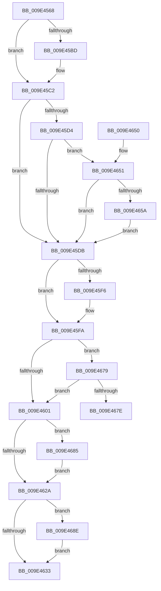

# EtwpProcessThreadImageRundown

- RVA: `0x009E4568`–`0x009E4697` (길이 `303` bytes)
- VA: `0x00000001409E4568`
- 실행 섹션: `PAGE`
- PDB 이름 있음: `예`; PDB Function 태그: `예`
- unwind 정보 RVA: `0x000A40B4`
- 디코드: `86`개 명령, `303/303` bytes 표시
- 미해석 바이트: `0` (있으면 어셈블리에 `.byte`로 보존)

> 이 문서는 커널 이미지의 기계어와 PDB 기호를 분석해 생성했습니다. 4번과 5번은 함수 원형과 자료형을 바이너리 사용 방식에서 추정한 C 해석이며 원본 소스 복구 결과는 아닙니다.

## 1. Dependencies

- 직접 호출 지점: **7**; 고유 호출 대상: **6**
- 직접 호출자로 확인된 함수: **1**
- RIP 상대 이미지 참조: **3**

### Outgoing calls
- `0x009E45A1` → [memset](../../text/6C/memset_function_006C6C40.md) (function, `0x006C6C40`)
- `0x009E45C2` → [EtwpIsStackWalkingEnabled](EtwpIsStackWalkingEnabled_function_009E46A0.md) (function, `0x009E46A0`)
- `0x009E45E8` → [ExAllocatePool2](../../poolcode/B8/ExAllocatePool2_function_00B820F0.md) (function, `0x00B820F0`)
- `0x009E460C` → [EtwpProcessEnumCallback](../8A/EtwpProcessEnumCallback_function_008A5F40.md) (function, `0x008A5F40`)
- `0x009E461C` → [PsEnumProcesses](../91/PsEnumProcesses_function_0091BE84.md) (function, `0x0091BE84`)
- `0x009E4687` → [ExFreePoolWithTag](../../poolcode/B8/ExFreePoolWithTag_function_00B82870.md) (function, `0x00B82870`)
- `0x009E4690` → [ExFreePoolWithTag](../../poolcode/B8/ExFreePoolWithTag_function_00B82870.md) (function, `0x00B82870`)

### Direct callers
- [EtwpKernelTraceRundown](EtwpKernelTraceRundown_function_009E4080.md) at `0x009E4138`

### Static image references
- `0x009E4601` → RVA `0x00FC6B70` (`ALMOSTRO`; read)
- `0x009E4615` → RVA `0x008A5F40` (`EtwpProcessEnumCallback`; read)
- `0x009E4665` → RVA `0x00EFF880` (`.data`; read)

## 2. Other-region calls and transfers

- 다른 실행 섹션으로 향하는 call: **4**
  - `0x009E45A1` → [memset](../../text/6C/memset_function_006C6C40.md) (`PAGE` → `.text`)
  - `0x009E45E8` → [ExAllocatePool2](../../poolcode/B8/ExAllocatePool2_function_00B820F0.md) (`PAGE` → `POOLCODE`)
  - `0x009E4687` → [ExFreePoolWithTag](../../poolcode/B8/ExFreePoolWithTag_function_00B82870.md) (`PAGE` → `POOLCODE`)
  - `0x009E4690` → [ExFreePoolWithTag](../../poolcode/B8/ExFreePoolWithTag_function_00B82870.md) (`PAGE` → `POOLCODE`)
- call이 아닌 외부 분기/꼬리 이동: **1**
  - `0x009E4680` → [sub_00B3066E](../B3/Unknown_function_00B3066E.md) (`tail-transfer`)

## 3. Assembly (complete function range)

```asm
009E4568  48 89 5C 24 10                  mov qword ptr [rsp + 0x10], rbx
009E456D  48 89 74 24 18                  mov qword ptr [rsp + 0x18], rsi
009E4572  48 89 7C 24 20                  mov qword ptr [rsp + 0x20], rdi
009E4577  55                              push rbp
009E4578  41 56                           push r14
009E457A  41 57                           push r15
009E457C  48 8B EC                        mov rbp, rsp
009E457F  48 83 EC 70                     sub rsp, 0x70
009E4583  48 83 65 20 00                  and qword ptr [rbp + 0x20], 0
009E4588  41 8A D8                        mov bl, r8b
009E458B  48 8B FA                        mov rdi, rdx
009E458E  48 8B F1                        mov rsi, rcx
009E4591  45 33 FF                        xor r15d, r15d
009E4594  48 8D 4D B0                     lea rcx, [rbp - 0x50]
009E4598  33 D2                           xor edx, edx
009E459A  4D 8B F1                        mov r14, r9
009E459D  45 8D 47 50                     lea r8d, [r15 + 0x50]
009E45A1  E8 9A 26 CE FF                  call 0x1406c6c40
009E45A6  48 89 75 B0                     mov qword ptr [rbp - 0x50], rsi
009E45AA  48 8B CF                        mov rcx, rdi
009E45AD  48 89 7D D0                     mov qword ptr [rbp - 0x30], rdi
009E45B1  BA 03 05 00 00                  mov edx, 0x503
009E45B6  88 5D F0                        mov byte ptr [rbp - 0x10], bl
009E45B9  84 DB                           test bl, bl
009E45BB  75 05                           jne 0x1409e45c2
009E45BD  BA 04 05 00 00                  mov edx, 0x504
009E45C2  E8 D9 00 00 00                  call 0x1409e46a0
009E45C7  88 45 F2                        mov byte ptr [rbp - 0xe], al
009E45CA  B9 40 00 00 00                  mov ecx, 0x40
009E45CF  48 85 F6                        test rsi, rsi
009E45D2  74 07                           je 0x1409e45db
009E45D4  8B 46 10                        mov eax, dword ptr [rsi + 0x10]
009E45D7  84 C1                           test cl, al
009E45D9  75 76                           jne 0x1409e4651
009E45DB  BB 00 20 00 00                  mov ebx, 0x2000
009E45E0  41 B8 45 74 77 74               mov r8d, 0x74777445
009E45E6  8B D3                           mov edx, ebx
009E45E8  E8 03 DB 19 00                  call 0x140b820f0
009E45ED  48 89 45 C0                     mov qword ptr [rbp - 0x40], rax
009E45F1  48 85 C0                        test rax, rax
009E45F4  74 04                           je 0x1409e45fa
009E45F6  66 89 5D C8                     mov word ptr [rbp - 0x38], bx
009E45FA  8B 55 40                        mov edx, dword ptr [rbp + 0x40]
009E45FD  85 D2                           test edx, edx
009E45FF  75 78                           jne 0x1409e4679
009E4601  48 8B 0D 68 25 5E 00            mov rcx, qword ptr [rip + 0x5e2568]
009E4608  48 8D 55 B0                     lea rdx, [rbp - 0x50]
009E460C  E8 2F 19 EC FF                  call 0x1408a5f40
009E4611  48 8D 55 B0                     lea rdx, [rbp - 0x50]
009E4615  48 8D 0D 24 19 EC FF            lea rcx, [rip - 0x13e6dc]
009E461C  E8 63 78 F3 FF                  call 0x14091be84
009E4621  48 8B 4D C0                     mov rcx, qword ptr [rbp - 0x40]
009E4625  48 85 C9                        test rcx, rcx
009E4628  75 5B                           jne 0x1409e4685
009E462A  48 8B 4D E0                     mov rcx, qword ptr [rbp - 0x20]
009E462E  48 85 C9                        test rcx, rcx
009E4631  75 5B                           jne 0x1409e468e
009E4633  4C 8D 5C 24 70                  lea r11, [rsp + 0x70]
009E4638  41 8B C7                        mov eax, r15d
009E463B  49 8B 5B 28                     mov rbx, qword ptr [r11 + 0x28]
009E463F  49 8B 73 30                     mov rsi, qword ptr [r11 + 0x30]
009E4643  49 8B 7B 38                     mov rdi, qword ptr [r11 + 0x38]
009E4647  49 8B E3                        mov rsp, r11
009E464A  41 5F                           pop r15
009E464C  41 5E                           pop r14
009E464E  5D                              pop rbp
009E464F  C3                              ret
009E4650  CC                              int3
009E4651  F7 47 0C 00 00 00 02            test dword ptr [rdi + 0xc], 0x2000000
009E4658  74 81                           je 0x1409e45db
009E465A  0F B6 87 32 03 00 00            movzx eax, byte ptr [rdi + 0x332]
009E4661  48 8D 14 80                     lea rdx, [rax + rax*4]
009E4665  48 8D 05 14 B2 51 00            lea rax, [rip + 0x51b214]
009E466C  48 8D 04 90                     lea rax, [rax + rdx*4]
009E4670  48 89 45 B8                     mov qword ptr [rbp - 0x48], rax
009E4674  E9 62 FF FF FF                  jmp 0x1409e45db
009E4679  4D 85 F6                        test r14, r14
009E467C  74 83                           je 0x1409e4601
009E467E  33 C9                           xor ecx, ecx
009E4680  E9 E9 BF 14 00                  jmp 0x140b3066e
009E4685  33 D2                           xor edx, edx
009E4687  E8 E4 E1 19 00                  call 0x140b82870
009E468C  EB 9C                           jmp 0x1409e462a
009E468E  33 D2                           xor edx, edx
009E4690  E8 DB E1 19 00                  call 0x140b82870
009E4695  EB 9C                           jmp 0x1409e4633
```

## 4. C-style interpretation (structured pseudocode)

```c
__int64 __fastcall EtwpProcessThreadImageRundown(__int64 a1, __int64 a2, unsigned __int8 a3, __int64 a4, unsigned int a5)
{
    __int64 result;
    __int64 v_r15;
    __int64 v_rsp;
    unsigned __int64 v_stack_m18;
    unsigned __int8 v_stack_m26;
    unsigned __int8 v_stack_m28;
    unsigned __int64 v_stack_m38;
    unsigned __int64 v_stack_m48;
    unsigned __int16 v_stack_m50;
    unsigned __int64 v_stack_m58;
    unsigned __int64 v_stack_m60;
    unsigned __int64 v_stack_m68;
    unsigned __int64 v_stack_p10;
    unsigned __int64 v_stack_p18;
    unsigned __int64 v_stack_p20;
    unsigned __int64 v_stack_p8;

    v_stack_p10 = v_rbx;
    v_stack_p18 = v_rsi;
    v_stack_p20 = v_rdi;
    v_rsp = (v_rsp) - (112);
    v_r15 = 0;
    a2 = 0;
    result = memset(v_stack_m68, a2, v_r15 + 80, a4);
    v_stack_m68 = a1;
    v_stack_m48 = 0;
    v_stack_m28 = a3;
    if (a3 == 0) {
        a2 = 0x504ULL;
    }
    result = EtwpIsStackWalkingEnabled(0, a2, v_r15 + 80, a4);
    v_stack_m26 = (unsigned __int8)(result);
    if (a1 == 0) goto loc_009E45DB;
    if (((64) & ((unsigned __int8)((unsigned int)(*(unsigned int *)(a1 + 16))))) != 0) goto loc_009E4651;
loc_009E45DB:
    result = ExAllocatePool2(64, (unsigned int)((unsigned int)((unsigned int)(0x2000ULL))), (unsigned int)(0x74777445ULL), a4);
    v_stack_m58 = result;
    if (result != 0) {
        v_stack_m50 = (unsigned __int16)((unsigned int)(0x2000ULL));
    }
    if ((unsigned int)((unsigned int)(a5)) != 0) goto loc_009E4679;
loc_009E4601:
    result = EtwpProcessEnumCallback(*(unsigned __int64 *)(v_rip + 6169960), v_stack_m68, (unsigned int)(0x74777445ULL), a4);
    result = PsEnumProcesses(v_rip - 1304284, v_stack_m68, (unsigned int)(0x74777445ULL), a4);
    if (v_stack_m58 != 0) goto loc_009E4685;
loc_009E462A:
    if (v_stack_m38 != 0) goto loc_009E468E;
loc_009E4633:
    return 0;
loc_009E4651:
    if (((*(unsigned int *)(*(unsigned __int64 *)(v_stack_m18 + 56) + 12)) & (0x2000000ULL)) == 0) goto loc_009E45DB;
    v_stack_m60 = v_rip + 5354004 + *(unsigned __int8 *)(*(unsigned __int64 *)(v_stack_m18 + 56) + 818) + *(unsigned __int8 *)(*(unsigned __int64 *)(v_stack_m18 + 56) + 818) * 4 * 4;
    goto loc_009E45DB;
loc_009E4679:
    if (a4 == 0) goto loc_009E4601;
    a1 = 0;
loc_009E4685:
    a2 = 0;
    result = ExFreePoolWithTag(a1, a2, (unsigned int)(0x74777445ULL), a4);
    goto loc_009E462A;
loc_009E468E:
    a2 = 0;
    result = ExFreePoolWithTag(a1, a2, (unsigned int)(0x74777445ULL), a4);
    goto loc_009E4633;
}
```

## 5. (Beta) C Style

```c
int64_t EtwpProcessThreadImageRundown(int64_t Arg1, void *Arg2, uint8_t Arg3, int64_t Arg4, uint32_t Arg5)
{
    uint8_t *arg2 = (uint8_t *)Arg2;

    int64_t result;
    int64_t local_r15;
    int64_t local_rsp;
    uint64_t v_stack_m18;
    uint8_t v_stack_m26;
    uint8_t v_stack_m28;
    uint64_t v_stack_m38;
    uint64_t v_stack_m48;
    uint16_t v_stack_m50;
    uint64_t v_stack_m58;
    uint64_t v_stack_m60;
    uint64_t v_stack_m68;
    uint64_t v_stack_p10;
    uint64_t v_stack_p18;
    uint64_t v_stack_p20;
    uint64_t v_stack_p8;

    v_stack_p10 = local_rbx;
    v_stack_p18 = local_rsi;
    v_stack_p20 = local_rdi;
    local_rsp = (local_rsp) - (112);
    local_r15 = 0;
    Arg2 = 0;
    result = memset(v_stack_m68, Arg2, local_r15 + 80, Arg4);
    v_stack_m68 = Arg1;
    v_stack_m48 = 0;
    v_stack_m28 = Arg3;
    if (Arg3 == 0) {
        Arg2 = 0x504ULL;
    }
    result = EtwpIsStackWalkingEnabled(0, Arg2, local_r15 + 80, Arg4);
    v_stack_m26 = (uint8_t)(result);
    if (Arg1 == 0) goto loc_009E45DB;
    if (((64) & ((uint8_t)((uint32_t)(*(uint32_t *)(Arg1 + 0x10))))) != 0) goto loc_009E4651;
loc_009E45DB:
    result = ExAllocatePool2(64, (uint32_t)((uint32_t)((uint32_t)(0x2000ULL))), (uint32_t)(0x74777445ULL), Arg4);
    v_stack_m58 = result;
    if (result != 0) {
        v_stack_m50 = (uint16_t)((uint32_t)(0x2000ULL));
    }
    if ((uint32_t)((uint32_t)(Arg5)) != 0) goto loc_009E4679;
loc_009E4601:
    result = EtwpProcessEnumCallback(*(uint64_t *)(v_rip + 0x5E2568), v_stack_m68, (uint32_t)(0x74777445ULL), Arg4);
    result = PsEnumProcesses(v_rip - 1304284, v_stack_m68, (uint32_t)(0x74777445ULL), Arg4);
    if (v_stack_m58 != 0) goto loc_009E4685;
loc_009E462A:
    if (v_stack_m38 != 0) goto loc_009E468E;
loc_009E4633:
    return 0;
loc_009E4651:
    if (((*(uint32_t *)(*(uint64_t *)(v_stack_m18 + 0x38) + 0xC)) & (0x2000000ULL)) == 0) goto loc_009E45DB;
    v_stack_m60 = v_rip + 5354004 + *(uint8_t *)(*(uint64_t *)(v_stack_m18 + 0x38) + 0x332) + *(uint8_t *)(*(uint64_t *)(v_stack_m18 + 0x38) + 0x332) * 4 * 4;
    goto loc_009E45DB;
loc_009E4679:
    if (Arg4 == 0) goto loc_009E4601;
    Arg1 = 0;
loc_009E4685:
    Arg2 = 0;
    result = ExFreePoolWithTag(Arg1, Arg2, (uint32_t)(0x74777445ULL), Arg4);
    goto loc_009E462A;
loc_009E468E:
    Arg2 = 0;
    result = ExFreePoolWithTag(Arg1, Arg2, (uint32_t)(0x74777445ULL), Arg4);
    goto loc_009E4633;
}
```

### 관측된 메모리 오프셋

구조체 형식이 확인되지 않은 접근은 인자 기준의 오프셋으로만 기록했습니다.

| 기준 인자 | 오프셋 표현 | 폭 (bit) | 접근 |
|---|---:|---:|---|
| `Arg2` | `+ 0xC` | `32` | `R` |
| `Arg2` | `+ 0x332` | `8` | `R` |

## 6. Execution-region graph

[열기: 2D/3D 그래프와 함수 탐색 컨트롤 패널](../../../control-panel.html?section=page&rva=0x009E4568&view=graph)

- 2D 그래프는 위에서 아래로 흐르고, 3D 그래프는 빈 공간을 드래그해 회전합니다. Shift+드래그는 이동, 휠은 확대·축소, 함수 노드 선택은 대상 보고서 이동입니다.

### Static fallback


