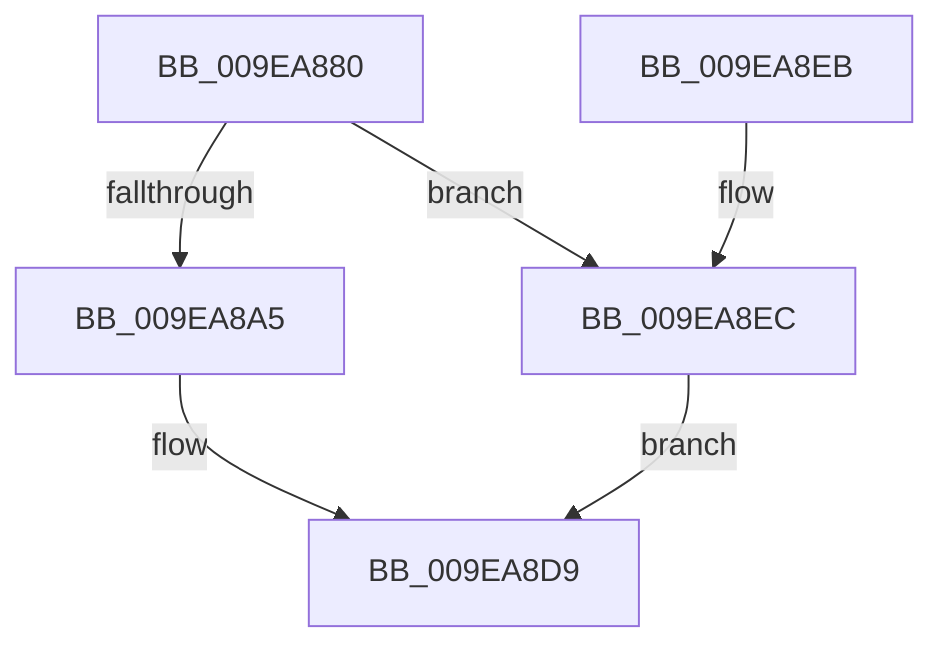

# EtwpUpdateDisallowList

- RVA: `0x009EA880`–`0x009EA8F3` (길이 `115` bytes)
- VA: `0x00000001409EA880`
- 실행 섹션: `PAGE`
- PDB 이름 있음: `예`; PDB Function 태그: `아니요`
- unwind 정보 RVA: `0x000A5464`
- 디코드: `32`개 명령, `115/115` bytes 표시
- 미해석 바이트: `0` (있으면 어셈블리에 `.byte`로 보존)

> 이 문서는 커널 이미지의 기계어와 PDB 기호를 분석해 생성했습니다. 4번과 5번은 함수 원형과 자료형을 바이너리 사용 방식에서 추정한 C 해석이며 원본 소스 복구 결과는 아닙니다.

## 1. Dependencies

- 직접 호출 지점: **3**; 고유 호출 대상: **3**
- 직접 호출자로 확인된 함수: **2**
- RIP 상대 이미지 참조: **0**

### Outgoing calls
- `0x009EA898` → [EtwpAcquireLoggerContextByLoggerId](../93/EtwpAcquireLoggerContextByLoggerId_function_00932920.md) (function, `0x00932920`)
- `0x009EA8B3` → [EtwpUpdateDisallowedGuids](EtwpUpdateDisallowedGuids_function_009EA8FC.md) (function, `0x009EA8FC`)
- `0x009EA8D4` → [ExReleaseRundownProtectionCacheAwareEx](../../text/25/ExReleaseRundownProtectionCacheAwareEx_function_0025F050.md) (function, `0x0025F050`)

### Direct callers
- [EtwStartAutoLogger](../7B/EtwStartAutoLogger_function_007BD2F8.md) at `0x007BE179`
- [NtTraceControl](../A9/NtTraceControl_function_00A9ED40.md) at `0x00A9F48E`

### Static image references
- 디코드된 RIP-relative 메모리 참조가 없습니다.

## 2. Other-region calls and transfers

- 다른 실행 섹션으로 향하는 call: **1**
  - `0x009EA8D4` → [ExReleaseRundownProtectionCacheAwareEx](../../text/25/ExReleaseRundownProtectionCacheAwareEx_function_0025F050.md) (`PAGE` → `.text`)
- 별도 외부 분기/꼬리 이동을 확인하지 못했습니다.

## 3. Assembly (complete function range)

```asm
009EA880  48 89 5C 24 08                  mov qword ptr [rsp + 8], rbx
009EA885  48 89 74 24 10                  mov qword ptr [rsp + 0x10], rsi
009EA88A  57                              push rdi
009EA88B  48 83 EC 40                     sub rsp, 0x40
009EA88F  41 8B F0                        mov esi, r8d
009EA892  49 8B D9                        mov rbx, r9
009EA895  45 33 C0                        xor r8d, r8d
009EA898  E8 83 80 F4 FF                  call 0x140932920
009EA89D  48 8B F8                        mov rdi, rax
009EA8A0  48 85 C0                        test rax, rax
009EA8A3  74 47                           je 0x1409ea8ec
009EA8A5  4C 8B C3                        mov r8, rbx
009EA8A8  48 89 44 24 30                  mov qword ptr [rsp + 0x30], rax
009EA8AD  0F B7 D6                        movzx edx, si
009EA8B0  48 8B C8                        mov rcx, rax
009EA8B3  E8 44 00 00 00                  call 0x1409ea8fc
009EA8B8  8B D8                           mov ebx, eax
009EA8BA  48 8B 97 50 05 00 00            mov rdx, qword ptr [rdi + 0x550]
009EA8C1  44 8B 07                        mov r8d, dword ptr [rdi]
009EA8C4  48 8B 8A C0 02 00 00            mov rcx, qword ptr [rdx + 0x2c0]
009EA8CB  BA 01 00 00 00                  mov edx, 1
009EA8D0  4A 8B 0C C1                     mov rcx, qword ptr [rcx + r8*8]
009EA8D4  E8 77 47 87 FF                  call 0x14025f050
009EA8D9  48 8B 74 24 58                  mov rsi, qword ptr [rsp + 0x58]
009EA8DE  8B C3                           mov eax, ebx
009EA8E0  48 8B 5C 24 50                  mov rbx, qword ptr [rsp + 0x50]
009EA8E5  48 83 C4 40                     add rsp, 0x40
009EA8E9  5F                              pop rdi
009EA8EA  C3                              ret
009EA8EB  CC                              int3
009EA8EC  BB 0D 00 00 C0                  mov ebx, 0xc000000d
009EA8F1  EB E6                           jmp 0x1409ea8d9
```

## 4. C-style interpretation (structured pseudocode)

```c
__int64 __fastcall EtwpUpdateDisallowList(__int64 a1, __int64 a2, int a3, __int64 a4)
{
    __int64 result;
    __int64 v_rsp;
    unsigned __int64 v_stack_m18;
    unsigned __int64 v_stack_p10;
    unsigned __int64 v_stack_p8;

    v_stack_p8 = v_rbx;
    v_stack_p10 = v_rsi;
    v_rsp = (v_rsp) - (64);
    a3 = 0;
    result = EtwpAcquireLoggerContextByLoggerId(a1, a2, a3, a4);
    if (result == 0) goto loc_009EA8EC;
    v_stack_m18 = result;
    result = EtwpUpdateDisallowedGuids(result, (unsigned __int16)((unsigned int)(a3)), a4, a4);
    result = ExReleaseRundownProtectionCacheAwareEx(*(unsigned __int64 *)(*(unsigned __int64 *)(*(unsigned __int64 *)(result + 1360) + 704) + (unsigned int)(*(unsigned int *)(result)) * 8), 1, (unsigned int)(*(unsigned int *)(result)), a4);
loc_009EA8D9:
    v_rsp = (v_rsp) + (64);
    return (unsigned int)((unsigned int)((unsigned int)((unsigned int)(result))));
loc_009EA8EC:
    goto loc_009EA8D9;
}
```

## 5. (Beta) C Style

```c
int64_t EtwpUpdateDisallowList(int64_t Arg1, int64_t Arg2, int32_t Arg3, int64_t Arg4)
{
    int64_t result;
    int64_t local_rsp;
    uint64_t v_stack_m18;
    uint64_t v_stack_p10;
    uint64_t v_stack_p8;

    v_stack_p8 = local_rbx;
    v_stack_p10 = local_rsi;
    local_rsp = (local_rsp) - (64);
    Arg3 = 0;
    result = EtwpAcquireLoggerContextByLoggerId(Arg1, Arg2, Arg3, Arg4);
    if (result == 0) goto loc_009EA8EC;
    v_stack_m18 = result;
    result = EtwpUpdateDisallowedGuids(result, (uint16_t)((uint32_t)(Arg3)), Arg4, Arg4);
    result = ExReleaseRundownProtectionCacheAwareEx(*(uint64_t *)(*(uint64_t *)(*(uint64_t *)(result + 0x550) + 0x2C0) + (uint32_t)(*(uint32_t *)(result)) * 8), 1, (uint32_t)(*(uint32_t *)(result)), Arg4);
loc_009EA8D9:
    local_rsp = (local_rsp) + (64);
    return (uint32_t)((uint32_t)((uint32_t)((uint32_t)(result))));
loc_009EA8EC:
    goto loc_009EA8D9;
}
```

## 6. Execution-region graph

[열기: 2D/3D 그래프와 함수 탐색 컨트롤 패널](../../../control-panel.html?section=page&rva=0x009EA880&view=graph)

- 2D 그래프는 위에서 아래로 흐르고, 3D 그래프는 빈 공간을 드래그해 회전합니다. Shift+드래그는 이동, 휠은 확대·축소, 함수 노드 선택은 대상 보고서 이동입니다.

### Static fallback


