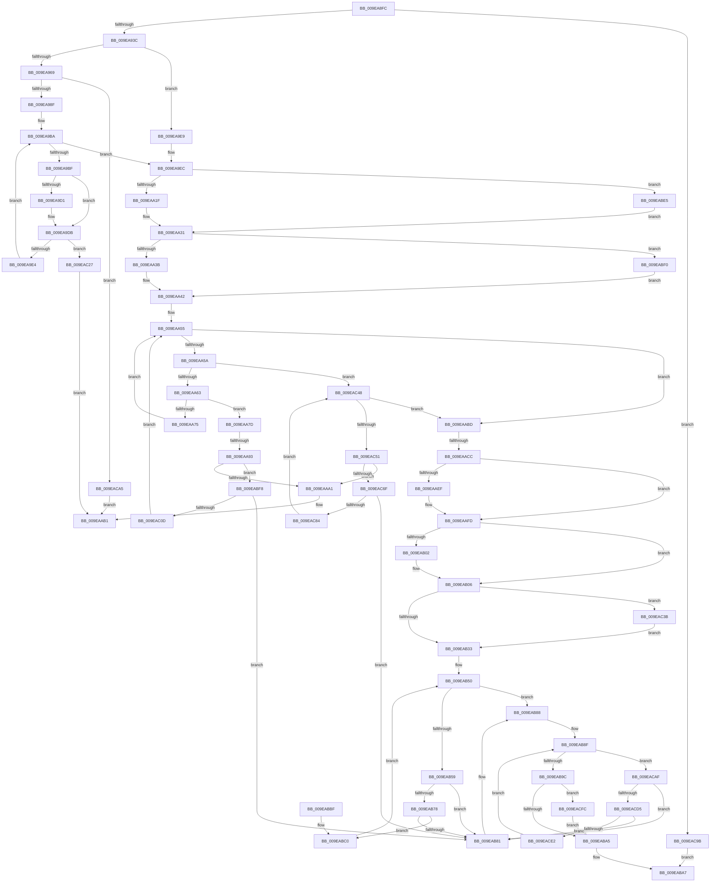

# EtwpUpdateDisallowedGuids

- RVA: `0x009EA8FC`–`0x009EAD0B` (길이 `1,039` bytes)
- VA: `0x00000001409EA8FC`
- 실행 섹션: `PAGE`
- PDB 이름 있음: `예`; PDB Function 태그: `예`
- unwind 정보 RVA: `0x000A5478`
- 디코드: `270`개 명령, `1,039/1,039` bytes 표시
- 미해석 바이트: `0` (있으면 어셈블리에 `.byte`로 보존)

> 이 문서는 커널 이미지의 기계어와 PDB 기호를 분석해 생성했습니다. 4번과 5번은 함수 원형과 자료형을 바이너리 사용 방식에서 추정한 C 해석이며 원본 소스 복구 결과는 아닙니다.

## 1. Dependencies

- 직접 호출 지점: **20**; 고유 호출 대상: **12**
- 직접 호출자로 확인된 함수: **1**
- RIP 상대 이미지 참조: **1**

### Outgoing calls
- `0x009EA97E` → [ExAllocatePool2](../../poolcode/B8/ExAllocatePool2_function_00B820F0.md) (function, `0x00B820F0`)
- `0x009EA998` → [memcpy](../../text/6C/memcpy_function_006C6840.md) (function, `0x006C6840`)
- `0x009EA9AE` → [qsort](../../text/50/qsort_function_005009F0.md) (function, `0x005009F0`)
- `0x009EAA08` → [KeWaitForSingleObject](../../text/20/KeWaitForSingleObject_function_0020E6B0.md) (function, `0x0020E6B0`)
- `0x009EAA6C` → [memcmp](../../text/6C/memcmp_function_006C6B10.md) (function, `0x006C6B10`)
- `0x009EAA93` → [ExAllocatePool2](../../poolcode/B8/ExAllocatePool2_function_00B820F0.md) (function, `0x00B820F0`)
- `0x009EAAAC` → [KeReleaseMutex](../../text/39/KeReleaseMutex_function_00396810.md) (function, `0x00396810`)
- `0x009EAADF` → [KeAbPreAcquire](../../text/21/KeAbPreAcquire_function_00210230.md) (function, `0x00210230`)
- `0x009EAAF8` → [ExfAcquirePushLockExclusiveEx](../../text/20/ExfAcquirePushLockExclusiveEx_function_0020FC90.md) (function, `0x0020FC90`)
- `0x009EAB36` → [KeAbPostRelease](../../text/2E/KeAbPostRelease_function_002E1600.md) (function, `0x002E1600`)
- `0x009EAB44` → [KeReleaseMutex](../../text/39/KeReleaseMutex_function_00396810.md) (function, `0x00396810`)
- `0x009EAB6A` → [EtwpNotifyDisallowedGuidChange](EtwpNotifyDisallowedGuidChange_function_009EAD14.md) (function, `0x009EAD14`)
- `0x009EABCD` → [ExFreePoolWithTag](../../poolcode/B8/ExFreePoolWithTag_function_00B82870.md) (function, `0x00B82870`)
- `0x009EABD7` → [ExFreePoolWithTag](../../poolcode/B8/ExFreePoolWithTag_function_00B82870.md) (function, `0x00B82870`)
- `0x009EAC2C` → [ExFreePoolWithTag](../../poolcode/B8/ExFreePoolWithTag_function_00B82870.md) (function, `0x00B82870`)
- `0x009EAC3E` → [ExfTryToWakePushLock](../../text/26/ExfTryToWakePushLock_function_00265DD0.md) (function, `0x00265DD0`)
- `0x009EAC61` → [ExAllocatePool2](../../poolcode/B8/ExAllocatePool2_function_00B820F0.md) (function, `0x00B820F0`)
- `0x009EACC3` → [EtwpNotifyDisallowedGuidChange](EtwpNotifyDisallowedGuidChange_function_009EAD14.md) (function, `0x009EAD14`)
- `0x009EACEE` → [ExFreePoolWithTag](../../poolcode/B8/ExFreePoolWithTag_function_00B82870.md) (function, `0x00B82870`)
- `0x009EAD01` → [ExFreePoolWithTag](../../poolcode/B8/ExFreePoolWithTag_function_00B82870.md) (function, `0x00B82870`)

### Direct callers
- [EtwpUpdateDisallowList](EtwpUpdateDisallowList_function_009EA880.md) at `0x009EA8B3`

### Static image references
- `0x009EA99D` → RVA `0x009E4860` (`EtwpCompareGuid`; read)

## 2. Other-region calls and transfers

- 다른 실행 섹션으로 향하는 call: **18**
  - `0x009EA97E` → [ExAllocatePool2](../../poolcode/B8/ExAllocatePool2_function_00B820F0.md) (`PAGE` → `POOLCODE`)
  - `0x009EA998` → [memcpy](../../text/6C/memcpy_function_006C6840.md) (`PAGE` → `.text`)
  - `0x009EA9AE` → [qsort](../../text/50/qsort_function_005009F0.md) (`PAGE` → `.text`)
  - `0x009EAA08` → [KeWaitForSingleObject](../../text/20/KeWaitForSingleObject_function_0020E6B0.md) (`PAGE` → `.text`)
  - `0x009EAA6C` → [memcmp](../../text/6C/memcmp_function_006C6B10.md) (`PAGE` → `.text`)
  - `0x009EAA93` → [ExAllocatePool2](../../poolcode/B8/ExAllocatePool2_function_00B820F0.md) (`PAGE` → `POOLCODE`)
  - `0x009EAAAC` → [KeReleaseMutex](../../text/39/KeReleaseMutex_function_00396810.md) (`PAGE` → `.text`)
  - `0x009EAADF` → [KeAbPreAcquire](../../text/21/KeAbPreAcquire_function_00210230.md) (`PAGE` → `.text`)
  - `0x009EAAF8` → [ExfAcquirePushLockExclusiveEx](../../text/20/ExfAcquirePushLockExclusiveEx_function_0020FC90.md) (`PAGE` → `.text`)
  - `0x009EAB36` → [KeAbPostRelease](../../text/2E/KeAbPostRelease_function_002E1600.md) (`PAGE` → `.text`)
  - `0x009EAB44` → [KeReleaseMutex](../../text/39/KeReleaseMutex_function_00396810.md) (`PAGE` → `.text`)
  - `0x009EABCD` → [ExFreePoolWithTag](../../poolcode/B8/ExFreePoolWithTag_function_00B82870.md) (`PAGE` → `POOLCODE`)
  - `0x009EABD7` → [ExFreePoolWithTag](../../poolcode/B8/ExFreePoolWithTag_function_00B82870.md) (`PAGE` → `POOLCODE`)
  - `0x009EAC2C` → [ExFreePoolWithTag](../../poolcode/B8/ExFreePoolWithTag_function_00B82870.md) (`PAGE` → `POOLCODE`)
  - `0x009EAC3E` → [ExfTryToWakePushLock](../../text/26/ExfTryToWakePushLock_function_00265DD0.md) (`PAGE` → `.text`)
  - `0x009EAC61` → [ExAllocatePool2](../../poolcode/B8/ExAllocatePool2_function_00B820F0.md) (`PAGE` → `POOLCODE`)
  - `0x009EACEE` → [ExFreePoolWithTag](../../poolcode/B8/ExFreePoolWithTag_function_00B82870.md) (`PAGE` → `POOLCODE`)
  - `0x009EAD01` → [ExFreePoolWithTag](../../poolcode/B8/ExFreePoolWithTag_function_00B82870.md) (`PAGE` → `POOLCODE`)
- call이 아닌 외부 분기/꼬리 이동: **3**
  - `0x009EAA8D` → [sub_00B3081E](../B3/Unknown_function_00B3081E.md) (`tail-transfer`)
  - `0x009EAAB8` → [sub_00B3081E + 0xE2](../B3/Unknown_function_00B3081E.md) (`tail-transfer`)
  - `0x009EAAC6` → [sub_00B3081E + 0x69](../B3/Unknown_function_00B3081E.md) (`tail-transfer`)

## 3. Assembly (complete function range)

```asm
009EA8FC  48 8B C4                        mov rax, rsp
009EA8FF  48 89 58 18                     mov qword ptr [rax + 0x18], rbx
009EA903  4C 89 48 20                     mov qword ptr [rax + 0x20], r9
009EA907  66 89 50 10                     mov word ptr [rax + 0x10], dx
009EA90B  48 89 48 08                     mov qword ptr [rax + 8], rcx
009EA90F  55                              push rbp
009EA910  56                              push rsi
009EA911  57                              push rdi
009EA912  41 54                           push r12
009EA914  41 55                           push r13
009EA916  41 56                           push r14
009EA918  41 57                           push r15
009EA91A  48 8B EC                        mov rbp, rsp
009EA91D  48 83 EC 50                     sub rsp, 0x50
009EA921  44 0F B7 F2                     movzx r14d, dx
009EA925  33 DB                           xor ebx, ebx
009EA927  B8 00 02 00 00                  mov eax, 0x200
009EA92C  49 8B F0                        mov rsi, r8
009EA92F  4C 8B E1                        mov r12, rcx
009EA932  66 44 3B F0                     cmp r14w, ax
009EA936  0F 87 5F 03 00 00               ja 0x1409eac9b
009EA93C  48 8D 45 E0                     lea rax, [rbp - 0x20]
009EA940  45 8B EE                        mov r13d, r14d
009EA943  48 89 45 E8                     mov qword ptr [rbp - 0x18], rax
009EA947  48 8D 45 E0                     lea rax, [rbp - 0x20]
009EA94B  48 89 45 E0                     mov qword ptr [rbp - 0x20], rax
009EA94F  48 8D 45 F0                     lea rax, [rbp - 0x10]
009EA953  48 89 45 F8                     mov qword ptr [rbp - 8], rax
009EA957  48 8D 45 F0                     lea rax, [rbp - 0x10]
009EA95B  48 89 45 F0                     mov qword ptr [rbp - 0x10], rax
009EA95F  66 45 85 F6                     test r14w, r14w
009EA963  0F 84 80 00 00 00               je 0x1409ea9e9
009EA969  41 8B FE                        mov edi, r14d
009EA96C  41 B8 45 74 77 64               mov r8d, 0x64777445
009EA972  48 C1 E7 04                     shl rdi, 4
009EA976  B9 00 01 00 00                  mov ecx, 0x100
009EA97B  48 8B D7                        mov rdx, rdi
009EA97E  E8 6D 77 19 00                  call 0x140b820f0
009EA983  4C 8B F8                        mov r15, rax
009EA986  48 85 C0                        test rax, rax
009EA989  0F 84 16 03 00 00               je 0x1409eaca5
009EA98F  4C 8B C7                        mov r8, rdi
009EA992  48 8B D6                        mov rdx, rsi
009EA995  48 8B C8                        mov rcx, rax
009EA998  E8 A3 BE CD FF                  call 0x1406c6840
009EA99D  4C 8D 0D BC 9E FF FF            lea r9, [rip - 0x6144]
009EA9A4  41 8B D6                        mov edx, r14d
009EA9A7  44 8D 43 10                     lea r8d, [rbx + 0x10]
009EA9AB  49 8B CF                        mov rcx, r15
009EA9AE  E8 3D 60 B1 FF                  call 0x1405009f0
009EA9B3  44 8B C3                        mov r8d, ebx
009EA9B6  45 8D 4E FF                     lea r9d, [r14 - 1]
009EA9BA  45 3B C1                        cmp r8d, r9d
009EA9BD  73 2D                           jae 0x1409ea9ec
009EA9BF  41 8B D0                        mov edx, r8d
009EA9C2  48 C1 E2 04                     shl rdx, 4
009EA9C6  4A 8B 0C 3A                     mov rcx, qword ptr [rdx + r15]
009EA9CA  4A 2B 4C 3A 10                  sub rcx, qword ptr [rdx + r15 + 0x10]
009EA9CF  75 0A                           jne 0x1409ea9db
009EA9D1  4A 8B 4C 3A 08                  mov rcx, qword ptr [rdx + r15 + 8]
009EA9D6  4A 2B 4C 3A 18                  sub rcx, qword ptr [rdx + r15 + 0x18]
009EA9DB  48 85 C9                        test rcx, rcx
009EA9DE  0F 84 43 02 00 00               je 0x1409eac27
009EA9E4  41 FF C0                        inc r8d
009EA9E7  EB D1                           jmp 0x1409ea9ba
009EA9E9  4C 8B FB                        mov r15, rbx
009EA9EC  49 8D 84 24 78 02 00 00         lea rax, [r12 + 0x278]
009EA9F4  48 89 5C 24 20                  mov qword ptr [rsp + 0x20], rbx
009EA9F9  48 8B C8                        mov rcx, rax
009EA9FC  48 89 45 58                     mov qword ptr [rbp + 0x58], rax
009EAA00  45 33 C9                        xor r9d, r9d
009EAA03  45 33 C0                        xor r8d, r8d
009EAA06  33 D2                           xor edx, edx
009EAA08  E8 A3 3C 82 FF                  call 0x14020e6b0
009EAA0D  41 0F B7 84 24 30 05 00 00      movzx eax, word ptr [r12 + 0x530]
009EAA16  66 85 C0                        test ax, ax
009EAA19  0F 84 C6 01 00 00               je 0x1409eabe5
009EAA1F  49 8B BC 24 38 05 00 00         mov rdi, qword ptr [r12 + 0x538]
009EAA27  44 8B E0                        mov r12d, eax
009EAA2A  49 C1 E4 04                     shl r12, 4
009EAA2E  4C 03 E7                        add r12, rdi
009EAA31  66 45 85 F6                     test r14w, r14w
009EAA35  0F 84 B5 01 00 00               je 0x1409eabf0
009EAA3B  49 C1 E5 04                     shl r13, 4
009EAA3F  4D 03 EF                        add r13, r15
009EAA42  41 0F B7 C6                     movzx eax, r14w
009EAA46  41 BE 10 00 00 00               mov r14d, 0x10
009EAA4C  66 F7 D8                        neg ax
009EAA4F  48 1B F6                        sbb rsi, rsi
009EAA52  49 23 F7                        and rsi, r15
009EAA55  49 3B FC                        cmp rdi, r12
009EAA58  73 63                           jae 0x1409eaabd
009EAA5A  49 3B F5                        cmp rsi, r13
009EAA5D  0F 83 E5 01 00 00               jae 0x1409eac48
009EAA63  4D 8B C6                        mov r8, r14
009EAA66  48 8B D6                        mov rdx, rsi
009EAA69  48 8B CF                        mov rcx, rdi
009EAA6C  E8 9F C0 CD FF                  call 0x1406c6b10
009EAA71  85 C0                           test eax, eax
009EAA73  75 08                           jne 0x1409eaa7d
009EAA75  49 03 FE                        add rdi, r14
009EAA78  49 03 F6                        add rsi, r14
009EAA7B  EB D8                           jmp 0x1409eaa55
009EAA7D  BA 18 00 00 00                  mov edx, 0x18
009EAA82  B9 00 01 00 00                  mov ecx, 0x100
009EAA87  41 B8 45 74 77 74               mov r8d, 0x74777445
009EAA8D  0F 89 8B 5D 14 00               jns 0x140b3081e
009EAA93  E8 58 76 19 00                  call 0x140b820f0
009EAA98  48 85 C0                        test rax, rax
009EAA9B  0F 85 57 01 00 00               jne 0x1409eabf8
009EAAA1  48 8B 4D 58                     mov rcx, qword ptr [rbp + 0x58]
009EAAA5  33 D2                           xor edx, edx
009EAAA7  BB 9A 00 00 C0                  mov ebx, 0xc000009a
009EAAAC  E8 5F BD 9A FF                  call 0x140396810
009EAAB1  48 8B 45 E0                     mov rax, qword ptr [rbp - 0x20]
009EAAB5  48 8B F0                        mov rsi, rax
009EAAB8  E9 43 5E 14 00                  jmp 0x140b30900
009EAABD  41 BC 45 74 77 74               mov r12d, 0x74777445
009EAAC3  49 3B F5                        cmp rsi, r13
009EAAC6  0F 82 BB 5D 14 00               jb 0x140b30887
009EAACC  4C 8B 6D 40                     mov r13, qword ptr [rbp + 0x40]
009EAAD0  45 33 C0                        xor r8d, r8d
009EAAD3  33 D2                           xor edx, edx
009EAAD5  49 8D BD B0 02 00 00            lea rdi, [r13 + 0x2b0]
009EAADC  48 8B CF                        mov rcx, rdi
009EAADF  E8 4C 57 82 FF                  call 0x140210230
009EAAE4  F0 48 0F BA 2F 00               lock bts qword ptr [rdi], 0
009EAAEA  48 8B F0                        mov rsi, rax
009EAAED  73 0E                           jae 0x1409eaafd
009EAAEF  4C 8B C7                        mov r8, rdi
009EAAF2  48 8B D0                        mov rdx, rax
009EAAF5  48 8B CF                        mov rcx, rdi
009EAAF8  E8 93 51 82 FF                  call 0x14020fc90
009EAAFD  48 85 F6                        test rsi, rsi
009EAB00  74 04                           je 0x1409eab06
009EAB02  C6 46 0A 01                     mov byte ptr [rsi + 0xa], 1
009EAB06  0F B7 45 48                     movzx eax, word ptr [rbp + 0x48]
009EAB0A  4D 8B B5 38 05 00 00            mov r14, qword ptr [r13 + 0x538]
009EAB11  66 41 89 85 30 05 00 00         mov word ptr [r13 + 0x530], ax
009EAB19  48 83 C8 FF                     or rax, 0xffffffffffffffff
009EAB1D  4D 89 BD 38 05 00 00            mov qword ptr [r13 + 0x538], r15
009EAB24  F0 48 0F C1 07                  lock xadd qword ptr [rdi], rax
009EAB29  24 06                           and al, 6
009EAB2B  3C 02                           cmp al, 2
009EAB2D  0F 84 08 01 00 00               je 0x1409eac3b
009EAB33  48 8B CF                        mov rcx, rdi
009EAB36  E8 C5 6A 8F FF                  call 0x1402e1600
009EAB3B  33 D2                           xor edx, edx
009EAB3D  49 8D 8D 78 02 00 00            lea rcx, [r13 + 0x278]
009EAB44  E8 C7 BC 9A FF                  call 0x140396810
009EAB49  48 8B 45 E0                     mov rax, qword ptr [rbp - 0x20]
009EAB4D  48 8B F0                        mov rsi, rax
009EAB50  48 8D 4D E0                     lea rcx, [rbp - 0x20]
009EAB54  48 3B C1                        cmp rax, rcx
009EAB57  74 2F                           je 0x1409eab88
009EAB59  48 8B 55 70                     mov rdx, qword ptr [rbp + 0x70]
009EAB5D  48 8B FE                        mov rdi, rsi
009EAB60  48 8B 36                        mov rsi, qword ptr [rsi]
009EAB63  45 33 C0                        xor r8d, r8d
009EAB66  48 8B 4F 10                     mov rcx, qword ptr [rdi + 0x10]
009EAB6A  E8 A5 01 00 00                  call 0x1409ead14
009EAB6F  48 8B 0F                        mov rcx, qword ptr [rdi]
009EAB72  48 39 79 08                     cmp qword ptr [rcx + 8], rdi
009EAB76  75 09                           jne 0x1409eab81
009EAB78  48 8B 47 08                     mov rax, qword ptr [rdi + 8]
009EAB7C  48 39 38                        cmp qword ptr [rax], rdi
009EAB7F  74 3F                           je 0x1409eabc0
009EAB81  B9 03 00 00 00                  mov ecx, 3
009EAB86  CD 29                           int 0x29
009EAB88  48 8B 45 F0                     mov rax, qword ptr [rbp - 0x10]
009EAB8C  48 8B F0                        mov rsi, rax
009EAB8F  48 8D 4D F0                     lea rcx, [rbp - 0x10]
009EAB93  48 3B C1                        cmp rax, rcx
009EAB96  0F 85 13 01 00 00               jne 0x1409eacaf
009EAB9C  4D 85 F6                        test r14, r14
009EAB9F  0F 85 57 01 00 00               jne 0x1409eacfc
009EABA5  8B C3                           mov eax, ebx
009EABA7  48 8B 9C 24 A0 00 00 00         mov rbx, qword ptr [rsp + 0xa0]
009EABAF  48 83 C4 50                     add rsp, 0x50
009EABB3  41 5F                           pop r15
009EABB5  41 5E                           pop r14
009EABB7  41 5D                           pop r13
009EABB9  41 5C                           pop r12
009EABBB  5F                              pop rdi
009EABBC  5E                              pop rsi
009EABBD  5D                              pop rbp
009EABBE  C3                              ret
009EABBF  CC                              int3
009EABC0  48 89 08                        mov qword ptr [rax], rcx
009EABC3  33 D2                           xor edx, edx
009EABC5  48 89 41 08                     mov qword ptr [rcx + 8], rax
009EABC9  48 8B 4F 10                     mov rcx, qword ptr [rdi + 0x10]
009EABCD  E8 9E 7C 19 00                  call 0x140b82870
009EABD2  33 D2                           xor edx, edx
009EABD4  48 8B CF                        mov rcx, rdi
009EABD7  E8 94 7C 19 00                  call 0x140b82870
009EABDC  48 8B 45 E0                     mov rax, qword ptr [rbp - 0x20]
009EABE0  E9 6B FF FF FF                  jmp 0x1409eab50
009EABE5  48 8B FB                        mov rdi, rbx
009EABE8  4C 8B E3                        mov r12, rbx
009EABEB  E9 41 FE FF FF                  jmp 0x1409eaa31
009EABF0  4C 8B EB                        mov r13, rbx
009EABF3  E9 4A FE FF FF                  jmp 0x1409eaa42
009EABF8  48 89 78 10                     mov qword ptr [rax + 0x10], rdi
009EABFC  48 8D 55 F0                     lea rdx, [rbp - 0x10]
009EAC00  48 8B 4D F8                     mov rcx, qword ptr [rbp - 8]
009EAC04  48 39 11                        cmp qword ptr [rcx], rdx
009EAC07  0F 85 74 FF FF FF               jne 0x1409eab81
009EAC0D  48 89 48 08                     mov qword ptr [rax + 8], rcx
009EAC11  48 8D 55 F0                     lea rdx, [rbp - 0x10]
009EAC15  48 89 10                        mov qword ptr [rax], rdx
009EAC18  49 03 FE                        add rdi, r14
009EAC1B  48 89 01                        mov qword ptr [rcx], rax
009EAC1E  48 89 45 F8                     mov qword ptr [rbp - 8], rax
009EAC22  E9 2E FE FF FF                  jmp 0x1409eaa55
009EAC27  33 D2                           xor edx, edx
009EAC29  49 8B CF                        mov rcx, r15
009EAC2C  E8 3F 7C 19 00                  call 0x140b82870
009EAC31  BB 0D 00 00 C0                  mov ebx, 0xc000000d
009EAC36  E9 76 FE FF FF                  jmp 0x1409eaab1
009EAC3B  48 8B CF                        mov rcx, rdi
009EAC3E  E8 8D B1 87 FF                  call 0x140265dd0
009EAC43  E9 EB FE FF FF                  jmp 0x1409eab33
009EAC48  49 3B FC                        cmp rdi, r12
009EAC4B  0F 83 6C FE FF FF               jae 0x1409eaabd
009EAC51  BA 18 00 00 00                  mov edx, 0x18
009EAC56  B9 00 01 00 00                  mov ecx, 0x100
009EAC5B  41 B8 45 74 77 74               mov r8d, 0x74777445
009EAC61  E8 8A 74 19 00                  call 0x140b820f0
009EAC66  48 85 C0                        test rax, rax
009EAC69  0F 84 32 FE FF FF               je 0x1409eaaa1
009EAC6F  48 89 78 10                     mov qword ptr [rax + 0x10], rdi
009EAC73  48 8D 55 F0                     lea rdx, [rbp - 0x10]
009EAC77  48 8B 4D F8                     mov rcx, qword ptr [rbp - 8]
009EAC7B  48 39 11                        cmp qword ptr [rcx], rdx
009EAC7E  0F 85 FD FE FF FF               jne 0x1409eab81
009EAC84  48 89 48 08                     mov qword ptr [rax + 8], rcx
009EAC88  48 8D 55 F0                     lea rdx, [rbp - 0x10]
009EAC8C  48 89 10                        mov qword ptr [rax], rdx
009EAC8F  49 03 FE                        add rdi, r14
009EAC92  48 89 01                        mov qword ptr [rcx], rax
009EAC95  48 89 45 F8                     mov qword ptr [rbp - 8], rax
009EAC99  EB AD                           jmp 0x1409eac48
009EAC9B  B8 0D 00 00 C0                  mov eax, 0xc000000d
009EACA0  E9 02 FF FF FF                  jmp 0x1409eaba7
009EACA5  BB 9A 00 00 C0                  mov ebx, 0xc000009a
009EACAA  E9 02 FE FF FF                  jmp 0x1409eaab1
009EACAF  48 8B 55 70                     mov rdx, qword ptr [rbp + 0x70]
009EACB3  48 8B FE                        mov rdi, rsi
009EACB6  48 8B 36                        mov rsi, qword ptr [rsi]
009EACB9  41 B8 01 00 00 00               mov r8d, 1
009EACBF  48 8B 4F 10                     mov rcx, qword ptr [rdi + 0x10]
009EACC3  E8 4C 00 00 00                  call 0x1409ead14
009EACC8  48 8B 0F                        mov rcx, qword ptr [rdi]
009EACCB  48 39 79 08                     cmp qword ptr [rcx + 8], rdi
009EACCF  0F 85 AC FE FF FF               jne 0x1409eab81
009EACD5  48 8B 47 08                     mov rax, qword ptr [rdi + 8]
009EACD9  48 39 38                        cmp qword ptr [rax], rdi
009EACDC  0F 85 9F FE FF FF               jne 0x1409eab81
009EACE2  48 89 08                        mov qword ptr [rax], rcx
009EACE5  33 D2                           xor edx, edx
009EACE7  48 89 41 08                     mov qword ptr [rcx + 8], rax
009EACEB  48 8B CF                        mov rcx, rdi
009EACEE  E8 7D 7B 19 00                  call 0x140b82870
009EACF3  48 8B 45 F0                     mov rax, qword ptr [rbp - 0x10]
009EACF7  E9 93 FE FF FF                  jmp 0x1409eab8f
009EACFC  33 D2                           xor edx, edx
009EACFE  49 8B CE                        mov rcx, r14
009EAD01  E8 6A 7B 19 00                  call 0x140b82870
009EAD06  E9 9A FE FF FF                  jmp 0x1409eaba5
```

## 4. C-style interpretation (structured pseudocode)

```c
__int64 __fastcall EtwpUpdateDisallowedGuids(__int64 a1, unsigned __int16 a2, __int64 a3, __int64 a4, __int64 a5, __int64 a6, __int64 a7)
{
    __int64 result;
    __int64 v_r12;
    __int64 v_r13;
    __int64 v_rbx;
    __int64 v_rdi;
    __int64 v_rsi;
    __int64 v_rsp;
    unsigned __int64 v_stack_m40;
    unsigned __int64 v_stack_m48;
    unsigned __int64 v_stack_m50;
    unsigned __int64 v_stack_m58;
    unsigned __int64 v_stack_m68;
    unsigned __int16 v_stack_p10;
    unsigned __int64 v_stack_p18;
    unsigned __int64 v_stack_p20;
    unsigned __int64 v_stack_p8;

    *(unsigned __int64 *)(v_rsp + 24) = v_rbx;
    *(unsigned __int64 *)(v_rsp + 32) = a4;
    *(unsigned __int16 *)(v_rsp + 16) = a2;
    *(unsigned __int64 *)(v_rsp + 8) = a1;
    v_rsp = (v_rsp) - (80);
    v_rbx = 0;
    if (a2 > 512) goto loc_009EAC9B;
    v_stack_m50 = v_stack_m58;
    v_stack_m58 = v_stack_m58;
    v_stack_m40 = v_stack_m48;
    v_stack_m48 = v_stack_m48;
    if (a2 == 0) goto loc_009EA9E9;
    v_rdi = ((unsigned int)(a2)) << (4);
    result = ExAllocatePool2(256, v_rdi, (unsigned int)(0x64777445ULL), a4);
    if (result == 0) goto loc_009EACA5;
    result = memcpy(result, a3, v_rdi, a4);
    result = qsort(result, (unsigned int)(a2), v_rbx + 16, v_rip - 24900);
loc_009EA9BA:
    if (0 >= ((unsigned int)(a2 - 1))) goto loc_009EA9EC;
    a2 = (0) << (4);
    a1 = (*(unsigned __int64 *)(a2 + result * 1)) - (*(unsigned __int64 *)(a2 + result * 1 + 16));
    if (!(condition_is_not_equal)) {
        a1 = *(unsigned __int64 *)(a2 + result * 1 + 8);
        a1 = (a1) - (*(unsigned __int64 *)(a2 + result * 1 + 24));
    }
    if (a1 == 0) goto loc_009EAC27;
    a3 = (unsigned int)((0) + 1);
    goto loc_009EA9BA;
loc_009EA9E9:
loc_009EA9EC:
    v_stack_m68 = 0;
    v_stack_p20 = a1 + 632;
    a4 = 0;
    a3 = 0;
    a2 = 0;
    result = KeWaitForSingleObject(a1 + 632, a2, a3, a4);
    if ((unsigned __int16)(*(unsigned __int16 *)(a1 + 1328)) == 0) goto loc_009EABE5;
    v_r12 = ((unsigned int)((unsigned int)(*(unsigned __int16 *)(a1 + 1328)))) << (4);
    v_r12 = (v_r12) + (*(unsigned __int64 *)(a1 + 1336));
loc_009EAA31:
    if (0 == 0) goto loc_009EABF0;
    v_r13 = ((unsigned int)(a2)) << (4);
    v_r13 = (v_r13) + (0);
loc_009EAA42:
    result = (unsigned __int16)(-(0));
    v_rsi = (a3) & (0);
loc_009EAA55:
    if ((*(unsigned __int64 *)(a1 + 1336)) >= v_r12) goto loc_009EAABD;
    if (v_rsi >= v_r13) goto loc_009EAC48;
    result = memcmp(*(unsigned __int64 *)(a1 + 1336), v_rsi, 16, a4);
    if ((unsigned int)(result) != 0) goto loc_009EAA7D;
    v_rdi = (*(unsigned __int64 *)(a1 + 1336)) + (16);
    v_rsi = (v_rsi) + (16);
    goto loc_009EAA55;
loc_009EAA7D:
    result = ExAllocatePool2(256, 24, (unsigned int)(0x74777445ULL), a4);
    if (result != 0) goto loc_009EABF8;
loc_009EAAA1:
    a2 = 0;
    result = KeReleaseMutex(v_stack_p20, a2, (unsigned int)(0x74777445ULL), a4);
loc_009EAAB1:
loc_009EAABD:
    a3 = 0;
    a2 = 0;
    result = KeAbPreAcquire(v_stack_p8 + 688, a2, a3, a4);
    if (!(condition_is_above_or_equal)) {
        a3 = v_stack_p8 + 688;
        a2 = result;
        a1 = v_stack_p8 + 688;
        result = ExfAcquirePushLockExclusiveEx(a1, a2, a3, a4);
    }
    if (result != 0) {
        *(unsigned __int8 *)(result + 10) = 1;
    }
    *(unsigned __int16 *)(v_stack_p8 + 1328) = (unsigned __int16)(v_stack_p10);
    result = (v_stack_p10) | (-1);
    *(unsigned __int64 *)(v_stack_p8 + 1336) = 0;
    result = (unsigned __int8)((result) & (6));
    if (((unsigned __int8)(result)) == 2) goto loc_009EAC3B;
loc_009EAB33:
    result = KeAbPostRelease(v_stack_p8 + 688, a2, a3, a4);
    a2 = 0;
    result = KeReleaseMutex(v_stack_p8 + 632, a2, a3, a4);
loc_009EAB50:
    if (v_stack_m58 == v_stack_m58) goto loc_009EAB88;
    a3 = 0;
    result = EtwpNotifyDisallowedGuidChange(*(unsigned __int64 *)(v_stack_m58 + 16), a7, a3, a4);
    if ((*(unsigned __int64 *)(*(unsigned __int64 *)(v_stack_m58) + 8)) != v_stack_m58) goto loc_009EAB81;
    if ((*(unsigned __int64 *)(*(unsigned __int64 *)(v_stack_m58 + 8))) == v_stack_m58) goto loc_009EABC0;
loc_009EAB81:
loc_009EAB88:
loc_009EAB8F:
    if (v_stack_m48 != v_stack_m48) goto loc_009EACAF;
    if (*(unsigned __int64 *)(v_stack_p8 + 1336) != 0) goto loc_009EACFC;
loc_009EABA5:
loc_009EABA7:
    v_rsp = (v_rsp) + (80);
    return (unsigned int)((unsigned int)((unsigned int)(0xC000009AULL)));
loc_009EABC0:
    *(unsigned __int64 *)((unsigned int)((unsigned int)((unsigned int)(0xC000009AULL)))) = v_stack_m48;
    a2 = 0;
    *(unsigned __int64 *)(v_stack_m48 + 8) = (unsigned int)((unsigned int)((unsigned int)(0xC000009AULL)));
    result = ExFreePoolWithTag(*(unsigned __int64 *)(v_stack_m58 + 16), a2, a3, a4);
    a2 = 0;
    result = ExFreePoolWithTag(v_stack_m58, a2, a3, a4);
    goto loc_009EAB50;
loc_009EABE5:
    goto loc_009EAA31;
loc_009EABF0:
    goto loc_009EAA42;
loc_009EABF8:
    *(unsigned __int64 *)(v_stack_m58 + 16) = v_stack_p18;
    if ((*(unsigned __int64 *)(v_stack_m40)) != v_stack_m48) goto loc_009EAB81;
    *(unsigned __int64 *)(v_stack_m58 + 8) = v_stack_m40;
    *(unsigned __int64 *)(v_stack_m58) = v_stack_m48;
    v_rdi = (v_stack_p18) + (*(unsigned __int64 *)(v_stack_p8 + 1336));
    *(unsigned __int64 *)(v_stack_m40) = v_stack_m58;
    v_stack_m40 = v_stack_m58;
    goto loc_009EAA55;
loc_009EAC27:
    a2 = 0;
    result = ExFreePoolWithTag(0, a2, a3, a4);
    goto loc_009EAAB1;
loc_009EAC3B:
    result = ExfTryToWakePushLock(v_rdi, a2, a3, a4);
    goto loc_009EAB33;
loc_009EAC48:
    if (v_rdi >= v_stack_p18) goto loc_009EAABD;
    result = ExAllocatePool2(256, 24, (unsigned int)(0x74777445ULL), a4);
    if (result == 0) goto loc_009EAAA1;
    *(unsigned __int64 *)(result + 16) = v_rdi;
    if ((*(unsigned __int64 *)(v_stack_m40)) != v_stack_m48) goto loc_009EAB81;
    *(unsigned __int64 *)(result + 8) = v_stack_m40;
    *(unsigned __int64 *)(result) = v_stack_m48;
    v_rdi = (v_rdi) + (*(unsigned __int64 *)(v_stack_p8 + 1336));
    *(unsigned __int64 *)(v_stack_m40) = result;
    v_stack_m40 = result;
    goto loc_009EAC48;
loc_009EAC9B:
    goto loc_009EABA7;
loc_009EACA5:
    goto loc_009EAAB1;
loc_009EACAF:
    result = EtwpNotifyDisallowedGuidChange(*(unsigned __int64 *)(v_stack_m48 + 16), a7, 1, a4);
    if ((*(unsigned __int64 *)(*(unsigned __int64 *)(v_stack_m48) + 8)) != v_stack_m48) goto loc_009EAB81;
    if ((*(unsigned __int64 *)(*(unsigned __int64 *)(v_stack_m48 + 8))) != v_stack_m48) goto loc_009EAB81;
    *(unsigned __int64 *)(*(unsigned __int64 *)(v_stack_m48 + 8)) = *(unsigned __int64 *)(v_stack_m48);
    a2 = 0;
    *(unsigned __int64 *)(*(unsigned __int64 *)(v_stack_m48) + 8) = *(unsigned __int64 *)(v_stack_m48 + 8);
    result = ExFreePoolWithTag(v_stack_m48, a2, 1, a4);
    goto loc_009EAB8F;
loc_009EACFC:
    a2 = 0;
    result = ExFreePoolWithTag(*(unsigned __int64 *)(v_stack_p8 + 1336), a2, 1, a4);
    goto loc_009EABA5;
}
```

## 5. (Beta) C Style

```c
int64_t EtwpUpdateDisallowedGuids(void *Arg1, uint16_t Arg2, int64_t Arg3, int64_t Arg4, uint64_t Arg5, uint64_t Arg6, int64_t Arg7)
{
    uint8_t *arg1 = (uint8_t *)Arg1;

    int64_t result;
    int64_t local_r12;
    int64_t local_r13;
    int64_t local_rbx;
    int64_t local_rdi;
    int64_t local_rsi;
    int64_t local_rsp;
    uint64_t v_stack_m40;
    uint64_t v_stack_m48;
    uint64_t v_stack_m50;
    uint64_t v_stack_m58;
    uint64_t v_stack_m68;
    uint16_t v_stack_p10;
    uint64_t v_stack_p18;
    uint64_t v_stack_p20;
    uint64_t v_stack_p8;

    *(uint64_t *)(local_rsp + 0x18) = local_rbx;
    *(uint64_t *)(local_rsp + 0x20) = Arg4;
    *(uint16_t *)(local_rsp + 0x10) = Arg2;
    *(void **)(local_rsp + 0x8) = Arg1;
    local_rsp = (local_rsp) - (80);
    local_rbx = 0;
    if (Arg2 > 512) goto loc_009EAC9B;
    v_stack_m50 = v_stack_m58;
    v_stack_m58 = v_stack_m58;
    v_stack_m40 = v_stack_m48;
    v_stack_m48 = v_stack_m48;
    if (Arg2 == 0) goto loc_009EA9E9;
    local_rdi = ((uint32_t)(Arg2)) << (4);
    result = ExAllocatePool2(256, local_rdi, (uint32_t)(0x64777445ULL), Arg4);
    if (result == 0) goto loc_009EACA5;
    result = memcpy(result, Arg3, local_rdi, Arg4);
    result = qsort(result, (uint32_t)(Arg2), local_rbx + 16, v_rip - 24900);
loc_009EA9BA:
    if (0 >= ((uint32_t)(Arg2 - 1))) goto loc_009EA9EC;
    Arg2 = (0) << (4);
    Arg1 = (*(uint64_t *)(Arg2 + result * 1)) - (*(uint64_t *)(Arg2 + result * 1 + 0x10));
    if (!(condition_is_not_equal)) {
        Arg1 = *(uint64_t *)(Arg2 + result * 1 + 0x8);
        Arg1 = (Arg1) - (*(uint64_t *)(Arg2 + result * 1 + 0x18));
    }
    if (Arg1 == NULL) goto loc_009EAC27;
    Arg3 = (uint32_t)((0) + 1);
    goto loc_009EA9BA;
loc_009EA9E9:
loc_009EA9EC:
    v_stack_m68 = 0;
    v_stack_p20 = Arg1 + 632;
    Arg4 = 0;
    Arg3 = 0;
    Arg2 = 0;
    result = KeWaitForSingleObject(Arg1 + 632, Arg2, Arg3, Arg4);
    if ((uint16_t)(*(uint16_t *)(arg1 + 0x530)) == 0) goto loc_009EABE5;
    local_r12 = ((uint32_t)((uint32_t)(*(uint16_t *)(arg1 + 0x530)))) << (4);
    local_r12 = (local_r12) + (*(uint64_t *)(arg1 + 0x538));
loc_009EAA31:
    if (0 == 0) goto loc_009EABF0;
    local_r13 = ((uint32_t)(Arg2)) << (4);
    local_r13 = (local_r13) + (0);
loc_009EAA42:
    result = (uint16_t)(-(0));
    local_rsi = (Arg3) & (0);
loc_009EAA55:
    if ((*(uint64_t *)(arg1 + 0x538)) >= local_r12) goto loc_009EAABD;
    if (local_rsi >= local_r13) goto loc_009EAC48;
    result = memcmp(*(uint64_t *)(arg1 + 0x538), local_rsi, 16, Arg4);
    if ((uint32_t)(result) != 0) goto loc_009EAA7D;
    local_rdi = (*(uint64_t *)(arg1 + 0x538)) + (16);
    local_rsi = (local_rsi) + (16);
    goto loc_009EAA55;
loc_009EAA7D:
    result = ExAllocatePool2(256, 24, (uint32_t)(0x74777445ULL), Arg4);
    if (result != 0) goto loc_009EABF8;
loc_009EAAA1:
    Arg2 = 0;
    result = KeReleaseMutex(v_stack_p20, Arg2, (uint32_t)(0x74777445ULL), Arg4);
loc_009EAAB1:
loc_009EAABD:
    Arg3 = 0;
    Arg2 = 0;
    result = KeAbPreAcquire(v_stack_p8 + 688, Arg2, Arg3, Arg4);
    if (!(condition_is_above_or_equal)) {
        Arg3 = v_stack_p8 + 688;
        Arg2 = result;
        Arg1 = v_stack_p8 + 688;
        result = ExfAcquirePushLockExclusiveEx(Arg1, Arg2, Arg3, Arg4);
    }
    if (result != 0) {
        *(uint8_t *)(result + 0xA) = 1;
    }
    *(uint16_t *)(v_stack_p8 + 0x530) = (uint16_t)(v_stack_p10);
    result = (v_stack_p10) | (-1);
    *(uint64_t *)(v_stack_p8 + 0x538) = 0;
    result = (uint8_t)((result) & (6));
    if (((uint8_t)(result)) == 2) goto loc_009EAC3B;
loc_009EAB33:
    result = KeAbPostRelease(v_stack_p8 + 688, Arg2, Arg3, Arg4);
    Arg2 = 0;
    result = KeReleaseMutex(v_stack_p8 + 632, Arg2, Arg3, Arg4);
loc_009EAB50:
    if (v_stack_m58 == v_stack_m58) goto loc_009EAB88;
    Arg3 = 0;
    result = EtwpNotifyDisallowedGuidChange(*(uint64_t *)(v_stack_m58 + 0x10), Arg7, Arg3, Arg4);
    if ((*(uint64_t *)(*(uint64_t *)(v_stack_m58) + 0x8)) != v_stack_m58) goto loc_009EAB81;
    if ((*(uint64_t *)(*(uint64_t *)(v_stack_m58 + 0x8))) == v_stack_m58) goto loc_009EABC0;
loc_009EAB81:
loc_009EAB88:
loc_009EAB8F:
    if (v_stack_m48 != v_stack_m48) goto loc_009EACAF;
    if (*(uint64_t *)(v_stack_p8 + 0x538) != 0) goto loc_009EACFC;
loc_009EABA5:
loc_009EABA7:
    local_rsp = (local_rsp) + (80);
    return (uint32_t)((uint32_t)((uint32_t)(0xC000009AULL)));
loc_009EABC0:
    *(uint64_t *)((uint32_t)((uint32_t)((uint32_t)(0xC000009AULL)))) = v_stack_m48;
    Arg2 = 0;
    *(uint64_t *)(v_stack_m48 + 0x8) = (uint32_t)((uint32_t)((uint32_t)(0xC000009AULL)));
    result = ExFreePoolWithTag(*(uint64_t *)(v_stack_m58 + 0x10), Arg2, Arg3, Arg4);
    Arg2 = 0;
    result = ExFreePoolWithTag(v_stack_m58, Arg2, Arg3, Arg4);
    goto loc_009EAB50;
loc_009EABE5:
    goto loc_009EAA31;
loc_009EABF0:
    goto loc_009EAA42;
loc_009EABF8:
    *(uint64_t *)(v_stack_m58 + 0x10) = v_stack_p18;
    if ((*(uint64_t *)(v_stack_m40)) != v_stack_m48) goto loc_009EAB81;
    *(uint64_t *)(v_stack_m58 + 0x8) = v_stack_m40;
    *(uint64_t *)(v_stack_m58) = v_stack_m48;
    local_rdi = (v_stack_p18) + (*(uint64_t *)(v_stack_p8 + 0x538));
    *(uint64_t *)(v_stack_m40) = v_stack_m58;
    v_stack_m40 = v_stack_m58;
    goto loc_009EAA55;
loc_009EAC27:
    Arg2 = 0;
    result = ExFreePoolWithTag(0, Arg2, Arg3, Arg4);
    goto loc_009EAAB1;
loc_009EAC3B:
    result = ExfTryToWakePushLock(local_rdi, Arg2, Arg3, Arg4);
    goto loc_009EAB33;
loc_009EAC48:
    if (local_rdi >= v_stack_p18) goto loc_009EAABD;
    result = ExAllocatePool2(256, 24, (uint32_t)(0x74777445ULL), Arg4);
    if (result == 0) goto loc_009EAAA1;
    *(uint64_t *)(result + 0x10) = local_rdi;
    if ((*(uint64_t *)(v_stack_m40)) != v_stack_m48) goto loc_009EAB81;
    *(uint64_t *)(result + 0x8) = v_stack_m40;
    *(uint64_t *)(result) = v_stack_m48;
    local_rdi = (local_rdi) + (*(uint64_t *)(v_stack_p8 + 0x538));
    *(uint64_t *)(v_stack_m40) = result;
    v_stack_m40 = result;
    goto loc_009EAC48;
loc_009EAC9B:
    goto loc_009EABA7;
loc_009EACA5:
    goto loc_009EAAB1;
loc_009EACAF:
    result = EtwpNotifyDisallowedGuidChange(*(uint64_t *)(v_stack_m48 + 0x10), Arg7, 1, Arg4);
    if ((*(uint64_t *)(*(uint64_t *)(v_stack_m48) + 0x8)) != v_stack_m48) goto loc_009EAB81;
    if ((*(uint64_t *)(*(uint64_t *)(v_stack_m48 + 0x8))) != v_stack_m48) goto loc_009EAB81;
    *(uint64_t *)(*(uint64_t *)(v_stack_m48 + 0x8)) = *(uint64_t *)(v_stack_m48);
    Arg2 = 0;
    *(uint64_t *)(*(uint64_t *)(v_stack_m48) + 0x8) = *(uint64_t *)(v_stack_m48 + 0x8);
    result = ExFreePoolWithTag(v_stack_m48, Arg2, 1, Arg4);
    goto loc_009EAB8F;
loc_009EACFC:
    Arg2 = 0;
    result = ExFreePoolWithTag(*(uint64_t *)(v_stack_p8 + 0x538), Arg2, 1, Arg4);
    goto loc_009EABA5;
}
```

### 관측된 메모리 오프셋

구조체 형식이 확인되지 않은 접근은 인자 기준의 오프셋으로만 기록했습니다.

| 기준 인자 | 오프셋 표현 | 폭 (bit) | 접근 |
|---|---:|---:|---|
| `Arg1` | `+ 0x278` | `64` | `R` |
| `Arg1` | `+ 0x530` | `16` | `R` |
| `Arg1` | `+ 0x538` | `64` | `R` |

## 6. Execution-region graph

[열기: 2D/3D 그래프와 함수 탐색 컨트롤 패널](../../../control-panel.html?section=page&rva=0x009EA8FC&view=graph)

- 2D 그래프는 위에서 아래로 흐르고, 3D 그래프는 빈 공간을 드래그해 회전합니다. Shift+드래그는 이동, 휠은 확대·축소, 함수 노드 선택은 대상 보고서 이동입니다.

### Static fallback


