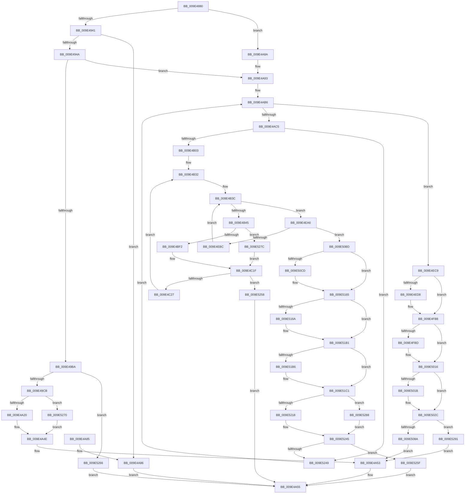

# ExProcessorCounterSetCallback

- RVA: `0x009E4880`–`0x009E529D` (길이 `2,589` bytes)
- VA: `0x00000001409E4880`
- 실행 섹션: `PAGE`
- PDB 이름 있음: `예`; PDB Function 태그: `아니요`
- unwind 정보 RVA: `0x000A4144`
- 디코드: `561`개 명령, `2,589/2,589` bytes 표시
- 미해석 바이트: `0` (있으면 어셈블리에 `.byte`로 보존)

> 이 문서는 커널 이미지의 기계어와 PDB 기호를 분석해 생성했습니다. 4번과 5번은 함수 원형과 자료형을 바이너리 사용 방식에서 추정한 C 해석이며 원본 소스 복구 결과는 아닙니다.

## 1. Dependencies

- 직접 호출 지점: **34**; 고유 호출 대상: **12**
- 직접 호출자로 확인된 함수: **0**
- RIP 상대 이미지 참조: **10**

### Outgoing calls
- `0x009E48C9` → [memset](../../text/6C/memset_function_006C6C40.md) (function, `0x006C6C40`)
- `0x009E48DD` → [memset](../../text/6C/memset_function_006C6C40.md) (function, `0x006C6C40`)
- `0x009E4907` → [memset](../../text/6C/memset_function_006C6C40.md) (function, `0x006C6C40`)
- `0x009E491B` → [memset](../../text/6C/memset_function_006C6C40.md) (function, `0x006C6C40`)
- `0x009E49AC` → [swscanf_s](../../text/50/swscanf_s_function_005063B0.md) (function, `0x005063B0`)
- `0x009E49EE` → [ExpQueryProcessorInformationCounters](ExpQueryProcessorInformationCounters_function_009E52B0.md) (function, `0x009E52B0`)
- `0x009E4A12` → [ExGetExtensionTable](../../text/42/ExGetExtensionTable_function_00428814.md) (function, `0x00428814`)
- `0x009E4A3B` → [guard_dispatch_icall](../../text/6B/guard_dispatch_icall_function_006BAAD0.md) (function, `0x006BAAD0`)
- `0x009E4A49` → [ExReleaseExtensionTable](../../text/45/ExReleaseExtensionTable_function_00456DC0.md) (function, `0x00456DC0`)
- `0x009E4A5F` → [_security_check_cookie](../../text/6A/_security_check_cookie_function_006AC640.md) (function, `0x006AC640`)
- `0x009E4A98` → [KeQueryActiveProcessorCountEx](../../text/24/KeQueryActiveProcessorCountEx_function_00249EF0.md) (function, `0x00249EF0`)
- `0x009E4ADF` → [memset](../../text/6C/memset_function_006C6C40.md) (function, `0x006C6C40`)
- `0x009E4AF3` → [KeQueryNodeActiveAffinityEx](../../text/25/KeQueryNodeActiveAffinityEx_function_00256740.md) (function, `0x00256740`)
- `0x009E4B0F` → [memset](../../text/6C/memset_function_006C6C40.md) (function, `0x006C6C40`)
- `0x009E4B8D` → [ExpQueryProcessorInformationCounters](ExpQueryProcessorInformationCounters_function_009E52B0.md) (function, `0x009E52B0`)
- `0x009E4BB2` → [RtlStringCbPrintfW](../../text/40/RtlStringCbPrintfW_function_0040FB40.md) (function, `0x0040FB40`)
- `0x009E4BC6` → [RtlInitUnicodeString](../../text/42/RtlInitUnicodeString_function_0042A780.md) (function, `0x0042A780`)
- `0x009E4BE4` → [ExGetExtensionTable](../../text/42/ExGetExtensionTable_function_00428814.md) (function, `0x00428814`)
- `0x009E4C0C` → [guard_dispatch_icall](../../text/6B/guard_dispatch_icall_function_006BAAD0.md) (function, `0x006BAAD0`)
- `0x009E4C1A` → [ExReleaseExtensionTable](../../text/45/ExReleaseExtensionTable_function_00456DC0.md) (function, `0x00456DC0`)
- `0x009E503F` → [RtlStringCbPrintfW](../../text/40/RtlStringCbPrintfW_function_0040FB40.md) (function, `0x0040FB40`)
- `0x009E504F` → [RtlInitUnicodeString](../../text/42/RtlInitUnicodeString_function_0042A780.md) (function, `0x0042A780`)
- `0x009E507C` → [ExGetExtensionTable](../../text/42/ExGetExtensionTable_function_00428814.md) (function, `0x00428814`)
- `0x009E50A5` → [guard_dispatch_icall](../../text/6B/guard_dispatch_icall_function_006BAAD0.md) (function, `0x006BAAD0`)
- `0x009E50B3` → [ExReleaseExtensionTable](../../text/45/ExReleaseExtensionTable_function_00456DC0.md) (function, `0x00456DC0`)
- `0x009E51D9` → [RtlStringCbPrintfW](../../text/40/RtlStringCbPrintfW_function_0040FB40.md) (function, `0x0040FB40`)
- `0x009E51E9` → [RtlInitUnicodeString](../../text/42/RtlInitUnicodeString_function_0042A780.md) (function, `0x0042A780`)
- `0x009E520E` → [ExGetExtensionTable](../../text/42/ExGetExtensionTable_function_00428814.md) (function, `0x00428814`)
- `0x009E5232` → [guard_dispatch_icall](../../text/6B/guard_dispatch_icall_function_006BAAD0.md) (function, `0x006BAAD0`)
- `0x009E5240` → [ExReleaseExtensionTable](../../text/45/ExReleaseExtensionTable_function_00456DC0.md) (function, `0x00456DC0`)
- `0x009E5270` → [ExpPcwDisabledStatus](../A6/ExpPcwDisabledStatus_function_00A611E0.md) (function, `0x00A611E0`)
- `0x009E527C` → [ExpPcwDisabledStatus](../A6/ExpPcwDisabledStatus_function_00A611E0.md) (function, `0x00A611E0`)
- `0x009E5288` → [ExpPcwDisabledStatus](../A6/ExpPcwDisabledStatus_function_00A611E0.md) (function, `0x00A611E0`)
- `0x009E5291` → [ExpPcwDisabledStatus](../A6/ExpPcwDisabledStatus_function_00A611E0.md) (function, `0x00A611E0`)

### Direct callers
- 이 함수 시작 RVA로 연결되는 직접 call은 확인되지 않았습니다. 간접 호출은 완전히 역산할 수 없습니다.

### Static image references
- `0x009E48A7` → RVA `0x00E0A740` (`.data`; read)
- `0x009E496D` → RVA `0x00B00670` (` ?? ::NNGAKEGL::`string'`; read)
- `0x009E49BD` → RVA `0x00FC6A80` (`ALMOSTRO`; read)
- `0x009E49D6` → RVA `0x00FC8C40` (`ALMOSTRO`; read)
- `0x009E49F3` → RVA `0x00FD8080` (`PAGEDATA`; read)
- `0x009E4AB6` → RVA `0x00FC5000` (`ALMOSTRO`; read)
- `0x009E4B6C` → RVA `0x00F231B8` (`.data`; read)
- `0x009E502C` → RVA `0x00B006A0` (` ?? ::NNGAKEGL::`string'`; read)
- `0x009E5069` → RVA `0x00FC6AE8` (`ALMOSTRO`; read)
- `0x009E51C6` → RVA `0x00B00680` (` ?? ::NNGAKEGL::`string'`; read)

## 2. Other-region calls and transfers

- 다른 실행 섹션으로 향하는 call: **28**
  - `0x009E48C9` → [memset](../../text/6C/memset_function_006C6C40.md) (`PAGE` → `.text`)
  - `0x009E48DD` → [memset](../../text/6C/memset_function_006C6C40.md) (`PAGE` → `.text`)
  - `0x009E4907` → [memset](../../text/6C/memset_function_006C6C40.md) (`PAGE` → `.text`)
  - `0x009E491B` → [memset](../../text/6C/memset_function_006C6C40.md) (`PAGE` → `.text`)
  - `0x009E49AC` → [swscanf_s](../../text/50/swscanf_s_function_005063B0.md) (`PAGE` → `.text`)
  - `0x009E4A12` → [ExGetExtensionTable](../../text/42/ExGetExtensionTable_function_00428814.md) (`PAGE` → `.text`)
  - `0x009E4A3B` → [guard_dispatch_icall](../../text/6B/guard_dispatch_icall_function_006BAAD0.md) (`PAGE` → `.text`)
  - `0x009E4A49` → [ExReleaseExtensionTable](../../text/45/ExReleaseExtensionTable_function_00456DC0.md) (`PAGE` → `.text`)
  - `0x009E4A5F` → [_security_check_cookie](../../text/6A/_security_check_cookie_function_006AC640.md) (`PAGE` → `.text`)
  - `0x009E4A98` → [KeQueryActiveProcessorCountEx](../../text/24/KeQueryActiveProcessorCountEx_function_00249EF0.md) (`PAGE` → `.text`)
  - `0x009E4ADF` → [memset](../../text/6C/memset_function_006C6C40.md) (`PAGE` → `.text`)
  - `0x009E4AF3` → [KeQueryNodeActiveAffinityEx](../../text/25/KeQueryNodeActiveAffinityEx_function_00256740.md) (`PAGE` → `.text`)
  - `0x009E4B0F` → [memset](../../text/6C/memset_function_006C6C40.md) (`PAGE` → `.text`)
  - `0x009E4BB2` → [RtlStringCbPrintfW](../../text/40/RtlStringCbPrintfW_function_0040FB40.md) (`PAGE` → `.text`)
  - `0x009E4BC6` → [RtlInitUnicodeString](../../text/42/RtlInitUnicodeString_function_0042A780.md) (`PAGE` → `.text`)
  - `0x009E4BE4` → [ExGetExtensionTable](../../text/42/ExGetExtensionTable_function_00428814.md) (`PAGE` → `.text`)
  - `0x009E4C0C` → [guard_dispatch_icall](../../text/6B/guard_dispatch_icall_function_006BAAD0.md) (`PAGE` → `.text`)
  - `0x009E4C1A` → [ExReleaseExtensionTable](../../text/45/ExReleaseExtensionTable_function_00456DC0.md) (`PAGE` → `.text`)
  - `0x009E503F` → [RtlStringCbPrintfW](../../text/40/RtlStringCbPrintfW_function_0040FB40.md) (`PAGE` → `.text`)
  - `0x009E504F` → [RtlInitUnicodeString](../../text/42/RtlInitUnicodeString_function_0042A780.md) (`PAGE` → `.text`)
  - `0x009E507C` → [ExGetExtensionTable](../../text/42/ExGetExtensionTable_function_00428814.md) (`PAGE` → `.text`)
  - `0x009E50A5` → [guard_dispatch_icall](../../text/6B/guard_dispatch_icall_function_006BAAD0.md) (`PAGE` → `.text`)
  - `0x009E50B3` → [ExReleaseExtensionTable](../../text/45/ExReleaseExtensionTable_function_00456DC0.md) (`PAGE` → `.text`)
  - `0x009E51D9` → [RtlStringCbPrintfW](../../text/40/RtlStringCbPrintfW_function_0040FB40.md) (`PAGE` → `.text`)
  - `0x009E51E9` → [RtlInitUnicodeString](../../text/42/RtlInitUnicodeString_function_0042A780.md) (`PAGE` → `.text`)
  - `0x009E520E` → [ExGetExtensionTable](../../text/42/ExGetExtensionTable_function_00428814.md) (`PAGE` → `.text`)
  - `0x009E5232` → [guard_dispatch_icall](../../text/6B/guard_dispatch_icall_function_006BAAD0.md) (`PAGE` → `.text`)
  - `0x009E5240` → [ExReleaseExtensionTable](../../text/45/ExReleaseExtensionTable_function_00456DC0.md) (`PAGE` → `.text`)
- 별도 외부 분기/꼬리 이동을 확인하지 못했습니다.

## 3. Assembly (complete function range)

```asm
009E4880  48 89 5C 24 08                  mov qword ptr [rsp + 8], rbx
009E4885  48 89 74 24 18                  mov qword ptr [rsp + 0x18], rsi
009E488A  48 89 7C 24 20                  mov qword ptr [rsp + 0x20], rdi
009E488F  55                              push rbp
009E4890  41 54                           push r12
009E4892  41 55                           push r13
009E4894  41 56                           push r14
009E4896  41 57                           push r15
009E4898  48 8D AC 24 90 FC FF FF         lea rbp, [rsp - 0x370]
009E48A0  48 81 EC 70 04 00 00            sub rsp, 0x470
009E48A7  48 8B 05 92 5E 42 00            mov rax, qword ptr [rip + 0x425e92]
009E48AE  48 33 C4                        xor rax, rsp
009E48B1  48 89 85 60 03 00 00            mov qword ptr [rbp + 0x360], rax
009E48B8  48 8B F2                        mov rsi, rdx
009E48BB  8B F9                           mov edi, ecx
009E48BD  33 D2                           xor edx, edx
009E48BF  48 8D 4D C0                     lea rcx, [rbp - 0x40]
009E48C3  41 B8 C8 00 00 00               mov r8d, 0xc8
009E48C9  E8 72 23 CE FF                  call 0x1406c6c40
009E48CE  33 D2                           xor edx, edx
009E48D0  48 8D 8D 90 00 00 00            lea rcx, [rbp + 0x90]
009E48D7  41 B8 C8 00 00 00               mov r8d, 0xc8
009E48DD  E8 5E 23 CE FF                  call 0x1406c6c40
009E48E2  33 DB                           xor ebx, ebx
009E48E4  48 8D 8D 60 01 00 00            lea rcx, [rbp + 0x160]
009E48EB  0F 57 C0                        xorps xmm0, xmm0
009E48EE  89 5C 24 3C                     mov dword ptr [rsp + 0x3c], ebx
009E48F2  33 D2                           xor edx, edx
009E48F4  89 5C 24 38                     mov dword ptr [rsp + 0x38], ebx
009E48F8  41 B8 C8 00 00 00               mov r8d, 0xc8
009E48FE  66 89 5C 24 34                  mov word ptr [rsp + 0x34], bx
009E4903  0F 11 45 80                     movups xmmword ptr [rbp - 0x80], xmm0
009E4907  E8 34 23 CE FF                  call 0x1406c6c40
009E490C  33 D2                           xor edx, edx
009E490E  48 8D 8D 30 02 00 00            lea rcx, [rbp + 0x230]
009E4915  41 B8 08 01 00 00               mov r8d, 0x108
009E491B  E8 20 23 CE FF                  call 0x1406c6c40
009E4920  45 32 E4                        xor r12b, r12b
009E4923  45 32 F6                        xor r14b, r14b
009E4926  45 32 FF                        xor r15b, r15b
009E4929  44 88 64 24 32                  mov byte ptr [rsp + 0x32], r12b
009E492E  44 88 74 24 30                  mov byte ptr [rsp + 0x30], r14b
009E4933  44 88 7C 24 31                  mov byte ptr [rsp + 0x31], r15b
009E4938  83 EF 02                        sub edi, 2
009E493B  0F 84 49 01 00 00               je 0x1409e4a8a
009E4941  83 FF 01                        cmp edi, 1
009E4944  0F 85 3C 01 00 00               jne 0x1409e4a86
009E494A  48 8B 06                        mov rax, qword ptr [rsi]
009E494D  4C 8D 4C 24 3C                  lea r9, [rsp + 0x3c]
009E4952  4C 8B 6E 18                     mov r13, qword ptr [rsi + 0x18]
009E4956  4C 8D 44 24 38                  lea r8, [rsp + 0x38]
009E495B  48 B9 05 FF E0 00 01 00 00 00   movabs rcx, 0x100e0ff05
009E4965  4C 89 6C 24 48                  mov qword ptr [rsp + 0x48], r13
009E496A  48 85 C1                        test rcx, rax
009E496D  48 8D 15 FC BC 11 00            lea rdx, [rip + 0x11bcfc]
009E4974  B9 00 00 0F C0                  mov ecx, 0xc00f0000
009E4979  41 0F 95 C4                     setne r12b
009E497D  48 85 C1                        test rcx, rax
009E4980  48 B9 00 00 00 3F 06 00 00 00   movabs rcx, 0x63f000000
009E498A  44 88 64 24 32                  mov byte ptr [rsp + 0x32], r12b
009E498F  41 0F 95 C6                     setne r14b
009E4993  48 85 C1                        test rcx, rax
009E4996  48 8B 4E 08                     mov rcx, qword ptr [rsi + 8]
009E499A  41 0F 95 C7                     setne r15b
009E499E  44 88 74 24 30                  mov byte ptr [rsp + 0x30], r14b
009E49A3  44 88 7C 24 31                  mov byte ptr [rsp + 0x31], r15b
009E49A8  48 8B 49 08                     mov rcx, qword ptr [rcx + 8]
009E49AC  E8 FF 19 B2 FF                  call 0x1405063b0
009E49B1  83 F8 02                        cmp eax, 2
009E49B4  0F 85 D9 00 00 00               jne 0x1409e4a93
009E49BA  8B 7E 10                        mov edi, dword ptr [rsi + 0x10]
009E49BD  8B 05 BD 20 5E 00               mov eax, dword ptr [rip + 0x5e20bd]
009E49C3  3B F8                           cmp edi, eax
009E49C5  0F 83 9B 08 00 00               jae 0x1409e5266
009E49CB  48 8D 95 60 01 00 00            lea rdx, [rbp + 0x160]
009E49D2  45 0F B6 CF                     movzx r9d, r15b
009E49D6  48 8D 05 63 42 5E 00            lea rax, [rip + 0x5e4263]
009E49DD  48 89 54 24 20                  mov qword ptr [rsp + 0x20], rdx
009E49E2  48 8B 0C F8                     mov rcx, qword ptr [rax + rdi*8]
009E49E6  41 0F B6 D4                     movzx edx, r12b
009E49EA  45 0F B6 C6                     movzx r8d, r14b
009E49EE  E8 BD 08 00 00                  call 0x1409e52b0
009E49F3  48 8B 0D 86 36 5F 00            mov rcx, qword ptr [rip + 0x5f3686]
009E49FA  48 8D 85 60 01 00 00            lea rax, [rbp + 0x160]
009E4A01  48 8B 76 08                     mov rsi, qword ptr [rsi + 8]
009E4A05  48 89 44 24 48                  mov qword ptr [rsp + 0x48], rax
009E4A0A  C7 44 24 50 C8 00 00 00         mov dword ptr [rsp + 0x50], 0xc8
009E4A12  E8 FD 3D A4 FF                  call 0x140428814
009E4A17  48 85 C0                        test rax, rax
009E4A1A  0F 84 50 08 00 00               je 0x1409e5270
009E4A20  48 8B 40 20                     mov rax, qword ptr [rax + 0x20]
009E4A24  48 8D 4C 24 48                  lea rcx, [rsp + 0x48]
009E4A29  48 89 4C 24 20                  mov qword ptr [rsp + 0x20], rcx
009E4A2E  44 8D 4B 01                     lea r9d, [rbx + 1]
009E4A32  49 8B CD                        mov rcx, r13
009E4A35  44 8B C7                        mov r8d, edi
009E4A38  48 8B D6                        mov rdx, rsi
009E4A3B  E8 90 60 CD FF                  call 0x1406baad0
009E4A40  48 8B 0D 39 36 5F 00            mov rcx, qword ptr [rip + 0x5f3639]
009E4A47  8B F8                           mov edi, eax
009E4A49  E8 72 23 A7 FF                  call 0x140456dc0
009E4A4E  85 FF                           test edi, edi
009E4A50  0F 48 DF                        cmovs ebx, edi
009E4A53  8B C3                           mov eax, ebx
009E4A55  48 8B 8D 60 03 00 00            mov rcx, qword ptr [rbp + 0x360]
009E4A5C  48 33 CC                        xor rcx, rsp
009E4A5F  E8 DC 7B CC FF                  call 0x1406ac640
009E4A64  4C 8D 9C 24 70 04 00 00         lea r11, [rsp + 0x470]
009E4A6C  49 8B 5B 30                     mov rbx, qword ptr [r11 + 0x30]
009E4A70  49 8B 73 40                     mov rsi, qword ptr [r11 + 0x40]
009E4A74  49 8B 7B 48                     mov rdi, qword ptr [r11 + 0x48]
009E4A78  49 8B E3                        mov rsp, r11
009E4A7B  41 5F                           pop r15
009E4A7D  41 5E                           pop r14
009E4A7F  41 5D                           pop r13
009E4A81  41 5C                           pop r12
009E4A83  5D                              pop rbp
009E4A84  C3                              ret
009E4A85  CC                              int3
009E4A86  33 C0                           xor eax, eax
009E4A88  EB CB                           jmp 0x1409e4a55
009E4A8A  4C 8B 6E 18                     mov r13, qword ptr [rsi + 0x18]
009E4A8E  4C 89 6C 24 48                  mov qword ptr [rsp + 0x48], r13
009E4A93  B9 FF FF 00 00                  mov ecx, 0xffff
009E4A98  E8 53 54 86 FF                  call 0x140249ef0
009E4A9D  89 44 24 58                     mov dword ptr [rsp + 0x58], eax
009E4AA1  8B F3                           mov esi, ebx
009E4AA3  48 89 5C 24 78                  mov qword ptr [rsp + 0x78], rbx
009E4AA8  BF 01 00 00 00                  mov edi, 1
009E4AAD  48 89 5C 24 70                  mov qword ptr [rsp + 0x70], rbx
009E4AB2  89 5C 24 38                     mov dword ptr [rsp + 0x38], ebx
009E4AB6  0F B7 05 43 05 5E 00            movzx eax, word ptr [rip + 0x5e0543]
009E4ABD  3B F0                           cmp esi, eax
009E4ABF  0F 83 04 04 00 00               jae 0x1409e4ec9
009E4AC5  33 D2                           xor edx, edx
009E4AC7  48 C7 85 30 02 00 00 01 00 20 00  mov qword ptr [rbp + 0x230], 0x200001
009E4AD2  41 B8 00 01 00 00               mov r8d, 0x100
009E4AD8  48 8D 8D 38 02 00 00            lea rcx, [rbp + 0x238]
009E4ADF  E8 5C 21 CE FF                  call 0x1406c6c40
009E4AE4  4C 8D 44 24 34                  lea r8, [rsp + 0x34]
009E4AE9  0F B7 CE                        movzx ecx, si
009E4AEC  48 8D 95 30 02 00 00            lea rdx, [rbp + 0x230]
009E4AF3  E8 48 1C 87 FF                  call 0x140256740
009E4AF8  66 39 5C 24 34                  cmp word ptr [rsp + 0x34], bx
009E4AFD  0F 84 46 07 00 00               je 0x1409e5249
009E4B03  33 D2                           xor edx, edx
009E4B05  48 8D 4D C0                     lea rcx, [rbp - 0x40]
009E4B09  41 B8 C8 00 00 00               mov r8d, 0xc8
009E4B0F  E8 2C 21 CE FF                  call 0x1406c6c40
009E4B14  48 8B 8D 38 02 00 00            mov rcx, qword ptr [rbp + 0x238]
009E4B1B  44 0F B7 C3                     movzx r8d, bx
009E4B1F  44 89 44 24 40                  mov dword ptr [rsp + 0x40], r8d
009E4B24  48 89 5C 24 68                  mov qword ptr [rsp + 0x68], rbx
009E4B29  48 89 5C 24 60                  mov qword ptr [rsp + 0x60], rbx
009E4B2E  89 5C 24 3C                     mov dword ptr [rsp + 0x3c], ebx
009E4B32  0F B7 95 30 02 00 00            movzx edx, word ptr [rbp + 0x230]
009E4B39  89 5D 90                        mov dword ptr [rbp - 0x70], ebx
009E4B3C  48 85 C9                        test rcx, rcx
009E4B3F  0F 84 61 03 00 00               je 0x1409e4ea6
009E4B45  48 0F BC D1                     bsf rdx, rcx
009E4B49  45 0F B6 CF                     movzx r9d, r15b
009E4B4D  0F B6 C2                        movzx eax, dl
009E4B50  48 0F B3 C1                     btr rcx, rax
009E4B54  0F B6 C2                        movzx eax, dl
009E4B57  48 89 4D 90                     mov qword ptr [rbp - 0x70], rcx
009E4B5B  41 0F B6 D4                     movzx edx, r12b
009E4B5F  41 0F B7 C8                     movzx ecx, r8w
009E4B63  45 0F B6 C6                     movzx r8d, r14b
009E4B67  C1 E1 06                        shl ecx, 6
009E4B6A  03 C8                           add ecx, eax
009E4B6C  48 8B 05 45 E6 53 00            mov rax, qword ptr [rip + 0x53e645]
009E4B73  8B 34 88                        mov esi, dword ptr [rax + rcx*4]
009E4B76  48 8D 85 60 01 00 00            lea rax, [rbp + 0x160]
009E4B7D  48 89 44 24 20                  mov qword ptr [rsp + 0x20], rax
009E4B82  48 8D 05 B7 40 5E 00            lea rax, [rip + 0x5e40b7]
009E4B89  48 8B 0C F0                     mov rcx, qword ptr [rax + rsi*8]
009E4B8D  E8 1E 07 00 00                  call 0x1409e52b0
009E4B92  8B 44 24 3C                     mov eax, dword ptr [rsp + 0x3c]
009E4B96  4C 8D 05 D3 BA 11 00            lea r8, [rip + 0x11bad3]
009E4B9D  44 8B 4C 24 38                  mov r9d, dword ptr [rsp + 0x38]
009E4BA2  48 8D 8D 40 03 00 00            lea rcx, [rbp + 0x340]
009E4BA9  BA 1A 00 00 00                  mov edx, 0x1a
009E4BAE  89 44 24 20                     mov dword ptr [rsp + 0x20], eax
009E4BB2  E8 89 AF A2 FF                  call 0x14040fb40
009E4BB7  FF 44 24 3C                     inc dword ptr [rsp + 0x3c]
009E4BBB  48 8D 95 40 03 00 00            lea rdx, [rbp + 0x340]
009E4BC2  48 8D 4D 80                     lea rcx, [rbp - 0x80]
009E4BC6  E8 B5 5B A4 FF                  call 0x14042a780
009E4BCB  48 8B 0D AE 34 5F 00            mov rcx, qword ptr [rip + 0x5f34ae]
009E4BD2  48 8D 85 60 01 00 00            lea rax, [rbp + 0x160]
009E4BD9  48 89 45 98                     mov qword ptr [rbp - 0x68], rax
009E4BDD  C7 45 A0 C8 00 00 00            mov dword ptr [rbp - 0x60], 0xc8
009E4BE4  E8 2B 3C A4 FF                  call 0x140428814
009E4BE9  48 85 C0                        test rax, rax
009E4BEC  0F 84 8A 06 00 00               je 0x1409e527c
009E4BF2  48 8B 40 20                     mov rax, qword ptr [rax + 0x20]
009E4BF6  48 8D 4D 98                     lea rcx, [rbp - 0x68]
009E4BFA  48 89 4C 24 20                  mov qword ptr [rsp + 0x20], rcx
009E4BFF  48 8D 55 80                     lea rdx, [rbp - 0x80]
009E4C03  49 8B CD                        mov rcx, r13
009E4C06  44 8B CF                        mov r9d, edi
009E4C09  44 8B C6                        mov r8d, esi
009E4C0C  E8 BF 5E CD FF                  call 0x1406baad0
009E4C11  48 8B 0D 68 34 5F 00            mov rcx, qword ptr [rip + 0x5f3468]
009E4C18  8B F8                           mov edi, eax
009E4C1A  E8 A1 21 A7 FF                  call 0x140456dc0
009E4C1F  85 FF                           test edi, edi
009E4C21  0F 88 31 06 00 00               js 0x1409e5258
009E4C27  48 8B 85 60 01 00 00            mov rax, qword ptr [rbp + 0x160]
009E4C2E  48 01 45 C0                     add qword ptr [rbp - 0x40], rax
009E4C32  48 8B 85 68 01 00 00            mov rax, qword ptr [rbp + 0x168]
009E4C39  48 01 45 C8                     add qword ptr [rbp - 0x38], rax
009E4C3D  48 8B 85 70 01 00 00            mov rax, qword ptr [rbp + 0x170]
009E4C44  48 01 45 D0                     add qword ptr [rbp - 0x30], rax
009E4C48  48 8B 85 78 01 00 00            mov rax, qword ptr [rbp + 0x178]
009E4C4F  48 01 45 D8                     add qword ptr [rbp - 0x28], rax
009E4C53  4C 8B AD D0 01 00 00            mov r13, qword ptr [rbp + 0x1d0]
009E4C5A  4C 01 6D 30                     add qword ptr [rbp + 0x30], r13
009E4C5E  8B 85 80 01 00 00               mov eax, dword ptr [rbp + 0x180]
009E4C64  01 45 E0                        add dword ptr [rbp - 0x20], eax
009E4C67  48 8B 85 90 01 00 00            mov rax, qword ptr [rbp + 0x190]
009E4C6E  48 01 45 F0                     add qword ptr [rbp - 0x10], rax
009E4C72  8B 85 9C 01 00 00               mov eax, dword ptr [rbp + 0x19c]
009E4C78  01 45 FC                        add dword ptr [rbp - 4], eax
009E4C7B  4C 8B AD 60 01 00 00            mov r13, qword ptr [rbp + 0x160]
009E4C82  4C 01 AD 90 00 00 00            add qword ptr [rbp + 0x90], r13
009E4C89  4C 8B AD 68 01 00 00            mov r13, qword ptr [rbp + 0x168]
009E4C90  4C 01 AD 98 00 00 00            add qword ptr [rbp + 0x98], r13
009E4C97  8B 85 A0 01 00 00               mov eax, dword ptr [rbp + 0x1a0]
009E4C9D  01 45 00                        add dword ptr [rbp], eax
009E4CA0  48 8B 85 88 01 00 00            mov rax, qword ptr [rbp + 0x188]
009E4CA7  48 01 45 E8                     add qword ptr [rbp - 0x18], rax
009E4CAB  4C 8B AD 70 01 00 00            mov r13, qword ptr [rbp + 0x170]
009E4CB2  4C 01 AD A0 00 00 00            add qword ptr [rbp + 0xa0], r13
009E4CB9  4C 8B AD 78 01 00 00            mov r13, qword ptr [rbp + 0x178]
009E4CC0  4C 01 AD A8 00 00 00            add qword ptr [rbp + 0xa8], r13
009E4CC7  8B 85 98 01 00 00               mov eax, dword ptr [rbp + 0x198]
009E4CCD  01 45 F8                        add dword ptr [rbp - 8], eax
009E4CD0  44 8B AD 80 01 00 00            mov r13d, dword ptr [rbp + 0x180]
009E4CD7  44 01 AD B0 00 00 00            add dword ptr [rbp + 0xb0], r13d
009E4CDE  4C 8B AD 90 01 00 00            mov r13, qword ptr [rbp + 0x190]
009E4CE5  4C 01 AD C0 00 00 00            add qword ptr [rbp + 0xc0], r13
009E4CEC  44 8B AD 9C 01 00 00            mov r13d, dword ptr [rbp + 0x19c]
009E4CF3  44 01 AD CC 00 00 00            add dword ptr [rbp + 0xcc], r13d
009E4CFA  48 8B 85 A8 01 00 00            mov rax, qword ptr [rbp + 0x1a8]
009E4D01  48 01 45 08                     add qword ptr [rbp + 8], rax
009E4D05  48 8B 85 C0 01 00 00            mov rax, qword ptr [rbp + 0x1c0]
009E4D0C  48 01 45 20                     add qword ptr [rbp + 0x20], rax
009E4D10  48 8B 85 B0 01 00 00            mov rax, qword ptr [rbp + 0x1b0]
009E4D17  48 01 45 10                     add qword ptr [rbp + 0x10], rax
009E4D1B  44 8B AD A0 01 00 00            mov r13d, dword ptr [rbp + 0x1a0]
009E4D22  44 01 AD D0 00 00 00            add dword ptr [rbp + 0xd0], r13d
009E4D29  4C 8B AD 88 01 00 00            mov r13, qword ptr [rbp + 0x188]
009E4D30  4C 01 AD B8 00 00 00            add qword ptr [rbp + 0xb8], r13
009E4D37  48 8B 85 C8 01 00 00            mov rax, qword ptr [rbp + 0x1c8]
009E4D3E  48 01 45 28                     add qword ptr [rbp + 0x28], rax
009E4D42  44 8B AD 98 01 00 00            mov r13d, dword ptr [rbp + 0x198]
009E4D49  44 01 AD C8 00 00 00            add dword ptr [rbp + 0xc8], r13d
009E4D50  48 8B 85 B8 01 00 00            mov rax, qword ptr [rbp + 0x1b8]
009E4D57  4C 8B AD A8 01 00 00            mov r13, qword ptr [rbp + 0x1a8]
009E4D5E  4C 01 AD D8 00 00 00            add qword ptr [rbp + 0xd8], r13
009E4D65  48 01 45 18                     add qword ptr [rbp + 0x18], rax
009E4D69  4C 8B AD C0 01 00 00            mov r13, qword ptr [rbp + 0x1c0]
009E4D70  4C 8B A5 08 02 00 00            mov r12, qword ptr [rbp + 0x208]
009E4D77  4C 8B BD 10 02 00 00            mov r15, qword ptr [rbp + 0x210]
009E4D7E  4C 8B B5 D8 01 00 00            mov r14, qword ptr [rbp + 0x1d8]
009E4D85  44 8B 9D F0 01 00 00            mov r11d, dword ptr [rbp + 0x1f0]
009E4D8C  44 8B 95 F4 01 00 00            mov r10d, dword ptr [rbp + 0x1f4]
009E4D93  4C 8B 8D F8 01 00 00            mov r9, qword ptr [rbp + 0x1f8]
009E4D9A  4C 8B 85 00 02 00 00            mov r8, qword ptr [rbp + 0x200]
009E4DA1  48 8B 95 20 02 00 00            mov rdx, qword ptr [rbp + 0x220]
009E4DA8  8B 85 1C 02 00 00               mov eax, dword ptr [rbp + 0x21c]
009E4DAE  8B B5 E4 01 00 00               mov esi, dword ptr [rbp + 0x1e4]
009E4DB4  8B BD E8 01 00 00               mov edi, dword ptr [rbp + 0x1e8]
009E4DBA  8B 8D 18 02 00 00               mov ecx, dword ptr [rbp + 0x218]
009E4DC0  09 45 7C                        or dword ptr [rbp + 0x7c], eax
009E4DC3  4C 01 65 68                     add qword ptr [rbp + 0x68], r12
009E4DC7  4C 01 7D 70                     add qword ptr [rbp + 0x70], r15
009E4DCB  4C 01 75 38                     add qword ptr [rbp + 0x38], r14
009E4DCF  01 75 44                        add dword ptr [rbp + 0x44], esi
009E4DD2  01 7D 48                        add dword ptr [rbp + 0x48], edi
009E4DD5  4C 01 5C 24 60                  add qword ptr [rsp + 0x60], r11
009E4DDA  4C 01 54 24 68                  add qword ptr [rsp + 0x68], r10
009E4DDF  4C 01 4D 58                     add qword ptr [rbp + 0x58], r9
009E4DE3  4C 01 45 60                     add qword ptr [rbp + 0x60], r8
009E4DE7  48 01 95 80 00 00 00            add qword ptr [rbp + 0x80], rdx
009E4DEE  01 4D 78                        add dword ptr [rbp + 0x78], ecx
009E4DF1  4C 01 AD F0 00 00 00            add qword ptr [rbp + 0xf0], r13
009E4DF8  4C 8B AD B0 01 00 00            mov r13, qword ptr [rbp + 0x1b0]
009E4DFF  4C 01 AD E0 00 00 00            add qword ptr [rbp + 0xe0], r13
009E4E06  4C 8B AD C8 01 00 00            mov r13, qword ptr [rbp + 0x1c8]
009E4E0D  4C 01 AD F8 00 00 00            add qword ptr [rbp + 0xf8], r13
009E4E14  4C 8B AD B8 01 00 00            mov r13, qword ptr [rbp + 0x1b8]
009E4E1B  4C 01 AD E8 00 00 00            add qword ptr [rbp + 0xe8], r13
009E4E22  4C 8B AD D0 01 00 00            mov r13, qword ptr [rbp + 0x1d0]
009E4E29  4C 01 AD 00 01 00 00            add qword ptr [rbp + 0x100], r13
009E4E30  4C 01 A5 38 01 00 00            add qword ptr [rbp + 0x138], r12
009E4E37  4C 01 BD 40 01 00 00            add qword ptr [rbp + 0x140], r15
009E4E3E  4C 01 B5 08 01 00 00            add qword ptr [rbp + 0x108], r14
009E4E45  01 BD 18 01 00 00               add dword ptr [rbp + 0x118], edi
009E4E4B  BF 01 00 00 00                  mov edi, 1
009E4E50  4C 01 85 30 01 00 00            add qword ptr [rbp + 0x130], r8
009E4E57  01 8D 48 01 00 00               add dword ptr [rbp + 0x148], ecx
009E4E5D  01 B5 14 01 00 00               add dword ptr [rbp + 0x114], esi
009E4E63  4C 01 5C 24 70                  add qword ptr [rsp + 0x70], r11
009E4E68  4C 01 54 24 78                  add qword ptr [rsp + 0x78], r10
009E4E6D  4C 01 8D 28 01 00 00            add qword ptr [rbp + 0x128], r9
009E4E74  48 01 95 50 01 00 00            add qword ptr [rbp + 0x150], rdx
009E4E7B  09 85 4C 01 00 00               or dword ptr [rbp + 0x14c], eax
009E4E81  48 8B 4D 90                     mov rcx, qword ptr [rbp - 0x70]
009E4E85  44 0F B6 74 24 30               movzx r14d, byte ptr [rsp + 0x30]
009E4E8B  44 0F B6 7C 24 31               movzx r15d, byte ptr [rsp + 0x31]
009E4E91  44 0F B6 64 24 32               movzx r12d, byte ptr [rsp + 0x32]
009E4E97  4C 8B 6C 24 48                  mov r13, qword ptr [rsp + 0x48]
009E4E9C  44 8B 44 24 40                  mov r8d, dword ptr [rsp + 0x40]
009E4EA1  E9 8C FC FF FF                  jmp 0x1409e4b32
009E4EA6  66 41 FF C0                     inc r8w
009E4EAA  45 0F B7 C0                     movzx r8d, r8w
009E4EAE  44 89 44 24 40                  mov dword ptr [rsp + 0x40], r8d
009E4EB3  44 3B C2                        cmp r8d, edx
009E4EB6  0F 83 01 02 00 00               jae 0x1409e50bd
009E4EBC  4A 8B 8C C5 38 02 00 00         mov rcx, qword ptr [rbp + r8*8 + 0x238]
009E4EC4  E9 73 FC FF FF                  jmp 0x1409e4b3c
009E4EC9  44 8B 44 24 58                  mov r8d, dword ptr [rsp + 0x58]
009E4ECE  41 83 F8 01                     cmp r8d, 1
009E4ED2  0F 86 E0 00 00 00               jbe 0x1409e4fb8
009E4ED8  48 8B 85 90 00 00 00            mov rax, qword ptr [rbp + 0x90]
009E4EDF  33 D2                           xor edx, edx
009E4EE1  49 F7 F0                        div r8
009E4EE4  33 D2                           xor edx, edx
009E4EE6  48 89 85 90 00 00 00            mov qword ptr [rbp + 0x90], rax
009E4EED  48 8B 85 98 00 00 00            mov rax, qword ptr [rbp + 0x98]
009E4EF4  49 F7 F0                        div r8
009E4EF7  33 D2                           xor edx, edx
009E4EF9  48 89 85 98 00 00 00            mov qword ptr [rbp + 0x98], rax
009E4F00  48 8B 85 A0 00 00 00            mov rax, qword ptr [rbp + 0xa0]
009E4F07  49 F7 F0                        div r8
009E4F0A  33 D2                           xor edx, edx
009E4F0C  48 89 85 A0 00 00 00            mov qword ptr [rbp + 0xa0], rax
009E4F13  48 8B 85 A8 00 00 00            mov rax, qword ptr [rbp + 0xa8]
009E4F1A  49 F7 F0                        div r8
009E4F1D  33 D2                           xor edx, edx
009E4F1F  48 89 85 A8 00 00 00            mov qword ptr [rbp + 0xa8], rax
009E4F26  48 8B 85 C0 00 00 00            mov rax, qword ptr [rbp + 0xc0]
009E4F2D  49 F7 F0                        div r8
009E4F30  33 D2                           xor edx, edx
009E4F32  48 89 85 C0 00 00 00            mov qword ptr [rbp + 0xc0], rax
009E4F39  48 8B 85 B8 00 00 00            mov rax, qword ptr [rbp + 0xb8]
009E4F40  49 F7 F0                        div r8
009E4F43  33 D2                           xor edx, edx
009E4F45  48 89 85 B8 00 00 00            mov qword ptr [rbp + 0xb8], rax
009E4F4C  48 8B 85 D8 00 00 00            mov rax, qword ptr [rbp + 0xd8]
009E4F53  49 F7 F0                        div r8
009E4F56  33 D2                           xor edx, edx
009E4F58  48 89 85 D8 00 00 00            mov qword ptr [rbp + 0xd8], rax
009E4F5F  48 8B 85 E0 00 00 00            mov rax, qword ptr [rbp + 0xe0]
009E4F66  49 F7 F0                        div r8
009E4F69  33 D2                           xor edx, edx
009E4F6B  48 89 85 E0 00 00 00            mov qword ptr [rbp + 0xe0], rax
009E4F72  48 8B 85 E8 00 00 00            mov rax, qword ptr [rbp + 0xe8]
009E4F79  49 F7 F0                        div r8
009E4F7C  33 D2                           xor edx, edx
009E4F7E  48 89 85 E8 00 00 00            mov qword ptr [rbp + 0xe8], rax
009E4F85  48 8B 85 08 01 00 00            mov rax, qword ptr [rbp + 0x108]
009E4F8C  49 F7 F0                        div r8
009E4F8F  33 D2                           xor edx, edx
009E4F91  48 89 85 08 01 00 00            mov qword ptr [rbp + 0x108], rax
009E4F98  8B 85 14 01 00 00               mov eax, dword ptr [rbp + 0x114]
009E4F9E  41 F7 F0                        div r8d
009E4FA1  33 D2                           xor edx, edx
009E4FA3  89 85 14 01 00 00               mov dword ptr [rbp + 0x114], eax
009E4FA9  8B 85 18 01 00 00               mov eax, dword ptr [rbp + 0x118]
009E4FAF  41 F7 F0                        div r8d
009E4FB2  89 85 18 01 00 00               mov dword ptr [rbp + 0x118], eax
009E4FB8  45 84 FF                        test r15b, r15b
009E4FBB  74 59                           je 0x1409e5016
009E4FBD  48 8B 44 24 70                  mov rax, qword ptr [rsp + 0x70]
009E4FC2  33 D2                           xor edx, edx
009E4FC4  49 F7 F0                        div r8
009E4FC7  33 D2                           xor edx, edx
009E4FC9  89 85 20 01 00 00               mov dword ptr [rbp + 0x120], eax
009E4FCF  48 8B 44 24 78                  mov rax, qword ptr [rsp + 0x78]
009E4FD4  49 F7 F0                        div r8
009E4FD7  33 D2                           xor edx, edx
009E4FD9  89 85 24 01 00 00               mov dword ptr [rbp + 0x124], eax
009E4FDF  48 8B 85 28 01 00 00            mov rax, qword ptr [rbp + 0x128]
009E4FE6  49 F7 F0                        div r8
009E4FE9  33 D2                           xor edx, edx
009E4FEB  48 89 85 28 01 00 00            mov qword ptr [rbp + 0x128], rax
009E4FF2  48 8B 85 30 01 00 00            mov rax, qword ptr [rbp + 0x130]
009E4FF9  49 F7 F0                        div r8
009E4FFC  33 D2                           xor edx, edx
009E4FFE  48 89 85 30 01 00 00            mov qword ptr [rbp + 0x130], rax
009E5005  48 8B 85 50 01 00 00            mov rax, qword ptr [rbp + 0x150]
009E500C  49 F7 F0                        div r8
009E500F  48 89 85 50 01 00 00            mov qword ptr [rbp + 0x150], rax
009E5016  45 84 F6                        test r14b, r14b
009E5019  74 11                           je 0x1409e502c
009E501B  8B 85 48 01 00 00               mov eax, dword ptr [rbp + 0x148]
009E5021  33 D2                           xor edx, edx
009E5023  41 F7 F0                        div r8d
009E5026  89 85 48 01 00 00               mov dword ptr [rbp + 0x148], eax
009E502C  4C 8D 05 6D B6 11 00            lea r8, [rip + 0x11b66d]
009E5033  BA 1A 00 00 00                  mov edx, 0x1a
009E5038  48 8D 8D 40 03 00 00            lea rcx, [rbp + 0x340]
009E503F  E8 FC AA A2 FF                  call 0x14040fb40
009E5044  48 8D 95 40 03 00 00            lea rdx, [rbp + 0x340]
009E504B  48 8D 4D 80                     lea rcx, [rbp - 0x80]
009E504F  E8 2C 57 A4 FF                  call 0x14042a780
009E5054  0F B7 1D A5 FF 5D 00            movzx ebx, word ptr [rip + 0x5dffa5]
009E505B  48 8D 85 90 00 00 00            lea rax, [rbp + 0x90]
009E5062  48 8B 0D 17 30 5F 00            mov rcx, qword ptr [rip + 0x5f3017]
009E5069  03 1D 79 1A 5E 00               add ebx, dword ptr [rip + 0x5e1a79]
009E506F  48 89 44 24 48                  mov qword ptr [rsp + 0x48], rax
009E5074  C7 44 24 50 C8 00 00 00         mov dword ptr [rsp + 0x50], 0xc8
009E507C  E8 93 37 A4 FF                  call 0x140428814
009E5081  48 85 C0                        test rax, rax
009E5084  0F 84 07 02 00 00               je 0x1409e5291
009E508A  48 8B 40 20                     mov rax, qword ptr [rax + 0x20]
009E508E  48 8D 4C 24 48                  lea rcx, [rsp + 0x48]
009E5093  48 89 4C 24 20                  mov qword ptr [rsp + 0x20], rcx
009E5098  48 8D 55 80                     lea rdx, [rbp - 0x80]
009E509C  49 8B CD                        mov rcx, r13
009E509F  44 8B CF                        mov r9d, edi
009E50A2  44 8B C3                        mov r8d, ebx
009E50A5  E8 26 5A CD FF                  call 0x1406baad0
009E50AA  48 8B 0D CF 2F 5F 00            mov rcx, qword ptr [rip + 0x5f2fcf]
009E50B1  8B D8                           mov ebx, eax
009E50B3  E8 08 1D A7 FF                  call 0x140456dc0
009E50B8  E9 96 F9 FF FF                  jmp 0x1409e4a53
009E50BD  44 0F B7 44 24 34               movzx r8d, word ptr [rsp + 0x34]
009E50C3  41 83 F8 01                     cmp r8d, 1
009E50C7  0F 86 98 00 00 00               jbe 0x1409e5165
009E50CD  48 8B 45 C0                     mov rax, qword ptr [rbp - 0x40]
009E50D1  33 D2                           xor edx, edx
009E50D3  49 F7 F0                        div r8
009E50D6  33 D2                           xor edx, edx
009E50D8  48 89 45 C0                     mov qword ptr [rbp - 0x40], rax
009E50DC  48 8B 45 C8                     mov rax, qword ptr [rbp - 0x38]
009E50E0  49 F7 F0                        div r8
009E50E3  33 D2                           xor edx, edx
009E50E5  48 89 45 C8                     mov qword ptr [rbp - 0x38], rax
009E50E9  48 8B 45 D0                     mov rax, qword ptr [rbp - 0x30]
009E50ED  49 F7 F0                        div r8
009E50F0  33 D2                           xor edx, edx
009E50F2  48 89 45 D0                     mov qword ptr [rbp - 0x30], rax
009E50F6  48 8B 45 D8                     mov rax, qword ptr [rbp - 0x28]
009E50FA  49 F7 F0                        div r8
009E50FD  33 D2                           xor edx, edx
009E50FF  48 89 45 D8                     mov qword ptr [rbp - 0x28], rax
009E5103  48 8B 45 F0                     mov rax, qword ptr [rbp - 0x10]
009E5107  49 F7 F0                        div r8
009E510A  33 D2                           xor edx, edx
009E510C  48 89 45 F0                     mov qword ptr [rbp - 0x10], rax
009E5110  48 8B 45 E8                     mov rax, qword ptr [rbp - 0x18]
009E5114  49 F7 F0                        div r8
009E5117  33 D2                           xor edx, edx
009E5119  48 89 45 E8                     mov qword ptr [rbp - 0x18], rax
009E511D  48 8B 45 08                     mov rax, qword ptr [rbp + 8]
009E5121  49 F7 F0                        div r8
009E5124  33 D2                           xor edx, edx
009E5126  48 89 45 08                     mov qword ptr [rbp + 8], rax
009E512A  48 8B 45 10                     mov rax, qword ptr [rbp + 0x10]
009E512E  49 F7 F0                        div r8
009E5131  33 D2                           xor edx, edx
009E5133  48 89 45 10                     mov qword ptr [rbp + 0x10], rax
009E5137  48 8B 45 18                     mov rax, qword ptr [rbp + 0x18]
009E513B  49 F7 F0                        div r8
009E513E  33 D2                           xor edx, edx
009E5140  48 89 45 18                     mov qword ptr [rbp + 0x18], rax
009E5144  48 8B 45 38                     mov rax, qword ptr [rbp + 0x38]
009E5148  49 F7 F0                        div r8
009E514B  33 D2                           xor edx, edx
009E514D  48 89 45 38                     mov qword ptr [rbp + 0x38], rax
009E5151  8B 45 44                        mov eax, dword ptr [rbp + 0x44]
009E5154  41 F7 F0                        div r8d
009E5157  33 D2                           xor edx, edx
009E5159  89 45 44                        mov dword ptr [rbp + 0x44], eax
009E515C  8B 45 48                        mov eax, dword ptr [rbp + 0x48]
009E515F  41 F7 F0                        div r8d
009E5162  89 45 48                        mov dword ptr [rbp + 0x48], eax
009E5165  45 84 FF                        test r15b, r15b
009E5168  74 47                           je 0x1409e51b1
009E516A  48 8B 44 24 60                  mov rax, qword ptr [rsp + 0x60]
009E516F  33 D2                           xor edx, edx
009E5171  49 F7 F0                        div r8
009E5174  33 D2                           xor edx, edx
009E5176  89 45 50                        mov dword ptr [rbp + 0x50], eax
009E5179  48 8B 44 24 68                  mov rax, qword ptr [rsp + 0x68]
009E517E  49 F7 F0                        div r8
009E5181  33 D2                           xor edx, edx
009E5183  89 45 54                        mov dword ptr [rbp + 0x54], eax
009E5186  48 8B 45 58                     mov rax, qword ptr [rbp + 0x58]
009E518A  49 F7 F0                        div r8
009E518D  33 D2                           xor edx, edx
009E518F  48 89 45 58                     mov qword ptr [rbp + 0x58], rax
009E5193  48 8B 45 60                     mov rax, qword ptr [rbp + 0x60]
009E5197  49 F7 F0                        div r8
009E519A  33 D2                           xor edx, edx
009E519C  48 89 45 60                     mov qword ptr [rbp + 0x60], rax
009E51A0  48 8B 85 80 00 00 00            mov rax, qword ptr [rbp + 0x80]
009E51A7  49 F7 F0                        div r8
009E51AA  48 89 85 80 00 00 00            mov qword ptr [rbp + 0x80], rax
009E51B1  45 84 F6                        test r14b, r14b
009E51B4  74 0B                           je 0x1409e51c1
009E51B6  8B 45 78                        mov eax, dword ptr [rbp + 0x78]
009E51B9  33 D2                           xor edx, edx
009E51BB  41 F7 F0                        div r8d
009E51BE  89 45 78                        mov dword ptr [rbp + 0x78], eax
009E51C1  44 8B 4C 24 38                  mov r9d, dword ptr [rsp + 0x38]
009E51C6  4C 8D 05 B3 B4 11 00            lea r8, [rip + 0x11b4b3]
009E51CD  BA 1A 00 00 00                  mov edx, 0x1a
009E51D2  48 8D 8D 40 03 00 00            lea rcx, [rbp + 0x340]
009E51D9  E8 62 A9 A2 FF                  call 0x14040fb40
009E51DE  48 8D 95 40 03 00 00            lea rdx, [rbp + 0x340]
009E51E5  48 8D 4D 80                     lea rcx, [rbp - 0x80]
009E51E9  E8 92 55 A4 FF                  call 0x14042a780
009E51EE  8B 35 F4 18 5E 00               mov esi, dword ptr [rip + 0x5e18f4]
009E51F4  48 8D 45 C0                     lea rax, [rbp - 0x40]
009E51F8  48 8B 0D 81 2E 5F 00            mov rcx, qword ptr [rip + 0x5f2e81]
009E51FF  03 74 24 38                     add esi, dword ptr [rsp + 0x38]
009E5203  48 89 45 A8                     mov qword ptr [rbp - 0x58], rax
009E5207  C7 45 B0 C8 00 00 00            mov dword ptr [rbp - 0x50], 0xc8
009E520E  E8 01 36 A4 FF                  call 0x140428814
009E5213  48 85 C0                        test rax, rax
009E5216  74 70                           je 0x1409e5288
009E5218  48 8B 40 20                     mov rax, qword ptr [rax + 0x20]
009E521C  48 8D 4D A8                     lea rcx, [rbp - 0x58]
009E5220  48 89 4C 24 20                  mov qword ptr [rsp + 0x20], rcx
009E5225  48 8D 55 80                     lea rdx, [rbp - 0x80]
009E5229  49 8B CD                        mov rcx, r13
009E522C  44 8B CF                        mov r9d, edi
009E522F  44 8B C6                        mov r8d, esi
009E5232  E8 99 58 CD FF                  call 0x1406baad0
009E5237  48 8B 0D 42 2E 5F 00            mov rcx, qword ptr [rip + 0x5f2e42]
009E523E  8B F0                           mov esi, eax
009E5240  E8 7B 1B A7 FF                  call 0x140456dc0
009E5245  85 F6                           test esi, esi
009E5247  78 16                           js 0x1409e525f
009E5249  8B 74 24 38                     mov esi, dword ptr [rsp + 0x38]
009E524D  FF C6                           inc esi
009E524F  89 74 24 38                     mov dword ptr [rsp + 0x38], esi
009E5253  E9 5E F8 FF FF                  jmp 0x1409e4ab6
009E5258  8B C7                           mov eax, edi
009E525A  E9 F6 F7 FF FF                  jmp 0x1409e4a55
009E525F  8B C6                           mov eax, esi
009E5261  E9 EF F7 FF FF                  jmp 0x1409e4a55
009E5266  B8 25 02 00 C0                  mov eax, 0xc0000225
009E526B  E9 E5 F7 FF FF                  jmp 0x1409e4a55
009E5270  E8 6B BF 07 00                  call 0x140a611e0
009E5275  8B F8                           mov edi, eax
009E5277  E9 D2 F7 FF FF                  jmp 0x1409e4a4e
009E527C  E8 5F BF 07 00                  call 0x140a611e0
009E5281  8B F8                           mov edi, eax
009E5283  E9 97 F9 FF FF                  jmp 0x1409e4c1f
009E5288  E8 53 BF 07 00                  call 0x140a611e0
009E528D  8B F0                           mov esi, eax
009E528F  EB B4                           jmp 0x1409e5245
009E5291  E8 4A BF 07 00                  call 0x140a611e0
009E5296  8B D8                           mov ebx, eax
009E5298  E9 B6 F7 FF FF                  jmp 0x1409e4a53
```

## 4. C-style interpretation (structured pseudocode)

```c
__int64 __fastcall ExProcessorCounterSetCallback(int a1, __int64 a2)
{
    __int64 result;
    __int64 v_r12;
    __int64 v_r14;
    __int64 v_r15;
    __int64 v_rbx;
    __int64 v_rdi;
    __int64 v_rsi;
    __int64 v_rsp;
    unsigned __int64 v_stack_m160;
    unsigned __int64 v_stack_m168;
    unsigned __int64 v_stack_m178;
    unsigned int v_stack_m17C;
    unsigned int v_stack_m180;
    unsigned __int64 v_stack_m188;
    unsigned __int64 v_stack_m190;
    unsigned __int64 v_stack_m198;
    unsigned __int64 v_stack_m1A0;
    unsigned int v_stack_m1A4;
    unsigned int v_stack_m1A8;
    unsigned int v_stack_m1B0;
    unsigned int v_stack_m1B4;
    unsigned __int64 v_stack_m1C0;
    unsigned __int64 v_stack_m1C8;
    unsigned __int64 v_stack_m1D0;
    unsigned __int64 v_stack_m1D8;
    unsigned __int64 v_stack_m1E0;
    unsigned __int64 v_stack_m1E8;
    unsigned __int64 v_stack_m1F0;
    unsigned int v_stack_m1F8;
    unsigned int v_stack_m1FC;
    unsigned int v_stack_m200;
    unsigned __int64 v_stack_m208;
    unsigned __int64 v_stack_m210;
    unsigned int v_stack_m218;
    unsigned __int64 v_stack_m220;
    unsigned __int64 v_stack_m228;
    unsigned __int64 v_stack_m230;
    unsigned __int64 v_stack_m238;
    unsigned __int64 v_stack_m248;
    unsigned int v_stack_m24C;
    unsigned int v_stack_m250;
    unsigned __int64 v_stack_m258;
    unsigned __int64 v_stack_m260;
    unsigned __int64 v_stack_m268;
    unsigned __int64 v_stack_m270;
    unsigned int v_stack_m274;
    unsigned int v_stack_m278;
    unsigned __int64 v_stack_m28;
    unsigned int v_stack_m280;
    unsigned int v_stack_m284;
    unsigned __int64 v_stack_m290;
    unsigned __int64 v_stack_m298;
    unsigned __int64 v_stack_m2A0;
    unsigned __int64 v_stack_m2A8;
    unsigned __int64 v_stack_m2B0;
    unsigned __int64 v_stack_m2B8;
    unsigned __int64 v_stack_m2C0;
    unsigned int v_stack_m2C8;
    unsigned int v_stack_m2CC;
    unsigned int v_stack_m2D0;
    unsigned __int64 v_stack_m2D8;
    unsigned __int64 v_stack_m2E0;
    unsigned int v_stack_m2E8;
    unsigned __int64 v_stack_m2F0;
    unsigned __int64 v_stack_m2F8;
    unsigned __int64 v_stack_m300;
    unsigned __int64 v_stack_m308;
    unsigned __int64 v_stack_m318;
    unsigned int v_stack_m31C;
    unsigned int v_stack_m320;
    unsigned __int64 v_stack_m328;
    unsigned __int64 v_stack_m330;
    unsigned __int64 v_stack_m338;
    unsigned __int64 v_stack_m340;
    unsigned int v_stack_m344;
    unsigned int v_stack_m348;
    unsigned int v_stack_m350;
    unsigned int v_stack_m354;
    unsigned __int64 v_stack_m360;
    unsigned __int64 v_stack_m368;
    unsigned __int64 v_stack_m370;
    unsigned __int64 v_stack_m378;
    unsigned __int64 v_stack_m38;
    unsigned __int64 v_stack_m380;
    unsigned __int64 v_stack_m388;
    unsigned __int64 v_stack_m390;
    unsigned __int64 v_stack_m398;
    unsigned int v_stack_m39C;
    unsigned int v_stack_m3A0;
    unsigned __int64 v_stack_m3A8;
    unsigned __int64 v_stack_m3B0;
    unsigned int v_stack_m3B8;
    unsigned __int64 v_stack_m3C0;
    unsigned __int64 v_stack_m3C8;
    unsigned __int64 v_stack_m3D0;
    unsigned __int64 v_stack_m3D8;
    unsigned int v_stack_m3E8;
    unsigned __int64 v_stack_m3F0;
    unsigned __int64 v_stack_m3F8;
    unsigned __int64 v_stack_m400;
    unsigned __int64 v_stack_m408;
    unsigned __int64 v_stack_m410;
    unsigned __int64 v_stack_m418;
    unsigned int v_stack_m420;
    unsigned __int64 v_stack_m428;
    unsigned int v_stack_m430;
    unsigned int v_stack_m434;
    unsigned int v_stack_m438;
    unsigned __int64 v_stack_m43C;
    unsigned __int8 v_stack_m43E;
    unsigned __int8 v_stack_m43F;
    unsigned __int8 v_stack_m440;
    unsigned int v_stack_m448;
    unsigned __int64 v_stack_m450;
    unsigned int v_stack_m45C;
    unsigned int v_stack_m460;
    unsigned __int16 v_stack_m464;
    unsigned __int8 v_stack_m466;
    unsigned __int8 v_stack_m467;
    unsigned __int8 v_stack_m468;
    unsigned __int64 v_stack_m478;
    unsigned __int64 v_stack_m58;
    unsigned __int64 v_stack_p18;
    unsigned __int64 v_stack_p20;
    unsigned __int64 v_stack_p8;

    v_stack_p8 = v_rbx;
    v_stack_p18 = v_rsi;
    v_stack_p20 = v_rdi;
    v_rsp = (v_rsp) - (0x470ULL);
    result = (*(unsigned __int64 *)(v_rip + 4349586)) ^ (v_rsp);
    v_stack_m38 = result;
    a2 = 0;
    result = memset(v_stack_m3D8, a2, 200, a4);
    a2 = 0;
    result = memset(v_stack_m308, a2, 200, a4);
    v_rbx = 0;
    v_stack_m45C = 0;
    a2 = 0;
    v_stack_m460 = 0;
    v_stack_m464 = 0;
    v_stack_m418 = v_xmm0;
    result = memset(v_stack_m238, a2, 200, a4);
    a2 = 0;
    result = memset(v_stack_m168, a2, 264, a4);
    v_r12 = 0;
    v_r14 = 0;
    v_r15 = 0;
    v_stack_m466 = 0;
    v_stack_m468 = 0;
    v_stack_m467 = 0;
    v_rdi = (unsigned int)(((unsigned int)(a1)) - (2));
    if (condition_is_equal) goto loc_009E4A8A;
    if (((unsigned int)(v_rdi)) != 1) goto loc_009E4A86;
    v_stack_m450 = *(unsigned __int64 *)(a2 + 24);
    v_r12 = (((v_stack_m168) & (*(unsigned __int64 *)(a2))) != 0) ? 1 : 0;
    v_stack_m466 = (unsigned __int8)(v_r12);
    v_r14 = ((((unsigned int)(0xC00F0000ULL)) & (*(unsigned __int64 *)(a2))) != 0) ? 1 : 0;
    v_r15 = ((((unsigned int)(0xC00F0000ULL)) & (*(unsigned __int64 *)(a2))) != 0) ? 1 : 0;
    v_stack_m468 = (unsigned __int8)(v_r14);
    v_stack_m467 = (unsigned __int8)(v_r15);
    result = swscanf_s(*(unsigned __int64 *)(*(unsigned __int64 *)(a2 + 8) + 8), v_rip + 1162492, v_stack_m460, v_stack_m45C);
    if (((unsigned int)(result)) != 2) goto loc_009E4A93;
    if (((unsigned int)((unsigned int)(*(unsigned int *)(a2 + 16)))) >= ((unsigned int)((unsigned int)(*(unsigned int *)(v_rip + 6168765))))) goto loc_009E5266;
    v_stack_m478 = v_stack_m238;
    result = ExpQueryProcessorInformationCounters(*(unsigned __int64 *)(v_rip + 6177379 + (unsigned int)(*(unsigned int *)(a2 + 16)) * 8), (unsigned __int8)(v_r12), (unsigned __int8)(v_r14), (unsigned __int8)(v_r15));
    v_stack_m450 = v_stack_m238;
    v_stack_m448 = 200;
    result = ExGetExtensionTable(*(unsigned __int64 *)(v_rip + 6239878), (unsigned __int8)(v_r12), (unsigned __int8)(v_r14), (unsigned __int8)(v_r15));
    if (result == 0) goto loc_009E5270;
    v_stack_m478 = v_stack_m450;
    result = guard_dispatch_icall(*(unsigned __int64 *)(a2 + 24), *(unsigned __int64 *)(a2 + 8), (unsigned int)((unsigned int)((unsigned int)(*(unsigned int *)(a2 + 16)))), v_rbx + 1);
    result = ExReleaseExtensionTable(*(unsigned __int64 *)(v_rip + 6239801), *(unsigned __int64 *)(a2 + 8), (unsigned int)((unsigned int)((unsigned int)(*(unsigned int *)(a2 + 16)))), v_rbx + 1);
loc_009E4A4E:
    if (sign_flag) { v_rbx = (unsigned int)((unsigned int)((unsigned int)(result))); }
loc_009E4A53:
loc_009E4A55:
    a1 = (v_stack_m38) ^ (v_rsp);
    result = _security_check_cookie(a1, *(unsigned __int64 *)(a2 + 8), (unsigned int)((unsigned int)((unsigned int)(*(unsigned int *)(a2 + 16)))), v_rbx + 1);
    return result;
loc_009E4A86:
    result = 0;
    goto loc_009E4A55;
loc_009E4A8A:
    v_stack_m428 = *(unsigned __int64 *)(*(unsigned __int64 *)(v_stack_m28 + 64) + 24);
loc_009E4A93:
    result = KeQueryActiveProcessorCountEx((unsigned int)(0xFFFFULL), *(unsigned __int64 *)(a2 + 8), (unsigned int)((unsigned int)((unsigned int)(*(unsigned int *)(a2 + 16)))), v_rbx + 1);
    v_stack_m418 = (unsigned int)(result);
    v_stack_m3F8 = *(unsigned __int64 *)(v_stack_m28 + 48);
    v_stack_m400 = *(unsigned __int64 *)(v_stack_m28 + 48);
    v_stack_m438 = (unsigned int)(*(unsigned __int64 *)(v_stack_m28 + 48));
loc_009E4AB6:
    if (((unsigned int)((unsigned int)((unsigned int)(*(unsigned __int64 *)(v_stack_m28 + 48))))) >= ((unsigned int)(*(unsigned __int16 *)(v_rip + 6161731)))) goto loc_009E4EC9;
    a2 = 0;
    v_stack_m168 = 0x200001ULL;
    result = memset(v_stack_m160, a2, 256, v_rbx + 1);
    result = KeQueryNodeActiveAffinityEx((unsigned __int16)((unsigned int)((unsigned int)(*(unsigned __int64 *)(v_stack_m28 + 48)))), v_stack_m168, v_stack_m43C, v_rbx + 1);
    if (v_stack_m43C == ((unsigned __int16)(*(unsigned __int64 *)(v_stack_m28 + 48)))) goto loc_009E5249;
    a2 = 0;
    result = memset(v_stack_m3D8, a2, 200, v_rbx + 1);
    v_stack_m430 = (unsigned int)((unsigned __int16)(*(unsigned __int64 *)(v_stack_m28 + 48)));
    v_stack_m408 = *(unsigned __int64 *)(v_stack_m28 + 48);
    v_stack_m410 = *(unsigned __int64 *)(v_stack_m28 + 48);
    v_stack_m434 = (unsigned int)(*(unsigned __int64 *)(v_stack_m28 + 48));
loc_009E4B32:
    v_stack_m408 = (unsigned int)(*(unsigned __int64 *)(v_stack_m28 + 48));
loc_009E4B3C:
    if (v_stack_m160 == 0) goto loc_009E4EA6;
    v_stack_m408 = v_stack_m160;
    a1 = (unsigned int)(((unsigned __int16)((unsigned __int16)(*(unsigned __int64 *)(v_stack_m28 + 48)))) << (6));
    a1 = (unsigned int)((a1) + ((unsigned int)((unsigned __int8)(v_stack_m168))));
    v_stack_m450 = v_stack_m238;
    result = ExpQueryProcessorInformationCounters(*(unsigned __int64 *)(v_rip + 6176951 + (unsigned int)(*(unsigned int *)(*(unsigned __int64 *)(v_rip + 5498437) + a1 * 4)) * 8), (unsigned __int8)(v_r12), (unsigned __int8)(v_r14), (unsigned __int8)(v_r15));
    v_stack_m450 = (unsigned int)((unsigned int)(v_stack_m434));
    result = RtlStringCbPrintfW(v_stack_m58, 26, v_rip + 1161939, (unsigned int)(v_stack_m438));
    result = RtlInitUnicodeString(v_stack_m418, v_stack_m58, v_rip + 1161939, (unsigned int)(v_stack_m438));
    v_stack_m400 = v_stack_m238;
    v_stack_m3F8 = 200;
    result = ExGetExtensionTable(*(unsigned __int64 *)(v_rip + 6239406), v_stack_m58, v_rip + 1161939, (unsigned int)(v_stack_m438));
    if (result == 0) goto loc_009E527C;
    v_stack_m450 = v_stack_m400;
    result = guard_dispatch_icall(*(unsigned __int64 *)(*(unsigned __int64 *)(v_stack_m28 + 64) + 24), v_stack_m418, (unsigned int)((unsigned int)((unsigned int)(*(unsigned int *)(*(unsigned __int64 *)(v_rip + 5498437) + a1 * 4)))), 1);
    result = ExReleaseExtensionTable(*(unsigned __int64 *)(v_rip + 6239336), v_stack_m418, (unsigned int)((unsigned int)((unsigned int)(*(unsigned int *)(*(unsigned __int64 *)(v_rip + 5498437) + a1 * 4)))), 1);
loc_009E4C1F:
    if (sign_flag) goto loc_009E5258;
    goto loc_009E4B32;
loc_009E4EA6:
    a3 = (unsigned __int16)(((unsigned int)(v_stack_m430)) + 1);
    v_stack_m430 = (unsigned int)((unsigned __int16)(a3));
    if (((unsigned int)((unsigned __int16)(a3))) >= ((unsigned int)(v_stack_m178))) goto loc_009E50BD;
    goto loc_009E4B3C;
loc_009E4EC9:
    result = (unsigned int)(v_stack_m17C);
    if (((unsigned int)((unsigned int)(v_stack_m418))) >= = 1) {
        result = v_stack_m308;
        a2 = 0;
        a2 = 0;
        v_stack_m308 = result;
        result = v_stack_m300;
        a2 = 0;
        v_stack_m300 = result;
        result = v_stack_m2F8;
        a2 = 0;
        v_stack_m2F8 = result;
        result = v_stack_m2F0;
        a2 = 0;
        v_stack_m2F0 = result;
        result = v_stack_m2D8;
        a2 = 0;
        v_stack_m2D8 = result;
        result = v_stack_m2E0;
        a2 = 0;
        v_stack_m2E0 = result;
        result = v_stack_m2C0;
        a2 = 0;
        v_stack_m2C0 = result;
        result = v_stack_m2B8;
        a2 = 0;
        v_stack_m2B8 = result;
        result = v_stack_m2B0;
        a2 = 0;
        v_stack_m2B0 = result;
        result = v_stack_m290;
        a2 = 0;
        v_stack_m290 = result;
        result = v_stack_m284;
        a2 = 0;
        v_stack_m284 = (unsigned int)(result);
        result = v_stack_m280;
        v_stack_m280 = (unsigned int)(result);
    }
    if ((unsigned __int8)(v_stack_m43F) != 0) {
        result = v_stack_m400;
        a2 = 0;
        a2 = 0;
        v_stack_m278 = (unsigned int)(result);
        result = v_stack_m3F8;
        a2 = 0;
        v_stack_m274 = (unsigned int)(result);
        result = v_stack_m270;
        a2 = 0;
        v_stack_m270 = result;
        result = v_stack_m268;
        a2 = 0;
        v_stack_m268 = result;
        result = v_stack_m248;
        v_stack_m248 = result;
    }
    if ((unsigned __int8)(v_stack_m440) != 0) {
        result = v_stack_m250;
        a2 = 0;
        v_stack_m250 = (unsigned int)(result);
    }
    result = RtlStringCbPrintfW(v_stack_m58, 26, v_rip + 1160813, v_stack_m1A0);
    result = RtlInitUnicodeString(v_stack_m418, v_stack_m58, v_rip + 1160813, v_stack_m1A0);
    v_rbx = (unsigned int)((*(unsigned __int16 *)(v_rip + 6160293)) + (*(unsigned int *)(v_rip + 6167161)));
    v_stack_m428 = v_stack_m308;
    v_stack_m420 = 200;
    result = ExGetExtensionTable(*(unsigned __int64 *)(v_rip + 6238231), v_stack_m58, v_rip + 1160813, v_stack_m1A0);
    if (result == 0) goto loc_009E5291;
    v_stack_m450 = v_stack_m428;
    result = guard_dispatch_icall(v_stack_m428, v_stack_m418, (unsigned int)((unsigned int)(v_rbx)), 1);
    result = ExReleaseExtensionTable(*(unsigned __int64 *)(v_rip + 6238159), v_stack_m418, (unsigned int)((unsigned int)(v_rbx)), 1);
    goto loc_009E4A53;
loc_009E50BD:
    if (((unsigned int)(v_stack_m43C)) >= = 1) {
        result = v_stack_m3D8;
        a2 = 0;
        a2 = 0;
        v_stack_m3D8 = result;
        result = v_stack_m3D0;
        a2 = 0;
        v_stack_m3D0 = result;
        result = v_stack_m3C8;
        a2 = 0;
        v_stack_m3C8 = result;
        result = v_stack_m3C0;
        a2 = 0;
        v_stack_m3C0 = result;
        result = v_stack_m3A8;
        a2 = 0;
        v_stack_m3A8 = result;
        result = v_stack_m3B0;
        a2 = 0;
        v_stack_m3B0 = result;
        result = v_stack_m390;
        a2 = 0;
        v_stack_m390 = result;
        result = v_stack_m388;
        a2 = 0;
        v_stack_m388 = result;
        result = v_stack_m380;
        a2 = 0;
        v_stack_m380 = result;
        result = v_stack_m360;
        a2 = 0;
        v_stack_m360 = result;
        result = v_stack_m354;
        a2 = 0;
        v_stack_m354 = (unsigned int)(result);
        result = v_stack_m350;
        v_stack_m350 = (unsigned int)(result);
    }
    if ((unsigned __int8)(v_stack_m43F) != 0) {
        result = v_stack_m410;
        a2 = 0;
        a2 = 0;
        v_stack_m348 = (unsigned int)(result);
        result = v_stack_m408;
        a2 = 0;
        v_stack_m344 = (unsigned int)(result);
        result = v_stack_m340;
        a2 = 0;
        v_stack_m340 = result;
        result = v_stack_m338;
        a2 = 0;
        v_stack_m338 = result;
        result = v_stack_m318;
        v_stack_m318 = result;
    }
    if ((unsigned __int8)(v_stack_m440) != 0) {
        result = v_stack_m320;
        a2 = 0;
        v_stack_m320 = (unsigned int)(result);
    }
    result = RtlStringCbPrintfW(v_stack_m58, 26, v_rip + 1160371, (unsigned int)(v_stack_m438));
    result = RtlInitUnicodeString(v_stack_m418, v_stack_m58, v_rip + 1160371, (unsigned int)(v_stack_m438));
    v_rsi = (unsigned int)(((unsigned int)(*(unsigned int *)(v_rip + 6166772))) + (v_stack_m438));
    v_stack_m3F0 = v_stack_m3D8;
    v_stack_m3E8 = 200;
    result = ExGetExtensionTable(*(unsigned __int64 *)(v_rip + 6237825), v_stack_m58, v_rip + 1160371, (unsigned int)(v_stack_m438));
    if (result == 0) goto loc_009E5288;
    v_stack_m450 = v_stack_m3F0;
    result = guard_dispatch_icall(v_stack_m428, v_stack_m418, (unsigned int)((unsigned int)(v_rsi)), 1);
    result = ExReleaseExtensionTable(*(unsigned __int64 *)(v_rip + 6237762), v_stack_m418, (unsigned int)((unsigned int)(v_rsi)), 1);
loc_009E5245:
    if (sign_flag) goto loc_009E525F;
loc_009E5249:
    v_rsi = (unsigned int)(((unsigned int)(v_stack_m438)) + 1);
    v_stack_m438 = (unsigned int)(v_rsi);
    goto loc_009E4AB6;
loc_009E5258:
    goto loc_009E4A55;
loc_009E525F:
    goto loc_009E4A55;
loc_009E5266:
    goto loc_009E4A55;
loc_009E5270:
    result = ExpPcwDisabledStatus(*(unsigned __int64 *)(v_rip + 6237762), v_stack_m418, (unsigned int)((unsigned int)(v_rsi)), 1);
    goto loc_009E4A4E;
loc_009E527C:
    result = ExpPcwDisabledStatus(*(unsigned __int64 *)(v_rip + 6237762), v_stack_m418, (unsigned int)((unsigned int)(v_rsi)), 1);
    goto loc_009E4C1F;
loc_009E5288:
    result = ExpPcwDisabledStatus(*(unsigned __int64 *)(v_rip + 6237762), v_stack_m418, (unsigned int)((unsigned int)(v_rsi)), 1);
    goto loc_009E5245;
loc_009E5291:
    result = ExpPcwDisabledStatus(*(unsigned __int64 *)(v_rip + 6237762), v_stack_m418, (unsigned int)((unsigned int)(v_rsi)), 1);
    goto loc_009E4A53;
}
```

## 5. (Beta) C Style

```c
int64_t ExProcessorCounterSetCallback(int32_t Arg1, void *Arg2)
{
    uint8_t *arg2 = (uint8_t *)Arg2;

    int64_t result;
    int64_t local_r12;
    int64_t local_r14;
    int64_t local_r15;
    int64_t local_rbx;
    int64_t local_rdi;
    int64_t local_rsi;
    int64_t local_rsp;
    uint64_t v_stack_m160;
    uint64_t v_stack_m168;
    uint64_t v_stack_m178;
    uint32_t v_stack_m17C;
    uint32_t v_stack_m180;
    uint64_t v_stack_m188;
    uint64_t v_stack_m190;
    uint64_t v_stack_m198;
    uint64_t v_stack_m1A0;
    uint32_t v_stack_m1A4;
    uint32_t v_stack_m1A8;
    uint32_t v_stack_m1B0;
    uint32_t v_stack_m1B4;
    uint64_t v_stack_m1C0;
    uint64_t v_stack_m1C8;
    uint64_t v_stack_m1D0;
    uint64_t v_stack_m1D8;
    uint64_t v_stack_m1E0;
    uint64_t v_stack_m1E8;
    uint64_t v_stack_m1F0;
    uint32_t v_stack_m1F8;
    uint32_t v_stack_m1FC;
    uint32_t v_stack_m200;
    uint64_t v_stack_m208;
    uint64_t v_stack_m210;
    uint32_t v_stack_m218;
    uint64_t v_stack_m220;
    uint64_t v_stack_m228;
    uint64_t v_stack_m230;
    uint64_t v_stack_m238;
    uint64_t v_stack_m248;
    uint32_t v_stack_m24C;
    uint32_t v_stack_m250;
    uint64_t v_stack_m258;
    uint64_t v_stack_m260;
    uint64_t v_stack_m268;
    uint64_t v_stack_m270;
    uint32_t v_stack_m274;
    uint32_t v_stack_m278;
    uint64_t v_stack_m28;
    uint32_t v_stack_m280;
    uint32_t v_stack_m284;
    uint64_t v_stack_m290;
    uint64_t v_stack_m298;
    uint64_t v_stack_m2A0;
    uint64_t v_stack_m2A8;
    uint64_t v_stack_m2B0;
    uint64_t v_stack_m2B8;
    uint64_t v_stack_m2C0;
    uint32_t v_stack_m2C8;
    uint32_t v_stack_m2CC;
    uint32_t v_stack_m2D0;
    uint64_t v_stack_m2D8;
    uint64_t v_stack_m2E0;
    uint32_t v_stack_m2E8;
    uint64_t v_stack_m2F0;
    uint64_t v_stack_m2F8;
    uint64_t v_stack_m300;
    uint64_t v_stack_m308;
    uint64_t v_stack_m318;
    uint32_t v_stack_m31C;
    uint32_t v_stack_m320;
    uint64_t v_stack_m328;
    uint64_t v_stack_m330;
    uint64_t v_stack_m338;
    uint64_t v_stack_m340;
    uint32_t v_stack_m344;
    uint32_t v_stack_m348;
    uint32_t v_stack_m350;
    uint32_t v_stack_m354;
    uint64_t v_stack_m360;
    uint64_t v_stack_m368;
    uint64_t v_stack_m370;
    uint64_t v_stack_m378;
    uint64_t v_stack_m38;
    uint64_t v_stack_m380;
    uint64_t v_stack_m388;
    uint64_t v_stack_m390;
    uint64_t v_stack_m398;
    uint32_t v_stack_m39C;
    uint32_t v_stack_m3A0;
    uint64_t v_stack_m3A8;
    uint64_t v_stack_m3B0;
    uint32_t v_stack_m3B8;
    uint64_t v_stack_m3C0;
    uint64_t v_stack_m3C8;
    uint64_t v_stack_m3D0;
    uint64_t v_stack_m3D8;
    uint32_t v_stack_m3E8;
    uint64_t v_stack_m3F0;
    uint64_t v_stack_m3F8;
    uint64_t v_stack_m400;
    uint64_t v_stack_m408;
    uint64_t v_stack_m410;
    uint64_t v_stack_m418;
    uint32_t v_stack_m420;
    uint64_t v_stack_m428;
    uint32_t v_stack_m430;
    uint32_t v_stack_m434;
    uint32_t v_stack_m438;
    uint64_t v_stack_m43C;
    uint8_t v_stack_m43E;
    uint8_t v_stack_m43F;
    uint8_t v_stack_m440;
    uint32_t v_stack_m448;
    uint64_t v_stack_m450;
    uint32_t v_stack_m45C;
    uint32_t v_stack_m460;
    uint16_t v_stack_m464;
    uint8_t v_stack_m466;
    uint8_t v_stack_m467;
    uint8_t v_stack_m468;
    uint64_t v_stack_m478;
    uint64_t v_stack_m58;
    uint64_t v_stack_p18;
    uint64_t v_stack_p20;
    uint64_t v_stack_p8;

    v_stack_p8 = local_rbx;
    v_stack_p18 = local_rsi;
    v_stack_p20 = local_rdi;
    local_rsp = (local_rsp) - (0x470ULL);
    result = (*(uint64_t *)(v_rip + 0x425E92)) ^ (local_rsp);
    v_stack_m38 = result;
    Arg2 = 0;
    result = memset(v_stack_m3D8, Arg2, 200, a4);
    Arg2 = 0;
    result = memset(v_stack_m308, Arg2, 200, a4);
    local_rbx = 0;
    v_stack_m45C = 0;
    Arg2 = 0;
    v_stack_m460 = 0;
    v_stack_m464 = 0;
    v_stack_m418 = v_xmm0;
    result = memset(v_stack_m238, Arg2, 200, a4);
    Arg2 = 0;
    result = memset(v_stack_m168, Arg2, 264, a4);
    local_r12 = 0;
    local_r14 = 0;
    local_r15 = 0;
    v_stack_m466 = 0;
    v_stack_m468 = 0;
    v_stack_m467 = 0;
    local_rdi = (uint32_t)(((uint32_t)(Arg1)) - (2));
    if (condition_is_equal) goto loc_009E4A8A;
    if (((uint32_t)(local_rdi)) != 1) goto loc_009E4A86;
    v_stack_m450 = *(uint64_t *)(arg2 + 0x18);
    local_r12 = (((v_stack_m168) & (*(uint64_t *)(arg2))) != 0) ? 1 : 0;
    v_stack_m466 = (uint8_t)(local_r12);
    local_r14 = ((((uint32_t)(0xC00F0000ULL)) & (*(uint64_t *)(arg2))) != 0) ? 1 : 0;
    local_r15 = ((((uint32_t)(0xC00F0000ULL)) & (*(uint64_t *)(arg2))) != 0) ? 1 : 0;
    v_stack_m468 = (uint8_t)(local_r14);
    v_stack_m467 = (uint8_t)(local_r15);
    result = swscanf_s(*(uint64_t *)(*(uint64_t *)(arg2 + 0x8) + 0x8), v_rip + 1162492, v_stack_m460, v_stack_m45C);
    if (((uint32_t)(result)) != 2) goto loc_009E4A93;
    if (((uint32_t)((uint32_t)(*(uint32_t *)(arg2 + 0x10)))) >= ((uint32_t)((uint32_t)(*(uint32_t *)(v_rip + 0x5E20BD))))) goto loc_009E5266;
    v_stack_m478 = v_stack_m238;
    result = ExpQueryProcessorInformationCounters(*(uint64_t *)(v_rip + 0x5E4263 + (uint32_t)(*(uint32_t *)(arg2 + 0x10)) * 8), (uint8_t)(local_r12), (uint8_t)(local_r14), (uint8_t)(local_r15));
    v_stack_m450 = v_stack_m238;
    v_stack_m448 = 200;
    result = ExGetExtensionTable(*(uint64_t *)(v_rip + 0x5F3686), (uint8_t)(local_r12), (uint8_t)(local_r14), (uint8_t)(local_r15));
    if (result == 0) goto loc_009E5270;
    v_stack_m478 = v_stack_m450;
    result = guard_dispatch_icall(*(uint64_t *)(arg2 + 0x18), *(uint64_t *)(arg2 + 0x8), (uint32_t)((uint32_t)((uint32_t)(*(uint32_t *)(arg2 + 0x10)))), local_rbx + 1);
    result = ExReleaseExtensionTable(*(uint64_t *)(v_rip + 0x5F3639), *(uint64_t *)(arg2 + 0x8), (uint32_t)((uint32_t)((uint32_t)(*(uint32_t *)(arg2 + 0x10)))), local_rbx + 1);
loc_009E4A4E:
    if (sign_flag) { local_rbx = (uint32_t)((uint32_t)((uint32_t)(result))); }
loc_009E4A53:
loc_009E4A55:
    Arg1 = (v_stack_m38) ^ (local_rsp);
    result = _security_check_cookie(Arg1, *(uint64_t *)(arg2 + 0x8), (uint32_t)((uint32_t)((uint32_t)(*(uint32_t *)(arg2 + 0x10)))), local_rbx + 1);
    return result;
loc_009E4A86:
    result = 0;
    goto loc_009E4A55;
loc_009E4A8A:
    v_stack_m428 = *(uint64_t *)(*(uint64_t *)(v_stack_m28 + 0x40) + 0x18);
loc_009E4A93:
    result = KeQueryActiveProcessorCountEx((uint32_t)(0xFFFFULL), *(uint64_t *)(arg2 + 0x8), (uint32_t)((uint32_t)((uint32_t)(*(uint32_t *)(arg2 + 0x10)))), local_rbx + 1);
    v_stack_m418 = (uint32_t)(result);
    v_stack_m3F8 = *(uint64_t *)(v_stack_m28 + 0x30);
    v_stack_m400 = *(uint64_t *)(v_stack_m28 + 0x30);
    v_stack_m438 = (uint32_t)(*(uint64_t *)(v_stack_m28 + 0x30));
loc_009E4AB6:
    if (((uint32_t)((uint32_t)((uint32_t)(*(uint64_t *)(v_stack_m28 + 0x30))))) >= ((uint32_t)(*(uint16_t *)(v_rip + 0x5E0543)))) goto loc_009E4EC9;
    Arg2 = 0;
    v_stack_m168 = 0x200001ULL;
    result = memset(v_stack_m160, Arg2, 256, local_rbx + 1);
    result = KeQueryNodeActiveAffinityEx((uint16_t)((uint32_t)((uint32_t)(*(uint64_t *)(v_stack_m28 + 0x30)))), v_stack_m168, v_stack_m43C, local_rbx + 1);
    if (v_stack_m43C == ((uint16_t)(*(uint64_t *)(v_stack_m28 + 0x30)))) goto loc_009E5249;
    Arg2 = 0;
    result = memset(v_stack_m3D8, Arg2, 200, local_rbx + 1);
    v_stack_m430 = (uint32_t)((uint16_t)(*(uint64_t *)(v_stack_m28 + 0x30)));
    v_stack_m408 = *(uint64_t *)(v_stack_m28 + 0x30);
    v_stack_m410 = *(uint64_t *)(v_stack_m28 + 0x30);
    v_stack_m434 = (uint32_t)(*(uint64_t *)(v_stack_m28 + 0x30));
loc_009E4B32:
    v_stack_m408 = (uint32_t)(*(uint64_t *)(v_stack_m28 + 0x30));
loc_009E4B3C:
    if (v_stack_m160 == 0) goto loc_009E4EA6;
    v_stack_m408 = v_stack_m160;
    Arg1 = (uint32_t)(((uint16_t)((uint16_t)(*(uint64_t *)(v_stack_m28 + 0x30)))) << (6));
    Arg1 = (uint32_t)((Arg1) + ((uint32_t)((uint8_t)(v_stack_m168))));
    v_stack_m450 = v_stack_m238;
    result = ExpQueryProcessorInformationCounters(*(uint64_t *)(v_rip + 0x5E40B7 + (uint32_t)(*(uint32_t *)(*(uint64_t *)(v_rip + 0x53E645) + Arg1 * 4)) * 8), (uint8_t)(local_r12), (uint8_t)(local_r14), (uint8_t)(local_r15));
    v_stack_m450 = (uint32_t)((uint32_t)(v_stack_m434));
    result = RtlStringCbPrintfW(v_stack_m58, 26, v_rip + 1161939, (uint32_t)(v_stack_m438));
    result = RtlInitUnicodeString(v_stack_m418, v_stack_m58, v_rip + 1161939, (uint32_t)(v_stack_m438));
    v_stack_m400 = v_stack_m238;
    v_stack_m3F8 = 200;
    result = ExGetExtensionTable(*(uint64_t *)(v_rip + 0x5F34AE), v_stack_m58, v_rip + 1161939, (uint32_t)(v_stack_m438));
    if (result == 0) goto loc_009E527C;
    v_stack_m450 = v_stack_m400;
    result = guard_dispatch_icall(*(uint64_t *)(*(uint64_t *)(v_stack_m28 + 0x40) + 0x18), v_stack_m418, (uint32_t)((uint32_t)((uint32_t)(*(uint32_t *)(*(uint64_t *)(v_rip + 0x53E645) + Arg1 * 4)))), 1);
    result = ExReleaseExtensionTable(*(uint64_t *)(v_rip + 0x5F3468), v_stack_m418, (uint32_t)((uint32_t)((uint32_t)(*(uint32_t *)(*(uint64_t *)(v_rip + 0x53E645) + Arg1 * 4)))), 1);
loc_009E4C1F:
    if (sign_flag) goto loc_009E5258;
    goto loc_009E4B32;
loc_009E4EA6:
    a3 = (uint16_t)(((uint32_t)(v_stack_m430)) + 1);
    v_stack_m430 = (uint32_t)((uint16_t)(a3));
    if (((uint32_t)((uint16_t)(a3))) >= ((uint32_t)(v_stack_m178))) goto loc_009E50BD;
    goto loc_009E4B3C;
loc_009E4EC9:
    result = (uint32_t)(v_stack_m17C);
    if (((uint32_t)((uint32_t)(v_stack_m418))) >= = 1) {
        result = v_stack_m308;
        Arg2 = 0;
        Arg2 = 0;
        v_stack_m308 = result;
        result = v_stack_m300;
        Arg2 = 0;
        v_stack_m300 = result;
        result = v_stack_m2F8;
        Arg2 = 0;
        v_stack_m2F8 = result;
        result = v_stack_m2F0;
        Arg2 = 0;
        v_stack_m2F0 = result;
        result = v_stack_m2D8;
        Arg2 = 0;
        v_stack_m2D8 = result;
        result = v_stack_m2E0;
        Arg2 = 0;
        v_stack_m2E0 = result;
        result = v_stack_m2C0;
        Arg2 = 0;
        v_stack_m2C0 = result;
        result = v_stack_m2B8;
        Arg2 = 0;
        v_stack_m2B8 = result;
        result = v_stack_m2B0;
        Arg2 = 0;
        v_stack_m2B0 = result;
        result = v_stack_m290;
        Arg2 = 0;
        v_stack_m290 = result;
        result = v_stack_m284;
        Arg2 = 0;
        v_stack_m284 = (uint32_t)(result);
        result = v_stack_m280;
        v_stack_m280 = (uint32_t)(result);
    }
    if ((uint8_t)(v_stack_m43F) != 0) {
        result = v_stack_m400;
        Arg2 = 0;
        Arg2 = 0;
        v_stack_m278 = (uint32_t)(result);
        result = v_stack_m3F8;
        Arg2 = 0;
        v_stack_m274 = (uint32_t)(result);
        result = v_stack_m270;
        Arg2 = 0;
        v_stack_m270 = result;
        result = v_stack_m268;
        Arg2 = 0;
        v_stack_m268 = result;
        result = v_stack_m248;
        v_stack_m248 = result;
    }
    if ((uint8_t)(v_stack_m440) != 0) {
        result = v_stack_m250;
        Arg2 = 0;
        v_stack_m250 = (uint32_t)(result);
    }
    result = RtlStringCbPrintfW(v_stack_m58, 26, v_rip + 1160813, v_stack_m1A0);
    result = RtlInitUnicodeString(v_stack_m418, v_stack_m58, v_rip + 1160813, v_stack_m1A0);
    local_rbx = (uint32_t)((*(uint16_t *)(v_rip + 0x5DFFA5)) + (*(uint32_t *)(v_rip + 0x5E1A79)));
    v_stack_m428 = v_stack_m308;
    v_stack_m420 = 200;
    result = ExGetExtensionTable(*(uint64_t *)(v_rip + 0x5F3017), v_stack_m58, v_rip + 1160813, v_stack_m1A0);
    if (result == 0) goto loc_009E5291;
    v_stack_m450 = v_stack_m428;
    result = guard_dispatch_icall(v_stack_m428, v_stack_m418, (uint32_t)((uint32_t)(local_rbx)), 1);
    result = ExReleaseExtensionTable(*(uint64_t *)(v_rip + 0x5F2FCF), v_stack_m418, (uint32_t)((uint32_t)(local_rbx)), 1);
    goto loc_009E4A53;
loc_009E50BD:
    if (((uint32_t)(v_stack_m43C)) >= = 1) {
        result = v_stack_m3D8;
        Arg2 = 0;
        Arg2 = 0;
        v_stack_m3D8 = result;
        result = v_stack_m3D0;
        Arg2 = 0;
        v_stack_m3D0 = result;
        result = v_stack_m3C8;
        Arg2 = 0;
        v_stack_m3C8 = result;
        result = v_stack_m3C0;
        Arg2 = 0;
        v_stack_m3C0 = result;
        result = v_stack_m3A8;
        Arg2 = 0;
        v_stack_m3A8 = result;
        result = v_stack_m3B0;
        Arg2 = 0;
        v_stack_m3B0 = result;
        result = v_stack_m390;
        Arg2 = 0;
        v_stack_m390 = result;
        result = v_stack_m388;
        Arg2 = 0;
        v_stack_m388 = result;
        result = v_stack_m380;
        Arg2 = 0;
        v_stack_m380 = result;
        result = v_stack_m360;
        Arg2 = 0;
        v_stack_m360 = result;
        result = v_stack_m354;
        Arg2 = 0;
        v_stack_m354 = (uint32_t)(result);
        result = v_stack_m350;
        v_stack_m350 = (uint32_t)(result);
    }
    if ((uint8_t)(v_stack_m43F) != 0) {
        result = v_stack_m410;
        Arg2 = 0;
        Arg2 = 0;
        v_stack_m348 = (uint32_t)(result);
        result = v_stack_m408;
        Arg2 = 0;
        v_stack_m344 = (uint32_t)(result);
        result = v_stack_m340;
        Arg2 = 0;
        v_stack_m340 = result;
        result = v_stack_m338;
        Arg2 = 0;
        v_stack_m338 = result;
        result = v_stack_m318;
        v_stack_m318 = result;
    }
    if ((uint8_t)(v_stack_m440) != 0) {
        result = v_stack_m320;
        Arg2 = 0;
        v_stack_m320 = (uint32_t)(result);
    }
    result = RtlStringCbPrintfW(v_stack_m58, 26, v_rip + 1160371, (uint32_t)(v_stack_m438));
    result = RtlInitUnicodeString(v_stack_m418, v_stack_m58, v_rip + 1160371, (uint32_t)(v_stack_m438));
    local_rsi = (uint32_t)(((uint32_t)(*(uint32_t *)(v_rip + 0x5E18F4))) + (v_stack_m438));
    v_stack_m3F0 = v_stack_m3D8;
    v_stack_m3E8 = 200;
    result = ExGetExtensionTable(*(uint64_t *)(v_rip + 0x5F2E81), v_stack_m58, v_rip + 1160371, (uint32_t)(v_stack_m438));
    if (result == 0) goto loc_009E5288;
    v_stack_m450 = v_stack_m3F0;
    result = guard_dispatch_icall(v_stack_m428, v_stack_m418, (uint32_t)((uint32_t)(local_rsi)), 1);
    result = ExReleaseExtensionTable(*(uint64_t *)(v_rip + 0x5F2E42), v_stack_m418, (uint32_t)((uint32_t)(local_rsi)), 1);
loc_009E5245:
    if (sign_flag) goto loc_009E525F;
loc_009E5249:
    local_rsi = (uint32_t)(((uint32_t)(v_stack_m438)) + 1);
    v_stack_m438 = (uint32_t)(local_rsi);
    goto loc_009E4AB6;
loc_009E5258:
    goto loc_009E4A55;
loc_009E525F:
    goto loc_009E4A55;
loc_009E5266:
    goto loc_009E4A55;
loc_009E5270:
    result = ExpPcwDisabledStatus(*(uint64_t *)(v_rip + 0x5F2E42), v_stack_m418, (uint32_t)((uint32_t)(local_rsi)), 1);
    goto loc_009E4A4E;
loc_009E527C:
    result = ExpPcwDisabledStatus(*(uint64_t *)(v_rip + 0x5F2E42), v_stack_m418, (uint32_t)((uint32_t)(local_rsi)), 1);
    goto loc_009E4C1F;
loc_009E5288:
    result = ExpPcwDisabledStatus(*(uint64_t *)(v_rip + 0x5F2E42), v_stack_m418, (uint32_t)((uint32_t)(local_rsi)), 1);
    goto loc_009E5245;
loc_009E5291:
    result = ExpPcwDisabledStatus(*(uint64_t *)(v_rip + 0x5F2E42), v_stack_m418, (uint32_t)((uint32_t)(local_rsi)), 1);
    goto loc_009E4A53;
}
```

### 관측된 메모리 오프셋

구조체 형식이 확인되지 않은 접근은 인자 기준의 오프셋으로만 기록했습니다.

| 기준 인자 | 오프셋 표현 | 폭 (bit) | 접근 |
|---|---:|---:|---|
| `Arg2` | `+ 0x0` | `64` | `R` |
| `Arg2` | `+ 0x8` | `64` | `R` |
| `Arg2` | `+ 0x10` | `32` | `R` |
| `Arg2` | `+ 0x18` | `64` | `R` |

## 6. Execution-region graph

[열기: 2D/3D 그래프와 함수 탐색 컨트롤 패널](../../../control-panel.html?section=page&rva=0x009E4880&view=graph)

- 2D 그래프는 위에서 아래로 흐르고, 3D 그래프는 빈 공간을 드래그해 회전합니다. Shift+드래그는 이동, 휠은 확대·축소, 함수 노드 선택은 대상 보고서 이동입니다.

### Static fallback


