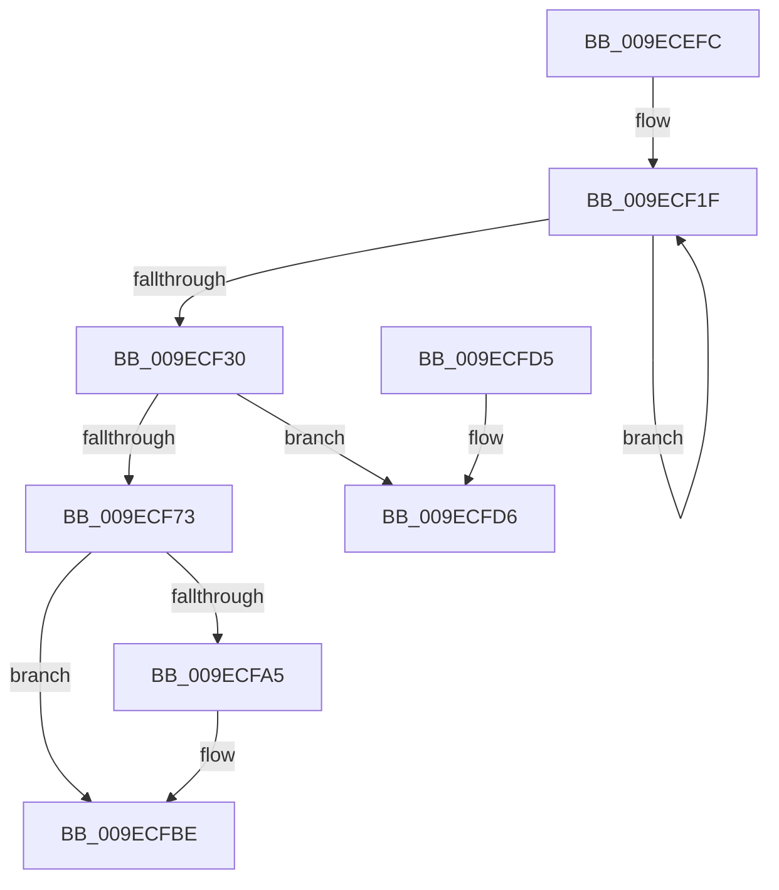

# ExpCreateWorkerThread

- RVA: `0x009ECEFC`–`0x009ECFE8` (길이 `236` bytes)
- VA: `0x00000001409ECEFC`
- 실행 섹션: `PAGE`
- PDB 이름 있음: `예`; PDB Function 태그: `예`
- unwind 정보 RVA: `0x000A5B84`
- 디코드: `53`개 명령, `236/236` bytes 표시
- 미해석 바이트: `0` (있으면 어셈블리에 `.byte`로 보존)

> 이 문서는 커널 이미지의 기계어와 PDB 기호를 분석해 생성했습니다. 4번과 5번은 함수 원형과 자료형을 바이너리 사용 방식에서 추정한 C 해석이며 원본 소스 복구 결과는 아닙니다.

## 1. Dependencies

- 직접 호출 지점: **5**; 고유 호출 대상: **5**
- 직접 호출자로 확인된 함수: **2**
- RIP 상대 이미지 참조: **2**

### Outgoing calls
- `0x009ECF68` → [ExpNodeCreateSystemThread](ExpNodeCreateSystemThread_function_009ECFF0.md) (function, `0x009ECFF0`)
- `0x009ECF9C` → [ObReferenceObjectByHandle](../86/ObReferenceObjectByHandle_function_00868DB0.md) (function, `0x00868DB0`)
- `0x009ECFAF` → [KeBoostPriorityThread](../../text/4D/KeBoostPriorityThread_function_004D37F8.md) (function, `0x004D37F8`)
- `0x009ECFB9` → [ObfDereferenceObject](../../text/2F/ObfDereferenceObject_function_002F9350.md) (function, `0x002F9350`)
- `0x009ECFC3` → [ZwClose](../../text/6A/ZwClose_function_006AD2B0.md) (function, `0x006AD2B0`)

### Direct callers
- [ExpPartitionCreatePoolInternal](../AF/ExpPartitionCreatePoolInternal_function_00AF6C08.md) at `0x00AF6CE4`
- [ExpWorkQueueManagerThread](../AF/ExpWorkQueueManagerThread_function_00AF6D60.md) at `0x00AF700C`
- [ExpWorkQueueManagerThread](../AF/ExpWorkQueueManagerThread_function_00AF6D60.md) at `0x00AF70F0`

### Static image references
- `0x009ECF4B` → RVA `0x004ECAF0` (`ExpWorkerThread`; read)
- `0x009ECF73` → RVA `0x00FC6AC8` (`ALMOSTRO`; read)

## 2. Other-region calls and transfers

- 다른 실행 섹션으로 향하는 call: **3**
  - `0x009ECFAF` → [KeBoostPriorityThread](../../text/4D/KeBoostPriorityThread_function_004D37F8.md) (`PAGE` → `.text`)
  - `0x009ECFB9` → [ObfDereferenceObject](../../text/2F/ObfDereferenceObject_function_002F9350.md) (`PAGE` → `.text`)
  - `0x009ECFC3` → [ZwClose](../../text/6A/ZwClose_function_006AD2B0.md) (`PAGE` → `.text`)
- call이 아닌 외부 분기/꼬리 이동: **1**
  - `0x009ECFE3` → [sub_00B30B90](../B3/Unknown_function_00B30B90.md) (`tail-transfer`)

## 3. Assembly (complete function range)

```asm
009ECEFC  48 89 5C 24 10                  mov qword ptr [rsp + 0x10], rbx
009ECF01  57                              push rdi
009ECF02  48 83 EC 50                     sub rsp, 0x50
009ECF06  48 83 64 24 70 00               and qword ptr [rsp + 0x70], 0
009ECF0C  4C 8B C2                        mov r8, rdx
009ECF0F  48 8B D9                        mov rbx, rcx
009ECF12  0F 0D 89 C8 02 00 00            prefetchw byte ptr [rcx + 0x2c8]
009ECF19  8B 81 C8 02 00 00               mov eax, dword ptr [rcx + 0x2c8]
009ECF1F  8D 50 01                        lea edx, [rax + 1]
009ECF22  0F BA EA 0E                     bts edx, 0xe
009ECF26  F0 0F B1 91 C8 02 00 00         lock cmpxchg dword ptr [rcx + 0x2c8], edx
009ECF2E  75 EF                           jne 0x1409ecf1f
009ECF30  48 8B 83 B0 02 00 00            mov rax, qword ptr [rbx + 0x2b0]
009ECF37  48 8B 89 B8 02 00 00            mov rcx, qword ptr [rcx + 0x2b8]
009ECF3E  48 8B 10                        mov rdx, qword ptr [rax]
009ECF41  48 8D 44 24 70                  lea rax, [rsp + 0x70]
009ECF46  48 89 44 24 40                  mov qword ptr [rsp + 0x40], rax
009ECF4B  48 8D 05 9E FB AF FF            lea rax, [rip - 0x500462]
009ECF52  4C 89 44 24 38                  mov qword ptr [rsp + 0x38], r8
009ECF57  48 89 5C 24 30                  mov qword ptr [rsp + 0x30], rbx
009ECF5C  4C 8B 8A 80 00 00 00            mov r9, qword ptr [rdx + 0x80]
009ECF63  48 89 44 24 28                  mov qword ptr [rsp + 0x28], rax
009ECF68  E8 83 00 00 00                  call 0x1409ecff0
009ECF6D  8B F8                           mov edi, eax
009ECF6F  85 C0                           test eax, eax
009ECF71  78 63                           js 0x1409ecfd6
009ECF73  4C 8B 05 4E 9B 5D 00            mov r8, qword ptr [rip + 0x5d9b4e]
009ECF7A  48 8D 44 24 60                  lea rax, [rsp + 0x60]
009ECF7F  48 83 64 24 28 00               and qword ptr [rsp + 0x28], 0
009ECF85  45 33 C9                        xor r9d, r9d
009ECF88  48 8B 4C 24 70                  mov rcx, qword ptr [rsp + 0x70]
009ECF8D  48 83 64 24 60 00               and qword ptr [rsp + 0x60], 0
009ECF93  48 89 44 24 20                  mov qword ptr [rsp + 0x20], rax
009ECF98  41 8D 51 20                     lea edx, [r9 + 0x20]
009ECF9C  E8 0F BE E7 FF                  call 0x140868db0
009ECFA1  85 C0                           test eax, eax
009ECFA3  78 19                           js 0x1409ecfbe
009ECFA5  48 8B 4C 24 60                  mov rcx, qword ptr [rsp + 0x60]
009ECFAA  BA 08 00 00 00                  mov edx, 8
009ECFAF  E8 44 68 AE FF                  call 0x1404d37f8
009ECFB4  48 8B 4C 24 60                  mov rcx, qword ptr [rsp + 0x60]
009ECFB9  E8 92 C3 90 FF                  call 0x1402f9350
009ECFBE  48 8B 4C 24 70                  mov rcx, qword ptr [rsp + 0x70]
009ECFC3  E8 E8 02 CC FF                  call 0x1406ad2b0
009ECFC8  48 8B 5C 24 68                  mov rbx, qword ptr [rsp + 0x68]
009ECFCD  8B C7                           mov eax, edi
009ECFCF  48 83 C4 50                     add rsp, 0x50
009ECFD3  5F                              pop rdi
009ECFD4  C3                              ret
009ECFD5  CC                              int3
009ECFD6  0F 0D 8B C8 02 00 00            prefetchw byte ptr [rbx + 0x2c8]
009ECFDD  8B 83 C8 02 00 00               mov eax, dword ptr [rbx + 0x2c8]
009ECFE3  E9 A8 3B 14 00                  jmp 0x140b30b90
```

## 4. C-style interpretation (structured pseudocode)

```c
__int64 __fastcall ExpCreateWorkerThread(__int64 a1, __int64 a2)
{
    __int64 result;
    __int64 v_rsp;
    unsigned __int64 v_stack_m18;
    unsigned __int64 v_stack_m20;
    unsigned __int64 v_stack_m28;
    unsigned __int64 v_stack_m30;
    unsigned __int64 v_stack_m38;
    unsigned __int64 v_stack_p10;
    unsigned __int64 v_stack_p18;
    unsigned __int64 v_stack_p8;

    v_stack_p10 = v_rbx;
    v_rsp = (v_rsp) - (80);
loc_009ECF1F:
    if (condition_is_not_equal) goto loc_009ECF1F;
    v_stack_m18 = v_stack_p18;
    v_stack_m20 = a2;
    v_stack_m28 = a1;
    v_stack_m30 = v_rip - 5244002;
    result = ExpNodeCreateSystemThread(*(unsigned __int64 *)(a1 + 696), *(unsigned __int64 *)(*(unsigned __int64 *)(a1 + 688)), a2, *(unsigned __int64 *)(*(unsigned __int64 *)(*(unsigned __int64 *)(a1 + 688)) + 128));
    if (sign_flag) goto loc_009ECFD6;
    a4 = 0;
    v_stack_m38 = v_stack_p8;
    result = ObReferenceObjectByHandle(v_stack_p18, a4 + 32, *(unsigned __int64 *)(v_rip + 6134606), a4);
    if (!(sign_flag)) {
        a1 = v_stack_p8;
        a2 = 8;
        result = KeBoostPriorityThread(a1, a2, *(unsigned __int64 *)(v_rip + 6134606), a4);
        a1 = v_stack_p8;
        result = ObfDereferenceObject(a1, a2, *(unsigned __int64 *)(v_rip + 6134606), a4);
    }
    result = ZwClose(v_stack_p18, a2, *(unsigned __int64 *)(v_rip + 6134606), a4);
    v_rsp = (v_rsp) + (80);
    return (unsigned int)((unsigned int)((unsigned int)((unsigned int)(result))));
loc_009ECFD6:
}
```

## 5. (Beta) C Style

```c
int64_t ExpCreateWorkerThread(void *Arg1, int64_t Arg2)
{
    uint8_t *arg1 = (uint8_t *)Arg1;

    int64_t result;
    int64_t local_rsp;
    uint64_t v_stack_m18;
    uint64_t v_stack_m20;
    uint64_t v_stack_m28;
    uint64_t v_stack_m30;
    uint64_t v_stack_m38;
    uint64_t v_stack_p10;
    uint64_t v_stack_p18;
    uint64_t v_stack_p8;

    v_stack_p10 = local_rbx;
    local_rsp = (local_rsp) - (80);
loc_009ECF1F:
    if (condition_is_not_equal) goto loc_009ECF1F;
    v_stack_m18 = v_stack_p18;
    v_stack_m20 = Arg2;
    v_stack_m28 = Arg1;
    v_stack_m30 = v_rip - 5244002;
    result = ExpNodeCreateSystemThread(*(uint64_t *)(arg1 + 0x2B8), *(uint64_t *)(*(uint64_t *)(arg1 + 0x2B0)), Arg2, *(uint64_t *)(*(uint64_t *)(*(uint64_t *)(arg1 + 0x2B0)) + 0x80));
    if (sign_flag) goto loc_009ECFD6;
    a4 = 0;
    v_stack_m38 = v_stack_p8;
    result = ObReferenceObjectByHandle(v_stack_p18, a4 + 32, *(uint64_t *)(v_rip + 0x5D9B4E), a4);
    if (!(sign_flag)) {
        Arg1 = v_stack_p8;
        Arg2 = 8;
        result = KeBoostPriorityThread(Arg1, Arg2, *(uint64_t *)(v_rip + 0x5D9B4E), a4);
        Arg1 = v_stack_p8;
        result = ObfDereferenceObject(Arg1, Arg2, *(uint64_t *)(v_rip + 0x5D9B4E), a4);
    }
    result = ZwClose(v_stack_p18, Arg2, *(uint64_t *)(v_rip + 0x5D9B4E), a4);
    local_rsp = (local_rsp) + (80);
    return (uint32_t)((uint32_t)((uint32_t)((uint32_t)(result))));
loc_009ECFD6:
}
```

### 관측된 메모리 오프셋

구조체 형식이 확인되지 않은 접근은 인자 기준의 오프셋으로만 기록했습니다.

| 기준 인자 | 오프셋 표현 | 폭 (bit) | 접근 |
|---|---:|---:|---|
| `Arg1` | `+ 0x2B0` | `64` | `R` |
| `Arg1` | `+ 0x2B8` | `64` | `R` |
| `Arg1` | `+ 0x2C8` | `8` | `R` |
| `Arg1` | `+ 0x2C8` | `32` | `R` |

## 6. Execution-region graph

[열기: 2D/3D 그래프와 함수 탐색 컨트롤 패널](../../../control-panel.html?section=page&rva=0x009ECEFC&view=graph)

- 2D 그래프는 위에서 아래로 흐르고, 3D 그래프는 빈 공간을 드래그해 회전합니다. Shift+드래그는 이동, 휠은 확대·축소, 함수 노드 선택은 대상 보고서 이동입니다.

### Static fallback


