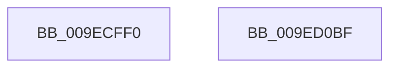

# ExpNodeCreateSystemThread

- RVA: `0x009ECFF0`–`0x009ED0C0` (길이 `208` bytes)
- VA: `0x00000001409ECFF0`
- 실행 섹션: `PAGE`
- PDB 이름 있음: `예`; PDB Function 태그: `아니요`
- unwind 정보 RVA: `0x000A5BA4`
- 디코드: `51`개 명령, `208/208` bytes 표시
- 미해석 바이트: `0` (있으면 어셈블리에 `.byte`로 보존)

> 이 문서는 커널 이미지의 기계어와 PDB 기호를 분석해 생성했습니다. 4번과 5번은 함수 원형과 자료형을 바이너리 사용 방식에서 추정한 C 해석이며 원본 소스 복구 결과는 아닙니다.

## 1. Dependencies

- 직접 호출 지점: **4**; 고유 호출 대상: **4**
- 직접 호출자로 확인된 함수: **2**
- RIP 상대 이미지 참조: **1**

### Outgoing calls
- `0x009ED047` → [KeQueryNodeActiveAffinity](../../text/43/KeQueryNodeActiveAffinity_function_0043EF80.md) (function, `0x0043EF80`)
- `0x009ED05A` → [KeSelectIdealProcessor](../../text/2C/KeSelectIdealProcessor_function_002CE8CC.md) (function, `0x002CE8CC`)
- `0x009ED098` → [PsCreateSystemThreadEx](PsCreateSystemThreadEx_function_009ED120.md) (function, `0x009ED120`)
- `0x009ED0A5` → [_security_check_cookie](../../text/6A/_security_check_cookie_function_006AC640.md) (function, `0x006AC640`)

### Direct callers
- [ExpPartitionCreateSystemThread](ExpPartitionCreateSystemThread_function_009ECEA4.md) at `0x009ECEE8`
- [ExpCreateWorkerThread](ExpCreateWorkerThread_function_009ECEFC.md) at `0x009ECF68`

### Static image references
- `0x009ED002` → RVA `0x00E0A740` (`.data`; read)

## 2. Other-region calls and transfers

- 다른 실행 섹션으로 향하는 call: **3**
  - `0x009ED047` → [KeQueryNodeActiveAffinity](../../text/43/KeQueryNodeActiveAffinity_function_0043EF80.md) (`PAGE` → `.text`)
  - `0x009ED05A` → [KeSelectIdealProcessor](../../text/2C/KeSelectIdealProcessor_function_002CE8CC.md) (`PAGE` → `.text`)
  - `0x009ED0A5` → [_security_check_cookie](../../text/6A/_security_check_cookie_function_006AC640.md) (`PAGE` → `.text`)
- 별도 외부 분기/꼬리 이동을 확인하지 못했습니다.

## 3. Assembly (complete function range)

```asm
009ECFF0  48 89 5C 24 10                  mov qword ptr [rsp + 0x10], rbx
009ECFF5  48 89 6C 24 18                  mov qword ptr [rsp + 0x18], rbp
009ECFFA  56                              push rsi
009ECFFB  57                              push rdi
009ECFFC  41 56                           push r14
009ECFFE  48 83 EC 70                     sub rsp, 0x70
009ED002  48 8B 05 37 D7 41 00            mov rax, qword ptr [rip + 0x41d737]
009ED009  48 33 C4                        xor rax, rsp
009ED00C  48 89 44 24 68                  mov qword ptr [rsp + 0x68], rax
009ED011  0F B7 09                        movzx ecx, word ptr [rcx]
009ED014  48 8D 54 24 58                  lea rdx, [rsp + 0x58]
009ED019  48 8B B4 24 B8 00 00 00         mov rsi, qword ptr [rsp + 0xb8]
009ED021  0F 57 C0                        xorps xmm0, xmm0
009ED024  48 8B BC 24 C0 00 00 00         mov rdi, qword ptr [rsp + 0xc0]
009ED02C  45 33 C0                        xor r8d, r8d
009ED02F  48 8B 9C 24 C8 00 00 00         mov rbx, qword ptr [rsp + 0xc8]
009ED037  4D 8B F1                        mov r14, r9
009ED03A  48 8B AC 24 D0 00 00 00         mov rbp, qword ptr [rsp + 0xd0]
009ED042  0F 11 44 24 58                  movups xmmword ptr [rsp + 0x58], xmm0
009ED047  E8 34 1F A5 FF                  call 0x14043ef80
009ED04C  45 33 C9                        xor r9d, r9d
009ED04F  48 8D 4C 24 58                  lea rcx, [rsp + 0x58]
009ED054  45 33 C0                        xor r8d, r8d
009ED057  48 8B D3                        mov rdx, rbx
009ED05A  E8 6D 18 8E FF                  call 0x1402ce8cc
009ED05F  0F B7 C0                        movzx eax, ax
009ED062  4D 8B CE                        mov r9, r14
009ED065  89 44 24 50                     mov dword ptr [rsp + 0x50], eax
009ED069  45 33 C0                        xor r8d, r8d
009ED06C  48 8D 44 24 50                  lea rax, [rsp + 0x50]
009ED071  BA FF FF 1F 00                  mov edx, 0x1fffff
009ED076  48 89 44 24 40                  mov qword ptr [rsp + 0x40], rax
009ED07B  48 8B CD                        mov rcx, rbp
009ED07E  48 8D 44 24 58                  lea rax, [rsp + 0x58]
009ED083  48 89 44 24 38                  mov qword ptr [rsp + 0x38], rax
009ED088  48 89 7C 24 30                  mov qword ptr [rsp + 0x30], rdi
009ED08D  48 89 74 24 28                  mov qword ptr [rsp + 0x28], rsi
009ED092  48 83 64 24 20 00               and qword ptr [rsp + 0x20], 0
009ED098  E8 83 00 00 00                  call 0x1409ed120
009ED09D  48 8B 4C 24 68                  mov rcx, qword ptr [rsp + 0x68]
009ED0A2  48 33 CC                        xor rcx, rsp
009ED0A5  E8 96 F5 CB FF                  call 0x1406ac640
009ED0AA  4C 8D 5C 24 70                  lea r11, [rsp + 0x70]
009ED0AF  49 8B 5B 28                     mov rbx, qword ptr [r11 + 0x28]
009ED0B3  49 8B 6B 30                     mov rbp, qword ptr [r11 + 0x30]
009ED0B7  49 8B E3                        mov rsp, r11
009ED0BA  41 5E                           pop r14
009ED0BC  5F                              pop rdi
009ED0BD  5E                              pop rsi
009ED0BE  C3                              ret
009ED0BF  CC                              int3
```

## 4. C-style interpretation (structured pseudocode)

```c
__int64 __fastcall ExpNodeCreateSystemThread(__int64 a1, __int64 a2, int a3, __int64 a4, __int64 a5, __int64 a6, __int64 a7, __int64 a8, __int64 a9)
{
    __int64 result;
    __int64 v_rsp;
    unsigned __int64 v_stack_m18;
    unsigned __int64 v_stack_m20;
    unsigned __int64 v_stack_m30;
    unsigned int v_stack_m38;
    unsigned __int64 v_stack_m48;
    unsigned __int64 v_stack_m50;
    unsigned __int64 v_stack_m58;
    unsigned __int64 v_stack_m60;
    unsigned __int64 v_stack_m68;
    unsigned __int64 v_stack_p10;
    unsigned __int64 v_stack_p18;

    v_stack_p10 = v_rbx;
    v_stack_p18 = v_rbp;
    v_rsp = (v_rsp) - (112);
    result = (*(unsigned __int64 *)(v_rip + 4314935)) ^ (v_rsp);
    v_stack_m20 = result;
    a3 = 0;
    v_stack_m30 = v_xmm0;
    result = KeQueryNodeActiveAffinity(*(unsigned __int16 *)(a1), v_stack_m30, a3, a4);
    a4 = 0;
    a3 = 0;
    result = KeSelectIdealProcessor(v_stack_m30, a8, a3, a4);
    v_stack_m38 = (unsigned int)((unsigned __int16)(result));
    a3 = 0;
    v_stack_m48 = v_stack_m38;
    v_stack_m50 = v_stack_m30;
    v_stack_m58 = a7;
    v_stack_m60 = a6;
    result = PsCreateSystemThreadEx(a9, (unsigned int)(0x1FFFFFULL), a3, 0);
    a1 = (v_stack_m20) ^ (v_rsp);
    result = _security_check_cookie(a1, (unsigned int)(0x1FFFFFULL), a3, 0);
    return result;
}
```

## 5. (Beta) C Style

```c
int64_t ExpNodeCreateSystemThread(void *Arg1, int64_t Arg2, int32_t Arg3, int64_t Arg4, uint64_t Arg5, int64_t Arg6, int64_t Arg7, int64_t Arg8, int64_t Arg9)
{
    uint8_t *arg1 = (uint8_t *)Arg1;

    int64_t result;
    int64_t local_rsp;
    uint64_t v_stack_m18;
    uint64_t v_stack_m20;
    uint64_t v_stack_m30;
    uint32_t v_stack_m38;
    uint64_t v_stack_m48;
    uint64_t v_stack_m50;
    uint64_t v_stack_m58;
    uint64_t v_stack_m60;
    uint64_t v_stack_m68;
    uint64_t v_stack_p10;
    uint64_t v_stack_p18;

    v_stack_p10 = local_rbx;
    v_stack_p18 = local_rbp;
    local_rsp = (local_rsp) - (112);
    result = (*(uint64_t *)(v_rip + 0x41D737)) ^ (local_rsp);
    v_stack_m20 = result;
    Arg3 = 0;
    v_stack_m30 = v_xmm0;
    result = KeQueryNodeActiveAffinity(*(uint16_t *)(arg1), v_stack_m30, Arg3, Arg4);
    Arg4 = 0;
    Arg3 = 0;
    result = KeSelectIdealProcessor(v_stack_m30, Arg8, Arg3, Arg4);
    v_stack_m38 = (uint32_t)((uint16_t)(result));
    Arg3 = 0;
    v_stack_m48 = v_stack_m38;
    v_stack_m50 = v_stack_m30;
    v_stack_m58 = Arg7;
    v_stack_m60 = Arg6;
    result = PsCreateSystemThreadEx(Arg9, (uint32_t)(0x1FFFFFULL), Arg3, 0);
    Arg1 = (v_stack_m20) ^ (local_rsp);
    result = _security_check_cookie(Arg1, (uint32_t)(0x1FFFFFULL), Arg3, 0);
    return result;
}
```

### 관측된 메모리 오프셋

구조체 형식이 확인되지 않은 접근은 인자 기준의 오프셋으로만 기록했습니다.

| 기준 인자 | 오프셋 표현 | 폭 (bit) | 접근 |
|---|---:|---:|---|
| `Arg1` | `+ 0x0` | `16` | `R` |

## 6. Execution-region graph

[열기: 2D/3D 그래프와 함수 탐색 컨트롤 패널](../../../control-panel.html?section=page&rva=0x009ECFF0&view=graph)

- 2D 그래프는 위에서 아래로 흐르고, 3D 그래프는 빈 공간을 드래그해 회전합니다. Shift+드래그는 이동, 휠은 확대·축소, 함수 노드 선택은 대상 보고서 이동입니다.

### Static fallback


