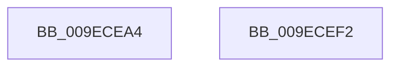

# ExpPartitionCreateSystemThread

- RVA: `0x009ECEA4`–`0x009ECEF3` (길이 `79` bytes)
- VA: `0x00000001409ECEA4`
- 실행 섹션: `PAGE`
- PDB 이름 있음: `예`; PDB Function 태그: `아니요`
- unwind 정보 RVA: `0x0005CC98`
- 디코드: `17`개 명령, `79/79` bytes 표시
- 미해석 바이트: `0` (있으면 어셈블리에 `.byte`로 보존)

> 이 문서는 커널 이미지의 기계어와 PDB 기호를 분석해 생성했습니다. 4번과 5번은 함수 원형과 자료형을 바이너리 사용 방식에서 추정한 C 해석이며 원본 소스 복구 결과는 아닙니다.

## 1. Dependencies

- 직접 호출 지점: **1**; 고유 호출 대상: **1**
- 직접 호출자로 확인된 함수: **1**
- RIP 상대 이미지 참조: **0**

### Outgoing calls
- `0x009ECEE8` → [ExpNodeCreateSystemThread](ExpNodeCreateSystemThread_function_009ECFF0.md) (function, `0x009ECFF0`)

### Direct callers
- [ExpWorkQueueManagerStart](../7D/ExpWorkQueueManagerStart_function_007D02B0.md) at `0x007D0306`

### Static image references
- 디코드된 RIP-relative 메모리 참조가 없습니다.

## 2. Other-region calls and transfers

- 다른 실행 섹션으로 향하는 call: **0**
- 별도 외부 분기/꼬리 이동을 확인하지 못했습니다.

## 3. Assembly (complete function range)

```asm
009ECEA4  4C 8B DC                        mov r11, rsp
009ECEA7  48 83 EC 58                     sub rsp, 0x58
009ECEAB  48 8B 01                        mov rax, qword ptr [rcx]
009ECEAE  48 8B CA                        mov rcx, rdx
009ECEB1  4C 8B 88 80 00 00 00            mov r9, qword ptr [rax + 0x80]
009ECEB8  48 8B 84 24 A0 00 00 00         mov rax, qword ptr [rsp + 0xa0]
009ECEC0  49 89 43 E8                     mov qword ptr [r11 - 0x18], rax
009ECEC4  48 8B 84 24 98 00 00 00         mov rax, qword ptr [rsp + 0x98]
009ECECC  49 89 43 E0                     mov qword ptr [r11 - 0x20], rax
009ECED0  48 8B 84 24 90 00 00 00         mov rax, qword ptr [rsp + 0x90]
009ECED8  49 89 43 D8                     mov qword ptr [r11 - 0x28], rax
009ECEDC  48 8B 84 24 88 00 00 00         mov rax, qword ptr [rsp + 0x88]
009ECEE4  49 89 43 D0                     mov qword ptr [r11 - 0x30], rax
009ECEE8  E8 03 01 00 00                  call 0x1409ecff0
009ECEED  48 83 C4 58                     add rsp, 0x58
009ECEF1  C3                              ret
009ECEF2  CC                              int3
```

## 4. C-style interpretation (structured pseudocode)

```c
__int64 __fastcall ExpPartitionCreateSystemThread(__int64 a1, __int64 a2, __int64 a3, __int64 a4, __int64 a5, __int64 a6, __int64 a7, __int64 a8, __int64 a9)
{
    __int64 result;
    __int64 v_rsp;

    v_rsp = (v_rsp) - (88);
    *(unsigned __int64 *)(v_rsp - 24) = a9;
    *(unsigned __int64 *)(v_rsp - 32) = a8;
    *(unsigned __int64 *)(v_rsp - 40) = a7;
    *(unsigned __int64 *)(v_rsp - 48) = a6;
    result = ExpNodeCreateSystemThread(a2, a2, a3, *(unsigned __int64 *)(*(unsigned __int64 *)(a1) + 128));
    v_rsp = (v_rsp) + (88);
    return result;
}
```

## 5. (Beta) C Style

```c
int64_t ExpPartitionCreateSystemThread(void *Arg1, int64_t Arg2, int64_t Arg3, int64_t Arg4, uint64_t Arg5, int64_t Arg6, int64_t Arg7, int64_t Arg8, int64_t Arg9)
{
    uint8_t *arg1 = (uint8_t *)Arg1;

    int64_t result;
    int64_t local_rsp;

    local_rsp = (local_rsp) - (88);
    *(uint64_t *)(local_rsp - 0x18) = Arg9;
    *(uint64_t *)(local_rsp - 0x20) = Arg8;
    *(uint64_t *)(local_rsp - 0x28) = Arg7;
    *(uint64_t *)(local_rsp - 0x30) = Arg6;
    result = ExpNodeCreateSystemThread(Arg2, Arg2, Arg3, *(uint64_t *)(*(uint64_t *)(arg1) + 0x80));
    local_rsp = (local_rsp) + (88);
    return result;
}
```

### 관측된 메모리 오프셋

구조체 형식이 확인되지 않은 접근은 인자 기준의 오프셋으로만 기록했습니다.

| 기준 인자 | 오프셋 표현 | 폭 (bit) | 접근 |
|---|---:|---:|---|
| `Arg1` | `+ 0x0` | `64` | `R` |

## 6. Execution-region graph

[열기: 2D/3D 그래프와 함수 탐색 컨트롤 패널](../../../control-panel.html?section=page&rva=0x009ECEA4&view=graph)

- 2D 그래프는 위에서 아래로 흐르고, 3D 그래프는 빈 공간을 드래그해 회전합니다. Shift+드래그는 이동, 휠은 확대·축소, 함수 노드 선택은 대상 보고서 이동입니다.

### Static fallback


