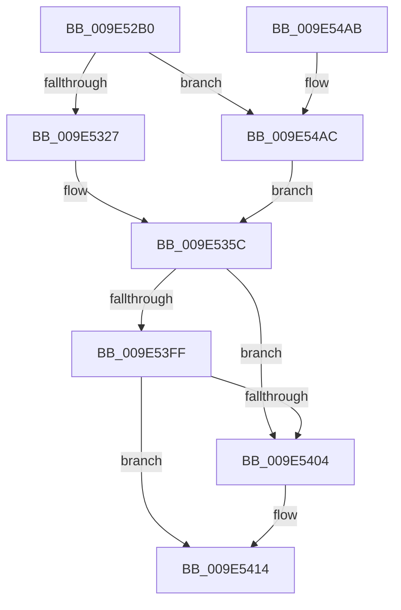

# ExpQueryProcessorInformationCounters

- RVA: `0x009E52B0`–`0x009E5521` (길이 `625` bytes)
- VA: `0x00000001409E52B0`
- 실행 섹션: `PAGE`
- PDB 이름 있음: `예`; PDB Function 태그: `아니요`
- unwind 정보 RVA: `0x000A4170`
- 디코드: `156`개 명령, `625/625` bytes 표시
- 미해석 바이트: `0` (있으면 어셈블리에 `.byte`로 보존)

> 이 문서는 커널 이미지의 기계어와 PDB 기호를 분석해 생성했습니다. 4번과 5번은 함수 원형과 자료형을 바이너리 사용 방식에서 추정한 C 해석이며 원본 소스 복구 결과는 아닙니다.

## 1. Dependencies

- 직접 호출 지점: **3**; 고유 호출 대상: **3**
- 직접 호출자로 확인된 함수: **1**
- RIP 상대 이미지 참조: **2**

### Outgoing calls
- `0x009E540F` → [PoGetPerfStateAndParkingInfo](../../text/2D/PoGetPerfStateAndParkingInfo_function_002DD484.md) (function, `0x002DD484`)
- `0x009E5485` → [_security_check_cookie](../../text/6A/_security_check_cookie_function_006AC640.md) (function, `0x006AC640`)
- `0x009E54B8` → [PoGetIdleTimes](../../text/2D/PoGetIdleTimes_function_002DF570.md) (function, `0x002DF570`)

### Direct callers
- [ExProcessorCounterSetCallback](ExProcessorCounterSetCallback_function_009E4880.md) at `0x009E49EE`
- [ExProcessorCounterSetCallback](ExProcessorCounterSetCallback_function_009E4880.md) at `0x009E4B8D`

### Static image references
- `0x009E52D4` → RVA `0x00E0A740` (`.data`; read)
- `0x009E5374` → RVA `0x00FC6AA0` (`ALMOSTRO`; read)

## 2. Other-region calls and transfers

- 다른 실행 섹션으로 향하는 call: **3**
  - `0x009E540F` → [PoGetPerfStateAndParkingInfo](../../text/2D/PoGetPerfStateAndParkingInfo_function_002DD484.md) (`PAGE` → `.text`)
  - `0x009E5485` → [_security_check_cookie](../../text/6A/_security_check_cookie_function_006AC640.md) (`PAGE` → `.text`)
  - `0x009E54B8` → [PoGetIdleTimes](../../text/2D/PoGetIdleTimes_function_002DF570.md) (`PAGE` → `.text`)
- 별도 외부 분기/꼬리 이동을 확인하지 못했습니다.

## 3. Assembly (complete function range)

```asm
009E52B0  48 89 5C 24 10                  mov qword ptr [rsp + 0x10], rbx
009E52B5  48 89 74 24 18                  mov qword ptr [rsp + 0x18], rsi
009E52BA  48 89 7C 24 20                  mov qword ptr [rsp + 0x20], rdi
009E52BF  55                              push rbp
009E52C0  41 54                           push r12
009E52C2  41 55                           push r13
009E52C4  41 56                           push r14
009E52C6  41 57                           push r15
009E52C8  48 8D 6C 24 D1                  lea rbp, [rsp - 0x2f]
009E52CD  48 81 EC B0 00 00 00            sub rsp, 0xb0
009E52D4  48 8B 05 65 54 42 00            mov rax, qword ptr [rip + 0x425465]
009E52DB  48 33 C4                        xor rax, rsp
009E52DE  48 89 45 27                     mov qword ptr [rbp + 0x27], rax
009E52E2  0F B6 81 D0 00 00 00            movzx eax, byte ptr [rcx + 0xd0]
009E52E9  0F 57 C0                        xorps xmm0, xmm0
009E52EC  48 8B 5D 7F                     mov rbx, qword ptr [rbp + 0x7f]
009E52F0  45 0F B6 E1                     movzx r12d, r9b
009E52F4  66 89 45 9F                     mov word ptr [rbp - 0x61], ax
009E52F8  45 0F B6 E8                     movzx r13d, r8b
009E52FC  0F B6 81 D1 00 00 00            movzx eax, byte ptr [rcx + 0xd1]
009E5303  48 8B F9                        mov rdi, rcx
009E5306  88 45 A1                        mov byte ptr [rbp - 0x5f], al
009E5309  33 C0                           xor eax, eax
009E530B  C6 45 A2 00                     mov byte ptr [rbp - 0x5e], 0
009E530F  0F 11 45 F7                     movups xmmword ptr [rbp - 9], xmm0
009E5313  0F 11 45 07                     movups xmmword ptr [rbp + 7], xmm0
009E5317  0F 11 45 17                     movups xmmword ptr [rbp + 0x17], xmm0
009E531B  0F 11 45 C7                     movups xmmword ptr [rbp - 0x39], xmm0
009E531F  84 D2                           test dl, dl
009E5321  0F 85 85 01 00 00               jne 0x1409e54ac
009E5327  48 89 03                        mov qword ptr [rbx], rax
009E532A  8B D0                           mov edx, eax
009E532C  48 89 43 48                     mov qword ptr [rbx + 0x48], rax
009E5330  44 8B C0                        mov r8d, eax
009E5333  48 89 43 50                     mov qword ptr [rbx + 0x50], rax
009E5337  44 8B C8                        mov r9d, eax
009E533A  48 89 43 58                     mov qword ptr [rbx + 0x58], rax
009E533E  44 8B D0                        mov r10d, eax
009E5341  48 89 43 60                     mov qword ptr [rbx + 0x60], rax
009E5345  44 8B D8                        mov r11d, eax
009E5348  48 89 43 68                     mov qword ptr [rbx + 0x68], rax
009E534C  8B F0                           mov esi, eax
009E534E  48 89 43 70                     mov qword ptr [rbx + 0x70], rax
009E5352  44 8B F0                        mov r14d, eax
009E5355  48 89 43 78                     mov qword ptr [rbx + 0x78], rax
009E5359  44 8B F8                        mov r15d, eax
009E535C  4C 89 43 08                     mov qword ptr [rbx + 8], r8
009E5360  0F 57 C0                        xorps xmm0, xmm0
009E5363  48 89 53 18                     mov qword ptr [rbx + 0x18], rdx
009E5367  4C 8D 45 D7                     lea r8, [rbp - 0x29]
009E536B  8B 87 48 86 00 00               mov eax, dword ptr [rdi + 0x8648]
009E5371  0F 57 C9                        xorps xmm1, xmm1
009E5374  8B 0D 26 17 5E 00               mov ecx, dword ptr [rip + 0x5e1726]
009E537A  48 0F AF C1                     imul rax, rcx
009E537E  0F 11 45 A7                     movups xmmword ptr [rbp - 0x59], xmm0
009E5382  0F 11 45 B7                     movups xmmword ptr [rbp - 0x49], xmm0
009E5386  0F 11 4D D7                     movups xmmword ptr [rbp - 0x29], xmm1
009E538A  48 89 43 10                     mov qword ptr [rbx + 0x10], rax
009E538E  8B 87 40 86 00 00               mov eax, dword ptr [rdi + 0x8640]
009E5394  89 43 20                        mov dword ptr [rbx + 0x20], eax
009E5397  8B 87 50 86 00 00               mov eax, dword ptr [rdi + 0x8650]
009E539D  48 0F AF C1                     imul rax, rcx
009E53A1  0F 11 4D E7                     movups xmmword ptr [rbp - 0x19], xmm1
009E53A5  48 89 43 30                     mov qword ptr [rbx + 0x30], rax
009E53A9  8B 87 5C 38 00 00               mov eax, dword ptr [rdi + 0x385c]
009E53AF  89 43 3C                        mov dword ptr [rbx + 0x3c], eax
009E53B2  8B 87 AC 38 00 00               mov eax, dword ptr [rdi + 0x38ac]
009E53B8  89 43 40                        mov dword ptr [rbx + 0x40], eax
009E53BB  8B 87 4C 86 00 00               mov eax, dword ptr [rdi + 0x864c]
009E53C1  48 0F AF C1                     imul rax, rcx
009E53C5  48 89 43 28                     mov qword ptr [rbx + 0x28], rax
009E53C9  8B 87 C4 38 00 00               mov eax, dword ptr [rdi + 0x38c4]
009E53CF  89 43 38                        mov dword ptr [rbx + 0x38], eax
009E53D2  4B 8D 04 0B                     lea rax, [r11 + r9]
009E53D6  49 03 C2                        add rax, r10
009E53D9  48 89 83 A8 00 00 00            mov qword ptr [rbx + 0xa8], rax
009E53E0  49 8D 04 36                     lea rax, [r14 + rsi]
009E53E4  49 03 C7                        add rax, r15
009E53E7  45 84 E4                        test r12b, r12b
009E53EA  48 89 83 B0 00 00 00            mov qword ptr [rbx + 0xb0], rax
009E53F1  B8 00 00 00 00                  mov eax, 0
009E53F6  4C 0F 44 C0                     cmove r8, rax
009E53FA  45 84 ED                        test r13b, r13b
009E53FD  75 05                           jne 0x1409e5404
009E53FF  4D 85 C0                        test r8, r8
009E5402  74 10                           je 0x1409e5414
009E5404  45 33 C9                        xor r9d, r9d
009E5407  48 8D 55 A7                     lea rdx, [rbp - 0x59]
009E540B  48 8D 4D 9F                     lea rcx, [rbp - 0x61]
009E540F  E8 70 80 8F FF                  call 0x1402dd484
009E5414  0F B6 45 C4                     movzx eax, byte ptr [rbp - 0x3c]
009E5418  89 83 80 00 00 00               mov dword ptr [rbx + 0x80], eax
009E541E  8B 45 AB                        mov eax, dword ptr [rbp - 0x55]
009E5421  89 83 84 00 00 00               mov dword ptr [rbx + 0x84], eax
009E5427  8B 45 AF                        mov eax, dword ptr [rbp - 0x51]
009E542A  89 83 88 00 00 00               mov dword ptr [rbx + 0x88], eax
009E5430  8B 45 A7                        mov eax, dword ptr [rbp - 0x59]
009E5433  89 83 8C 00 00 00               mov dword ptr [rbx + 0x8c], eax
009E5439  8B 45 BB                        mov eax, dword ptr [rbp - 0x45]
009E543C  89 83 B8 00 00 00               mov dword ptr [rbx + 0xb8], eax
009E5442  8B 45 BF                        mov eax, dword ptr [rbp - 0x41]
009E5445  89 83 BC 00 00 00               mov dword ptr [rbx + 0xbc], eax
009E544B  8B 45 D7                        mov eax, dword ptr [rbp - 0x29]
009E544E  89 83 90 00 00 00               mov dword ptr [rbx + 0x90], eax
009E5454  8B 45 DB                        mov eax, dword ptr [rbp - 0x25]
009E5457  89 83 94 00 00 00               mov dword ptr [rbx + 0x94], eax
009E545D  48 8B 45 DF                     mov rax, qword ptr [rbp - 0x21]
009E5461  48 89 83 98 00 00 00            mov qword ptr [rbx + 0x98], rax
009E5468  48 8B 45 E7                     mov rax, qword ptr [rbp - 0x19]
009E546C  48 89 83 A0 00 00 00            mov qword ptr [rbx + 0xa0], rax
009E5473  48 8B 45 EF                     mov rax, qword ptr [rbp - 0x11]
009E5477  48 89 83 C0 00 00 00            mov qword ptr [rbx + 0xc0], rax
009E547E  48 8B 4D 27                     mov rcx, qword ptr [rbp + 0x27]
009E5482  48 33 CC                        xor rcx, rsp
009E5485  E8 B6 71 CC FF                  call 0x1406ac640
009E548A  4C 8D 9C 24 B0 00 00 00         lea r11, [rsp + 0xb0]
009E5492  49 8B 5B 38                     mov rbx, qword ptr [r11 + 0x38]
009E5496  49 8B 73 40                     mov rsi, qword ptr [r11 + 0x40]
009E549A  49 8B 7B 48                     mov rdi, qword ptr [r11 + 0x48]
009E549E  49 8B E3                        mov rsp, r11
009E54A1  41 5F                           pop r15
009E54A3  41 5E                           pop r14
009E54A5  41 5D                           pop r13
009E54A7  41 5C                           pop r12
009E54A9  5D                              pop rbp
009E54AA  C3                              ret
009E54AB  CC                              int3
009E54AC  4C 8D 45 C7                     lea r8, [rbp - 0x39]
009E54B0  48 8D 55 F7                     lea rdx, [rbp - 9]
009E54B4  48 8D 4D 9F                     lea rcx, [rbp - 0x61]
009E54B8  E8 B3 A0 8F FF                  call 0x1402df570
009E54BD  48 8B 45 CF                     mov rax, qword ptr [rbp - 0x31]
009E54C1  8B 4D C7                        mov ecx, dword ptr [rbp - 0x39]
009E54C4  4C 8B 5D FF                     mov r11, qword ptr [rbp - 1]
009E54C8  44 8B 7D 17                     mov r15d, dword ptr [rbp + 0x17]
009E54CC  4C 8B 55 07                     mov r10, qword ptr [rbp + 7]
009E54D0  44 8B 75 1B                     mov r14d, dword ptr [rbp + 0x1b]
009E54D4  4C 8B 4D 0F                     mov r9, qword ptr [rbp + 0xf]
009E54D8  8B 75 1F                        mov esi, dword ptr [rbp + 0x1f]
009E54DB  8B 55 CB                        mov edx, dword ptr [rbp - 0x35]
009E54DE  48 89 43 78                     mov qword ptr [rbx + 0x78], rax
009E54E2  8B 05 B8 15 5E 00               mov eax, dword ptr [rip + 0x5e15b8]
009E54E8  48 0F AF C8                     imul rcx, rax
009E54EC  48 0F AF D0                     imul rdx, rax
009E54F0  48 89 0B                        mov qword ptr [rbx], rcx
009E54F3  4C 89 5B 48                     mov qword ptr [rbx + 0x48], r11
009E54F7  4C 89 7B 60                     mov qword ptr [rbx + 0x60], r15
009E54FB  4C 89 53 50                     mov qword ptr [rbx + 0x50], r10
009E54FF  4C 89 73 68                     mov qword ptr [rbx + 0x68], r14
009E5503  4C 89 4B 58                     mov qword ptr [rbx + 0x58], r9
009E5507  48 2B D1                        sub rdx, rcx
009E550A  48 89 73 70                     mov qword ptr [rbx + 0x70], rsi
009E550E  44 8B 87 6C 86 00 00            mov r8d, dword ptr [rdi + 0x866c]
009E5515  4C 0F AF C0                     imul r8, rax
009E5519  4C 03 C1                        add r8, rcx
009E551C  E9 3B FE FF FF                  jmp 0x1409e535c
```

## 4. C-style interpretation (structured pseudocode)

```c
__int64 __fastcall ExpQueryProcessorInformationCounters(__int64 a1, unsigned __int8 a2, unsigned __int8 a3, unsigned __int8 a4, __int64 a5)
{
    __int64 result;
    __int64 v_rsp;
    unsigned __int64 v_stack_m28;
    unsigned __int64 v_stack_m30;
    unsigned int v_stack_m38;
    unsigned int v_stack_m3C;
    unsigned __int64 v_stack_m40;
    unsigned __int64 v_stack_m48;
    unsigned __int64 v_stack_m50;
    unsigned __int64 v_stack_m57;
    unsigned __int64 v_stack_m58;
    unsigned __int64 v_stack_m60;
    unsigned __int64 v_stack_m68;
    unsigned __int64 v_stack_m70;
    unsigned __int64 v_stack_m78;
    unsigned int v_stack_m7C;
    unsigned __int64 v_stack_m80;
    unsigned __int64 v_stack_m88;
    unsigned int v_stack_m8C;
    unsigned __int64 v_stack_m90;
    unsigned __int8 v_stack_m93;
    unsigned int v_stack_m98;
    unsigned int v_stack_m9C;
    unsigned __int64 v_stack_mA0;
    unsigned int v_stack_mA8;
    unsigned int v_stack_mAC;
    unsigned __int64 v_stack_mB0;
    unsigned __int8 v_stack_mB5;
    unsigned __int8 v_stack_mB6;
    unsigned __int16 v_stack_mB8;
    unsigned __int64 v_stack_p10;
    unsigned __int64 v_stack_p18;
    unsigned __int64 v_stack_p20;

    v_stack_p10 = v_rbx;
    v_stack_p18 = v_rsi;
    v_stack_p20 = v_rdi;
    v_rsp = (v_rsp) - (176);
    result = (*(unsigned __int64 *)(v_rip + 4346981)) ^ (v_rsp);
    v_stack_m30 = result;
    v_stack_mB8 = (unsigned __int16)(*(unsigned __int8 *)(a1 + 208));
    v_stack_mB6 = (unsigned __int8)(*(unsigned __int8 *)(a1 + 209));
    result = 0;
    v_stack_mB5 = 0;
    v_stack_m60 = v_xmm0;
    v_stack_m50 = v_xmm0;
    v_stack_m40 = v_xmm0;
    v_stack_m90 = v_xmm0;
    if (a2 != 0) goto loc_009E54AC;
    *(unsigned __int64 *)(a5) = 0;
    *(unsigned __int64 *)(a5 + 72) = 0;
    *(unsigned __int64 *)(a5 + 80) = 0;
    *(unsigned __int64 *)(a5 + 88) = 0;
    *(unsigned __int64 *)(a5 + 96) = 0;
    *(unsigned __int64 *)(a5 + 104) = 0;
    *(unsigned __int64 *)(a5 + 112) = 0;
    *(unsigned __int64 *)(a5 + 120) = 0;
loc_009E535C:
    *(unsigned __int64 *)(a5 + 8) = 0;
    *(unsigned __int64 *)(a5 + 24) = 0;
    result = ((unsigned int)(*(unsigned int *)(a1 + 34376))) * ((unsigned int)(*(unsigned int *)(v_rip + 6166310)));
    v_stack_mB0 = v_xmm0;
    v_stack_mA0 = v_xmm0;
    v_stack_m80 = v_xmm1;
    *(unsigned __int64 *)(a5 + 16) = result;
    *(unsigned int *)(a5 + 32) = (unsigned int)((unsigned int)(*(unsigned int *)(a1 + 34368)));
    result = ((unsigned int)(*(unsigned int *)(a1 + 34384))) * ((unsigned int)(*(unsigned int *)(v_rip + 6166310)));
    v_stack_m70 = v_xmm1;
    *(unsigned __int64 *)(a5 + 48) = result;
    *(unsigned int *)(a5 + 60) = (unsigned int)((unsigned int)(*(unsigned int *)(a1 + 14428)));
    *(unsigned int *)(a5 + 64) = (unsigned int)((unsigned int)(*(unsigned int *)(a1 + 14508)));
    result = ((unsigned int)(*(unsigned int *)(a1 + 34380))) * ((unsigned int)(*(unsigned int *)(v_rip + 6166310)));
    *(unsigned __int64 *)(a5 + 40) = result;
    *(unsigned int *)(a5 + 56) = (unsigned int)((unsigned int)(*(unsigned int *)(a1 + 14532)));
    result = (0 + 0 * 1) + (0);
    *(unsigned __int64 *)(a5 + 168) = result;
    result = (0 + 0 * 1) + (0);
    *(unsigned __int64 *)(a5 + 176) = result;
    a3 = v_stack_m80;
    if (a4 == 0) { a3 = 0; }
    if (a3 != 0) goto loc_009E5404;
    result = 0;
    if (a3 != 0) {
        a4 = 0;
        a2 = v_stack_mB0;
        a1 = v_stack_mB8;
        result = PoGetPerfStateAndParkingInfo(a1, a2, a3, a4);
    }
    *(unsigned int *)(a5 + 128) = (unsigned int)(v_stack_m93);
    *(unsigned int *)(a5 + 132) = (unsigned int)((unsigned int)(v_stack_mAC));
    *(unsigned int *)(a5 + 136) = (unsigned int)((unsigned int)(v_stack_mA8));
    *(unsigned int *)(a5 + 140) = (unsigned int)((unsigned int)(v_stack_mB0));
    *(unsigned int *)(a5 + 184) = (unsigned int)((unsigned int)(v_stack_m9C));
    *(unsigned int *)(a5 + 188) = (unsigned int)((unsigned int)(v_stack_m98));
    *(unsigned int *)(a5 + 144) = (unsigned int)((unsigned int)(v_stack_m80));
    *(unsigned int *)(a5 + 148) = (unsigned int)((unsigned int)(v_stack_m7C));
    *(unsigned __int64 *)(a5 + 152) = v_stack_m78;
    *(unsigned __int64 *)(a5 + 160) = v_stack_m70;
    *(unsigned __int64 *)(a5 + 192) = v_stack_m68;
    a1 = (v_stack_m30) ^ (v_rsp);
    result = _security_check_cookie(a1, a2, a3, a4);
    return result;
loc_009E54AC:
    result = PoGetIdleTimes(v_stack_mB8, v_stack_m60, v_stack_m90, a4);
    *(unsigned __int64 *)(*(unsigned __int64 *)(v_stack_m28 + 56) + 120) = v_stack_m88;
    a1 = ((unsigned int)(v_stack_m90)) * ((unsigned int)(*(unsigned int *)(v_rip + 6165944)));
    a2 = ((unsigned int)(v_stack_m8C)) * ((unsigned int)(*(unsigned int *)(v_rip + 6165944)));
    *(unsigned __int64 *)(*(unsigned __int64 *)(v_stack_m28 + 56)) = a1;
    *(unsigned __int64 *)(*(unsigned __int64 *)(v_stack_m28 + 56) + 72) = v_stack_m58;
    *(unsigned __int64 *)(*(unsigned __int64 *)(v_stack_m28 + 56) + 96) = (unsigned int)(v_stack_m40);
    *(unsigned __int64 *)(*(unsigned __int64 *)(v_stack_m28 + 56) + 80) = v_stack_m50;
    *(unsigned __int64 *)(*(unsigned __int64 *)(v_stack_m28 + 56) + 104) = (unsigned int)(v_stack_m3C);
    *(unsigned __int64 *)(*(unsigned __int64 *)(v_stack_m28 + 56) + 88) = v_stack_m48;
    a2 = (a2) - (a1);
    *(unsigned __int64 *)(*(unsigned __int64 *)(v_stack_m28 + 56) + 112) = (unsigned int)(v_stack_m38);
    a3 = ((unsigned int)(*(unsigned int *)(*(unsigned __int64 *)(v_stack_m28 + 72) + 34412))) * ((unsigned int)(*(unsigned int *)(v_rip + 6165944)));
    a3 = (a3) + (a1);
    goto loc_009E535C;
}
```

## 5. (Beta) C Style

```c
int64_t ExpQueryProcessorInformationCounters(void *Arg1, uint8_t Arg2, uint8_t Arg3, uint8_t Arg4, void *Arg5)
{
    uint8_t *arg1 = (uint8_t *)Arg1;
    uint8_t *arg5 = (uint8_t *)Arg5;

    int64_t result;
    int64_t local_rsp;
    uint64_t v_stack_m28;
    uint64_t v_stack_m30;
    uint32_t v_stack_m38;
    uint32_t v_stack_m3C;
    uint64_t v_stack_m40;
    uint64_t v_stack_m48;
    uint64_t v_stack_m50;
    uint64_t v_stack_m57;
    uint64_t v_stack_m58;
    uint64_t v_stack_m60;
    uint64_t v_stack_m68;
    uint64_t v_stack_m70;
    uint64_t v_stack_m78;
    uint32_t v_stack_m7C;
    uint64_t v_stack_m80;
    uint64_t v_stack_m88;
    uint32_t v_stack_m8C;
    uint64_t v_stack_m90;
    uint8_t v_stack_m93;
    uint32_t v_stack_m98;
    uint32_t v_stack_m9C;
    uint64_t v_stack_mA0;
    uint32_t v_stack_mA8;
    uint32_t v_stack_mAC;
    uint64_t v_stack_mB0;
    uint8_t v_stack_mB5;
    uint8_t v_stack_mB6;
    uint16_t v_stack_mB8;
    uint64_t v_stack_p10;
    uint64_t v_stack_p18;
    uint64_t v_stack_p20;

    v_stack_p10 = local_rbx;
    v_stack_p18 = local_rsi;
    v_stack_p20 = local_rdi;
    local_rsp = (local_rsp) - (176);
    result = (*(uint64_t *)(v_rip + 0x425465)) ^ (local_rsp);
    v_stack_m30 = result;
    v_stack_mB8 = (uint16_t)(*(uint8_t *)(arg1 + 0xD0));
    v_stack_mB6 = (uint8_t)(*(uint8_t *)(arg1 + 0xD1));
    result = 0;
    v_stack_mB5 = 0;
    v_stack_m60 = v_xmm0;
    v_stack_m50 = v_xmm0;
    v_stack_m40 = v_xmm0;
    v_stack_m90 = v_xmm0;
    if (Arg2 != 0) goto loc_009E54AC;
    *(uint64_t *)(arg5) = 0;
    *(uint64_t *)(arg5 + 0x48) = 0;
    *(uint64_t *)(arg5 + 0x50) = 0;
    *(uint64_t *)(arg5 + 0x58) = 0;
    *(uint64_t *)(arg5 + 0x60) = 0;
    *(uint64_t *)(arg5 + 0x68) = 0;
    *(uint64_t *)(arg5 + 0x70) = 0;
    *(uint64_t *)(arg5 + 0x78) = 0;
loc_009E535C:
    *(uint64_t *)(arg5 + 0x8) = 0;
    *(uint64_t *)(arg5 + 0x18) = 0;
    result = ((uint32_t)(*(uint32_t *)(arg1 + 0x8648))) * ((uint32_t)(*(uint32_t *)(v_rip + 0x5E1726)));
    v_stack_mB0 = v_xmm0;
    v_stack_mA0 = v_xmm0;
    v_stack_m80 = v_xmm1;
    *(uint64_t *)(arg5 + 0x10) = result;
    *(uint32_t *)(arg5 + 0x20) = (uint32_t)((uint32_t)(*(uint32_t *)(arg1 + 0x8640)));
    result = ((uint32_t)(*(uint32_t *)(arg1 + 0x8650))) * ((uint32_t)(*(uint32_t *)(v_rip + 0x5E1726)));
    v_stack_m70 = v_xmm1;
    *(uint64_t *)(arg5 + 0x30) = result;
    *(uint32_t *)(arg5 + 0x3C) = (uint32_t)((uint32_t)(*(uint32_t *)(arg1 + 0x385C)));
    *(uint32_t *)(arg5 + 0x40) = (uint32_t)((uint32_t)(*(uint32_t *)(arg1 + 0x38AC)));
    result = ((uint32_t)(*(uint32_t *)(arg1 + 0x864C))) * ((uint32_t)(*(uint32_t *)(v_rip + 0x5E1726)));
    *(uint64_t *)(arg5 + 0x28) = result;
    *(uint32_t *)(arg5 + 0x38) = (uint32_t)((uint32_t)(*(uint32_t *)(arg1 + 0x38C4)));
    result = (0 + 0 * 1) + (0);
    *(uint64_t *)(arg5 + 0xA8) = result;
    result = (0 + 0 * 1) + (0);
    *(uint64_t *)(arg5 + 0xB0) = result;
    Arg3 = v_stack_m80;
    if (Arg4 == 0) { Arg3 = 0; }
    if (Arg3 != 0) goto loc_009E5404;
    result = 0;
    if (Arg3 != 0) {
        Arg4 = 0;
        Arg2 = v_stack_mB0;
        Arg1 = v_stack_mB8;
        result = PoGetPerfStateAndParkingInfo(Arg1, Arg2, Arg3, Arg4);
    }
    *(uint32_t *)(arg5 + 0x80) = (uint32_t)(v_stack_m93);
    *(uint32_t *)(arg5 + 0x84) = (uint32_t)((uint32_t)(v_stack_mAC));
    *(uint32_t *)(arg5 + 0x88) = (uint32_t)((uint32_t)(v_stack_mA8));
    *(uint32_t *)(arg5 + 0x8C) = (uint32_t)((uint32_t)(v_stack_mB0));
    *(uint32_t *)(arg5 + 0xB8) = (uint32_t)((uint32_t)(v_stack_m9C));
    *(uint32_t *)(arg5 + 0xBC) = (uint32_t)((uint32_t)(v_stack_m98));
    *(uint32_t *)(arg5 + 0x90) = (uint32_t)((uint32_t)(v_stack_m80));
    *(uint32_t *)(arg5 + 0x94) = (uint32_t)((uint32_t)(v_stack_m7C));
    *(uint64_t *)(arg5 + 0x98) = v_stack_m78;
    *(uint64_t *)(arg5 + 0xA0) = v_stack_m70;
    *(uint64_t *)(arg5 + 0xC0) = v_stack_m68;
    Arg1 = (v_stack_m30) ^ (local_rsp);
    result = _security_check_cookie(Arg1, Arg2, Arg3, Arg4);
    return result;
loc_009E54AC:
    result = PoGetIdleTimes(v_stack_mB8, v_stack_m60, v_stack_m90, Arg4);
    *(uint64_t *)(*(uint64_t *)(v_stack_m28 + 0x38) + 0x78) = v_stack_m88;
    Arg1 = ((uint32_t)(v_stack_m90)) * ((uint32_t)(*(uint32_t *)(v_rip + 0x5E15B8)));
    Arg2 = ((uint32_t)(v_stack_m8C)) * ((uint32_t)(*(uint32_t *)(v_rip + 0x5E15B8)));
    *(void **)(*(uint64_t *)(v_stack_m28 + 0x38)) = Arg1;
    *(uint64_t *)(*(uint64_t *)(v_stack_m28 + 0x38) + 0x48) = v_stack_m58;
    *(uint64_t *)(*(uint64_t *)(v_stack_m28 + 0x38) + 0x60) = (uint32_t)(v_stack_m40);
    *(uint64_t *)(*(uint64_t *)(v_stack_m28 + 0x38) + 0x50) = v_stack_m50;
    *(uint64_t *)(*(uint64_t *)(v_stack_m28 + 0x38) + 0x68) = (uint32_t)(v_stack_m3C);
    *(uint64_t *)(*(uint64_t *)(v_stack_m28 + 0x38) + 0x58) = v_stack_m48;
    Arg2 = (Arg2) - (Arg1);
    *(uint64_t *)(*(uint64_t *)(v_stack_m28 + 0x38) + 0x70) = (uint32_t)(v_stack_m38);
    Arg3 = ((uint32_t)(*(uint32_t *)(*(uint64_t *)(v_stack_m28 + 0x48) + 0x866C))) * ((uint32_t)(*(uint32_t *)(v_rip + 0x5E15B8)));
    Arg3 = (Arg3) + (Arg1);
    goto loc_009E535C;
}
```

### 관측된 메모리 오프셋

구조체 형식이 확인되지 않은 접근은 인자 기준의 오프셋으로만 기록했습니다.

| 기준 인자 | 오프셋 표현 | 폭 (bit) | 접근 |
|---|---:|---:|---|
| `Arg1` | `+ 0xD0` | `8` | `R` |
| `Arg1` | `+ 0xD1` | `8` | `R` |
| `Arg1` | `+ 0x385C` | `32` | `R` |
| `Arg1` | `+ 0x38AC` | `32` | `R` |
| `Arg1` | `+ 0x38C4` | `32` | `R` |
| `Arg1` | `+ 0x8640` | `32` | `R` |
| `Arg1` | `+ 0x8648` | `32` | `R` |
| `Arg1` | `+ 0x864C` | `32` | `R` |
| `Arg1` | `+ 0x8650` | `32` | `R` |
| `Arg1` | `+ 0x866C` | `32` | `R` |
| `Arg5` | `+ 0x0` | `64` | `W` |
| `Arg5` | `+ 0x8` | `64` | `W` |
| `Arg5` | `+ 0x10` | `64` | `W` |
| `Arg5` | `+ 0x18` | `64` | `W` |
| `Arg5` | `+ 0x20` | `32` | `W` |
| `Arg5` | `+ 0x28` | `64` | `W` |
| `Arg5` | `+ 0x30` | `64` | `W` |
| `Arg5` | `+ 0x38` | `32` | `W` |
| `Arg5` | `+ 0x3C` | `32` | `W` |
| `Arg5` | `+ 0x40` | `32` | `W` |
| `Arg5` | `+ 0x48` | `64` | `W` |
| `Arg5` | `+ 0x50` | `64` | `W` |
| `Arg5` | `+ 0x58` | `64` | `W` |
| `Arg5` | `+ 0x60` | `64` | `W` |
| `Arg5` | `+ 0x68` | `64` | `W` |
| `Arg5` | `+ 0x70` | `64` | `W` |
| `Arg5` | `+ 0x78` | `64` | `W` |
| `Arg5` | `+ 0x80` | `32` | `W` |
| `Arg5` | `+ 0x84` | `32` | `W` |
| `Arg5` | `+ 0x88` | `32` | `W` |
| `Arg5` | `+ 0x8C` | `32` | `W` |
| `Arg5` | `+ 0x90` | `32` | `W` |

추가 오프셋 8개는 표에서 생략했습니다.

## 6. Execution-region graph

[열기: 2D/3D 그래프와 함수 탐색 컨트롤 패널](../../../control-panel.html?section=page&rva=0x009E52B0&view=graph)

- 2D 그래프는 위에서 아래로 흐르고, 3D 그래프는 빈 공간을 드래그해 회전합니다. Shift+드래그는 이동, 휠은 확대·축소, 함수 노드 선택은 대상 보고서 이동입니다.

### Static fallback


