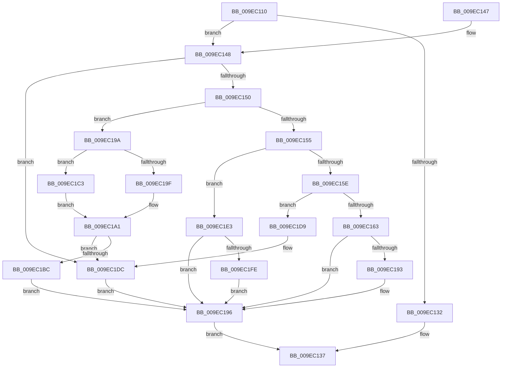

# ExpWnfCaptureScopeInstanceId

- RVA: `0x009EC110`–`0x009EC206` (길이 `246` bytes)
- VA: `0x00000001409EC110`
- 실행 섹션: `PAGE`
- PDB 이름 있음: `예`; PDB Function 태그: `아니요`
- unwind 정보 RVA: `0x00098C54`
- 디코드: `74`개 명령, `246/246` bytes 표시
- 미해석 바이트: `0` (있으면 어셈블리에 `.byte`로 보존)

> 이 문서는 커널 이미지의 기계어와 PDB 기호를 분석해 생성했습니다. 4번과 5번은 함수 원형과 자료형을 바이너리 사용 방식에서 추정한 C 해석이며 원본 소스 복구 결과는 아닙니다.

## 1. Dependencies

- 직접 호출 지점: **3**; 고유 호출 대상: **3**
- 직접 호출자로 확인된 함수: **2**
- RIP 상대 이미지 참조: **1**

### Outgoing calls
- `0x009EC188` → [ObpReferenceObjectByHandleWithTag](../86/ObpReferenceObjectByHandleWithTag_function_00869650.md) (function, `0x00869650`)
- `0x009EC1AF` → [PsGetSessionById](../../text/22/PsGetSessionById_function_00225150.md) (function, `0x00225150`)
- `0x009EC1F3` → [SeCaptureSid](../92/SeCaptureSid_function_009276D4.md) (function, `0x009276D4`)

### Direct callers
- [ExpNtDeleteWnfStateData](../7C/ExpNtDeleteWnfStateData_function_007CF1A8.md) at `0x007CF284`
- [NtQueryWnfStateNameInformation](NtQueryWnfStateNameInformation_function_009EBD20.md) at `0x009EBDEB`

### Static image references
- `0x009EC174` → RVA `0x00FC6A98` (`ALMOSTRO`; read)

## 2. Other-region calls and transfers

- 다른 실행 섹션으로 향하는 call: **1**
  - `0x009EC1AF` → [PsGetSessionById](../../text/22/PsGetSessionById_function_00225150.md) (`PAGE` → `.text`)
- 별도 외부 분기/꼬리 이동을 확인하지 못했습니다.

## 3. Assembly (complete function range)

```asm
009EC110  48 89 5C 24 08                  mov qword ptr [rsp + 8], rbx
009EC115  48 89 74 24 10                  mov qword ptr [rsp + 0x10], rsi
009EC11A  57                              push rdi
009EC11B  48 83 EC 40                     sub rsp, 0x40
009EC11F  48 8B 5C 24 70                  mov rbx, qword ptr [rsp + 0x70]
009EC124  49 8B F9                        mov rdi, r9
009EC127  45 8A C8                        mov r9b, r8b
009EC12A  4C 8B D2                        mov r10, rdx
009EC12D  48 85 D2                        test rdx, rdx
009EC130  75 16                           jne 0x1409ec148
009EC132  48 21 17                        and qword ptr [rdi], rdx
009EC135  33 C0                           xor eax, eax
009EC137  48 8B 5C 24 50                  mov rbx, qword ptr [rsp + 0x50]
009EC13C  48 8B 74 24 58                  mov rsi, qword ptr [rsp + 0x58]
009EC141  48 83 C4 40                     add rsp, 0x40
009EC145  5F                              pop rdi
009EC146  C3                              ret
009EC147  CC                              int3
009EC148  85 C9                           test ecx, ecx
009EC14A  0F 84 8C 00 00 00               je 0x1409ec1dc
009EC150  83 E9 01                        sub ecx, 1
009EC153  74 45                           je 0x1409ec19a
009EC155  83 E9 01                        sub ecx, 1
009EC158  0F 84 85 00 00 00               je 0x1409ec1e3
009EC15E  83 E9 01                        sub ecx, 1
009EC161  75 76                           jne 0x1409ec1d9
009EC163  48 83 64 24 38 00               and qword ptr [rsp + 0x38], 0
009EC169  33 D2                           xor edx, edx
009EC16B  48 83 64 24 30 00               and qword ptr [rsp + 0x30], 0
009EC171  49 8B CA                        mov rcx, r10
009EC174  4C 8B 05 1D A9 5D 00            mov r8, qword ptr [rip + 0x5da91d]
009EC17B  48 89 5C 24 28                  mov qword ptr [rsp + 0x28], rbx
009EC180  C7 44 24 20 57 6E 66 20         mov dword ptr [rsp + 0x20], 0x20666e57
009EC188  E8 C3 D4 E7 FF                  call 0x140869650
009EC18D  8B C8                           mov ecx, eax
009EC18F  85 C0                           test eax, eax
009EC191  78 03                           js 0x1409ec196
009EC193  48 89 1F                        mov qword ptr [rdi], rbx
009EC196  8B C1                           mov eax, ecx
009EC198  EB 9D                           jmp 0x1409ec137
009EC19A  45 84 C9                        test r9b, r9b
009EC19D  75 24                           jne 0x1409ec1c3
009EC19F  8B 0A                           mov ecx, dword ptr [rdx]
009EC1A1  B8 08 00 00 00                  mov eax, 8
009EC1A6  48 8B D3                        mov rdx, rbx
009EC1A9  48 8D 34 18                     lea rsi, [rax + rbx]
009EC1AD  89 0E                           mov dword ptr [rsi], ecx
009EC1AF  E8 9C 8F 83 FF                  call 0x140225150
009EC1B4  48 89 03                        mov qword ptr [rbx], rax
009EC1B7  48 85 C0                        test rax, rax
009EC1BA  74 20                           je 0x1409ec1dc
009EC1BC  48 89 37                        mov qword ptr [rdi], rsi
009EC1BF  33 C9                           xor ecx, ecx
009EC1C1  EB D3                           jmp 0x1409ec196
009EC1C3  48 B8 00 00 FF FF FF 7F 00 00   movabs rax, 0x7fffffff0000
009EC1CD  90                              nop
009EC1CE  4C 3B D0                        cmp r10, rax
009EC1D1  49 0F 42 C2                     cmovb rax, r10
009EC1D5  8B 08                           mov ecx, dword ptr [rax]
009EC1D7  EB C8                           jmp 0x1409ec1a1
009EC1D9  83 F9 01                        cmp ecx, 1
009EC1DC  B9 0D 00 00 C0                  mov ecx, 0xc000000d
009EC1E1  EB B3                           jmp 0x1409ec196
009EC1E3  48 89 5C 24 30                  mov qword ptr [rsp + 0x30], rbx
009EC1E8  41 8A D1                        mov dl, r9b
009EC1EB  49 8B CA                        mov rcx, r10
009EC1EE  C6 44 24 28 00                  mov byte ptr [rsp + 0x28], 0
009EC1F3  E8 DC B4 F3 FF                  call 0x1409276d4
009EC1F8  8B C8                           mov ecx, eax
009EC1FA  85 C0                           test eax, eax
009EC1FC  78 98                           js 0x1409ec196
009EC1FE  48 8B 03                        mov rax, qword ptr [rbx]
009EC201  48 89 07                        mov qword ptr [rdi], rax
009EC204  EB 90                           jmp 0x1409ec196
```

## 4. C-style interpretation (structured pseudocode)

```c
__int64 __fastcall ExpWnfCaptureScopeInstanceId(int a1, __int64 a2, unsigned __int8 a3, __int64 a4, __int64 a5)
{
    __int64 result;
    __int64 v_rsp;
    unsigned __int64 v_stack_p10;
    unsigned int v_stack_p20;
    unsigned __int64 v_stack_p28;
    unsigned __int64 v_stack_p30;
    unsigned __int64 v_stack_p38;
    unsigned __int64 v_stack_p8;

    v_stack_p8 = v_rbx;
    v_stack_p10 = v_rsi;
    v_rsp = (v_rsp) - (64);
    if (a2 != 0) goto loc_009EC148;
    result = 0;
loc_009EC137:
    v_rsp = (v_rsp) + (64);
    return result;
loc_009EC148:
    if (a1 == 0) goto loc_009EC1DC;
    a1 = (unsigned int)((a1) - (1));
    if (condition_is_equal) goto loc_009EC19A;
    a1 = (unsigned int)((a1) - (1));
    if (condition_is_equal) goto loc_009EC1E3;
    a1 = (unsigned int)((a1) - (1));
    if (condition_is_not_equal) goto loc_009EC1D9;
    a2 = 0;
    v_stack_p28 = v_stack_p8;
    v_stack_p20 = 0x20666E57ULL;
    result = ObpReferenceObjectByHandleWithTag(0, a2, *(unsigned __int64 *)(v_rip + 6138141), a3);
    if (!(sign_flag)) {
        *(unsigned __int64 *)(a4) = v_stack_p8;
    }
    goto loc_009EC137;
loc_009EC19A:
    if (a3 != 0) goto loc_009EC1C3;
loc_009EC1A1:
    *(unsigned int *)(8 + v_stack_p8 * 1) = (unsigned int)((unsigned int)(*(unsigned int *)(a2)));
    result = PsGetSessionById((unsigned int)(*(unsigned int *)(a2)), v_stack_p8, *(unsigned __int64 *)(v_rip + 6138141), a3);
    *(unsigned __int64 *)(v_stack_p8) = result;
    if (result == 0) goto loc_009EC1DC;
    *(unsigned __int64 *)(a4) = 8 + v_stack_p8 * 1;
    a1 = 0;
    goto loc_009EC196;
loc_009EC1C3:
    if (0 < result) { result = 0; }
    goto loc_009EC1A1;
loc_009EC1D9:
loc_009EC1DC:
    goto loc_009EC196;
loc_009EC1E3:
    v_stack_p30 = v_stack_p8;
    v_stack_p28 = 0;
    result = SeCaptureSid(0, a3, *(unsigned __int64 *)(v_rip + 6138141), a3);
    if (sign_flag) goto loc_009EC196;
    *(unsigned __int64 *)(a4) = *(unsigned __int64 *)(v_stack_p8);
    goto loc_009EC196;
}
```

## 5. (Beta) C Style

```c
int64_t ExpWnfCaptureScopeInstanceId(int32_t Arg1, int64_t Arg2, uint8_t Arg3, void *Arg4, void *Arg5)
{
    uint8_t *arg4 = (uint8_t *)Arg4;
    uint8_t *arg5 = (uint8_t *)Arg5;

    int64_t result;
    int64_t local_rsp;
    uint64_t v_stack_p10;
    uint32_t v_stack_p20;
    uint64_t v_stack_p28;
    uint64_t v_stack_p30;
    uint64_t v_stack_p38;
    uint64_t v_stack_p8;

    v_stack_p8 = local_rbx;
    v_stack_p10 = local_rsi;
    local_rsp = (local_rsp) - (64);
    if (Arg2 != 0) goto loc_009EC148;
    result = 0;
loc_009EC137:
    local_rsp = (local_rsp) + (64);
    return result;
loc_009EC148:
    if (Arg1 == 0) goto loc_009EC1DC;
    Arg1 = (uint32_t)((Arg1) - (1));
    if (condition_is_equal) goto loc_009EC19A;
    Arg1 = (uint32_t)((Arg1) - (1));
    if (condition_is_equal) goto loc_009EC1E3;
    Arg1 = (uint32_t)((Arg1) - (1));
    if (condition_is_not_equal) goto loc_009EC1D9;
    Arg2 = 0;
    v_stack_p28 = v_stack_p8;
    v_stack_p20 = 0x20666E57ULL;
    result = ObpReferenceObjectByHandleWithTag(0, Arg2, *(uint64_t *)(v_rip + 0x5DA91D), Arg3);
    if (!(sign_flag)) {
        *(uint64_t *)(arg4) = v_stack_p8;
    }
    goto loc_009EC137;
loc_009EC19A:
    if (Arg3 != 0) goto loc_009EC1C3;
loc_009EC1A1:
    *(uint32_t *)(8 + v_stack_p8 * 1) = (uint32_t)((uint32_t)(*(uint32_t *)(Arg2)));
    result = PsGetSessionById((uint32_t)(*(uint32_t *)(Arg2)), v_stack_p8, *(uint64_t *)(v_rip + 0x5DA91D), Arg3);
    *(uint64_t *)(v_stack_p8) = result;
    if (result == 0) goto loc_009EC1DC;
    *(uint64_t *)(arg4) = 8 + v_stack_p8 * 1;
    Arg1 = 0;
    goto loc_009EC196;
loc_009EC1C3:
    if (0 < result) { result = 0; }
    goto loc_009EC1A1;
loc_009EC1D9:
loc_009EC1DC:
    goto loc_009EC196;
loc_009EC1E3:
    v_stack_p30 = v_stack_p8;
    v_stack_p28 = 0;
    result = SeCaptureSid(0, Arg3, *(uint64_t *)(v_rip + 0x5DA91D), Arg3);
    if (sign_flag) goto loc_009EC196;
    *(uint64_t *)(arg4) = *(uint64_t *)(v_stack_p8);
    goto loc_009EC196;
}
```

### 관측된 메모리 오프셋

구조체 형식이 확인되지 않은 접근은 인자 기준의 오프셋으로만 기록했습니다.

| 기준 인자 | 오프셋 표현 | 폭 (bit) | 접근 |
|---|---:|---:|---|
| `Arg4` | `+ 0x0` | `64` | `R/W` |
| `Arg4` | `+ 0x0` | `64` | `W` |
| `Arg5` | `+ 0x0` | `64` | `R` |
| `Arg5` | `+ 0x0` | `64` | `W` |

## 6. Execution-region graph

[열기: 2D/3D 그래프와 함수 탐색 컨트롤 패널](../../../control-panel.html?section=page&rva=0x009EC110&view=graph)

- 2D 그래프는 위에서 아래로 흐르고, 3D 그래프는 빈 공간을 드래그해 회전합니다. Shift+드래그는 이동, 휠은 확대·축소, 함수 노드 선택은 대상 보고서 이동입니다.

### Static fallback


