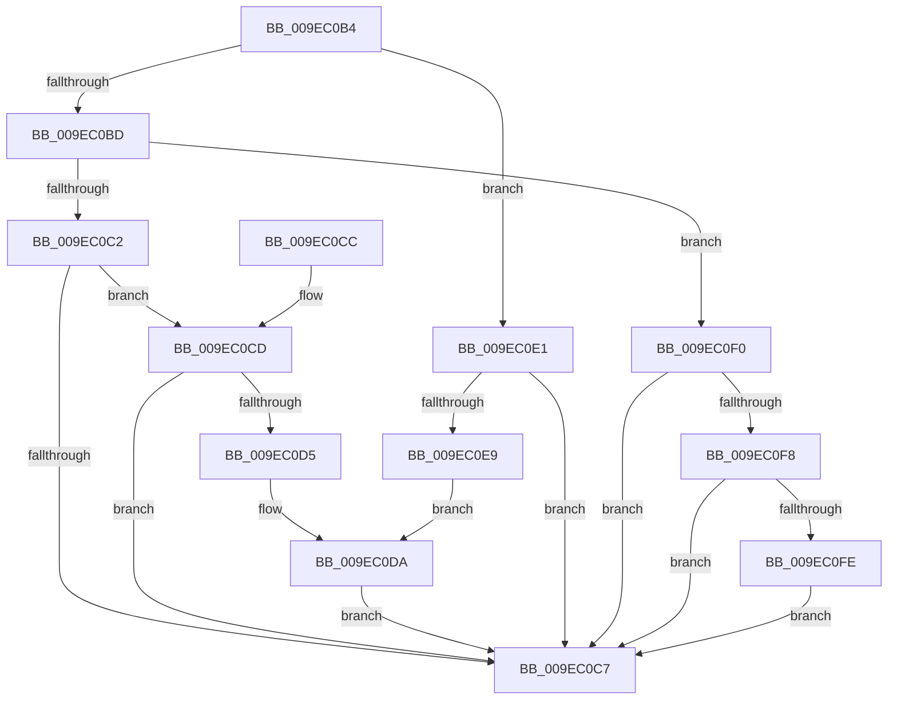

# ExpWnfReleaseCapturedScopeInstanceId

- RVA: `0x009EC0B4`–`0x009EC107` (길이 `83` bytes)
- VA: `0x00000001409EC0B4`
- 실행 섹션: `PAGE`
- PDB 이름 있음: `예`; PDB Function 태그: `아니요`
- unwind 정보 RVA: `0x000687E8`
- 디코드: `29`개 명령, `83/83` bytes 표시
- 미해석 바이트: `0` (있으면 어셈블리에 `.byte`로 보존)

> 이 문서는 커널 이미지의 기계어와 PDB 기호를 분석해 생성했습니다. 4번과 5번은 함수 원형과 자료형을 바이너리 사용 방식에서 추정한 C 해석이며 원본 소스 복구 결과는 아닙니다.

## 1. Dependencies

- 직접 호출 지점: **2**; 고유 호출 대상: **2**
- 직접 호출자로 확인된 함수: **2**
- RIP 상대 이미지 참조: **0**

### Outgoing calls
- `0x009EC0DA` → [ObfDereferenceObjectWithTag](../../text/2F/ObfDereferenceObjectWithTag_function_002F78E0.md) (function, `0x002F78E0`)
- `0x009EC100` → [ExFreePoolWithTag](../../poolcode/B8/ExFreePoolWithTag_function_00B82870.md) (function, `0x00B82870`)

### Direct callers
- [ExpNtDeleteWnfStateData](../7C/ExpNtDeleteWnfStateData_function_007CF1A8.md) at `0x007CF53D`
- [NtQueryWnfStateNameInformation](NtQueryWnfStateNameInformation_function_009EBD20.md) at `0x009EC089`

### Static image references
- 디코드된 RIP-relative 메모리 참조가 없습니다.

## 2. Other-region calls and transfers

- 다른 실행 섹션으로 향하는 call: **2**
  - `0x009EC0DA` → [ObfDereferenceObjectWithTag](../../text/2F/ObfDereferenceObjectWithTag_function_002F78E0.md) (`PAGE` → `.text`)
  - `0x009EC100` → [ExFreePoolWithTag](../../poolcode/B8/ExFreePoolWithTag_function_00B82870.md) (`PAGE` → `POOLCODE`)
- 별도 외부 분기/꼬리 이동을 확인하지 못했습니다.

## 3. Assembly (complete function range)

```asm
009EC0B4  48 83 EC 28                     sub rsp, 0x28
009EC0B8  83 E9 01                        sub ecx, 1
009EC0BB  74 24                           je 0x1409ec0e1
009EC0BD  83 E9 01                        sub ecx, 1
009EC0C0  74 2E                           je 0x1409ec0f0
009EC0C2  83 F9 01                        cmp ecx, 1
009EC0C5  74 06                           je 0x1409ec0cd
009EC0C7  48 83 C4 28                     add rsp, 0x28
009EC0CB  C3                              ret
009EC0CC  CC                              int3
009EC0CD  48 8B 0A                        mov rcx, qword ptr [rdx]
009EC0D0  48 85 C9                        test rcx, rcx
009EC0D3  74 F2                           je 0x1409ec0c7
009EC0D5  BA 57 6E 66 20                  mov edx, 0x20666e57
009EC0DA  E8 01 B8 90 FF                  call 0x1402f78e0
009EC0DF  EB E6                           jmp 0x1409ec0c7
009EC0E1  48 8B 0A                        mov rcx, qword ptr [rdx]
009EC0E4  48 85 C9                        test rcx, rcx
009EC0E7  74 DE                           je 0x1409ec0c7
009EC0E9  BA 50 73 51 79                  mov edx, 0x79517350
009EC0EE  EB EA                           jmp 0x1409ec0da
009EC0F0  48 8B 0A                        mov rcx, qword ptr [rdx]
009EC0F3  48 85 C9                        test rcx, rcx
009EC0F6  74 CF                           je 0x1409ec0c7
009EC0F8  41 80 F8 01                     cmp r8b, 1
009EC0FC  75 C9                           jne 0x1409ec0c7
009EC0FE  33 D2                           xor edx, edx
009EC100  E8 6B 67 19 00                  call 0x140b82870
009EC105  EB C0                           jmp 0x1409ec0c7
```

## 4. C-style interpretation (structured pseudocode)

```c
__int64 __fastcall ExpWnfReleaseCapturedScopeInstanceId(int a1, __int64 a2, unsigned __int8 a3)
{
    __int64 result;
    __int64 v_rsp;

    v_rsp = (v_rsp) - (40);
    a1 = (unsigned int)((a1) - (1));
    if (condition_is_equal) goto loc_009EC0E1;
    a1 = (unsigned int)((a1) - (1));
    if (condition_is_equal) goto loc_009EC0F0;
    if (a1 == 1) goto loc_009EC0CD;
loc_009EC0C7:
    v_rsp = (v_rsp) + (40);
    return result;
loc_009EC0CD:
    if (*(unsigned __int64 *)(a2) == 0) goto loc_009EC0C7;
loc_009EC0DA:
    result = ObfDereferenceObjectWithTag(*(unsigned __int64 *)(a2), (unsigned int)(0x20666E57ULL), a3, a4);
    goto loc_009EC0C7;
loc_009EC0E1:
    if (*(unsigned __int64 *)((unsigned int)(0x20666E57ULL)) == 0) goto loc_009EC0C7;
    goto loc_009EC0DA;
loc_009EC0F0:
    if (*(unsigned __int64 *)((unsigned int)(0x79517350ULL)) == 0) goto loc_009EC0C7;
    if (a3 != 1) goto loc_009EC0C7;
    a2 = 0;
    result = ExFreePoolWithTag(*(unsigned __int64 *)((unsigned int)(0x79517350ULL)), a2, a3, a4);
    goto loc_009EC0C7;
}
```

## 5. (Beta) C Style

```c
int64_t ExpWnfReleaseCapturedScopeInstanceId(int32_t Arg1, void *Arg2, uint8_t Arg3)
{
    uint8_t *arg2 = (uint8_t *)Arg2;

    int64_t result;
    int64_t local_rsp;

    local_rsp = (local_rsp) - (40);
    Arg1 = (uint32_t)((Arg1) - (1));
    if (condition_is_equal) goto loc_009EC0E1;
    Arg1 = (uint32_t)((Arg1) - (1));
    if (condition_is_equal) goto loc_009EC0F0;
    if (Arg1 == 1) goto loc_009EC0CD;
loc_009EC0C7:
    local_rsp = (local_rsp) + (40);
    return result;
loc_009EC0CD:
    if (*(uint64_t *)(arg2) == 0) goto loc_009EC0C7;
loc_009EC0DA:
    result = ObfDereferenceObjectWithTag(*(uint64_t *)(arg2), (uint32_t)(0x20666E57ULL), Arg3, a4);
    goto loc_009EC0C7;
loc_009EC0E1:
    if (*(uint64_t *)((uint32_t)(0x20666E57ULL)) == 0) goto loc_009EC0C7;
    goto loc_009EC0DA;
loc_009EC0F0:
    if (*(uint64_t *)((uint32_t)(0x79517350ULL)) == 0) goto loc_009EC0C7;
    if (Arg3 != 1) goto loc_009EC0C7;
    Arg2 = 0;
    result = ExFreePoolWithTag(*(uint64_t *)((uint32_t)(0x79517350ULL)), Arg2, Arg3, a4);
    goto loc_009EC0C7;
}
```

### 관측된 메모리 오프셋

구조체 형식이 확인되지 않은 접근은 인자 기준의 오프셋으로만 기록했습니다.

| 기준 인자 | 오프셋 표현 | 폭 (bit) | 접근 |
|---|---:|---:|---|
| `Arg2` | `+ 0x0` | `64` | `R` |

## 6. Execution-region graph

[열기: 2D/3D 그래프와 함수 탐색 컨트롤 패널](../../../control-panel.html?section=page&rva=0x009EC0B4&view=graph)

- 2D 그래프는 위에서 아래로 흐르고, 3D 그래프는 빈 공간을 드래그해 회전합니다. Shift+드래그는 이동, 휠은 확대·축소, 함수 노드 선택은 대상 보고서 이동입니다.

### Static fallback


