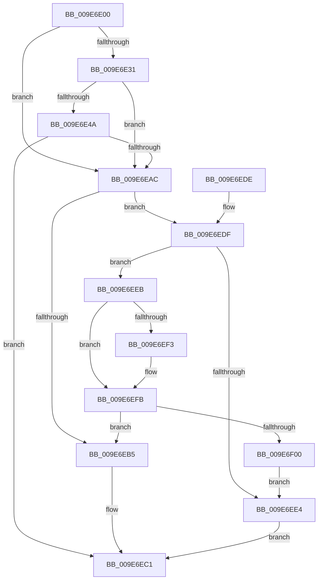

# ExpWnfValidatePubSubPreconditions

- RVA: `0x009E6E00`–`0x009E6F02` (길이 `258` bytes)
- VA: `0x00000001409E6E00`
- 실행 섹션: `PAGE`
- PDB 이름 있음: `예`; PDB Function 태그: `아니요`
- unwind 정보 RVA: `0x000A490C`
- 디코드: `73`개 명령, `258/258` bytes 표시
- 미해석 바이트: `0` (있으면 어셈블리에 `.byte`로 보존)

> 이 문서는 커널 이미지의 기계어와 PDB 기호를 분석해 생성했습니다. 4번과 5번은 함수 원형과 자료형을 바이너리 사용 방식에서 추정한 C 해석이며 원본 소스 복구 결과는 아닙니다.

## 1. Dependencies

- 직접 호출 지점: **3**; 고유 호출 대상: **3**
- 직접 호출자로 확인된 함수: **2**
- RIP 상대 이미지 참조: **1**

### Outgoing calls
- `0x009E6E4E` → [SeCaptureSubjectContext](../86/SeCaptureSubjectContext_function_0086B820.md) (function, `0x0086B820`)
- `0x009E6E92` → [SeAccessCheck](../../text/3A/SeAccessCheck_function_003A6BC0.md) (function, `0x003A6BC0`)
- `0x009E6E9C` → [SeReleaseSubjectContext](../86/SeReleaseSubjectContext_function_0086B710.md) (function, `0x0086B710`)

### Direct callers
- [NtQueryWnfStateData](../90/NtQueryWnfStateData_function_00909DF0.md) at `0x0090A573`
- [ExpNtUpdateWnfStateData](../90/ExpNtUpdateWnfStateData_function_0090A7A0.md) at `0x0090B12A`

### Static image references
- `0x009E6E7D` → RVA `0x00B4B070` (`ExpWnfNotificationMapping`; read)

## 2. Other-region calls and transfers

- 다른 실행 섹션으로 향하는 call: **1**
  - `0x009E6E92` → [SeAccessCheck](../../text/3A/SeAccessCheck_function_003A6BC0.md) (`PAGE` → `.text`)
- 별도 외부 분기/꼬리 이동을 확인하지 못했습니다.

## 3. Assembly (complete function range)

```asm
009E6E00  48 8B C4                        mov rax, rsp
009E6E03  48 89 58 08                     mov qword ptr [rax + 8], rbx
009E6E07  48 89 68 10                     mov qword ptr [rax + 0x10], rbp
009E6E0B  48 89 70 18                     mov qword ptr [rax + 0x18], rsi
009E6E0F  57                              push rdi
009E6E10  41 56                           push r14
009E6E12  41 57                           push r15
009E6E14  48 81 EC 80 00 00 00            sub rsp, 0x80
009E6E1B  33 DB                           xor ebx, ebx
009E6E1D  4D 8B F1                        mov r14, r9
009E6E20  41 8B E8                        mov ebp, r8d
009E6E23  48 8B FA                        mov rdi, rdx
009E6E26  8B F1                           mov esi, ecx
009E6E28  39 9C 24 C0 00 00 00            cmp dword ptr [rsp + 0xc0], ebx
009E6E2F  75 7B                           jne 0x1409e6eac
009E6E31  4C 8B 7A 10                     mov r15, qword ptr [rdx + 0x10]
009E6E35  0F 57 C0                        xorps xmm0, xmm0
009E6E38  89 58 B8                        mov dword ptr [rax - 0x48], ebx
009E6E3B  89 58 28                        mov dword ptr [rax + 0x28], ebx
009E6E3E  0F 11 40 C0                     movups xmmword ptr [rax - 0x40], xmm0
009E6E42  0F 11 40 D0                     movups xmmword ptr [rax - 0x30], xmm0
009E6E46  85 C9                           test ecx, ecx
009E6E48  74 62                           je 0x1409e6eac
009E6E4A  48 8D 48 C0                     lea rcx, [rax - 0x40]
009E6E4E  E8 CD 49 E8 FF                  call 0x14086b820
009E6E53  48 8D 84 24 C0 00 00 00         lea rax, [rsp + 0xc0]
009E6E5B  44 8B CE                        mov r9d, esi
009E6E5E  48 89 44 24 48                  mov qword ptr [rsp + 0x48], rax
009E6E63  48 8D 54 24 58                  lea rdx, [rsp + 0x58]
009E6E68  48 8D 44 24 50                  lea rax, [rsp + 0x50]
009E6E6D  45 33 C0                        xor r8d, r8d
009E6E70  48 89 44 24 40                  mov qword ptr [rsp + 0x40], rax
009E6E75  49 8B CF                        mov rcx, r15
009E6E78  C6 44 24 38 01                  mov byte ptr [rsp + 0x38], 1
009E6E7D  48 8D 05 EC 41 16 00            lea rax, [rip + 0x1641ec]
009E6E84  48 89 44 24 30                  mov qword ptr [rsp + 0x30], rax
009E6E89  48 89 5C 24 28                  mov qword ptr [rsp + 0x28], rbx
009E6E8E  89 5C 24 20                     mov dword ptr [rsp + 0x20], ebx
009E6E92  E8 29 FD 9B FF                  call 0x1403a6bc0
009E6E97  48 8D 4C 24 58                  lea rcx, [rsp + 0x58]
009E6E9C  E8 6F 48 E8 FF                  call 0x14086b710
009E6EA1  8B 84 24 C0 00 00 00            mov eax, dword ptr [rsp + 0xc0]
009E6EA8  85 C0                           test eax, eax
009E6EAA  78 15                           js 0x1409e6ec1
009E6EAC  48 8B 4F 08                     mov rcx, qword ptr [rdi + 8]
009E6EB0  48 85 C9                        test rcx, rcx
009E6EB3  75 2A                           jne 0x1409e6edf
009E6EB5  3B 2F                           cmp ebp, dword ptr [rdi]
009E6EB7  B8 0D 00 00 C0                  mov eax, 0xc000000d
009E6EBC  0F 47 D8                        cmova ebx, eax
009E6EBF  8B C3                           mov eax, ebx
009E6EC1  4C 8D 9C 24 80 00 00 00         lea r11, [rsp + 0x80]
009E6EC9  49 8B 5B 20                     mov rbx, qword ptr [r11 + 0x20]
009E6ECD  49 8B 6B 28                     mov rbp, qword ptr [r11 + 0x28]
009E6ED1  49 8B 73 30                     mov rsi, qword ptr [r11 + 0x30]
009E6ED5  49 8B E3                        mov rsp, r11
009E6ED8  41 5F                           pop r15
009E6EDA  41 5E                           pop r14
009E6EDC  5F                              pop rdi
009E6EDD  C3                              ret
009E6EDE  CC                              int3
009E6EDF  4D 85 F6                        test r14, r14
009E6EE2  75 07                           jne 0x1409e6eeb
009E6EE4  B8 0D 00 00 C0                  mov eax, 0xc000000d
009E6EE9  EB D6                           jmp 0x1409e6ec1
009E6EEB  48 8B 11                        mov rdx, qword ptr [rcx]
009E6EEE  49 2B 16                        sub rdx, qword ptr [r14]
009E6EF1  75 08                           jne 0x1409e6efb
009E6EF3  48 8B 51 08                     mov rdx, qword ptr [rcx + 8]
009E6EF7  49 2B 56 08                     sub rdx, qword ptr [r14 + 8]
009E6EFB  48 85 D2                        test rdx, rdx
009E6EFE  74 B5                           je 0x1409e6eb5
009E6F00  EB E2                           jmp 0x1409e6ee4
```

## 4. C-style interpretation (structured pseudocode)

```c
__int64 __fastcall ExpWnfValidatePubSubPreconditions(int a1, __int64 a2, int a3, __int64 a4, unsigned int a5)
{
    __int64 result;
    __int64 v_rbx;
    __int64 v_rsp;
    unsigned __int64 v_stack_m18;
    unsigned __int64 v_stack_m40;
    unsigned __int64 v_stack_m48;
    unsigned __int64 v_stack_m50;
    unsigned __int64 v_stack_m58;
    unsigned __int8 v_stack_m60;
    unsigned __int64 v_stack_m68;
    unsigned __int64 v_stack_m70;
    unsigned int v_stack_m78;

    *(unsigned __int64 *)(v_rsp + 8) = v_rbx;
    *(unsigned __int64 *)(v_rsp + 16) = v_rbp;
    *(unsigned __int64 *)(v_rsp + 24) = v_rsi;
    v_rsp = (v_rsp) - (128);
    v_rbx = 0;
    if (a5 != 0) goto loc_009E6EAC;
    *(unsigned int *)(v_rsp - 72) = 0;
    *(unsigned int *)(v_rsp + 40) = 0;
    *(unsigned __int64 *)(v_rsp - 64) = v_xmm0;
    *(unsigned __int64 *)(v_rsp - 48) = v_xmm0;
    if (a1 == 0) goto loc_009E6EAC;
    result = SeCaptureSubjectContext(v_rsp - 64, a2, a3, a4);
    v_stack_m50 = a5;
    a3 = 0;
    v_stack_m58 = v_stack_m48;
    v_stack_m60 = 1;
    v_stack_m68 = v_rip + 1458668;
    v_stack_m70 = 0;
    v_stack_m78 = 0;
    result = SeAccessCheck(*(unsigned __int64 *)(a2 + 16), v_stack_m40, a3, (unsigned int)((unsigned int)((unsigned int)(a1))));
    result = SeReleaseSubjectContext(v_stack_m40, v_stack_m40, a3, (unsigned int)((unsigned int)((unsigned int)(a1))));
    if (sign_flag) goto loc_009E6EC1;
loc_009E6EAC:
    if (*(unsigned __int64 *)(a2 + 8) != 0) goto loc_009E6EDF;
loc_009E6EB5:
    if (((unsigned int)((unsigned int)(a3))) > (*(unsigned int *)(a2))) { v_rbx = (unsigned int)((unsigned int)(0xC000000DULL)); }
loc_009E6EC1:
    return (unsigned int)((unsigned int)(v_rbx));
loc_009E6EDF:
    if (a4 != 0) goto loc_009E6EEB;
loc_009E6EE4:
    goto loc_009E6EC1;
loc_009E6EEB:
    a2 = (*(unsigned __int64 *)(*(unsigned __int64 *)(a2 + 8))) - (*(unsigned __int64 *)(a4));
    if (!(condition_is_not_equal)) {
        a2 = *(unsigned __int64 *)(*(unsigned __int64 *)(a2 + 8) + 8);
        a2 = (a2) - (*(unsigned __int64 *)(a4 + 8));
    }
    if (a2 == 0) goto loc_009E6EB5;
    goto loc_009E6EE4;
}
```

## 5. (Beta) C Style

```c
int64_t ExpWnfValidatePubSubPreconditions(int32_t Arg1, void *Arg2, int32_t Arg3, int64_t Arg4, uint32_t Arg5)
{
    uint8_t *arg2 = (uint8_t *)Arg2;

    int64_t result;
    int64_t local_rbx;
    int64_t local_rsp;
    uint64_t v_stack_m18;
    uint64_t v_stack_m40;
    uint64_t v_stack_m48;
    uint64_t v_stack_m50;
    uint64_t v_stack_m58;
    uint8_t v_stack_m60;
    uint64_t v_stack_m68;
    uint64_t v_stack_m70;
    uint32_t v_stack_m78;

    *(uint64_t *)(local_rsp + 0x8) = local_rbx;
    *(uint64_t *)(local_rsp + 0x10) = local_rbp;
    *(uint64_t *)(local_rsp + 0x18) = local_rsi;
    local_rsp = (local_rsp) - (128);
    local_rbx = 0;
    if (Arg5 != 0) goto loc_009E6EAC;
    *(uint32_t *)(local_rsp - 0x48) = 0;
    *(uint32_t *)(local_rsp + 0x28) = 0;
    *(uint64_t *)(local_rsp - 0x40) = v_xmm0;
    *(uint64_t *)(local_rsp - 0x30) = v_xmm0;
    if (Arg1 == 0) goto loc_009E6EAC;
    result = SeCaptureSubjectContext(local_rsp - 64, Arg2, Arg3, Arg4);
    v_stack_m50 = Arg5;
    Arg3 = 0;
    v_stack_m58 = v_stack_m48;
    v_stack_m60 = 1;
    v_stack_m68 = v_rip + 1458668;
    v_stack_m70 = 0;
    v_stack_m78 = 0;
    result = SeAccessCheck(*(uint64_t *)(arg2 + 0x10), v_stack_m40, Arg3, (uint32_t)((uint32_t)((uint32_t)(Arg1))));
    result = SeReleaseSubjectContext(v_stack_m40, v_stack_m40, Arg3, (uint32_t)((uint32_t)((uint32_t)(Arg1))));
    if (sign_flag) goto loc_009E6EC1;
loc_009E6EAC:
    if (*(uint64_t *)(arg2 + 0x8) != 0) goto loc_009E6EDF;
loc_009E6EB5:
    if (((uint32_t)((uint32_t)(Arg3))) > (*(uint32_t *)(arg2))) { local_rbx = (uint32_t)((uint32_t)(0xC000000DULL)); }
loc_009E6EC1:
    return (uint32_t)((uint32_t)(local_rbx));
loc_009E6EDF:
    if (Arg4 != 0) goto loc_009E6EEB;
loc_009E6EE4:
    goto loc_009E6EC1;
loc_009E6EEB:
    Arg2 = (*(uint64_t *)(*(uint64_t *)(arg2 + 0x8))) - (*(uint64_t *)(Arg4));
    if (!(condition_is_not_equal)) {
        Arg2 = *(uint64_t *)(*(uint64_t *)(arg2 + 0x8) + 0x8);
        Arg2 = (Arg2) - (*(uint64_t *)(Arg4 + 0x8));
    }
    if (Arg2 == NULL) goto loc_009E6EB5;
    goto loc_009E6EE4;
}
```

### 관측된 메모리 오프셋

구조체 형식이 확인되지 않은 접근은 인자 기준의 오프셋으로만 기록했습니다.

| 기준 인자 | 오프셋 표현 | 폭 (bit) | 접근 |
|---|---:|---:|---|
| `Arg2` | `+ 0x0` | `32` | `R` |
| `Arg2` | `+ 0x8` | `64` | `R` |
| `Arg2` | `+ 0x10` | `64` | `R` |

## 6. Execution-region graph

[열기: 2D/3D 그래프와 함수 탐색 컨트롤 패널](../../../control-panel.html?section=page&rva=0x009E6E00&view=graph)

- 2D 그래프는 위에서 아래로 흐르고, 3D 그래프는 빈 공간을 드래그해 회전합니다. Shift+드래그는 이동, 휠은 확대·축소, 함수 노드 선택은 대상 보고서 이동입니다.

### Static fallback


