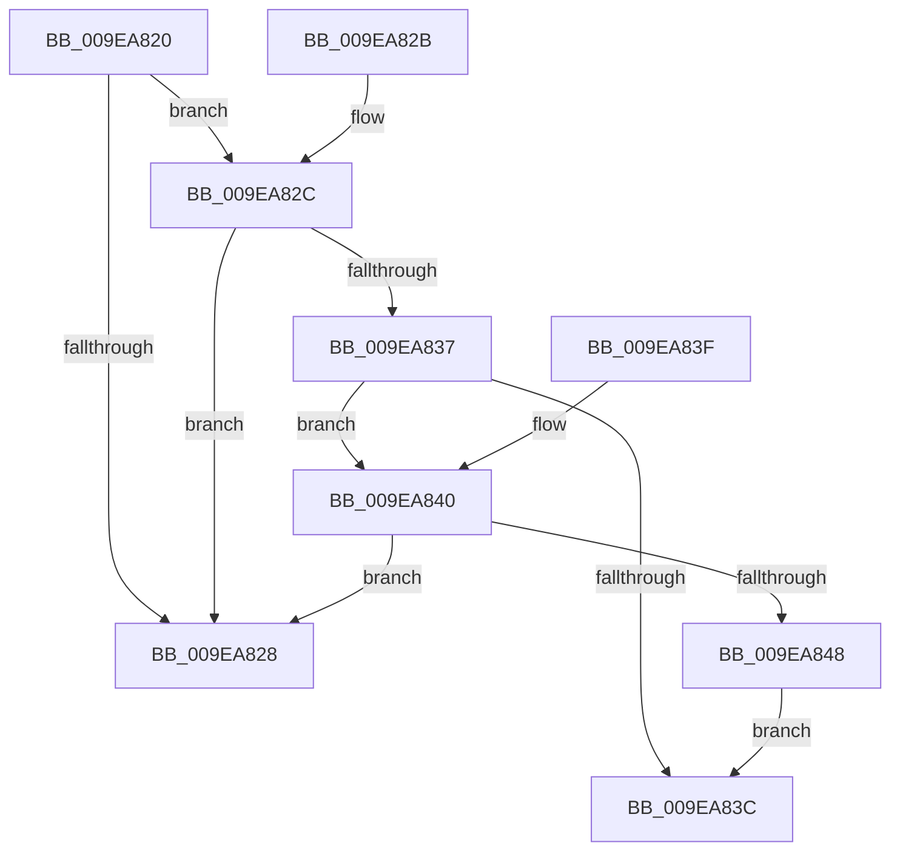

# FsRtlOplockIsFastIoPossible

- RVA: `0x009EA820`–`0x009EA84A` (길이 `42` bytes)
- VA: `0x00000001409EA820`
- 실행 섹션: `PAGE`
- PDB 이름 있음: `예`; PDB Function 태그: `아니요`
- unwind 정보 RVA: `0x000DB714`
- 디코드: `17`개 명령, `42/42` bytes 표시
- 미해석 바이트: `0` (있으면 어셈블리에 `.byte`로 보존)

> 이 문서는 커널 이미지의 기계어와 PDB 기호를 분석해 생성했습니다. 4번과 5번은 함수 원형과 자료형을 바이너리 사용 방식에서 추정한 C 해석이며 원본 소스 복구 결과는 아닙니다.

## 1. Dependencies

- 직접 호출 지점: **0**; 고유 호출 대상: **0**
- 직접 호출자로 확인된 함수: **0**
- RIP 상대 이미지 참조: **0**

### Outgoing calls
- 직접 디코드된 call 명령이 없습니다.

### Direct callers
- 이 함수 시작 RVA로 연결되는 직접 call은 확인되지 않았습니다. 간접 호출은 완전히 역산할 수 없습니다.

### Static image references
- 디코드된 RIP-relative 메모리 참조가 없습니다.

## 2. Other-region calls and transfers

- 다른 실행 섹션으로 향하는 call: **0**
- 별도 외부 분기/꼬리 이동을 확인하지 못했습니다.

## 3. Assembly (complete function range)

```asm
009EA820  48 8B 01                        mov rax, qword ptr [rcx]
009EA823  48 85 C0                        test rax, rax
009EA826  75 04                           jne 0x1409ea82c
009EA828  B0 01                           mov al, 1
009EA82A  C3                              ret
009EA82B  CC                              int3
009EA82C  8B 88 90 00 00 00               mov ecx, dword ptr [rax + 0x90]
009EA832  83 F9 01                        cmp ecx, 1
009EA835  74 F1                           je 0x1409ea828
009EA837  F6 C1 40                        test cl, 0x40
009EA83A  75 04                           jne 0x1409ea840
009EA83C  32 C0                           xor al, al
009EA83E  C3                              ret
009EA83F  CC                              int3
009EA840  F7 C1 00 0F F0 01               test ecx, 0x1f00f00
009EA846  74 E0                           je 0x1409ea828
009EA848  EB F2                           jmp 0x1409ea83c
```

## 4. C-style interpretation (structured pseudocode)

```c
__int64 __fastcall FsRtlOplockIsFastIoPossible(__int64 a1)
{
    __int64 result;

    if (*(unsigned __int64 *)(a1) != 0) goto loc_009EA82C;
loc_009EA828:
    return 1;
loc_009EA82C:
    if (((unsigned int)((unsigned int)(*(unsigned int *)(1 + 144)))) == 1) goto loc_009EA828;
    if ((((unsigned __int8)((unsigned int)(*(unsigned int *)(1 + 144)))) & (64)) != 0) goto loc_009EA840;
loc_009EA83C:
    result = 0;
    return result;
loc_009EA840:
    if ((((unsigned int)((unsigned int)(*(unsigned int *)(1 + 144)))) & (0x1F00F00ULL)) == 0) goto loc_009EA828;
    goto loc_009EA83C;
}
```

## 5. (Beta) C Style

```c
int64_t FsRtlOplockIsFastIoPossible(void *Arg1)
{
    uint8_t *arg1 = (uint8_t *)Arg1;

    int64_t result;

    if (*(uint64_t *)(arg1) != 0) goto loc_009EA82C;
loc_009EA828:
    return 1;
loc_009EA82C:
    if (((uint32_t)((uint32_t)(*(uint32_t *)(1 + 0x90)))) == 1) goto loc_009EA828;
    if ((((uint8_t)((uint32_t)(*(uint32_t *)(1 + 0x90)))) & (64)) != 0) goto loc_009EA840;
loc_009EA83C:
    result = 0;
    return result;
loc_009EA840:
    if ((((uint32_t)((uint32_t)(*(uint32_t *)(1 + 0x90)))) & (0x1F00F00ULL)) == 0) goto loc_009EA828;
    goto loc_009EA83C;
}
```

### 관측된 메모리 오프셋

구조체 형식이 확인되지 않은 접근은 인자 기준의 오프셋으로만 기록했습니다.

| 기준 인자 | 오프셋 표현 | 폭 (bit) | 접근 |
|---|---:|---:|---|
| `Arg1` | `+ 0x0` | `64` | `R` |

## 6. Execution-region graph

[열기: 2D/3D 그래프와 함수 탐색 컨트롤 패널](../../../control-panel.html?section=page&rva=0x009EA820&view=graph)

- 2D 그래프는 위에서 아래로 흐르고, 3D 그래프는 빈 공간을 드래그해 회전합니다. Shift+드래그는 이동, 휠은 확대·축소, 함수 노드 선택은 대상 보고서 이동입니다.

### Static fallback


