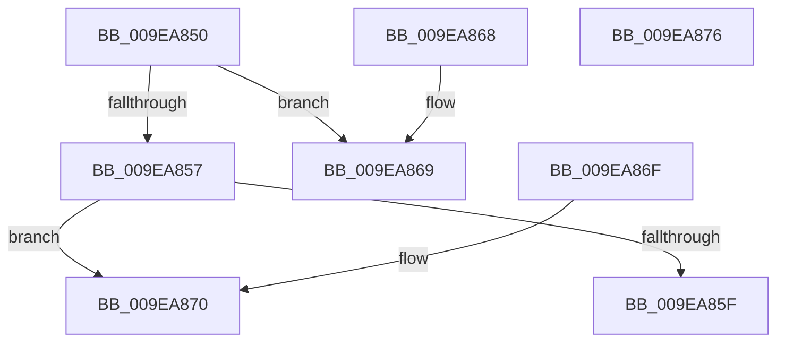

# FsRtlSetEcpListIntoIrp

- RVA: `0x009EA850`–`0x009EA877` (길이 `39` bytes)
- VA: `0x00000001409EA850`
- 실행 섹션: `PAGE`
- PDB 이름 있음: `예`; PDB Function 태그: `아니요`
- unwind 정보 RVA: `0x000DB714`
- 디코드: `16`개 명령, `39/39` bytes 표시
- 미해석 바이트: `0` (있으면 어셈블리에 `.byte`로 보존)

> 이 문서는 커널 이미지의 기계어와 PDB 기호를 분석해 생성했습니다. 4번과 5번은 함수 원형과 자료형을 바이너리 사용 방식에서 추정한 C 해석이며 원본 소스 복구 결과는 아닙니다.

## 1. Dependencies

- 직접 호출 지점: **0**; 고유 호출 대상: **0**
- 직접 호출자로 확인된 함수: **0**
- RIP 상대 이미지 참조: **0**

### Outgoing calls
- 직접 디코드된 call 명령이 없습니다.

### Direct callers
- 이 함수 시작 RVA로 연결되는 직접 call은 확인되지 않았습니다. 간접 호출은 완전히 역산할 수 없습니다.

### Static image references
- 디코드된 RIP-relative 메모리 참조가 없습니다.

## 2. Other-region calls and transfers

- 다른 실행 섹션으로 향하는 call: **0**
- 별도 외부 분기/꼬리 이동을 확인하지 못했습니다.

## 3. Assembly (complete function range)

```asm
009EA850  8B 41 10                        mov eax, dword ptr [rcx + 0x10]
009EA853  84 C0                           test al, al
009EA855  79 12                           jns 0x1409ea869
009EA857  33 C0                           xor eax, eax
009EA859  48 39 41 70                     cmp qword ptr [rcx + 0x70], rax
009EA85D  75 11                           jne 0x1409ea870
009EA85F  48 89 51 70                     mov qword ptr [rcx + 0x70], rdx
009EA863  83 4A 04 08                     or dword ptr [rdx + 4], 8
009EA867  C3                              ret
009EA868  CC                              int3
009EA869  B8 EF 00 00 C0                  mov eax, 0xc00000ef
009EA86E  C3                              ret
009EA86F  CC                              int3
009EA870  B8 F0 00 00 C0                  mov eax, 0xc00000f0
009EA875  C3                              ret
009EA876  CC                              int3
```

## 4. C-style interpretation (structured pseudocode)

```c
__int64 __fastcall FsRtlSetEcpListIntoIrp(__int64 a1, __int64 a2)
{
    __int64 result;

    if (!sign_flag) goto loc_009EA869;
    result = 0;
    if ((*(unsigned __int64 *)(a1 + 112)) != 0) goto loc_009EA870;
    *(unsigned __int64 *)(a1 + 112) = a2;
    return result;
loc_009EA869:
    return (unsigned int)(0xC00000EFULL);
loc_009EA870:
    return (unsigned int)(0xC00000F0ULL);
}
```

## 5. (Beta) C Style

```c
int64_t FsRtlSetEcpListIntoIrp(void *Arg1, void *Arg2)
{
    uint8_t *arg1 = (uint8_t *)Arg1;
    uint8_t *arg2 = (uint8_t *)Arg2;

    int64_t result;

    if (!sign_flag) goto loc_009EA869;
    result = 0;
    if ((*(uint64_t *)(arg1 + 0x70)) != 0) goto loc_009EA870;
    *(void **)(arg1 + 0x70) = Arg2;
    return result;
loc_009EA869:
    return (uint32_t)(0xC00000EFULL);
loc_009EA870:
    return (uint32_t)(0xC00000F0ULL);
}
```

### 관측된 메모리 오프셋

구조체 형식이 확인되지 않은 접근은 인자 기준의 오프셋으로만 기록했습니다.

| 기준 인자 | 오프셋 표현 | 폭 (bit) | 접근 |
|---|---:|---:|---|
| `Arg1` | `+ 0x10` | `32` | `R` |
| `Arg1` | `+ 0x70` | `64` | `R` |
| `Arg1` | `+ 0x70` | `64` | `W` |
| `Arg2` | `+ 0x4` | `32` | `R/W` |

## 6. Execution-region graph

[열기: 2D/3D 그래프와 함수 탐색 컨트롤 패널](../../../control-panel.html?section=page&rva=0x009EA850&view=graph)

- 2D 그래프는 위에서 아래로 흐르고, 3D 그래프는 빈 공간을 드래그해 회전합니다. Shift+드래그는 이동, 휠은 확대·축소, 함수 노드 선택은 대상 보고서 이동입니다.

### Static fallback


