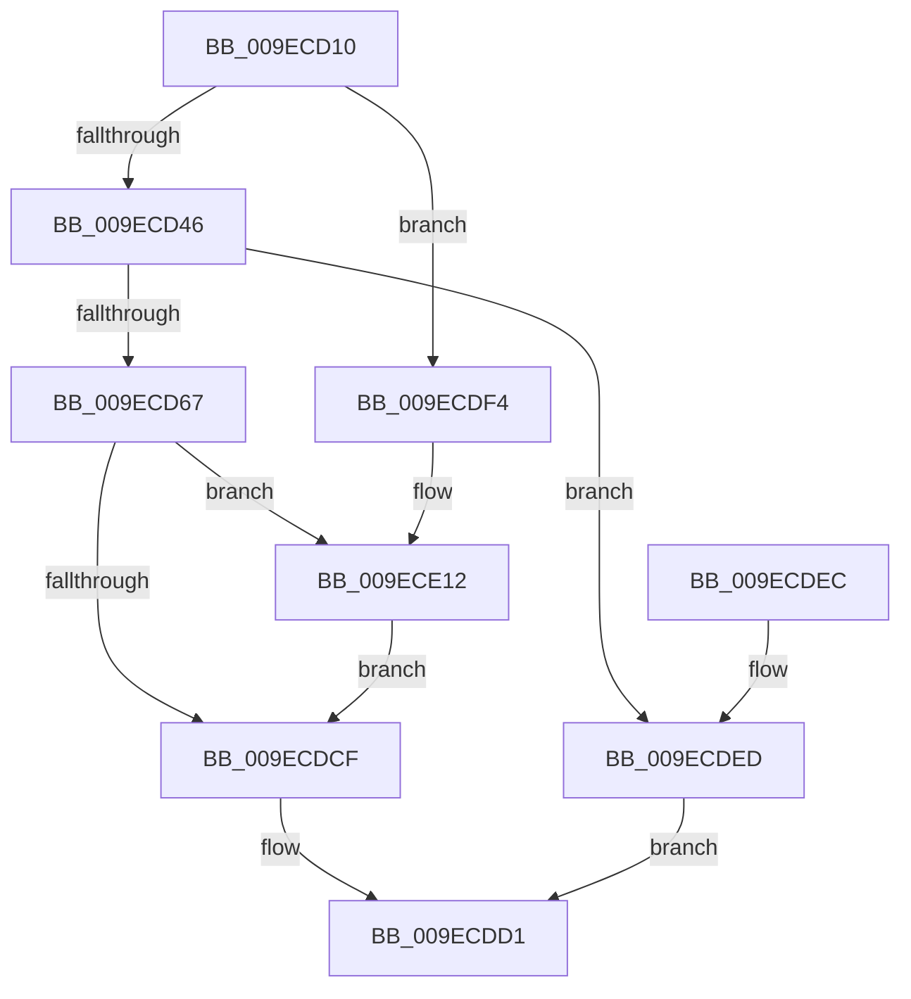

# IoCreateSystemThread

- RVA: `0x009ECD10`–`0x009ECE26` (길이 `278` bytes)
- VA: `0x00000001409ECD10`
- 실행 섹션: `PAGE`
- PDB 이름 있음: `예`; PDB Function 태그: `아니요`
- unwind 정보 RVA: `0x000A5B5C`
- 디코드: `68`개 명령, `278/278` bytes 표시
- 미해석 바이트: `0` (있으면 어셈블리에 `.byte`로 보존)

> 이 문서는 커널 이미지의 기계어와 PDB 기호를 분석해 생성했습니다. 4번과 5번은 함수 원형과 자료형을 바이너리 사용 방식에서 추정한 C 해석이며 원본 소스 복구 결과는 아닙니다.

## 1. Dependencies

- 직접 호출 지점: **6**; 고유 호출 대상: **6**
- 직접 호출자로 확인된 함수: **0**
- RIP 상대 이미지 참조: **1**

### Outgoing calls
- `0x009ECD56` → [ExAllocatePool2](../../poolcode/B8/ExAllocatePool2_function_00B820F0.md) (function, `0x00B820F0`)
- `0x009ECD85` → [ObfReferenceObject](../../text/20/ObfReferenceObject_function_0020FA20.md) (function, `0x0020FA20`)
- `0x009ECDC4` → [PsCreateSystemThreadEx](PsCreateSystemThreadEx_function_009ED120.md) (function, `0x009ED120`)
- `0x009ECE0C` → [KeBugCheckEx](../../text/4F/KeBugCheckEx_function_004FD660.md) (function, `0x004FD660`)
- `0x009ECE15` → [ObfDereferenceObject](../../text/2F/ObfDereferenceObject_function_002F9350.md) (function, `0x002F9350`)
- `0x009ECE1F` → [ExFreePoolWithTag](../../poolcode/B8/ExFreePoolWithTag_function_00B82870.md) (function, `0x00B82870`)

### Direct callers
- 이 함수 시작 RVA로 연결되는 직접 call은 확인되지 않았습니다. 간접 호출은 완전히 역산할 수 없습니다.

### Static image references
- `0x009ECD90` → RVA `0x009BCDF0` (`IopThreadStart`; read)

## 2. Other-region calls and transfers

- 다른 실행 섹션으로 향하는 call: **5**
  - `0x009ECD56` → [ExAllocatePool2](../../poolcode/B8/ExAllocatePool2_function_00B820F0.md) (`PAGE` → `POOLCODE`)
  - `0x009ECD85` → [ObfReferenceObject](../../text/20/ObfReferenceObject_function_0020FA20.md) (`PAGE` → `.text`)
  - `0x009ECE0C` → [KeBugCheckEx](../../text/4F/KeBugCheckEx_function_004FD660.md) (`PAGE` → `.text`)
  - `0x009ECE15` → [ObfDereferenceObject](../../text/2F/ObfDereferenceObject_function_002F9350.md) (`PAGE` → `.text`)
  - `0x009ECE1F` → [ExFreePoolWithTag](../../poolcode/B8/ExFreePoolWithTag_function_00B82870.md) (`PAGE` → `POOLCODE`)
- 별도 외부 분기/꼬리 이동을 확인하지 못했습니다.

## 3. Assembly (complete function range)

```asm
009ECD10  48 8B C4                        mov rax, rsp
009ECD13  48 89 58 08                     mov qword ptr [rax + 8], rbx
009ECD17  48 89 68 10                     mov qword ptr [rax + 0x10], rbp
009ECD1B  48 89 70 18                     mov qword ptr [rax + 0x18], rsi
009ECD1F  48 89 78 20                     mov qword ptr [rax + 0x20], rdi
009ECD23  41 56                           push r14
009ECD25  48 83 EC 50                     sub rsp, 0x50
009ECD29  0F B7 01                        movzx eax, word ptr [rcx]
009ECD2C  49 8B F1                        mov rsi, r9
009ECD2F  66 83 E8 03                     sub ax, 3
009ECD33  41 8B E8                        mov ebp, r8d
009ECD36  4C 8B F2                        mov r14, rdx
009ECD39  48 8B D9                        mov rbx, rcx
009ECD3C  66 83 F8 01                     cmp ax, 1
009ECD40  0F 87 AE 00 00 00               ja 0x1409ecdf4
009ECD46  BA 18 00 00 00                  mov edx, 0x18
009ECD4B  B9 00 01 00 00                  mov ecx, 0x100
009ECD50  41 B8 49 6F 20 20               mov r8d, 0x20206f49
009ECD56  E8 95 53 19 00                  call 0x140b820f0
009ECD5B  48 8B F8                        mov rdi, rax
009ECD5E  48 85 C0                        test rax, rax
009ECD61  0F 84 86 00 00 00               je 0x1409ecded
009ECD67  48 89 18                        mov qword ptr [rax], rbx
009ECD6A  48 8B CB                        mov rcx, rbx
009ECD6D  48 8B 84 24 90 00 00 00         mov rax, qword ptr [rsp + 0x90]
009ECD75  48 89 47 08                     mov qword ptr [rdi + 8], rax
009ECD79  48 8B 84 24 98 00 00 00         mov rax, qword ptr [rsp + 0x98]
009ECD81  48 89 47 10                     mov qword ptr [rdi + 0x10], rax
009ECD85  E8 96 2C 82 FF                  call 0x14020fa20
009ECD8A  48 83 64 24 40 00               and qword ptr [rsp + 0x40], 0
009ECD90  48 8D 05 59 00 FD FF            lea rax, [rip - 0x2ffa7]
009ECD97  48 83 64 24 38 00               and qword ptr [rsp + 0x38], 0
009ECD9D  4C 8B C6                        mov r8, rsi
009ECDA0  4C 8B 8C 24 80 00 00 00         mov r9, qword ptr [rsp + 0x80]
009ECDA8  8B D5                           mov edx, ebp
009ECDAA  48 89 7C 24 30                  mov qword ptr [rsp + 0x30], rdi
009ECDAF  49 8B CE                        mov rcx, r14
009ECDB2  48 89 44 24 28                  mov qword ptr [rsp + 0x28], rax
009ECDB7  48 8B 84 24 88 00 00 00         mov rax, qword ptr [rsp + 0x88]
009ECDBF  48 89 44 24 20                  mov qword ptr [rsp + 0x20], rax
009ECDC4  E8 57 03 00 00                  call 0x1409ed120
009ECDC9  8B F0                           mov esi, eax
009ECDCB  85 C0                           test eax, eax
009ECDCD  78 43                           js 0x1409ece12
009ECDCF  8B C6                           mov eax, esi
009ECDD1  48 8B 5C 24 60                  mov rbx, qword ptr [rsp + 0x60]
009ECDD6  48 8B 6C 24 68                  mov rbp, qword ptr [rsp + 0x68]
009ECDDB  48 8B 74 24 70                  mov rsi, qword ptr [rsp + 0x70]
009ECDE0  48 8B 7C 24 78                  mov rdi, qword ptr [rsp + 0x78]
009ECDE5  48 83 C4 50                     add rsp, 0x50
009ECDE9  41 5E                           pop r14
009ECDEB  C3                              ret
009ECDEC  CC                              int3
009ECDED  B8 9A 00 00 C0                  mov eax, 0xc000009a
009ECDF2  EB DD                           jmp 0x1409ecdd1
009ECDF4  48 83 64 24 20 00               and qword ptr [rsp + 0x20], 0
009ECDFA  4C 8B CB                        mov r9, rbx
009ECDFD  4C 8B 84 24 90 00 00 00         mov r8, qword ptr [rsp + 0x90]
009ECE05  33 D2                           xor edx, edx
009ECE07  B9 48 01 00 00                  mov ecx, 0x148
009ECE0C  E8 4F 08 B1 FF                  call 0x1404fd660
009ECE11  CC                              int3
009ECE12  48 8B CB                        mov rcx, rbx
009ECE15  E8 36 C5 90 FF                  call 0x1402f9350
009ECE1A  33 D2                           xor edx, edx
009ECE1C  48 8B CF                        mov rcx, rdi
009ECE1F  E8 4C 5A 19 00                  call 0x140b82870
009ECE24  EB A9                           jmp 0x1409ecdcf
```

## 4. C-style interpretation (structured pseudocode)

```c
__int64 __fastcall IoCreateSystemThread(__int64 a1, __int64 a2, int a3, __int64 a4, __int64 a5, __int64 a6, __int64 a7, __int64 a8)
{
    __int64 result;
    __int64 v_rsp;
    unsigned __int64 v_stack_m18;
    unsigned __int64 v_stack_m20;
    unsigned __int64 v_stack_m28;
    unsigned __int64 v_stack_m30;
    unsigned __int64 v_stack_m38;
    unsigned __int64 v_stack_p10;
    unsigned __int64 v_stack_p18;
    unsigned __int64 v_stack_p20;
    unsigned __int64 v_stack_p8;

    *(unsigned __int64 *)(v_rsp + 8) = v_rbx;
    *(unsigned __int64 *)(v_rsp + 16) = v_rbp;
    *(unsigned __int64 *)(v_rsp + 24) = v_rsi;
    *(unsigned __int64 *)(v_rsp + 32) = v_rdi;
    v_rsp = (v_rsp) - (80);
    result = (unsigned __int16)((*(unsigned __int16 *)(a1)) - (3));
    if (((unsigned __int16)(result)) > 1) goto loc_009ECDF4;
    result = ExAllocatePool2(256, 24, (unsigned int)(0x20206F49ULL), a4);
    if (result == 0) goto loc_009ECDED;
    *(unsigned __int64 *)(result) = a1;
    *(unsigned __int64 *)(result + 8) = a7;
    *(unsigned __int64 *)(result + 16) = a8;
    result = ObfReferenceObject(a1, 24, (unsigned int)(0x20206F49ULL), a4);
    v_stack_m28 = result;
    v_stack_m30 = v_rip - 196519;
    v_stack_m38 = a6;
    result = PsCreateSystemThreadEx(a2, (unsigned int)((unsigned int)((unsigned int)(a3))), a4, a5);
    if (sign_flag) goto loc_009ECE12;
loc_009ECDCF:
loc_009ECDD1:
    v_rsp = (v_rsp) + (80);
    return (unsigned int)((unsigned int)((unsigned int)((unsigned int)(result))));
loc_009ECDED:
    goto loc_009ECDD1;
loc_009ECDF4:
    a2 = 0;
    result = KeBugCheckEx(328, a2, a7, v_stack_p8);
loc_009ECE12:
    result = ObfDereferenceObject(v_stack_p8, a2, a7, v_stack_p8);
    a2 = 0;
    result = ExFreePoolWithTag(v_stack_p20, a2, a7, v_stack_p8);
    goto loc_009ECDCF;
}
```

## 5. (Beta) C Style

```c
int64_t IoCreateSystemThread(void *Arg1, int64_t Arg2, int32_t Arg3, int64_t Arg4, int64_t Arg5, int64_t Arg6, int64_t Arg7, int64_t Arg8)
{
    uint8_t *arg1 = (uint8_t *)Arg1;

    int64_t result;
    int64_t local_rsp;
    uint64_t v_stack_m18;
    uint64_t v_stack_m20;
    uint64_t v_stack_m28;
    uint64_t v_stack_m30;
    uint64_t v_stack_m38;
    uint64_t v_stack_p10;
    uint64_t v_stack_p18;
    uint64_t v_stack_p20;
    uint64_t v_stack_p8;

    *(uint64_t *)(local_rsp + 0x8) = local_rbx;
    *(uint64_t *)(local_rsp + 0x10) = local_rbp;
    *(uint64_t *)(local_rsp + 0x18) = local_rsi;
    *(uint64_t *)(local_rsp + 0x20) = local_rdi;
    local_rsp = (local_rsp) - (80);
    result = (uint16_t)((*(uint16_t *)(arg1)) - (3));
    if (((uint16_t)(result)) > 1) goto loc_009ECDF4;
    result = ExAllocatePool2(256, 24, (uint32_t)(0x20206F49ULL), Arg4);
    if (result == 0) goto loc_009ECDED;
    *(void **)(result) = Arg1;
    *(uint64_t *)(result + 0x8) = Arg7;
    *(uint64_t *)(result + 0x10) = Arg8;
    result = ObfReferenceObject(Arg1, 24, (uint32_t)(0x20206F49ULL), Arg4);
    v_stack_m28 = result;
    v_stack_m30 = v_rip - 196519;
    v_stack_m38 = Arg6;
    result = PsCreateSystemThreadEx(Arg2, (uint32_t)((uint32_t)((uint32_t)(Arg3))), Arg4, Arg5);
    if (sign_flag) goto loc_009ECE12;
loc_009ECDCF:
loc_009ECDD1:
    local_rsp = (local_rsp) + (80);
    return (uint32_t)((uint32_t)((uint32_t)((uint32_t)(result))));
loc_009ECDED:
    goto loc_009ECDD1;
loc_009ECDF4:
    Arg2 = 0;
    result = KeBugCheckEx(328, Arg2, Arg7, v_stack_p8);
loc_009ECE12:
    result = ObfDereferenceObject(v_stack_p8, Arg2, Arg7, v_stack_p8);
    Arg2 = 0;
    result = ExFreePoolWithTag(v_stack_p20, Arg2, Arg7, v_stack_p8);
    goto loc_009ECDCF;
}
```

### 관측된 메모리 오프셋

구조체 형식이 확인되지 않은 접근은 인자 기준의 오프셋으로만 기록했습니다.

| 기준 인자 | 오프셋 표현 | 폭 (bit) | 접근 |
|---|---:|---:|---|
| `Arg1` | `+ 0x0` | `16` | `R` |

## 6. Execution-region graph

[열기: 2D/3D 그래프와 함수 탐색 컨트롤 패널](../../../control-panel.html?section=page&rva=0x009ECD10&view=graph)

- 2D 그래프는 위에서 아래로 흐르고, 3D 그래프는 빈 공간을 드래그해 회전합니다. Shift+드래그는 이동, 휠은 확대·축소, 함수 노드 선택은 대상 보고서 이동입니다.

### Static fallback


