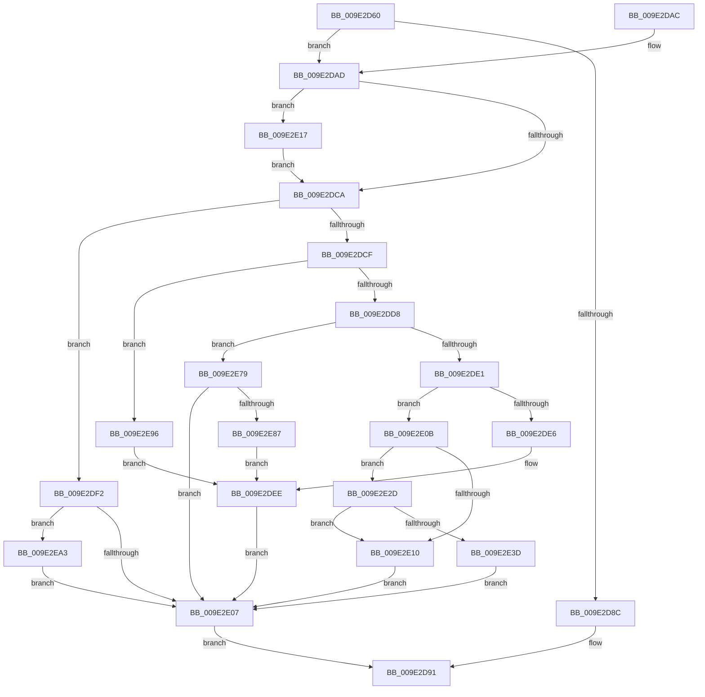

# IoWMIRegistrationControl

- RVA: `0x009E2D60`–`0x009E2EB2` (길이 `338` bytes)
- VA: `0x00000001409E2D60`
- 실행 섹션: `PAGE`
- PDB 이름 있음: `예`; PDB Function 태그: `아니요`
- unwind 정보 RVA: `0x000A3EE8`
- 디코드: `97`개 명령, `338/338` bytes 표시
- 미해석 바이트: `0` (있으면 어셈블리에 `.byte`로 보존)

> 이 문서는 커널 이미지의 기계어와 PDB 기호를 분석해 생성했습니다. 4번과 5번은 함수 원형과 자료형을 바이너리 사용 방식에서 추정한 C 해석이며 원본 소스 복구 결과는 아닙니다.

## 1. Dependencies

- 직접 호출 지점: **10**; 고유 호출 대상: **8**
- 직접 호출자로 확인된 함수: **5**
- RIP 상대 이미지 참조: **2**

### Outgoing calls
- `0x009E2DE9` → [WmipUpdateRegistration](WmipUpdateRegistration_function_009E2BA4.md) (function, `0x009E2BA4`)
- `0x009E2DF7` → [WmipRegisterDevice](WmipRegisterDevice_function_009E2808.md) (function, `0x009E2808`)
- `0x009E2E30` → [WmipFindRegEntryByDevice](../../text/46/WmipFindRegEntryByDevice_function_0046C22C.md) (function, `0x0046C22C`)
- `0x009E2E52` → [KeWaitForSingleObject](../../text/20/KeWaitForSingleObject_function_0020E6B0.md) (function, `0x0020E6B0`)
- `0x009E2E68` → [KeReleaseMutex](../../text/39/KeReleaseMutex_function_00396810.md) (function, `0x00396810`)
- `0x009E2E70` → [WmipUnreferenceRegEntry](../../text/47/WmipUnreferenceRegEntry_function_0047B6F0.md) (function, `0x0047B6F0`)
- `0x009E2E7C` → [WmipDeregisterDevice](../A7/WmipDeregisterDevice_function_00A7F9D4.md) (function, `0x00A7F9D4`)
- `0x009E2E8C` → [WmipRegisterDevice](WmipRegisterDevice_function_009E2808.md) (function, `0x009E2808`)
- `0x009E2E99` → [WmipDeregisterDevice](../A7/WmipDeregisterDevice_function_00A7F9D4.md) (function, `0x00A7F9D4`)
- `0x009E2EA8` → [WmipSetTraceNotify](../AB/WmipSetTraceNotify_function_00ABF0E0.md) (function, `0x00ABF0E0`)

### Direct callers
- [DifIoWMIRegistrationControlWrapper](../../text/62/DifIoWMIRegistrationControlWrapper_function_0062D880.md) at `0x0062D954`
- [PpmEnableWmiInterface](../76/PpmEnableWmiInterface_function_00768604.md) at `0x00768649`
- [ViDdiDriverEntry](../../pagevrfy/B9/ViDdiDriverEntry_function_00B94740.md) at `0x00B947FF`
- [WmipDriverEntry](../../init/C4/WmipDriverEntry_function_00C4D490.md) at `0x00C4D604`
- [WheaInitialize](../../init/C5/WheaInitialize_function_00C54C08.md) at `0x00C55113`

### Static image references
- `0x009E2D7E` → RVA `0x00EFFA98` (`.data`; read)
- `0x009E2E43` → RVA `0x00EFFA60` (`.data`; read)

## 2. Other-region calls and transfers

- 다른 실행 섹션으로 향하는 call: **4**
  - `0x009E2E30` → [WmipFindRegEntryByDevice](../../text/46/WmipFindRegEntryByDevice_function_0046C22C.md) (`PAGE` → `.text`)
  - `0x009E2E52` → [KeWaitForSingleObject](../../text/20/KeWaitForSingleObject_function_0020E6B0.md) (`PAGE` → `.text`)
  - `0x009E2E68` → [KeReleaseMutex](../../text/39/KeReleaseMutex_function_00396810.md) (`PAGE` → `.text`)
  - `0x009E2E70` → [WmipUnreferenceRegEntry](../../text/47/WmipUnreferenceRegEntry_function_0047B6F0.md) (`PAGE` → `.text`)
- 별도 외부 분기/꼬리 이동을 확인하지 못했습니다.

## 3. Assembly (complete function range)

```asm
009E2D60  48 8B C4                        mov rax, rsp
009E2D63  48 89 58 08                     mov qword ptr [rax + 8], rbx
009E2D67  48 89 68 10                     mov qword ptr [rax + 0x10], rbp
009E2D6B  48 89 70 18                     mov qword ptr [rax + 0x18], rsi
009E2D6F  48 89 78 20                     mov qword ptr [rax + 0x20], rdi
009E2D73  41 56                           push r14
009E2D75  48 83 EC 30                     sub rsp, 0x30
009E2D79  33 ED                           xor ebp, ebp
009E2D7B  45 32 F6                        xor r14b, r14b
009E2D7E  48 39 2D 13 CD 51 00            cmp qword ptr [rip + 0x51cd13], rbp
009E2D85  8B FA                           mov edi, edx
009E2D87  48 8B F1                        mov rsi, rcx
009E2D8A  75 21                           jne 0x1409e2dad
009E2D8C  B8 01 00 00 C0                  mov eax, 0xc0000001
009E2D91  48 8B 5C 24 40                  mov rbx, qword ptr [rsp + 0x40]
009E2D96  48 8B 6C 24 48                  mov rbp, qword ptr [rsp + 0x48]
009E2D9B  48 8B 74 24 50                  mov rsi, qword ptr [rsp + 0x50]
009E2DA0  48 8B 7C 24 58                  mov rdi, qword ptr [rsp + 0x58]
009E2DA5  48 83 C4 30                     add rsp, 0x30
009E2DA9  41 5E                           pop r14
009E2DAB  C3                              ret
009E2DAC  CC                              int3
009E2DAD  8B C7                           mov eax, edi
009E2DAF  B9 00 00 01 00                  mov ecx, 0x10000
009E2DB4  0F BA F0 1F                     btr eax, 0x1f
009E2DB8  85 FF                           test edi, edi
009E2DBA  0F 49 C7                        cmovns eax, edi
009E2DBD  C1 FF 1F                        sar edi, 0x1f
009E2DC0  81 E7 00 00 00 80               and edi, 0x80000000
009E2DC6  85 C1                           test ecx, eax
009E2DC8  75 4D                           jne 0x1409e2e17
009E2DCA  83 E8 01                        sub eax, 1
009E2DCD  74 23                           je 0x1409e2df2
009E2DCF  83 E8 01                        sub eax, 1
009E2DD2  0F 84 BE 00 00 00               je 0x1409e2e96
009E2DD8  83 E8 01                        sub eax, 1
009E2DDB  0F 84 98 00 00 00               je 0x1409e2e79
009E2DE1  83 E8 01                        sub eax, 1
009E2DE4  75 25                           jne 0x1409e2e0b
009E2DE6  48 8B CE                        mov rcx, rsi
009E2DE9  E8 B6 FD FF FF                  call 0x1409e2ba4
009E2DEE  8B D8                           mov ebx, eax
009E2DF0  EB 15                           jmp 0x1409e2e07
009E2DF2  8B D7                           mov edx, edi
009E2DF4  48 8B CE                        mov rcx, rsi
009E2DF7  E8 0C FA FF FF                  call 0x1409e2808
009E2DFC  8B D8                           mov ebx, eax
009E2DFE  45 84 F6                        test r14b, r14b
009E2E01  0F 85 9C 00 00 00               jne 0x1409e2ea3
009E2E07  8B C3                           mov eax, ebx
009E2E09  EB 86                           jmp 0x1409e2d91
009E2E0B  83 F8 01                        cmp eax, 1
009E2E0E  74 1D                           je 0x1409e2e2d
009E2E10  BB 0D 00 00 C0                  mov ebx, 0xc000000d
009E2E15  EB F0                           jmp 0x1409e2e07
009E2E17  8B E8                           mov ebp, eax
009E2E19  41 B6 01                        mov r14b, 1
009E2E1C  81 E5 00 00 F0 00               and ebp, 0xf00000
009E2E22  25 FF FF 0E FF                  and eax, 0xff0effff
009E2E27  0B FD                           or edi, ebp
009E2E29  0B F9                           or edi, ecx
009E2E2B  EB 9D                           jmp 0x1409e2dca
009E2E2D  48 8B CE                        mov rcx, rsi
009E2E30  E8 F7 93 A8 FF                  call 0x14046c22c
009E2E35  48 8B D8                        mov rbx, rax
009E2E38  48 85 C0                        test rax, rax
009E2E3B  74 D3                           je 0x1409e2e10
009E2E3D  48 83 64 24 20 00               and qword ptr [rsp + 0x20], 0
009E2E43  48 8D 0D 16 CC 51 00            lea rcx, [rip + 0x51cc16]
009E2E4A  45 33 C9                        xor r9d, r9d
009E2E4D  45 33 C0                        xor r8d, r8d
009E2E50  33 D2                           xor edx, edx
009E2E52  E8 59 B8 82 FF                  call 0x14020e6b0
009E2E57  F0 81 4B 30 00 00 00 20         lock or dword ptr [rbx + 0x30], 0x20000000
009E2E5F  33 D2                           xor edx, edx
009E2E61  48 8D 0D F8 CB 51 00            lea rcx, [rip + 0x51cbf8]
009E2E68  E8 A3 39 9B FF                  call 0x140396810
009E2E6D  48 8B CB                        mov rcx, rbx
009E2E70  E8 7B 88 A9 FF                  call 0x14047b6f0
009E2E75  33 DB                           xor ebx, ebx
009E2E77  EB 8E                           jmp 0x1409e2e07
009E2E79  48 8B CE                        mov rcx, rsi
009E2E7C  E8 53 CB 09 00                  call 0x140a7f9d4
009E2E81  8B D8                           mov ebx, eax
009E2E83  85 C0                           test eax, eax
009E2E85  78 80                           js 0x1409e2e07
009E2E87  8B D7                           mov edx, edi
009E2E89  48 8B CE                        mov rcx, rsi
009E2E8C  E8 77 F9 FF FF                  call 0x1409e2808
009E2E91  E9 58 FF FF FF                  jmp 0x1409e2dee
009E2E96  48 8B CE                        mov rcx, rsi
009E2E99  E8 36 CB 09 00                  call 0x140a7f9d4
009E2E9E  E9 4B FF FF FF                  jmp 0x1409e2dee
009E2EA3  8B D5                           mov edx, ebp
009E2EA5  48 8B CE                        mov rcx, rsi
009E2EA8  E8 33 C2 0D 00                  call 0x140abf0e0
009E2EAD  E9 55 FF FF FF                  jmp 0x1409e2e07
```

## 4. C-style interpretation (structured pseudocode)

```c
__int64 __fastcall IoWMIRegistrationControl(__int64 a1, int a2, int a3, int a4)
{
    __int64 result;
    __int64 v_r14;
    __int64 v_rbp;
    __int64 v_rbx;
    __int64 v_rdi;
    __int64 v_rsp;
    unsigned __int64 v_stack_p10;
    unsigned __int64 v_stack_p18;
    unsigned __int64 v_stack_p20;
    unsigned __int64 v_stack_p8;

    *(unsigned __int64 *)(v_rsp + 8) = v_rbx;
    *(unsigned __int64 *)(v_rsp + 16) = v_rbp;
    *(unsigned __int64 *)(v_rsp + 24) = v_rsi;
    *(unsigned __int64 *)(v_rsp + 32) = v_rdi;
    v_rsp = (v_rsp) - (48);
    v_rbp = 0;
    v_r14 = 0;
    if ((*(unsigned __int64 *)(v_rip + 5360915)) != 0) goto loc_009E2DAD;
loc_009E2D91:
    v_rsp = (v_rsp) + (48);
    return (unsigned int)(0xC0000001ULL);
loc_009E2DAD:
    result = (unsigned int)((unsigned int)(v_stack_p20));
    if (!sign_flag) { result = (unsigned int)(v_stack_p20); }
    v_rdi = (unsigned int)((v_stack_p20) >> (31));
    v_rdi = (unsigned int)((v_rdi) & (0x80000000ULL));
    if ((((unsigned int)((unsigned int)(0x10000ULL))) & ((unsigned int)(result))) != 0) goto loc_009E2E17;
loc_009E2DCA:
    result = (unsigned int)((result) - (1));
    if (condition_is_equal) goto loc_009E2DF2;
    result = (unsigned int)((result) - (1));
    if (condition_is_equal) goto loc_009E2E96;
    result = (unsigned int)((result) - (1));
    if (condition_is_equal) goto loc_009E2E79;
    result = (unsigned int)((result) - (1));
    if (condition_is_not_equal) goto loc_009E2E0B;
    result = WmipUpdateRegistration(v_stack_p18, a2, a3, a4);
loc_009E2DEE:
    goto loc_009E2E07;
loc_009E2DF2:
    result = WmipRegisterDevice(v_stack_p18, (unsigned int)((unsigned int)(v_rdi)), a3, a4);
    if (0 != 0) goto loc_009E2EA3;
loc_009E2E07:
    goto loc_009E2D91;
loc_009E2E0B:
    if (((unsigned int)((unsigned int)((unsigned int)((unsigned int)((unsigned int)(result)))))) == 1) goto loc_009E2E2D;
loc_009E2E10:
    goto loc_009E2E07;
loc_009E2E17:
    v_rbp = (unsigned int)(((unsigned int)((unsigned int)((unsigned int)((unsigned int)((unsigned int)((unsigned int)(result))))))) & (0xF00000ULL));
    result = (unsigned int)(((unsigned int)((unsigned int)((unsigned int)((unsigned int)(result))))) & (0xFF0EFFFFULL));
    v_rdi = (unsigned int)((v_rdi) | ((unsigned int)(v_rbp)));
    v_rdi = (unsigned int)((v_rdi) | ((unsigned int)(v_stack_p18)));
    goto loc_009E2DCA;
loc_009E2E2D:
    result = WmipFindRegEntryByDevice(v_stack_p18, (unsigned int)((unsigned int)(v_rdi)), a3, a4);
    if (result == 0) goto loc_009E2E10;
    a4 = 0;
    a3 = 0;
    a2 = 0;
    result = KeWaitForSingleObject(v_rip + 5360662, a2, a3, a4);
    a2 = 0;
    result = KeReleaseMutex(v_rip + 5360632, a2, a3, a4);
    result = WmipUnreferenceRegEntry(result, a2, a3, a4);
    v_rbx = 0;
    goto loc_009E2E07;
loc_009E2E79:
    result = WmipDeregisterDevice(v_stack_p18, a2, a3, a4);
    if (sign_flag) goto loc_009E2E07;
    result = WmipRegisterDevice(v_stack_p18, (unsigned int)((unsigned int)(v_rdi)), a3, a4);
    goto loc_009E2DEE;
loc_009E2E96:
    result = WmipDeregisterDevice(v_stack_p18, (unsigned int)((unsigned int)(v_rdi)), a3, a4);
    goto loc_009E2DEE;
loc_009E2EA3:
    result = WmipSetTraceNotify(v_stack_p18, (unsigned int)((unsigned int)(v_rbp)), a3, a4);
    goto loc_009E2E07;
}
```

## 5. (Beta) C Style

```c
int64_t IoWMIRegistrationControl(int64_t Arg1, int32_t Arg2, int32_t Arg3, int32_t Arg4)
{
    int64_t result;
    int64_t local_r14;
    int64_t local_rbp;
    int64_t local_rbx;
    int64_t local_rdi;
    int64_t local_rsp;
    uint64_t v_stack_p10;
    uint64_t v_stack_p18;
    uint64_t v_stack_p20;
    uint64_t v_stack_p8;

    *(uint64_t *)(local_rsp + 0x8) = local_rbx;
    *(uint64_t *)(local_rsp + 0x10) = local_rbp;
    *(uint64_t *)(local_rsp + 0x18) = local_rsi;
    *(uint64_t *)(local_rsp + 0x20) = local_rdi;
    local_rsp = (local_rsp) - (48);
    local_rbp = 0;
    local_r14 = 0;
    if ((*(uint64_t *)(v_rip + 0x51CD13)) != 0) goto loc_009E2DAD;
loc_009E2D91:
    local_rsp = (local_rsp) + (48);
    return (uint32_t)(0xC0000001ULL);
loc_009E2DAD:
    result = (uint32_t)((uint32_t)(v_stack_p20));
    if (!sign_flag) { result = (uint32_t)(v_stack_p20); }
    local_rdi = (uint32_t)((v_stack_p20) >> (31));
    local_rdi = (uint32_t)((local_rdi) & (0x80000000ULL));
    if ((((uint32_t)((uint32_t)(0x10000ULL))) & ((uint32_t)(result))) != 0) goto loc_009E2E17;
loc_009E2DCA:
    result = (uint32_t)((result) - (1));
    if (condition_is_equal) goto loc_009E2DF2;
    result = (uint32_t)((result) - (1));
    if (condition_is_equal) goto loc_009E2E96;
    result = (uint32_t)((result) - (1));
    if (condition_is_equal) goto loc_009E2E79;
    result = (uint32_t)((result) - (1));
    if (condition_is_not_equal) goto loc_009E2E0B;
    result = WmipUpdateRegistration(v_stack_p18, Arg2, Arg3, Arg4);
loc_009E2DEE:
    goto loc_009E2E07;
loc_009E2DF2:
    result = WmipRegisterDevice(v_stack_p18, (uint32_t)((uint32_t)(local_rdi)), Arg3, Arg4);
    if (0 != 0) goto loc_009E2EA3;
loc_009E2E07:
    goto loc_009E2D91;
loc_009E2E0B:
    if (((uint32_t)((uint32_t)((uint32_t)((uint32_t)((uint32_t)(result)))))) == 1) goto loc_009E2E2D;
loc_009E2E10:
    goto loc_009E2E07;
loc_009E2E17:
    local_rbp = (uint32_t)(((uint32_t)((uint32_t)((uint32_t)((uint32_t)((uint32_t)((uint32_t)(result))))))) & (0xF00000ULL));
    result = (uint32_t)(((uint32_t)((uint32_t)((uint32_t)((uint32_t)(result))))) & (0xFF0EFFFFULL));
    local_rdi = (uint32_t)((local_rdi) | ((uint32_t)(local_rbp)));
    local_rdi = (uint32_t)((local_rdi) | ((uint32_t)(v_stack_p18)));
    goto loc_009E2DCA;
loc_009E2E2D:
    result = WmipFindRegEntryByDevice(v_stack_p18, (uint32_t)((uint32_t)(local_rdi)), Arg3, Arg4);
    if (result == 0) goto loc_009E2E10;
    Arg4 = 0;
    Arg3 = 0;
    Arg2 = 0;
    result = KeWaitForSingleObject(v_rip + 5360662, Arg2, Arg3, Arg4);
    Arg2 = 0;
    result = KeReleaseMutex(v_rip + 5360632, Arg2, Arg3, Arg4);
    result = WmipUnreferenceRegEntry(result, Arg2, Arg3, Arg4);
    local_rbx = 0;
    goto loc_009E2E07;
loc_009E2E79:
    result = WmipDeregisterDevice(v_stack_p18, Arg2, Arg3, Arg4);
    if (sign_flag) goto loc_009E2E07;
    result = WmipRegisterDevice(v_stack_p18, (uint32_t)((uint32_t)(local_rdi)), Arg3, Arg4);
    goto loc_009E2DEE;
loc_009E2E96:
    result = WmipDeregisterDevice(v_stack_p18, (uint32_t)((uint32_t)(local_rdi)), Arg3, Arg4);
    goto loc_009E2DEE;
loc_009E2EA3:
    result = WmipSetTraceNotify(v_stack_p18, (uint32_t)((uint32_t)(local_rbp)), Arg3, Arg4);
    goto loc_009E2E07;
}
```

## 6. Execution-region graph

[열기: 2D/3D 그래프와 함수 탐색 컨트롤 패널](../../../control-panel.html?section=page&rva=0x009E2D60&view=graph)

- 2D 그래프는 위에서 아래로 흐르고, 3D 그래프는 빈 공간을 드래그해 회전합니다. Shift+드래그는 이동, 휠은 확대·축소, 함수 노드 선택은 대상 보고서 이동입니다.

### Static fallback


