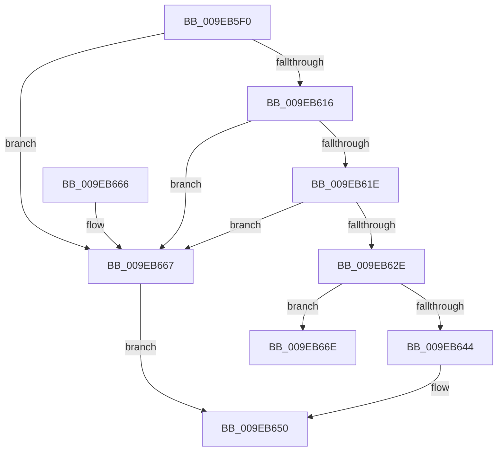

# IopCheckTopDeviceHint

- RVA: `0x009EB5F0`–`0x009EB675` (길이 `133` bytes)
- VA: `0x00000001409EB5F0`
- 실행 섹션: `PAGE`
- PDB 이름 있음: `예`; PDB Function 태그: `아니요`
- unwind 정보 RVA: `0x000A5548`
- 디코드: `36`개 명령, `133/133` bytes 표시
- 미해석 바이트: `0` (있으면 어셈블리에 `.byte`로 보존)

> 이 문서는 커널 이미지의 기계어와 PDB 기호를 분석해 생성했습니다. 4번과 5번은 함수 원형과 자료형을 바이너리 사용 방식에서 추정한 C 해석이며 원본 소스 복구 결과는 아닙니다.

## 1. Dependencies

- 직접 호출 지점: **1**; 고유 호출 대상: **1**
- 직접 호출자로 확인된 함수: **1**
- RIP 상대 이미지 참조: **0**

### Outgoing calls
- `0x009EB63B` → [IopVerifyDeviceObjectOnStack](../../text/41/IopVerifyDeviceObjectOnStack_function_0041B3B0.md) (function, `0x0041B3B0`)

### Direct callers
- [IopParseDevice](../89/IopParseDevice_function_0089E510.md) at `0x0089F8CE`

### Static image references
- 디코드된 RIP-relative 메모리 참조가 없습니다.

## 2. Other-region calls and transfers

- 다른 실행 섹션으로 향하는 call: **1**
  - `0x009EB63B` → [IopVerifyDeviceObjectOnStack](../../text/41/IopVerifyDeviceObjectOnStack_function_0041B3B0.md) (`PAGE` → `.text`)
- 별도 외부 분기/꼬리 이동을 확인하지 못했습니다.

## 3. Assembly (complete function range)

```asm
009EB5F0  48 89 5C 24 10                  mov qword ptr [rsp + 0x10], rbx
009EB5F5  48 89 74 24 18                  mov qword ptr [rsp + 0x18], rsi
009EB5FA  48 89 7C 24 20                  mov qword ptr [rsp + 0x20], rdi
009EB5FF  41 56                           push r14
009EB601  48 83 EC 20                     sub rsp, 0x20
009EB605  48 8B 31                        mov rsi, qword ptr [rcx]
009EB608  4D 8B F1                        mov r14, r9
009EB60B  48 8B FA                        mov rdi, rdx
009EB60E  48 8B D9                        mov rbx, rcx
009EB611  45 84 C0                        test r8b, r8b
009EB614  75 51                           jne 0x1409eb667
009EB616  8B 46 48                        mov eax, dword ptr [rsi + 0x48]
009EB619  83 F8 35                        cmp eax, 0x35
009EB61C  77 49                           ja 0x1409eb667
009EB61E  49 B8 08 11 12 00 01 00 20 00   movabs r8, 0x20000100121108
009EB628  49 0F A3 C0                     bt r8, rax
009EB62C  73 39                           jae 0x1409eb667
009EB62E  48 8B 92 B0 00 00 00            mov rdx, qword ptr [rdx + 0xb0]
009EB635  41 B0 01                        mov r8b, 1
009EB638  48 8B CE                        mov rcx, rsi
009EB63B  E8 70 FD A2 FF                  call 0x14041b3b0
009EB640  84 C0                           test al, al
009EB642  74 2A                           je 0x1409eb66e
009EB644  48 8B 87 B0 00 00 00            mov rax, qword ptr [rdi + 0xb0]
009EB64B  48 89 03                        mov qword ptr [rbx], rax
009EB64E  33 C0                           xor eax, eax
009EB650  48 8B 5C 24 38                  mov rbx, qword ptr [rsp + 0x38]
009EB655  48 8B 74 24 40                  mov rsi, qword ptr [rsp + 0x40]
009EB65A  48 8B 7C 24 48                  mov rdi, qword ptr [rsp + 0x48]
009EB65F  48 83 C4 20                     add rsp, 0x20
009EB663  41 5E                           pop r14
009EB665  C3                              ret
009EB666  CC                              int3
009EB667  B8 0D 00 00 C0                  mov eax, 0xc000000d
009EB66C  EB E2                           jmp 0x1409eb650
009EB66E  48 8B 87 A8 00 00 00            mov rax, qword ptr [rdi + 0xa8]
```

## 4. C-style interpretation (structured pseudocode)

```c
__int64 __fastcall IopCheckTopDeviceHint(__int64 a1, __int64 a2, unsigned __int8 a3, __int64 a4)
{
    __int64 result;
    __int64 v_rsp;
    unsigned __int64 v_stack_p10;
    unsigned __int64 v_stack_p18;
    unsigned __int64 v_stack_p20;

    v_stack_p10 = v_rbx;
    v_stack_p18 = v_rsi;
    v_stack_p20 = v_rdi;
    v_rsp = (v_rsp) - (32);
    if (a3 != 0) goto loc_009EB667;
    if (((unsigned int)((unsigned int)(*(unsigned int *)(*(unsigned __int64 *)(a1) + 72)))) > 53) goto loc_009EB667;
    if (((unsigned int)((unsigned int)(*(unsigned int *)(*(unsigned __int64 *)(a1) + 72)))) >= 53) goto loc_009EB667;
    result = IopVerifyDeviceObjectOnStack(*(unsigned __int64 *)(a1), *(unsigned __int64 *)(a2 + 176), 1, a4);
    if ((unsigned __int8)(result) == 0) goto loc_009EB66E;
    *(unsigned __int64 *)(a1) = *(unsigned __int64 *)(a2 + 176);
    result = 0;
loc_009EB650:
    v_rsp = (v_rsp) + (32);
    return result;
loc_009EB667:
    goto loc_009EB650;
loc_009EB66E:
    return *(unsigned __int64 *)(v_stack_p20 + 168);
}
```

## 5. (Beta) C Style

```c
int64_t IopCheckTopDeviceHint(void *Arg1, void *Arg2, uint8_t Arg3, int64_t Arg4)
{
    uint8_t *arg1 = (uint8_t *)Arg1;
    uint8_t *arg2 = (uint8_t *)Arg2;

    int64_t result;
    int64_t local_rsp;
    uint64_t v_stack_p10;
    uint64_t v_stack_p18;
    uint64_t v_stack_p20;

    v_stack_p10 = local_rbx;
    v_stack_p18 = local_rsi;
    v_stack_p20 = local_rdi;
    local_rsp = (local_rsp) - (32);
    if (Arg3 != 0) goto loc_009EB667;
    if (((uint32_t)((uint32_t)(*(uint32_t *)(*(uint64_t *)(arg1) + 0x48)))) > 53) goto loc_009EB667;
    if (((uint32_t)((uint32_t)(*(uint32_t *)(*(uint64_t *)(arg1) + 0x48)))) >= 53) goto loc_009EB667;
    result = IopVerifyDeviceObjectOnStack(*(uint64_t *)(arg1), *(uint64_t *)(arg2 + 0xB0), 1, Arg4);
    if ((uint8_t)(result) == 0) goto loc_009EB66E;
    *(uint64_t *)(arg1) = *(uint64_t *)(arg2 + 0xB0);
    result = 0;
loc_009EB650:
    local_rsp = (local_rsp) + (32);
    return result;
loc_009EB667:
    goto loc_009EB650;
loc_009EB66E:
    return *(uint64_t *)(v_stack_p20 + 0xA8);
}
```

### 관측된 메모리 오프셋

구조체 형식이 확인되지 않은 접근은 인자 기준의 오프셋으로만 기록했습니다.

| 기준 인자 | 오프셋 표현 | 폭 (bit) | 접근 |
|---|---:|---:|---|
| `Arg1` | `+ 0x0` | `64` | `R` |
| `Arg1` | `+ 0x0` | `64` | `W` |
| `Arg2` | `+ 0xA8` | `64` | `R` |
| `Arg2` | `+ 0xB0` | `64` | `R` |

## 6. Execution-region graph

[열기: 2D/3D 그래프와 함수 탐색 컨트롤 패널](../../../control-panel.html?section=page&rva=0x009EB5F0&view=graph)

- 2D 그래프는 위에서 아래로 흐르고, 3D 그래프는 빈 공간을 드래그해 회전합니다. Shift+드래그는 이동, 휠은 확대·축소, 함수 노드 선택은 대상 보고서 이동입니다.

### Static fallback


