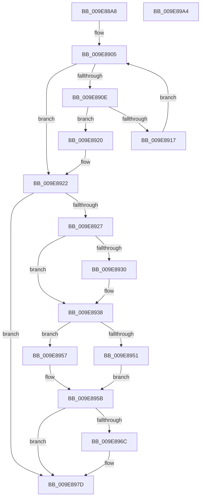

# IopCleanupFileObjectIosbRange

- RVA: `0x009E88A8`–`0x009E89A5` (길이 `253` bytes)
- VA: `0x00000001409E88A8`
- 실행 섹션: `PAGE`
- PDB 이름 있음: `예`; PDB Function 태그: `아니요`
- unwind 정보 RVA: `0x0005D7BC`
- 디코드: `67`개 명령, `253/253` bytes 표시
- 미해석 바이트: `0` (있으면 어셈블리에 `.byte`로 보존)

> 이 문서는 커널 이미지의 기계어와 PDB 기호를 분석해 생성했습니다. 4번과 5번은 함수 원형과 자료형을 바이너리 사용 방식에서 추정한 C 해석이며 원본 소스 복구 결과는 아닙니다.

## 1. Dependencies

- 직접 호출 지점: **9**; 고유 호출 대상: **9**
- 직접 호출자로 확인된 함수: **1**
- RIP 상대 이미지 참조: **2**

### Outgoing calls
- `0x009E88D8` → [ObfDereferenceObjectWithTag](../../text/2F/ObfDereferenceObjectWithTag_function_002F78E0.md) (function, `0x002F78E0`)
- `0x009E88E8` → [ExAcquireFastMutex](../../text/20/ExAcquireFastMutex_function_0020E5A0.md) (function, `0x0020E5A0`)
- `0x009E88F9` → [RtlLookupElementGenericTableAvl](../../text/3F/RtlLookupElementGenericTableAvl_function_003FEFB0.md) (function, `0x003FEFB0`)
- `0x009E8933` → [MmUnmapLockedPages](../../text/24/MmUnmapLockedPages_function_00246E60.md) (function, `0x00246E60`)
- `0x009E893B` → [MmUnlockPages](../../text/29/MmUnlockPages_function_0029EEE0.md) (function, `0x0029EEE0`)
- `0x009E8943` → [IoFreeMdl](../../text/29/IoFreeMdl_function_0029EA80.md) (function, `0x0029EA80`)
- `0x009E8960` → [ExFreePoolWithTag](../../poolcode/B8/ExFreePoolWithTag_function_00B82870.md) (function, `0x00B82870`)
- `0x009E8978` → [RtlDeleteElementGenericTableAvl](../../text/3E/RtlDeleteElementGenericTableAvl_function_003EE750.md) (function, `0x003EE750`)
- `0x009E8984` → [ExReleaseFastMutex](../../text/25/ExReleaseFastMutex_function_002519C0.md) (function, `0x002519C0`)

### Direct callers
- [IopCleanupProcessResources](IopCleanupProcessResources_function_009E8850.md) at `0x009E888F`

### Static image references
- `0x009E88E1` → RVA `0x00F8D880` (`.data`; read)
- `0x009E88F2` → RVA `0x00F8D800` (`.data`; read)

## 2. Other-region calls and transfers

- 다른 실행 섹션으로 향하는 call: **9**
  - `0x009E88D8` → [ObfDereferenceObjectWithTag](../../text/2F/ObfDereferenceObjectWithTag_function_002F78E0.md) (`PAGE` → `.text`)
  - `0x009E88E8` → [ExAcquireFastMutex](../../text/20/ExAcquireFastMutex_function_0020E5A0.md) (`PAGE` → `.text`)
  - `0x009E88F9` → [RtlLookupElementGenericTableAvl](../../text/3F/RtlLookupElementGenericTableAvl_function_003FEFB0.md) (`PAGE` → `.text`)
  - `0x009E8933` → [MmUnmapLockedPages](../../text/24/MmUnmapLockedPages_function_00246E60.md) (`PAGE` → `.text`)
  - `0x009E893B` → [MmUnlockPages](../../text/29/MmUnlockPages_function_0029EEE0.md) (`PAGE` → `.text`)
  - `0x009E8943` → [IoFreeMdl](../../text/29/IoFreeMdl_function_0029EA80.md) (`PAGE` → `.text`)
  - `0x009E8960` → [ExFreePoolWithTag](../../poolcode/B8/ExFreePoolWithTag_function_00B82870.md) (`PAGE` → `POOLCODE`)
  - `0x009E8978` → [RtlDeleteElementGenericTableAvl](../../text/3E/RtlDeleteElementGenericTableAvl_function_003EE750.md) (`PAGE` → `.text`)
  - `0x009E8984` → [ExReleaseFastMutex](../../text/25/ExReleaseFastMutex_function_002519C0.md) (`PAGE` → `.text`)
- 별도 외부 분기/꼬리 이동을 확인하지 못했습니다.

## 3. Assembly (complete function range)

```asm
009E88A8  48 8B C4                        mov rax, rsp
009E88AB  48 89 58 08                     mov qword ptr [rax + 8], rbx
009E88AF  48 89 68 10                     mov qword ptr [rax + 0x10], rbp
009E88B3  48 89 70 18                     mov qword ptr [rax + 0x18], rsi
009E88B7  48 89 78 20                     mov qword ptr [rax + 0x20], rdi
009E88BB  41 56                           push r14
009E88BD  48 83 EC 30                     sub rsp, 0x30
009E88C1  48 83 60 F0 00                  and qword ptr [rax - 0x10], 0
009E88C6  4C 8B F1                        mov r14, rcx
009E88C9  48 8B 49 20                     mov rcx, qword ptr [rcx + 0x20]
009E88CD  BA 49 6F 43 70                  mov edx, 0x70436f49
009E88D2  48 89 48 E8                     mov qword ptr [rax - 0x18], rcx
009E88D6  33 F6                           xor esi, esi
009E88D8  E8 03 F0 90 FF                  call 0x1402f78e0
009E88DD  49 21 76 20                     and qword ptr [r14 + 0x20], rsi
009E88E1  48 8D 0D 98 4F 5A 00            lea rcx, [rip + 0x5a4f98]
009E88E8  E8 B3 5C 82 FF                  call 0x14020e5a0
009E88ED  48 8D 54 24 20                  lea rdx, [rsp + 0x20]
009E88F2  48 8D 0D 07 4F 5A 00            lea rcx, [rip + 0x5a4f07]
009E88F9  E8 B2 66 A1 FF                  call 0x1403fefb0
009E88FE  48 8B E8                        mov rbp, rax
009E8901  48 8B 58 08                     mov rbx, qword ptr [rax + 8]
009E8905  48 8D 7B 18                     lea rdi, [rbx + 0x18]
009E8909  48 85 DB                        test rbx, rbx
009E890C  74 14                           je 0x1409e8922
009E890E  48 8B 0F                        mov rcx, qword ptr [rdi]
009E8911  49 39 4E 10                     cmp qword ptr [r14 + 0x10], rcx
009E8915  74 09                           je 0x1409e8920
009E8917  48 8B F3                        mov rsi, rbx
009E891A  48 8B 5B 28                     mov rbx, qword ptr [rbx + 0x28]
009E891E  EB E5                           jmp 0x1409e8905
009E8920  FF 0B                           dec dword ptr [rbx]
009E8922  83 3B 00                        cmp dword ptr [rbx], 0
009E8925  75 56                           jne 0x1409e897d
009E8927  48 8B 4B 20                     mov rcx, qword ptr [rbx + 0x20]
009E892B  48 85 C9                        test rcx, rcx
009E892E  74 08                           je 0x1409e8938
009E8930  48 8B 17                        mov rdx, qword ptr [rdi]
009E8933  E8 28 E5 85 FF                  call 0x140246e60
009E8938  48 8B 0F                        mov rcx, qword ptr [rdi]
009E893B  E8 A0 65 8B FF                  call 0x14029eee0
009E8940  48 8B 0F                        mov rcx, qword ptr [rdi]
009E8943  E8 38 61 8B FF                  call 0x14029ea80
009E8948  48 8B 43 28                     mov rax, qword ptr [rbx + 0x28]
009E894C  48 85 F6                        test rsi, rsi
009E894F  75 06                           jne 0x1409e8957
009E8951  48 89 45 08                     mov qword ptr [rbp + 8], rax
009E8955  EB 04                           jmp 0x1409e895b
009E8957  48 89 46 28                     mov qword ptr [rsi + 0x28], rax
009E895B  33 D2                           xor edx, edx
009E895D  48 8B CB                        mov rcx, rbx
009E8960  E8 0B 9F 19 00                  call 0x140b82870
009E8965  48 83 7D 08 00                  cmp qword ptr [rbp + 8], 0
009E896A  75 11                           jne 0x1409e897d
009E896C  48 8D 54 24 20                  lea rdx, [rsp + 0x20]
009E8971  48 8D 0D 88 4E 5A 00            lea rcx, [rip + 0x5a4e88]
009E8978  E8 D3 5D A0 FF                  call 0x1403ee750
009E897D  48 8D 0D FC 4E 5A 00            lea rcx, [rip + 0x5a4efc]
009E8984  E8 37 90 86 FF                  call 0x1402519c0
009E8989  48 8B 5C 24 40                  mov rbx, qword ptr [rsp + 0x40]
009E898E  48 8B 6C 24 48                  mov rbp, qword ptr [rsp + 0x48]
009E8993  48 8B 74 24 50                  mov rsi, qword ptr [rsp + 0x50]
009E8998  48 8B 7C 24 58                  mov rdi, qword ptr [rsp + 0x58]
009E899D  48 83 C4 30                     add rsp, 0x30
009E89A1  41 5E                           pop r14
009E89A3  C3                              ret
009E89A4  CC                              int3
```

## 4. C-style interpretation (structured pseudocode)

```c
__int64 __fastcall IopCleanupFileObjectIosbRange(__int64 a1)
{
    __int64 result;
    __int64 v_rsi;
    __int64 v_rsp;
    unsigned __int64 v_stack_m18;
    unsigned __int64 v_stack_p10;
    unsigned __int64 v_stack_p18;
    unsigned __int64 v_stack_p20;
    unsigned __int64 v_stack_p8;

    *(unsigned __int64 *)(v_rsp + 8) = v_rbx;
    *(unsigned __int64 *)(v_rsp + 16) = v_rbp;
    *(unsigned __int64 *)(v_rsp + 24) = v_rsi;
    *(unsigned __int64 *)(v_rsp + 32) = v_rdi;
    v_rsp = (v_rsp) - (48);
    *(unsigned __int64 *)(v_rsp - 24) = *(unsigned __int64 *)(a1 + 32);
    v_rsi = 0;
    result = ObfDereferenceObjectWithTag(*(unsigned __int64 *)(a1 + 32), (unsigned int)(0x70436F49ULL), a3, a4);
    result = ExAcquireFastMutex(v_rip + 5918616, (unsigned int)(0x70436F49ULL), a3, a4);
    result = RtlLookupElementGenericTableAvl(v_rip + 5918471, v_stack_m18, a3, a4);
loc_009E8905:
    if (*(unsigned __int64 *)(result + 8) == 0) goto loc_009E8922;
    if ((*(unsigned __int64 *)(a1 + 16)) == (*(unsigned __int64 *)(*(unsigned __int64 *)(result + 8) + 24))) goto loc_009E8920;
    goto loc_009E8905;
loc_009E8920:
loc_009E8922:
    if ((*(unsigned int *)(*(unsigned __int64 *)(*(unsigned __int64 *)(result + 8) + 40))) != 0) goto loc_009E897D;
    if (*(unsigned __int64 *)(*(unsigned __int64 *)(*(unsigned __int64 *)(result + 8) + 40) + 32) != 0) {
        a2 = *(unsigned __int64 *)(*(unsigned __int64 *)(result + 8) + 24);
        result = MmUnmapLockedPages(*(unsigned __int64 *)(*(unsigned __int64 *)(*(unsigned __int64 *)(result + 8) + 40) + 32), a2, a3, a4);
    }
    result = MmUnlockPages(*(unsigned __int64 *)(*(unsigned __int64 *)(result + 8) + 24), a2, a3, a4);
    result = IoFreeMdl(*(unsigned __int64 *)(*(unsigned __int64 *)(result + 8) + 24), a2, a3, a4);
    if (*(unsigned __int64 *)(result + 8) != 0) goto loc_009E8957;
    *(unsigned __int64 *)(result + 8) = *(unsigned __int64 *)(*(unsigned __int64 *)(*(unsigned __int64 *)(result + 8) + 40) + 40);
    goto loc_009E895B;
loc_009E8957:
    *(unsigned __int64 *)(*(unsigned __int64 *)(result + 8) + 40) = *(unsigned __int64 *)(*(unsigned __int64 *)(*(unsigned __int64 *)(result + 8) + 40) + 40);
loc_009E895B:
    a2 = 0;
    result = ExFreePoolWithTag(*(unsigned __int64 *)(*(unsigned __int64 *)(result + 8) + 40), a2, a3, a4);
    if ((*(unsigned __int64 *)(result + 8)) == 0) {
        a2 = v_stack_m18;
        a1 = v_rip + 5918344;
        result = RtlDeleteElementGenericTableAvl(a1, a2, a3, a4);
    }
    result = ExReleaseFastMutex(v_rip + 5918460, a2, a3, a4);
    v_rsp = (v_rsp) + (48);
    return result;
}
```

## 5. (Beta) C Style

```c
int64_t IopCleanupFileObjectIosbRange(void *Arg1)
{
    uint8_t *arg1 = (uint8_t *)Arg1;

    int64_t result;
    int64_t local_rsi;
    int64_t local_rsp;
    uint64_t v_stack_m18;
    uint64_t v_stack_p10;
    uint64_t v_stack_p18;
    uint64_t v_stack_p20;
    uint64_t v_stack_p8;

    *(uint64_t *)(local_rsp + 0x8) = local_rbx;
    *(uint64_t *)(local_rsp + 0x10) = local_rbp;
    *(uint64_t *)(local_rsp + 0x18) = local_rsi;
    *(uint64_t *)(local_rsp + 0x20) = local_rdi;
    local_rsp = (local_rsp) - (48);
    *(uint64_t *)(local_rsp - 0x18) = *(uint64_t *)(arg1 + 0x20);
    local_rsi = 0;
    result = ObfDereferenceObjectWithTag(*(uint64_t *)(arg1 + 0x20), (uint32_t)(0x70436F49ULL), a3, a4);
    result = ExAcquireFastMutex(v_rip + 5918616, (uint32_t)(0x70436F49ULL), a3, a4);
    result = RtlLookupElementGenericTableAvl(v_rip + 5918471, v_stack_m18, a3, a4);
loc_009E8905:
    if (*(uint64_t *)(result + 0x8) == 0) goto loc_009E8922;
    if ((*(uint64_t *)(arg1 + 0x10)) == (*(uint64_t *)(*(uint64_t *)(result + 0x8) + 0x18))) goto loc_009E8920;
    goto loc_009E8905;
loc_009E8920:
loc_009E8922:
    if ((*(uint32_t *)(*(uint64_t *)(*(uint64_t *)(result + 0x8) + 0x28))) != 0) goto loc_009E897D;
    if (*(uint64_t *)(*(uint64_t *)(*(uint64_t *)(result + 0x8) + 0x28) + 0x20) != 0) {
        a2 = *(uint64_t *)(*(uint64_t *)(result + 0x8) + 0x18);
        result = MmUnmapLockedPages(*(uint64_t *)(*(uint64_t *)(*(uint64_t *)(result + 0x8) + 0x28) + 0x20), a2, a3, a4);
    }
    result = MmUnlockPages(*(uint64_t *)(*(uint64_t *)(result + 0x8) + 0x18), a2, a3, a4);
    result = IoFreeMdl(*(uint64_t *)(*(uint64_t *)(result + 0x8) + 0x18), a2, a3, a4);
    if (*(uint64_t *)(result + 0x8) != 0) goto loc_009E8957;
    *(uint64_t *)(result + 0x8) = *(uint64_t *)(*(uint64_t *)(*(uint64_t *)(result + 0x8) + 0x28) + 0x28);
    goto loc_009E895B;
loc_009E8957:
    *(uint64_t *)(*(uint64_t *)(result + 0x8) + 0x28) = *(uint64_t *)(*(uint64_t *)(*(uint64_t *)(result + 0x8) + 0x28) + 0x28);
loc_009E895B:
    a2 = 0;
    result = ExFreePoolWithTag(*(uint64_t *)(*(uint64_t *)(result + 0x8) + 0x28), a2, a3, a4);
    if ((*(uint64_t *)(result + 0x8)) == 0) {
        a2 = v_stack_m18;
        Arg1 = v_rip + 5918344;
        result = RtlDeleteElementGenericTableAvl(Arg1, a2, a3, a4);
    }
    result = ExReleaseFastMutex(v_rip + 5918460, a2, a3, a4);
    local_rsp = (local_rsp) + (48);
    return result;
}
```

### 관측된 메모리 오프셋

구조체 형식이 확인되지 않은 접근은 인자 기준의 오프셋으로만 기록했습니다.

| 기준 인자 | 오프셋 표현 | 폭 (bit) | 접근 |
|---|---:|---:|---|
| `Arg1` | `+ 0x10` | `64` | `R` |
| `Arg1` | `+ 0x20` | `64` | `R` |
| `Arg1` | `+ 0x20` | `64` | `R/W` |

## 6. Execution-region graph

[열기: 2D/3D 그래프와 함수 탐색 컨트롤 패널](../../../control-panel.html?section=page&rva=0x009E88A8&view=graph)

- 2D 그래프는 위에서 아래로 흐르고, 3D 그래프는 빈 공간을 드래그해 회전합니다. Shift+드래그는 이동, 휠은 확대·축소, 함수 노드 선택은 대상 보고서 이동입니다.

### Static fallback


