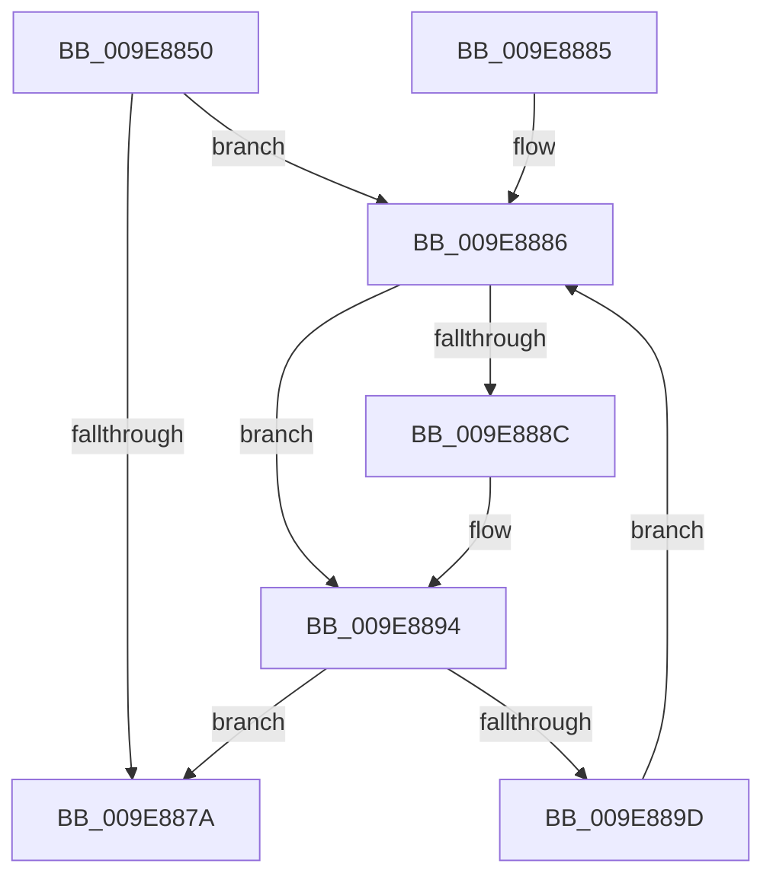

# IopCleanupProcessResources

- RVA: `0x009E8850`–`0x009E889F` (길이 `79` bytes)
- VA: `0x00000001409E8850`
- 실행 섹션: `PAGE`
- PDB 이름 있음: `예`; PDB Function 태그: `아니요`
- unwind 정보 RVA: `0x000A4D58`
- 디코드: `25`개 명령, `79/79` bytes 표시
- 미해석 바이트: `0` (있으면 어셈블리에 `.byte`로 보존)

> 이 문서는 커널 이미지의 기계어와 PDB 기호를 분석해 생성했습니다. 4번과 5번은 함수 원형과 자료형을 바이너리 사용 방식에서 추정한 C 해석이며 원본 소스 복구 결과는 아닙니다.

## 1. Dependencies

- 직접 호출 지점: **2**; 고유 호출 대상: **2**
- 직접 호출자로 확인된 함수: **1**
- RIP 상대 이미지 참조: **0**

### Outgoing calls
- `0x009E8870` → [IopCancelIrpsInFileObjectList](../../text/20/IopCancelIrpsInFileObjectList_function_00207110.md) (function, `0x00207110`)
- `0x009E888F` → [IopCleanupFileObjectIosbRange](IopCleanupFileObjectIosbRange_function_009E88A8.md) (function, `0x009E88A8`)

### Direct callers
- [IopCloseFile](../86/IopCloseFile_function_008640C0.md) at `0x0086424B`
- [IopCloseFile](../86/IopCloseFile_function_008640C0.md) at `0x008642E8`

### Static image references
- 디코드된 RIP-relative 메모리 참조가 없습니다.

## 2. Other-region calls and transfers

- 다른 실행 섹션으로 향하는 call: **1**
  - `0x009E8870` → [IopCancelIrpsInFileObjectList](../../text/20/IopCancelIrpsInFileObjectList_function_00207110.md) (`PAGE` → `.text`)
- 별도 외부 분기/꼬리 이동을 확인하지 못했습니다.

## 3. Assembly (complete function range)

```asm
009E8850  48 89 5C 24 08                  mov qword ptr [rsp + 8], rbx
009E8855  57                              push rdi
009E8856  48 83 EC 30                     sub rsp, 0x30
009E885A  49 8B D8                        mov rbx, r8
009E885D  C6 44 24 28 01                  mov byte ptr [rsp + 0x28], 1
009E8862  45 33 C0                        xor r8d, r8d
009E8865  C6 44 24 20 01                  mov byte ptr [rsp + 0x20], 1
009E886A  45 33 C9                        xor r9d, r9d
009E886D  48 8B FA                        mov rdi, rdx
009E8870  E8 9B E8 81 FF                  call 0x140207110
009E8875  48 85 DB                        test rbx, rbx
009E8878  75 0C                           jne 0x1409e8886
009E887A  48 8B 5C 24 40                  mov rbx, qword ptr [rsp + 0x40]
009E887F  48 83 C4 30                     add rsp, 0x30
009E8883  5F                              pop rdi
009E8884  C3                              ret
009E8885  CC                              int3
009E8886  48 39 7B 20                     cmp qword ptr [rbx + 0x20], rdi
009E888A  75 08                           jne 0x1409e8894
009E888C  48 8B CB                        mov rcx, rbx
009E888F  E8 14 00 00 00                  call 0x1409e88a8
009E8894  48 8B 5B 28                     mov rbx, qword ptr [rbx + 0x28]
009E8898  48 85 DB                        test rbx, rbx
009E889B  74 DD                           je 0x1409e887a
009E889D  EB E7                           jmp 0x1409e8886
```

## 4. C-style interpretation (structured pseudocode)

```c
__int64 __fastcall IopCleanupProcessResources(__int64 a1, __int64 a2, __int64 a3, int a4)
{
    __int64 result;
    __int64 v_rsp;
    unsigned __int8 v_stack_m10;
    unsigned __int8 v_stack_m18;
    unsigned __int64 v_stack_p8;

    v_stack_p8 = v_rbx;
    v_rsp = (v_rsp) - (48);
    v_stack_m10 = 1;
    a3 = 0;
    v_stack_m18 = 1;
    a4 = 0;
    result = IopCancelIrpsInFileObjectList(a1, a2, a3, a4);
    if (0 != 0) goto loc_009E8886;
loc_009E887A:
    v_rsp = (v_rsp) + (48);
    return result;
loc_009E8886:
    if ((*(unsigned __int64 *)(v_stack_p8 + 32)) == a2) {
        a1 = v_stack_p8;
        result = IopCleanupFileObjectIosbRange(a1, a2, a3, a4);
    }
    if (*(unsigned __int64 *)(v_stack_p8 + 40) == 0) goto loc_009E887A;
    goto loc_009E8886;
}
```

## 5. (Beta) C Style

```c
int64_t IopCleanupProcessResources(int64_t Arg1, int64_t Arg2, int64_t Arg3, int32_t Arg4)
{
    int64_t result;
    int64_t local_rsp;
    uint8_t v_stack_m10;
    uint8_t v_stack_m18;
    uint64_t v_stack_p8;

    v_stack_p8 = local_rbx;
    local_rsp = (local_rsp) - (48);
    v_stack_m10 = 1;
    Arg3 = 0;
    v_stack_m18 = 1;
    Arg4 = 0;
    result = IopCancelIrpsInFileObjectList(Arg1, Arg2, Arg3, Arg4);
    if (0 != 0) goto loc_009E8886;
loc_009E887A:
    local_rsp = (local_rsp) + (48);
    return result;
loc_009E8886:
    if ((*(uint64_t *)(v_stack_p8 + 0x20)) == Arg2) {
        Arg1 = v_stack_p8;
        result = IopCleanupFileObjectIosbRange(Arg1, Arg2, Arg3, Arg4);
    }
    if (*(uint64_t *)(v_stack_p8 + 0x28) == 0) goto loc_009E887A;
    goto loc_009E8886;
}
```

## 6. Execution-region graph

[열기: 2D/3D 그래프와 함수 탐색 컨트롤 패널](../../../control-panel.html?section=page&rva=0x009E8850&view=graph)

- 2D 그래프는 위에서 아래로 흐르고, 3D 그래프는 빈 공간을 드래그해 회전합니다. Shift+드래그는 이동, 휠은 확대·축소, 함수 노드 선택은 대상 보고서 이동입니다.

### Static fallback


