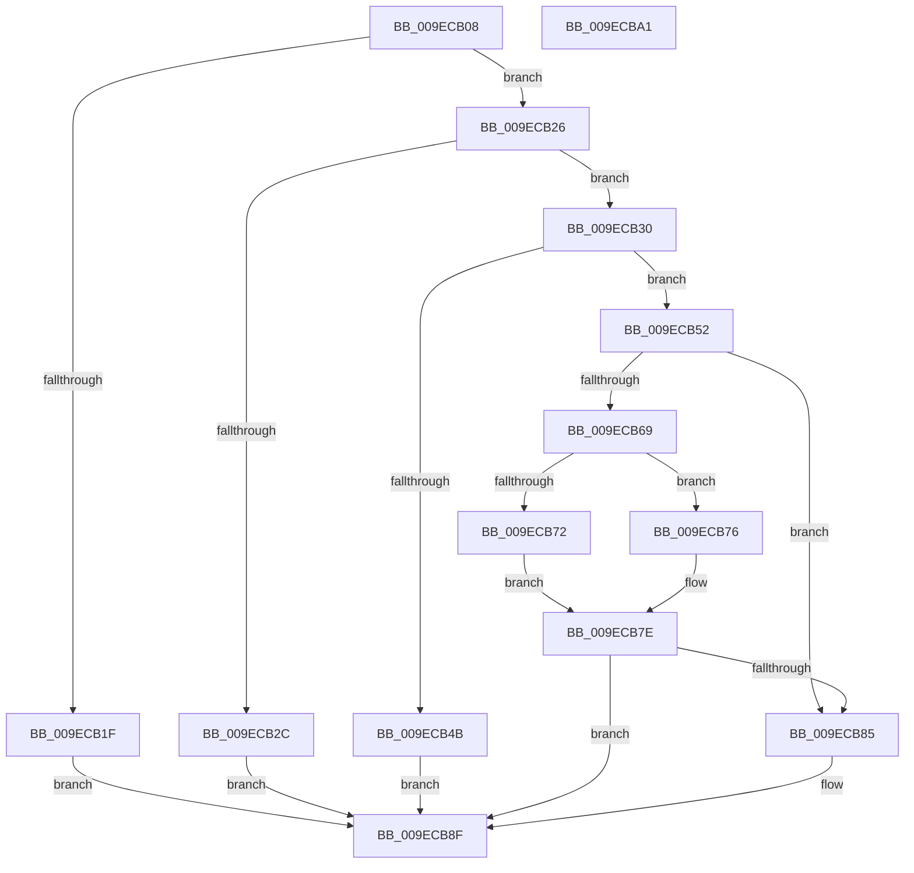

# MUIInitializeResourceLock

- RVA: `0x009ECB08`–`0x009ECBA2` (길이 `154` bytes)
- VA: `0x00000001409ECB08`
- 실행 섹션: `PAGE`
- PDB 이름 있음: `예`; PDB Function 태그: `아니요`
- unwind 정보 RVA: `0x0005FD94`
- 디코드: `50`개 명령, `154/154` bytes 표시
- 미해석 바이트: `0` (있으면 어셈블리에 `.byte`로 보존)

> 이 문서는 커널 이미지의 기계어와 PDB 기호를 분석해 생성했습니다. 4번과 5번은 함수 원형과 자료형을 바이너리 사용 방식에서 추정한 C 해석이며 원본 소스 복구 결과는 아닙니다.

## 1. Dependencies

- 직접 호출 지점: **4**; 고유 호출 대상: **4**
- 직접 호출자로 확인된 함수: **3**
- RIP 상대 이미지 참조: **0**

### Outgoing calls
- `0x009ECB3E` → [ExAllocatePool2](../../poolcode/B8/ExAllocatePool2_function_00B820F0.md) (function, `0x00B820F0`)
- `0x009ECB55` → [ExInitializeResourceLite](../../text/41/ExInitializeResourceLite_function_0041F9A0.md) (function, `0x0041F9A0`)
- `0x009ECB79` → [ExDeleteResourceLite](../../text/38/ExDeleteResourceLite_function_0038BA60.md) (function, `0x0038BA60`)
- `0x009ECB8A` → [ExFreePoolWithTag](../../poolcode/B8/ExFreePoolWithTag_function_00B82870.md) (function, `0x00B82870`)

### Direct callers
- [NtFlushInstallUILanguage](../7D/NtFlushInstallUILanguage_function_007D4200.md) at `0x007D4275`
- [NtMapCMFModule](../7D/NtMapCMFModule_function_007D4310.md) at `0x007D43FE`
- [NtGetMUIRegistryInfo](NtGetMUIRegistryInfo_function_009EC780.md) at `0x009EC97E`

### Static image references
- 디코드된 RIP-relative 메모리 참조가 없습니다.

## 2. Other-region calls and transfers

- 다른 실행 섹션으로 향하는 call: **4**
  - `0x009ECB3E` → [ExAllocatePool2](../../poolcode/B8/ExAllocatePool2_function_00B820F0.md) (`PAGE` → `POOLCODE`)
  - `0x009ECB55` → [ExInitializeResourceLite](../../text/41/ExInitializeResourceLite_function_0041F9A0.md) (`PAGE` → `.text`)
  - `0x009ECB79` → [ExDeleteResourceLite](../../text/38/ExDeleteResourceLite_function_0038BA60.md) (`PAGE` → `.text`)
  - `0x009ECB8A` → [ExFreePoolWithTag](../../poolcode/B8/ExFreePoolWithTag_function_00B82870.md) (`PAGE` → `POOLCODE`)
- 별도 외부 분기/꼬리 이동을 확인하지 못했습니다.

## 3. Assembly (complete function range)

```asm
009ECB08  48 89 5C 24 10                  mov qword ptr [rsp + 0x10], rbx
009ECB0D  48 89 74 24 18                  mov qword ptr [rsp + 0x18], rsi
009ECB12  57                              push rdi
009ECB13  48 83 EC 20                     sub rsp, 0x20
009ECB17  48 8B F1                        mov rsi, rcx
009ECB1A  48 85 C9                        test rcx, rcx
009ECB1D  75 07                           jne 0x1409ecb26
009ECB1F  BF 0D 00 00 C0                  mov edi, 0xc000000d
009ECB24  EB 69                           jmp 0x1409ecb8f
009ECB26  48 83 39 00                     cmp qword ptr [rcx], 0
009ECB2A  74 04                           je 0x1409ecb30
009ECB2C  33 FF                           xor edi, edi
009ECB2E  EB 5F                           jmp 0x1409ecb8f
009ECB30  BA 68 00 00 00                  mov edx, 0x68
009ECB35  41 B8 50 69 75 6D               mov r8d, 0x6d756950
009ECB3B  8D 4A D8                        lea ecx, [rdx - 0x28]
009ECB3E  E8 AD 55 19 00                  call 0x140b820f0
009ECB43  48 8B D8                        mov rbx, rax
009ECB46  48 85 C0                        test rax, rax
009ECB49  75 07                           jne 0x1409ecb52
009ECB4B  BF 17 00 00 C0                  mov edi, 0xc0000017
009ECB50  EB 3D                           jmp 0x1409ecb8f
009ECB52  48 8B CB                        mov rcx, rbx
009ECB55  E8 46 2E A3 FF                  call 0x14041f9a0
009ECB5A  8B C8                           mov ecx, eax
009ECB5C  8B F8                           mov edi, eax
009ECB5E  B8 00 00 00 C0                  mov eax, 0xc0000000
009ECB63  23 C8                           and ecx, eax
009ECB65  3B C8                           cmp ecx, eax
009ECB67  74 1C                           je 0x1409ecb85
009ECB69  33 C0                           xor eax, eax
009ECB6B  F0 48 0F B1 1E                  lock cmpxchg qword ptr [rsi], rbx
009ECB70  75 04                           jne 0x1409ecb76
009ECB72  33 DB                           xor ebx, ebx
009ECB74  EB 08                           jmp 0x1409ecb7e
009ECB76  48 8B CB                        mov rcx, rbx
009ECB79  E8 E2 EE 99 FF                  call 0x14038ba60
009ECB7E  33 FF                           xor edi, edi
009ECB80  48 85 DB                        test rbx, rbx
009ECB83  74 0A                           je 0x1409ecb8f
009ECB85  33 D2                           xor edx, edx
009ECB87  48 8B CB                        mov rcx, rbx
009ECB8A  E8 E1 5C 19 00                  call 0x140b82870
009ECB8F  48 8B 5C 24 38                  mov rbx, qword ptr [rsp + 0x38]
009ECB94  8B C7                           mov eax, edi
009ECB96  48 8B 74 24 40                  mov rsi, qword ptr [rsp + 0x40]
009ECB9B  48 83 C4 20                     add rsp, 0x20
009ECB9F  5F                              pop rdi
009ECBA0  C3                              ret
009ECBA1  CC                              int3
```

## 4. C-style interpretation (structured pseudocode)

```c
__int64 __fastcall MUIInitializeResourceLock(__int64 a1)
{
    __int64 result;
    __int64 v_rbx;
    __int64 v_rdi;
    __int64 v_rsp;
    unsigned __int64 v_stack_p10;
    unsigned __int64 v_stack_p18;

    v_stack_p10 = v_rbx;
    v_stack_p18 = v_rsi;
    v_rsp = (v_rsp) - (32);
    if (a1 != 0) goto loc_009ECB26;
    goto loc_009ECB8F;
loc_009ECB26:
    if ((*(unsigned __int64 *)(a1)) == 0) goto loc_009ECB30;
    v_rdi = 0;
    goto loc_009ECB8F;
loc_009ECB30:
    result = ExAllocatePool2(104 - 40, 104, (unsigned int)(0x6D756950ULL), a4);
    if (result != 0) goto loc_009ECB52;
    goto loc_009ECB8F;
loc_009ECB52:
    result = ExInitializeResourceLite(result, 104, (unsigned int)(0x6D756950ULL), a4);
    a1 = (unsigned int)(((unsigned int)((unsigned int)(result))) & ((unsigned int)((unsigned int)(0xC0000000ULL))));
    if (((unsigned int)(a1)) == ((unsigned int)((unsigned int)(0xC0000000ULL)))) goto loc_009ECB85;
    result = 0;
    if (condition_is_not_equal) goto loc_009ECB76;
    v_rbx = 0;
    goto loc_009ECB7E;
loc_009ECB76:
    result = ExDeleteResourceLite(0, 104, (unsigned int)(0x6D756950ULL), a4);
loc_009ECB7E:
    v_rdi = 0;
    if (0 != 0) {
        a2 = 0;
        a1 = 0;
        result = ExFreePoolWithTag(a1, a2, (unsigned int)(0x6D756950ULL), a4);
    }
    v_rsp = (v_rsp) + (32);
    return 0;
}
```

## 5. (Beta) C Style

```c
int64_t MUIInitializeResourceLock(void *Arg1)
{
    uint8_t *arg1 = (uint8_t *)Arg1;

    int64_t result;
    int64_t local_rbx;
    int64_t local_rdi;
    int64_t local_rsp;
    uint64_t v_stack_p10;
    uint64_t v_stack_p18;

    v_stack_p10 = local_rbx;
    v_stack_p18 = local_rsi;
    local_rsp = (local_rsp) - (32);
    if (Arg1 != NULL) goto loc_009ECB26;
    goto loc_009ECB8F;
loc_009ECB26:
    if ((*(uint64_t *)(arg1)) == 0) goto loc_009ECB30;
    local_rdi = 0;
    goto loc_009ECB8F;
loc_009ECB30:
    result = ExAllocatePool2(104 - 40, 104, (uint32_t)(0x6D756950ULL), a4);
    if (result != 0) goto loc_009ECB52;
    goto loc_009ECB8F;
loc_009ECB52:
    result = ExInitializeResourceLite(result, 104, (uint32_t)(0x6D756950ULL), a4);
    Arg1 = (uint32_t)(((uint32_t)((uint32_t)(result))) & ((uint32_t)((uint32_t)(0xC0000000ULL))));
    if (((uint32_t)(Arg1)) == ((uint32_t)((uint32_t)(0xC0000000ULL)))) goto loc_009ECB85;
    result = 0;
    if (condition_is_not_equal) goto loc_009ECB76;
    local_rbx = 0;
    goto loc_009ECB7E;
loc_009ECB76:
    result = ExDeleteResourceLite(0, 104, (uint32_t)(0x6D756950ULL), a4);
loc_009ECB7E:
    local_rdi = 0;
    if (0 != 0) {
        a2 = 0;
        Arg1 = 0;
        result = ExFreePoolWithTag(Arg1, a2, (uint32_t)(0x6D756950ULL), a4);
    }
    local_rsp = (local_rsp) + (32);
    return 0;
}
```

### 관측된 메모리 오프셋

구조체 형식이 확인되지 않은 접근은 인자 기준의 오프셋으로만 기록했습니다.

| 기준 인자 | 오프셋 표현 | 폭 (bit) | 접근 |
|---|---:|---:|---|
| `Arg1` | `+ 0x0` | `64` | `R` |

## 6. Execution-region graph

[열기: 2D/3D 그래프와 함수 탐색 컨트롤 패널](../../../control-panel.html?section=page&rva=0x009ECB08&view=graph)

- 2D 그래프는 위에서 아래로 흐르고, 3D 그래프는 빈 공간을 드래그해 회전합니다. Shift+드래그는 이동, 휠은 확대·축소, 함수 노드 선택은 대상 보고서 이동입니다.

### Static fallback


