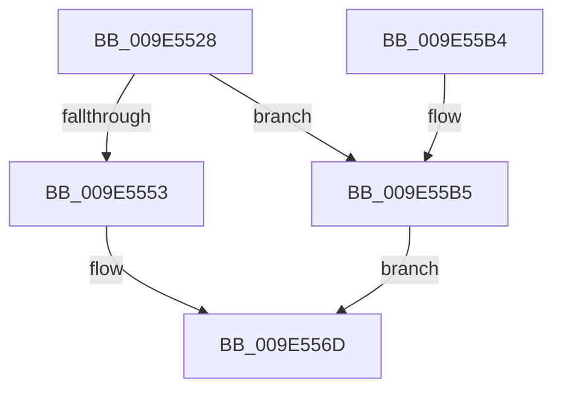

# MiInitializeFixupVad

- RVA: `0x009E5528`–`0x009E55C2` (길이 `154` bytes)
- VA: `0x00000001409E5528`
- 실행 섹션: `PAGE`
- PDB 이름 있음: `예`; PDB Function 태그: `아니요`
- unwind 정보 RVA: `0x0006AD84`
- 디코드: `41`개 명령, `154/154` bytes 표시
- 미해석 바이트: `0` (있으면 어셈블리에 `.byte`로 보존)

> 이 문서는 커널 이미지의 기계어와 PDB 기호를 분석해 생성했습니다. 4번과 5번은 함수 원형과 자료형을 바이너리 사용 방식에서 추정한 C 해석이며 원본 소스 복구 결과는 아닙니다.

## 1. Dependencies

- 직접 호출 지점: **1**; 고유 호출 대상: **1**
- 직접 호출자로 확인된 함수: **1**
- RIP 상대 이미지 참조: **0**

### Outgoing calls
- `0x009E559A` → [MiInitializePrivateFixupBitmap](MiInitializePrivateFixupBitmap_function_009E55C8.md) (function, `0x009E55C8`)

### Direct callers
- [MiMapViewOfImageSection](../97/MiMapViewOfImageSection_function_0097E92C.md) at `0x0097F7E6`

### Static image references
- 디코드된 RIP-relative 메모리 참조가 없습니다.

## 2. Other-region calls and transfers

- 다른 실행 섹션으로 향하는 call: **0**
- 별도 외부 분기/꼬리 이동을 확인하지 못했습니다.

## 3. Assembly (complete function range)

```asm
009E5528  40 53                           push rbx
009E552A  48 83 EC 20                     sub rsp, 0x20
009E552E  48 8B 41 48                     mov rax, qword ptr [rcx + 0x48]
009E5532  44 8B CA                        mov r9d, edx
009E5535  48 8B D9                        mov rbx, rcx
009E5538  48 8B 10                        mov rdx, qword ptr [rax]
009E553B  48 8B 42 60                     mov rax, qword ptr [rdx + 0x60]
009E553F  4C 8B 92 88 00 00 00            mov r10, qword ptr [rdx + 0x88]
009E5546  48 83 E0 F8                     and rax, 0xfffffffffffffff8
009E554A  48 8B 48 20                     mov rcx, qword ptr [rax + 0x20]
009E554E  45 85 C0                        test r8d, r8d
009E5551  75 62                           jne 0x1409e55b5
009E5553  8B 43 18                        mov eax, dword ptr [rbx + 0x18]
009E5556  44 0F B6 43 20                  movzx r8d, byte ptr [rbx + 0x20]
009E555B  49 C1 E0 20                     shl r8, 0x20
009E555F  4C 0B C0                        or r8, rax
009E5562  48 8B 02                        mov rax, qword ptr [rdx]
009E5565  49 C1 E0 0C                     shl r8, 0xc
009E5569  4C 2B 40 20                     sub r8, qword ptr [rax + 0x20]
009E556D  48 8B 43 50                     mov rax, qword ptr [rbx + 0x50]
009E5571  48 8D 8B 98 00 00 00            lea rcx, [rbx + 0x98]
009E5578  49 2B C2                        sub rax, r10
009E557B  44 89 8B 88 00 00 00            mov dword ptr [rbx + 0x88], r9d
009E5582  48 C1 F8 03                     sar rax, 3
009E5586  48 69 C0 00 F0 FF FF            imul rax, rax, -0x1000
009E558D  49 03 C0                        add rax, r8
009E5590  45 8B C1                        mov r8d, r9d
009E5593  48 89 83 90 00 00 00            mov qword ptr [rbx + 0x90], rax
009E559A  E8 29 00 00 00                  call 0x1409e55c8
009E559F  89 43 34                        mov dword ptr [rbx + 0x34], eax
009E55A2  48 C1 E8 20                     shr rax, 0x20
009E55A6  88 43 22                        mov byte ptr [rbx + 0x22], al
009E55A9  0F BA 6B 30 16                  bts dword ptr [rbx + 0x30], 0x16
009E55AE  48 83 C4 20                     add rsp, 0x20
009E55B2  5B                              pop rbx
009E55B3  C3                              ret
009E55B4  CC                              int3
009E55B5  4C 8B 41 30                     mov r8, qword ptr [rcx + 0x30]
009E55B9  4C 03 41 28                     add r8, qword ptr [rcx + 0x28]
009E55BD  49 F7 D8                        neg r8
009E55C0  EB AB                           jmp 0x1409e556d
```

## 4. C-style interpretation (structured pseudocode)

```c
__int64 __fastcall MiInitializeFixupVad(__int64 a1, int a2, int a3)
{
    __int64 result;
    __int64 v_rsp;

    v_rsp = (v_rsp) - (32);
    result = (*(unsigned __int64 *)(*(unsigned __int64 *)(*(unsigned __int64 *)(a1 + 72)) + 96)) & (-8);
    if (a3 != 0) goto loc_009E55B5;
    a3 = (*(unsigned __int8 *)(a1 + 32)) << (32);
    a3 = (a3) | ((unsigned int)(*(unsigned int *)(a1 + 24)));
    a3 = (a3) << (12);
    a3 = (a3) - (*(unsigned __int64 *)(*(unsigned __int64 *)(*(unsigned __int64 *)(*(unsigned __int64 *)(a1 + 72))) + 32));
loc_009E556D:
    result = (*(unsigned __int64 *)(a1 + 80)) - (*(unsigned __int64 *)(*(unsigned __int64 *)(*(unsigned __int64 *)(a1 + 72)) + 136));
    *(unsigned int *)(a1 + 136) = (unsigned int)((unsigned int)(a2));
    result = (result) >> (3);
    result = (result) * (result);
    result = (result) + (a3);
    *(unsigned __int64 *)(a1 + 144) = result;
    result = MiInitializePrivateFixupBitmap(a1 + 152, *(unsigned __int64 *)(*(unsigned __int64 *)(a1 + 72)), (unsigned int)((unsigned int)((unsigned int)(a2))), (unsigned int)(a2));
    *(unsigned int *)(a1 + 52) = (unsigned int)(result);
    result = (result) >> (32);
    *(unsigned __int8 *)(a1 + 34) = (unsigned __int8)(result);
    v_rsp = (v_rsp) + (32);
    return result;
loc_009E55B5:
    a3 = (*(unsigned __int64 *)(a1 + 152 + 48)) + (*(unsigned __int64 *)(a1 + 152 + 40));
    a3 = -(a3);
    goto loc_009E556D;
}
```

## 5. (Beta) C Style

```c
int64_t MiInitializeFixupVad(void *Arg1, int32_t Arg2, int32_t Arg3)
{
    uint8_t *arg1 = (uint8_t *)Arg1;

    int64_t result;
    int64_t local_rsp;

    local_rsp = (local_rsp) - (32);
    result = (*(uint64_t *)(*(uint64_t *)(*(uint64_t *)(arg1 + 0x48)) + 0x60)) & (-8);
    if (Arg3 != 0) goto loc_009E55B5;
    Arg3 = (*(uint8_t *)(arg1 + 0x20)) << (32);
    Arg3 = (Arg3) | ((uint32_t)(*(uint32_t *)(arg1 + 0x18)));
    Arg3 = (Arg3) << (12);
    Arg3 = (Arg3) - (*(uint64_t *)(*(uint64_t *)(*(uint64_t *)(*(uint64_t *)(arg1 + 0x48))) + 0x20));
loc_009E556D:
    result = (*(uint64_t *)(arg1 + 0x50)) - (*(uint64_t *)(*(uint64_t *)(*(uint64_t *)(arg1 + 0x48)) + 0x88));
    *(uint32_t *)(arg1 + 0x88) = (uint32_t)((uint32_t)(Arg2));
    result = (result) >> (3);
    result = (result) * (result);
    result = (result) + (Arg3);
    *(uint64_t *)(arg1 + 0x90) = result;
    result = MiInitializePrivateFixupBitmap(Arg1 + 152, *(uint64_t *)(*(uint64_t *)(arg1 + 0x48)), (uint32_t)((uint32_t)((uint32_t)(Arg2))), (uint32_t)(Arg2));
    *(uint32_t *)(arg1 + 0x34) = (uint32_t)(result);
    result = (result) >> (32);
    *(uint8_t *)(arg1 + 0x22) = (uint8_t)(result);
    local_rsp = (local_rsp) + (32);
    return result;
loc_009E55B5:
    Arg3 = (*(uint64_t *)(arg1 + 0x98 + 0x30)) + (*(uint64_t *)(arg1 + 0x98 + 0x28));
    Arg3 = -(Arg3);
    goto loc_009E556D;
}
```

### 관측된 메모리 오프셋

구조체 형식이 확인되지 않은 접근은 인자 기준의 오프셋으로만 기록했습니다.

| 기준 인자 | 오프셋 표현 | 폭 (bit) | 접근 |
|---|---:|---:|---|
| `Arg1` | `+ 0x18` | `32` | `R` |
| `Arg1` | `+ 0x20` | `8` | `R` |
| `Arg1` | `+ 0x22` | `8` | `W` |
| `Arg1` | `+ 0x30` | `32` | `R/W` |
| `Arg1` | `+ 0x34` | `32` | `W` |
| `Arg1` | `+ 0x48` | `64` | `R` |
| `Arg1` | `+ 0x50` | `64` | `R` |
| `Arg1` | `+ 0x88` | `32` | `W` |
| `Arg1` | `+ 0x90` | `64` | `W` |
| `Arg1` | `+ 0x98` | `64` | `R` |

## 6. Execution-region graph

[열기: 2D/3D 그래프와 함수 탐색 컨트롤 패널](../../../control-panel.html?section=page&rva=0x009E5528&view=graph)

- 2D 그래프는 위에서 아래로 흐르고, 3D 그래프는 빈 공간을 드래그해 회전합니다. Shift+드래그는 이동, 휠은 확대·축소, 함수 노드 선택은 대상 보고서 이동입니다.

### Static fallback


