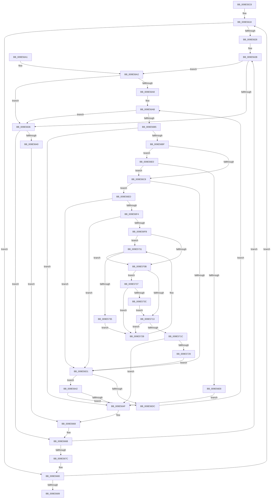

# MiInitializePrivateFixupBitmap

- RVA: `0x009E55C8`–`0x009E573E` (길이 `374` bytes)
- VA: `0x00000001409E55C8`
- 실행 섹션: `PAGE`
- PDB 이름 있음: `예`; PDB Function 태그: `아니요`
- unwind 정보 RVA: `0x000A41C4`
- 디코드: `127`개 명령, `374/374` bytes 표시
- 미해석 바이트: `0` (있으면 어셈블리에 `.byte`로 보존)

> 이 문서는 커널 이미지의 기계어와 PDB 기호를 분석해 생성했습니다. 4번과 5번은 함수 원형과 자료형을 바이너리 사용 방식에서 추정한 C 해석이며 원본 소스 복구 결과는 아닙니다.

## 1. Dependencies

- 직접 호출 지점: **3**; 고유 호출 대상: **3**
- 직접 호출자로 확인된 함수: **2**
- RIP 상대 이미지 참조: **0**

### Outgoing calls
- `0x009E5609` → [RtlClearAllBits](../../text/45/RtlClearAllBits_function_00450230.md) (function, `0x00450230`)
- `0x009E5642` → [HalAdjustResourceList](../../text/48/HalAdjustResourceList_function_0048FDC0.md) (function, `0x0048FDC0`)
- `0x009E572B` → [gsl::details::terminate](../../text/4F/gsl_details_terminate_function_004F9AA0.md) (function, `0x004F9AA0`)

### Direct callers
- [MiAddPrivateFixupEntryForSystemImage](../../text/4B/MiAddPrivateFixupEntryForSystemImage_function_004BAA18.md) at `0x004BAAB2`
- [MiInitializeFixupVad](MiInitializeFixupVad_function_009E5528.md) at `0x009E559A`

### Static image references
- 디코드된 RIP-relative 메모리 참조가 없습니다.

## 2. Other-region calls and transfers

- 다른 실행 섹션으로 향하는 call: **3**
  - `0x009E5609` → [RtlClearAllBits](../../text/45/RtlClearAllBits_function_00450230.md) (`PAGE` → `.text`)
  - `0x009E5642` → [HalAdjustResourceList](../../text/48/HalAdjustResourceList_function_0048FDC0.md) (`PAGE` → `.text`)
  - `0x009E572B` → [gsl::details::terminate](../../text/4F/gsl_details_terminate_function_004F9AA0.md) (`PAGE` → `.text`)
- 별도 외부 분기/꼬리 이동을 확인하지 못했습니다.

## 3. Assembly (complete function range)

```asm
009E55C8  48 89 5C 24 10                  mov qword ptr [rsp + 0x10], rbx
009E55CD  44 89 44 24 18                  mov dword ptr [rsp + 0x18], r8d
009E55D2  55                              push rbp
009E55D3  56                              push rsi
009E55D4  57                              push rdi
009E55D5  41 54                           push r12
009E55D7  41 55                           push r13
009E55D9  41 56                           push r14
009E55DB  41 57                           push r15
009E55DD  48 83 EC 20                     sub rsp, 0x20
009E55E1  48 8B 02                        mov rax, qword ptr [rdx]
009E55E4  41 8B E8                        mov ebp, r8d
009E55E7  48 8B 7A 60                     mov rdi, qword ptr [rdx + 0x60]
009E55EB  48 8B DA                        mov rbx, rdx
009E55EE  48 83 E7 F8                     and rdi, 0xfffffffffffffff8
009E55F2  4C 8B F9                        mov r15, rcx
009E55F5  48 89 7C 24 60                  mov qword ptr [rsp + 0x60], rdi
009E55FA  44 8B 48 08                     mov r9d, dword ptr [rax + 8]
009E55FE  48 8D 41 10                     lea rax, [rcx + 0x10]
009E5602  48 89 41 08                     mov qword ptr [rcx + 8], rax
009E5606  44 89 09                        mov dword ptr [rcx], r9d
009E5609  E8 22 AC A6 FF                  call 0x140450230
009E560E  45 33 C0                        xor r8d, r8d
009E5611  45 33 DB                        xor r11d, r11d
009E5614  48 83 EB 80                     sub rbx, -0x80
009E5618  4C 8B 4B 08                     mov r9, qword ptr [rbx + 8]
009E561C  8B 43 2C                        mov eax, dword ptr [rbx + 0x2c]
009E561F  4D 8D 24 C1                     lea r12, [r9 + rax*8]
009E5623  4D 3B CC                        cmp r9, r12
009E5626  73 58                           jae 0x1409e5680
009E5628  83 E5 01                        and ebp, 1
009E562B  48 8B 7F 20                     mov rdi, qword ptr [rdi + 0x20]
009E562F  4C 8B 2F                        mov r13, qword ptr [rdi]
009E5632  85 ED                           test ebp, ebp
009E5634  75 6C                           jne 0x1409e56a2
009E5636  8B 43 20                        mov eax, dword ptr [rbx + 0x20]
009E5639  83 E0 0A                        and eax, 0xa
009E563C  3C 0A                           cmp al, 0xa
009E563E  75 2B                           jne 0x1409e566b
009E5640  EB 26                           jmp 0x1409e5668
009E5642  E8 79 A7 AA FF                  call 0x14048fdc0
009E5647  85 C0                           test eax, eax
009E5649  0F 84 8D 00 00 00               je 0x1409e56dc
009E564F  41 8B D0                        mov edx, r8d
009E5652  41 8B C0                        mov eax, r8d
009E5655  48 C1 EA 03                     shr rdx, 3
009E5659  83 E0 07                        and eax, 7
009E565C  49 03 57 08                     add rdx, qword ptr [r15 + 8]
009E5660  0F BE 0A                        movsx ecx, byte ptr [rdx]
009E5663  0F AB C1                        bts ecx, eax
009E5666  88 0A                           mov byte ptr [rdx], cl
009E5668  49 FF C3                        inc r11
009E566B  48 8B 7C 24 60                  mov rdi, qword ptr [rsp + 0x60]
009E5670  49 83 C1 08                     add r9, 8
009E5674  41 FF C0                        inc r8d
009E5677  4D 3B CC                        cmp r9, r12
009E567A  72 AF                           jb 0x1409e562b
009E567C  8B 6C 24 70                     mov ebp, dword ptr [rsp + 0x70]
009E5680  48 8B 5B 10                     mov rbx, qword ptr [rbx + 0x10]
009E5684  48 85 DB                        test rbx, rbx
009E5687  75 8F                           jne 0x1409e5618
009E5689  48 8B 5C 24 68                  mov rbx, qword ptr [rsp + 0x68]
009E568E  49 8B C3                        mov rax, r11
009E5691  48 83 C4 20                     add rsp, 0x20
009E5695  41 5F                           pop r15
009E5697  41 5E                           pop r14
009E5699  41 5D                           pop r13
009E569B  41 5C                           pop r12
009E569D  5F                              pop rdi
009E569E  5E                              pop rsi
009E569F  5D                              pop rbp
009E56A0  C3                              ret
009E56A1  CC                              int3
009E56A2  44 3B 47 38                     cmp r8d, dword ptr [rdi + 0x38]
009E56A6  73 8E                           jae 0x1409e5636
009E56A8  41 8B C8                        mov ecx, r8d
009E56AB  8B C1                           mov eax, ecx
009E56AD  41 2B C0                        sub eax, r8d
009E56B0  83 F8 01                        cmp eax, 1
009E56B3  73 81                           jae 0x1409e5636
009E56B5  8B D1                           mov edx, ecx
009E56B7  49 83 7C D5 00 00               cmp qword ptr [r13 + rdx*8], 0
009E56BD  75 90                           jne 0x1409e564f
009E56BF  48 8B 47 58                     mov rax, qword ptr [rdi + 0x58]
009E56C3  48 85 C0                        test rax, rax
009E56C6  75 18                           jne 0x1409e56e0
009E56C8  48 8B 47 60                     mov rax, qword ptr [rdi + 0x60]
009E56CC  48 85 C0                        test rax, rax
009E56CF  75 1C                           jne 0x1409e56ed
009E56D1  F6 44 24 70 02                  test byte ptr [rsp + 0x70], 2
009E56D6  0F 85 66 FF FF FF               jne 0x1409e5642
009E56DC  FF C1                           inc ecx
009E56DE  EB CB                           jmp 0x1409e56ab
009E56E0  48 83 7C D0 40 00               cmp qword ptr [rax + rdx*8 + 0x40], 0
009E56E6  74 E0                           je 0x1409e56c8
009E56E8  E9 62 FF FF FF                  jmp 0x1409e564f
009E56ED  8B 70 20                        mov esi, dword ptr [rax + 0x20]
009E56F0  3B CE                           cmp ecx, esi
009E56F2  72 DD                           jb 0x1409e56d1
009E56F4  8B 50 24                        mov edx, dword ptr [rax + 0x24]
009E56F7  3B CA                           cmp ecx, edx
009E56F9  77 D6                           ja 0x1409e56d1
009E56FB  4C 8B 70 18                     mov r14, qword ptr [rax + 0x18]
009E56FF  2B D6                           sub edx, esi
009E5701  FF C2                           inc edx
009E5703  44 8B D2                        mov r10d, edx
009E5706  4D 85 F6                        test r14, r14
009E5709  74 26                           je 0x1409e5731
009E570B  49 8B D2                        mov rdx, r10
009E570E  4D 85 F6                        test r14, r14
009E5711  74 24                           je 0x1409e5737
009E5713  8B C1                           mov eax, ecx
009E5715  2B C6                           sub eax, esi
009E5717  48 3B C2                        cmp rax, rdx
009E571A  73 0F                           jae 0x1409e572b
009E571C  49 8B 04 C6                     mov rax, qword ptr [r14 + rax*8]
009E5720  48 85 C0                        test rax, rax
009E5723  0F 85 26 FF FF FF               jne 0x1409e564f
009E5729  EB A6                           jmp 0x1409e56d1
009E572B  E8 70 43 B1 FF                  call 0x1404f9aa0
009E5730  CC                              int3
009E5731  85 D2                           test edx, edx
009E5733  74 D6                           je 0x1409e570b
009E5735  EB F4                           jmp 0x1409e572b
009E5737  4D 85 D2                        test r10, r10
009E573A  75 EF                           jne 0x1409e572b
009E573C  EB D5                           jmp 0x1409e5713
```

## 4. C-style interpretation (structured pseudocode)

```c
__int64 __fastcall MiInitializePrivateFixupBitmap(__int64 a1, __int64 a2, int a3)
{
    __int64 result;
    __int64 v_r11;
    __int64 v_rbp;
    __int64 v_rbx;
    __int64 v_rdi;
    __int64 v_rsp;
    unsigned __int64 v_stack_p10;
    unsigned int v_stack_p18;
    unsigned __int8 v_stack_p70;
    unsigned __int64 v_stack_p8;

    v_stack_p10 = v_rbx;
    v_stack_p18 = a3;
    v_rsp = (v_rsp) - (32);
    v_rdi = (*(unsigned __int64 *)(a2 + 96)) & (-8);
    v_stack_p8 = v_rdi;
    *(unsigned __int64 *)(a1 + 8) = a1 + 16;
    *(unsigned int *)(a1) = (unsigned int)((unsigned int)(*(unsigned int *)(*(unsigned __int64 *)(a2) + 8)));
    result = RtlClearAllBits(a1, a2, a3, (unsigned int)(*(unsigned int *)(*(unsigned __int64 *)(a2) + 8)));
    a3 = 0;
    v_r11 = 0;
    v_rbx = (a2) - (-128);
loc_009E5618:
    if ((*(unsigned __int64 *)(v_rbx + 8)) >= (*(unsigned __int64 *)(v_rbx + 8) + (unsigned int)(*(unsigned int *)(v_rbx + 44)) * 8)) goto loc_009E5680;
    v_rbp = (unsigned int)(((unsigned int)(a3)) & (1));
loc_009E562B:
    if ((unsigned int)(v_rbp) != 0) goto loc_009E56A2;
loc_009E5636:
    result = (unsigned int)(((unsigned int)(*(unsigned int *)(v_rbx + 32))) & (10));
    if (((unsigned __int8)(result)) != 10) goto loc_009E566B;
    goto loc_009E5668;
loc_009E5642:
    result = HalAdjustResourceList(a1, a2, a3, *(unsigned __int64 *)(v_rbx + 8));
    if ((unsigned int)(result) == 0) goto loc_009E56DC;
loc_009E564F:
    a2 = (0) >> (3);
    result = (unsigned int)((0) & (7));
    a2 = (a2) + (*(unsigned __int64 *)(a1 + 8));
    *(unsigned __int8 *)(a2) = (unsigned __int8)((__int8)(*(unsigned __int8 *)(a2)));
loc_009E5668:
    v_r11 = (v_r11) + 1;
loc_009E566B:
    a4 = (*(unsigned __int64 *)(v_rbx + 8)) + (8);
    a3 = (unsigned int)((a3) + 1);
    if (a4 < (*(unsigned __int64 *)(v_rbx + 8) + (unsigned int)(*(unsigned int *)(v_rbx + 44)) * 8)) goto loc_009E562B;
loc_009E5680:
    if (*(unsigned __int64 *)(v_rbx + 16) != 0) goto loc_009E5618;
    v_rsp = (v_rsp) + (32);
    return v_r11;
loc_009E56A2:
    if (a3 >= (*(unsigned int *)(v_stack_p8 + 56))) goto loc_009E5636;
loc_009E56AB:
    result = (unsigned int)(((unsigned int)((unsigned int)((unsigned int)(a3)))) - (a3));
    if (((unsigned int)(result)) >= 1) goto loc_009E5636;
    if ((*(unsigned __int64 *)(*(unsigned __int64 *)(*(unsigned __int64 *)(v_rdi + 32)) + (unsigned int)((unsigned int)((unsigned int)(a3))) * 8)) != 0) goto loc_009E564F;
    if (*(unsigned __int64 *)(v_stack_p8 + 88) != 0) goto loc_009E56E0;
loc_009E56C8:
    if (*(unsigned __int64 *)(v_stack_p8 + 96) != 0) goto loc_009E56ED;
loc_009E56D1:
    if (((v_stack_p70) & (2)) != 0) goto loc_009E5642;
loc_009E56DC:
    a1 = (unsigned int)(((unsigned int)(a3)) + 1);
    goto loc_009E56AB;
loc_009E56E0:
    if ((*(unsigned __int64 *)(*(unsigned __int64 *)(v_stack_p8 + 96) + (unsigned int)((unsigned int)((unsigned int)(a3))) * 8 + 64)) == 0) goto loc_009E56C8;
    goto loc_009E564F;
loc_009E56ED:
    if (((unsigned int)(a1)) < ((unsigned int)((unsigned int)(*(unsigned int *)(*(unsigned __int64 *)(v_stack_p8 + 96) + 32))))) goto loc_009E56D1;
    if (((unsigned int)(a1)) > ((unsigned int)((unsigned int)(*(unsigned int *)(*(unsigned __int64 *)(v_stack_p8 + 96) + 36))))) goto loc_009E56D1;
    a2 = (unsigned int)(((unsigned int)(*(unsigned int *)(*(unsigned __int64 *)(v_stack_p8 + 96) + 36))) - ((unsigned int)((unsigned int)(*(unsigned int *)(*(unsigned __int64 *)(v_stack_p8 + 96) + 32)))));
    a2 = (unsigned int)((a2) + 1);
    if (*(unsigned __int64 *)(*(unsigned __int64 *)(v_stack_p8 + 96) + 24) == 0) goto loc_009E5731;
loc_009E570B:
    if (*(unsigned __int64 *)(*(unsigned __int64 *)(v_stack_p8 + 96) + 24) == 0) goto loc_009E5737;
loc_009E5713:
    result = (unsigned int)(((unsigned int)((unsigned int)(a1))) - ((unsigned int)((unsigned int)(*(unsigned int *)(*(unsigned __int64 *)(v_stack_p8 + 96) + 32)))));
    if (result >= ((unsigned int)((unsigned int)(a2)))) goto loc_009E572B;
    if (*(unsigned __int64 *)(*(unsigned __int64 *)(*(unsigned __int64 *)(v_stack_p8 + 96) + 24) + result * 8) != 0) goto loc_009E564F;
    goto loc_009E56D1;
loc_009E572B:
    result = gsl__details__terminate(a1, (unsigned int)((unsigned int)(a2)), a3, a4);
loc_009E5731:
    if ((unsigned int)((unsigned int)((unsigned int)(a2))) == 0) goto loc_009E570B;
    goto loc_009E572B;
loc_009E5737:
    if ((unsigned int)((unsigned int)(a2)) != 0) goto loc_009E572B;
    goto loc_009E5713;
}
```

## 5. (Beta) C Style

```c
int64_t MiInitializePrivateFixupBitmap(void *Arg1, void *Arg2, int32_t Arg3)
{
    uint8_t *arg1 = (uint8_t *)Arg1;
    uint8_t *arg2 = (uint8_t *)Arg2;

    int64_t result;
    int64_t local_r11;
    int64_t local_rbp;
    int64_t local_rbx;
    int64_t local_rdi;
    int64_t local_rsp;
    uint64_t v_stack_p10;
    uint32_t v_stack_p18;
    uint8_t v_stack_p70;
    uint64_t v_stack_p8;

    v_stack_p10 = local_rbx;
    v_stack_p18 = Arg3;
    local_rsp = (local_rsp) - (32);
    local_rdi = (*(uint64_t *)(arg2 + 0x60)) & (-8);
    v_stack_p8 = local_rdi;
    *(void **)(arg1 + 0x8) = Arg1 + 16;
    *(uint32_t *)(arg1) = (uint32_t)((uint32_t)(*(uint32_t *)(*(uint64_t *)(arg2) + 0x8)));
    result = RtlClearAllBits(Arg1, Arg2, Arg3, (uint32_t)(*(uint32_t *)(*(uint64_t *)(arg2) + 0x8)));
    Arg3 = 0;
    local_r11 = 0;
    local_rbx = (Arg2) - (-128);
loc_009E5618:
    if ((*(uint64_t *)(local_rbx + 0x8)) >= (*(uint64_t *)(local_rbx + 0x8) + (uint32_t)(*(uint32_t *)(local_rbx + 0x2C)) * 8)) goto loc_009E5680;
    local_rbp = (uint32_t)(((uint32_t)(Arg3)) & (1));
loc_009E562B:
    if ((uint32_t)(local_rbp) != 0) goto loc_009E56A2;
loc_009E5636:
    result = (uint32_t)(((uint32_t)(*(uint32_t *)(local_rbx + 0x20))) & (10));
    if (((uint8_t)(result)) != 10) goto loc_009E566B;
    goto loc_009E5668;
loc_009E5642:
    result = HalAdjustResourceList(Arg1, Arg2, Arg3, *(uint64_t *)(local_rbx + 0x8));
    if ((uint32_t)(result) == 0) goto loc_009E56DC;
loc_009E564F:
    Arg2 = (0) >> (3);
    result = (uint32_t)((0) & (7));
    Arg2 = (Arg2) + (*(uint64_t *)(arg1 + 0x8));
    *(uint8_t *)(arg2) = (uint8_t)((int8_t)(*(uint8_t *)(arg2)));
loc_009E5668:
    local_r11 = (local_r11) + 1;
loc_009E566B:
    a4 = (*(uint64_t *)(local_rbx + 0x8)) + (8);
    Arg3 = (uint32_t)((Arg3) + 1);
    if (a4 < (*(uint64_t *)(local_rbx + 0x8) + (uint32_t)(*(uint32_t *)(local_rbx + 0x2C)) * 8)) goto loc_009E562B;
loc_009E5680:
    if (*(uint64_t *)(local_rbx + 0x10) != 0) goto loc_009E5618;
    local_rsp = (local_rsp) + (32);
    return local_r11;
loc_009E56A2:
    if (Arg3 >= (*(uint32_t *)(v_stack_p8 + 0x38))) goto loc_009E5636;
loc_009E56AB:
    result = (uint32_t)(((uint32_t)((uint32_t)((uint32_t)(Arg3)))) - (Arg3));
    if (((uint32_t)(result)) >= 1) goto loc_009E5636;
    if ((*(uint64_t *)(*(uint64_t *)(*(uint64_t *)(local_rdi + 0x20)) + (uint32_t)((uint32_t)((uint32_t)(Arg3))) * 8)) != 0) goto loc_009E564F;
    if (*(uint64_t *)(v_stack_p8 + 0x58) != 0) goto loc_009E56E0;
loc_009E56C8:
    if (*(uint64_t *)(v_stack_p8 + 0x60) != 0) goto loc_009E56ED;
loc_009E56D1:
    if (((v_stack_p70) & (2)) != 0) goto loc_009E5642;
loc_009E56DC:
    Arg1 = (uint32_t)(((uint32_t)(Arg3)) + 1);
    goto loc_009E56AB;
loc_009E56E0:
    if ((*(uint64_t *)(*(uint64_t *)(v_stack_p8 + 0x60) + (uint32_t)((uint32_t)((uint32_t)(Arg3))) * 8 + 0x40)) == 0) goto loc_009E56C8;
    goto loc_009E564F;
loc_009E56ED:
    if (((uint32_t)(Arg1)) < ((uint32_t)((uint32_t)(*(uint32_t *)(*(uint64_t *)(v_stack_p8 + 0x60) + 0x20))))) goto loc_009E56D1;
    if (((uint32_t)(Arg1)) > ((uint32_t)((uint32_t)(*(uint32_t *)(*(uint64_t *)(v_stack_p8 + 0x60) + 0x24))))) goto loc_009E56D1;
    Arg2 = (uint32_t)(((uint32_t)(*(uint32_t *)(*(uint64_t *)(v_stack_p8 + 0x60) + 0x24))) - ((uint32_t)((uint32_t)(*(uint32_t *)(*(uint64_t *)(v_stack_p8 + 0x60) + 0x20)))));
    Arg2 = (uint32_t)((Arg2) + 1);
    if (*(uint64_t *)(*(uint64_t *)(v_stack_p8 + 0x60) + 0x18) == 0) goto loc_009E5731;
loc_009E570B:
    if (*(uint64_t *)(*(uint64_t *)(v_stack_p8 + 0x60) + 0x18) == 0) goto loc_009E5737;
loc_009E5713:
    result = (uint32_t)(((uint32_t)((uint32_t)(Arg1))) - ((uint32_t)((uint32_t)(*(uint32_t *)(*(uint64_t *)(v_stack_p8 + 0x60) + 0x20)))));
    if (result >= ((uint32_t)((uint32_t)(Arg2)))) goto loc_009E572B;
    if (*(uint64_t *)(*(uint64_t *)(*(uint64_t *)(v_stack_p8 + 0x60) + 0x18) + result * 8) != 0) goto loc_009E564F;
    goto loc_009E56D1;
loc_009E572B:
    result = gsl__details__terminate(Arg1, (uint32_t)((uint32_t)(Arg2)), Arg3, a4);
loc_009E5731:
    if ((uint32_t)((uint32_t)((uint32_t)(Arg2))) == 0) goto loc_009E570B;
    goto loc_009E572B;
loc_009E5737:
    if ((uint32_t)((uint32_t)(Arg2)) != 0) goto loc_009E572B;
    goto loc_009E5713;
}
```

### 관측된 메모리 오프셋

구조체 형식이 확인되지 않은 접근은 인자 기준의 오프셋으로만 기록했습니다.

| 기준 인자 | 오프셋 표현 | 폭 (bit) | 접근 |
|---|---:|---:|---|
| `Arg1` | `+ 0x0` | `32` | `W` |
| `Arg1` | `+ 0x8` | `64` | `R` |
| `Arg1` | `+ 0x8` | `64` | `W` |
| `Arg1` | `+ 0x10` | `64` | `R` |
| `Arg2` | `+ 0x0` | `64` | `R` |
| `Arg2` | `+ 0x60` | `64` | `R` |

## 6. Execution-region graph

[열기: 2D/3D 그래프와 함수 탐색 컨트롤 패널](../../../control-panel.html?section=page&rva=0x009E55C8&view=graph)

- 2D 그래프는 위에서 아래로 흐르고, 3D 그래프는 빈 공간을 드래그해 회전합니다. Shift+드래그는 이동, 휠은 확대·축소, 함수 노드 선택은 대상 보고서 이동입니다.

### Static fallback


