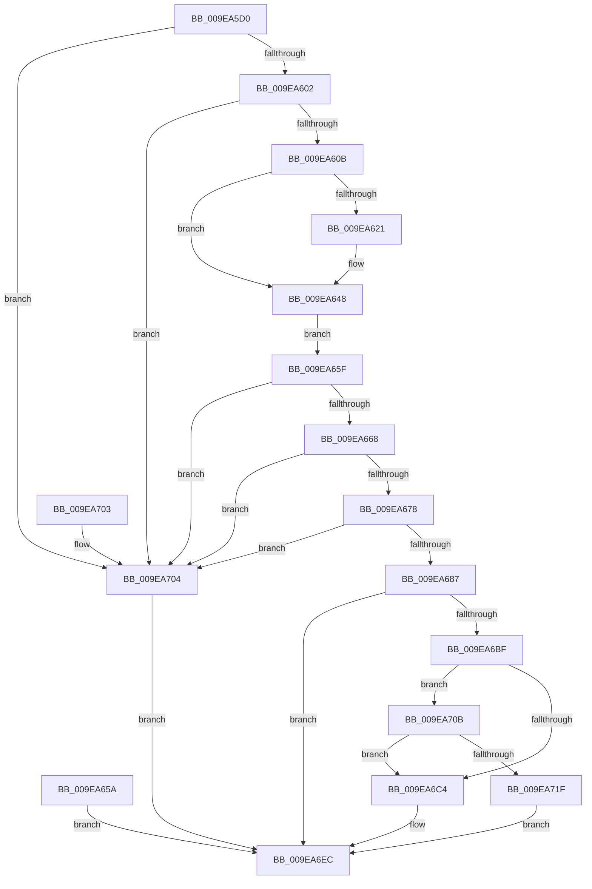

# MiLockUnlockCommon

- RVA: `0x009EA5D0`–`0x009EA735` (길이 `357` bytes)
- VA: `0x00000001409EA5D0`
- 실행 섹션: `PAGE`
- PDB 이름 있음: `예`; PDB Function 태그: `아니요`
- unwind 정보 RVA: `0x000A537C`
- 디코드: `85`개 명령, `357/357` bytes 표시
- 미해석 바이트: `0` (있으면 어셈블리에 `.byte`로 보존)

> 이 문서는 커널 이미지의 기계어와 PDB 기호를 분석해 생성했습니다. 4번과 5번은 함수 원형과 자료형을 바이너리 사용 방식에서 추정한 C 해석이며 원본 소스 복구 결과는 아닙니다.

## 1. Dependencies

- 직접 호출 지점: **3**; 고유 호출 대상: **3**
- 직접 호출자로 확인된 함수: **2**
- RIP 상대 이미지 참조: **2**

### Outgoing calls
- `0x009EA6B6` → [ObpReferenceObjectByHandleWithTag](../86/ObpReferenceObjectByHandleWithTag_function_00869650.md) (function, `0x00869650`)
- `0x009EA716` → [SeSinglePrivilegeCheck](../87/SeSinglePrivilegeCheck_function_00871E20.md) (function, `0x00871E20`)
- `0x009EA729` → [ObfDereferenceObjectWithTag](../../text/2F/ObfDereferenceObjectWithTag_function_002F78E0.md) (function, `0x002F78E0`)

### Direct callers
- [NtLockVirtualMemory](../../text/40/NtLockVirtualMemory_function_004088A0.md) at `0x00408931`
- [NtUnlockVirtualMemory](../../text/4E/NtUnlockVirtualMemory_function_004EE890.md) at `0x004EE90E`

### Static image references
- `0x009EA687` → RVA `0x00FC6A98` (`ALMOSTRO`; read)
- `0x009EA70F` → RVA `0x00FD9AD0` (`PAGEDATA`; read)

## 2. Other-region calls and transfers

- 다른 실행 섹션으로 향하는 call: **1**
  - `0x009EA729` → [ObfDereferenceObjectWithTag](../../text/2F/ObfDereferenceObjectWithTag_function_002F78E0.md) (`PAGE` → `.text`)
- 별도 외부 분기/꼬리 이동을 확인하지 못했습니다.

## 3. Assembly (complete function range)

```asm
009EA5D0  48 89 5C 24 08                  mov qword ptr [rsp + 8], rbx
009EA5D5  48 89 74 24 10                  mov qword ptr [rsp + 0x10], rsi
009EA5DA  48 89 7C 24 18                  mov qword ptr [rsp + 0x18], rdi
009EA5DF  41 56                           push r14
009EA5E1  48 83 EC 70                     sub rsp, 0x70
009EA5E5  41 8B D9                        mov ebx, r9d
009EA5E8  48 8B F2                        mov rsi, rdx
009EA5EB  4C 8B D1                        mov r10, rcx
009EA5EE  45 33 C9                        xor r9d, r9d
009EA5F1  4C 89 4C 24 48                  mov qword ptr [rsp + 0x48], r9
009EA5F6  F7 C3 FC FF FF FF               test ebx, 0xfffffffc
009EA5FC  0F 85 02 01 00 00               jne 0x1409ea704
009EA602  F6 C3 03                        test bl, 3
009EA605  0F 84 F9 00 00 00               je 0x1409ea704
009EA60B  65 48 8B 04 25 88 01 00 00      mov rax, qword ptr gs:[0x188]
009EA614  44 0F B6 B0 32 02 00 00         movzx r14d, byte ptr [rax + 0x232]
009EA61C  45 84 F6                        test r14b, r14b
009EA61F  74 27                           je 0x1409ea648
009EA621  48 BA 00 00 FF FF FF 7F 00 00   movabs rdx, 0x7fffffff0000
009EA62B  48 8B CA                        mov rcx, rdx
009EA62E  48 3B F2                        cmp rsi, rdx
009EA631  48 0F 42 CE                     cmovb rcx, rsi
009EA635  48 8B 01                        mov rax, qword ptr [rcx]
009EA638  48 89 01                        mov qword ptr [rcx], rax
009EA63B  4C 3B C2                        cmp r8, rdx
009EA63E  49 0F 42 D0                     cmovb rdx, r8
009EA642  48 8B 02                        mov rax, qword ptr [rdx]
009EA645  48 89 02                        mov qword ptr [rdx], rax
009EA648  48 8B 36                        mov rsi, qword ptr [rsi]
009EA64B  48 89 74 24 58                  mov qword ptr [rsp + 0x58], rsi
009EA650  49 8B 38                        mov rdi, qword ptr [r8]
009EA653  48 89 7C 24 60                  mov qword ptr [rsp + 0x60], rdi
009EA658  EB 05                           jmp 0x1409ea65f
009EA65A  E9 8D 00 00 00                  jmp 0x1409ea6ec
009EA65F  48 85 FF                        test rdi, rdi
009EA662  0F 84 9C 00 00 00               je 0x1409ea704
009EA668  48 8D 47 FF                     lea rax, [rdi - 1]
009EA66C  48 03 C6                        add rax, rsi
009EA66F  48 3B C6                        cmp rax, rsi
009EA672  0F 82 8C 00 00 00               jb 0x1409ea704
009EA678  48 B9 FF FF FE FF FF 7F 00 00   movabs rcx, 0x7ffffffeffff
009EA682  48 3B C1                        cmp rax, rcx
009EA685  77 7D                           ja 0x1409ea704
009EA687  4C 8B 05 0A C4 5D 00            mov r8, qword ptr [rip + 0x5dc40a]
009EA68E  4C 89 4C 24 38                  mov qword ptr [rsp + 0x38], r9
009EA693  4C 89 4C 24 30                  mov qword ptr [rsp + 0x30], r9
009EA698  48 8D 44 24 48                  lea rax, [rsp + 0x48]
009EA69D  48 89 44 24 28                  mov qword ptr [rsp + 0x28], rax
009EA6A2  C7 44 24 20 4D 6D 56 6D         mov dword ptr [rsp + 0x20], 0x6d566d4d
009EA6AA  45 0F B6 CE                     movzx r9d, r14b
009EA6AE  BA 08 00 00 00                  mov edx, 8
009EA6B3  49 8B CA                        mov rcx, r10
009EA6B6  E8 95 EF E7 FF                  call 0x140869650
009EA6BB  85 C0                           test eax, eax
009EA6BD  78 2D                           js 0x1409ea6ec
009EA6BF  F6 C3 02                        test bl, 2
009EA6C2  75 47                           jne 0x1409ea70b
009EA6C4  48 8B 84 24 A0 00 00 00         mov rax, qword ptr [rsp + 0xa0]
009EA6CC  48 89 30                        mov qword ptr [rax], rsi
009EA6CF  48 8B 84 24 A8 00 00 00         mov rax, qword ptr [rsp + 0xa8]
009EA6D7  48 89 38                        mov qword ptr [rax], rdi
009EA6DA  48 8B 8C 24 B0 00 00 00         mov rcx, qword ptr [rsp + 0xb0]
009EA6E2  48 8B 44 24 48                  mov rax, qword ptr [rsp + 0x48]
009EA6E7  48 89 01                        mov qword ptr [rcx], rax
009EA6EA  33 C0                           xor eax, eax
009EA6EC  4C 8D 5C 24 70                  lea r11, [rsp + 0x70]
009EA6F1  49 8B 5B 10                     mov rbx, qword ptr [r11 + 0x10]
009EA6F5  49 8B 73 18                     mov rsi, qword ptr [r11 + 0x18]
009EA6F9  49 8B 7B 20                     mov rdi, qword ptr [r11 + 0x20]
009EA6FD  49 8B E3                        mov rsp, r11
009EA700  41 5E                           pop r14
009EA702  C3                              ret
009EA703  CC                              int3
009EA704  B8 0D 00 00 C0                  mov eax, 0xc000000d
009EA709  EB E1                           jmp 0x1409ea6ec
009EA70B  41 0F B6 D6                     movzx edx, r14b
009EA70F  48 8B 0D BA F3 5E 00            mov rcx, qword ptr [rip + 0x5ef3ba]
009EA716  E8 05 77 E8 FF                  call 0x140871e20
009EA71B  84 C0                           test al, al
009EA71D  75 A5                           jne 0x1409ea6c4
009EA71F  BA 4D 6D 56 6D                  mov edx, 0x6d566d4d
009EA724  48 8B 4C 24 48                  mov rcx, qword ptr [rsp + 0x48]
009EA729  E8 B2 D1 90 FF                  call 0x1402f78e0
009EA72E  B8 61 00 00 C0                  mov eax, 0xc0000061
009EA733  EB B7                           jmp 0x1409ea6ec
```

## 4. C-style interpretation (structured pseudocode)

```c
__int64 __fastcall MiLockUnlockCommon(__int64 a1, __int64 a2, __int64 a3, int a4, __int64 a5, __int64 a6, __int64 a7)
{
    __int64 result;
    __int64 v_rsp;
    unsigned __int64 v_stack_m18;
    unsigned __int64 v_stack_m20;
    unsigned __int64 v_stack_m28;
    unsigned __int64 v_stack_m30;
    unsigned __int64 v_stack_m40;
    unsigned __int64 v_stack_m48;
    unsigned __int64 v_stack_m50;
    unsigned int v_stack_m58;
    unsigned __int64 v_stack_m8;
    unsigned __int64 v_stack_p10;
    unsigned __int64 v_stack_p18;
    unsigned __int64 v_stack_p8;

    v_stack_p8 = v_rbx;
    v_stack_p10 = v_rsi;
    v_stack_p18 = v_rdi;
    v_rsp = (v_rsp) - (112);
    a4 = 0;
    v_stack_m30 = 0;
    if ((((unsigned int)((unsigned int)(a4))) & (0xFFFFFFFCULL)) != 0) goto loc_009EA704;
    if ((((unsigned __int8)((unsigned int)(a4))) & (3)) == 0) goto loc_009EA704;
    result = *(unsigned __int64 *)(gs_base + (0 + 392));
    if ((unsigned __int8)(*(unsigned __int8 *)(*(unsigned __int64 *)(gs_base + (0 + 392)) + 562)) != 0) {
        a1 = a2;
        if (a2 < a2) { a1 = a2; }
        result = *(unsigned __int64 *)(a1);
        *(unsigned __int64 *)(a1) = result;
        if (a3 < a2) { a2 = a3; }
        result = *(unsigned __int64 *)(a2);
        *(unsigned __int64 *)(a2) = result;
    }
    v_stack_m20 = *(unsigned __int64 *)(a2);
    v_stack_m18 = *(unsigned __int64 *)(a3);
    goto loc_009EA65F;
loc_009EA65F:
    if (*(unsigned __int64 *)(a3) == 0) goto loc_009EA704;
    result = (*(unsigned __int64 *)(a3) - 1) + (*(unsigned __int64 *)(a2));
    if (result < (*(unsigned __int64 *)(a2))) goto loc_009EA704;
    if (result > a1) goto loc_009EA704;
    v_stack_m40 = 0;
    v_stack_m48 = 0;
    v_stack_m50 = v_stack_m30;
    v_stack_m58 = 0x6D566D4DULL;
    result = ObpReferenceObjectByHandleWithTag(a1, 8, *(unsigned __int64 *)(v_rip + 6145034), (unsigned __int8)(*(unsigned __int8 *)(*(unsigned __int64 *)(gs_base + (0 + 392)) + 562)));
    if (sign_flag) goto loc_009EA6EC;
    if ((((unsigned __int8)((unsigned int)(a4))) & (2)) != 0) goto loc_009EA70B;
loc_009EA6C4:
    *(unsigned __int64 *)(a5) = *(unsigned __int64 *)(a2);
    *(unsigned __int64 *)(a6) = *(unsigned __int64 *)(a3);
    *(unsigned __int64 *)(a7) = v_stack_m30;
    result = 0;
loc_009EA6EC:
    return result;
loc_009EA704:
    goto loc_009EA6EC;
loc_009EA70B:
    result = SeSinglePrivilegeCheck(*(unsigned __int64 *)(v_rip + 6222778), (unsigned __int8)(*(unsigned __int8 *)(*(unsigned __int64 *)(gs_base + (0 + 392)) + 562)), *(unsigned __int64 *)(v_rip + 6145034), (unsigned __int8)(*(unsigned __int8 *)(*(unsigned __int64 *)(gs_base + (0 + 392)) + 562)));
    if ((unsigned __int8)(result) != 0) goto loc_009EA6C4;
    result = ObfDereferenceObjectWithTag(v_stack_m28, (unsigned int)(0x6D566D4DULL), *(unsigned __int64 *)(v_rip + 6145034), (unsigned __int8)(*(unsigned __int8 *)(*(unsigned __int64 *)(gs_base + (0 + 392)) + 562)));
    goto loc_009EA6EC;
}
```

## 5. (Beta) C Style

```c
int64_t MiLockUnlockCommon(int64_t Arg1, int64_t Arg2, int64_t Arg3, int32_t Arg4, void *Arg5, void *Arg6, void *Arg7)
{
    uint8_t *arg5 = (uint8_t *)Arg5;
    uint8_t *arg6 = (uint8_t *)Arg6;
    uint8_t *arg7 = (uint8_t *)Arg7;

    int64_t result;
    int64_t local_rsp;
    uint64_t v_stack_m18;
    uint64_t v_stack_m20;
    uint64_t v_stack_m28;
    uint64_t v_stack_m30;
    uint64_t v_stack_m40;
    uint64_t v_stack_m48;
    uint64_t v_stack_m50;
    uint32_t v_stack_m58;
    uint64_t v_stack_m8;
    uint64_t v_stack_p10;
    uint64_t v_stack_p18;
    uint64_t v_stack_p8;

    v_stack_p8 = local_rbx;
    v_stack_p10 = local_rsi;
    v_stack_p18 = local_rdi;
    local_rsp = (local_rsp) - (112);
    Arg4 = 0;
    v_stack_m30 = 0;
    if ((((uint32_t)((uint32_t)(Arg4))) & (0xFFFFFFFCULL)) != 0) goto loc_009EA704;
    if ((((uint8_t)((uint32_t)(Arg4))) & (3)) == 0) goto loc_009EA704;
    result = *(uint64_t *)(gs_base + (0 + 0x188));
    if ((uint8_t)(*(uint8_t *)(*(uint64_t *)(gs_base + (0 + 0x188)) + 0x232)) != 0) {
        Arg1 = Arg2;
        if (Arg2 < Arg2) { Arg1 = Arg2; }
        result = *(uint64_t *)(Arg1);
        *(uint64_t *)(Arg1) = result;
        if (Arg3 < Arg2) { Arg2 = Arg3; }
        result = *(uint64_t *)(Arg2);
        *(uint64_t *)(Arg2) = result;
    }
    v_stack_m20 = *(uint64_t *)(Arg2);
    v_stack_m18 = *(uint64_t *)(Arg3);
    goto loc_009EA65F;
loc_009EA65F:
    if (*(uint64_t *)(Arg3) == 0) goto loc_009EA704;
    result = (*(uint64_t *)(Arg3) - 1) + (*(uint64_t *)(Arg2));
    if (result < (*(uint64_t *)(Arg2))) goto loc_009EA704;
    if (result > Arg1) goto loc_009EA704;
    v_stack_m40 = 0;
    v_stack_m48 = 0;
    v_stack_m50 = v_stack_m30;
    v_stack_m58 = 0x6D566D4DULL;
    result = ObpReferenceObjectByHandleWithTag(Arg1, 8, *(uint64_t *)(v_rip + 0x5DC40A), (uint8_t)(*(uint8_t *)(*(uint64_t *)(gs_base + (0 + 0x188)) + 0x232)));
    if (sign_flag) goto loc_009EA6EC;
    if ((((uint8_t)((uint32_t)(Arg4))) & (2)) != 0) goto loc_009EA70B;
loc_009EA6C4:
    *(uint64_t *)(arg5) = *(uint64_t *)(Arg2);
    *(uint64_t *)(arg6) = *(uint64_t *)(Arg3);
    *(uint64_t *)(arg7) = v_stack_m30;
    result = 0;
loc_009EA6EC:
    return result;
loc_009EA704:
    goto loc_009EA6EC;
loc_009EA70B:
    result = SeSinglePrivilegeCheck(*(uint64_t *)(v_rip + 0x5EF3BA), (uint8_t)(*(uint8_t *)(*(uint64_t *)(gs_base + (0 + 0x188)) + 0x232)), *(uint64_t *)(v_rip + 0x5DC40A), (uint8_t)(*(uint8_t *)(*(uint64_t *)(gs_base + (0 + 0x188)) + 0x232)));
    if ((uint8_t)(result) != 0) goto loc_009EA6C4;
    result = ObfDereferenceObjectWithTag(v_stack_m28, (uint32_t)(0x6D566D4DULL), *(uint64_t *)(v_rip + 0x5DC40A), (uint8_t)(*(uint8_t *)(*(uint64_t *)(gs_base + (0 + 0x188)) + 0x232)));
    goto loc_009EA6EC;
}
```

### 관측된 메모리 오프셋

구조체 형식이 확인되지 않은 접근은 인자 기준의 오프셋으로만 기록했습니다.

| 기준 인자 | 오프셋 표현 | 폭 (bit) | 접근 |
|---|---:|---:|---|
| `Arg5` | `+ 0x0` | `64` | `W` |
| `Arg6` | `+ 0x0` | `64` | `W` |
| `Arg7` | `+ 0x0` | `64` | `W` |

## 6. Execution-region graph

[열기: 2D/3D 그래프와 함수 탐색 컨트롤 패널](../../../control-panel.html?section=page&rva=0x009EA5D0&view=graph)

- 2D 그래프는 위에서 아래로 흐르고, 3D 그래프는 빈 공간을 드래그해 회전합니다. Shift+드래그는 이동, 휠은 확대·축소, 함수 노드 선택은 대상 보고서 이동입니다.

### Static fallback


