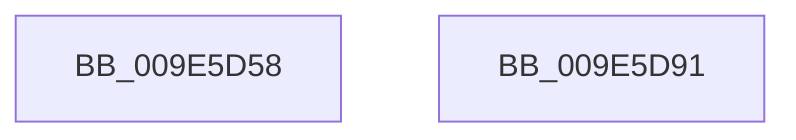

# MiReturnFullProcessCommitment

- RVA: `0x009E5D58`–`0x009E5D92` (길이 `58` bytes)
- VA: `0x00000001409E5D58`
- 실행 섹션: `PAGE`
- PDB 이름 있음: `예`; PDB Function 태그: `아니요`
- unwind 정보 RVA: `0x0005CAAC`
- 디코드: `18`개 명령, `58/58` bytes 표시
- 미해석 바이트: `0` (있으면 어셈블리에 `.byte`로 보존)

> 이 문서는 커널 이미지의 기계어와 PDB 기호를 분석해 생성했습니다. 4번과 5번은 함수 원형과 자료형을 바이너리 사용 방식에서 추정한 C 해석이며 원본 소스 복구 결과는 아닙니다.

## 1. Dependencies

- 직접 호출 지점: **3**; 고유 호출 대상: **3**
- 직접 호출자로 확인된 함수: **14**
- RIP 상대 이미지 참조: **0**

### Outgoing calls
- `0x009E5D68` → [MiGetProcessPartition](../../text/44/MiGetProcessPartition_function_00443B10.md) (function, `0x00443B10`)
- `0x009E5D76` → [MiReturnCommit](../../text/24/MiReturnCommit_function_00248410.md) (function, `0x00248410`)
- `0x009E5D81` → [MiReturnFullProcessCharges](../../text/2C/MiReturnFullProcessCharges_function_002C2E70.md) (function, `0x002C2E70`)

### Direct callers
- [MiCloneVads](../../text/22/MiCloneVads_function_0022DC1C.md) at `0x0022E2E6`
- [MiProbeAndLockPages](../../text/23/MiProbeAndLockPages_function_0023B4F0.md) at `0x0023B7AF`
- [MmProbeAndLockPages](../../text/23/MmProbeAndLockPages_function_0023B990.md) at `0x0023BAF4`
- [MiMakeHyperRangeAccessible](../../text/27/MiMakeHyperRangeAccessible_function_0027CE10.md) at `0x0027D0F4`
- [MiSplitPrivatePage](../../text/2A/MiSplitPrivatePage_function_002A6210.md) at `0x002A64D9`
- [MiSplitPrivatePage](../../text/2A/MiSplitPrivatePage_function_002A6210.md) at `0x002A66FC`
- [sub_002C3A7C](../../text/2C/Unknown_function_002C3A7C.md) at `0x002C3ACB`
- [sub_002C3A7C](../../text/2C/Unknown_function_002C3A7C.md) at `0x002C3B24`
- [sub_002C3A7C](../../text/2C/Unknown_function_002C3A7C.md) at `0x002C40C8`
- [sub_002C3A7C](../../text/2C/Unknown_function_002C3A7C.md) at `0x002C441D`
- [MiProtectPrivateMemory](../../text/2C/MiProtectPrivateMemory_function_002C45B0.md) at `0x002C5147`
- [MiCommitExistingVad](../../text/32/MiCommitExistingVad_function_0032A860.md) at `0x0032AEA0`
- [MiCommitExistingVad](../../text/32/MiCommitExistingVad_function_0032A860.md) at `0x0032B3A6`
- [MiCommitExistingVad](../../text/32/MiCommitExistingVad_function_0032A860.md) at `0x0032B538`
- [MiCommitExistingVad](../../text/32/MiCommitExistingVad_function_0032A860.md) at `0x0032B5E3`
- [MiCopyToUserVa](../../text/3D/MiCopyToUserVa_function_003D1E68.md) at `0x003D2145`
- [MiSplitReducedCommitClonePage](../../text/4F/MiSplitReducedCommitClonePage_function_004FA808.md) at `0x004FA998`
- [MiPrepareImagePagesForHotPatch](../../text/68/MiPrepareImagePagesForHotPatch_function_00683800.md) at `0x00683D4F`
- [MiFreeLargePageView](../9B/MiFreeLargePageView_function_009BB3B4.md) at `0x009BB420`
- [sub_009E5A16](Unknown_function_009E5A16.md) at `0x009E5A19`
- [MiDeleteVadBitmap](../A4/MiDeleteVadBitmap_function_00A45F18.md) at `0x00A46088`

### Static image references
- 디코드된 RIP-relative 메모리 참조가 없습니다.

## 2. Other-region calls and transfers

- 다른 실행 섹션으로 향하는 call: **3**
  - `0x009E5D68` → [MiGetProcessPartition](../../text/44/MiGetProcessPartition_function_00443B10.md) (`PAGE` → `.text`)
  - `0x009E5D76` → [MiReturnCommit](../../text/24/MiReturnCommit_function_00248410.md) (`PAGE` → `.text`)
  - `0x009E5D81` → [MiReturnFullProcessCharges](../../text/2C/MiReturnFullProcessCharges_function_002C2E70.md) (`PAGE` → `.text`)
- 별도 외부 분기/꼬리 이동을 확인하지 못했습니다.

## 3. Assembly (complete function range)

```asm
009E5D58  48 89 5C 24 08                  mov qword ptr [rsp + 8], rbx
009E5D5D  57                              push rdi
009E5D5E  48 83 EC 20                     sub rsp, 0x20
009E5D62  48 8B DA                        mov rbx, rdx
009E5D65  48 8B F9                        mov rdi, rcx
009E5D68  E8 A3 DD A5 FF                  call 0x140443b10
009E5D6D  48 8B D3                        mov rdx, rbx
009E5D70  48 8B C8                        mov rcx, rax
009E5D73  45 33 C0                        xor r8d, r8d
009E5D76  E8 95 26 86 FF                  call 0x140248410
009E5D7B  48 8B D3                        mov rdx, rbx
009E5D7E  48 8B CF                        mov rcx, rdi
009E5D81  E8 EA D0 8D FF                  call 0x1402c2e70
009E5D86  48 8B 5C 24 30                  mov rbx, qword ptr [rsp + 0x30]
009E5D8B  48 83 C4 20                     add rsp, 0x20
009E5D8F  5F                              pop rdi
009E5D90  C3                              ret
009E5D91  CC                              int3
```

## 4. C-style interpretation (structured pseudocode)

```c
__int64 __fastcall MiReturnFullProcessCommitment(__int64 a1, __int64 a2, int a3)
{
    __int64 result;
    __int64 v_rsp;
    unsigned __int64 v_stack_p8;

    v_stack_p8 = v_rbx;
    v_rsp = (v_rsp) - (32);
    result = MiGetProcessPartition(a1, a2, a3, a4);
    a3 = 0;
    result = MiReturnCommit(result, a2, a3, a4);
    result = MiReturnFullProcessCharges(a1, a2, a3, a4);
    v_rsp = (v_rsp) + (32);
    return result;
}
```

## 5. (Beta) C Style

```c
int64_t MiReturnFullProcessCommitment(int64_t Arg1, int64_t Arg2, int32_t Arg3)
{
    int64_t result;
    int64_t local_rsp;
    uint64_t v_stack_p8;

    v_stack_p8 = local_rbx;
    local_rsp = (local_rsp) - (32);
    result = MiGetProcessPartition(Arg1, Arg2, Arg3, a4);
    Arg3 = 0;
    result = MiReturnCommit(result, Arg2, Arg3, a4);
    result = MiReturnFullProcessCharges(Arg1, Arg2, Arg3, a4);
    local_rsp = (local_rsp) + (32);
    return result;
}
```

## 6. Execution-region graph

[열기: 2D/3D 그래프와 함수 탐색 컨트롤 패널](../../../control-panel.html?section=page&rva=0x009E5D58&view=graph)

- 2D 그래프는 위에서 아래로 흐르고, 3D 그래프는 빈 공간을 드래그해 회전합니다. Shift+드래그는 이동, 휠은 확대·축소, 함수 노드 선택은 대상 보고서 이동입니다.

### Static fallback


