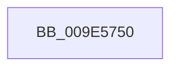

# MiReturnPageTablePageCommitment

- RVA: `0x009E5750`–`0x009E57A9` (길이 `89` bytes)
- VA: `0x00000001409E5750`
- 실행 섹션: `PAGE`
- PDB 이름 있음: `예`; PDB Function 태그: `아니요`
- unwind 정보 RVA: `0x000A41E0`
- 디코드: `20`개 명령, `89/89` bytes 표시
- 미해석 바이트: `0` (있으면 어셈블리에 `.byte`로 보존)

> 이 문서는 커널 이미지의 기계어와 PDB 기호를 분석해 생성했습니다. 4번과 5번은 함수 원형과 자료형을 바이너리 사용 방식에서 추정한 C 해석이며 원본 소스 복구 결과는 아닙니다.

## 1. Dependencies

- 직접 호출 지점: **0**; 고유 호출 대상: **0**
- 직접 호출자로 확인된 함수: **2**
- RIP 상대 이미지 참조: **0**

### Outgoing calls
- 직접 디코드된 call 명령이 없습니다.

### Direct callers
- [MiRemoveVad](../../text/29/MiRemoveVad_function_00295C78.md) at `0x00295E90`
- [MiDeleteEmptyPageTableCommit](../../text/48/MiDeleteEmptyPageTableCommit_function_004834F4.md) at `0x004836CB`

### Static image references
- 디코드된 RIP-relative 메모리 참조가 없습니다.

## 2. Other-region calls and transfers

- 다른 실행 섹션으로 향하는 call: **0**
- call이 아닌 외부 분기/꼬리 이동: **1**
  - `0x009E57A3` → [sub_009E5C4D](Unknown_function_009E5C4D.md) (`tail-transfer`)

## 3. Assembly (complete function range)

```asm
009E5750  4C 89 44 24 18                  mov qword ptr [rsp + 0x18], r8
009E5755  53                              push rbx
009E5756  56                              push rsi
009E5757  57                              push rdi
009E5758  41 56                           push r14
009E575A  48 81 EC A8 00 00 00            sub rsp, 0xa8
009E5761  48 8B B4 24 F8 00 00 00         mov rsi, qword ptr [rsp + 0xf8]
009E5769  48 8B D9                        mov rbx, rcx
009E576C  48 8B BC 24 F0 00 00 00         mov rdi, qword ptr [rsp + 0xf0]
009E5774  4D 8B D1                        mov r10, r9
009E5777  48 B8 FD FF FF FF 07 00 00 00   movabs rax, 0x7fffffffd
009E5781  4D 8B F0                        mov r14, r8
009E5784  4C 8B DA                        mov r11, rdx
009E5787  49 B8 FE FF FF FF 07 00 00 00   movabs r8, 0x7fffffffe
009E5791  44 8B 4E 34                     mov r9d, dword ptr [rsi + 0x34]
009E5795  0F B6 4E 22                     movzx ecx, byte ptr [rsi + 0x22]
009E5799  48 C1 E1 20                     shl rcx, 0x20
009E579D  49 0B C9                        or rcx, r9
009E57A0  48 3B C8                        cmp rcx, rax
009E57A3  0F 83 A4 04 00 00               jae 0x1409e5c4d
```

## 4. C-style interpretation (structured pseudocode)

```c
__int64 __fastcall MiReturnPageTablePageCommitment(__int64 a1, __int64 a2, __int64 a3, __int64 a4, __int64 a5, __int64 a6)
{
    __int64 v_rsp;
    unsigned __int64 v_stack_p18;

    v_stack_p18 = a3;
    v_rsp = (v_rsp) - (168);
    a1 = (*(unsigned __int8 *)(a6 + 34)) << (32);
    a1 = (a1) | ((unsigned int)(*(unsigned int *)(a6 + 52)));
}
```

## 5. (Beta) C Style

```c
int64_t MiReturnPageTablePageCommitment(int64_t Arg1, int64_t Arg2, int64_t Arg3, int64_t Arg4, int64_t Arg5, void *Arg6)
{
    uint8_t *arg6 = (uint8_t *)Arg6;

    int64_t local_rsp;
    uint64_t v_stack_p18;

    v_stack_p18 = Arg3;
    local_rsp = (local_rsp) - (168);
    Arg1 = (*(uint8_t *)(arg6 + 0x22)) << (32);
    Arg1 = (Arg1) | ((uint32_t)(*(uint32_t *)(arg6 + 0x34)));
}
```

### 관측된 메모리 오프셋

구조체 형식이 확인되지 않은 접근은 인자 기준의 오프셋으로만 기록했습니다.

| 기준 인자 | 오프셋 표현 | 폭 (bit) | 접근 |
|---|---:|---:|---|
| `Arg6` | `+ 0x22` | `8` | `R` |
| `Arg6` | `+ 0x34` | `32` | `R` |

## 6. Execution-region graph

[열기: 2D/3D 그래프와 함수 탐색 컨트롤 패널](../../../control-panel.html?section=page&rva=0x009E5750&view=graph)

- 2D 그래프는 위에서 아래로 흐르고, 3D 그래프는 빈 공간을 드래그해 회전합니다. Shift+드래그는 이동, 휠은 확대·축소, 함수 노드 선택은 대상 보고서 이동입니다.

### Static fallback


