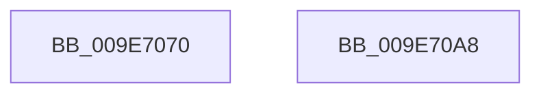

# NtAlpcCreatePort

- RVA: `0x009E7070`–`0x009E70A9` (길이 `57` bytes)
- VA: `0x00000001409E7070`
- 실행 섹션: `PAGE`
- PDB 이름 있음: `예`; PDB Function 태그: `아니요`
- unwind 정보 RVA: `0x00064C80`
- 디코드: `16`개 명령, `57/57` bytes 표시
- 미해석 바이트: `0` (있으면 어셈블리에 `.byte`로 보존)

> 이 문서는 커널 이미지의 기계어와 PDB 기호를 분석해 생성했습니다. 4번과 5번은 함수 원형과 자료형을 바이너리 사용 방식에서 추정한 C 해석이며 원본 소스 복구 결과는 아닙니다.

## 1. Dependencies

- 직접 호출 지점: **2**; 고유 호출 대상: **2**
- 직접 호출자로 확인된 함수: **0**
- RIP 상대 이미지 참조: **0**

### Outgoing calls
- `0x009E7094` → [AlpcpCreateConnectionPort](AlpcpCreateConnectionPort_function_009E70B0.md) (function, `0x009E70B0`)
- `0x009E709B` → [KeLeaveCriticalRegion](../../text/25/KeLeaveCriticalRegion_function_0025D8B0.md) (function, `0x0025D8B0`)

### Direct callers
- 이 함수 시작 RVA로 연결되는 직접 call은 확인되지 않았습니다. 간접 호출은 완전히 역산할 수 없습니다.

### Static image references
- 디코드된 RIP-relative 메모리 참조가 없습니다.

## 2. Other-region calls and transfers

- 다른 실행 섹션으로 향하는 call: **1**
  - `0x009E709B` → [KeLeaveCriticalRegion](../../text/25/KeLeaveCriticalRegion_function_0025D8B0.md) (`PAGE` → `.text`)
- 별도 외부 분기/꼬리 이동을 확인하지 못했습니다.

## 3. Assembly (complete function range)

```asm
009E7070  40 53                           push rbx
009E7072  48 83 EC 30                     sub rsp, 0x30
009E7076  65 48 8B 04 25 88 01 00 00      mov rax, qword ptr gs:[0x188]
009E707F  45 33 C9                        xor r9d, r9d
009E7082  C6 44 24 28 00                  mov byte ptr [rsp + 0x28], 0
009E7087  C6 44 24 20 00                  mov byte ptr [rsp + 0x20], 0
009E708C  66 FF 88 E4 01 00 00            dec word ptr [rax + 0x1e4]
009E7093  90                              nop
009E7094  E8 17 00 00 00                  call 0x1409e70b0
009E7099  8B D8                           mov ebx, eax
009E709B  E8 10 68 87 FF                  call 0x14025d8b0
009E70A0  8B C3                           mov eax, ebx
009E70A2  48 83 C4 30                     add rsp, 0x30
009E70A6  5B                              pop rbx
009E70A7  C3                              ret
009E70A8  CC                              int3
```

## 4. C-style interpretation (structured pseudocode)

```c
__int64 __fastcall NtAlpcCreatePort(__int64 a1, __int64 a2, __int64 a3, int a4)
{
    __int64 result;
    __int64 v_rsp;
    unsigned __int8 v_stack_m10;
    unsigned __int8 v_stack_m18;

    v_rsp = (v_rsp) - (48);
    a4 = 0;
    v_stack_m10 = 0;
    v_stack_m18 = 0;
    result = AlpcpCreateConnectionPort(a1, a2, a3, a4);
    result = KeLeaveCriticalRegion(a1, a2, a3, a4);
    v_rsp = (v_rsp) + (48);
    return (unsigned int)((unsigned int)((unsigned int)((unsigned int)(result))));
}
```

## 5. (Beta) C Style

```c
int64_t NtAlpcCreatePort(int64_t Arg1, int64_t Arg2, int64_t Arg3, int32_t Arg4)
{
    int64_t result;
    int64_t local_rsp;
    uint8_t v_stack_m10;
    uint8_t v_stack_m18;

    local_rsp = (local_rsp) - (48);
    Arg4 = 0;
    v_stack_m10 = 0;
    v_stack_m18 = 0;
    result = AlpcpCreateConnectionPort(Arg1, Arg2, Arg3, Arg4);
    result = KeLeaveCriticalRegion(Arg1, Arg2, Arg3, Arg4);
    local_rsp = (local_rsp) + (48);
    return (uint32_t)((uint32_t)((uint32_t)((uint32_t)(result))));
}
```

## 6. Execution-region graph

[열기: 2D/3D 그래프와 함수 탐색 컨트롤 패널](../../../control-panel.html?section=page&rva=0x009E7070&view=graph)

- 2D 그래프는 위에서 아래로 흐르고, 3D 그래프는 빈 공간을 드래그해 회전합니다. Shift+드래그는 이동, 휠은 확대·축소, 함수 노드 선택은 대상 보고서 이동입니다.

### Static fallback


