# NtCancelIoFile

- RVA: `0x009E93E0`–`0x009E95EE` (길이 `526` bytes)
- VA: `0x00000001409E93E0`
- 실행 섹션: `PAGE`
- PDB 이름 있음: `예`; PDB Function 태그: `아니요`
- unwind 정보 RVA: `0x000A5008`
- 디코드: `127`개 명령, `526/526` bytes 표시
- 미해석 바이트: `0` (있으면 어셈블리에 `.byte`로 보존)

> 이 문서는 커널 이미지의 기계어와 PDB 기호를 분석해 생성했습니다. 4번과 5번은 함수 원형과 자료형을 바이너리 사용 방식에서 추정한 C 해석이며 원본 소스 복구 결과는 아닙니다.

## 1. Dependencies

- 직접 호출 지점: **9**; 고유 호출 대상: **7**
- 직접 호출자로 확인된 함수: **0**
- RIP 상대 이미지 참조: **1**

### Outgoing calls
- `0x009E9448` → [IopReferenceFileObject](../../text/29/IopReferenceFileObject_function_0029D530.md) (function, `0x0029D530`)
- `0x009E94B1` → [IoCancelIrp](../../text/27/IoCancelIrp_function_002720E0.md) (function, `0x002720E0`)
- `0x009E94CF` → [KiLowerIrqlProcessIrqlFlags](../../text/4F/KiLowerIrqlProcessIrqlFlags_function_004F5698.md) (function, `0x004F5698`)
- `0x009E951E` → [KiLowerIrqlProcessIrqlFlags](../../text/4F/KiLowerIrqlProcessIrqlFlags_function_004F5698.md) (function, `0x004F5698`)
- `0x009E9538` → [KeDelayExecutionThread](../../text/20/KeDelayExecutionThread_function_00209550.md) (function, `0x00209550`)
- `0x009E956F` → [IopCancelIrpsInFileObjectList](../../text/20/IopCancelIrpsInFileObjectList_function_00207110.md) (function, `0x00207110`)
- `0x009E9590` → [ObfDereferenceObject](../../text/2F/ObfDereferenceObject_function_002F9350.md) (function, `0x002F9350`)
- `0x009E95B8` → [KiRaiseIrqlProcessIrqlFlags](../../text/4F/KiRaiseIrqlProcessIrqlFlags_function_004F56FC.md) (function, `0x004F56FC`)
- `0x009E95CA` → [KiRaiseIrqlProcessIrqlFlags](../../text/4F/KiRaiseIrqlProcessIrqlFlags_function_004F56FC.md) (function, `0x004F56FC`)

### Direct callers
- 이 함수 시작 RVA로 연결되는 직접 call은 확인되지 않았습니다. 간접 호출은 완전히 역산할 수 없습니다.

### Static image references
- `0x009E947B` → RVA `0x00FC6D20` (`ALMOSTRO`; read)

## 2. Other-region calls and transfers

- 다른 실행 섹션으로 향하는 call: **9**
  - `0x009E9448` → [IopReferenceFileObject](../../text/29/IopReferenceFileObject_function_0029D530.md) (`PAGE` → `.text`)
  - `0x009E94B1` → [IoCancelIrp](../../text/27/IoCancelIrp_function_002720E0.md) (`PAGE` → `.text`)
  - `0x009E94CF` → [KiLowerIrqlProcessIrqlFlags](../../text/4F/KiLowerIrqlProcessIrqlFlags_function_004F5698.md) (`PAGE` → `.text`)
  - `0x009E951E` → [KiLowerIrqlProcessIrqlFlags](../../text/4F/KiLowerIrqlProcessIrqlFlags_function_004F5698.md) (`PAGE` → `.text`)
  - `0x009E9538` → [KeDelayExecutionThread](../../text/20/KeDelayExecutionThread_function_00209550.md) (`PAGE` → `.text`)
  - `0x009E956F` → [IopCancelIrpsInFileObjectList](../../text/20/IopCancelIrpsInFileObjectList_function_00207110.md) (`PAGE` → `.text`)
  - `0x009E9590` → [ObfDereferenceObject](../../text/2F/ObfDereferenceObject_function_002F9350.md) (`PAGE` → `.text`)
  - `0x009E95B8` → [KiRaiseIrqlProcessIrqlFlags](../../text/4F/KiRaiseIrqlProcessIrqlFlags_function_004F56FC.md) (`PAGE` → `.text`)
  - `0x009E95CA` → [KiRaiseIrqlProcessIrqlFlags](../../text/4F/KiRaiseIrqlProcessIrqlFlags_function_004F56FC.md) (`PAGE` → `.text`)
- 별도 외부 분기/꼬리 이동을 확인하지 못했습니다.

## 3. Assembly (complete function range)

```asm
009E93E0  48 89 5C 24 08                  mov qword ptr [rsp + 8], rbx
009E93E5  48 89 74 24 10                  mov qword ptr [rsp + 0x10], rsi
009E93EA  57                              push rdi
009E93EB  41 54                           push r12
009E93ED  41 55                           push r13
009E93EF  41 56                           push r14
009E93F1  41 57                           push r15
009E93F3  48 83 EC 30                     sub rsp, 0x30
009E93F7  4C 8B E2                        mov r12, rdx
009E93FA  4C 8B D1                        mov r10, rcx
009E93FD  33 D2                           xor edx, edx
009E93FF  48 89 54 24 70                  mov qword ptr [rsp + 0x70], rdx
009E9404  45 32 F6                        xor r14b, r14b
009E9407  65 48 8B 3C 25 88 01 00 00      mov rdi, qword ptr gs:[0x188]
009E9410  44 0F B6 87 32 02 00 00         movzx r8d, byte ptr [rdi + 0x232]
009E9418  45 84 C0                        test r8b, r8b
009E941B  74 1C                           je 0x1409e9439
009E941D  48 B9 00 00 FF FF FF 7F 00 00   movabs rcx, 0x7fffffff0000
009E9427  4C 3B E1                        cmp r12, rcx
009E942A  49 0F 42 CC                     cmovb rcx, r12
009E942E  8B 01                           mov eax, dword ptr [rcx]
009E9430  89 01                           mov dword ptr [rcx], eax
009E9432  EB 05                           jmp 0x1409e9439
009E9434  E9 5E 01 00 00                  jmp 0x1409e9597
009E9439  48 89 54 24 20                  mov qword ptr [rsp + 0x20], rdx
009E943E  4C 8D 4C 24 70                  lea r9, [rsp + 0x70]
009E9443  33 D2                           xor edx, edx
009E9445  49 8B CA                        mov rcx, r10
009E9448  E8 E3 40 8B FF                  call 0x14029d530
009E944D  85 C0                           test eax, eax
009E944F  0F 88 42 01 00 00               js 0x1409e9597
009E9455  65 48 8B 04 25 88 01 00 00      mov rax, qword ptr gs:[0x188]
009E945E  48 FF 80 90 03 00 00            inc qword ptr [rax + 0x390]
009E9465  65 FF 04 25 E4 2E 00 00         inc dword ptr gs:[0x2ee4]
009E946D  45 0F 20 C7                     mov r15, cr8
009E9471  41 BD 01 00 00 00               mov r13d, 1
009E9477  45 0F 22 C5                     mov cr8, r13
009E947B  83 3D 9E D8 5D 00 00            cmp dword ptr [rip + 0x5dd89e], 0
009E9482  0F 85 3A 01 00 00               jne 0x1409e95c2
009E9488  48 81 C7 40 05 00 00            add rdi, 0x540
009E948F  48 8B 1F                        mov rbx, qword ptr [rdi]
009E9492  48 8B 74 24 70                  mov rsi, qword ptr [rsp + 0x70]
009E9497  48 3B FB                        cmp rdi, rbx
009E949A  74 22                           je 0x1409e94be
009E949C  0F 1F 40 00                     nop dword ptr [rax]
009E94A0  48 8D 4B E0                     lea rcx, [rbx - 0x20]
009E94A4  48 39 B1 C0 00 00 00            cmp qword ptr [rcx + 0xc0], rsi
009E94AB  75 09                           jne 0x1409e94b6
009E94AD  45 0F B6 F5                     movzx r14d, r13b
009E94B1  E8 2A 8C 88 FF                  call 0x1402720e0
009E94B6  48 8B 1B                        mov rbx, qword ptr [rbx]
009E94B9  48 3B FB                        cmp rdi, rbx
009E94BC  75 E2                           jne 0x1409e94a0
009E94BE  83 3D 5B D8 5D 00 00            cmp dword ptr [rip + 0x5dd85b], 0
009E94C5  74 0D                           je 0x1409e94d4
009E94C7  44 0F 20 C1                     mov rcx, cr8
009E94CB  41 0F B6 D7                     movzx edx, r15b
009E94CF  E8 C4 C1 B0 FF                  call 0x1404f5698
009E94D4  41 0F B6 C7                     movzx eax, r15b
009E94D8  44 0F 22 C0                     mov cr8, rax
009E94DC  45 84 F6                        test r14b, r14b
009E94DF  74 60                           je 0x1409e9541
009E94E1  48 C7 44 24 78 60 79 FE FF      mov qword ptr [rsp + 0x78], 0xfffffffffffe7960
009E94EA  32 DB                           xor bl, bl
009E94EC  45 0F 20 C6                     mov r14, cr8
009E94F0  45 0F 22 C5                     mov cr8, r13
009E94F4  83 3D 25 D8 5D 00 00            cmp dword ptr [rip + 0x5dd825], 0
009E94FB  0F 85 AF 00 00 00               jne 0x1409e95b0
009E9501  48 8B 07                        mov rax, qword ptr [rdi]
009E9504  48 3B F8                        cmp rdi, rax
009E9507  0F 85 C7 00 00 00               jne 0x1409e95d4
009E950D  83 3D 0C D8 5D 00 00            cmp dword ptr [rip + 0x5dd80c], 0
009E9514  74 0D                           je 0x1409e9523
009E9516  44 0F 20 C1                     mov rcx, cr8
009E951A  41 0F B6 D6                     movzx edx, r14b
009E951E  E8 75 C1 B0 FF                  call 0x1404f5698
009E9523  41 0F B6 C6                     movzx eax, r14b
009E9527  44 0F 22 C0                     mov cr8, rax
009E952B  84 DB                           test bl, bl
009E952D  74 12                           je 0x1409e9541
009E952F  4C 8D 44 24 78                  lea r8, [rsp + 0x78]
009E9534  33 D2                           xor edx, edx
009E9536  33 C9                           xor ecx, ecx
009E9538  E8 13 00 82 FF                  call 0x140209550
009E953D  84 DB                           test bl, bl
009E953F  75 A9                           jne 0x1409e94ea
009E9541  65 4C 8B 0C 25 88 01 00 00      mov r9, qword ptr gs:[0x188]
009E954A  65 48 8B 04 25 88 01 00 00      mov rax, qword ptr gs:[0x188]
009E9553  48 8B 90 B8 00 00 00            mov rdx, qword ptr [rax + 0xb8]
009E955A  C6 44 24 28 00                  mov byte ptr [rsp + 0x28], 0
009E955F  44 88 6C 24 20                  mov byte ptr [rsp + 0x20], r13b
009E9564  45 33 C0                        xor r8d, r8d
009E9567  48 8B 5C 24 70                  mov rbx, qword ptr [rsp + 0x70]
009E956C  48 8B CB                        mov rcx, rbx
009E956F  E8 9C DB 81 FF                  call 0x140207110
009E9574  90                              nop
009E9575  41 C7 04 24 00 00 00 00         mov dword ptr [r12], 0
009E957D  49 C7 44 24 08 00 00 00 00      mov qword ptr [r12 + 8], 0
009E9586  EB 05                           jmp 0x1409e958d
009E9588  48 8B 5C 24 70                  mov rbx, qword ptr [rsp + 0x70]
009E958D  48 8B CB                        mov rcx, rbx
009E9590  E8 BB FD 90 FF                  call 0x1402f9350
009E9595  33 C0                           xor eax, eax
009E9597  48 8B 5C 24 60                  mov rbx, qword ptr [rsp + 0x60]
009E959C  48 8B 74 24 68                  mov rsi, qword ptr [rsp + 0x68]
009E95A1  48 83 C4 30                     add rsp, 0x30
009E95A5  41 5F                           pop r15
009E95A7  41 5E                           pop r14
009E95A9  41 5D                           pop r13
009E95AB  41 5C                           pop r12
009E95AD  5F                              pop rdi
009E95AE  C3                              ret
009E95AF  CC                              int3
009E95B0  41 0F B6 D5                     movzx edx, r13b
009E95B4  41 0F B6 CE                     movzx ecx, r14b
009E95B8  E8 3F C1 B0 FF                  call 0x1404f56fc
009E95BD  E9 3F FF FF FF                  jmp 0x1409e9501
009E95C2  41 0F B6 D5                     movzx edx, r13b
009E95C6  41 0F B6 CF                     movzx ecx, r15b
009E95CA  E8 2D C1 B0 FF                  call 0x1404f56fc
009E95CF  E9 B4 FE FF FF                  jmp 0x1409e9488
009E95D4  48 39 B0 A0 00 00 00            cmp qword ptr [rax + 0xa0], rsi
009E95DB  74 08                           je 0x1409e95e5
009E95DD  48 8B 00                        mov rax, qword ptr [rax]
009E95E0  E9 1F FF FF FF                  jmp 0x1409e9504
009E95E5  41 0F B6 DD                     movzx ebx, r13b
009E95E9  E9 1F FF FF FF                  jmp 0x1409e950d
```

## 4. C-style interpretation (structured pseudocode)

```c
__int64 __fastcall NtCancelIoFile(__int64 a1, __int64 a2)
{
    __int64 result;
    __int64 v_r14;
    __int64 v_rbx;
    __int64 v_rdi;
    __int64 v_rsp;
    unsigned __int8 v_stack_m30;
    unsigned __int64 v_stack_m38;
    unsigned __int64 v_stack_p10;
    unsigned __int64 v_stack_p18;
    unsigned __int64 v_stack_p20;
    unsigned __int64 v_stack_p8;

    v_stack_p8 = v_rbx;
    v_stack_p10 = v_rsi;
    v_rsp = (v_rsp) - (48);
    a2 = 0;
    v_stack_p18 = 0;
    v_r14 = 0;
    if ((unsigned __int8)(*(unsigned __int8 *)(*(unsigned __int64 *)(gs_base + (0 + 392)) + 562)) == 0) goto loc_009E9439;
    if (0 < a1) { a1 = 0; }
    *(unsigned int *)(a1) = (unsigned int)((unsigned int)(*(unsigned int *)(a1)));
    goto loc_009E9439;
loc_009E9439:
    v_stack_m38 = 0;
    a2 = 0;
    result = IopReferenceFileObject(a1, a2, *(unsigned __int8 *)(*(unsigned __int64 *)(gs_base + (0 + 392)) + 562), v_stack_p18);
    if (sign_flag) goto loc_009E9597;
    if ((*(unsigned int *)(v_rip + 6150302)) != 0) goto loc_009E95C2;
loc_009E9488:
    v_rdi = (*(unsigned __int64 *)(gs_base + (0 + 392))) + (0x540ULL);
    if (v_rdi == (*(unsigned __int64 *)(v_rdi))) goto loc_009E94BE;
loc_009E94A0:
    result = *(unsigned __int64 *)(gs_base + (0 + 392));
    if ((*(unsigned __int64 *)(*(unsigned __int64 *)(v_rdi) - 32 + 192)) == v_stack_p18) {
        v_r14 = 1;
        result = IoCancelIrp(*(unsigned __int64 *)(v_rdi) - 32, a2, *(unsigned __int8 *)(*(unsigned __int64 *)(gs_base + (0 + 392)) + 562), v_stack_p18);
    }
    if (v_rdi != (*(unsigned __int64 *)(*(unsigned __int64 *)(v_rdi)))) goto loc_009E94A0;
loc_009E94BE:
    if ((*(unsigned int *)(v_rip + 6150235)) != 0) {
        a1 = 1;
        a2 = (unsigned __int8)(v_cr8);
        result = KiLowerIrqlProcessIrqlFlags(a1, a2, *(unsigned __int8 *)(*(unsigned __int64 *)(gs_base + (0 + 392)) + 562), v_stack_p18);
    }
    if ((unsigned __int8)(v_r14) == 0) goto loc_009E9541;
    v_stack_p20 = 0xFFFFFFFFFFFE7960ULL;
loc_009E94EA:
    v_rbx = 0;
    if ((*(unsigned int *)(v_rip + 6150181)) != 0) goto loc_009E95B0;
loc_009E9501:
loc_009E9504:
    if (v_rdi != (*(unsigned __int64 *)(v_rdi))) goto loc_009E95D4;
loc_009E950D:
    result = *(unsigned __int64 *)(v_rdi);
    if ((*(unsigned int *)(v_rip + 6150156)) != 0) {
        a1 = 1;
        a2 = (unsigned __int8)((unsigned __int8)(v_cr8));
        result = KiLowerIrqlProcessIrqlFlags(a1, a2, *(unsigned __int8 *)(*(unsigned __int64 *)(gs_base + (0 + 392)) + 562), v_stack_p18);
    }
    if (0 == 0) goto loc_009E9541;
    a2 = 0;
    a1 = 0;
    result = KeDelayExecutionThread(a1, a2, v_stack_p20, v_stack_p18);
    if (0 != 0) goto loc_009E94EA;
loc_009E9541:
    v_stack_m30 = 0;
    v_stack_m38 = 1;
    a3 = 0;
    result = IopCancelIrpsInFileObjectList(v_stack_p18, *(unsigned __int64 *)(*(unsigned __int64 *)(gs_base + (0 + 392)) + 184), a3, *(unsigned __int64 *)(gs_base + (0 + 392)));
    *(unsigned int *)(a2) = 0;
    *(unsigned __int64 *)(a2 + 8) = 0;
    goto loc_009E958D;
loc_009E958D:
    result = ObfDereferenceObject(v_stack_p18, *(unsigned __int64 *)(*(unsigned __int64 *)(gs_base + (0 + 392)) + 184), a3, *(unsigned __int64 *)(gs_base + (0 + 392)));
    result = 0;
loc_009E9597:
    v_rsp = (v_rsp) + (48);
    return result;
loc_009E95B0:
    result = KiRaiseIrqlProcessIrqlFlags((unsigned __int8)((unsigned __int8)(v_cr8)), 1, a3, *(unsigned __int64 *)(gs_base + (0 + 392)));
    goto loc_009E9501;
loc_009E95C2:
    result = KiRaiseIrqlProcessIrqlFlags((unsigned __int8)(v_cr8), 1, a3, *(unsigned __int64 *)(gs_base + (0 + 392)));
    goto loc_009E9488;
loc_009E95D4:
    if ((*(unsigned __int64 *)(result + 160)) == v_stack_p10) goto loc_009E95E5;
    goto loc_009E9504;
loc_009E95E5:
    goto loc_009E950D;
}
```

## 5. (Beta) C Style

```c
int64_t NtCancelIoFile(int64_t Arg1, int64_t Arg2)
{
    int64_t result;
    int64_t local_r14;
    int64_t local_rbx;
    int64_t local_rdi;
    int64_t local_rsp;
    uint8_t v_stack_m30;
    uint64_t v_stack_m38;
    uint64_t v_stack_p10;
    uint64_t v_stack_p18;
    uint64_t v_stack_p20;
    uint64_t v_stack_p8;

    v_stack_p8 = local_rbx;
    v_stack_p10 = local_rsi;
    local_rsp = (local_rsp) - (48);
    Arg2 = 0;
    v_stack_p18 = 0;
    local_r14 = 0;
    if ((uint8_t)(*(uint8_t *)(*(uint64_t *)(gs_base + (0 + 0x188)) + 0x232)) == 0) goto loc_009E9439;
    if (0 < Arg1) { Arg1 = 0; }
    *(uint32_t *)(Arg1) = (uint32_t)((uint32_t)(*(uint32_t *)(Arg1)));
    goto loc_009E9439;
loc_009E9439:
    v_stack_m38 = 0;
    Arg2 = 0;
    result = IopReferenceFileObject(Arg1, Arg2, *(uint8_t *)(*(uint64_t *)(gs_base + (0 + 0x188)) + 0x232), v_stack_p18);
    if (sign_flag) goto loc_009E9597;
    if ((*(uint32_t *)(v_rip + 0x5DD89E)) != 0) goto loc_009E95C2;
loc_009E9488:
    local_rdi = (*(uint64_t *)(gs_base + (0 + 0x188))) + (0x540ULL);
    if (local_rdi == (*(uint64_t *)(local_rdi))) goto loc_009E94BE;
loc_009E94A0:
    result = *(uint64_t *)(gs_base + (0 + 0x188));
    if ((*(uint64_t *)(*(uint64_t *)(local_rdi) - 0x20 + 0xC0)) == v_stack_p18) {
        local_r14 = 1;
        result = IoCancelIrp(*(uint64_t *)(local_rdi) - 32, Arg2, *(uint8_t *)(*(uint64_t *)(gs_base + (0 + 0x188)) + 0x232), v_stack_p18);
    }
    if (local_rdi != (*(uint64_t *)(*(uint64_t *)(local_rdi)))) goto loc_009E94A0;
loc_009E94BE:
    if ((*(uint32_t *)(v_rip + 0x5DD85B)) != 0) {
        Arg1 = 1;
        Arg2 = (uint8_t)(v_cr8);
        result = KiLowerIrqlProcessIrqlFlags(Arg1, Arg2, *(uint8_t *)(*(uint64_t *)(gs_base + (0 + 0x188)) + 0x232), v_stack_p18);
    }
    if ((uint8_t)(local_r14) == 0) goto loc_009E9541;
    v_stack_p20 = 0xFFFFFFFFFFFE7960ULL;
loc_009E94EA:
    local_rbx = 0;
    if ((*(uint32_t *)(v_rip + 0x5DD825)) != 0) goto loc_009E95B0;
loc_009E9501:
loc_009E9504:
    if (local_rdi != (*(uint64_t *)(local_rdi))) goto loc_009E95D4;
loc_009E950D:
    result = *(uint64_t *)(local_rdi);
    if ((*(uint32_t *)(v_rip + 0x5DD80C)) != 0) {
        Arg1 = 1;
        Arg2 = (uint8_t)((uint8_t)(v_cr8));
        result = KiLowerIrqlProcessIrqlFlags(Arg1, Arg2, *(uint8_t *)(*(uint64_t *)(gs_base + (0 + 0x188)) + 0x232), v_stack_p18);
    }
    if (0 == 0) goto loc_009E9541;
    Arg2 = 0;
    Arg1 = 0;
    result = KeDelayExecutionThread(Arg1, Arg2, v_stack_p20, v_stack_p18);
    if (0 != 0) goto loc_009E94EA;
loc_009E9541:
    v_stack_m30 = 0;
    v_stack_m38 = 1;
    a3 = 0;
    result = IopCancelIrpsInFileObjectList(v_stack_p18, *(uint64_t *)(*(uint64_t *)(gs_base + (0 + 0x188)) + 0xB8), a3, *(uint64_t *)(gs_base + (0 + 0x188)));
    *(uint32_t *)(Arg2) = 0;
    *(uint64_t *)(Arg2 + 0x8) = 0;
    goto loc_009E958D;
loc_009E958D:
    result = ObfDereferenceObject(v_stack_p18, *(uint64_t *)(*(uint64_t *)(gs_base + (0 + 0x188)) + 0xB8), a3, *(uint64_t *)(gs_base + (0 + 0x188)));
    result = 0;
loc_009E9597:
    local_rsp = (local_rsp) + (48);
    return result;
loc_009E95B0:
    result = KiRaiseIrqlProcessIrqlFlags((uint8_t)((uint8_t)(v_cr8)), 1, a3, *(uint64_t *)(gs_base + (0 + 0x188)));
    goto loc_009E9501;
loc_009E95C2:
    result = KiRaiseIrqlProcessIrqlFlags((uint8_t)(v_cr8), 1, a3, *(uint64_t *)(gs_base + (0 + 0x188)));
    goto loc_009E9488;
loc_009E95D4:
    if ((*(uint64_t *)(result + 0xA0)) == v_stack_p10) goto loc_009E95E5;
    goto loc_009E9504;
loc_009E95E5:
    goto loc_009E950D;
}
```

## 6. Execution-region graph

[열기: 2D/3D 그래프와 함수 탐색 컨트롤 패널](../../../control-panel.html?section=page&rva=0x009E93E0&view=graph)

- 2D 그래프는 위에서 아래로 흐르고, 3D 그래프는 빈 공간을 드래그해 회전합니다. Shift+드래그는 이동, 휠은 확대·축소, 함수 노드 선택은 대상 보고서 이동입니다.

### Static fallback

```mermaid
flowchart TD
  bb_009E93E0[BB_009E93E0]
  bb_009E941D[BB_009E941D]
  bb_009E9434[BB_009E9434]
  bb_009E9439[BB_009E9439]
  bb_009E9455[BB_009E9455]
  bb_009E9488[BB_009E9488]
  bb_009E949C[BB_009E949C]
  bb_009E94A0[BB_009E94A0]
  bb_009E94AD[BB_009E94AD]
  bb_009E94B6[BB_009E94B6]
  bb_009E94BE[BB_009E94BE]
  bb_009E94C7[BB_009E94C7]
  bb_009E94D4[BB_009E94D4]
  bb_009E94E1[BB_009E94E1]
  bb_009E94EA[BB_009E94EA]
  bb_009E9501[BB_009E9501]
  bb_009E9504[BB_009E9504]
  bb_009E950D[BB_009E950D]
  bb_009E9516[BB_009E9516]
  bb_009E9523[BB_009E9523]
  bb_009E952F[BB_009E952F]
  bb_009E9541[BB_009E9541]
  bb_009E9588[BB_009E9588]
  bb_009E958D[BB_009E958D]
  bb_009E9597[BB_009E9597]
  bb_009E95AF[BB_009E95AF]
  bb_009E95B0[BB_009E95B0]
  bb_009E95C2[BB_009E95C2]
  bb_009E95D4[BB_009E95D4]
  bb_009E95DD[BB_009E95DD]
  bb_009E95E5[BB_009E95E5]
  bb_009E93E0 -->|branch| bb_009E9439
  bb_009E93E0 -->|fallthrough| bb_009E941D
  bb_009E941D -->|branch| bb_009E9439
  bb_009E9434 -->|branch| bb_009E9597
  bb_009E9439 -->|branch| bb_009E9597
  bb_009E9439 -->|fallthrough| bb_009E9455
  bb_009E9455 -->|branch| bb_009E95C2
  bb_009E9455 -->|fallthrough| bb_009E9488
  bb_009E9488 -->|branch| bb_009E94BE
  bb_009E9488 -->|fallthrough| bb_009E949C
  bb_009E949C -->|flow| bb_009E94A0
  bb_009E94A0 -->|branch| bb_009E94B6
  bb_009E94A0 -->|fallthrough| bb_009E94AD
  bb_009E94AD -->|flow| bb_009E94B6
  bb_009E94B6 -->|branch| bb_009E94A0
  bb_009E94B6 -->|fallthrough| bb_009E94BE
  bb_009E94BE -->|branch| bb_009E94D4
  bb_009E94BE -->|fallthrough| bb_009E94C7
  bb_009E94C7 -->|flow| bb_009E94D4
  bb_009E94D4 -->|branch| bb_009E9541
  bb_009E94D4 -->|fallthrough| bb_009E94E1
  bb_009E94E1 -->|flow| bb_009E94EA
  bb_009E94EA -->|branch| bb_009E95B0
  bb_009E94EA -->|fallthrough| bb_009E9501
  bb_009E9501 -->|flow| bb_009E9504
  bb_009E9504 -->|branch| bb_009E95D4
  bb_009E9504 -->|fallthrough| bb_009E950D
  bb_009E950D -->|branch| bb_009E9523
  bb_009E950D -->|fallthrough| bb_009E9516
  bb_009E9516 -->|flow| bb_009E9523
  bb_009E9523 -->|branch| bb_009E9541
  bb_009E9523 -->|fallthrough| bb_009E952F
  bb_009E952F -->|branch| bb_009E94EA
  bb_009E952F -->|fallthrough| bb_009E9541
  bb_009E9541 -->|branch| bb_009E958D
  bb_009E9588 -->|flow| bb_009E958D
  bb_009E958D -->|flow| bb_009E9597
  bb_009E95AF -->|flow| bb_009E95B0
  bb_009E95B0 -->|branch| bb_009E9501
  bb_009E95C2 -->|branch| bb_009E9488
  bb_009E95D4 -->|branch| bb_009E95E5
  bb_009E95D4 -->|fallthrough| bb_009E95DD
  bb_009E95DD -->|branch| bb_009E9504
  bb_009E95E5 -->|branch| bb_009E950D
```


