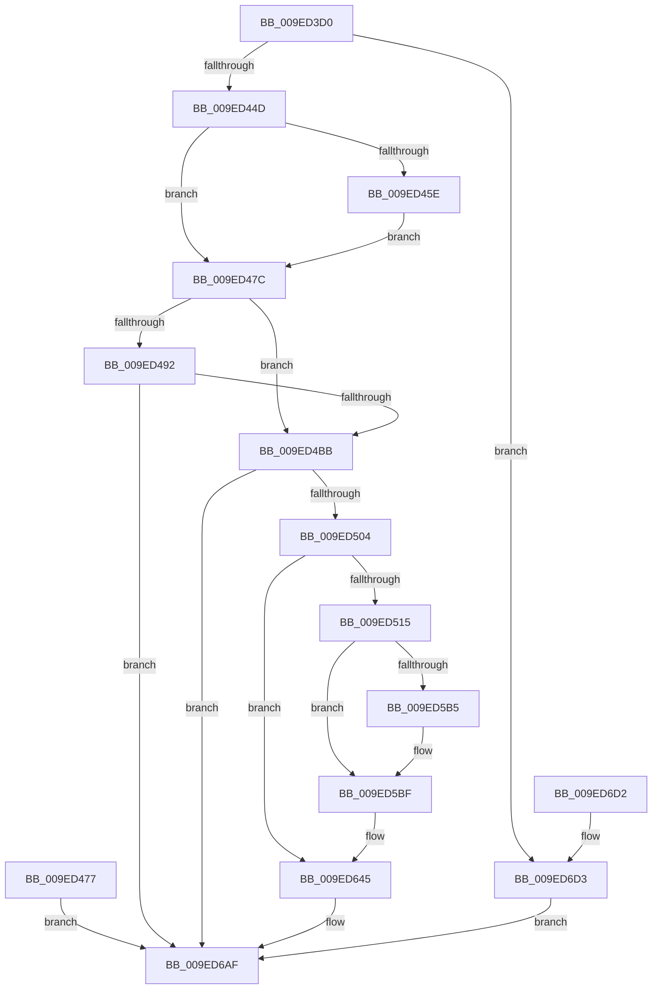

# NtCreateThreadEx

- RVA: `0x009ED3D0`–`0x009ED6DA` (길이 `778` bytes)
- VA: `0x00000001409ED3D0`
- 실행 섹션: `PAGE`
- PDB 이름 있음: `예`; PDB Function 태그: `아니요`
- unwind 정보 RVA: `0x000A5BE8`
- 디코드: `182`개 명령, `778/778` bytes 표시
- 미해석 바이트: `0` (있으면 어셈블리에 `.byte`로 보존)

> 이 문서는 커널 이미지의 기계어와 PDB 기호를 분석해 생성했습니다. 4번과 5번은 함수 원형과 자료형을 바이너리 사용 방식에서 추정한 C 해석이며 원본 소스 복구 결과는 아닙니다.

## 1. Dependencies

- 직접 호출 지점: **12**; 고유 호출 대상: **10**
- 직접 호출자로 확인된 함수: **0**
- RIP 상대 이미지 참조: **3**

### Outgoing calls
- `0x009ED488` → [memset](../../text/6C/memset_function_006C6C40.md) (function, `0x006C6C40`)
- `0x009ED4AE` → [PspBuildCreateProcessContext](PspBuildCreateProcessContext_function_009ED6E0.md) (function, `0x009ED6E0`)
- `0x009ED4F7` → [ObpReferenceObjectByHandleWithTag](../86/ObpReferenceObjectByHandleWithTag_function_00869650.md) (function, `0x00869650`)
- `0x009ED561` → [memset](../../text/6C/memset_function_006C6C40.md) (function, `0x006C6C40`)
- `0x009ED5A3` → [RtlGetExtendedContextLength2](../../text/49/RtlGetExtendedContextLength2_function_00493FE0.md) (function, `0x00493FE0`)
- `0x009ED5C3` → [_chkstk](../../text/6B/_chkstk_function_006BA960.md) (function, `0x006BA960`)
- `0x009ED5D5` → [memset](../../text/6C/memset_function_006C6C40.md) (function, `0x006C6C40`)
- `0x009ED5E7` → [RtlInitializeExtendedContext2](../../text/2F/RtlInitializeExtendedContext2_function_002F5D40.md) (function, `0x002F5D40`)
- `0x009ED64D` → [ObfDereferenceObjectWithTag](../../text/2F/ObfDereferenceObjectWithTag_function_002F78E0.md) (function, `0x002F78E0`)
- `0x009ED69D` → [PspCreateThread](PspCreateThread_function_009EF034.md) (function, `0x009EF034`)
- `0x009ED6A8` → [PspDeleteCreateProcessContext](PspDeleteCreateProcessContext_function_009EF4C4.md) (function, `0x009EF4C4`)
- `0x009ED6B9` → [_security_check_cookie](../../text/6A/_security_check_cookie_function_006AC640.md) (function, `0x006AC640`)

### Direct callers
- 이 함수 시작 RVA로 연결되는 직접 call은 확인되지 않았습니다. 간접 호출은 완전히 역산할 수 없습니다.

### Static image references
- `0x009ED3E9` → RVA `0x00E0A740` (`.data`; read)
- `0x009ED4CB` → RVA `0x00FC6A98` (`ALMOSTRO`; read)
- `0x009ED58F` → RVA `0x00FC7480` (`ALMOSTRO`; read)

## 2. Other-region calls and transfers

- 다른 실행 섹션으로 향하는 call: **8**
  - `0x009ED488` → [memset](../../text/6C/memset_function_006C6C40.md) (`PAGE` → `.text`)
  - `0x009ED561` → [memset](../../text/6C/memset_function_006C6C40.md) (`PAGE` → `.text`)
  - `0x009ED5A3` → [RtlGetExtendedContextLength2](../../text/49/RtlGetExtendedContextLength2_function_00493FE0.md) (`PAGE` → `.text`)
  - `0x009ED5C3` → [_chkstk](../../text/6B/_chkstk_function_006BA960.md) (`PAGE` → `.text`)
  - `0x009ED5D5` → [memset](../../text/6C/memset_function_006C6C40.md) (`PAGE` → `.text`)
  - `0x009ED5E7` → [RtlInitializeExtendedContext2](../../text/2F/RtlInitializeExtendedContext2_function_002F5D40.md) (`PAGE` → `.text`)
  - `0x009ED64D` → [ObfDereferenceObjectWithTag](../../text/2F/ObfDereferenceObjectWithTag_function_002F78E0.md) (`PAGE` → `.text`)
  - `0x009ED6B9` → [_security_check_cookie](../../text/6A/_security_check_cookie_function_006AC640.md) (`PAGE` → `.text`)
- 별도 외부 분기/꼬리 이동을 확인하지 못했습니다.

## 3. Assembly (complete function range)

```asm
009ED3D0  40 55                           push rbp
009ED3D2  53                              push rbx
009ED3D3  56                              push rsi
009ED3D4  57                              push rdi
009ED3D5  41 54                           push r12
009ED3D7  41 55                           push r13
009ED3D9  41 56                           push r14
009ED3DB  41 57                           push r15
009ED3DD  48 81 EC 28 03 00 00            sub rsp, 0x328
009ED3E4  48 8D 6C 24 70                  lea rbp, [rsp + 0x70]
009ED3E9  48 8B 05 50 D3 41 00            mov rax, qword ptr [rip + 0x41d350]
009ED3F0  48 33 C5                        xor rax, rbp
009ED3F3  48 89 85 A8 02 00 00            mov qword ptr [rbp + 0x2a8], rax
009ED3FA  4D 8B F9                        mov r15, r9
009ED3FD  4C 89 45 40                     mov qword ptr [rbp + 0x40], r8
009ED401  89 55 10                        mov dword ptr [rbp + 0x10], edx
009ED404  48 8B F1                        mov rsi, rcx
009ED407  48 8B 85 20 03 00 00            mov rax, qword ptr [rbp + 0x320]
009ED40E  48 89 45 20                     mov qword ptr [rbp + 0x20], rax
009ED412  48 8B 85 28 03 00 00            mov rax, qword ptr [rbp + 0x328]
009ED419  48 89 45 18                     mov qword ptr [rbp + 0x18], rax
009ED41D  48 8B BD 50 03 00 00            mov rdi, qword ptr [rbp + 0x350]
009ED424  33 D2                           xor edx, edx
009ED426  48 89 55 08                     mov qword ptr [rbp + 8], rdx
009ED42A  48 89 55 28                     mov qword ptr [rbp + 0x28], rdx
009ED42E  89 55 00                        mov dword ptr [rbp], edx
009ED431  44 8B E2                        mov r12d, edx
009ED434  44 8B F2                        mov r14d, edx
009ED437  8B DA                           mov ebx, edx
009ED439  44 8B AD 30 03 00 00            mov r13d, dword ptr [rbp + 0x330]
009ED440  41 F7 C5 80 FF FF FF            test r13d, 0xffffff80
009ED447  0F 85 86 02 00 00               jne 0x1409ed6d3
009ED44D  65 48 8B 04 25 88 01 00 00      mov rax, qword ptr gs:[0x188]
009ED456  38 90 32 02 00 00               cmp byte ptr [rax + 0x232], dl
009ED45C  74 1E                           je 0x1409ed47c
009ED45E  48 B9 00 00 FF FF FF 7F 00 00   movabs rcx, 0x7fffffff0000
009ED468  48 3B F1                        cmp rsi, rcx
009ED46B  48 0F 42 CE                     cmovb rcx, rsi
009ED46F  48 8B 01                        mov rax, qword ptr [rcx]
009ED472  48 89 01                        mov qword ptr [rcx], rax
009ED475  EB 05                           jmp 0x1409ed47c
009ED477  E9 33 02 00 00                  jmp 0x1409ed6af
009ED47C  33 D2                           xor edx, edx
009ED47E  41 B8 60 02 00 00               mov r8d, 0x260
009ED484  48 8D 4D 48                     lea rcx, [rbp + 0x48]
009ED488  E8 B3 97 CD FF                  call 0x1406c6c40
009ED48D  48 85 FF                        test rdi, rdi
009ED490  74 29                           je 0x1409ed4bb
009ED492  65 48 8B 04 25 88 01 00 00      mov rax, qword ptr gs:[0x188]
009ED49B  8A 90 32 02 00 00               mov dl, byte ptr [rax + 0x232]
009ED4A1  4C 8D 4D 48                     lea r9, [rbp + 0x48]
009ED4A5  41 B8 01 00 00 00               mov r8d, 1
009ED4AB  48 8B CF                        mov rcx, rdi
009ED4AE  E8 2D 02 00 00                  call 0x1409ed6e0
009ED4B3  85 C0                           test eax, eax
009ED4B5  0F 88 F4 01 00 00               js 0x1409ed6af
009ED4BB  65 48 8B 04 25 88 01 00 00      mov rax, qword ptr gs:[0x188]
009ED4C4  44 8A 88 32 02 00 00            mov r9b, byte ptr [rax + 0x232]
009ED4CB  4C 8B 05 C6 95 5D 00            mov r8, qword ptr [rip + 0x5d95c6]
009ED4D2  48 83 64 24 38 00               and qword ptr [rsp + 0x38], 0
009ED4D8  48 83 64 24 30 00               and qword ptr [rsp + 0x30], 0
009ED4DE  48 8D 45 08                     lea rax, [rbp + 8]
009ED4E2  48 89 44 24 28                  mov qword ptr [rsp + 0x28], rax
009ED4E7  C7 44 24 20 50 73 43 72         mov dword ptr [rsp + 0x20], 0x72437350
009ED4EF  BA 02 00 00 00                  mov edx, 2
009ED4F4  49 8B CF                        mov rcx, r15
009ED4F7  E8 54 C1 E7 FF                  call 0x140869650
009ED4FC  85 C0                           test eax, eax
009ED4FE  0F 88 AB 01 00 00               js 0x1409ed6af
009ED504  48 8B 7D 08                     mov rdi, qword ptr [rbp + 8]
009ED508  F6 87 70 01 00 00 01            test byte ptr [rdi + 0x170], 1
009ED50F  0F 85 30 01 00 00               jne 0x1409ed645
009ED515  8B 04 24                        mov eax, dword ptr [rsp]
009ED518  48 83 EC 20                     sub rsp, 0x20
009ED51C  4C 8D 74 24 70                  lea r14, [rsp + 0x70]
009ED521  41 8B 06                        mov eax, dword ptr [r14]
009ED524  41 C6 06 00                     mov byte ptr [r14], 0
009ED528  48 8B 85 40 03 00 00            mov rax, qword ptr [rbp + 0x340]
009ED52F  49 89 46 10                     mov qword ptr [r14 + 0x10], rax
009ED533  48 8B 85 48 03 00 00            mov rax, qword ptr [rbp + 0x348]
009ED53A  49 89 46 18                     mov qword ptr [r14 + 0x18], rax
009ED53E  48 8B 85 38 03 00 00            mov rax, qword ptr [rbp + 0x338]
009ED545  49 89 46 08                     mov qword ptr [r14 + 8], rax
009ED549  8B 04 24                        mov eax, dword ptr [rsp]
009ED54C  48 83 EC 50                     sub rsp, 0x50
009ED550  48 8D 4C 24 70                  lea rcx, [rsp + 0x70]
009ED555  48 89 4D 38                     mov qword ptr [rbp + 0x38], rcx
009ED559  8B 01                           mov eax, dword ptr [rcx]
009ED55B  33 D2                           xor edx, edx
009ED55D  44 8D 42 48                     lea r8d, [rdx + 0x48]
009ED561  E8 DA 96 CD FF                  call 0x1406c6c40
009ED566  8B 8F 54 07 00 00               mov ecx, dword ptr [rdi + 0x754]
009ED56C  81 E1 00 40 00 00               and ecx, 0x4000
009ED572  8B C1                           mov eax, ecx
009ED574  F7 D8                           neg eax
009ED576  4D 1B E4                        sbb r12, r12
009ED579  41 81 E4 00 08 00 00            and r12d, 0x800
009ED580  F7 D9                           neg ecx
009ED582  1B C0                           sbb eax, eax
009ED584  83 E0 40                        and eax, 0x40
009ED587  05 0B 00 10 00                  add eax, 0x10000b
009ED58C  89 45 08                        mov dword ptr [rbp + 8], eax
009ED58F  48 8B 0D EA 9E 5D 00            mov rcx, qword ptr [rip + 0x5d9eea]
009ED596  48 89 4D 30                     mov qword ptr [rbp + 0x30], rcx
009ED59A  45 8B C4                        mov r8d, r12d
009ED59D  48 8D 55 00                     lea rdx, [rbp]
009ED5A1  8B C8                           mov ecx, eax
009ED5A3  E8 38 6A AA FF                  call 0x140493fe0
009ED5A8  44 8B 45 00                     mov r8d, dword ptr [rbp]
009ED5AC  49 8D 40 0F                     lea rax, [r8 + 0xf]
009ED5B0  49 3B C0                        cmp rax, r8
009ED5B3  77 0A                           ja 0x1409ed5bf
009ED5B5  48 B8 F0 FF FF FF FF FF FF 0F   movabs rax, 0xffffffffffffff0
009ED5BF  48 83 E0 F0                     and rax, 0xfffffffffffffff0
009ED5C3  E8 98 D3 CC FF                  call 0x1406ba960
009ED5C8  48 2B E0                        sub rsp, rax
009ED5CB  48 8D 5C 24 70                  lea rbx, [rsp + 0x70]
009ED5D0  33 D2                           xor edx, edx
009ED5D2  48 8B CB                        mov rcx, rbx
009ED5D5  E8 66 96 CD FF                  call 0x1406c6c40
009ED5DA  4D 8B CC                        mov r9, r12
009ED5DD  4C 8D 45 28                     lea r8, [rbp + 0x28]
009ED5E1  8B 55 08                        mov edx, dword ptr [rbp + 8]
009ED5E4  48 8B CB                        mov rcx, rbx
009ED5E7  E8 54 87 90 FF                  call 0x1402f5d40
009ED5EC  48 8B 45 30                     mov rax, qword ptr [rbp + 0x30]
009ED5F0  48 89 83 F8 00 00 00            mov qword ptr [rbx + 0xf8], rax
009ED5F7  48 8B 45 20                     mov rax, qword ptr [rbp + 0x20]
009ED5FB  48 89 83 80 00 00 00            mov qword ptr [rbx + 0x80], rax
009ED602  48 8B 45 18                     mov rax, qword ptr [rbp + 0x18]
009ED606  48 89 83 88 00 00 00            mov qword ptr [rbx + 0x88], rax
009ED60D  B9 2B 00 00 00                  mov ecx, 0x2b
009ED612  C7 43 3A 2B 00 2B 00            mov dword ptr [rbx + 0x3a], 0x2b002b
009ED619  C7 43 3E 53 00 2B 00            mov dword ptr [rbx + 0x3e], 0x2b0053
009ED620  66 89 4B 42                     mov word ptr [rbx + 0x42], cx
009ED624  66 C7 43 38 33 00               mov word ptr [rbx + 0x38], 0x33
009ED62A  B9 80 1F 00 00                  mov ecx, 0x1f80
009ED62F  89 4B 34                        mov dword ptr [rbx + 0x34], ecx
009ED632  66 C7 83 00 01 00 00 7F 02      mov word ptr [rbx + 0x100], 0x27f
009ED63B  89 8B 18 01 00 00               mov dword ptr [rbx + 0x118], ecx
009ED641  4C 8B 65 38                     mov r12, qword ptr [rbp + 0x38]
009ED645  BA 50 73 43 72                  mov edx, 0x72437350
009ED64A  48 8B CF                        mov rcx, rdi
009ED64D  E8 8E A2 90 FF                  call 0x1402f78e0
009ED652  4C 89 74 24 60                  mov qword ptr [rsp + 0x60], r14
009ED657  48 8B 45 18                     mov rax, qword ptr [rbp + 0x18]
009ED65B  48 89 44 24 58                  mov qword ptr [rsp + 0x58], rax
009ED660  48 8B 45 20                     mov rax, qword ptr [rbp + 0x20]
009ED664  48 89 44 24 50                  mov qword ptr [rsp + 0x50], rax
009ED669  44 89 6C 24 48                  mov dword ptr [rsp + 0x48], r13d
009ED66E  4C 89 64 24 40                  mov qword ptr [rsp + 0x40], r12
009ED673  48 89 5C 24 38                  mov qword ptr [rsp + 0x38], rbx
009ED678  48 8B 45 60                     mov rax, qword ptr [rbp + 0x60]
009ED67C  48 89 44 24 30                  mov qword ptr [rsp + 0x30], rax
009ED681  48 8D 45 48                     lea rax, [rbp + 0x48]
009ED685  48 89 44 24 28                  mov qword ptr [rsp + 0x28], rax
009ED68A  48 83 64 24 20 00               and qword ptr [rsp + 0x20], 0
009ED690  4D 8B CF                        mov r9, r15
009ED693  4C 8B 45 40                     mov r8, qword ptr [rbp + 0x40]
009ED697  8B 55 10                        mov edx, dword ptr [rbp + 0x10]
009ED69A  48 8B CE                        mov rcx, rsi
009ED69D  E8 92 19 00 00                  call 0x1409ef034
009ED6A2  8B D8                           mov ebx, eax
009ED6A4  48 8D 4D 48                     lea rcx, [rbp + 0x48]
009ED6A8  E8 17 1E 00 00                  call 0x1409ef4c4
009ED6AD  8B C3                           mov eax, ebx
009ED6AF  48 8B 8D A8 02 00 00            mov rcx, qword ptr [rbp + 0x2a8]
009ED6B6  48 33 CD                        xor rcx, rbp
009ED6B9  E8 82 EF CB FF                  call 0x1406ac640
009ED6BE  48 8D A5 B8 02 00 00            lea rsp, [rbp + 0x2b8]
009ED6C5  41 5F                           pop r15
009ED6C7  41 5E                           pop r14
009ED6C9  41 5D                           pop r13
009ED6CB  41 5C                           pop r12
009ED6CD  5F                              pop rdi
009ED6CE  5E                              pop rsi
009ED6CF  5B                              pop rbx
009ED6D0  5D                              pop rbp
009ED6D1  C3                              ret
009ED6D2  CC                              int3
009ED6D3  B8 F5 00 00 C0                  mov eax, 0xc00000f5
009ED6D8  EB D5                           jmp 0x1409ed6af
```

## 4. C-style interpretation (structured pseudocode)

```c
__int64 __fastcall NtCreateThreadEx(__int64 a1, int a2, __int64 a3, __int64 a4, __int64 a5, __int64 a6, unsigned int a7, __int64 a8, __int64 a9, __int64 a10, __int64 a11)
{
    __int64 result;
    __int64 v_r12;
    __int64 v_rsp;
    unsigned __int64 v_stack_m298;
    unsigned __int64 v_stack_m2B0;
    unsigned __int64 v_stack_m2B8;
    unsigned __int64 v_stack_m2C0;
    unsigned __int64 v_stack_m2C8;
    unsigned __int64 v_stack_m2D0;
    unsigned __int64 v_stack_m2D8;
    unsigned __int64 v_stack_m2E0;
    unsigned int v_stack_m2E8;
    unsigned __int64 v_stack_m2F0;
    unsigned __int64 v_stack_m2F8;
    unsigned __int64 v_stack_m318;
    unsigned __int64 v_stack_m330;
    unsigned __int64 v_stack_m338;
    unsigned __int64 v_stack_m340;
    unsigned int v_stack_m348;
    unsigned int v_stack_m368;
    unsigned __int64 v_stack_m378;
    unsigned __int64 v_stack_m380;
    unsigned int v_stack_m388;
    unsigned int v_stack_m390;
    unsigned __int64 v_stack_m398;
    unsigned __int64 v_stack_m3A0;
    unsigned __int64 v_stack_m3A8;
    unsigned __int64 v_stack_m3B0;
    unsigned __int64 v_stack_m3B8;
    unsigned __int64 v_stack_m40;
    unsigned __int64 v_stack_m50;

    v_rsp = (v_rsp) - (808);
    result = (*(unsigned __int64 *)(v_rip + 4313936)) ^ (v_stack_m2F8);
    v_stack_m50 = result;
    v_stack_m2B8 = a3;
    v_stack_m2E8 = a2;
    v_stack_m2D8 = a5;
    v_stack_m2E0 = a6;
    a2 = 0;
    v_stack_m2F0 = 0;
    v_stack_m2D0 = 0;
    v_stack_m2F8 = 0;
    if ((((unsigned int)((unsigned int)(a7))) & (0xFFFFFF80ULL)) != 0) goto loc_009ED6D3;
    if ((*(unsigned __int8 *)(*(unsigned __int64 *)(gs_base + (0 + 392)) + 562)) == 0) goto loc_009ED47C;
    if (a1 < a1) { a1 = a1; }
    *(unsigned __int64 *)(a1) = *(unsigned __int64 *)(a1);
    goto loc_009ED47C;
loc_009ED47C:
    a2 = 0;
    result = memset(v_stack_m2B0, a2, 608, a4);
    if (a11 == 0) goto loc_009ED4BB;
    result = PspBuildCreateProcessContext(a11, *(unsigned __int8 *)(*(unsigned __int64 *)(gs_base + (0 + 392)) + 562), 1, v_stack_m2B0);
    if (sign_flag) goto loc_009ED6AF;
loc_009ED4BB:
    v_stack_m340 = v_stack_m2F0;
    v_stack_m348 = 0x72437350ULL;
    result = ObpReferenceObjectByHandleWithTag(a4, 2, *(unsigned __int64 *)(v_rip + 6133190), *(unsigned __int8 *)(*(unsigned __int64 *)(gs_base + (0 + 392)) + 562));
    if (sign_flag) goto loc_009ED6AF;
    if (((*(unsigned __int8 *)(v_stack_m2F0 + 368)) & (1)) != 0) goto loc_009ED645;
    v_rsp = (v_rsp) - (32);
    *(unsigned __int8 *)(v_stack_m318) = 0;
    *(unsigned __int64 *)(v_stack_m318 + 16) = a9;
    *(unsigned __int64 *)(v_stack_m318 + 24) = a10;
    *(unsigned __int64 *)(v_stack_m318 + 8) = a8;
    v_rsp = (v_rsp) - (80);
    v_stack_m2C0 = v_stack_m368;
    a2 = 0;
    result = memset(v_stack_m368, a2, a2 + 72, *(unsigned __int8 *)(*(unsigned __int64 *)(gs_base + (0 + 392)) + 562));
    a1 = (unsigned int)(((unsigned int)(*(unsigned int *)(v_stack_m2F0 + 1876))) & (0x4000ULL));
    result = (unsigned int)(-((unsigned int)((unsigned int)(a1))));
    v_r12 = (unsigned int)((0) & (0x800ULL));
    a1 = (unsigned int)(-(a1));
    result = (unsigned int)((result) & (64));
    result = (unsigned int)((result) + (0x10000BULL));
    v_stack_m2F0 = (unsigned int)(result);
    v_stack_m2C8 = *(unsigned __int64 *)(v_rip + 6135530);
    result = RtlGetExtendedContextLength2((unsigned int)((unsigned int)(result)), v_stack_m2F8, (unsigned int)((unsigned int)(v_r12)), *(unsigned __int8 *)(*(unsigned __int64 *)(gs_base + (0 + 392)) + 562));
    if (((unsigned int)(v_stack_m2F8) + 15) <= ((unsigned int)(v_stack_m2F8))) {
    }
    result = ((unsigned int)(v_stack_m2F8) + 15) & (-16);
    result = _chkstk((unsigned int)((unsigned int)(result)), v_stack_m2F8, (unsigned int)(v_stack_m2F8), *(unsigned __int8 *)(*(unsigned __int64 *)(gs_base + (0 + 392)) + 562));
    v_rsp = (v_rsp) - (result);
    a2 = 0;
    result = memset(v_stack_m368, a2, (unsigned int)(v_stack_m2F8), *(unsigned __int8 *)(*(unsigned __int64 *)(gs_base + (0 + 392)) + 562));
    result = RtlInitializeExtendedContext2(v_stack_m368, (unsigned int)(v_stack_m2F0), v_stack_m2D0, v_r12);
    *(unsigned __int64 *)(v_stack_m368 + 248) = v_stack_m2C8;
    *(unsigned __int64 *)(v_stack_m368 + 128) = v_stack_m2D8;
    *(unsigned __int64 *)(v_stack_m368 + 136) = v_stack_m2E0;
    *(unsigned int *)(v_stack_m368 + 58) = 0x2B002BULL;
    *(unsigned int *)(v_stack_m368 + 62) = 0x2B0053ULL;
    *(unsigned __int16 *)(v_stack_m368 + 66) = 43;
    *(unsigned __int16 *)(v_stack_m368 + 56) = 51;
    *(unsigned int *)(v_stack_m368 + 52) = (unsigned int)((unsigned int)(0x1F80ULL));
    *(unsigned __int16 *)(v_stack_m368 + 256) = 639;
    *(unsigned int *)(v_stack_m368 + 280) = (unsigned int)((unsigned int)(0x1F80ULL));
loc_009ED645:
    result = ObfDereferenceObjectWithTag(v_stack_m2F0, (unsigned int)(0x72437350ULL), v_stack_m2D0, v_r12);
    v_stack_m378 = v_stack_m318;
    v_stack_m380 = v_stack_m2E0;
    v_stack_m388 = v_stack_m2D8;
    v_stack_m390 = (unsigned int)((unsigned int)(a7));
    v_stack_m398 = v_stack_m2C0;
    v_stack_m3A0 = v_stack_m368;
    v_stack_m3A8 = v_stack_m298;
    v_stack_m3B0 = v_stack_m2B0;
    result = PspCreateThread(a1, (unsigned int)(v_stack_m2E8), v_stack_m2B8, a4);
    result = PspDeleteCreateProcessContext(v_stack_m2B0, (unsigned int)(v_stack_m2E8), v_stack_m2B8, a4);
loc_009ED6AF:
    a1 = (v_stack_m50) ^ (v_stack_m2F8);
    result = _security_check_cookie(a1, (unsigned int)(v_stack_m2E8), v_stack_m2B8, a4);
    return result;
loc_009ED6D3:
    goto loc_009ED6AF;
}
```

## 5. (Beta) C Style

```c
int64_t NtCreateThreadEx(int64_t Arg1, int32_t Arg2, int64_t Arg3, int64_t Arg4, int64_t Arg5, int64_t Arg6, uint32_t Arg7, int64_t Arg8, int64_t Arg9, int64_t Arg10, int64_t Arg11)
{
    int64_t result;
    int64_t local_r12;
    int64_t local_rsp;
    uint64_t v_stack_m298;
    uint64_t v_stack_m2B0;
    uint64_t v_stack_m2B8;
    uint64_t v_stack_m2C0;
    uint64_t v_stack_m2C8;
    uint64_t v_stack_m2D0;
    uint64_t v_stack_m2D8;
    uint64_t v_stack_m2E0;
    uint32_t v_stack_m2E8;
    uint64_t v_stack_m2F0;
    uint64_t v_stack_m2F8;
    uint64_t v_stack_m318;
    uint64_t v_stack_m330;
    uint64_t v_stack_m338;
    uint64_t v_stack_m340;
    uint32_t v_stack_m348;
    uint32_t v_stack_m368;
    uint64_t v_stack_m378;
    uint64_t v_stack_m380;
    uint32_t v_stack_m388;
    uint32_t v_stack_m390;
    uint64_t v_stack_m398;
    uint64_t v_stack_m3A0;
    uint64_t v_stack_m3A8;
    uint64_t v_stack_m3B0;
    uint64_t v_stack_m3B8;
    uint64_t v_stack_m40;
    uint64_t v_stack_m50;

    local_rsp = (local_rsp) - (808);
    result = (*(uint64_t *)(v_rip + 0x41D350)) ^ (v_stack_m2F8);
    v_stack_m50 = result;
    v_stack_m2B8 = Arg3;
    v_stack_m2E8 = Arg2;
    v_stack_m2D8 = Arg5;
    v_stack_m2E0 = Arg6;
    Arg2 = 0;
    v_stack_m2F0 = 0;
    v_stack_m2D0 = 0;
    v_stack_m2F8 = 0;
    if ((((uint32_t)((uint32_t)(Arg7))) & (0xFFFFFF80ULL)) != 0) goto loc_009ED6D3;
    if ((*(uint8_t *)(*(uint64_t *)(gs_base + (0 + 0x188)) + 0x232)) == 0) goto loc_009ED47C;
    if (Arg1 < Arg1) { Arg1 = Arg1; }
    *(uint64_t *)(Arg1) = *(uint64_t *)(Arg1);
    goto loc_009ED47C;
loc_009ED47C:
    Arg2 = 0;
    result = memset(v_stack_m2B0, Arg2, 608, Arg4);
    if (Arg11 == 0) goto loc_009ED4BB;
    result = PspBuildCreateProcessContext(Arg11, *(uint8_t *)(*(uint64_t *)(gs_base + (0 + 0x188)) + 0x232), 1, v_stack_m2B0);
    if (sign_flag) goto loc_009ED6AF;
loc_009ED4BB:
    v_stack_m340 = v_stack_m2F0;
    v_stack_m348 = 0x72437350ULL;
    result = ObpReferenceObjectByHandleWithTag(Arg4, 2, *(uint64_t *)(v_rip + 0x5D95C6), *(uint8_t *)(*(uint64_t *)(gs_base + (0 + 0x188)) + 0x232));
    if (sign_flag) goto loc_009ED6AF;
    if (((*(uint8_t *)(v_stack_m2F0 + 0x170)) & (1)) != 0) goto loc_009ED645;
    local_rsp = (local_rsp) - (32);
    *(uint8_t *)(v_stack_m318) = 0;
    *(uint64_t *)(v_stack_m318 + 0x10) = Arg9;
    *(uint64_t *)(v_stack_m318 + 0x18) = Arg10;
    *(uint64_t *)(v_stack_m318 + 0x8) = Arg8;
    local_rsp = (local_rsp) - (80);
    v_stack_m2C0 = v_stack_m368;
    Arg2 = 0;
    result = memset(v_stack_m368, Arg2, Arg2 + 72, *(uint8_t *)(*(uint64_t *)(gs_base + (0 + 0x188)) + 0x232));
    Arg1 = (uint32_t)(((uint32_t)(*(uint32_t *)(v_stack_m2F0 + 0x754))) & (0x4000ULL));
    result = (uint32_t)(-((uint32_t)((uint32_t)(Arg1))));
    local_r12 = (uint32_t)((0) & (0x800ULL));
    Arg1 = (uint32_t)(-(Arg1));
    result = (uint32_t)((result) & (64));
    result = (uint32_t)((result) + (0x10000BULL));
    v_stack_m2F0 = (uint32_t)(result);
    v_stack_m2C8 = *(uint64_t *)(v_rip + 0x5D9EEA);
    result = RtlGetExtendedContextLength2((uint32_t)((uint32_t)(result)), v_stack_m2F8, (uint32_t)((uint32_t)(local_r12)), *(uint8_t *)(*(uint64_t *)(gs_base + (0 + 0x188)) + 0x232));
    if (((uint32_t)(v_stack_m2F8) + 15) <= ((uint32_t)(v_stack_m2F8))) {
    }
    result = ((uint32_t)(v_stack_m2F8) + 15) & (-16);
    result = _chkstk((uint32_t)((uint32_t)(result)), v_stack_m2F8, (uint32_t)(v_stack_m2F8), *(uint8_t *)(*(uint64_t *)(gs_base + (0 + 0x188)) + 0x232));
    local_rsp = (local_rsp) - (result);
    Arg2 = 0;
    result = memset(v_stack_m368, Arg2, (uint32_t)(v_stack_m2F8), *(uint8_t *)(*(uint64_t *)(gs_base + (0 + 0x188)) + 0x232));
    result = RtlInitializeExtendedContext2(v_stack_m368, (uint32_t)(v_stack_m2F0), v_stack_m2D0, local_r12);
    *(uint64_t *)(v_stack_m368 + 0xF8) = v_stack_m2C8;
    *(uint64_t *)(v_stack_m368 + 0x80) = v_stack_m2D8;
    *(uint64_t *)(v_stack_m368 + 0x88) = v_stack_m2E0;
    *(uint32_t *)(v_stack_m368 + 0x3A) = 0x2B002BULL;
    *(uint32_t *)(v_stack_m368 + 0x3E) = 0x2B0053ULL;
    *(uint16_t *)(v_stack_m368 + 0x42) = 43;
    *(uint16_t *)(v_stack_m368 + 0x38) = 51;
    *(uint32_t *)(v_stack_m368 + 0x34) = (uint32_t)((uint32_t)(0x1F80ULL));
    *(uint16_t *)(v_stack_m368 + 0x100) = 639;
    *(uint32_t *)(v_stack_m368 + 0x118) = (uint32_t)((uint32_t)(0x1F80ULL));
loc_009ED645:
    result = ObfDereferenceObjectWithTag(v_stack_m2F0, (uint32_t)(0x72437350ULL), v_stack_m2D0, local_r12);
    v_stack_m378 = v_stack_m318;
    v_stack_m380 = v_stack_m2E0;
    v_stack_m388 = v_stack_m2D8;
    v_stack_m390 = (uint32_t)((uint32_t)(Arg7));
    v_stack_m398 = v_stack_m2C0;
    v_stack_m3A0 = v_stack_m368;
    v_stack_m3A8 = v_stack_m298;
    v_stack_m3B0 = v_stack_m2B0;
    result = PspCreateThread(Arg1, (uint32_t)(v_stack_m2E8), v_stack_m2B8, Arg4);
    result = PspDeleteCreateProcessContext(v_stack_m2B0, (uint32_t)(v_stack_m2E8), v_stack_m2B8, Arg4);
loc_009ED6AF:
    Arg1 = (v_stack_m50) ^ (v_stack_m2F8);
    result = _security_check_cookie(Arg1, (uint32_t)(v_stack_m2E8), v_stack_m2B8, Arg4);
    return result;
loc_009ED6D3:
    goto loc_009ED6AF;
}
```

## 6. Execution-region graph

[열기: 2D/3D 그래프와 함수 탐색 컨트롤 패널](../../../control-panel.html?section=page&rva=0x009ED3D0&view=graph)

- 2D 그래프는 위에서 아래로 흐르고, 3D 그래프는 빈 공간을 드래그해 회전합니다. Shift+드래그는 이동, 휠은 확대·축소, 함수 노드 선택은 대상 보고서 이동입니다.

### Static fallback


