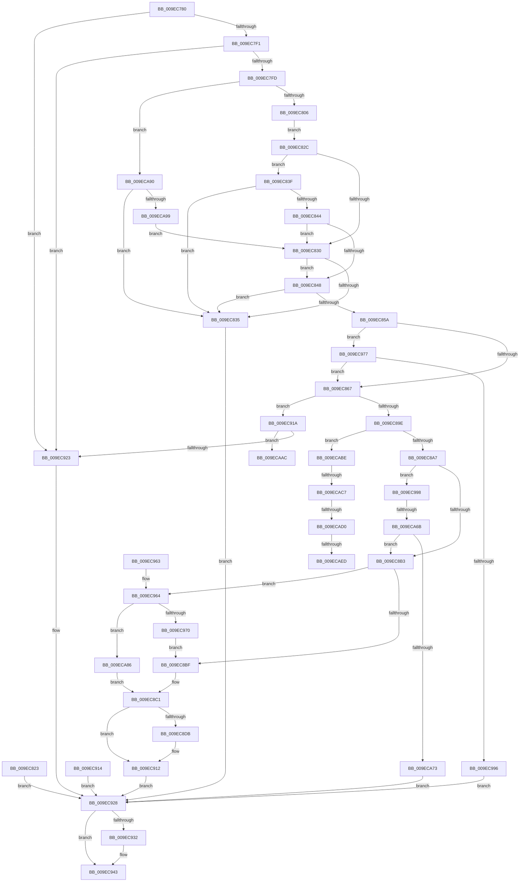

# NtGetMUIRegistryInfo

- RVA: `0x009EC780`–`0x009ECAFF` (길이 `895` bytes)
- VA: `0x00000001409EC780`
- 실행 섹션: `PAGE`
- PDB 이름 있음: `예`; PDB Function 태그: `예`
- unwind 정보 RVA: `0x000A5AEC`
- 디코드: `201`개 명령, `895/895` bytes 표시
- 미해석 바이트: `0` (있으면 어셈블리에 `.byte`로 보존)

> 이 문서는 커널 이미지의 기계어와 PDB 기호를 분석해 생성했습니다. 4번과 5번은 함수 원형과 자료형을 바이너리 사용 방식에서 추정한 C 해석이며 원본 소스 복구 결과는 아닙니다.

## 1. Dependencies

- 직접 호출 지점: **10**; 고유 호출 대상: **10**
- 직접 호출자로 확인된 함수: **0**
- RIP 상대 이미지 참조: **11**

### Outgoing calls
- `0x009EC885` → [ExAcquireResourceExclusiveLite](../../text/21/ExAcquireResourceExclusiveLite_function_00214E20.md) (function, `0x00214E20`)
- `0x009EC8EA` → [ProbeForWrite](../8E/ProbeForWrite_function_008E91C0.md) (function, `0x008E91C0`)
- `0x009EC8F7` → [memset](../../text/6C/memset_function_006C6C40.md) (function, `0x006C6C40`)
- `0x009EC90D` → [memcpy](../../text/6C/memcpy_function_006C6840.md) (function, `0x006C6840`)
- `0x009EC939` → [ExReleaseResourceLite](../../text/25/ExReleaseResourceLite_function_0025FA10.md) (function, `0x0025FA10`)
- `0x009EC93E` → [KeLeaveCriticalRegion](../../text/25/KeLeaveCriticalRegion_function_0025D8B0.md) (function, `0x0025D8B0`)
- `0x009EC97E` → [MUIInitializeResourceLock](MUIInitializeResourceLock_function_009ECB08.md) (function, `0x009ECB08`)
- `0x009EC9A7` → [KeInitializeEvent](../../text/40/KeInitializeEvent_function_0040DD10.md) (function, `0x0040DD10`)
- `0x009ECA5C` → [PsCreateSystemThreadEx](PsCreateSystemThreadEx_function_009ED120.md) (function, `0x009ED120`)
- `0x009ECAD2` → [ExFreePoolWithTag](../../poolcode/B8/ExFreePoolWithTag_function_00B82870.md) (function, `0x00B82870`)

### Direct callers
- 이 함수 시작 RVA로 연결되는 직접 call은 확인되지 않았습니다. 간접 호출은 완전히 역산할 수 없습니다.

### Static image references
- `0x009EC7F1` → RVA `0x00FC41C4` (`.data`; read)
- `0x009EC85A` → RVA `0x00EEEFB0` (`.data`; read)
- `0x009EC892` → RVA `0x00EEEFD8` (`.data`; read)
- `0x009EC8CE` → RVA `0x00EEEFE0` (`.data`; read)
- `0x009EC9C3` → RVA `0x00FD9A60` (`PAGEDATA`; read)
- `0x009EC9D2` → RVA `0x00FD9A70` (`PAGEDATA`; read)
- `0x009ECA33` → RVA `0x007D4170` (`MUIRegistrySystemRoutine`; read)
- `0x009ECA73` → RVA `0x00EEEFD8` (`.data`; read/write)
- `0x009ECA7B` → RVA `0x00EEEFE0` (`.data`; write)
- `0x009ECAAC` → RVA `0x00EEEFD8` (`.data`; write)
- `0x009ECAED` → RVA `0x00FC5008` (`ALMOSTRO`; read)

## 2. Other-region calls and transfers

- 다른 실행 섹션으로 향하는 call: **7**
  - `0x009EC885` → [ExAcquireResourceExclusiveLite](../../text/21/ExAcquireResourceExclusiveLite_function_00214E20.md) (`PAGE` → `.text`)
  - `0x009EC8F7` → [memset](../../text/6C/memset_function_006C6C40.md) (`PAGE` → `.text`)
  - `0x009EC90D` → [memcpy](../../text/6C/memcpy_function_006C6840.md) (`PAGE` → `.text`)
  - `0x009EC939` → [ExReleaseResourceLite](../../text/25/ExReleaseResourceLite_function_0025FA10.md) (`PAGE` → `.text`)
  - `0x009EC93E` → [KeLeaveCriticalRegion](../../text/25/KeLeaveCriticalRegion_function_0025D8B0.md) (`PAGE` → `.text`)
  - `0x009EC9A7` → [KeInitializeEvent](../../text/40/KeInitializeEvent_function_0040DD10.md) (`PAGE` → `.text`)
  - `0x009ECAD2` → [ExFreePoolWithTag](../../poolcode/B8/ExFreePoolWithTag_function_00B82870.md) (`PAGE` → `POOLCODE`)
- call이 아닌 외부 분기/꼬리 이동: **6**
  - `0x009ECA65` → [sub_00B30AB8](../B3/Unknown_function_00B30AB8.md) (`tail-transfer`)
  - `0x009ECAB9` → [sub_00B30AB8 + 0xD0](../B3/Unknown_function_00B30AB8.md) (`tail-transfer`)
  - `0x009ECAC1` → [sub_00B30AB8 + 0xA2](../B3/Unknown_function_00B30AB8.md) (`tail-transfer`)
  - `0x009ECACA` → [sub_00B30AB8 + 0xD0](../B3/Unknown_function_00B30AB8.md) (`tail-transfer`)
  - `0x009ECAE7` → [sub_00B30AB8 + 0xD0](../B3/Unknown_function_00B30AB8.md) (`tail-transfer`)
  - `0x009ECAFA` → [sub_00B30AB8 + 0xD0](../B3/Unknown_function_00B30AB8.md) (`tail-transfer`)

## 3. Assembly (complete function range)

```asm
009EC780  4C 8B DC                        mov r11, rsp
009EC783  49 89 5B 08                     mov qword ptr [r11 + 8], rbx
009EC787  49 89 73 10                     mov qword ptr [r11 + 0x10], rsi
009EC78B  49 89 7B 18                     mov qword ptr [r11 + 0x18], rdi
009EC78F  41 54                           push r12
009EC791  41 56                           push r14
009EC793  41 57                           push r15
009EC795  48 81 EC E0 00 00 00            sub rsp, 0xe0
009EC79C  4D 8B E0                        mov r12, r8
009EC79F  4C 8B FA                        mov r15, rdx
009EC7A2  8B D1                           mov edx, ecx
009EC7A4  33 FF                           xor edi, edi
009EC7A6  89 7C 24 50                     mov dword ptr [rsp + 0x50], edi
009EC7AA  33 C0                           xor eax, eax
009EC7AC  41 89 7B B4                     mov dword ptr [r11 - 0x4c], edi
009EC7B0  41 89 7B CC                     mov dword ptr [r11 - 0x34], edi
009EC7B4  0F 57 C0                        xorps xmm0, xmm0
009EC7B7  41 0F 11 43 98                  movups xmmword ptr [r11 - 0x68], xmm0
009EC7BC  49 89 43 A8                     mov qword ptr [r11 - 0x58], rax
009EC7C0  49 89 7B 90                     mov qword ptr [r11 - 0x70], rdi
009EC7C4  0F 11 44 24 58                  movups xmmword ptr [rsp + 0x58], xmm0
009EC7C9  0F 11 44 24 68                  movups xmmword ptr [rsp + 0x68], xmm0
009EC7CE  0F 11 44 24 78                  movups xmmword ptr [rsp + 0x78], xmm0
009EC7D3  40 88 BC 24 18 01 00 00         mov byte ptr [rsp + 0x118], dil
009EC7DB  65 48 8B 04 25 88 01 00 00      mov rax, qword ptr gs:[0x188]
009EC7E4  40 38 B8 32 02 00 00            cmp byte ptr [rax + 0x232], dil
009EC7EB  0F 84 32 01 00 00               je 0x1409ec923
009EC7F1  39 3D CD 79 5D 00               cmp dword ptr [rip + 0x5d79cd], edi
009EC7F7  0F 85 26 01 00 00               jne 0x1409ec923
009EC7FD  4D 85 FF                        test r15, r15
009EC800  0F 84 8A 02 00 00               je 0x1409eca90
009EC806  49 BE 00 00 FF FF FF 7F 00 00   movabs r14, 0x7fffffff0000
009EC810  49 8B C6                        mov rax, r14
009EC813  4D 3B FE                        cmp r15, r14
009EC816  49 0F 42 C7                     cmovb rax, r15
009EC81A  90                              nop
009EC81B  8B 08                           mov ecx, dword ptr [rax]
009EC81D  89 4C 24 50                     mov dword ptr [rsp + 0x50], ecx
009EC821  EB 09                           jmp 0x1409ec82c
009EC823  8B F0                           mov esi, eax
009EC825  33 FF                           xor edi, edi
009EC827  E9 FC 00 00 00                  jmp 0x1409ec928
009EC82C  85 C9                           test ecx, ecx
009EC82E  75 0F                           jne 0x1409ec83f
009EC830  4D 85 E4                        test r12, r12
009EC833  74 13                           je 0x1409ec848
009EC835  BE 0D 00 00 C0                  mov esi, 0xc000000d
009EC83A  E9 E9 00 00 00                  jmp 0x1409ec928
009EC83F  4D 85 E4                        test r12, r12
009EC842  74 F1                           je 0x1409ec835
009EC844  85 C9                           test ecx, ecx
009EC846  74 E8                           je 0x1409ec830
009EC848  BB 01 00 00 00                  mov ebx, 1
009EC84D  85 D2                           test edx, edx
009EC84F  0F 45 DA                        cmovne ebx, edx
009EC852  F7 C3 F4 FF FF FF               test ebx, 0xfffffff4
009EC858  75 DB                           jne 0x1409ec835
009EC85A  48 39 3D 4F 27 50 00            cmp qword ptr [rip + 0x50274f], rdi
009EC861  0F 84 10 01 00 00               je 0x1409ec977
009EC867  65 48 8B 04 25 88 01 00 00      mov rax, qword ptr gs:[0x188]
009EC870  48 83 CE FF                     or rsi, 0xffffffffffffffff
009EC874  66 01 B0 E4 01 00 00            add word ptr [rax + 0x1e4], si
009EC87B  90                              nop
009EC87C  B2 01                           mov dl, 1
009EC87E  48 8B 0D 2B 27 50 00            mov rcx, qword ptr [rip + 0x50272b]
009EC885  E8 96 85 82 FF                  call 0x140214e20
009EC88A  C6 84 24 18 01 00 00 01         mov byte ptr [rsp + 0x118], 1
009EC892  48 8B 0D 3F 27 50 00            mov rcx, qword ptr [rip + 0x50273f]
009EC899  48 3B CE                        cmp rcx, rsi
009EC89C  74 7C                           je 0x1409ec91a
009EC89E  F6 C3 01                        test bl, 1
009EC8A1  0F 84 17 02 00 00               je 0x1409ecabe
009EC8A7  40 8A DF                        mov bl, dil
009EC8AA  48 85 C9                        test rcx, rcx
009EC8AD  0F 84 E5 00 00 00               je 0x1409ec998
009EC8B3  8B 44 24 50                     mov eax, dword ptr [rsp + 0x50]
009EC8B7  85 C0                           test eax, eax
009EC8B9  0F 85 A5 00 00 00               jne 0x1409ec964
009EC8BF  8B F7                           mov esi, edi
009EC8C1  4D 3B FE                        cmp r15, r14
009EC8C4  4D 0F 42 F7                     cmovb r14, r15
009EC8C8  41 8B 06                        mov eax, dword ptr [r14]
009EC8CB  41 89 06                        mov dword ptr [r14], eax
009EC8CE  8B 05 0C 27 50 00               mov eax, dword ptr [rip + 0x50270c]
009EC8D4  41 89 07                        mov dword ptr [r15], eax
009EC8D7  84 DB                           test bl, bl
009EC8D9  74 37                           je 0x1409ec912
009EC8DB  8B 5C 24 50                     mov ebx, dword ptr [rsp + 0x50]
009EC8DF  41 B8 01 00 00 00               mov r8d, 1
009EC8E5  8B D3                           mov edx, ebx
009EC8E7  49 8B CC                        mov rcx, r12
009EC8EA  E8 D1 C8 EF FF                  call 0x1408e91c0
009EC8EF  44 8B C3                        mov r8d, ebx
009EC8F2  33 D2                           xor edx, edx
009EC8F4  49 8B CC                        mov rcx, r12
009EC8F7  E8 44 A3 CD FF                  call 0x1406c6c40
009EC8FC  44 8B 05 DD 26 50 00            mov r8d, dword ptr [rip + 0x5026dd]
009EC903  48 8B 15 CE 26 50 00            mov rdx, qword ptr [rip + 0x5026ce]
009EC90A  49 8B CC                        mov rcx, r12
009EC90D  E8 2E 9F CD FF                  call 0x1406c6840
009EC912  EB 14                           jmp 0x1409ec928
009EC914  8B F0                           mov esi, eax
009EC916  33 FF                           xor edi, edi
009EC918  EB 0E                           jmp 0x1409ec928
009EC91A  F6 C3 02                        test bl, 2
009EC91D  0F 85 89 01 00 00               jne 0x1409ecaac
009EC923  BE 01 00 00 C0                  mov esi, 0xc0000001
009EC928  40 38 BC 24 18 01 00 00         cmp byte ptr [rsp + 0x118], dil
009EC930  74 11                           je 0x1409ec943
009EC932  48 8B 0D 77 26 50 00            mov rcx, qword ptr [rip + 0x502677]
009EC939  E8 D2 30 87 FF                  call 0x14025fa10
009EC93E  E8 6D 0F 87 FF                  call 0x14025d8b0
009EC943  8B C6                           mov eax, esi
009EC945  4C 8D 9C 24 E0 00 00 00         lea r11, [rsp + 0xe0]
009EC94D  49 8B 5B 20                     mov rbx, qword ptr [r11 + 0x20]
009EC951  49 8B 73 28                     mov rsi, qword ptr [r11 + 0x28]
009EC955  49 8B 7B 30                     mov rdi, qword ptr [r11 + 0x30]
009EC959  49 8B E3                        mov rsp, r11
009EC95C  41 5F                           pop r15
009EC95E  41 5E                           pop r14
009EC960  41 5C                           pop r12
009EC962  C3                              ret
009EC963  CC                              int3
009EC964  3B 05 76 26 50 00               cmp eax, dword ptr [rip + 0x502676]
009EC96A  0F 82 16 01 00 00               jb 0x1409eca86
009EC970  B3 01                           mov bl, 1
009EC972  E9 48 FF FF FF                  jmp 0x1409ec8bf
009EC977  48 8D 0D 32 26 50 00            lea rcx, [rip + 0x502632]
009EC97E  E8 85 01 00 00                  call 0x1409ecb08
009EC983  8B F0                           mov esi, eax
009EC985  8B C8                           mov ecx, eax
009EC987  B8 00 00 00 C0                  mov eax, 0xc0000000
009EC98C  23 C8                           and ecx, eax
009EC98E  3B C8                           cmp ecx, eax
009EC990  0F 85 D1 FE FF FF               jne 0x1409ec867
009EC996  EB 90                           jmp 0x1409ec928
009EC998  45 33 C0                        xor r8d, r8d
009EC99B  41 8D 50 01                     lea edx, [r8 + 1]
009EC99F  48 8D 8C 24 90 00 00 00         lea rcx, [rsp + 0x90]
009EC9A7  E8 64 13 A2 FF                  call 0x14040dd10
009EC9AC  48 8D 84 24 90 00 00 00         lea rax, [rsp + 0x90]
009EC9B4  48 89 44 24 58                  mov qword ptr [rsp + 0x58], rax
009EC9B9  48 89 7C 24 60                  mov qword ptr [rsp + 0x60], rdi
009EC9BE  48 89 7C 24 68                  mov qword ptr [rsp + 0x68], rdi
009EC9C3  0F B7 05 96 D0 5E 00            movzx eax, word ptr [rip + 0x5ed096]
009EC9CA  89 44 24 70                     mov dword ptr [rsp + 0x70], eax
009EC9CE  89 7C 24 74                     mov dword ptr [rsp + 0x74], edi
009EC9D2  0F B7 05 97 D0 5E 00            movzx eax, word ptr [rip + 0x5ed097]
009EC9D9  89 44 24 78                     mov dword ptr [rsp + 0x78], eax
009EC9DD  89 7C 24 7C                     mov dword ptr [rsp + 0x7c], edi
009EC9E1  BE 01 00 00 C0                  mov esi, 0xc0000001
009EC9E6  89 B4 24 80 00 00 00            mov dword ptr [rsp + 0x80], esi
009EC9ED  C7 84 24 A8 00 00 00 30 00 00 00  mov dword ptr [rsp + 0xa8], 0x30
009EC9F8  48 89 BC 24 B0 00 00 00         mov qword ptr [rsp + 0xb0], rdi
009ECA00  C7 84 24 C0 00 00 00 00 02 00 00  mov dword ptr [rsp + 0xc0], 0x200
009ECA0B  48 89 BC 24 B8 00 00 00         mov qword ptr [rsp + 0xb8], rdi
009ECA13  0F 57 C0                        xorps xmm0, xmm0
009ECA16  F3 0F 7F 84 24 C8 00 00 00      movdqu xmmword ptr [rsp + 0xc8], xmm0
009ECA1F  48 89 7C 24 40                  mov qword ptr [rsp + 0x40], rdi
009ECA24  48 89 7C 24 38                  mov qword ptr [rsp + 0x38], rdi
009ECA29  48 8D 44 24 58                  lea rax, [rsp + 0x58]
009ECA2E  48 89 44 24 30                  mov qword ptr [rsp + 0x30], rax
009ECA33  48 8D 05 36 77 DE FF            lea rax, [rip - 0x2188ca]
009ECA3A  48 89 44 24 28                  mov qword ptr [rsp + 0x28], rax
009ECA3F  48 89 7C 24 20                  mov qword ptr [rsp + 0x20], rdi
009ECA44  45 33 C9                        xor r9d, r9d
009ECA47  4C 8D 84 24 A8 00 00 00         lea r8, [rsp + 0xa8]
009ECA4F  BA FF FF 1F 00                  mov edx, 0x1fffff
009ECA54  48 8D 8C 24 88 00 00 00         lea rcx, [rsp + 0x88]
009ECA5C  E8 BF 06 00 00                  call 0x1409ed120
009ECA61  8B F0                           mov esi, eax
009ECA63  85 C0                           test eax, eax
009ECA65  0F 89 4D 40 14 00               jns 0x140b30ab8
009ECA6B  85 F6                           test esi, esi
009ECA6D  0F 89 40 FE FF FF               jns 0x1409ec8b3
009ECA73  48 83 0D 5D 25 50 00 FF         or qword ptr [rip + 0x50255d], 0xffffffffffffffff
009ECA7B  89 3D 5F 25 50 00               mov dword ptr [rip + 0x50255f], edi
009ECA81  E9 A2 FE FF FF                  jmp 0x1409ec928
009ECA86  BE 23 00 00 C0                  mov esi, 0xc0000023
009ECA8B  E9 31 FE FF FF                  jmp 0x1409ec8c1
009ECA90  F6 C2 0A                        test dl, 0xa
009ECA93  0F 84 9C FD FF FF               je 0x1409ec835
009ECA99  89 7C 24 50                     mov dword ptr [rsp + 0x50], edi
009ECA9D  49 BE 00 00 FF FF FF 7F 00 00   movabs r14, 0x7fffffff0000
009ECAA7  E9 84 FD FF FF                  jmp 0x1409ec830
009ECAAC  48 89 3D 25 25 50 00            mov qword ptr [rip + 0x502525], rdi
009ECAB3  89 3D 27 25 50 00               mov dword ptr [rip + 0x502527], edi
009ECAB9  E9 CA 40 14 00                  jmp 0x140b30b88
009ECABE  F6 C3 02                        test bl, 2
009ECAC1  0F 84 93 40 14 00               je 0x140b30b5a
009ECAC7  48 85 C9                        test rcx, rcx
009ECACA  0F 84 B8 40 14 00               je 0x140b30b88
009ECAD0  33 D2                           xor edx, edx
009ECAD2  E8 99 5D 19 00                  call 0x140b82870
009ECAD7  48 89 3D FA 24 50 00            mov qword ptr [rip + 0x5024fa], rdi
009ECADE  89 3D FC 24 50 00               mov dword ptr [rip + 0x5024fc], edi
009ECAE4  F6 C3 08                        test bl, 8
009ECAE7  0F 84 9B 40 14 00               je 0x140b30b88
009ECAED  48 8B 05 14 85 5D 00            mov rax, qword ptr [rip + 0x5d8514]
009ECAF4  FF 80 A4 03 00 00               inc dword ptr [rax + 0x3a4]
009ECAFA  E9 89 40 14 00                  jmp 0x140b30b88
```

## 4. C-style interpretation (structured pseudocode)

```c
__int64 __fastcall NtGetMUIRegistryInfo(int a1, __int64 a2, __int64 a3, int a4)
{
    __int64 result;
    __int64 v_r14;
    __int64 v_rbx;
    __int64 v_rdi;
    __int64 v_rsi;
    __int64 v_rsp;
    unsigned __int64 v_stack_m18;
    unsigned int v_stack_m20;
    unsigned __int64 v_stack_m28;
    unsigned __int64 v_stack_m30;
    unsigned int v_stack_m38;
    unsigned __int64 v_stack_m50;
    unsigned __int64 v_stack_m58;
    unsigned int v_stack_m60;
    unsigned int v_stack_m64;
    unsigned int v_stack_m68;
    unsigned int v_stack_m6C;
    unsigned int v_stack_m70;
    unsigned __int64 v_stack_m78;
    unsigned __int64 v_stack_m80;
    unsigned __int64 v_stack_m88;
    unsigned __int64 v_stack_m90;
    unsigned __int64 v_stack_mA0;
    unsigned int v_stack_mA8;
    unsigned __int64 v_stack_mB0;
    unsigned __int64 v_stack_mB8;
    unsigned __int64 v_stack_mC0;
    unsigned __int8 v_stack_p20;

    *(unsigned __int64 *)(v_rsp + 8) = v_rbx;
    *(unsigned __int64 *)(v_rsp + 16) = v_rsi;
    *(unsigned __int64 *)(v_rsp + 24) = v_rdi;
    v_rsp = (v_rsp) - (224);
    v_rdi = 0;
    v_stack_mA8 = 0;
    result = 0;
    *(unsigned int *)(v_rsp - 76) = 0;
    *(unsigned int *)(v_rsp - 52) = 0;
    *(unsigned __int64 *)(v_rsp - 104) = v_xmm0;
    *(unsigned __int64 *)(v_rsp - 88) = 0;
    *(unsigned __int64 *)(v_rsp - 112) = 0;
    v_stack_mA0 = v_xmm0;
    v_stack_m90 = v_xmm0;
    v_stack_m80 = v_xmm0;
    v_stack_p20 = 0;
    if ((*(unsigned __int8 *)(*(unsigned __int64 *)(gs_base + (0 + 392)) + 562)) == 0) goto loc_009EC923;
    if ((*(unsigned int *)(v_rip + 6126029)) != 0) goto loc_009EC923;
    if (a2 == 0) goto loc_009ECA90;
    result = v_r14;
    if (a2 < v_r14) { result = a2; }
    v_stack_mA8 = (unsigned int)((unsigned int)(*(unsigned int *)(result)));
    goto loc_009EC82C;
loc_009EC82C:
    if ((unsigned int)((unsigned int)(*(unsigned int *)(result))) != 0) goto loc_009EC83F;
loc_009EC830:
    if (a3 == 0) goto loc_009EC848;
loc_009EC835:
    goto loc_009EC928;
loc_009EC83F:
    if (a3 == 0) goto loc_009EC835;
    if ((unsigned int)((unsigned int)(*(unsigned int *)(result))) == 0) goto loc_009EC830;
loc_009EC848:
    v_rbx = 1;
    if ((unsigned int)((unsigned int)(a1)) != 0) { v_rbx = (unsigned int)((unsigned int)(a1)); }
    if ((((unsigned int)(v_rbx)) & (0xFFFFFFF4ULL)) != 0) goto loc_009EC835;
    if ((*(unsigned __int64 *)(v_rip + 5252943)) == 0) goto loc_009EC977;
loc_009EC867:
    v_rsi = ((unsigned int)(0xC000000DULL)) | (-1);
    result = ExAcquireResourceExclusiveLite(*(unsigned __int64 *)(v_rip + 5252907), 1, a3, a4);
    v_stack_p20 = 1;
    if ((*(unsigned __int64 *)(v_rip + 5252927)) == v_rsi) goto loc_009EC91A;
    if ((((unsigned __int8)(v_rbx)) & (1)) == 0) goto loc_009ECABE;
    if (*(unsigned __int64 *)(v_rip + 5252927) == 0) goto loc_009EC998;
loc_009EC8B3:
    if ((unsigned int)((unsigned int)(v_stack_mA8)) != 0) goto loc_009EC964;
loc_009EC8BF:
loc_009EC8C1:
    if (a2 < v_r14) { v_r14 = a2; }
    *(unsigned int *)(v_r14) = (unsigned int)((unsigned int)(*(unsigned int *)(v_r14)));
    *(unsigned int *)(a2) = (unsigned int)((unsigned int)(*(unsigned int *)(v_rip + 5252876)));
    result = (unsigned int)(*(unsigned int *)(v_rip + 5252876));
    v_rbx = 0;
    if (0 != 0) {
        v_rbx = v_stack_mA8;
        a3 = 1;
        a2 = (unsigned int)(v_rbx);
        a1 = a3;
        result = ProbeForWrite(a1, a2, a3, a4);
        a3 = (unsigned int)(v_rbx);
        a2 = 0;
        a1 = a3;
        result = memset(a1, a2, a3, a4);
        a3 = *(unsigned int *)(v_rip + 5252829);
        a2 = *(unsigned __int64 *)(v_rip + 5252814);
        a1 = a3;
        result = memcpy(a1, a2, a3, a4);
    }
    goto loc_009EC928;
loc_009EC91A:
    if ((((unsigned __int8)(v_rbx)) & (2)) != 0) goto loc_009ECAAC;
loc_009EC923:
loc_009EC928:
    if (v_stack_p20 != 0) {
        a1 = *(unsigned __int64 *)(v_rip + 5252727);
        result = ExReleaseResourceLite(a1, a2, a3, a4);
        result = KeLeaveCriticalRegion(a1, a2, a3, a4);
    }
    return (unsigned int)((unsigned int)((unsigned int)(0xC0000001ULL)));
loc_009EC964:
    if (((unsigned int)((unsigned int)((unsigned int)((unsigned int)(0xC0000001ULL))))) < (*(unsigned int *)(v_rip + 5252726))) goto loc_009ECA86;
    goto loc_009EC8BF;
loc_009EC977:
    result = MUIInitializeResourceLock(v_rip + 5252658, a2, a3, a4);
    a1 = (unsigned int)(((unsigned int)((unsigned int)(result))) & ((unsigned int)((unsigned int)(0xC0000000ULL))));
    if (a1 != ((unsigned int)((unsigned int)(0xC0000000ULL)))) goto loc_009EC867;
    goto loc_009EC928;
loc_009EC998:
    a3 = 0;
    result = KeInitializeEvent(v_stack_m50, a3 + 1, a3, a4);
    v_stack_m88 = v_stack_m50;
    v_stack_m80 = *(unsigned __int64 *)(v_stack_m18 + 48);
    v_stack_m78 = *(unsigned __int64 *)(v_stack_m18 + 48);
    v_stack_m70 = (unsigned int)(*(unsigned __int16 *)(v_rip + 6213782));
    v_stack_m6C = (unsigned int)(*(unsigned __int64 *)(v_stack_m18 + 48));
    v_stack_m68 = (unsigned int)(*(unsigned __int16 *)(v_rip + 6213783));
    v_stack_m64 = (unsigned int)(*(unsigned __int64 *)(v_stack_m18 + 48));
    v_stack_m60 = (unsigned int)((unsigned int)(0xC0000001ULL));
    v_stack_m38 = 48;
    v_stack_m30 = *(unsigned __int64 *)(v_stack_m18 + 48);
    v_stack_m20 = 512;
    v_stack_m28 = *(unsigned __int64 *)(v_stack_m18 + 48);
    v_stack_m18 = v_xmm0;
    v_stack_mA0 = *(unsigned __int64 *)(v_stack_m18 + 48);
    v_stack_mA8 = *(unsigned __int64 *)(v_stack_m18 + 48);
    v_stack_mB0 = v_stack_m88;
    v_stack_mB8 = v_rip - 2197706;
    v_stack_mC0 = *(unsigned __int64 *)(v_stack_m18 + 48);
    a4 = 0;
    result = PsCreateSystemThreadEx(v_stack_m58, (unsigned int)(0x1FFFFFULL), v_stack_m38, a4);
    if (!sign_flag) goto loc_009EC8B3;
    *(unsigned int *)(v_rip + 5252447) = (unsigned int)(*(unsigned __int64 *)(v_stack_m18 + 48));
    goto loc_009EC928;
loc_009ECA86:
    goto loc_009EC8C1;
loc_009ECA90:
    if ((((unsigned __int8)((unsigned int)(0x1FFFFFULL))) & (10)) == 0) goto loc_009EC835;
    v_stack_m90 = (unsigned int)(*(unsigned __int64 *)(v_stack_m18 + 48));
    goto loc_009EC830;
loc_009ECAAC:
    *(unsigned __int64 *)(v_rip + 5252389) = *(unsigned __int64 *)(v_stack_m18 + 48);
    *(unsigned int *)(v_rip + 5252391) = (unsigned int)(*(unsigned __int64 *)(v_stack_m18 + 48));
loc_009ECABE:
    a2 = 0;
    result = ExFreePoolWithTag(v_stack_m58, a2, v_stack_m38, a4);
    *(unsigned __int64 *)(v_rip + 5252346) = *(unsigned __int64 *)(v_stack_m18 + 48);
    *(unsigned int *)(v_rip + 5252348) = (unsigned int)(*(unsigned __int64 *)(v_stack_m18 + 48));
}
```

## 5. (Beta) C Style

```c
int64_t NtGetMUIRegistryInfo(int32_t Arg1, int64_t Arg2, int64_t Arg3, int32_t Arg4)
{
    int64_t result;
    int64_t local_r14;
    int64_t local_rbx;
    int64_t local_rdi;
    int64_t local_rsi;
    int64_t local_rsp;
    uint64_t v_stack_m18;
    uint32_t v_stack_m20;
    uint64_t v_stack_m28;
    uint64_t v_stack_m30;
    uint32_t v_stack_m38;
    uint64_t v_stack_m50;
    uint64_t v_stack_m58;
    uint32_t v_stack_m60;
    uint32_t v_stack_m64;
    uint32_t v_stack_m68;
    uint32_t v_stack_m6C;
    uint32_t v_stack_m70;
    uint64_t v_stack_m78;
    uint64_t v_stack_m80;
    uint64_t v_stack_m88;
    uint64_t v_stack_m90;
    uint64_t v_stack_mA0;
    uint32_t v_stack_mA8;
    uint64_t v_stack_mB0;
    uint64_t v_stack_mB8;
    uint64_t v_stack_mC0;
    uint8_t v_stack_p20;

    *(uint64_t *)(local_rsp + 0x8) = local_rbx;
    *(uint64_t *)(local_rsp + 0x10) = local_rsi;
    *(uint64_t *)(local_rsp + 0x18) = local_rdi;
    local_rsp = (local_rsp) - (224);
    local_rdi = 0;
    v_stack_mA8 = 0;
    result = 0;
    *(uint32_t *)(local_rsp - 0x4C) = 0;
    *(uint32_t *)(local_rsp - 0x34) = 0;
    *(uint64_t *)(local_rsp - 0x68) = v_xmm0;
    *(uint64_t *)(local_rsp - 0x58) = 0;
    *(uint64_t *)(local_rsp - 0x70) = 0;
    v_stack_mA0 = v_xmm0;
    v_stack_m90 = v_xmm0;
    v_stack_m80 = v_xmm0;
    v_stack_p20 = 0;
    if ((*(uint8_t *)(*(uint64_t *)(gs_base + (0 + 0x188)) + 0x232)) == 0) goto loc_009EC923;
    if ((*(uint32_t *)(v_rip + 0x5D79CD)) != 0) goto loc_009EC923;
    if (Arg2 == 0) goto loc_009ECA90;
    result = local_r14;
    if (Arg2 < local_r14) { result = Arg2; }
    v_stack_mA8 = (uint32_t)((uint32_t)(*(uint32_t *)(result)));
    goto loc_009EC82C;
loc_009EC82C:
    if ((uint32_t)((uint32_t)(*(uint32_t *)(result))) != 0) goto loc_009EC83F;
loc_009EC830:
    if (Arg3 == 0) goto loc_009EC848;
loc_009EC835:
    goto loc_009EC928;
loc_009EC83F:
    if (Arg3 == 0) goto loc_009EC835;
    if ((uint32_t)((uint32_t)(*(uint32_t *)(result))) == 0) goto loc_009EC830;
loc_009EC848:
    local_rbx = 1;
    if ((uint32_t)((uint32_t)(Arg1)) != 0) { local_rbx = (uint32_t)((uint32_t)(Arg1)); }
    if ((((uint32_t)(local_rbx)) & (0xFFFFFFF4ULL)) != 0) goto loc_009EC835;
    if ((*(uint64_t *)(v_rip + 0x50274F)) == 0) goto loc_009EC977;
loc_009EC867:
    local_rsi = ((uint32_t)(0xC000000DULL)) | (-1);
    result = ExAcquireResourceExclusiveLite(*(uint64_t *)(v_rip + 0x50272B), 1, Arg3, Arg4);
    v_stack_p20 = 1;
    if ((*(uint64_t *)(v_rip + 0x50273F)) == local_rsi) goto loc_009EC91A;
    if ((((uint8_t)(local_rbx)) & (1)) == 0) goto loc_009ECABE;
    if (*(uint64_t *)(v_rip + 0x50273F) == 0) goto loc_009EC998;
loc_009EC8B3:
    if ((uint32_t)((uint32_t)(v_stack_mA8)) != 0) goto loc_009EC964;
loc_009EC8BF:
loc_009EC8C1:
    if (Arg2 < local_r14) { local_r14 = Arg2; }
    *(uint32_t *)(local_r14) = (uint32_t)((uint32_t)(*(uint32_t *)(local_r14)));
    *(uint32_t *)(Arg2) = (uint32_t)((uint32_t)(*(uint32_t *)(v_rip + 0x50270C)));
    result = (uint32_t)(*(uint32_t *)(v_rip + 0x50270C));
    local_rbx = 0;
    if (0 != 0) {
        local_rbx = v_stack_mA8;
        Arg3 = 1;
        Arg2 = (uint32_t)(local_rbx);
        Arg1 = Arg3;
        result = ProbeForWrite(Arg1, Arg2, Arg3, Arg4);
        Arg3 = (uint32_t)(local_rbx);
        Arg2 = 0;
        Arg1 = Arg3;
        result = memset(Arg1, Arg2, Arg3, Arg4);
        Arg3 = *(uint32_t *)(v_rip + 0x5026DD);
        Arg2 = *(uint64_t *)(v_rip + 0x5026CE);
        Arg1 = Arg3;
        result = memcpy(Arg1, Arg2, Arg3, Arg4);
    }
    goto loc_009EC928;
loc_009EC91A:
    if ((((uint8_t)(local_rbx)) & (2)) != 0) goto loc_009ECAAC;
loc_009EC923:
loc_009EC928:
    if (v_stack_p20 != 0) {
        Arg1 = *(uint64_t *)(v_rip + 0x502677);
        result = ExReleaseResourceLite(Arg1, Arg2, Arg3, Arg4);
        result = KeLeaveCriticalRegion(Arg1, Arg2, Arg3, Arg4);
    }
    return (uint32_t)((uint32_t)((uint32_t)(0xC0000001ULL)));
loc_009EC964:
    if (((uint32_t)((uint32_t)((uint32_t)((uint32_t)(0xC0000001ULL))))) < (*(uint32_t *)(v_rip + 0x502676))) goto loc_009ECA86;
    goto loc_009EC8BF;
loc_009EC977:
    result = MUIInitializeResourceLock(v_rip + 5252658, Arg2, Arg3, Arg4);
    Arg1 = (uint32_t)(((uint32_t)((uint32_t)(result))) & ((uint32_t)((uint32_t)(0xC0000000ULL))));
    if (Arg1 != ((uint32_t)((uint32_t)(0xC0000000ULL)))) goto loc_009EC867;
    goto loc_009EC928;
loc_009EC998:
    Arg3 = 0;
    result = KeInitializeEvent(v_stack_m50, Arg3 + 1, Arg3, Arg4);
    v_stack_m88 = v_stack_m50;
    v_stack_m80 = *(uint64_t *)(v_stack_m18 + 0x30);
    v_stack_m78 = *(uint64_t *)(v_stack_m18 + 0x30);
    v_stack_m70 = (uint32_t)(*(uint16_t *)(v_rip + 0x5ED096));
    v_stack_m6C = (uint32_t)(*(uint64_t *)(v_stack_m18 + 0x30));
    v_stack_m68 = (uint32_t)(*(uint16_t *)(v_rip + 0x5ED097));
    v_stack_m64 = (uint32_t)(*(uint64_t *)(v_stack_m18 + 0x30));
    v_stack_m60 = (uint32_t)((uint32_t)(0xC0000001ULL));
    v_stack_m38 = 48;
    v_stack_m30 = *(uint64_t *)(v_stack_m18 + 0x30);
    v_stack_m20 = 512;
    v_stack_m28 = *(uint64_t *)(v_stack_m18 + 0x30);
    v_stack_m18 = v_xmm0;
    v_stack_mA0 = *(uint64_t *)(v_stack_m18 + 0x30);
    v_stack_mA8 = *(uint64_t *)(v_stack_m18 + 0x30);
    v_stack_mB0 = v_stack_m88;
    v_stack_mB8 = v_rip - 2197706;
    v_stack_mC0 = *(uint64_t *)(v_stack_m18 + 0x30);
    Arg4 = 0;
    result = PsCreateSystemThreadEx(v_stack_m58, (uint32_t)(0x1FFFFFULL), v_stack_m38, Arg4);
    if (!sign_flag) goto loc_009EC8B3;
    *(uint32_t *)(v_rip + 0x50255F) = (uint32_t)(*(uint64_t *)(v_stack_m18 + 0x30));
    goto loc_009EC928;
loc_009ECA86:
    goto loc_009EC8C1;
loc_009ECA90:
    if ((((uint8_t)((uint32_t)(0x1FFFFFULL))) & (10)) == 0) goto loc_009EC835;
    v_stack_m90 = (uint32_t)(*(uint64_t *)(v_stack_m18 + 0x30));
    goto loc_009EC830;
loc_009ECAAC:
    *(uint64_t *)(v_rip + 0x502525) = *(uint64_t *)(v_stack_m18 + 0x30);
    *(uint32_t *)(v_rip + 0x502527) = (uint32_t)(*(uint64_t *)(v_stack_m18 + 0x30));
loc_009ECABE:
    Arg2 = 0;
    result = ExFreePoolWithTag(v_stack_m58, Arg2, v_stack_m38, Arg4);
    *(uint64_t *)(v_rip + 0x5024FA) = *(uint64_t *)(v_stack_m18 + 0x30);
    *(uint32_t *)(v_rip + 0x5024FC) = (uint32_t)(*(uint64_t *)(v_stack_m18 + 0x30));
}
```

## 6. Execution-region graph

[열기: 2D/3D 그래프와 함수 탐색 컨트롤 패널](../../../control-panel.html?section=page&rva=0x009EC780&view=graph)

- 2D 그래프는 위에서 아래로 흐르고, 3D 그래프는 빈 공간을 드래그해 회전합니다. Shift+드래그는 이동, 휠은 확대·축소, 함수 노드 선택은 대상 보고서 이동입니다.

### Static fallback


