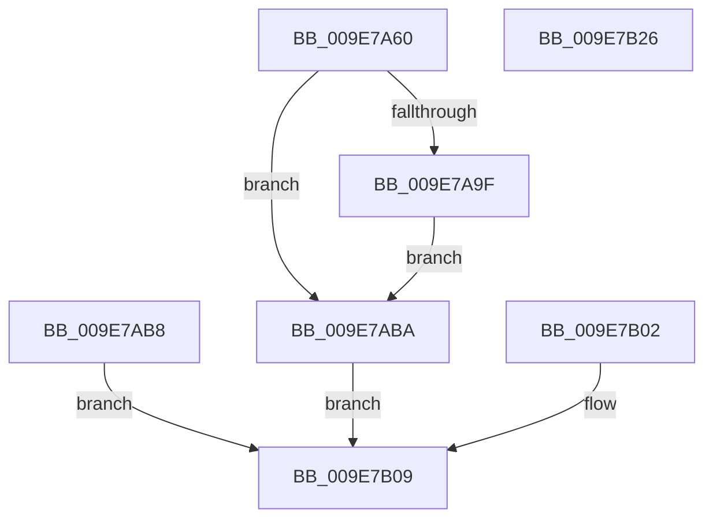

# NtOpenSymbolicLinkObject

- RVA: `0x009E7A60`–`0x009E7B27` (길이 `199` bytes)
- VA: `0x00000001409E7A60`
- 실행 섹션: `PAGE`
- PDB 이름 있음: `예`; PDB Function 태그: `아니요`
- unwind 정보 RVA: `0x000A4C00`
- 디코드: `49`개 명령, `199/199` bytes 표시
- 미해석 바이트: `0` (있으면 어셈블리에 `.byte`로 보존)

> 이 문서는 커널 이미지의 기계어와 PDB 기호를 분석해 생성했습니다. 4번과 5번은 함수 원형과 자료형을 바이너리 사용 방식에서 추정한 C 해석이며 원본 소스 복구 결과는 아닙니다.

## 1. Dependencies

- 직접 호출 지점: **2**; 고유 호출 대상: **2**
- 직접 호출자로 확인된 함수: **2**
- RIP 상대 이미지 참조: **1**

### Outgoing calls
- `0x009E7AC1` → [PsGetCurrentSilo](../../text/40/PsGetCurrentSilo_function_004094A0.md) (function, `0x004094A0`)
- `0x009E7AEC` → [ObOpenObjectByNameEx](../89/ObOpenObjectByNameEx_function_0089A8A0.md) (function, `0x0089A8A0`)

### Direct callers
- [AdtpInitializeDriveLetters](../82/AdtpInitializeDriveLetters_function_00823058.md) at `0x00823118`
- [AdtpInitializeDriveLetters](../82/AdtpInitializeDriveLetters_function_00823058.md) at `0x00823236`
- [IopReassignSystemRoot](../../init/C2/IopReassignSystemRoot_function_00C2D1D0.md) at `0x00C2D28D`
- [IopReassignSystemRoot](../../init/C2/IopReassignSystemRoot_function_00C2D1D0.md) at `0x00C2D347`

### Static image references
- `0x009E7ABA` → RVA `0x00F0F658` (`.data`; read)

## 2. Other-region calls and transfers

- 다른 실행 섹션으로 향하는 call: **1**
  - `0x009E7AC1` → [PsGetCurrentSilo](../../text/40/PsGetCurrentSilo_function_004094A0.md) (`PAGE` → `.text`)
- 별도 외부 분기/꼬리 이동을 확인하지 못했습니다.

## 3. Assembly (complete function range)

```asm
009E7A60  48 89 5C 24 08                  mov qword ptr [rsp + 8], rbx
009E7A65  48 89 74 24 10                  mov qword ptr [rsp + 0x10], rsi
009E7A6A  48 89 7C 24 18                  mov qword ptr [rsp + 0x18], rdi
009E7A6F  41 54                           push r12
009E7A71  41 56                           push r14
009E7A73  41 57                           push r15
009E7A75  48 83 EC 50                     sub rsp, 0x50
009E7A79  4D 8B F0                        mov r14, r8
009E7A7C  44 8B FA                        mov r15d, edx
009E7A7F  48 8B D9                        mov rbx, rcx
009E7A82  45 33 E4                        xor r12d, r12d
009E7A85  4C 89 64 24 40                  mov qword ptr [rsp + 0x40], r12
009E7A8A  65 48 8B 04 25 88 01 00 00      mov rax, qword ptr gs:[0x188]
009E7A93  0F B6 B0 32 02 00 00            movzx esi, byte ptr [rax + 0x232]
009E7A9A  40 84 F6                        test sil, sil
009E7A9D  74 1B                           je 0x1409e7aba
009E7A9F  48 B9 00 00 FF FF FF 7F 00 00   movabs rcx, 0x7fffffff0000
009E7AA9  48 3B D9                        cmp rbx, rcx
009E7AAC  48 0F 42 CB                     cmovb rcx, rbx
009E7AB0  48 8B 01                        mov rax, qword ptr [rcx]
009E7AB3  48 89 01                        mov qword ptr [rcx], rax
009E7AB6  EB 02                           jmp 0x1409e7aba
009E7AB8  EB 4F                           jmp 0x1409e7b09
009E7ABA  48 8B 3D 97 7B 52 00            mov rdi, qword ptr [rip + 0x527b97]
009E7AC1  E8 DA 19 A2 FF                  call 0x1404094a0
009E7AC6  48 8D 4C 24 40                  lea rcx, [rsp + 0x40]
009E7ACB  48 89 4C 24 38                  mov qword ptr [rsp + 0x38], rcx
009E7AD0  48 89 44 24 30                  mov qword ptr [rsp + 0x30], rax
009E7AD5  4C 89 64 24 28                  mov qword ptr [rsp + 0x28], r12
009E7ADA  44 89 7C 24 20                  mov dword ptr [rsp + 0x20], r15d
009E7ADF  45 33 C9                        xor r9d, r9d
009E7AE2  44 0F B6 C6                     movzx r8d, sil
009E7AE6  48 8B D7                        mov rdx, rdi
009E7AE9  49 8B CE                        mov rcx, r14
009E7AEC  E8 AF 2D EB FF                  call 0x14089a8a0
009E7AF1  89 84 24 88 00 00 00            mov dword ptr [rsp + 0x88], eax
009E7AF8  48 8B 4C 24 40                  mov rcx, qword ptr [rsp + 0x40]
009E7AFD  48 89 0B                        mov qword ptr [rbx], rcx
009E7B00  EB 07                           jmp 0x1409e7b09
009E7B02  8B 84 24 88 00 00 00            mov eax, dword ptr [rsp + 0x88]
009E7B09  48 8B 5C 24 70                  mov rbx, qword ptr [rsp + 0x70]
009E7B0E  48 8B 74 24 78                  mov rsi, qword ptr [rsp + 0x78]
009E7B13  48 8B BC 24 80 00 00 00         mov rdi, qword ptr [rsp + 0x80]
009E7B1B  48 83 C4 50                     add rsp, 0x50
009E7B1F  41 5F                           pop r15
009E7B21  41 5E                           pop r14
009E7B23  41 5C                           pop r12
009E7B25  C3                              ret
009E7B26  CC                              int3
```

## 4. C-style interpretation (structured pseudocode)

```c
__int64 __fastcall NtOpenSymbolicLinkObject(__int64 a1, int a2, __int64 a3, int a4)
{
    __int64 result;
    __int64 v_r12;
    __int64 v_rsp;
    unsigned __int64 v_stack_m28;
    unsigned __int64 v_stack_m30;
    unsigned __int64 v_stack_m38;
    unsigned __int64 v_stack_m40;
    unsigned int v_stack_m48;
    unsigned __int64 v_stack_p10;
    unsigned __int64 v_stack_p18;
    unsigned int v_stack_p20;
    unsigned __int64 v_stack_p8;

    v_stack_p8 = v_rbx;
    v_stack_p10 = v_rsi;
    v_stack_p18 = v_rdi;
    v_rsp = (v_rsp) - (80);
    v_r12 = 0;
    v_stack_m28 = 0;
    if ((unsigned __int8)(*(unsigned __int8 *)(*(unsigned __int64 *)(gs_base + (0 + 392)) + 562)) == 0) goto loc_009E7ABA;
    if (a1 < a1) { a1 = a1; }
    *(unsigned __int64 *)(a1) = *(unsigned __int64 *)(a1);
    goto loc_009E7ABA;
loc_009E7ABA:
    result = PsGetCurrentSilo(a1, a2, a3, a4);
    v_stack_m30 = v_stack_m28;
    v_stack_m38 = result;
    v_stack_m40 = 0;
    v_stack_m48 = (unsigned int)((unsigned int)(a2));
    a4 = 0;
    result = ObOpenObjectByNameEx(a3, *(unsigned __int64 *)(v_rip + 5405591), (unsigned __int8)(*(unsigned __int8 *)(*(unsigned __int64 *)(gs_base + (0 + 392)) + 562)), a4);
    v_stack_p20 = (unsigned int)(result);
    *(unsigned __int64 *)(a1) = v_stack_m28;
    goto loc_009E7B09;
loc_009E7B09:
    v_rsp = (v_rsp) + (80);
    return result;
}
```

## 5. (Beta) C Style

```c
int64_t NtOpenSymbolicLinkObject(int64_t Arg1, int32_t Arg2, int64_t Arg3, int32_t Arg4)
{
    int64_t result;
    int64_t local_r12;
    int64_t local_rsp;
    uint64_t v_stack_m28;
    uint64_t v_stack_m30;
    uint64_t v_stack_m38;
    uint64_t v_stack_m40;
    uint32_t v_stack_m48;
    uint64_t v_stack_p10;
    uint64_t v_stack_p18;
    uint32_t v_stack_p20;
    uint64_t v_stack_p8;

    v_stack_p8 = local_rbx;
    v_stack_p10 = local_rsi;
    v_stack_p18 = local_rdi;
    local_rsp = (local_rsp) - (80);
    local_r12 = 0;
    v_stack_m28 = 0;
    if ((uint8_t)(*(uint8_t *)(*(uint64_t *)(gs_base + (0 + 0x188)) + 0x232)) == 0) goto loc_009E7ABA;
    if (Arg1 < Arg1) { Arg1 = Arg1; }
    *(uint64_t *)(Arg1) = *(uint64_t *)(Arg1);
    goto loc_009E7ABA;
loc_009E7ABA:
    result = PsGetCurrentSilo(Arg1, Arg2, Arg3, Arg4);
    v_stack_m30 = v_stack_m28;
    v_stack_m38 = result;
    v_stack_m40 = 0;
    v_stack_m48 = (uint32_t)((uint32_t)(Arg2));
    Arg4 = 0;
    result = ObOpenObjectByNameEx(Arg3, *(uint64_t *)(v_rip + 0x527B97), (uint8_t)(*(uint8_t *)(*(uint64_t *)(gs_base + (0 + 0x188)) + 0x232)), Arg4);
    v_stack_p20 = (uint32_t)(result);
    *(uint64_t *)(Arg1) = v_stack_m28;
    goto loc_009E7B09;
loc_009E7B09:
    local_rsp = (local_rsp) + (80);
    return result;
}
```

## 6. Execution-region graph

[열기: 2D/3D 그래프와 함수 탐색 컨트롤 패널](../../../control-panel.html?section=page&rva=0x009E7A60&view=graph)

- 2D 그래프는 위에서 아래로 흐르고, 3D 그래프는 빈 공간을 드래그해 회전합니다. Shift+드래그는 이동, 휠은 확대·축소, 함수 노드 선택은 대상 보고서 이동입니다.

### Static fallback


