# NtQuerySymbolicLinkObject

- RVA: `0x009EBA20`–`0x009EBCE7` (길이 `711` bytes)
- VA: `0x00000001409EBA20`
- 실행 섹션: `PAGE`
- PDB 이름 있음: `예`; PDB Function 태그: `아니요`
- unwind 정보 RVA: `0x000A5770`
- 디코드: `184`개 명령, `711/711` bytes 표시
- 미해석 바이트: `0` (있으면 어셈블리에 `.byte`로 보존)

> 이 문서는 커널 이미지의 기계어와 PDB 기호를 분석해 생성했습니다. 4번과 5번은 함수 원형과 자료형을 바이너리 사용 방식에서 추정한 C 해석이며 원본 소스 복구 결과는 아닙니다.

## 1. Dependencies

- 직접 호출 지점: **11**; 고유 호출 대상: **11**
- 직접 호출자로 확인된 함수: **3**
- RIP 상대 이미지 참조: **2**

### Outgoing calls
- `0x009EBB10` → [ExRaiseAccessViolation](../8E/ExRaiseAccessViolation_function_008E9240.md) (function, `0x008E9240`)
- `0x009EBB16` → [ExRaiseDatatypeMisalignment](../89/ExRaiseDatatypeMisalignment_function_00899FD0.md) (function, `0x00899FD0`)
- `0x009EBB48` → [ObReferenceObjectByHandle](../86/ObReferenceObjectByHandle_function_00868DB0.md) (function, `0x00868DB0`)
- `0x009EBB83` → [KeAbPreAcquire](../../text/21/KeAbPreAcquire_function_00210230.md) (function, `0x00210230`)
- `0x009EBB9C` → [ExfAcquirePushLockExclusiveEx](../../text/20/ExfAcquirePushLockExclusiveEx_function_0020FC90.md) (function, `0x0020FC90`)
- `0x009EBBF6` → [memcpy](../../text/6C/memcpy_function_006C6840.md) (function, `0x006C6840`)
- `0x009EBC3E` → [KeAbPostRelease](../../text/2E/KeAbPostRelease_function_002E1600.md) (function, `0x002E1600`)
- `0x009EBC4C` → [KeLeaveCriticalRegionThread](../../text/25/KeLeaveCriticalRegionThread_function_0025EFF0.md) (function, `0x0025EFF0`)
- `0x009EBC56` → [ObfDereferenceObject](../../text/2F/ObfDereferenceObject_function_002F9350.md) (function, `0x002F9350`)
- `0x009EBC96` → [ExfReleasePushLock](../../text/26/ExfReleasePushLock_function_002638D0.md) (function, `0x002638D0`)
- `0x009EBCDD` → [RtlInitUnicodeString](../../text/42/RtlInitUnicodeString_function_0042A780.md) (function, `0x0042A780`)

### Direct callers
- [AdtpInitializeDriveLetters](../82/AdtpInitializeDriveLetters_function_00823058.md) at `0x00823167`
- [AdtpInitializeDriveLetters](../82/AdtpInitializeDriveLetters_function_00823058.md) at `0x00823249`
- [IopReassignSystemRoot](../../init/C2/IopReassignSystemRoot_function_00C2D1D0.md) at `0x00C2D2AF`
- [IopStoreSystemPartitionInformation](../../init/C2/IopStoreSystemPartitionInformation_function_00C2D780.md) at `0x00C2D866`

### Static image references
- `0x009EBB23` → RVA `0x00F0F658` (`.data`; read)
- `0x009EBCD1` → RVA `0x00AFCAD0` (` ?? ::NNGAKEGL::`string'`; read)

## 2. Other-region calls and transfers

- 다른 실행 섹션으로 향하는 call: **8**
  - `0x009EBB83` → [KeAbPreAcquire](../../text/21/KeAbPreAcquire_function_00210230.md) (`PAGE` → `.text`)
  - `0x009EBB9C` → [ExfAcquirePushLockExclusiveEx](../../text/20/ExfAcquirePushLockExclusiveEx_function_0020FC90.md) (`PAGE` → `.text`)
  - `0x009EBBF6` → [memcpy](../../text/6C/memcpy_function_006C6840.md) (`PAGE` → `.text`)
  - `0x009EBC3E` → [KeAbPostRelease](../../text/2E/KeAbPostRelease_function_002E1600.md) (`PAGE` → `.text`)
  - `0x009EBC4C` → [KeLeaveCriticalRegionThread](../../text/25/KeLeaveCriticalRegionThread_function_0025EFF0.md) (`PAGE` → `.text`)
  - `0x009EBC56` → [ObfDereferenceObject](../../text/2F/ObfDereferenceObject_function_002F9350.md) (`PAGE` → `.text`)
  - `0x009EBC96` → [ExfReleasePushLock](../../text/26/ExfReleasePushLock_function_002638D0.md) (`PAGE` → `.text`)
  - `0x009EBCDD` → [RtlInitUnicodeString](../../text/42/RtlInitUnicodeString_function_0042A780.md) (`PAGE` → `.text`)
- 별도 외부 분기/꼬리 이동을 확인하지 못했습니다.

## 3. Assembly (complete function range)

```asm
009EBA20  48 89 5C 24 08                  mov qword ptr [rsp + 8], rbx
009EBA25  48 89 74 24 10                  mov qword ptr [rsp + 0x10], rsi
009EBA2A  57                              push rdi
009EBA2B  41 56                           push r14
009EBA2D  41 57                           push r15
009EBA2F  48 83 EC 60                     sub rsp, 0x60
009EBA33  49 8B F0                        mov rsi, r8
009EBA36  4C 8B FA                        mov r15, rdx
009EBA39  4C 8B D1                        mov r10, rcx
009EBA3C  0F 57 C0                        xorps xmm0, xmm0
009EBA3F  0F 11 44 24 40                  movups xmmword ptr [rsp + 0x40], xmm0
009EBA44  0F 57 C9                        xorps xmm1, xmm1
009EBA47  0F 11 4C 24 50                  movups xmmword ptr [rsp + 0x50], xmm1
009EBA4C  65 48 8B 04 25 88 01 00 00      mov rax, qword ptr gs:[0x188]
009EBA55  44 0F B6 88 32 02 00 00         movzx r9d, byte ptr [rax + 0x232]
009EBA5D  45 84 C9                        test r9b, r9b
009EBA60  0F 84 13 02 00 00               je 0x1409ebc79
009EBA66  41 F6 C7 01                     test r15b, 1
009EBA6A  0F 85 A6 00 00 00               jne 0x1409ebb16
009EBA70  49 B8 00 00 FF FF FF 7F 00 00   movabs r8, 0x7fffffff0000
009EBA7A  49 8B C0                        mov rax, r8
009EBA7D  49 3B D0                        cmp rdx, r8
009EBA80  48 0F 42 C2                     cmovb rax, rdx
009EBA84  90                              nop
009EBA85  0F B6 00                        movzx eax, byte ptr [rax]
009EBA88  49 8B C8                        mov rcx, r8
009EBA8B  48 0F 42 CA                     cmovb rcx, rdx
009EBA8F  0F B7 01                        movzx eax, word ptr [rcx]
009EBA92  66 89 01                        mov word ptr [rcx], ax
009EBA95  48 8D 4A 02                     lea rcx, [rdx + 2]
009EBA99  49 3B C8                        cmp rcx, r8
009EBA9C  49 0F 43 C8                     cmovae rcx, r8
009EBAA0  0F B7 01                        movzx eax, word ptr [rcx]
009EBAA3  66 89 01                        mov word ptr [rcx], ax
009EBAA6  0F 10 02                        movups xmm0, xmmword ptr [rdx]
009EBAA9  0F 11 44 24 40                  movups xmmword ptr [rsp + 0x40], xmm0
009EBAAE  66 48 0F 7E C0                  movq rax, xmm0
009EBAB3  48 C1 E8 10                     shr rax, 0x10
009EBAB7  0F B7 C8                        movzx ecx, ax
009EBABA  48 85 C9                        test rcx, rcx
009EBABD  74 4E                           je 0x1409ebb0d
009EBABF  48 8B 44 24 48                  mov rax, qword ptr [rsp + 0x48]
009EBAC4  48 8D 50 FF                     lea rdx, [rax - 1]
009EBAC8  48 03 D1                        add rdx, rcx
009EBACB  48 3B C2                        cmp rax, rdx
009EBACE  77 40                           ja 0x1409ebb10
009EBAD0  49 3B D0                        cmp rdx, r8
009EBAD3  73 3B                           jae 0x1409ebb10
009EBAD5  48 81 E2 00 F0 FF FF            and rdx, 0xfffffffffffff000
009EBADC  48 81 C2 00 10 00 00            add rdx, 0x1000
009EBAE3  0F B6 08                        movzx ecx, byte ptr [rax]
009EBAE6  88 08                           mov byte ptr [rax], cl
009EBAE8  48 25 00 F0 FF FF               and rax, 0xfffffffffffff000
009EBAEE  48 05 00 10 00 00               add rax, 0x1000
009EBAF4  48 3B C2                        cmp rax, rdx
009EBAF7  75 EA                           jne 0x1409ebae3
009EBAF9  48 85 F6                        test rsi, rsi
009EBAFC  74 1E                           je 0x1409ebb1c
009EBAFE  49 3B F0                        cmp rsi, r8
009EBB01  4C 0F 42 C6                     cmovb r8, rsi
009EBB05  41 8B 00                        mov eax, dword ptr [r8]
009EBB08  41 89 00                        mov dword ptr [r8], eax
009EBB0B  EB 0F                           jmp 0x1409ebb1c
009EBB0D  90                              nop
009EBB0E  EB E9                           jmp 0x1409ebaf9
009EBB10  E8 2B D7 EF FF                  call 0x1408e9240
009EBB15  CC                              int3
009EBB16  E8 B5 E4 EA FF                  call 0x140899fd0
009EBB1B  CC                              int3
009EBB1C  EB 05                           jmp 0x1409ebb23
009EBB1E  E9 3F 01 00 00                  jmp 0x1409ebc62
009EBB23  4C 8B 05 2E 3B 52 00            mov r8, qword ptr [rip + 0x523b2e]
009EBB2A  45 33 F6                        xor r14d, r14d
009EBB2D  4C 89 74 24 30                  mov qword ptr [rsp + 0x30], r14
009EBB32  4C 89 74 24 28                  mov qword ptr [rsp + 0x28], r14
009EBB37  48 8D 44 24 30                  lea rax, [rsp + 0x30]
009EBB3C  48 89 44 24 20                  mov qword ptr [rsp + 0x20], rax
009EBB41  41 8D 56 01                     lea edx, [r14 + 1]
009EBB45  49 8B CA                        mov rcx, r10
009EBB48  E8 63 D2 E7 FF                  call 0x140868db0
009EBB4D  89 84 24 98 00 00 00            mov dword ptr [rsp + 0x98], eax
009EBB54  85 C0                           test eax, eax
009EBB56  0F 88 FF 00 00 00               js 0x1409ebc5b
009EBB5C  65 48 8B 04 25 88 01 00 00      mov rax, qword ptr gs:[0x188]
009EBB65  66 FF 88 E4 01 00 00            dec word ptr [rax + 0x1e4]
009EBB6C  90                              nop
009EBB6D  48 8B 5C 24 30                  mov rbx, qword ptr [rsp + 0x30]
009EBB72  48 83 C3 E0                     add rbx, -0x20
009EBB76  48 89 5C 24 38                  mov qword ptr [rsp + 0x38], rbx
009EBB7B  45 33 C0                        xor r8d, r8d
009EBB7E  33 D2                           xor edx, edx
009EBB80  48 8B CB                        mov rcx, rbx
009EBB83  E8 A8 46 82 FF                  call 0x140210230
009EBB88  48 8B F8                        mov rdi, rax
009EBB8B  F0 48 0F BA 2B 00               lock bts qword ptr [rbx], 0
009EBB91  73 0E                           jae 0x1409ebba1
009EBB93  4C 8B C3                        mov r8, rbx
009EBB96  48 8B D0                        mov rdx, rax
009EBB99  48 8B CB                        mov rcx, rbx
009EBB9C  E8 EF 40 82 FF                  call 0x14020fc90
009EBBA1  48 85 FF                        test rdi, rdi
009EBBA4  74 04                           je 0x1409ebbaa
009EBBA6  C6 47 0A 01                     mov byte ptr [rdi + 0xa], 1
009EBBAA  48 8B 4C 24 30                  mov rcx, qword ptr [rsp + 0x30]
009EBBAF  8B 41 1C                        mov eax, dword ptr [rcx + 0x1c]
009EBBB2  A8 10                           test al, 0x10
009EBBB4  0F 85 17 01 00 00               jne 0x1409ebcd1
009EBBBA  0F 10 41 08                     movups xmm0, xmmword ptr [rcx + 8]
009EBBBE  0F 11 44 24 50                  movups xmmword ptr [rsp + 0x50], xmm0
009EBBC3  48 8B 7C 24 50                  mov rdi, qword ptr [rsp + 0x50]
009EBBC8  0F B7 4C 24 42                  movzx ecx, word ptr [rsp + 0x42]
009EBBCD  48 85 F6                        test rsi, rsi
009EBBD0  0F 84 B0 00 00 00               je 0x1409ebc86
009EBBD6  48 8B C7                        mov rax, rdi
009EBBD9  48 C1 E8 10                     shr rax, 0x10
009EBBDD  66 3B C1                        cmp ax, cx
009EBBE0  0F 87 B7 00 00 00               ja 0x1409ebc9d
009EBBE6  0F B7 C8                        movzx ecx, ax
009EBBE9  44 8B C1                        mov r8d, ecx
009EBBEC  48 8B 54 24 58                  mov rdx, qword ptr [rsp + 0x58]
009EBBF1  48 8B 4C 24 48                  mov rcx, qword ptr [rsp + 0x48]
009EBBF6  E8 45 AC CD FF                  call 0x1406c6840
009EBBFB  66 41 89 3F                     mov word ptr [r15], di
009EBBFF  48 85 F6                        test rsi, rsi
009EBC02  74 09                           je 0x1409ebc0d
009EBC04  48 C1 EF 10                     shr rdi, 0x10
009EBC08  0F B7 C7                        movzx eax, di
009EBC0B  89 06                           mov dword ptr [rsi], eax
009EBC0D  EB 08                           jmp 0x1409ebc17
009EBC0F  45 33 F6                        xor r14d, r14d
009EBC12  48 8B 5C 24 38                  mov rbx, qword ptr [rsp + 0x38]
009EBC17  0F 0D 0B                        prefetchw byte ptr [rbx]
009EBC1A  48 8B 03                        mov rax, qword ptr [rbx]
009EBC1D  48 8B C8                        mov rcx, rax
009EBC20  48 83 E1 F0                     and rcx, 0xfffffffffffffff0
009EBC24  48 8D 50 F0                     lea rdx, [rax - 0x10]
009EBC28  48 83 F9 10                     cmp rcx, 0x10
009EBC2C  49 0F 46 D6                     cmovbe rdx, r14
009EBC30  A8 02                           test al, 2
009EBC32  75 5F                           jne 0x1409ebc93
009EBC34  F0 48 0F B1 13                  lock cmpxchg qword ptr [rbx], rdx
009EBC39  75 58                           jne 0x1409ebc93
009EBC3B  48 8B CB                        mov rcx, rbx
009EBC3E  E8 BD 59 8F FF                  call 0x1402e1600
009EBC43  65 48 8B 0C 25 88 01 00 00      mov rcx, qword ptr gs:[0x188]
009EBC4C  E8 9F 33 87 FF                  call 0x14025eff0
009EBC51  48 8B 4C 24 30                  mov rcx, qword ptr [rsp + 0x30]
009EBC56  E8 F5 D6 90 FF                  call 0x1402f9350
009EBC5B  8B 84 24 98 00 00 00            mov eax, dword ptr [rsp + 0x98]
009EBC62  4C 8D 5C 24 60                  lea r11, [rsp + 0x60]
009EBC67  49 8B 5B 20                     mov rbx, qword ptr [r11 + 0x20]
009EBC6B  49 8B 73 28                     mov rsi, qword ptr [r11 + 0x28]
009EBC6F  49 8B E3                        mov rsp, r11
009EBC72  41 5F                           pop r15
009EBC74  41 5E                           pop r14
009EBC76  5F                              pop rdi
009EBC77  C3                              ret
009EBC78  CC                              int3
009EBC79  0F 10 02                        movups xmm0, xmmword ptr [rdx]
009EBC7C  0F 11 44 24 40                  movups xmmword ptr [rsp + 0x40], xmm0
009EBC81  E9 9D FE FF FF                  jmp 0x1409ebb23
009EBC86  66 3B F9                        cmp di, cx
009EBC89  77 17                           ja 0x1409ebca2
009EBC8B  0F B7 CF                        movzx ecx, di
009EBC8E  E9 56 FF FF FF                  jmp 0x1409ebbe9
009EBC93  48 8B CB                        mov rcx, rbx
009EBC96  E8 35 7C 87 FF                  call 0x1402638d0
009EBC9B  EB 9E                           jmp 0x1409ebc3b
009EBC9D  48 85 F6                        test rsi, rsi
009EBCA0  74 E4                           je 0x1409ebc86
009EBCA2  C7 84 24 98 00 00 00 23 00 00 C0  mov dword ptr [rsp + 0x98], 0xc0000023
009EBCAD  48 85 F6                        test rsi, rsi
009EBCB0  0F 84 61 FF FF FF               je 0x1409ebc17
009EBCB6  48 C1 EF 10                     shr rdi, 0x10
009EBCBA  0F B7 C7                        movzx eax, di
009EBCBD  89 06                           mov dword ptr [rsi], eax
009EBCBF  E9 53 FF FF FF                  jmp 0x1409ebc17
009EBCC4  45 33 F6                        xor r14d, r14d
009EBCC7  48 8B 5C 24 38                  mov rbx, qword ptr [rsp + 0x38]
009EBCCC  E9 46 FF FF FF                  jmp 0x1409ebc17
009EBCD1  48 8D 15 F8 0D 11 00            lea rdx, [rip + 0x110df8]
009EBCD8  48 8D 4C 24 50                  lea rcx, [rsp + 0x50]
009EBCDD  E8 9E EA A3 FF                  call 0x14042a780
009EBCE2  E9 DC FE FF FF                  jmp 0x1409ebbc3
```

## 4. C-style interpretation (structured pseudocode)

```c
__int64 __fastcall NtQuerySymbolicLinkObject(__int64 a1, __int64 a2, __int64 a3)
{
    __int64 result;
    __int64 v_r14;
    __int64 v_rbx;
    __int64 v_rdi;
    __int64 v_rsp;
    unsigned __int64 v_stack_m10;
    unsigned __int64 v_stack_m18;
    unsigned __int64 v_stack_m20;
    unsigned __int64 v_stack_m28;
    unsigned __int64 v_stack_m30;
    unsigned __int16 v_stack_m36;
    unsigned __int64 v_stack_m38;
    unsigned __int64 v_stack_m40;
    unsigned __int64 v_stack_m48;
    unsigned __int64 v_stack_m50;
    unsigned __int64 v_stack_m58;
    unsigned __int64 v_stack_p10;
    unsigned int v_stack_p20;
    unsigned int v_stack_p38;
    unsigned __int64 v_stack_p8;

    v_stack_p8 = v_rbx;
    v_stack_p10 = v_rsi;
    v_rsp = (v_rsp) - (96);
    v_stack_m38 = v_xmm0;
    v_stack_m28 = v_xmm1;
    if ((unsigned __int8)(*(unsigned __int8 *)(*(unsigned __int64 *)(gs_base + (0 + 392)) + 562)) == 0) goto loc_009EBC79;
    if ((((unsigned __int8)(a2)) & (1)) != 0) goto loc_009EBB16;
    if (a2 < a3) {
        a3 = a2;
        a3 = a2;
    }
    *(unsigned __int16 *)(a3) = (unsigned __int16)(*(unsigned __int16 *)(a3));
    a1 = a2 + 2;
    if ((a2 + 2) >= a3) { a1 = a3; }
    *(unsigned __int16 *)(a1) = (unsigned __int16)(*(unsigned __int16 *)(a1));
    v_stack_m38 = v_xmm0;
    result = (*(unsigned __int16 *)(a1)) >> (16);
    if ((unsigned __int16)(result) == 0) goto loc_009EBB0D;
    a2 = (v_stack_m30 - 1) + ((unsigned __int16)(result));
    if (v_stack_m30 > a2) goto loc_009EBB10;
    if (a2 >= a3) goto loc_009EBB10;
    a2 = (a2) & (0xFFFFFFFFFFFFF000ULL);
    a2 = (a2) + (0x1000ULL);
loc_009EBAE3:
    *(unsigned __int8 *)(v_stack_m30) = (unsigned __int8)(*(unsigned __int8 *)(v_stack_m30));
    result = (v_stack_m30) & (0xFFFFFFFFFFFFF000ULL);
    result = (result) + (0x1000ULL);
    if (result != a2) goto loc_009EBAE3;
loc_009EBAF9:
    if (a3 == 0) goto loc_009EBB1C;
    if (a3 < a3) { a3 = a3; }
    *(unsigned int *)(a3) = (unsigned int)((unsigned int)(*(unsigned int *)(a3)));
    goto loc_009EBB1C;
loc_009EBB0D:
    goto loc_009EBAF9;
loc_009EBB10:
    result = ExRaiseAccessViolation(*(unsigned __int8 *)(v_stack_m30), a2, a3, *(unsigned __int8 *)(*(unsigned __int64 *)(gs_base + (0 + 392)) + 562));
loc_009EBB16:
    result = ExRaiseDatatypeMisalignment(*(unsigned __int8 *)(v_stack_m30), a2, a3, *(unsigned __int8 *)(*(unsigned __int64 *)(gs_base + (0 + 392)) + 562));
loc_009EBB1C:
    goto loc_009EBB23;
loc_009EBB23:
    v_r14 = 0;
    v_stack_m48 = 0;
    v_stack_m50 = 0;
    v_stack_m58 = v_stack_m48;
    result = ObReferenceObjectByHandle(a1, v_r14 + 1, *(unsigned __int64 *)(v_rip + 5389102), *(unsigned __int8 *)(*(unsigned __int64 *)(gs_base + (0 + 392)) + 562));
    v_stack_p20 = (unsigned int)(result);
    if (sign_flag) goto loc_009EBC5B;
    v_rbx = (v_stack_m48) + (-32);
    v_stack_m40 = v_rbx;
    a3 = 0;
    a2 = 0;
    result = KeAbPreAcquire(v_rbx, a2, a3, *(unsigned __int8 *)(*(unsigned __int64 *)(gs_base + (0 + 392)) + 562));
    if (!(condition_is_above_or_equal)) {
        a3 = v_rbx;
        a2 = result;
        a1 = v_rbx;
        result = ExfAcquirePushLockExclusiveEx(a1, a2, a3, *(unsigned __int8 *)(*(unsigned __int64 *)(gs_base + (0 + 392)) + 562));
    }
    if (result != 0) {
        *(unsigned __int8 *)(result + 10) = 1;
    }
    if ((((unsigned __int8)((unsigned int)(*(unsigned int *)(v_stack_m48 + 28)))) & (16)) != 0) goto loc_009EBCD1;
    v_stack_m28 = v_xmm0;
loc_009EBBC3:
    if (a3 == 0) goto loc_009EBC86;
    result = (v_stack_m28) >> (16);
    if (((unsigned __int16)(result)) > ((unsigned __int16)(v_stack_m36))) goto loc_009EBC9D;
loc_009EBBE9:
    result = memcpy(v_stack_m30, v_stack_m20, (unsigned int)((unsigned int)((unsigned __int16)(result))), *(unsigned __int8 *)(*(unsigned __int64 *)(gs_base + (0 + 392)) + 562));
    *(unsigned __int16 *)(a2) = (unsigned __int16)(v_stack_m28);
    v_rdi = v_stack_m28;
    if (a3 != 0) {
        v_rdi = (v_stack_m28) >> (16);
        result = (unsigned __int16)(v_rdi);
        *(unsigned int *)(a3) = (unsigned int)(result);
    }
    goto loc_009EBC17;
loc_009EBC17:
    a1 = (*(unsigned __int64 *)(v_rbx)) & (-16);
    a2 = *(unsigned __int64 *)(v_rbx) - 16;
    if (a1 <= 16) { a2 = 0; }
    if ((((unsigned __int8)(*(unsigned __int64 *)(v_rbx))) & (2)) != 0) goto loc_009EBC93;
    if ((((unsigned __int8)(*(unsigned __int64 *)(v_rbx))) & (2)) != 0) goto loc_009EBC93;
loc_009EBC3B:
    result = KeAbPostRelease(v_rbx, a2, (unsigned int)((unsigned int)((unsigned __int16)(result))), *(unsigned __int8 *)(*(unsigned __int64 *)(gs_base + (0 + 392)) + 562));
    result = KeLeaveCriticalRegionThread(*(unsigned __int64 *)(gs_base + (0 + 392)), a2, (unsigned int)((unsigned int)((unsigned __int16)(result))), *(unsigned __int8 *)(*(unsigned __int64 *)(gs_base + (0 + 392)) + 562));
    result = ObfDereferenceObject(v_stack_m48, a2, (unsigned int)((unsigned int)((unsigned __int16)(result))), *(unsigned __int8 *)(*(unsigned __int64 *)(gs_base + (0 + 392)) + 562));
loc_009EBC5B:
loc_009EBC62:
    return (unsigned int)(v_stack_p20);
loc_009EBC79:
    v_stack_m20 = v_xmm0;
    goto loc_009EBB23;
loc_009EBC86:
    if (((unsigned __int16)(v_rdi)) > ((unsigned __int16)(v_stack_m48))) goto loc_009EBCA2;
    goto loc_009EBBE9;
loc_009EBC93:
    result = ExfReleasePushLock(*(unsigned __int64 *)(v_stack_m18 + 32), a2, (unsigned int)((unsigned int)((unsigned __int16)(result))), *(unsigned __int8 *)(*(unsigned __int64 *)(gs_base + (0 + 392)) + 562));
    goto loc_009EBC3B;
loc_009EBC9D:
    if (*(unsigned __int64 *)(v_stack_m18 + 40) == 0) goto loc_009EBC86;
loc_009EBCA2:
    v_stack_p38 = 0xC0000023ULL;
    if (*(unsigned __int64 *)(v_stack_m18 + 40) == 0) goto loc_009EBC17;
    v_rdi = (v_rdi) >> (16);
    *(unsigned int *)(*(unsigned __int64 *)(v_stack_m18 + 40)) = (unsigned int)((unsigned __int16)(v_rdi));
    goto loc_009EBC17;
loc_009EBCD1:
    result = RtlInitUnicodeString(v_stack_m10, v_rip + 1117688, (unsigned int)((unsigned int)((unsigned __int16)(result))), *(unsigned __int8 *)(*(unsigned __int64 *)(gs_base + (0 + 392)) + 562));
    goto loc_009EBBC3;
}
```

## 5. (Beta) C Style

```c
int64_t NtQuerySymbolicLinkObject(int64_t Arg1, void *Arg2, int64_t Arg3)
{
    uint8_t *arg2 = (uint8_t *)Arg2;

    int64_t result;
    int64_t local_r14;
    int64_t local_rbx;
    int64_t local_rdi;
    int64_t local_rsp;
    uint64_t v_stack_m10;
    uint64_t v_stack_m18;
    uint64_t v_stack_m20;
    uint64_t v_stack_m28;
    uint64_t v_stack_m30;
    uint16_t v_stack_m36;
    uint64_t v_stack_m38;
    uint64_t v_stack_m40;
    uint64_t v_stack_m48;
    uint64_t v_stack_m50;
    uint64_t v_stack_m58;
    uint64_t v_stack_p10;
    uint32_t v_stack_p20;
    uint32_t v_stack_p38;
    uint64_t v_stack_p8;

    v_stack_p8 = local_rbx;
    v_stack_p10 = local_rsi;
    local_rsp = (local_rsp) - (96);
    v_stack_m38 = v_xmm0;
    v_stack_m28 = v_xmm1;
    if ((uint8_t)(*(uint8_t *)(*(uint64_t *)(gs_base + (0 + 0x188)) + 0x232)) == 0) goto loc_009EBC79;
    if ((((uint8_t)(Arg2)) & (1)) != 0) goto loc_009EBB16;
    if (Arg2 < Arg3) {
        Arg3 = Arg2;
        Arg3 = Arg2;
    }
    *(uint16_t *)(Arg3) = (uint16_t)(*(uint16_t *)(Arg3));
    Arg1 = Arg2 + 2;
    if ((Arg2 + 2) >= Arg3) { Arg1 = Arg3; }
    *(uint16_t *)(Arg1) = (uint16_t)(*(uint16_t *)(Arg1));
    v_stack_m38 = v_xmm0;
    result = (*(uint16_t *)(Arg1)) >> (16);
    if ((uint16_t)(result) == 0) goto loc_009EBB0D;
    Arg2 = (v_stack_m30 - 1) + ((uint16_t)(result));
    if (v_stack_m30 > Arg2) goto loc_009EBB10;
    if (Arg2 >= Arg3) goto loc_009EBB10;
    Arg2 = (Arg2) & (0xFFFFFFFFFFFFF000ULL);
    Arg2 = (Arg2) + (0x1000ULL);
loc_009EBAE3:
    *(uint8_t *)(v_stack_m30) = (uint8_t)(*(uint8_t *)(v_stack_m30));
    result = (v_stack_m30) & (0xFFFFFFFFFFFFF000ULL);
    result = (result) + (0x1000ULL);
    if (result != Arg2) goto loc_009EBAE3;
loc_009EBAF9:
    if (Arg3 == 0) goto loc_009EBB1C;
    if (Arg3 < Arg3) { Arg3 = Arg3; }
    *(uint32_t *)(Arg3) = (uint32_t)((uint32_t)(*(uint32_t *)(Arg3)));
    goto loc_009EBB1C;
loc_009EBB0D:
    goto loc_009EBAF9;
loc_009EBB10:
    result = ExRaiseAccessViolation(*(uint8_t *)(v_stack_m30), Arg2, Arg3, *(uint8_t *)(*(uint64_t *)(gs_base + (0 + 0x188)) + 0x232));
loc_009EBB16:
    result = ExRaiseDatatypeMisalignment(*(uint8_t *)(v_stack_m30), Arg2, Arg3, *(uint8_t *)(*(uint64_t *)(gs_base + (0 + 0x188)) + 0x232));
loc_009EBB1C:
    goto loc_009EBB23;
loc_009EBB23:
    local_r14 = 0;
    v_stack_m48 = 0;
    v_stack_m50 = 0;
    v_stack_m58 = v_stack_m48;
    result = ObReferenceObjectByHandle(Arg1, local_r14 + 1, *(uint64_t *)(v_rip + 0x523B2E), *(uint8_t *)(*(uint64_t *)(gs_base + (0 + 0x188)) + 0x232));
    v_stack_p20 = (uint32_t)(result);
    if (sign_flag) goto loc_009EBC5B;
    local_rbx = (v_stack_m48) + (-32);
    v_stack_m40 = local_rbx;
    Arg3 = 0;
    Arg2 = 0;
    result = KeAbPreAcquire(local_rbx, Arg2, Arg3, *(uint8_t *)(*(uint64_t *)(gs_base + (0 + 0x188)) + 0x232));
    if (!(condition_is_above_or_equal)) {
        Arg3 = local_rbx;
        Arg2 = result;
        Arg1 = local_rbx;
        result = ExfAcquirePushLockExclusiveEx(Arg1, Arg2, Arg3, *(uint8_t *)(*(uint64_t *)(gs_base + (0 + 0x188)) + 0x232));
    }
    if (result != 0) {
        *(uint8_t *)(result + 0xA) = 1;
    }
    if ((((uint8_t)((uint32_t)(*(uint32_t *)(v_stack_m48 + 0x1C)))) & (16)) != 0) goto loc_009EBCD1;
    v_stack_m28 = v_xmm0;
loc_009EBBC3:
    if (Arg3 == 0) goto loc_009EBC86;
    result = (v_stack_m28) >> (16);
    if (((uint16_t)(result)) > ((uint16_t)(v_stack_m36))) goto loc_009EBC9D;
loc_009EBBE9:
    result = memcpy(v_stack_m30, v_stack_m20, (uint32_t)((uint32_t)((uint16_t)(result))), *(uint8_t *)(*(uint64_t *)(gs_base + (0 + 0x188)) + 0x232));
    *(uint16_t *)(arg2) = (uint16_t)(v_stack_m28);
    local_rdi = v_stack_m28;
    if (Arg3 != 0) {
        local_rdi = (v_stack_m28) >> (16);
        result = (uint16_t)(local_rdi);
        *(uint32_t *)(Arg3) = (uint32_t)(result);
    }
    goto loc_009EBC17;
loc_009EBC17:
    Arg1 = (*(uint64_t *)(local_rbx)) & (-16);
    Arg2 = *(uint64_t *)(local_rbx) - 16;
    if (Arg1 <= 16) { Arg2 = 0; }
    if ((((uint8_t)(*(uint64_t *)(local_rbx))) & (2)) != 0) goto loc_009EBC93;
    if ((((uint8_t)(*(uint64_t *)(local_rbx))) & (2)) != 0) goto loc_009EBC93;
loc_009EBC3B:
    result = KeAbPostRelease(local_rbx, Arg2, (uint32_t)((uint32_t)((uint16_t)(result))), *(uint8_t *)(*(uint64_t *)(gs_base + (0 + 0x188)) + 0x232));
    result = KeLeaveCriticalRegionThread(*(uint64_t *)(gs_base + (0 + 0x188)), Arg2, (uint32_t)((uint32_t)((uint16_t)(result))), *(uint8_t *)(*(uint64_t *)(gs_base + (0 + 0x188)) + 0x232));
    result = ObfDereferenceObject(v_stack_m48, Arg2, (uint32_t)((uint32_t)((uint16_t)(result))), *(uint8_t *)(*(uint64_t *)(gs_base + (0 + 0x188)) + 0x232));
loc_009EBC5B:
loc_009EBC62:
    return (uint32_t)(v_stack_p20);
loc_009EBC79:
    v_stack_m20 = v_xmm0;
    goto loc_009EBB23;
loc_009EBC86:
    if (((uint16_t)(local_rdi)) > ((uint16_t)(v_stack_m48))) goto loc_009EBCA2;
    goto loc_009EBBE9;
loc_009EBC93:
    result = ExfReleasePushLock(*(uint64_t *)(v_stack_m18 + 0x20), Arg2, (uint32_t)((uint32_t)((uint16_t)(result))), *(uint8_t *)(*(uint64_t *)(gs_base + (0 + 0x188)) + 0x232));
    goto loc_009EBC3B;
loc_009EBC9D:
    if (*(uint64_t *)(v_stack_m18 + 0x28) == 0) goto loc_009EBC86;
loc_009EBCA2:
    v_stack_p38 = 0xC0000023ULL;
    if (*(uint64_t *)(v_stack_m18 + 0x28) == 0) goto loc_009EBC17;
    local_rdi = (local_rdi) >> (16);
    *(uint32_t *)(*(uint64_t *)(v_stack_m18 + 0x28)) = (uint32_t)((uint16_t)(local_rdi));
    goto loc_009EBC17;
loc_009EBCD1:
    result = RtlInitUnicodeString(v_stack_m10, v_rip + 1117688, (uint32_t)((uint32_t)((uint16_t)(result))), *(uint8_t *)(*(uint64_t *)(gs_base + (0 + 0x188)) + 0x232));
    goto loc_009EBBC3;
}
```

### 관측된 메모리 오프셋

구조체 형식이 확인되지 않은 접근은 인자 기준의 오프셋으로만 기록했습니다.

| 기준 인자 | 오프셋 표현 | 폭 (bit) | 접근 |
|---|---:|---:|---|
| `Arg2` | `+ 0x0` | `128` | `R` |

## 6. Execution-region graph

[열기: 2D/3D 그래프와 함수 탐색 컨트롤 패널](../../../control-panel.html?section=page&rva=0x009EBA20&view=graph)

- 2D 그래프는 위에서 아래로 흐르고, 3D 그래프는 빈 공간을 드래그해 회전합니다. Shift+드래그는 이동, 휠은 확대·축소, 함수 노드 선택은 대상 보고서 이동입니다.

### Static fallback

```mermaid
flowchart TD
  bb_009EBA20[BB_009EBA20]
  bb_009EBA66[BB_009EBA66]
  bb_009EBA70[BB_009EBA70]
  bb_009EBABF[BB_009EBABF]
  bb_009EBAD0[BB_009EBAD0]
  bb_009EBAD5[BB_009EBAD5]
  bb_009EBAE3[BB_009EBAE3]
  bb_009EBAF9[BB_009EBAF9]
  bb_009EBAFE[BB_009EBAFE]
  bb_009EBB0D[BB_009EBB0D]
  bb_009EBB10[BB_009EBB10]
  bb_009EBB16[BB_009EBB16]
  bb_009EBB1C[BB_009EBB1C]
  bb_009EBB1E[BB_009EBB1E]
  bb_009EBB23[BB_009EBB23]
  bb_009EBB5C[BB_009EBB5C]
  bb_009EBB93[BB_009EBB93]
  bb_009EBBA1[BB_009EBBA1]
  bb_009EBBA6[BB_009EBBA6]
  bb_009EBBAA[BB_009EBBAA]
  bb_009EBBBA[BB_009EBBBA]
  bb_009EBBC3[BB_009EBBC3]
  bb_009EBBD6[BB_009EBBD6]
  bb_009EBBE6[BB_009EBBE6]
  bb_009EBBE9[BB_009EBBE9]
  bb_009EBC04[BB_009EBC04]
  bb_009EBC0D[BB_009EBC0D]
  bb_009EBC0F[BB_009EBC0F]
  bb_009EBC17[BB_009EBC17]
  bb_009EBC34[BB_009EBC34]
  bb_009EBC3B[BB_009EBC3B]
  bb_009EBC5B[BB_009EBC5B]
  bb_009EBC62[BB_009EBC62]
  bb_009EBC78[BB_009EBC78]
  bb_009EBC79[BB_009EBC79]
  bb_009EBC86[BB_009EBC86]
  bb_009EBC8B[BB_009EBC8B]
  bb_009EBC93[BB_009EBC93]
  bb_009EBC9D[BB_009EBC9D]
  bb_009EBCA2[BB_009EBCA2]
  bb_009EBCB6[BB_009EBCB6]
  bb_009EBCC4[BB_009EBCC4]
  bb_009EBCD1[BB_009EBCD1]
  bb_009EBA20 -->|branch| bb_009EBC79
  bb_009EBA20 -->|fallthrough| bb_009EBA66
  bb_009EBA66 -->|branch| bb_009EBB16
  bb_009EBA66 -->|fallthrough| bb_009EBA70
  bb_009EBA70 -->|branch| bb_009EBB0D
  bb_009EBA70 -->|fallthrough| bb_009EBABF
  bb_009EBABF -->|branch| bb_009EBB10
  bb_009EBABF -->|fallthrough| bb_009EBAD0
  bb_009EBAD0 -->|branch| bb_009EBB10
  bb_009EBAD0 -->|fallthrough| bb_009EBAD5
  bb_009EBAD5 -->|flow| bb_009EBAE3
  bb_009EBAE3 -->|branch| bb_009EBAE3
  bb_009EBAE3 -->|fallthrough| bb_009EBAF9
  bb_009EBAF9 -->|branch| bb_009EBB1C
  bb_009EBAF9 -->|fallthrough| bb_009EBAFE
  bb_009EBAFE -->|branch| bb_009EBB1C
  bb_009EBB0D -->|branch| bb_009EBAF9
  bb_009EBB10 -->|flow| bb_009EBB16
  bb_009EBB16 -->|flow| bb_009EBB1C
  bb_009EBB1C -->|branch| bb_009EBB23
  bb_009EBB1E -->|branch| bb_009EBC62
  bb_009EBB23 -->|branch| bb_009EBC5B
  bb_009EBB23 -->|fallthrough| bb_009EBB5C
  bb_009EBB5C -->|branch| bb_009EBBA1
  bb_009EBB5C -->|fallthrough| bb_009EBB93
  bb_009EBB93 -->|flow| bb_009EBBA1
  bb_009EBBA1 -->|branch| bb_009EBBAA
  bb_009EBBA1 -->|fallthrough| bb_009EBBA6
  bb_009EBBA6 -->|flow| bb_009EBBAA
  bb_009EBBAA -->|branch| bb_009EBCD1
  bb_009EBBAA -->|fallthrough| bb_009EBBBA
  bb_009EBBBA -->|flow| bb_009EBBC3
  bb_009EBBC3 -->|branch| bb_009EBC86
  bb_009EBBC3 -->|fallthrough| bb_009EBBD6
  bb_009EBBD6 -->|branch| bb_009EBC9D
  bb_009EBBD6 -->|fallthrough| bb_009EBBE6
  bb_009EBBE6 -->|flow| bb_009EBBE9
  bb_009EBBE9 -->|branch| bb_009EBC0D
  bb_009EBBE9 -->|fallthrough| bb_009EBC04
  bb_009EBC04 -->|flow| bb_009EBC0D
  bb_009EBC0D -->|branch| bb_009EBC17
  bb_009EBC0F -->|flow| bb_009EBC17
  bb_009EBC17 -->|branch| bb_009EBC93
  bb_009EBC17 -->|fallthrough| bb_009EBC34
  bb_009EBC34 -->|branch| bb_009EBC93
  bb_009EBC34 -->|fallthrough| bb_009EBC3B
  bb_009EBC3B -->|flow| bb_009EBC5B
  bb_009EBC5B -->|flow| bb_009EBC62
  bb_009EBC78 -->|flow| bb_009EBC79
  bb_009EBC79 -->|branch| bb_009EBB23
  bb_009EBC86 -->|branch| bb_009EBCA2
  bb_009EBC86 -->|fallthrough| bb_009EBC8B
  bb_009EBC8B -->|branch| bb_009EBBE9
  bb_009EBC93 -->|branch| bb_009EBC3B
  bb_009EBC9D -->|branch| bb_009EBC86
  bb_009EBC9D -->|fallthrough| bb_009EBCA2
  bb_009EBCA2 -->|branch| bb_009EBC17
  bb_009EBCA2 -->|fallthrough| bb_009EBCB6
  bb_009EBCB6 -->|branch| bb_009EBC17
  bb_009EBCC4 -->|branch| bb_009EBC17
  bb_009EBCD1 -->|branch| bb_009EBBC3
```


