# NtQueryWnfStateNameInformation

- RVA: `0x009EBD20`–`0x009EC0AE` (길이 `910` bytes)
- VA: `0x00000001409EBD20`
- 실행 섹션: `PAGE`
- PDB 이름 있음: `예`; PDB Function 태그: `아니요`
- unwind 정보 RVA: `0x000A5800`
- 디코드: `241`개 명령, `910/910` bytes 표시
- 미해석 바이트: `0` (있으면 어셈블리에 `.byte`로 보존)

> 이 문서는 커널 이미지의 기계어와 PDB 기호를 분석해 생성했습니다. 4번과 5번은 함수 원형과 자료형을 바이너리 사용 방식에서 추정한 C 해석이며 원본 소스 복구 결과는 아닙니다.

## 1. Dependencies

- 직접 호출 지점: **13**; 고유 호출 대상: **12**
- 직접 호출자로 확인된 함수: **0**
- RIP 상대 이미지 참조: **1**

### Outgoing calls
- `0x009EBD9F` → [ExpCaptureWnfStateName](../90/ExpCaptureWnfStateName_function_00909370.md) (function, `0x00909370`)
- `0x009EBDEB` → [ExpWnfCaptureScopeInstanceId](ExpWnfCaptureScopeInstanceId_function_009EC110.md) (function, `0x009EC110`)
- `0x009EBE4B` → [ProbeForWrite](../8E/ProbeForWrite_function_008E91C0.md) (function, `0x008E91C0`)
- `0x009EBE8C` → [ExpWnfCheckCrossScopeAccess](../90/ExpWnfCheckCrossScopeAccess_function_0090CA94.md) (function, `0x0090CA94`)
- `0x009EBEFF` → [ExpWnfResolveScopeInstance](../90/ExpWnfResolveScopeInstance_function_0090B280.md) (function, `0x0090B280`)
- `0x009EBF1F` → [ExpWnfLookupNameInstance](../90/ExpWnfLookupNameInstance_function_00908C70.md) (function, `0x00908C70`)
- `0x009EBF40` → [ExpWnfLookupPermanentName](../8B/ExpWnfLookupPermanentName_function_008BD914.md) (function, `0x008BD914`)
- `0x009EBF7C` → [ExpWnfCheckCallerAccess](../9D/ExpWnfCheckCallerAccess_function_009D57C0.md) (function, `0x009D57C0`)
- `0x009EC049` → [ExReleaseRundownProtection](../../text/34/ExReleaseRundownProtection_function_00349E80.md) (function, `0x00349E80`)
- `0x009EC05C` → [ExReleaseRundownProtection](../../text/34/ExReleaseRundownProtection_function_00349E80.md) (function, `0x00349E80`)
- `0x009EC070` → [ExFreePoolWithTag](../../poolcode/B8/ExFreePoolWithTag_function_00B82870.md) (function, `0x00B82870`)
- `0x009EC075` → [KeLeaveCriticalRegion](../../text/25/KeLeaveCriticalRegion_function_0025D8B0.md) (function, `0x0025D8B0`)
- `0x009EC089` → [ExpWnfReleaseCapturedScopeInstanceId](ExpWnfReleaseCapturedScopeInstanceId_function_009EC0B4.md) (function, `0x009EC0B4`)

### Direct callers
- 이 함수 시작 RVA로 연결되는 직접 call은 확인되지 않았습니다. 간접 호출은 완전히 역산할 수 없습니다.

### Static image references
- `0x009EBEC3` → RVA `0x00FC6AB0` (`ALMOSTRO`; read)

## 2. Other-region calls and transfers

- 다른 실행 섹션으로 향하는 call: **4**
  - `0x009EC049` → [ExReleaseRundownProtection](../../text/34/ExReleaseRundownProtection_function_00349E80.md) (`PAGE` → `.text`)
  - `0x009EC05C` → [ExReleaseRundownProtection](../../text/34/ExReleaseRundownProtection_function_00349E80.md) (`PAGE` → `.text`)
  - `0x009EC070` → [ExFreePoolWithTag](../../poolcode/B8/ExFreePoolWithTag_function_00B82870.md) (`PAGE` → `POOLCODE`)
  - `0x009EC075` → [KeLeaveCriticalRegion](../../text/25/KeLeaveCriticalRegion_function_0025D8B0.md) (`PAGE` → `.text`)
- 별도 외부 분기/꼬리 이동을 확인하지 못했습니다.

## 3. Assembly (complete function range)

```asm
009EBD20  4C 8B DC                        mov r11, rsp
009EBD23  49 89 5B 08                     mov qword ptr [r11 + 8], rbx
009EBD27  49 89 73 18                     mov qword ptr [r11 + 0x18], rsi
009EBD2B  4D 89 4B 20                     mov qword ptr [r11 + 0x20], r9
009EBD2F  89 54 24 10                     mov dword ptr [rsp + 0x10], edx
009EBD33  57                              push rdi
009EBD34  41 54                           push r12
009EBD36  41 55                           push r13
009EBD38  41 56                           push r14
009EBD3A  41 57                           push r15
009EBD3C  48 81 EC A0 00 00 00            sub rsp, 0xa0
009EBD43  49 8B F1                        mov rsi, r9
009EBD46  4D 8B E0                        mov r12, r8
009EBD49  44 8B F2                        mov r14d, edx
009EBD4C  49 83 63 88 00                  and qword ptr [r11 - 0x78], 0
009EBD51  49 83 63 A8 00                  and qword ptr [r11 - 0x58], 0
009EBD56  65 48 8B 04 25 88 01 00 00      mov rax, qword ptr gs:[0x188]
009EBD5F  66 FF 88 E4 01 00 00            dec word ptr [rax + 0x1e4]
009EBD66  90                              nop
009EBD67  65 48 8B 04 25 88 01 00 00      mov rax, qword ptr gs:[0x188]
009EBD70  44 8A B8 32 02 00 00            mov r15b, byte ptr [rax + 0x232]
009EBD77  44 88 7C 24 30                  mov byte ptr [rsp + 0x30], r15b
009EBD7C  49 83 63 A0 00                  and qword ptr [r11 - 0x60], 0
009EBD81  49 83 63 98 00                  and qword ptr [r11 - 0x68], 0
009EBD86  49 83 63 80 00                  and qword ptr [r11 - 0x80], 0
009EBD8B  83 64 24 3C 00                  and dword ptr [rsp + 0x3c], 0
009EBD90  0F 57 C0                        xorps xmm0, xmm0
009EBD93  41 0F 11 43 C8                  movups xmmword ptr [r11 - 0x38], xmm0
009EBD98  45 8A C7                        mov r8b, r15b
009EBD9B  49 8D 53 88                     lea rdx, [r11 - 0x78]
009EBD9F  E8 CC D5 F1 FF                  call 0x140909370
009EBDA4  8B F8                           mov edi, eax
009EBDA6  89 44 24 34                     mov dword ptr [rsp + 0x34], eax
009EBDAA  85 C0                           test eax, eax
009EBDAC  0F 88 66 02 00 00               js 0x1409ec018
009EBDB2  48 8B 5C 24 50                  mov rbx, qword ptr [rsp + 0x50]
009EBDB7  48 8B C3                        mov rax, rbx
009EBDBA  48 C1 E8 04                     shr rax, 4
009EBDBE  83 E0 03                        and eax, 3
009EBDC1  89 44 24 58                     mov dword ptr [rsp + 0x58], eax
009EBDC5  48 8B CB                        mov rcx, rbx
009EBDC8  48 C1 E9 06                     shr rcx, 6
009EBDCC  83 E1 0F                        and ecx, 0xf
009EBDCF  89 4C 24 3C                     mov dword ptr [rsp + 0x3c], ecx
009EBDD3  48 8D 84 24 90 00 00 00         lea rax, [rsp + 0x90]
009EBDDB  48 89 44 24 20                  mov qword ptr [rsp + 0x20], rax
009EBDE0  4C 8D 4C 24 70                  lea r9, [rsp + 0x70]
009EBDE5  45 8A C7                        mov r8b, r15b
009EBDE8  49 8B D4                        mov rdx, r12
009EBDEB  E8 20 03 00 00                  call 0x1409ec110
009EBDF0  8B F8                           mov edi, eax
009EBDF2  89 44 24 34                     mov dword ptr [rsp + 0x34], eax
009EBDF6  85 C0                           test eax, eax
009EBDF8  0F 88 1A 02 00 00               js 0x1409ec018
009EBDFE  41 8B CE                        mov ecx, r14d
009EBE01  45 85 F6                        test r14d, r14d
009EBE04  74 18                           je 0x1409ebe1e
009EBE06  83 E9 01                        sub ecx, 1
009EBE09  74 13                           je 0x1409ebe1e
009EBE0B  83 F9 01                        cmp ecx, 1
009EBE0E  74 0E                           je 0x1409ebe1e
009EBE10  BF 03 00 00 C0                  mov edi, 0xc0000003
009EBE15  89 7C 24 34                     mov dword ptr [rsp + 0x34], edi
009EBE19  E9 FA 01 00 00                  jmp 0x1409ec018
009EBE1E  41 B8 04 00 00 00               mov r8d, 4
009EBE24  44 39 84 24 F0 00 00 00         cmp dword ptr [rsp + 0xf0], r8d
009EBE2C  73 0E                           jae 0x1409ebe3c
009EBE2E  BF 0D 00 00 C0                  mov edi, 0xc000000d
009EBE33  89 7C 24 34                     mov dword ptr [rsp + 0x34], edi
009EBE37  E9 DC 01 00 00                  jmp 0x1409ec018
009EBE3C  45 84 FF                        test r15b, r15b
009EBE3F  74 10                           je 0x1409ebe51
009EBE41  8B 94 24 F0 00 00 00            mov edx, dword ptr [rsp + 0xf0]
009EBE48  48 8B CE                        mov rcx, rsi
009EBE4B  E8 70 D3 EF FF                  call 0x1408e91c0
009EBE50  90                              nop
009EBE51  BE 01 00 00 00                  mov esi, 1
009EBE56  45 85 F6                        test r14d, r14d
009EBE59  75 17                           jne 0x1409ebe72
009EBE5B  89 74 24 40                     mov dword ptr [rsp + 0x40], esi
009EBE5F  4D 85 E4                        test r12, r12
009EBE62  74 13                           je 0x1409ebe77
009EBE64  BF 0D 00 00 C0                  mov edi, 0xc000000d
009EBE69  89 7C 24 34                     mov dword ptr [rsp + 0x34], edi
009EBE6D  E9 9E 01 00 00                  jmp 0x1409ec010
009EBE72  83 64 24 40 00                  and dword ptr [rsp + 0x40], 0
009EBE77  45 84 FF                        test r15b, r15b
009EBE7A  74 25                           je 0x1409ebea1
009EBE7C  45 85 F6                        test r14d, r14d
009EBE7F  74 20                           je 0x1409ebea1
009EBE81  45 33 ED                        xor r13d, r13d
009EBE84  4D 85 E4                        test r12, r12
009EBE87  74 1B                           je 0x1409ebea4
009EBE89  48 8B CB                        mov rcx, rbx
009EBE8C  E8 03 0C F2 FF                  call 0x14090ca94
009EBE91  8B F8                           mov edi, eax
009EBE93  89 44 24 34                     mov dword ptr [rsp + 0x34], eax
009EBE97  85 C0                           test eax, eax
009EBE99  0F 88 71 01 00 00               js 0x1409ec010
009EBE9F  EB 03                           jmp 0x1409ebea4
009EBEA1  44 8B EE                        mov r13d, esi
009EBEA4  45 33 E4                        xor r12d, r12d
009EBEA7  45 85 ED                        test r13d, r13d
009EBEAA  75 0F                           jne 0x1409ebebb
009EBEAC  41 8D 46 FF                     lea eax, [r14 - 1]
009EBEB0  41 8D 4C 24 02                  lea ecx, [r12 + 2]
009EBEB5  3B C6                           cmp eax, esi
009EBEB7  44 0F 46 E1                     cmovbe r12d, ecx
009EBEBB  45 33 C0                        xor r8d, r8d
009EBEBE  45 84 FF                        test r15b, r15b
009EBEC1  75 09                           jne 0x1409ebecc
009EBEC3  48 8B 15 E6 AB 5D 00            mov rdx, qword ptr [rip + 0x5dabe6]
009EBECA  EB 1F                           jmp 0x1409ebeeb
009EBECC  65 48 8B 04 25 88 01 00 00      mov rax, qword ptr gs:[0x188]
009EBED5  48 8B 90 B8 00 00 00            mov rdx, qword ptr [rax + 0xb8]
009EBEDC  48 8B 5C 24 50                  mov rbx, qword ptr [rsp + 0x50]
009EBEE1  44 39 44 24 40                  cmp dword ptr [rsp + 0x40], r8d
009EBEE6  75 03                           jne 0x1409ebeeb
009EBEE8  4C 8B C0                        mov r8, rax
009EBEEB  48 8B 44 24 70                  mov rax, qword ptr [rsp + 0x70]
009EBEF0  48 89 44 24 20                  mov qword ptr [rsp + 0x20], rax
009EBEF5  44 8B 4C 24 3C                  mov r9d, dword ptr [rsp + 0x3c]
009EBEFA  48 8D 4C 24 60                  lea rcx, [rsp + 0x60]
009EBEFF  E8 7C F3 F1 FF                  call 0x14090b280
009EBF04  8B F8                           mov edi, eax
009EBF06  89 44 24 34                     mov dword ptr [rsp + 0x34], eax
009EBF0A  85 C0                           test eax, eax
009EBF0C  0F 88 FE 00 00 00               js 0x1409ec010
009EBF12  4C 8D 44 24 48                  lea r8, [rsp + 0x48]
009EBF17  48 8B D3                        mov rdx, rbx
009EBF1A  48 8B 4C 24 60                  mov rcx, qword ptr [rsp + 0x60]
009EBF1F  E8 4C CD F1 FF                  call 0x140908c70
009EBF24  8B F8                           mov edi, eax
009EBF26  89 44 24 34                     mov dword ptr [rsp + 0x34], eax
009EBF2A  3D 34 00 00 C0                  cmp eax, 0xc0000034
009EBF2F  75 32                           jne 0x1409ebf63
009EBF31  83 7C 24 58 03                  cmp dword ptr [rsp + 0x58], 3
009EBF36  74 2B                           je 0x1409ebf63
009EBF38  48 8D 54 24 68                  lea rdx, [rsp + 0x68]
009EBF3D  48 8B CB                        mov rcx, rbx
009EBF40  E8 CF 19 ED FF                  call 0x1408bd914
009EBF45  8B F8                           mov edi, eax
009EBF47  89 44 24 34                     mov dword ptr [rsp + 0x34], eax
009EBF4B  85 C0                           test eax, eax
009EBF4D  0F 88 BD 00 00 00               js 0x1409ec010
009EBF53  45 85 ED                        test r13d, r13d
009EBF56  75 37                           jne 0x1409ebf8f
009EBF58  48 8B 4C 24 68                  mov rcx, qword ptr [rsp + 0x68]
009EBF5D  48 8B 49 10                     mov rcx, qword ptr [rcx + 0x10]
009EBF61  EB 16                           jmp 0x1409ebf79
009EBF63  85 C0                           test eax, eax
009EBF65  0F 88 A5 00 00 00               js 0x1409ec010
009EBF6B  45 85 ED                        test r13d, r13d
009EBF6E  75 1F                           jne 0x1409ebf8f
009EBF70  48 8B 4C 24 48                  mov rcx, qword ptr [rsp + 0x48]
009EBF75  48 8B 49 48                     mov rcx, qword ptr [rcx + 0x48]
009EBF79  41 8B D4                        mov edx, r12d
009EBF7C  E8 3F 98 FE FF                  call 0x1409d57c0
009EBF81  85 C0                           test eax, eax
009EBF83  89 44 24 34                     mov dword ptr [rsp + 0x34], eax
009EBF87  8B F8                           mov edi, eax
009EBF89  0F 88 81 00 00 00               js 0x1409ec010
009EBF8F  45 85 F6                        test r14d, r14d
009EBF92  74 2D                           je 0x1409ebfc1
009EBF94  48 8B 4C 24 48                  mov rcx, qword ptr [rsp + 0x48]
009EBF99  41 83 FE 01                     cmp r14d, 1
009EBF9D  74 11                           je 0x1409ebfb0
009EBF9F  48 85 C9                        test rcx, rcx
009EBFA2  74 1D                           je 0x1409ebfc1
009EBFA4  8B 81 A4 00 00 00               mov eax, dword ptr [rcx + 0xa4]
009EBFAA  85 C0                           test eax, eax
009EBFAC  75 11                           jne 0x1409ebfbf
009EBFAE  EB 11                           jmp 0x1409ebfc1
009EBFB0  48 85 C9                        test rcx, rcx
009EBFB3  74 0A                           je 0x1409ebfbf
009EBFB5  8B 81 A0 00 00 00               mov eax, dword ptr [rcx + 0xa0]
009EBFBB  85 C0                           test eax, eax
009EBFBD  75 02                           jne 0x1409ebfc1
009EBFBF  33 F6                           xor esi, esi
009EBFC1  48 8B 84 24 E8 00 00 00         mov rax, qword ptr [rsp + 0xe8]
009EBFC9  89 30                           mov dword ptr [rax], esi
009EBFCB  33 FF                           xor edi, edi
009EBFCD  89 7C 24 34                     mov dword ptr [rsp + 0x34], edi
009EBFD1  48 8B F0                        mov rsi, rax
009EBFD4  EB 42                           jmp 0x1409ec018
009EBFD6  8B F8                           mov edi, eax
009EBFD8  89 44 24 34                     mov dword ptr [rsp + 0x34], eax
009EBFDC  44 8B B4 24 D8 00 00 00         mov r14d, dword ptr [rsp + 0xd8]
009EBFE4  44 8A 7C 24 30                  mov r15b, byte ptr [rsp + 0x30]
009EBFE9  48 8B B4 24 E8 00 00 00         mov rsi, qword ptr [rsp + 0xe8]
009EBFF1  EB 25                           jmp 0x1409ec018
009EBFF3  8B F8                           mov edi, eax
009EBFF5  89 44 24 34                     mov dword ptr [rsp + 0x34], eax
009EBFF9  44 8B B4 24 D8 00 00 00         mov r14d, dword ptr [rsp + 0xd8]
009EC001  44 8A 7C 24 30                  mov r15b, byte ptr [rsp + 0x30]
009EC006  48 8B B4 24 E8 00 00 00         mov rsi, qword ptr [rsp + 0xe8]
009EC00E  EB 08                           jmp 0x1409ec018
009EC010  48 8B B4 24 E8 00 00 00         mov rsi, qword ptr [rsp + 0xe8]
009EC018  81 FF 34 00 00 C0               cmp edi, 0xc0000034
009EC01E  75 1B                           jne 0x1409ec03b
009EC020  45 85 F6                        test r14d, r14d
009EC023  75 16                           jne 0x1409ec03b
009EC025  44 21 36                        and dword ptr [rsi], r14d
009EC028  33 FF                           xor edi, edi
009EC02A  89 7C 24 34                     mov dword ptr [rsp + 0x34], edi
009EC02E  EB 0B                           jmp 0x1409ec03b
009EC030  8B F8                           mov edi, eax
009EC032  89 44 24 34                     mov dword ptr [rsp + 0x34], eax
009EC036  44 8A 7C 24 30                  mov r15b, byte ptr [rsp + 0x30]
009EC03B  48 8B 4C 24 48                  mov rcx, qword ptr [rsp + 0x48]
009EC040  48 85 C9                        test rcx, rcx
009EC043  74 09                           je 0x1409ec04e
009EC045  48 83 C1 08                     add rcx, 8
009EC049  E8 32 DE 95 FF                  call 0x140349e80
009EC04E  48 8B 4C 24 60                  mov rcx, qword ptr [rsp + 0x60]
009EC053  48 85 C9                        test rcx, rcx
009EC056  74 09                           je 0x1409ec061
009EC058  48 83 C1 08                     add rcx, 8
009EC05C  E8 1F DE 95 FF                  call 0x140349e80
009EC061  48 8B 4C 24 68                  mov rcx, qword ptr [rsp + 0x68]
009EC066  48 85 C9                        test rcx, rcx
009EC069  74 0A                           je 0x1409ec075
009EC06B  BA 57 6E 66 20                  mov edx, 0x20666e57
009EC070  E8 FB 67 19 00                  call 0x140b82870
009EC075  E8 36 18 87 FF                  call 0x14025d8b0
009EC07A  45 8A C7                        mov r8b, r15b
009EC07D  48 8D 94 24 90 00 00 00         lea rdx, [rsp + 0x90]
009EC085  8B 4C 24 3C                     mov ecx, dword ptr [rsp + 0x3c]
009EC089  E8 26 00 00 00                  call 0x1409ec0b4
009EC08E  8B C7                           mov eax, edi
009EC090  4C 8D 9C 24 A0 00 00 00         lea r11, [rsp + 0xa0]
009EC098  49 8B 5B 30                     mov rbx, qword ptr [r11 + 0x30]
009EC09C  49 8B 73 40                     mov rsi, qword ptr [r11 + 0x40]
009EC0A0  49 8B E3                        mov rsp, r11
009EC0A3  41 5F                           pop r15
009EC0A5  41 5E                           pop r14
009EC0A7  41 5D                           pop r13
009EC0A9  41 5C                           pop r12
009EC0AB  5F                              pop rdi
009EC0AC  C3                              ret
009EC0AD  CC                              int3
```

## 4. C-style interpretation (structured pseudocode)

```c
__int64 __fastcall NtQueryWnfStateNameInformation(__int64 a1, int a2, __int64 a3, __int64 a4, unsigned int a5)
{
    __int64 result;
    __int64 v_r12;
    __int64 v_r13;
    __int64 v_rdi;
    __int64 v_rsi;
    __int64 v_rsp;
    unsigned __int64 v_stack_m28;
    unsigned __int64 v_stack_m38;
    unsigned __int64 v_stack_m58;
    unsigned __int64 v_stack_m60;
    unsigned __int64 v_stack_m68;
    unsigned int v_stack_m70;
    unsigned __int64 v_stack_m78;
    unsigned __int64 v_stack_m80;
    unsigned int v_stack_m88;
    unsigned int v_stack_m8C;
    unsigned int v_stack_m94;
    unsigned __int8 v_stack_m98;
    unsigned __int64 v_stack_mA8;
    unsigned int v_stack_p10;
    unsigned __int64 v_stack_p20;

    *(unsigned __int64 *)(v_rsp + 8) = v_rbx;
    *(unsigned __int64 *)(v_rsp + 24) = v_rsi;
    *(unsigned __int64 *)(v_rsp + 32) = a4;
    v_stack_p10 = a2;
    v_rsp = (v_rsp) - (160);
    v_stack_m98 = (unsigned __int8)(*(unsigned __int8 *)(*(unsigned __int64 *)(gs_base + (0 + 392)) + 562));
    *(unsigned __int64 *)(v_rsp - 56) = v_xmm0;
    result = ExpCaptureWnfStateName(a1, v_rsp - 120, (unsigned __int8)(*(unsigned __int8 *)(*(unsigned __int64 *)(gs_base + (0 + 392)) + 562)), a4);
    v_stack_m94 = (unsigned int)(result);
    if (sign_flag) goto loc_009EC018;
    result = (v_stack_m78) >> (4);
    result = (unsigned int)((result) & (3));
    v_stack_m70 = (unsigned int)(result);
    a1 = (v_stack_m78) >> (6);
    a1 = (unsigned int)((a1) & (15));
    v_stack_m8C = (unsigned int)(a1);
    v_stack_mA8 = v_stack_m38;
    result = ExpWnfCaptureScopeInstanceId(a1, a3, (unsigned __int8)(*(unsigned __int8 *)(*(unsigned __int64 *)(gs_base + (0 + 392)) + 562)), v_stack_m58);
    v_stack_m94 = (unsigned int)(result);
    if (sign_flag) goto loc_009EC018;
    if ((unsigned int)((unsigned int)(a2)) == 0) goto loc_009EBE1E;
    a1 = (unsigned int)(((unsigned int)((unsigned int)((unsigned int)(a2)))) - (1));
    if (condition_is_equal) goto loc_009EBE1E;
    if (((unsigned int)(a1)) == 1) goto loc_009EBE1E;
    v_stack_m94 = (unsigned int)((unsigned int)(0xC0000003ULL));
    goto loc_009EC018;
loc_009EBE1E:
    if (a5 >= 4) goto loc_009EBE3C;
    v_stack_m94 = (unsigned int)((unsigned int)(0xC000000DULL));
    goto loc_009EC018;
loc_009EBE3C:
    if ((unsigned __int8)(*(unsigned __int8 *)(*(unsigned __int64 *)(gs_base + (0 + 392)) + 562)) != 0) {
        a2 = a5;
        a1 = a4;
        result = ProbeForWrite(a1, a2, 4, v_stack_m58);
    }
    if ((unsigned int)((unsigned int)(a2)) != 0) goto loc_009EBE72;
    v_stack_m88 = 1;
    if (a3 == 0) goto loc_009EBE77;
    v_stack_m94 = (unsigned int)((unsigned int)(0xC000000DULL));
    goto loc_009EC010;
loc_009EBE72:
loc_009EBE77:
    if ((unsigned __int8)(*(unsigned __int8 *)(*(unsigned __int64 *)(gs_base + (0 + 392)) + 562)) == 0) goto loc_009EBEA1;
    if ((unsigned int)((unsigned int)(a2)) == 0) goto loc_009EBEA1;
    v_r13 = 0;
    if (a3 == 0) goto loc_009EBEA4;
    result = ExpWnfCheckCrossScopeAccess(v_stack_m78, a2, 4, v_stack_m58);
    v_stack_m94 = (unsigned int)(result);
    if (sign_flag) goto loc_009EC010;
    goto loc_009EBEA4;
loc_009EBEA1:
loc_009EBEA4:
    v_r12 = 0;
    if (1 == 0) {
        result = (unsigned int)(a2) - 1;
        a1 = v_r12 + 2;
        if (((unsigned int)(result)) <= 1) { v_r12 = (unsigned int)(a1); }
    }
    a3 = 0;
    if ((unsigned __int8)(*(unsigned __int8 *)(*(unsigned __int64 *)(gs_base + (0 + 392)) + 562)) != 0) goto loc_009EBECC;
    goto loc_009EBEEB;
loc_009EBECC:
    if (v_stack_m88 == 0) {
        a3 = *(unsigned __int64 *)(gs_base + (0 + 392));
    }
    v_stack_mA8 = v_stack_m58;
    result = ExpWnfResolveScopeInstance(v_stack_m68, *(unsigned __int64 *)(*(unsigned __int64 *)(gs_base + (0 + 392)) + 184), a3, (unsigned int)(v_stack_m8C));
    v_stack_m94 = (unsigned int)(result);
    if (sign_flag) goto loc_009EC010;
    result = ExpWnfLookupNameInstance(v_stack_m68, v_stack_m78, v_stack_m80, (unsigned int)(v_stack_m8C));
    v_stack_m94 = (unsigned int)(result);
    if (((unsigned int)(result)) != 0xC0000034ULL) goto loc_009EBF63;
    if (v_stack_m70 == 3) goto loc_009EBF63;
    result = ExpWnfLookupPermanentName(v_stack_m78, v_stack_m60, v_stack_m80, (unsigned int)(v_stack_m8C));
    v_stack_m94 = (unsigned int)(result);
    if (sign_flag) goto loc_009EC010;
    if (1 != 0) goto loc_009EBF8F;
    goto loc_009EBF79;
loc_009EBF63:
    if (sign_flag) goto loc_009EC010;
    if (1 != 0) goto loc_009EBF8F;
loc_009EBF79:
    result = ExpWnfCheckCallerAccess(*(unsigned __int64 *)(v_stack_m80 + 72), (unsigned int)((unsigned int)(v_r12)), v_stack_m80, (unsigned int)(v_stack_m8C));
    v_stack_m94 = (unsigned int)(result);
    if (sign_flag) goto loc_009EC010;
loc_009EBF8F:
    if ((unsigned int)((unsigned int)(a2)) == 0) goto loc_009EBFC1;
    if (((unsigned int)((unsigned int)(a2))) == 1) goto loc_009EBFB0;
    if (v_stack_m80 == 0) goto loc_009EBFC1;
    if ((unsigned int)((unsigned int)(*(unsigned int *)(v_stack_m80 + 164))) != 0) goto loc_009EBFBF;
    goto loc_009EBFC1;
loc_009EBFB0:
    if (v_stack_m80 == 0) goto loc_009EBFBF;
    v_rsi = 1;
    if ((unsigned int)((unsigned int)(*(unsigned int *)(v_stack_m80 + 160))) == 0) {
        v_rsi = 0;
    }
    *(unsigned int *)(v_stack_p20) = 0;
    v_rdi = 0;
    v_stack_m94 = 0;
    goto loc_009EC018;
loc_009EC010:
loc_009EC018:
    if (0 != 0xC0000034ULL) goto loc_009EC03B;
    if ((unsigned int)((unsigned int)(a2)) != 0) goto loc_009EC03B;
    v_rdi = 0;
    v_stack_m94 = 0;
    goto loc_009EC03B;
loc_009EC03B:
    result = v_stack_p20;
    if (v_stack_m80 != 0) {
        a1 = (v_stack_m80) + (8);
        result = ExReleaseRundownProtection(a1, (unsigned int)((unsigned int)(v_r12)), v_stack_m80, (unsigned int)(v_stack_m8C));
    }
    if (v_stack_m68 != 0) {
        a1 = (v_stack_m68) + (8);
        result = ExReleaseRundownProtection(a1, (unsigned int)((unsigned int)(v_r12)), v_stack_m80, (unsigned int)(v_stack_m8C));
    }
    if (v_stack_m60 != 0) {
        a2 = 0x20666E57ULL;
        result = ExFreePoolWithTag(v_stack_m60, a2, v_stack_m80, (unsigned int)(v_stack_m8C));
    }
    result = KeLeaveCriticalRegion(v_stack_m60, a2, v_stack_m80, (unsigned int)(v_stack_m8C));
    result = ExpWnfReleaseCapturedScopeInstanceId((unsigned int)(v_stack_m8C), v_stack_m38, (unsigned __int8)(*(unsigned __int8 *)(*(unsigned __int64 *)(gs_base + (0 + 392)) + 562)), (unsigned int)(v_stack_m8C));
    return 0;
}
```

## 5. (Beta) C Style

```c
int64_t NtQueryWnfStateNameInformation(int64_t Arg1, int32_t Arg2, int64_t Arg3, int64_t Arg4, uint32_t Arg5)
{
    int64_t result;
    int64_t local_r12;
    int64_t local_r13;
    int64_t local_rdi;
    int64_t local_rsi;
    int64_t local_rsp;
    uint64_t v_stack_m28;
    uint64_t v_stack_m38;
    uint64_t v_stack_m58;
    uint64_t v_stack_m60;
    uint64_t v_stack_m68;
    uint32_t v_stack_m70;
    uint64_t v_stack_m78;
    uint64_t v_stack_m80;
    uint32_t v_stack_m88;
    uint32_t v_stack_m8C;
    uint32_t v_stack_m94;
    uint8_t v_stack_m98;
    uint64_t v_stack_mA8;
    uint32_t v_stack_p10;
    uint64_t v_stack_p20;

    *(uint64_t *)(local_rsp + 0x8) = local_rbx;
    *(uint64_t *)(local_rsp + 0x18) = local_rsi;
    *(uint64_t *)(local_rsp + 0x20) = Arg4;
    v_stack_p10 = Arg2;
    local_rsp = (local_rsp) - (160);
    v_stack_m98 = (uint8_t)(*(uint8_t *)(*(uint64_t *)(gs_base + (0 + 0x188)) + 0x232));
    *(uint64_t *)(local_rsp - 0x38) = v_xmm0;
    result = ExpCaptureWnfStateName(Arg1, local_rsp - 120, (uint8_t)(*(uint8_t *)(*(uint64_t *)(gs_base + (0 + 0x188)) + 0x232)), Arg4);
    v_stack_m94 = (uint32_t)(result);
    if (sign_flag) goto loc_009EC018;
    result = (v_stack_m78) >> (4);
    result = (uint32_t)((result) & (3));
    v_stack_m70 = (uint32_t)(result);
    Arg1 = (v_stack_m78) >> (6);
    Arg1 = (uint32_t)((Arg1) & (15));
    v_stack_m8C = (uint32_t)(Arg1);
    v_stack_mA8 = v_stack_m38;
    result = ExpWnfCaptureScopeInstanceId(Arg1, Arg3, (uint8_t)(*(uint8_t *)(*(uint64_t *)(gs_base + (0 + 0x188)) + 0x232)), v_stack_m58);
    v_stack_m94 = (uint32_t)(result);
    if (sign_flag) goto loc_009EC018;
    if ((uint32_t)((uint32_t)(Arg2)) == 0) goto loc_009EBE1E;
    Arg1 = (uint32_t)(((uint32_t)((uint32_t)((uint32_t)(Arg2)))) - (1));
    if (condition_is_equal) goto loc_009EBE1E;
    if (((uint32_t)(Arg1)) == 1) goto loc_009EBE1E;
    v_stack_m94 = (uint32_t)((uint32_t)(0xC0000003ULL));
    goto loc_009EC018;
loc_009EBE1E:
    if (Arg5 >= 4) goto loc_009EBE3C;
    v_stack_m94 = (uint32_t)((uint32_t)(0xC000000DULL));
    goto loc_009EC018;
loc_009EBE3C:
    if ((uint8_t)(*(uint8_t *)(*(uint64_t *)(gs_base + (0 + 0x188)) + 0x232)) != 0) {
        Arg2 = Arg5;
        Arg1 = Arg4;
        result = ProbeForWrite(Arg1, Arg2, 4, v_stack_m58);
    }
    if ((uint32_t)((uint32_t)(Arg2)) != 0) goto loc_009EBE72;
    v_stack_m88 = 1;
    if (Arg3 == 0) goto loc_009EBE77;
    v_stack_m94 = (uint32_t)((uint32_t)(0xC000000DULL));
    goto loc_009EC010;
loc_009EBE72:
loc_009EBE77:
    if ((uint8_t)(*(uint8_t *)(*(uint64_t *)(gs_base + (0 + 0x188)) + 0x232)) == 0) goto loc_009EBEA1;
    if ((uint32_t)((uint32_t)(Arg2)) == 0) goto loc_009EBEA1;
    local_r13 = 0;
    if (Arg3 == 0) goto loc_009EBEA4;
    result = ExpWnfCheckCrossScopeAccess(v_stack_m78, Arg2, 4, v_stack_m58);
    v_stack_m94 = (uint32_t)(result);
    if (sign_flag) goto loc_009EC010;
    goto loc_009EBEA4;
loc_009EBEA1:
loc_009EBEA4:
    local_r12 = 0;
    if (1 == 0) {
        result = (uint32_t)(Arg2) - 1;
        Arg1 = local_r12 + 2;
        if (((uint32_t)(result)) <= 1) { local_r12 = (uint32_t)(Arg1); }
    }
    Arg3 = 0;
    if ((uint8_t)(*(uint8_t *)(*(uint64_t *)(gs_base + (0 + 0x188)) + 0x232)) != 0) goto loc_009EBECC;
    goto loc_009EBEEB;
loc_009EBECC:
    if (v_stack_m88 == 0) {
        Arg3 = *(uint64_t *)(gs_base + (0 + 0x188));
    }
    v_stack_mA8 = v_stack_m58;
    result = ExpWnfResolveScopeInstance(v_stack_m68, *(uint64_t *)(*(uint64_t *)(gs_base + (0 + 0x188)) + 0xB8), Arg3, (uint32_t)(v_stack_m8C));
    v_stack_m94 = (uint32_t)(result);
    if (sign_flag) goto loc_009EC010;
    result = ExpWnfLookupNameInstance(v_stack_m68, v_stack_m78, v_stack_m80, (uint32_t)(v_stack_m8C));
    v_stack_m94 = (uint32_t)(result);
    if (((uint32_t)(result)) != 0xC0000034ULL) goto loc_009EBF63;
    if (v_stack_m70 == 3) goto loc_009EBF63;
    result = ExpWnfLookupPermanentName(v_stack_m78, v_stack_m60, v_stack_m80, (uint32_t)(v_stack_m8C));
    v_stack_m94 = (uint32_t)(result);
    if (sign_flag) goto loc_009EC010;
    if (1 != 0) goto loc_009EBF8F;
    goto loc_009EBF79;
loc_009EBF63:
    if (sign_flag) goto loc_009EC010;
    if (1 != 0) goto loc_009EBF8F;
loc_009EBF79:
    result = ExpWnfCheckCallerAccess(*(uint64_t *)(v_stack_m80 + 0x48), (uint32_t)((uint32_t)(local_r12)), v_stack_m80, (uint32_t)(v_stack_m8C));
    v_stack_m94 = (uint32_t)(result);
    if (sign_flag) goto loc_009EC010;
loc_009EBF8F:
    if ((uint32_t)((uint32_t)(Arg2)) == 0) goto loc_009EBFC1;
    if (((uint32_t)((uint32_t)(Arg2))) == 1) goto loc_009EBFB0;
    if (v_stack_m80 == 0) goto loc_009EBFC1;
    if ((uint32_t)((uint32_t)(*(uint32_t *)(v_stack_m80 + 0xA4))) != 0) goto loc_009EBFBF;
    goto loc_009EBFC1;
loc_009EBFB0:
    if (v_stack_m80 == 0) goto loc_009EBFBF;
    local_rsi = 1;
    if ((uint32_t)((uint32_t)(*(uint32_t *)(v_stack_m80 + 0xA0))) == 0) {
        local_rsi = 0;
    }
    *(uint32_t *)(v_stack_p20) = 0;
    local_rdi = 0;
    v_stack_m94 = 0;
    goto loc_009EC018;
loc_009EC010:
loc_009EC018:
    if (0 != 0xC0000034ULL) goto loc_009EC03B;
    if ((uint32_t)((uint32_t)(Arg2)) != 0) goto loc_009EC03B;
    local_rdi = 0;
    v_stack_m94 = 0;
    goto loc_009EC03B;
loc_009EC03B:
    result = v_stack_p20;
    if (v_stack_m80 != 0) {
        Arg1 = (v_stack_m80) + (8);
        result = ExReleaseRundownProtection(Arg1, (uint32_t)((uint32_t)(local_r12)), v_stack_m80, (uint32_t)(v_stack_m8C));
    }
    if (v_stack_m68 != 0) {
        Arg1 = (v_stack_m68) + (8);
        result = ExReleaseRundownProtection(Arg1, (uint32_t)((uint32_t)(local_r12)), v_stack_m80, (uint32_t)(v_stack_m8C));
    }
    if (v_stack_m60 != 0) {
        Arg2 = 0x20666E57ULL;
        result = ExFreePoolWithTag(v_stack_m60, Arg2, v_stack_m80, (uint32_t)(v_stack_m8C));
    }
    result = KeLeaveCriticalRegion(v_stack_m60, Arg2, v_stack_m80, (uint32_t)(v_stack_m8C));
    result = ExpWnfReleaseCapturedScopeInstanceId((uint32_t)(v_stack_m8C), v_stack_m38, (uint8_t)(*(uint8_t *)(*(uint64_t *)(gs_base + (0 + 0x188)) + 0x232)), (uint32_t)(v_stack_m8C));
    return 0;
}
```

## 6. Execution-region graph

[열기: 2D/3D 그래프와 함수 탐색 컨트롤 패널](../../../control-panel.html?section=page&rva=0x009EBD20&view=graph)

- 2D 그래프는 위에서 아래로 흐르고, 3D 그래프는 빈 공간을 드래그해 회전합니다. Shift+드래그는 이동, 휠은 확대·축소, 함수 노드 선택은 대상 보고서 이동입니다.

### Static fallback

```mermaid
flowchart TD
  bb_009EBD20[BB_009EBD20]
  bb_009EBDB2[BB_009EBDB2]
  bb_009EBDFE[BB_009EBDFE]
  bb_009EBE06[BB_009EBE06]
  bb_009EBE0B[BB_009EBE0B]
  bb_009EBE10[BB_009EBE10]
  bb_009EBE1E[BB_009EBE1E]
  bb_009EBE2E[BB_009EBE2E]
  bb_009EBE3C[BB_009EBE3C]
  bb_009EBE41[BB_009EBE41]
  bb_009EBE51[BB_009EBE51]
  bb_009EBE5B[BB_009EBE5B]
  bb_009EBE64[BB_009EBE64]
  bb_009EBE72[BB_009EBE72]
  bb_009EBE77[BB_009EBE77]
  bb_009EBE7C[BB_009EBE7C]
  bb_009EBE81[BB_009EBE81]
  bb_009EBE89[BB_009EBE89]
  bb_009EBE9F[BB_009EBE9F]
  bb_009EBEA1[BB_009EBEA1]
  bb_009EBEA4[BB_009EBEA4]
  bb_009EBEAC[BB_009EBEAC]
  bb_009EBEBB[BB_009EBEBB]
  bb_009EBEC3[BB_009EBEC3]
  bb_009EBECC[BB_009EBECC]
  bb_009EBEE8[BB_009EBEE8]
  bb_009EBEEB[BB_009EBEEB]
  bb_009EBF12[BB_009EBF12]
  bb_009EBF31[BB_009EBF31]
  bb_009EBF38[BB_009EBF38]
  bb_009EBF53[BB_009EBF53]
  bb_009EBF58[BB_009EBF58]
  bb_009EBF63[BB_009EBF63]
  bb_009EBF6B[BB_009EBF6B]
  bb_009EBF70[BB_009EBF70]
  bb_009EBF79[BB_009EBF79]
  bb_009EBF8F[BB_009EBF8F]
  bb_009EBF94[BB_009EBF94]
  bb_009EBF9F[BB_009EBF9F]
  bb_009EBFA4[BB_009EBFA4]
  bb_009EBFAE[BB_009EBFAE]
  bb_009EBFB0[BB_009EBFB0]
  bb_009EBFB5[BB_009EBFB5]
  bb_009EBFBF[BB_009EBFBF]
  bb_009EBFC1[BB_009EBFC1]
  bb_009EBFD6[BB_009EBFD6]
  bb_009EBFF3[BB_009EBFF3]
  bb_009EC010[BB_009EC010]
  bb_009EC018[BB_009EC018]
  bb_009EC020[BB_009EC020]
  bb_009EC025[BB_009EC025]
  bb_009EC030[BB_009EC030]
  bb_009EC03B[BB_009EC03B]
  bb_009EC045[BB_009EC045]
  bb_009EC04E[BB_009EC04E]
  bb_009EC058[BB_009EC058]
  bb_009EC061[BB_009EC061]
  bb_009EC06B[BB_009EC06B]
  bb_009EC075[BB_009EC075]
  bb_009EC0AD[BB_009EC0AD]
  bb_009EBD20 -->|branch| bb_009EC018
  bb_009EBD20 -->|fallthrough| bb_009EBDB2
  bb_009EBDB2 -->|branch| bb_009EC018
  bb_009EBDB2 -->|fallthrough| bb_009EBDFE
  bb_009EBDFE -->|branch| bb_009EBE1E
  bb_009EBDFE -->|fallthrough| bb_009EBE06
  bb_009EBE06 -->|branch| bb_009EBE1E
  bb_009EBE06 -->|fallthrough| bb_009EBE0B
  bb_009EBE0B -->|branch| bb_009EBE1E
  bb_009EBE0B -->|fallthrough| bb_009EBE10
  bb_009EBE10 -->|branch| bb_009EC018
  bb_009EBE1E -->|branch| bb_009EBE3C
  bb_009EBE1E -->|fallthrough| bb_009EBE2E
  bb_009EBE2E -->|branch| bb_009EC018
  bb_009EBE3C -->|branch| bb_009EBE51
  bb_009EBE3C -->|fallthrough| bb_009EBE41
  bb_009EBE41 -->|flow| bb_009EBE51
  bb_009EBE51 -->|branch| bb_009EBE72
  bb_009EBE51 -->|fallthrough| bb_009EBE5B
  bb_009EBE5B -->|branch| bb_009EBE77
  bb_009EBE5B -->|fallthrough| bb_009EBE64
  bb_009EBE64 -->|branch| bb_009EC010
  bb_009EBE72 -->|flow| bb_009EBE77
  bb_009EBE77 -->|branch| bb_009EBEA1
  bb_009EBE77 -->|fallthrough| bb_009EBE7C
  bb_009EBE7C -->|branch| bb_009EBEA1
  bb_009EBE7C -->|fallthrough| bb_009EBE81
  bb_009EBE81 -->|branch| bb_009EBEA4
  bb_009EBE81 -->|fallthrough| bb_009EBE89
  bb_009EBE89 -->|branch| bb_009EC010
  bb_009EBE89 -->|fallthrough| bb_009EBE9F
  bb_009EBE9F -->|branch| bb_009EBEA4
  bb_009EBEA1 -->|flow| bb_009EBEA4
  bb_009EBEA4 -->|branch| bb_009EBEBB
  bb_009EBEA4 -->|fallthrough| bb_009EBEAC
  bb_009EBEAC -->|flow| bb_009EBEBB
  bb_009EBEBB -->|branch| bb_009EBECC
  bb_009EBEBB -->|fallthrough| bb_009EBEC3
  bb_009EBEC3 -->|branch| bb_009EBEEB
  bb_009EBECC -->|branch| bb_009EBEEB
  bb_009EBECC -->|fallthrough| bb_009EBEE8
  bb_009EBEE8 -->|flow| bb_009EBEEB
  bb_009EBEEB -->|branch| bb_009EC010
  bb_009EBEEB -->|fallthrough| bb_009EBF12
  bb_009EBF12 -->|branch| bb_009EBF63
  bb_009EBF12 -->|fallthrough| bb_009EBF31
  bb_009EBF31 -->|branch| bb_009EBF63
  bb_009EBF31 -->|fallthrough| bb_009EBF38
  bb_009EBF38 -->|branch| bb_009EC010
  bb_009EBF38 -->|fallthrough| bb_009EBF53
  bb_009EBF53 -->|branch| bb_009EBF8F
  bb_009EBF53 -->|fallthrough| bb_009EBF58
  bb_009EBF58 -->|branch| bb_009EBF79
  bb_009EBF63 -->|branch| bb_009EC010
  bb_009EBF63 -->|fallthrough| bb_009EBF6B
  bb_009EBF6B -->|branch| bb_009EBF8F
  bb_009EBF6B -->|fallthrough| bb_009EBF70
  bb_009EBF70 -->|flow| bb_009EBF79
  bb_009EBF79 -->|branch| bb_009EC010
  bb_009EBF79 -->|fallthrough| bb_009EBF8F
  bb_009EBF8F -->|branch| bb_009EBFC1
  bb_009EBF8F -->|fallthrough| bb_009EBF94
  bb_009EBF94 -->|branch| bb_009EBFB0
  bb_009EBF94 -->|fallthrough| bb_009EBF9F
  bb_009EBF9F -->|branch| bb_009EBFC1
  bb_009EBF9F -->|fallthrough| bb_009EBFA4
  bb_009EBFA4 -->|branch| bb_009EBFBF
  bb_009EBFA4 -->|fallthrough| bb_009EBFAE
  bb_009EBFAE -->|branch| bb_009EBFC1
  bb_009EBFB0 -->|branch| bb_009EBFBF
  bb_009EBFB0 -->|fallthrough| bb_009EBFB5
  bb_009EBFB5 -->|branch| bb_009EBFC1
  bb_009EBFB5 -->|fallthrough| bb_009EBFBF
  bb_009EBFBF -->|flow| bb_009EBFC1
  bb_009EBFC1 -->|branch| bb_009EC018
  bb_009EBFD6 -->|branch| bb_009EC018
  bb_009EBFF3 -->|branch| bb_009EC018
  bb_009EC010 -->|flow| bb_009EC018
  bb_009EC018 -->|branch| bb_009EC03B
  bb_009EC018 -->|fallthrough| bb_009EC020
  bb_009EC020 -->|branch| bb_009EC03B
  bb_009EC020 -->|fallthrough| bb_009EC025
  bb_009EC025 -->|branch| bb_009EC03B
  bb_009EC030 -->|flow| bb_009EC03B
  bb_009EC03B -->|branch| bb_009EC04E
  bb_009EC03B -->|fallthrough| bb_009EC045
  bb_009EC045 -->|flow| bb_009EC04E
  bb_009EC04E -->|branch| bb_009EC061
  bb_009EC04E -->|fallthrough| bb_009EC058
  bb_009EC058 -->|flow| bb_009EC061
  bb_009EC061 -->|branch| bb_009EC075
  bb_009EC061 -->|fallthrough| bb_009EC06B
  bb_009EC06B -->|flow| bb_009EC075
```


