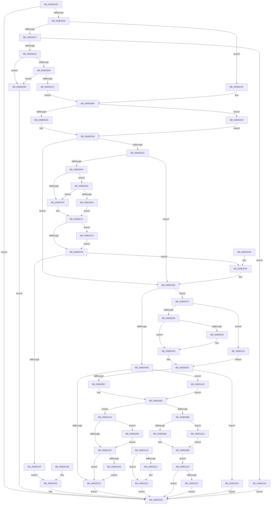

# NtUnlockFile

- RVA: `0x009E5DA0`–`0x009E6299` (길이 `1,273` bytes)
- VA: `0x00000001409E5DA0`
- 실행 섹션: `PAGE`
- PDB 이름 있음: `예`; PDB Function 태그: `아니요`
- unwind 정보 RVA: `0x000A4274`
- 디코드: `306`개 명령, `1,273/1,273` bytes 표시
- 미해석 바이트: `0` (있으면 어셈블리에 `.byte`로 보존)

> 이 문서는 커널 이미지의 기계어와 PDB 기호를 분석해 생성했습니다. 4번과 5번은 함수 원형과 자료형을 바이너리 사용 방식에서 추정한 C 해석이며 원본 소스 복구 결과는 아닙니다.

## 1. Dependencies

- 직접 호출 지점: **27**; 고유 호출 대상: **21**
- 직접 호출자로 확인된 함수: **0**
- RIP 상대 이미지 참조: **2**

### Outgoing calls
- `0x009E5E1B` → [ObReferenceObjectByHandle](../86/ObReferenceObjectByHandle_function_00868DB0.md) (function, `0x00868DB0`)
- `0x009E5E96` → [ExRaiseDatatypeMisalignment](../89/ExRaiseDatatypeMisalignment_function_00899FD0.md) (function, `0x00899FD0`)
- `0x009E5EA3` → [ObfDereferenceObject](../../text/2F/ObfDereferenceObject_function_002F9350.md) (function, `0x002F9350`)
- `0x009E5ED3` → [IoGetRelatedDeviceObject](../../text/29/IoGetRelatedDeviceObject_function_0029B120.md) (function, `0x0029B120`)
- `0x009E5F48` → [guard_dispatch_icall](../../text/6B/guard_dispatch_icall_function_006BAAD0.md) (function, `0x006BAAD0`)
- `0x009E5F83` → [ObfDereferenceObject](../../text/2F/ObfDereferenceObject_function_002F9350.md) (function, `0x002F9350`)
- `0x009E5FCC` → [ExAllocatePool2](../../poolcode/B8/ExAllocatePool2_function_00B820F0.md) (function, `0x00B820F0`)
- `0x009E5FE5` → [ObfDereferenceObject](../../text/2F/ObfDereferenceObject_function_002F9350.md) (function, `0x002F9350`)
- `0x009E601A` → [KeAbPreAcquire](../../text/21/KeAbPreAcquire_function_00210230.md) (function, `0x00210230`)
- `0x009E6045` → [ObfReferenceObject](../../text/20/ObfReferenceObject_function_0020FA20.md) (function, `0x0020FA20`)
- `0x009E6066` → [IopResetEvent](../../text/29/IopResetEvent_function_0029D5F0.md) (function, `0x0029D5F0`)
- `0x009E6075` → [IopAllocateIrpExReturn](../../text/20/IopAllocateIrpExReturn_function_00207720.md) (function, `0x00207720`)
- `0x009E60EA` → [ExAllocatePool2](../../poolcode/B8/ExAllocatePool2_function_00B820F0.md) (function, `0x00B820F0`)
- `0x009E611A` → [ExFreePoolWithTag](../../poolcode/B8/ExFreePoolWithTag_function_00B82870.md) (function, `0x00B82870`)
- `0x009E613A` → [IopExceptionCleanupEx](../8A/IopExceptionCleanupEx_function_008AE5C8.md) (function, `0x008AE5C8`)
- `0x009E6179` → [IopSynchronousServiceTail](../8E/IopSynchronousServiceTail_function_008EB440.md) (function, `0x008EB440`)
- `0x009E61A5` → [IopSynchronousApiServiceTail](../8A/IopSynchronousApiServiceTail_function_008ACE3C.md) (function, `0x008ACE3C`)
- `0x009E61B9` → [KeInitializeEvent](../../text/40/KeInitializeEvent_function_0040DD10.md) (function, `0x0040DD10`)
- `0x009E61E0` → [IopReleaseFileObjectLock](../../text/25/IopReleaseFileObjectLock_function_00250A90.md) (function, `0x00250A90`)
- `0x009E6205` → [ObfDereferenceObject](../../text/2F/ObfDereferenceObject_function_002F9350.md) (function, `0x002F9350`)
- `0x009E622E` → [IopWaitAndAcquireFileObjectLock](../8A/IopWaitAndAcquireFileObjectLock_function_008AE6D8.md) (function, `0x008AE6D8`)
- `0x009E623D` → [ObfDereferenceObject](../../text/2F/ObfDereferenceObject_function_002F9350.md) (function, `0x002F9350`)
- `0x009E6250` → [IoGetAttachedDevice](../../text/41/IoGetAttachedDevice_function_00410810.md) (function, `0x00410810`)
- `0x009E625D` → [MmIsDriverVerifying](../../text/4A/MmIsDriverVerifying_function_004A8770.md) (function, `0x004A8770`)
- `0x009E626D` → [VfFastIoSnapState](../../pagevrfy/BB/VfFastIoSnapState_function_00BB97BC.md) (function, `0x00BB97BC`)
- `0x009E6280` → [VfFastIoCheckState](../../pagevrfy/BB/VfFastIoCheckState_function_00BB9440.md) (function, `0x00BB9440`)
- `0x009E628F` → [ExFreePoolWithTag](../../poolcode/B8/ExFreePoolWithTag_function_00B82870.md) (function, `0x00B82870`)

### Direct callers
- 이 함수 시작 RVA로 연결되는 직접 call은 확인되지 않았습니다. 간접 호출은 완전히 역산할 수 없습니다.

### Static image references
- `0x009E5DFA` → RVA `0x00FC6AE0` (`ALMOSTRO`; read)
- `0x009E5F01` → RVA `0x00F04A20` (`.data`; read)

## 2. Other-region calls and transfers

- 다른 실행 섹션으로 향하는 call: **21**
  - `0x009E5EA3` → [ObfDereferenceObject](../../text/2F/ObfDereferenceObject_function_002F9350.md) (`PAGE` → `.text`)
  - `0x009E5ED3` → [IoGetRelatedDeviceObject](../../text/29/IoGetRelatedDeviceObject_function_0029B120.md) (`PAGE` → `.text`)
  - `0x009E5F48` → [guard_dispatch_icall](../../text/6B/guard_dispatch_icall_function_006BAAD0.md) (`PAGE` → `.text`)
  - `0x009E5F83` → [ObfDereferenceObject](../../text/2F/ObfDereferenceObject_function_002F9350.md) (`PAGE` → `.text`)
  - `0x009E5FCC` → [ExAllocatePool2](../../poolcode/B8/ExAllocatePool2_function_00B820F0.md) (`PAGE` → `POOLCODE`)
  - `0x009E5FE5` → [ObfDereferenceObject](../../text/2F/ObfDereferenceObject_function_002F9350.md) (`PAGE` → `.text`)
  - `0x009E601A` → [KeAbPreAcquire](../../text/21/KeAbPreAcquire_function_00210230.md) (`PAGE` → `.text`)
  - `0x009E6045` → [ObfReferenceObject](../../text/20/ObfReferenceObject_function_0020FA20.md) (`PAGE` → `.text`)
  - `0x009E6066` → [IopResetEvent](../../text/29/IopResetEvent_function_0029D5F0.md) (`PAGE` → `.text`)
  - `0x009E6075` → [IopAllocateIrpExReturn](../../text/20/IopAllocateIrpExReturn_function_00207720.md) (`PAGE` → `.text`)
  - `0x009E60EA` → [ExAllocatePool2](../../poolcode/B8/ExAllocatePool2_function_00B820F0.md) (`PAGE` → `POOLCODE`)
  - `0x009E611A` → [ExFreePoolWithTag](../../poolcode/B8/ExFreePoolWithTag_function_00B82870.md) (`PAGE` → `POOLCODE`)
  - `0x009E61B9` → [KeInitializeEvent](../../text/40/KeInitializeEvent_function_0040DD10.md) (`PAGE` → `.text`)
  - `0x009E61E0` → [IopReleaseFileObjectLock](../../text/25/IopReleaseFileObjectLock_function_00250A90.md) (`PAGE` → `.text`)
  - `0x009E6205` → [ObfDereferenceObject](../../text/2F/ObfDereferenceObject_function_002F9350.md) (`PAGE` → `.text`)
  - `0x009E623D` → [ObfDereferenceObject](../../text/2F/ObfDereferenceObject_function_002F9350.md) (`PAGE` → `.text`)
  - `0x009E6250` → [IoGetAttachedDevice](../../text/41/IoGetAttachedDevice_function_00410810.md) (`PAGE` → `.text`)
  - `0x009E625D` → [MmIsDriverVerifying](../../text/4A/MmIsDriverVerifying_function_004A8770.md) (`PAGE` → `.text`)
  - `0x009E626D` → [VfFastIoSnapState](../../pagevrfy/BB/VfFastIoSnapState_function_00BB97BC.md) (`PAGE` → `PAGEVRFY`)
  - `0x009E6280` → [VfFastIoCheckState](../../pagevrfy/BB/VfFastIoCheckState_function_00BB9440.md) (`PAGE` → `PAGEVRFY`)
  - `0x009E628F` → [ExFreePoolWithTag](../../poolcode/B8/ExFreePoolWithTag_function_00B82870.md) (`PAGE` → `POOLCODE`)
- 별도 외부 분기/꼬리 이동을 확인하지 못했습니다.

## 3. Assembly (complete function range)

```asm
009E5DA0  4C 8B DC                        mov r11, rsp
009E5DA3  49 89 5B 08                     mov qword ptr [r11 + 8], rbx
009E5DA7  49 89 73 10                     mov qword ptr [r11 + 0x10], rsi
009E5DAB  49 89 7B 18                     mov qword ptr [r11 + 0x18], rdi
009E5DAF  4D 89 63 20                     mov qword ptr [r11 + 0x20], r12
009E5DB3  41 55                           push r13
009E5DB5  41 56                           push r14
009E5DB7  41 57                           push r15
009E5DB9  48 81 EC A0 00 00 00            sub rsp, 0xa0
009E5DC0  49 8B F1                        mov rsi, r9
009E5DC3  49 8B F8                        mov rdi, r8
009E5DC6  4C 8B EA                        mov r13, rdx
009E5DC9  33 D2                           xor edx, edx
009E5DCB  49 89 53 A8                     mov qword ptr [r11 - 0x58], rdx
009E5DCF  49 89 53 A0                     mov qword ptr [r11 - 0x60], rdx
009E5DD3  49 89 53 98                     mov qword ptr [r11 - 0x68], rdx
009E5DD7  0F 57 C0                        xorps xmm0, xmm0
009E5DDA  41 0F 11 43 D0                  movups xmmword ptr [r11 - 0x30], xmm0
009E5DDF  65 48 8B 04 25 88 01 00 00      mov rax, qword ptr gs:[0x188]
009E5DE8  48 89 44 24 70                  mov qword ptr [rsp + 0x70], rax
009E5DED  44 0F B6 A0 32 02 00 00         movzx r12d, byte ptr [rax + 0x232]
009E5DF5  44 88 64 24 41                  mov byte ptr [rsp + 0x41], r12b
009E5DFA  4C 8B 05 DF 0C 5E 00            mov r8, qword ptr [rip + 0x5e0cdf]
009E5E01  49 89 53 90                     mov qword ptr [r11 - 0x70], rdx
009E5E05  49 8D 43 98                     lea rax, [r11 - 0x68]
009E5E09  48 89 44 24 28                  mov qword ptr [rsp + 0x28], rax
009E5E0E  49 8D 43 90                     lea rax, [r11 - 0x70]
009E5E12  48 89 44 24 20                  mov qword ptr [rsp + 0x20], rax
009E5E17  45 0F B6 CC                     movzx r9d, r12b
009E5E1B  E8 90 2F E8 FF                  call 0x140868db0
009E5E20  48 8B 5C 24 48                  mov rbx, qword ptr [rsp + 0x48]
009E5E25  48 89 5C 24 68                  mov qword ptr [rsp + 0x68], rbx
009E5E2A  85 C0                           test eax, eax
009E5E2C  0F 88 5A 01 00 00               js 0x1409e5f8c
009E5E32  45 84 E4                        test r12b, r12b
009E5E35  74 78                           je 0x1409e5eaf
009E5E37  F6 44 24 54 03                  test byte ptr [rsp + 0x54], 3
009E5E3C  0F 84 F8 03 00 00               je 0x1409e623a
009E5E42  48 BA 00 00 FF FF FF 7F 00 00   movabs rdx, 0x7fffffff0000
009E5E4C  48 8B CA                        mov rcx, rdx
009E5E4F  4C 3B EA                        cmp r13, rdx
009E5E52  49 0F 42 CD                     cmovb rcx, r13
009E5E56  8B 01                           mov eax, dword ptr [rcx]
009E5E58  89 01                           mov dword ptr [rcx], eax
009E5E5A  40 F6 C7 03                     test dil, 3
009E5E5E  75 36                           jne 0x1409e5e96
009E5E60  48 8B C2                        mov rax, rdx
009E5E63  48 3B FA                        cmp rdi, rdx
009E5E66  48 0F 42 C7                     cmovb rax, rdi
009E5E6A  90                              nop
009E5E6B  0F B6 00                        movzx eax, byte ptr [rax]
009E5E6E  48 8B 07                        mov rax, qword ptr [rdi]
009E5E71  48 89 44 24 60                  mov qword ptr [rsp + 0x60], rax
009E5E76  40 F6 C6 03                     test sil, 3
009E5E7A  75 1A                           jne 0x1409e5e96
009E5E7C  48 3B F2                        cmp rsi, rdx
009E5E7F  48 0F 42 D6                     cmovb rdx, rsi
009E5E83  90                              nop
009E5E84  0F B6 02                        movzx eax, byte ptr [rdx]
009E5E87  48 8B 06                        mov rax, qword ptr [rsi]
009E5E8A  48 89 44 24 58                  mov qword ptr [rsp + 0x58], rax
009E5E8F  48 8B 5C 24 48                  mov rbx, qword ptr [rsp + 0x48]
009E5E94  EB 29                           jmp 0x1409e5ebf
009E5E96  E8 35 41 EB FF                  call 0x140899fd0
009E5E9B  90                              nop
009E5E9C  8B D8                           mov ebx, eax
009E5E9E  48 8B 4C 24 48                  mov rcx, qword ptr [rsp + 0x48]
009E5EA3  E8 A8 34 91 FF                  call 0x1402f9350
009E5EA8  8B C3                           mov eax, ebx
009E5EAA  E9 DD 00 00 00                  jmp 0x1409e5f8c
009E5EAF  48 8B 07                        mov rax, qword ptr [rdi]
009E5EB2  48 89 44 24 60                  mov qword ptr [rsp + 0x60], rax
009E5EB7  48 8B 06                        mov rax, qword ptr [rsi]
009E5EBA  48 89 44 24 58                  mov qword ptr [rsp + 0x58], rax
009E5EBF  4C 8D 7B 50                     lea r15, [rbx + 0x50]
009E5EC3  41 F7 07 00 08 00 00            test dword ptr [r15], 0x800
009E5ECA  0F 85 7C 03 00 00               jne 0x1409e624c
009E5ED0  48 8B CB                        mov rcx, rbx
009E5ED3  E8 48 52 8B FF                  call 0x14029b120
009E5ED8  48 8B F0                        mov rsi, rax
009E5EDB  4C 8B 70 08                     mov r14, qword ptr [rax + 8]
009E5EDF  49 8B 46 50                     mov rax, qword ptr [r14 + 0x50]
009E5EE3  48 85 C0                        test rax, rax
009E5EE6  0F 84 C9 00 00 00               je 0x1409e5fb5
009E5EEC  48 8B 78 38                     mov rdi, qword ptr [rax + 0x38]
009E5EF0  48 85 FF                        test rdi, rdi
009E5EF3  0F 84 BC 00 00 00               je 0x1409e5fb5
009E5EF9  0F 57 C0                        xorps xmm0, xmm0
009E5EFC  0F 11 44 24 78                  movups xmmword ptr [rsp + 0x78], xmm0
009E5F01  8B 05 19 EB 51 00               mov eax, dword ptr [rip + 0x51eb19]
009E5F07  A8 10                           test al, 0x10
009E5F09  0F 85 4B 03 00 00               jne 0x1409e625a
009E5F0F  45 33 F6                        xor r14d, r14d
009E5F12  48 89 74 24 30                  mov qword ptr [rsp + 0x30], rsi
009E5F17  48 8D 44 24 78                  lea rax, [rsp + 0x78]
009E5F1C  48 89 44 24 28                  mov qword ptr [rsp + 0x28], rax
009E5F21  8B 84 24 E0 00 00 00            mov eax, dword ptr [rsp + 0xe0]
009E5F28  89 44 24 20                     mov dword ptr [rsp + 0x20], eax
009E5F2C  4C 8B 4C 24 70                  mov r9, qword ptr [rsp + 0x70]
009E5F31  4D 8B 89 B8 00 00 00            mov r9, qword ptr [r9 + 0xb8]
009E5F38  4C 8D 44 24 58                  lea r8, [rsp + 0x58]
009E5F3D  48 8D 54 24 60                  lea rdx, [rsp + 0x60]
009E5F42  48 8B CB                        mov rcx, rbx
009E5F45  48 8B C7                        mov rax, rdi
009E5F48  E8 83 4B CD FF                  call 0x1406baad0
009E5F4D  44 0F B6 E0                     movzx r12d, al
009E5F51  4D 85 F6                        test r14, r14
009E5F54  0F 85 20 03 00 00               jne 0x1409e627a
009E5F5A  45 84 E4                        test r12b, r12b
009E5F5D  74 50                           je 0x1409e5faf
009E5F5F  0F 10 44 24 78                  movups xmm0, xmmword ptr [rsp + 0x78]
009E5F64  41 0F 11 45 00                  movups xmmword ptr [r13], xmm0
009E5F69  EB 15                           jmp 0x1409e5f80
009E5F6B  89 44 24 78                     mov dword ptr [rsp + 0x78], eax
009E5F6F  48 C7 84 24 80 00 00 00 00 00 00 00  mov qword ptr [rsp + 0x80], 0
009E5F7B  48 8B 5C 24 48                  mov rbx, qword ptr [rsp + 0x48]
009E5F80  48 8B CB                        mov rcx, rbx
009E5F83  E8 C8 33 91 FF                  call 0x1402f9350
009E5F88  8B 44 24 78                     mov eax, dword ptr [rsp + 0x78]
009E5F8C  4C 8D 9C 24 A0 00 00 00         lea r11, [rsp + 0xa0]
009E5F94  49 8B 5B 20                     mov rbx, qword ptr [r11 + 0x20]
009E5F98  49 8B 73 28                     mov rsi, qword ptr [r11 + 0x28]
009E5F9C  49 8B 7B 30                     mov rdi, qword ptr [r11 + 0x30]
009E5FA0  4D 8B 63 38                     mov r12, qword ptr [r11 + 0x38]
009E5FA4  49 8B E3                        mov rsp, r11
009E5FA7  41 5F                           pop r15
009E5FA9  41 5E                           pop r14
009E5FAB  41 5D                           pop r13
009E5FAD  C3                              ret
009E5FAE  CC                              int3
009E5FAF  44 0F B6 64 24 41               movzx r12d, byte ptr [rsp + 0x41]
009E5FB5  41 8B 3F                        mov edi, dword ptr [r15]
009E5FB8  40 F6 C7 02                     test dil, 2
009E5FBC  75 33                           jne 0x1409e5ff1
009E5FBE  BA 18 00 00 00                  mov edx, 0x18
009E5FC3  8D 4A 28                        lea ecx, [rdx + 0x28]
009E5FC6  41 B8 49 6F 45 76               mov r8d, 0x76456f49
009E5FCC  E8 1F C1 19 00                  call 0x140b820f0
009E5FD1  48 8B F8                        mov rdi, rax
009E5FD4  48 89 44 24 50                  mov qword ptr [rsp + 0x50], rax
009E5FD9  48 85 C0                        test rax, rax
009E5FDC  0F 85 CD 01 00 00               jne 0x1409e61af
009E5FE2  48 8B CB                        mov rcx, rbx
009E5FE5  E8 66 33 91 FF                  call 0x1402f9350
009E5FEA  B8 9A 00 00 C0                  mov eax, 0xc000009a
009E5FEF  EB 9B                           jmp 0x1409e5f8c
009E5FF1  C1 EF 02                        shr edi, 2
009E5FF4  40 80 E7 01                     and dil, 1
009E5FF8  65 48 8B 04 25 88 01 00 00      mov rax, qword ptr gs:[0x188]
009E6001  66 FF 88 E4 01 00 00            dec word ptr [rax + 0x1e4]
009E6008  90                              nop
009E6009  48 8B 5C 24 48                  mov rbx, qword ptr [rsp + 0x48]
009E600E  48 8D 8B 80 00 00 00            lea rcx, [rbx + 0x80]
009E6015  45 33 C0                        xor r8d, r8d
009E6018  33 D2                           xor edx, edx
009E601A  E8 11 A2 82 FF                  call 0x140210230
009E601F  C6 44 24 40 00                  mov byte ptr [rsp + 0x40], 0
009E6024  BA 01 00 00 00                  mov edx, 1
009E6029  87 53 74                        xchg dword ptr [rbx + 0x74], edx
009E602C  85 D2                           test edx, edx
009E602E  0F 85 DD 01 00 00               jne 0x1409e6211
009E6034  48 85 C0                        test rax, rax
009E6037  74 04                           je 0x1409e603d
009E6039  C6 40 0A 01                     mov byte ptr [rax + 0xa], 1
009E603D  48 8B 5C 24 48                  mov rbx, qword ptr [rsp + 0x48]
009E6042  48 8B CB                        mov rcx, rbx
009E6045  E8 D6 99 82 FF                  call 0x14020fa20
009E604A  33 FF                           xor edi, edi
009E604C  80 7C 24 40 00                  cmp byte ptr [rsp + 0x40], 0
009E6051  0F 85 AB 01 00 00               jne 0x1409e6202
009E6057  C6 44 24 40 01                  mov byte ptr [rsp + 0x40], 1
009E605C  33 FF                           xor edi, edi
009E605E  48 89 7C 24 50                  mov qword ptr [rsp + 0x50], rdi
009E6063  48 8B CB                        mov rcx, rbx
009E6066  E8 85 75 8B FF                  call 0x14029d5f0
009E606B  45 33 C0                        xor r8d, r8d
009E606E  0F B6 56 4C                     movzx edx, byte ptr [rsi + 0x4c]
009E6072  48 8B CE                        mov rcx, rsi
009E6075  E8 A6 16 82 FF                  call 0x140207720
009E607A  4C 8B F0                        mov r14, rax
009E607D  48 89 44 24 48                  mov qword ptr [rsp + 0x48], rax
009E6082  48 85 C0                        test rax, rax
009E6085  0F 84 3E 01 00 00               je 0x1409e61c9
009E608B  48 89 98 C0 00 00 00            mov qword ptr [rax + 0xc0], rbx
009E6092  48 8B 44 24 70                  mov rax, qword ptr [rsp + 0x70]
009E6097  49 89 86 98 00 00 00            mov qword ptr [r14 + 0x98], rax
009E609E  45 88 66 40                     mov byte ptr [r14 + 0x40], r12b
009E60A2  44 0F B6 7C 24 40               movzx r15d, byte ptr [rsp + 0x40]
009E60A8  45 84 FF                        test r15b, r15b
009E60AB  0F 84 39 01 00 00               je 0x1409e61ea
009E60B1  49 8B C5                        mov rax, r13
009E60B4  33 C9                           xor ecx, ecx
009E60B6  49 89 4E 50                     mov qword ptr [r14 + 0x50], rcx
009E60BA  49 89 46 48                     mov qword ptr [r14 + 0x48], rax
009E60BE  49 C7 46 58 00 00 00 00         mov qword ptr [r14 + 0x58], 0
009E60C6  49 8B 9E B8 00 00 00            mov rbx, qword ptr [r14 + 0xb8]
009E60CD  66 C7 43 B8 11 02               mov word ptr [rbx - 0x48], 0x211
009E60D3  48 8B 44 24 68                  mov rax, qword ptr [rsp + 0x68]
009E60D8  48 89 43 E8                     mov qword ptr [rbx - 0x18], rax
009E60DC  BA 08 00 00 00                  mov edx, 8
009E60E1  8D 4A 59                        lea ecx, [rdx + 0x59]
009E60E4  41 B8 49 6F 4C 65               mov r8d, 0x654c6f49
009E60EA  E8 01 C0 19 00                  call 0x140b820f0
009E60EF  48 8B 4C 24 58                  mov rcx, qword ptr [rsp + 0x58]
009E60F4  48 89 08                        mov qword ptr [rax], rcx
009E60F7  49 89 86 A0 00 00 00            mov qword ptr [r14 + 0xa0], rax
009E60FE  48 89 43 C0                     mov qword ptr [rbx - 0x40], rax
009E6102  EB 42                           jmp 0x1409e6146
009E6104  8B F8                           mov edi, eax
009E6106  48 8B 5C 24 68                  mov rbx, qword ptr [rsp + 0x68]
009E610B  8B 4B 50                        mov ecx, dword ptr [rbx + 0x50]
009E610E  F6 C1 02                        test cl, 2
009E6111  75 0C                           jne 0x1409e611f
009E6113  33 D2                           xor edx, edx
009E6115  48 8B 4C 24 50                  mov rcx, qword ptr [rsp + 0x50]
009E611A  E8 51 C7 19 00                  call 0x140b82870
009E611F  0F B6 53 50                     movzx edx, byte ptr [rbx + 0x50]
009E6123  D1 EA                           shr edx, 1
009E6125  83 E2 01                        and edx, 1
009E6128  88 54 24 20                     mov byte ptr [rsp + 0x20], dl
009E612C  45 33 C9                        xor r9d, r9d
009E612F  45 33 C0                        xor r8d, r8d
009E6132  48 8B 54 24 48                  mov rdx, qword ptr [rsp + 0x48]
009E6137  48 8B CB                        mov rcx, rbx
009E613A  E8 89 84 EC FF                  call 0x1408ae5c8
009E613F  8B C7                           mov eax, edi
009E6141  E9 46 FE FF FF                  jmp 0x1409e5f8c
009E6146  8B 84 24 E0 00 00 00            mov eax, dword ptr [rsp + 0xe0]
009E614D  89 43 C8                        mov dword ptr [rbx - 0x38], eax
009E6150  48 8B 44 24 60                  mov rax, qword ptr [rsp + 0x60]
009E6155  48 89 43 D0                     mov qword ptr [rbx - 0x30], rax
009E6159  C7 44 24 30 02 00 00 00         mov dword ptr [rsp + 0x30], 2
009E6161  44 88 7C 24 28                  mov byte ptr [rsp + 0x28], r15b
009E6166  44 88 64 24 20                  mov byte ptr [rsp + 0x20], r12b
009E616B  45 33 C9                        xor r9d, r9d
009E616E  4C 8B 44 24 68                  mov r8, qword ptr [rsp + 0x68]
009E6173  49 8B D6                        mov rdx, r14
009E6176  48 8B CE                        mov rcx, rsi
009E6179  E8 C2 52 F0 FF                  call 0x1408eb440
009E617E  45 84 FF                        test r15b, r15b
009E6181  0F 85 05 FE FF FF               jne 0x1409e5f8c
009E6187  4C 89 6C 24 28                  mov qword ptr [rsp + 0x28], r13
009E618C  48 8D 8C 24 88 00 00 00         lea rcx, [rsp + 0x88]
009E6194  48 89 4C 24 20                  mov qword ptr [rsp + 0x20], rcx
009E6199  45 0F B6 CC                     movzx r9d, r12b
009E619D  4D 8B C6                        mov r8, r14
009E61A0  48 8B D7                        mov rdx, rdi
009E61A3  8B C8                           mov ecx, eax
009E61A5  E8 92 6C EC FF                  call 0x1408ace3c
009E61AA  E9 DD FD FF FF                  jmp 0x1409e5f8c
009E61AF  45 33 C0                        xor r8d, r8d
009E61B2  41 8D 50 01                     lea edx, [r8 + 1]
009E61B6  48 8B C8                        mov rcx, rax
009E61B9  E8 52 7B A2 FF                  call 0x14040dd10
009E61BE  32 C0                           xor al, al
009E61C0  88 44 24 40                     mov byte ptr [rsp + 0x40], al
009E61C4  E9 9A FE FF FF                  jmp 0x1409e6063
009E61C9  48 85 FF                        test rdi, rdi
009E61CC  0F 85 B8 00 00 00               jne 0x1409e628a
009E61D2  41 8B 07                        mov eax, dword ptr [r15]
009E61D5  A8 02                           test al, 2
009E61D7  0F 84 05 FE FF FF               je 0x1409e5fe2
009E61DD  48 8B CB                        mov rcx, rbx
009E61E0  E8 AB A8 86 FF                  call 0x140250a90
009E61E5  E9 F8 FD FF FF                  jmp 0x1409e5fe2
009E61EA  41 C7 46 10 04 00 00 00         mov dword ptr [r14 + 0x10], 4
009E61F2  48 8D 84 24 88 00 00 00         lea rax, [rsp + 0x88]
009E61FA  48 8B CF                        mov rcx, rdi
009E61FD  E9 B4 FE FF FF                  jmp 0x1409e60b6
009E6202  48 8B CB                        mov rcx, rbx
009E6205  E8 46 31 91 FF                  call 0x1402f9350
009E620A  8B C7                           mov eax, edi
009E620C  E9 7B FD FF FF                  jmp 0x1409e5f8c
009E6211  48 8D 4C 24 40                  lea rcx, [rsp + 0x40]
009E6216  48 89 4C 24 20                  mov qword ptr [rsp + 0x20], rcx
009E621B  4C 8B C8                        mov r9, rax
009E621E  44 0F B6 C7                     movzx r8d, dil
009E6222  41 0F B6 D4                     movzx edx, r12b
009E6226  48 8B 5C 24 48                  mov rbx, qword ptr [rsp + 0x48]
009E622B  48 8B CB                        mov rcx, rbx
009E622E  E8 A5 84 EC FF                  call 0x1408ae6d8
009E6233  8B F8                           mov edi, eax
009E6235  E9 12 FE FF FF                  jmp 0x1409e604c
009E623A  48 8B CB                        mov rcx, rbx
009E623D  E8 0E 31 91 FF                  call 0x1402f9350
009E6242  B8 22 00 00 C0                  mov eax, 0xc0000022
009E6247  E9 40 FD FF FF                  jmp 0x1409e5f8c
009E624C  48 8B 4B 08                     mov rcx, qword ptr [rbx + 8]
009E6250  E8 BB A5 A2 FF                  call 0x140410810
009E6255  E9 7E FC FF FF                  jmp 0x1409e5ed8
009E625A  49 8B CE                        mov rcx, r14
009E625D  E8 0E 25 AC FF                  call 0x1404a8770
009E6262  85 C0                           test eax, eax
009E6264  0F 84 A5 FC FF FF               je 0x1409e5f0f
009E626A  49 8B CE                        mov rcx, r14
009E626D  E8 4A 35 1D 00                  call 0x140bb97bc
009E6272  4C 8B F0                        mov r14, rax
009E6275  E9 98 FC FF FF                  jmp 0x1409e5f12
009E627A  48 8B D7                        mov rdx, rdi
009E627D  49 8B CE                        mov rcx, r14
009E6280  E8 BB 31 1D 00                  call 0x140bb9440
009E6285  E9 D0 FC FF FF                  jmp 0x1409e5f5a
009E628A  33 D2                           xor edx, edx
009E628C  48 8B CF                        mov rcx, rdi
009E628F  E8 DC C5 19 00                  call 0x140b82870
009E6294  E9 39 FF FF FF                  jmp 0x1409e61d2
```

## 4. C-style interpretation (structured pseudocode)

```c
__int64 __fastcall NtUnlockFile(__int64 a1, __int64 a2, __int64 a3, __int64 a4, unsigned int a5)
{
    __int64 result;
    __int64 v_r14;
    __int64 v_rdi;
    __int64 v_rsp;
    unsigned __int64 v_stack_m18;
    unsigned __int64 v_stack_m30;
    unsigned __int64 v_stack_m38;
    unsigned __int64 v_stack_m40;
    unsigned __int64 v_stack_m48;
    unsigned __int64 v_stack_m50;
    unsigned __int64 v_stack_m58;
    unsigned __int8 v_stack_m5F;
    unsigned __int64 v_stack_m60;
    unsigned __int8 v_stack_m64;
    unsigned __int64 v_stack_m70;
    unsigned __int8 v_stack_m77;
    unsigned __int8 v_stack_m78;
    unsigned __int8 v_stack_m80;
    unsigned __int64 v_stack_m88;
    unsigned __int64 v_stack_m90;
    unsigned __int64 v_stack_m98;

    *(unsigned __int64 *)(v_rsp + 8) = v_rbx;
    *(unsigned __int64 *)(v_rsp + 16) = v_rsi;
    *(unsigned __int64 *)(v_rsp + 24) = v_rdi;
    *(unsigned __int64 *)(v_rsp + 32) = v_r12;
    v_rsp = (v_rsp) - (160);
    a2 = 0;
    *(unsigned __int64 *)(v_rsp - 88) = 0;
    *(unsigned __int64 *)(v_rsp - 96) = 0;
    *(unsigned __int64 *)(v_rsp - 104) = 0;
    *(unsigned __int64 *)(v_rsp - 48) = v_xmm0;
    v_stack_m48 = *(unsigned __int64 *)(gs_base + (0 + 392));
    v_stack_m77 = (unsigned __int8)(*(unsigned __int8 *)(*(unsigned __int64 *)(gs_base + (0 + 392)) + 562));
    *(unsigned __int64 *)(v_rsp - 112) = 0;
    v_stack_m90 = v_rsp - 104;
    v_stack_m98 = v_rsp - 112;
    result = ObReferenceObjectByHandle(a1, a2, *(unsigned __int64 *)(v_rip + 6163679), (unsigned __int8)(*(unsigned __int8 *)(*(unsigned __int64 *)(gs_base + (0 + 392)) + 562)));
    v_stack_m50 = v_stack_m70;
    if (sign_flag) goto loc_009E5F8C;
    if ((unsigned __int8)(*(unsigned __int8 *)(*(unsigned __int64 *)(gs_base + (0 + 392)) + 562)) == 0) goto loc_009E5EAF;
    if (((v_stack_m64) & (3)) == 0) goto loc_009E623A;
    a1 = 0;
    if (0 < 0) { a1 = 0; }
    *(unsigned int *)(a1) = (unsigned int)((unsigned int)(*(unsigned int *)(a1)));
    if ((((unsigned __int8)(a3)) & (3)) != 0) goto loc_009E5E96;
    result = 0;
    if (a3 < 0) { result = a3; }
    v_stack_m58 = *(unsigned __int64 *)(a3);
    if ((((unsigned __int8)(a4)) & (3)) != 0) goto loc_009E5E96;
    if (a4 < 0) { a2 = a4; }
    v_stack_m60 = *(unsigned __int64 *)(a4);
    goto loc_009E5EBF;
loc_009E5E96:
    result = ExRaiseDatatypeMisalignment(a1, a2, *(unsigned __int64 *)(v_rip + 6163679), (unsigned __int8)(*(unsigned __int8 *)(*(unsigned __int64 *)(gs_base + (0 + 392)) + 562)));
    result = ObfDereferenceObject(v_stack_m70, a2, *(unsigned __int64 *)(v_rip + 6163679), (unsigned __int8)(*(unsigned __int8 *)(*(unsigned __int64 *)(gs_base + (0 + 392)) + 562)));
    goto loc_009E5F8C;
loc_009E5EAF:
    v_stack_m58 = *(unsigned __int64 *)(a3);
    v_stack_m60 = *(unsigned __int64 *)(a4);
loc_009E5EBF:
    if (((*(unsigned int *)((unsigned int)((unsigned int)(result)) + 80)) & (0x800ULL)) != 0) goto loc_009E624C;
    result = IoGetRelatedDeviceObject((unsigned int)((unsigned int)(result)), a2, *(unsigned __int64 *)(v_rip + 6163679), (unsigned __int8)(*(unsigned __int8 *)(*(unsigned __int64 *)(gs_base + (0 + 392)) + 562)));
loc_009E5ED8:
    if (*(unsigned __int64 *)(*(unsigned __int64 *)(result + 8) + 80) == 0) goto loc_009E5FB5;
    if (*(unsigned __int64 *)(*(unsigned __int64 *)(*(unsigned __int64 *)(result + 8) + 80) + 56) == 0) goto loc_009E5FB5;
    v_stack_m40 = v_xmm0;
    if ((((unsigned __int8)((unsigned int)(*(unsigned int *)(v_rip + 5368601)))) & (16)) != 0) goto loc_009E625A;
loc_009E5F0F:
    v_r14 = 0;
loc_009E5F12:
    v_stack_m88 = result;
    v_stack_m90 = v_stack_m40;
    v_stack_m98 = (unsigned int)((unsigned int)(a5));
    result = guard_dispatch_icall((unsigned int)((unsigned int)(result)), v_stack_m58, v_stack_m60, *(unsigned __int64 *)(v_stack_m48 + 184));
    if (0 != 0) goto loc_009E627A;
loc_009E5F5A:
    if ((unsigned __int8)((unsigned __int8)(result)) == 0) goto loc_009E5FAF;
    *(unsigned __int64 *)(a2) = v_xmm0;
    goto loc_009E5F80;
loc_009E5F80:
    result = ObfDereferenceObject((unsigned int)((unsigned int)(result)), v_stack_m58, v_stack_m60, *(unsigned __int64 *)(v_stack_m48 + 184));
loc_009E5F8C:
    return (unsigned int)(v_stack_m40);
loc_009E5FAF:
loc_009E5FB5:
    if ((((unsigned __int8)((unsigned int)(*(unsigned int *)((unsigned int)((unsigned int)(result)) + 80)))) & (2)) != 0) goto loc_009E5FF1;
    result = ExAllocatePool2(24 + 40, 24, (unsigned int)(0x76456F49ULL), *(unsigned __int64 *)(v_stack_m48 + 184));
    v_stack_m50 = result;
    if (result != 0) goto loc_009E61AF;
loc_009E5FE2:
    result = ObfDereferenceObject(*(unsigned __int64 *)(v_stack_m18 + 32), 24, (unsigned int)(0x76456F49ULL), *(unsigned __int64 *)(v_stack_m48 + 184));
    goto loc_009E5F8C;
loc_009E5FF1:
    v_rdi = (unsigned int)((result) >> (2));
    v_rdi = (unsigned __int8)((v_rdi) & (1));
    a3 = 0;
    a2 = 0;
    result = KeAbPreAcquire(v_stack_m58 + 128, a2, a3, *(unsigned __int64 *)(v_stack_m48 + 184));
    v_stack_m60 = 0;
    if (1 != 0) goto loc_009E6211;
    if (result != 0) {
        *(unsigned __int8 *)(result + 10) = 1;
    }
    result = ObfReferenceObject(v_stack_m58, 1, a3, *(unsigned __int64 *)(v_stack_m48 + 184));
    v_rdi = 0;
loc_009E604C:
    if (v_stack_m60 != 0) goto loc_009E6202;
    v_stack_m60 = 1;
    v_rdi = 0;
    v_stack_m50 = 0;
loc_009E6063:
    result = IopResetEvent(v_stack_m58, 1, a3, *(unsigned __int64 *)(v_stack_m48 + 184));
    a3 = 0;
    result = IopAllocateIrpExReturn(*(unsigned __int64 *)(v_stack_m18 + 40), *(unsigned __int8 *)(*(unsigned __int64 *)(v_stack_m18 + 40) + 76), a3, *(unsigned __int64 *)(v_stack_m48 + 184));
    v_stack_m58 = result;
    if (result == 0) goto loc_009E61C9;
    *(unsigned __int64 *)(result + 192) = v_stack_m58;
    *(unsigned __int64 *)(result + 152) = v_stack_m30;
    *(unsigned __int8 *)(result + 64) = (unsigned __int8)(v_stack_m5F);
    if ((unsigned __int8)(v_stack_m60) == 0) goto loc_009E61EA;
    a1 = 0;
loc_009E60B6:
    *(unsigned __int64 *)(result + 80) = 0;
    *(unsigned __int64 *)(result + 72) = 0;
    *(unsigned __int64 *)(result + 88) = 0;
    *(unsigned __int16 *)(*(unsigned __int64 *)(result + 184) - 72) = 529;
    *(unsigned __int64 *)(*(unsigned __int64 *)(result + 184) - 24) = v_stack_m38;
    result = ExAllocatePool2(8 + 89, 8, (unsigned int)(0x654C6F49ULL), *(unsigned __int64 *)(v_stack_m48 + 184));
    *(unsigned __int64 *)(result) = v_stack_m48;
    *(unsigned __int64 *)(result + 160) = result;
    *(unsigned __int64 *)(*(unsigned __int64 *)(result + 184) - 64) = result;
    goto loc_009E6146;
loc_009E6146:
    *(unsigned int *)(*(unsigned __int64 *)(result + 184) - 56) = (unsigned int)((unsigned int)(a5));
    *(unsigned __int64 *)(*(unsigned __int64 *)(result + 184) - 48) = v_stack_m40;
    v_stack_m70 = 2;
    v_stack_m78 = (unsigned __int8)(v_stack_m60);
    v_stack_m80 = (unsigned __int8)(v_stack_m5F);
    a4 = 0;
    result = IopSynchronousServiceTail(*(unsigned __int64 *)(v_stack_m18 + 40), result, v_stack_m38, a4);
    if ((unsigned __int8)(v_stack_m60) != 0) goto loc_009E5F8C;
    v_stack_m78 = 0;
    v_stack_m80 = v_stack_m18;
    result = IopSynchronousApiServiceTail((unsigned int)((unsigned int)(result)), 0, result, (unsigned __int8)(v_stack_m5F));
    goto loc_009E5F8C;
loc_009E61AF:
    a3 = 0;
    result = KeInitializeEvent(result, a3 + 1, a3, (unsigned __int8)(v_stack_m5F));
    result = 0;
    v_stack_m60 = 0;
    goto loc_009E6063;
loc_009E61C9:
    if (0 != 0) goto loc_009E628A;
loc_009E61D2:
    if ((((unsigned __int8)((unsigned int)(*(unsigned int *)(v_stack_m60)))) & (2)) == 0) goto loc_009E5FE2;
    result = IopReleaseFileObjectLock(*(unsigned __int64 *)(result + 184), a3 + 1, a3, (unsigned __int8)(v_stack_m5F));
    goto loc_009E5FE2;
loc_009E61EA:
    *(unsigned int *)(result + 16) = 4;
    goto loc_009E60B6;
loc_009E6202:
    result = ObfDereferenceObject(*(unsigned __int64 *)(result + 184), a3 + 1, a3, (unsigned __int8)(v_stack_m5F));
    goto loc_009E5F8C;
loc_009E6211:
    v_stack_m80 = v_stack_m60;
    result = IopWaitAndAcquireFileObjectLock(v_stack_m58, (unsigned __int8)(v_stack_m5F), 0, 0);
    goto loc_009E604C;
loc_009E623A:
    result = ObfDereferenceObject(v_stack_m58, (unsigned __int8)(v_stack_m5F), 0, 0);
    goto loc_009E5F8C;
loc_009E624C:
    result = IoGetAttachedDevice(*(unsigned __int64 *)(v_stack_m58 + 8), (unsigned __int8)(v_stack_m5F), 0, 0);
    goto loc_009E5ED8;
loc_009E625A:
    result = MmIsDriverVerifying(result, (unsigned __int8)(v_stack_m5F), 0, 0);
    if ((unsigned int)(result) == 0) goto loc_009E5F0F;
    result = VfFastIoSnapState(result, (unsigned __int8)(v_stack_m5F), 0, 0);
    goto loc_009E5F12;
loc_009E627A:
    result = VfFastIoCheckState(result, (unsigned int)((unsigned int)(result)), 0, 0);
    goto loc_009E5F5A;
loc_009E628A:
    a2 = 0;
    result = ExFreePoolWithTag((unsigned int)((unsigned int)(result)), a2, 0, 0);
    goto loc_009E61D2;
}
```

## 5. (Beta) C Style

```c
int64_t NtUnlockFile(int64_t Arg1, int64_t Arg2, void *Arg3, void *Arg4, uint32_t Arg5)
{
    uint8_t *arg3 = (uint8_t *)Arg3;
    uint8_t *arg4 = (uint8_t *)Arg4;

    int64_t result;
    int64_t local_r14;
    int64_t local_rdi;
    int64_t local_rsp;
    uint64_t v_stack_m18;
    uint64_t v_stack_m30;
    uint64_t v_stack_m38;
    uint64_t v_stack_m40;
    uint64_t v_stack_m48;
    uint64_t v_stack_m50;
    uint64_t v_stack_m58;
    uint8_t v_stack_m5F;
    uint64_t v_stack_m60;
    uint8_t v_stack_m64;
    uint64_t v_stack_m70;
    uint8_t v_stack_m77;
    uint8_t v_stack_m78;
    uint8_t v_stack_m80;
    uint64_t v_stack_m88;
    uint64_t v_stack_m90;
    uint64_t v_stack_m98;

    *(uint64_t *)(local_rsp + 0x8) = local_rbx;
    *(uint64_t *)(local_rsp + 0x10) = local_rsi;
    *(uint64_t *)(local_rsp + 0x18) = local_rdi;
    *(uint64_t *)(local_rsp + 0x20) = local_r12;
    local_rsp = (local_rsp) - (160);
    Arg2 = 0;
    *(uint64_t *)(local_rsp - 0x58) = 0;
    *(uint64_t *)(local_rsp - 0x60) = 0;
    *(uint64_t *)(local_rsp - 0x68) = 0;
    *(uint64_t *)(local_rsp - 0x30) = v_xmm0;
    v_stack_m48 = *(uint64_t *)(gs_base + (0 + 0x188));
    v_stack_m77 = (uint8_t)(*(uint8_t *)(*(uint64_t *)(gs_base + (0 + 0x188)) + 0x232));
    *(uint64_t *)(local_rsp - 0x70) = 0;
    v_stack_m90 = local_rsp - 104;
    v_stack_m98 = local_rsp - 112;
    result = ObReferenceObjectByHandle(Arg1, Arg2, *(uint64_t *)(v_rip + 0x5E0CDF), (uint8_t)(*(uint8_t *)(*(uint64_t *)(gs_base + (0 + 0x188)) + 0x232)));
    v_stack_m50 = v_stack_m70;
    if (sign_flag) goto loc_009E5F8C;
    if ((uint8_t)(*(uint8_t *)(*(uint64_t *)(gs_base + (0 + 0x188)) + 0x232)) == 0) goto loc_009E5EAF;
    if (((v_stack_m64) & (3)) == 0) goto loc_009E623A;
    Arg1 = 0;
    if (0 < 0) { Arg1 = 0; }
    *(uint32_t *)(Arg1) = (uint32_t)((uint32_t)(*(uint32_t *)(Arg1)));
    if ((((uint8_t)(Arg3)) & (3)) != 0) goto loc_009E5E96;
    result = 0;
    if (Arg3 < 0) { result = Arg3; }
    v_stack_m58 = *(uint64_t *)(arg3);
    if ((((uint8_t)(Arg4)) & (3)) != 0) goto loc_009E5E96;
    if (Arg4 < 0) { Arg2 = Arg4; }
    v_stack_m60 = *(uint64_t *)(arg4);
    goto loc_009E5EBF;
loc_009E5E96:
    result = ExRaiseDatatypeMisalignment(Arg1, Arg2, *(uint64_t *)(v_rip + 0x5E0CDF), (uint8_t)(*(uint8_t *)(*(uint64_t *)(gs_base + (0 + 0x188)) + 0x232)));
    result = ObfDereferenceObject(v_stack_m70, Arg2, *(uint64_t *)(v_rip + 0x5E0CDF), (uint8_t)(*(uint8_t *)(*(uint64_t *)(gs_base + (0 + 0x188)) + 0x232)));
    goto loc_009E5F8C;
loc_009E5EAF:
    v_stack_m58 = *(uint64_t *)(arg3);
    v_stack_m60 = *(uint64_t *)(arg4);
loc_009E5EBF:
    if (((*(uint32_t *)((uint32_t)((uint32_t)(result)) + 0x50)) & (0x800ULL)) != 0) goto loc_009E624C;
    result = IoGetRelatedDeviceObject((uint32_t)((uint32_t)(result)), Arg2, *(uint64_t *)(v_rip + 0x5E0CDF), (uint8_t)(*(uint8_t *)(*(uint64_t *)(gs_base + (0 + 0x188)) + 0x232)));
loc_009E5ED8:
    if (*(uint64_t *)(*(uint64_t *)(result + 0x8) + 0x50) == 0) goto loc_009E5FB5;
    if (*(uint64_t *)(*(uint64_t *)(*(uint64_t *)(result + 0x8) + 0x50) + 0x38) == 0) goto loc_009E5FB5;
    v_stack_m40 = v_xmm0;
    if ((((uint8_t)((uint32_t)(*(uint32_t *)(v_rip + 0x51EB19)))) & (16)) != 0) goto loc_009E625A;
loc_009E5F0F:
    local_r14 = 0;
loc_009E5F12:
    v_stack_m88 = result;
    v_stack_m90 = v_stack_m40;
    v_stack_m98 = (uint32_t)((uint32_t)(Arg5));
    result = guard_dispatch_icall((uint32_t)((uint32_t)(result)), v_stack_m58, v_stack_m60, *(uint64_t *)(v_stack_m48 + 0xB8));
    if (0 != 0) goto loc_009E627A;
loc_009E5F5A:
    if ((uint8_t)((uint8_t)(result)) == 0) goto loc_009E5FAF;
    *(uint64_t *)(Arg2) = v_xmm0;
    goto loc_009E5F80;
loc_009E5F80:
    result = ObfDereferenceObject((uint32_t)((uint32_t)(result)), v_stack_m58, v_stack_m60, *(uint64_t *)(v_stack_m48 + 0xB8));
loc_009E5F8C:
    return (uint32_t)(v_stack_m40);
loc_009E5FAF:
loc_009E5FB5:
    if ((((uint8_t)((uint32_t)(*(uint32_t *)((uint32_t)((uint32_t)(result)) + 0x50)))) & (2)) != 0) goto loc_009E5FF1;
    result = ExAllocatePool2(24 + 40, 24, (uint32_t)(0x76456F49ULL), *(uint64_t *)(v_stack_m48 + 0xB8));
    v_stack_m50 = result;
    if (result != 0) goto loc_009E61AF;
loc_009E5FE2:
    result = ObfDereferenceObject(*(uint64_t *)(v_stack_m18 + 0x20), 24, (uint32_t)(0x76456F49ULL), *(uint64_t *)(v_stack_m48 + 0xB8));
    goto loc_009E5F8C;
loc_009E5FF1:
    local_rdi = (uint32_t)((result) >> (2));
    local_rdi = (uint8_t)((local_rdi) & (1));
    Arg3 = 0;
    Arg2 = 0;
    result = KeAbPreAcquire(v_stack_m58 + 128, Arg2, Arg3, *(uint64_t *)(v_stack_m48 + 0xB8));
    v_stack_m60 = 0;
    if (1 != 0) goto loc_009E6211;
    if (result != 0) {
        *(uint8_t *)(result + 0xA) = 1;
    }
    result = ObfReferenceObject(v_stack_m58, 1, Arg3, *(uint64_t *)(v_stack_m48 + 0xB8));
    local_rdi = 0;
loc_009E604C:
    if (v_stack_m60 != 0) goto loc_009E6202;
    v_stack_m60 = 1;
    local_rdi = 0;
    v_stack_m50 = 0;
loc_009E6063:
    result = IopResetEvent(v_stack_m58, 1, Arg3, *(uint64_t *)(v_stack_m48 + 0xB8));
    Arg3 = 0;
    result = IopAllocateIrpExReturn(*(uint64_t *)(v_stack_m18 + 0x28), *(uint8_t *)(*(uint64_t *)(v_stack_m18 + 0x28) + 0x4C), Arg3, *(uint64_t *)(v_stack_m48 + 0xB8));
    v_stack_m58 = result;
    if (result == 0) goto loc_009E61C9;
    *(uint64_t *)(result + 0xC0) = v_stack_m58;
    *(uint64_t *)(result + 0x98) = v_stack_m30;
    *(uint8_t *)(result + 0x40) = (uint8_t)(v_stack_m5F);
    if ((uint8_t)(v_stack_m60) == 0) goto loc_009E61EA;
    Arg1 = 0;
loc_009E60B6:
    *(uint64_t *)(result + 0x50) = 0;
    *(uint64_t *)(result + 0x48) = 0;
    *(uint64_t *)(result + 0x58) = 0;
    *(uint16_t *)(*(uint64_t *)(result + 0xB8) - 0x48) = 529;
    *(uint64_t *)(*(uint64_t *)(result + 0xB8) - 0x18) = v_stack_m38;
    result = ExAllocatePool2(8 + 89, 8, (uint32_t)(0x654C6F49ULL), *(uint64_t *)(v_stack_m48 + 0xB8));
    *(uint64_t *)(result) = v_stack_m48;
    *(uint64_t *)(result + 0xA0) = result;
    *(uint64_t *)(*(uint64_t *)(result + 0xB8) - 0x40) = result;
    goto loc_009E6146;
loc_009E6146:
    *(uint32_t *)(*(uint64_t *)(result + 0xB8) - 0x38) = (uint32_t)((uint32_t)(Arg5));
    *(uint64_t *)(*(uint64_t *)(result + 0xB8) - 0x30) = v_stack_m40;
    v_stack_m70 = 2;
    v_stack_m78 = (uint8_t)(v_stack_m60);
    v_stack_m80 = (uint8_t)(v_stack_m5F);
    Arg4 = 0;
    result = IopSynchronousServiceTail(*(uint64_t *)(v_stack_m18 + 0x28), result, v_stack_m38, Arg4);
    if ((uint8_t)(v_stack_m60) != 0) goto loc_009E5F8C;
    v_stack_m78 = 0;
    v_stack_m80 = v_stack_m18;
    result = IopSynchronousApiServiceTail((uint32_t)((uint32_t)(result)), 0, result, (uint8_t)(v_stack_m5F));
    goto loc_009E5F8C;
loc_009E61AF:
    Arg3 = 0;
    result = KeInitializeEvent(result, Arg3 + 1, Arg3, (uint8_t)(v_stack_m5F));
    result = 0;
    v_stack_m60 = 0;
    goto loc_009E6063;
loc_009E61C9:
    if (0 != 0) goto loc_009E628A;
loc_009E61D2:
    if ((((uint8_t)((uint32_t)(*(uint32_t *)(v_stack_m60)))) & (2)) == 0) goto loc_009E5FE2;
    result = IopReleaseFileObjectLock(*(uint64_t *)(result + 0xB8), Arg3 + 1, Arg3, (uint8_t)(v_stack_m5F));
    goto loc_009E5FE2;
loc_009E61EA:
    *(uint32_t *)(result + 0x10) = 4;
    goto loc_009E60B6;
loc_009E6202:
    result = ObfDereferenceObject(*(uint64_t *)(result + 0xB8), Arg3 + 1, Arg3, (uint8_t)(v_stack_m5F));
    goto loc_009E5F8C;
loc_009E6211:
    v_stack_m80 = v_stack_m60;
    result = IopWaitAndAcquireFileObjectLock(v_stack_m58, (uint8_t)(v_stack_m5F), 0, 0);
    goto loc_009E604C;
loc_009E623A:
    result = ObfDereferenceObject(v_stack_m58, (uint8_t)(v_stack_m5F), 0, 0);
    goto loc_009E5F8C;
loc_009E624C:
    result = IoGetAttachedDevice(*(uint64_t *)(v_stack_m58 + 0x8), (uint8_t)(v_stack_m5F), 0, 0);
    goto loc_009E5ED8;
loc_009E625A:
    result = MmIsDriverVerifying(result, (uint8_t)(v_stack_m5F), 0, 0);
    if ((uint32_t)(result) == 0) goto loc_009E5F0F;
    result = VfFastIoSnapState(result, (uint8_t)(v_stack_m5F), 0, 0);
    goto loc_009E5F12;
loc_009E627A:
    result = VfFastIoCheckState(result, (uint32_t)((uint32_t)(result)), 0, 0);
    goto loc_009E5F5A;
loc_009E628A:
    Arg2 = 0;
    result = ExFreePoolWithTag((uint32_t)((uint32_t)(result)), Arg2, 0, 0);
    goto loc_009E61D2;
}
```

### 관측된 메모리 오프셋

구조체 형식이 확인되지 않은 접근은 인자 기준의 오프셋으로만 기록했습니다.

| 기준 인자 | 오프셋 표현 | 폭 (bit) | 접근 |
|---|---:|---:|---|
| `Arg3` | `+ 0x0` | `64` | `R` |
| `Arg4` | `+ 0x0` | `64` | `R` |

## 6. Execution-region graph

[열기: 2D/3D 그래프와 함수 탐색 컨트롤 패널](../../../control-panel.html?section=page&rva=0x009E5DA0&view=graph)

- 2D 그래프는 위에서 아래로 흐르고, 3D 그래프는 빈 공간을 드래그해 회전합니다. Shift+드래그는 이동, 휠은 확대·축소, 함수 노드 선택은 대상 보고서 이동입니다.

### Static fallback


