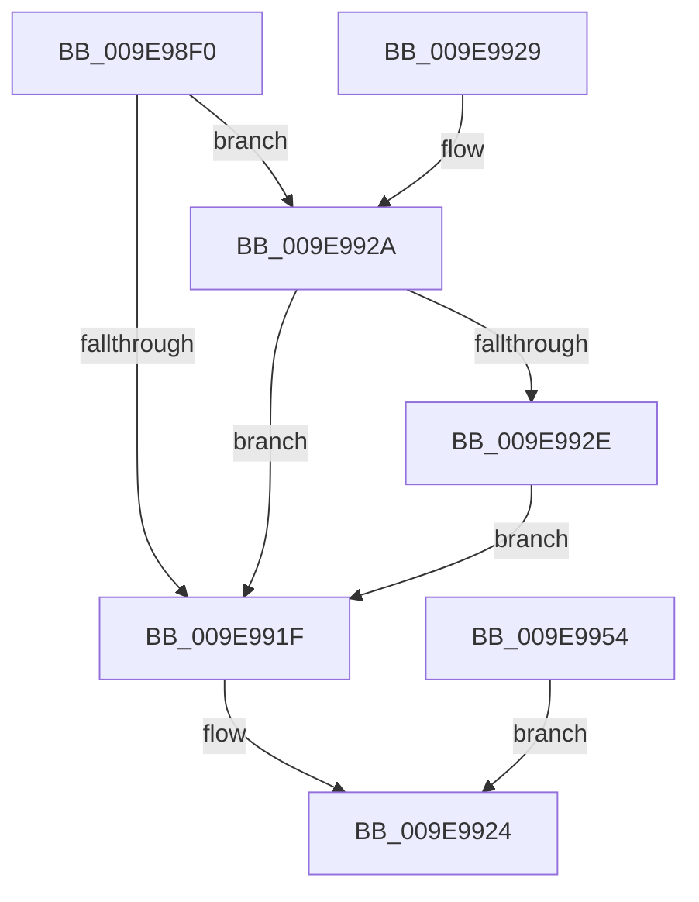

# NtWaitForAlertByThreadId

- RVA: `0x009E98F0`–`0x009E9956` (길이 `102` bytes)
- VA: `0x00000001409E98F0`
- 실행 섹션: `PAGE`
- PDB 이름 있음: `예`; PDB Function 태그: `아니요`
- unwind 정보 RVA: `0x000A5154`
- 디코드: `25`개 명령, `102/102` bytes 표시
- 미해석 바이트: `0` (있으면 어셈블리에 `.byte`로 보존)

> 이 문서는 커널 이미지의 기계어와 PDB 기호를 분석해 생성했습니다. 4번과 5번은 함수 원형과 자료형을 바이너리 사용 방식에서 추정한 C 해석이며 원본 소스 복구 결과는 아닙니다.

## 1. Dependencies

- 직접 호출 지점: **1**; 고유 호출 대상: **1**
- 직접 호출자로 확인된 함수: **0**
- RIP 상대 이미지 참조: **0**

### Outgoing calls
- `0x009E991F` → [KeWaitForAlertByThreadId](../../text/3C/KeWaitForAlertByThreadId_function_003C4B14.md) (function, `0x003C4B14`)

### Direct callers
- 이 함수 시작 RVA로 연결되는 직접 call은 확인되지 않았습니다. 간접 호출은 완전히 역산할 수 없습니다.

### Static image references
- 디코드된 RIP-relative 메모리 참조가 없습니다.

## 2. Other-region calls and transfers

- 다른 실행 섹션으로 향하는 call: **1**
  - `0x009E991F` → [KeWaitForAlertByThreadId](../../text/3C/KeWaitForAlertByThreadId_function_003C4B14.md) (`PAGE` → `.text`)
- 별도 외부 분기/꼬리 이동을 확인하지 못했습니다.

## 3. Assembly (complete function range)

```asm
009E98F0  48 89 54 24 10                  mov qword ptr [rsp + 0x10], rdx
009E98F5  48 83 EC 28                     sub rsp, 0x28
009E98F9  4C 8B C1                        mov r8, rcx
009E98FC  48 C7 44 24 40 00 00 00 00      mov qword ptr [rsp + 0x40], 0
009E9905  65 48 8B 0C 25 88 01 00 00      mov rcx, qword ptr gs:[0x188]
009E990E  0F B6 89 32 02 00 00            movzx ecx, byte ptr [rcx + 0x232]
009E9915  48 8B 54 24 38                  mov rdx, qword ptr [rsp + 0x38]
009E991A  48 85 D2                        test rdx, rdx
009E991D  75 0B                           jne 0x1409e992a
009E991F  E8 F0 B1 9D FF                  call 0x1403c4b14
009E9924  48 83 C4 28                     add rsp, 0x28
009E9928  C3                              ret
009E9929  CC                              int3
009E992A  84 C9                           test cl, cl
009E992C  74 F1                           je 0x1409e991f
009E992E  48 B8 00 00 FF FF FF 7F 00 00   movabs rax, 0x7fffffff0000
009E9938  48 3B D0                        cmp rdx, rax
009E993B  48 0F 42 C2                     cmovb rax, rdx
009E993F  90                              nop
009E9940  48 8B 00                        mov rax, qword ptr [rax]
009E9943  48 89 44 24 40                  mov qword ptr [rsp + 0x40], rax
009E9948  48 8D 54 24 40                  lea rdx, [rsp + 0x40]
009E994D  48 89 54 24 38                  mov qword ptr [rsp + 0x38], rdx
009E9952  EB CB                           jmp 0x1409e991f
009E9954  EB CE                           jmp 0x1409e9924
```

## 4. C-style interpretation (structured pseudocode)

```c
__int64 __fastcall NtWaitForAlertByThreadId(__int64 a1, __int64 a2)
{
    __int64 result;
    __int64 v_rsp;
    unsigned __int64 v_stack_p10;
    unsigned __int64 v_stack_p18;
    unsigned __int64 v_stack_p38;
    unsigned __int64 v_stack_p40;

    v_stack_p10 = a2;
    v_rsp = (v_rsp) - (40);
    v_stack_p18 = 0;
    if (v_stack_p10 != 0) goto loc_009E992A;
loc_009E991F:
    result = KeWaitForAlertByThreadId(*(unsigned __int8 *)(*(unsigned __int64 *)(gs_base + (0 + 392)) + 562), v_stack_p10, a1, a4);
loc_009E9924:
    v_rsp = (v_rsp) + (40);
    return result;
loc_009E992A:
    if ((unsigned __int8)(*(unsigned __int8 *)(*(unsigned __int64 *)(gs_base + (0 + 392)) + 562)) == 0) goto loc_009E991F;
    if (v_stack_p10 < result) { result = v_stack_p10; }
    v_stack_p40 = *(unsigned __int64 *)(result);
    v_stack_p38 = v_stack_p40;
    goto loc_009E991F;
}
```

## 5. (Beta) C Style

```c
int64_t NtWaitForAlertByThreadId(int64_t Arg1, int64_t Arg2)
{
    int64_t result;
    int64_t local_rsp;
    uint64_t v_stack_p10;
    uint64_t v_stack_p18;
    uint64_t v_stack_p38;
    uint64_t v_stack_p40;

    v_stack_p10 = Arg2;
    local_rsp = (local_rsp) - (40);
    v_stack_p18 = 0;
    if (v_stack_p10 != 0) goto loc_009E992A;
loc_009E991F:
    result = KeWaitForAlertByThreadId(*(uint8_t *)(*(uint64_t *)(gs_base + (0 + 0x188)) + 0x232), v_stack_p10, Arg1, a4);
loc_009E9924:
    local_rsp = (local_rsp) + (40);
    return result;
loc_009E992A:
    if ((uint8_t)(*(uint8_t *)(*(uint64_t *)(gs_base + (0 + 0x188)) + 0x232)) == 0) goto loc_009E991F;
    if (v_stack_p10 < result) { result = v_stack_p10; }
    v_stack_p40 = *(uint64_t *)(result);
    v_stack_p38 = v_stack_p40;
    goto loc_009E991F;
}
```

## 6. Execution-region graph

[열기: 2D/3D 그래프와 함수 탐색 컨트롤 패널](../../../control-panel.html?section=page&rva=0x009E98F0&view=graph)

- 2D 그래프는 위에서 아래로 흐르고, 3D 그래프는 빈 공간을 드래그해 회전합니다. Shift+드래그는 이동, 휠은 확대·축소, 함수 노드 선택은 대상 보고서 이동입니다.

### Static fallback


